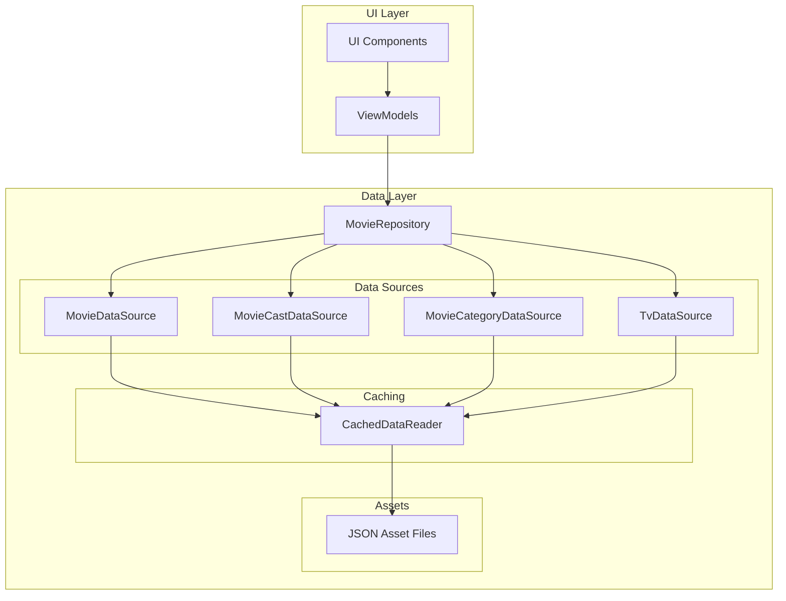
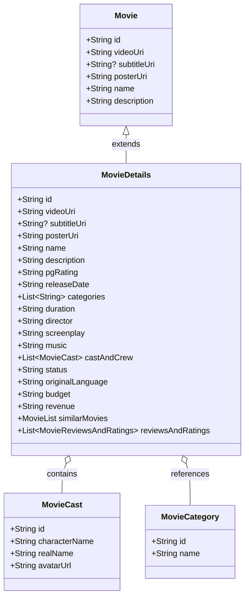
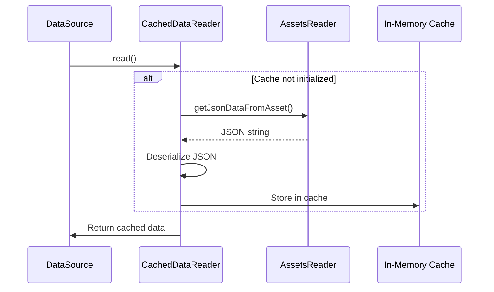
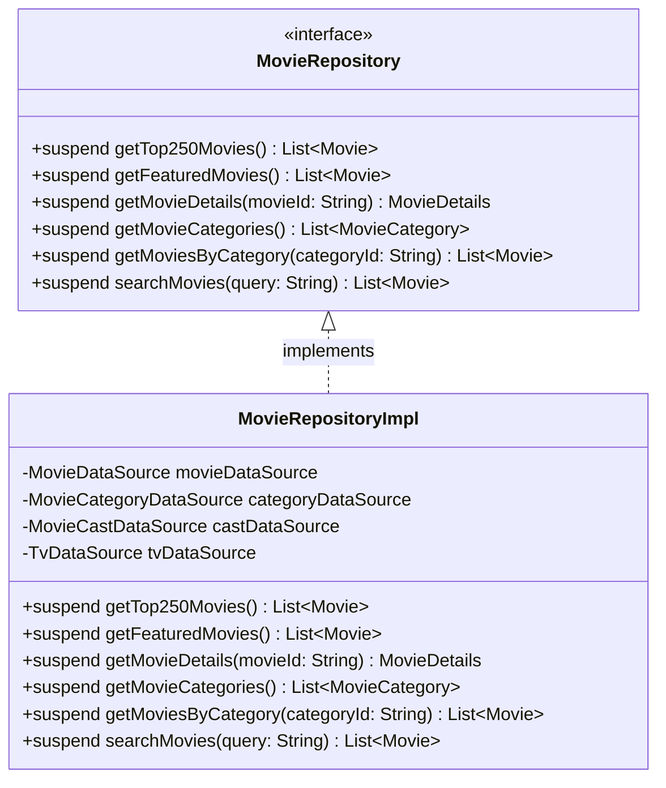
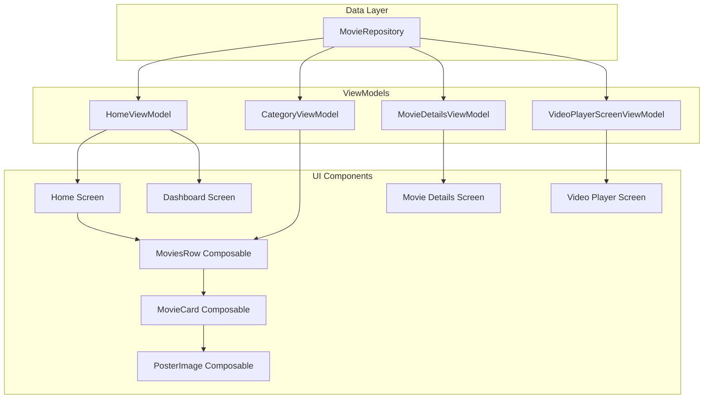

<!-- source: DeepWiki mcp.deepwiki.com · repo android/tv-samples · page 2.4 JetStream Data Management · fetched 2026-10-23 -->

# JetStream Data Management

<details>
<summary>Relevant source files</summary>

The following files were used as context for generating this wiki page:

- [JetStreamCompose/gradle.properties](JetStreamCompose/gradle.properties)
- [JetStreamCompose/jetstream/src/main/java/com/google/jetstream/JetStreamApplication.kt](JetStreamCompose/jetstream/src/main/java/com/google/jetstream/JetStreamApplication.kt)
- [JetStreamCompose/jetstream/src/main/java/com/google/jetstream/data/entities/Movie.kt](JetStreamCompose/jetstream/src/main/java/com/google/jetstream/data/entities/Movie.kt)
- [JetStreamCompose/jetstream/src/main/java/com/google/jetstream/data/entities/MovieCast.kt](JetStreamCompose/jetstream/src/main/java/com/google/jetstream/data/entities/MovieCast.kt)
- [JetStreamCompose/jetstream/src/main/java/com/google/jetstream/data/entities/MovieCategory.kt](JetStreamCompose/jetstream/src/main/java/com/google/jetstream/data/entities/MovieCategory.kt)
- [JetStreamCompose/jetstream/src/main/java/com/google/jetstream/data/entities/MovieDetails.kt](JetStreamCompose/jetstream/src/main/java/com/google/jetstream/data/entities/MovieDetails.kt)
- [JetStreamCompose/jetstream/src/main/java/com/google/jetstream/data/repositories/CachedDataReader.kt](JetStreamCompose/jetstream/src/main/java/com/google/jetstream/data/repositories/CachedDataReader.kt)
- [JetStreamCompose/jetstream/src/main/java/com/google/jetstream/data/repositories/MovieCastDataSource.kt](JetStreamCompose/jetstream/src/main/java/com/google/jetstream/data/repositories/MovieCastDataSource.kt)
- [JetStreamCompose/jetstream/src/main/java/com/google/jetstream/data/repositories/MovieCategoryDataSource.kt](JetStreamCompose/jetstream/src/main/java/com/google/jetstream/data/repositories/MovieCategoryDataSource.kt)
- [JetStreamCompose/jetstream/src/main/java/com/google/jetstream/data/repositories/MovieDataSource.kt](JetStreamCompose/jetstream/src/main/java/com/google/jetstream/data/repositories/MovieDataSource.kt)
- [JetStreamCompose/jetstream/src/main/java/com/google/jetstream/data/repositories/TvDataSource.kt](JetStreamCompose/jetstream/src/main/java/com/google/jetstream/data/repositories/TvDataSource.kt)
- [JetStreamCompose/jetstream/src/main/java/com/google/jetstream/data/util/StringConstants.kt](JetStreamCompose/jetstream/src/main/java/com/google/jetstream/data/util/StringConstants.kt)
- [JetStreamCompose/jetstream/src/main/java/com/google/jetstream/presentation/common/MovieCard.kt](JetStreamCompose/jetstream/src/main/java/com/google/jetstream/presentation/common/MovieCard.kt)
- [JetStreamCompose/jetstream/src/main/java/com/google/jetstream/presentation/common/PosterImage.kt](JetStreamCompose/jetstream/src/main/java/com/google/jetstream/presentation/common/PosterImage.kt)
- [JetStreamCompose/jetstream/src/main/java/com/google/jetstream/presentation/screens/dashboard/DashboardTopBar.kt](JetStreamCompose/jetstream/src/main/java/com/google/jetstream/presentation/screens/dashboard/DashboardTopBar.kt)
- [JetStreamCompose/jetstream/src/main/java/com/google/jetstream/presentation/screens/videoPlayer/VideoPlayerScreenViewModel.kt](JetStreamCompose/jetstream/src/main/java/com/google/jetstream/presentation/screens/videoPlayer/VideoPlayerScreenViewModel.kt)

</details>


This document explains how data is managed, retrieved, and utilized throughout the JetStreamCompose application. It covers the data architecture, entities, data sources, caching mechanisms, and the repository pattern implementation. For information about UI components that consume this data, see [JetStream UI Components](#2.3).

## Data Architecture Overview

JetStreamCompose uses a repository pattern with multiple data sources to provide movie and TV show information to the UI layer. The data flow follows a unidirectional pattern where:

1. UI components request data through viewmodels
2. Viewmodels get data from repositories
3. Repositories coordinate data sources
4. Data sources fetch and cache JSON data from local assets



Sources: [JetStreamCompose/jetstream/src/main/java/com/google/jetstream/data/repositories/MovieRepositoryImpl.kt](), [JetStreamCompose/jetstream/src/main/java/com/google/jetstream/data/repositories/CachedDataReader.kt]()

## Data Entities

JetStream uses several key data entities to represent movies, TV shows, and associated information:



Sources: [JetStreamCompose/jetstream/src/main/java/com/google/jetstream/data/entities/Movie.kt](), [JetStreamCompose/jetstream/src/main/java/com/google/jetstream/data/entities/MovieDetails.kt](), [JetStreamCompose/jetstream/src/main/java/com/google/jetstream/data/entities/MovieCategory.kt](), [JetStreamCompose/jetstream/src/main/java/com/google/jetstream/data/entities/MovieCast.kt]()

### Movie Entity

The `Movie` entity represents the basic movie information used throughout the application:

| Property | Type | Description |
|----------|------|-------------|
| id | String | Unique identifier for the movie |
| videoUri | String | URI pointing to the video content |
| subtitleUri | String? | Optional URI for subtitle content |
| posterUri | String | URI for the movie poster image |
| name | String | Movie title |
| description | String | Movie description/synopsis |

The `Movie` class includes a utility method to convert from the `MoviesResponseItem` model to a `Movie` entity with either standard or long thumbnail type:

```kotlin
enum class ThumbnailType {
    Standard,
    Long
}

fun MoviesResponseItem.toMovie(thumbnailType: ThumbnailType = ThumbnailType.Standard): Movie {
    // Conversion logic
}
```

Sources: [JetStreamCompose/jetstream/src/main/java/com/google/jetstream/data/entities/Movie.kt:20-48]()

### MovieDetails Entity

`MovieDetails` extends the basic `Movie` information with additional fields for movie details screens:

```kotlin
data class MovieDetails(
    // Basic movie fields
    val id: String,
    val videoUri: String,
    val subtitleUri: String?,
    val posterUri: String,
    val name: String,
    val description: String,
    
    // Additional detail fields
    val pgRating: String,
    val releaseDate: String,
    val categories: List<String>,
    val duration: String,
    val director: String,
    val screenplay: String,
    val music: String,
    val castAndCrew: List<MovieCast>,
    val status: String,
    val originalLanguage: String,
    val budget: String,
    val revenue: String,
    val similarMovies: MovieList,
    val reviewsAndRatings: List<MovieReviewsAndRatings>,
)
```

Sources: [JetStreamCompose/jetstream/src/main/java/com/google/jetstream/data/entities/MovieDetails.kt:19-40]()

## Data Sources and Caching

JetStream fetches data from JSON assets in the app and employs a caching mechanism for efficient data retrieval.

### Asset-based Data Sources

The application uses multiple data sources, each responsible for a specific type of data:

1. **MovieDataSource**: Provides movie information from various asset files
2. **MovieCategoryDataSource**: Provides category information
3. **MovieCastDataSource**: Provides cast information
4. **TvDataSource**: Provides TV show information

All data sources follow a similar pattern of using the `CachedDataReader` for efficient data access.

Sources: [JetStreamCompose/jetstream/src/main/java/com/google/jetstream/data/repositories/MovieDataSource.kt](), [JetStreamCompose/jetstream/src/main/java/com/google/jetstream/data/repositories/MovieCategoryDataSource.kt](), [JetStreamCompose/jetstream/src/main/java/com/google/jetstream/data/repositories/MovieCastDataSource.kt](), [JetStreamCompose/jetstream/src/main/java/com/google/jetstream/data/repositories/TvDataSource.kt]()

### CachedDataReader Mechanism

The `CachedDataReader` provides in-memory caching for data sources:



Key features of the `CachedDataReader`:

1. Uses a mutex to ensure thread-safety
2. Lazily initializes the cache on first read
3. Returns cached data for subsequent reads
4. Parametrized with generic type for flexibility

```kotlin
internal class CachedDataReader<T>(private val reader: suspend () -> List<T>) {
    private val mutex = Mutex()
    private lateinit var cache: List<T>

    suspend fun read(): List<T> {
        mutex.withLock {
            if (!::cache.isInitialized) {
                cache = reader()
            }
        }
        return cache
    }
}
```

Sources: [JetStreamCompose/jetstream/src/main/java/com/google/jetstream/data/repositories/CachedDataReader.kt:31-43]()

## Repository Pattern Implementation

JetStream follows the repository pattern to abstract the data sources from the UI layer. The repository is implemented using dependency injection with Hilt.

### MovieRepository Interface and Implementation

The `MovieRepository` interface defines methods to access movie data, while its implementation coordinates the various data sources:



The binding of the repository interface to its implementation is configured in the `MovieRepositoryModule`:

```kotlin
@InstallIn(SingletonComponent::class)
@Module
abstract class MovieRepositoryModule {
    @Binds
    abstract fun bindMovieRepository(
        movieRepositoryImpl: MovieRepositoryImpl
    ): MovieRepository
}
```

Sources: [JetStreamCompose/jetstream/src/main/java/com/google/jetstream/JetStreamApplication.kt:31-39]()

## Data Usage in ViewModels

ViewModels use the `MovieRepository` to fetch data and provide it to the UI layer. A good example is the `VideoPlayerScreenViewModel`:

```kotlin
@HiltViewModel
class VideoPlayerScreenViewModel @Inject constructor(
    savedStateHandle: SavedStateHandle,
    repository: MovieRepository,
) : ViewModel() {
    val uiState = savedStateHandle
        .getStateFlow<String?>(VideoPlayerScreen.MovieIdBundleKey, null)
        .map { id ->
            if (id == null) {
                VideoPlayerScreenUiState.Error
            } else {
                val details = repository.getMovieDetails(movieId = id)
                VideoPlayerScreenUiState.Done(movieDetails = details)
            }
        }.stateIn(
            scope = viewModelScope,
            started = SharingStarted.WhileSubscribed(5_000),
            initialValue = VideoPlayerScreenUiState.Loading
        )
}
```

Sources: [JetStreamCompose/jetstream/src/main/java/com/google/jetstream/presentation/screens/videoPlayer/VideoPlayerScreenViewModel.kt:32-50]()

## Asset Configuration and Constants

JetStream uses JSON assets to store movie data. The asset file paths are defined in `StringConstants`:

```kotlin
object Assets {
    const val Top250Movies = "movies.json"
    const val MostPopularMovies = "movies.json"
    const val InTheaters = "movies.json"
    const val MostPopularTVShows = "movies.json"
    const val MovieCategories = "movieCategories.json"
    const val MovieCast = "movieCast.json"
}
```

Sources: [JetStreamCompose/jetstream/src/main/java/com/google/jetstream/data/util/StringConstants.kt:35-42]()

## UI Components Consuming the Data

Data flows from the repository to the UI components through ViewModels. The UI components then display the data to users.



For example, the `PosterImage` composable displays poster images from `Movie` entities:

```kotlin
@Composable
fun PosterImage(
    movie: Movie,
    modifier: Modifier = Modifier,
) {
    AsyncImage(
        modifier = modifier,
        model = ImageRequest.Builder(LocalContext.current)
            .crossfade(true)
            .data(movie.posterUri)
            .build(),
        contentDescription = StringConstants.Composable.ContentDescription.moviePoster(movie.name),
        contentScale = ContentScale.Crop
    )
}
```

Sources: [JetStreamCompose/jetstream/src/main/java/com/google/jetstream/presentation/common/PosterImage.kt:29-42](), [JetStreamCompose/jetstream/src/main/java/com/google/jetstream/presentation/common/MovieCard.kt:32-59]()

---

