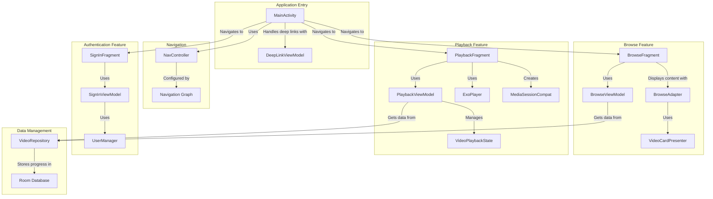
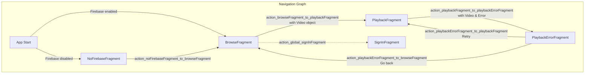
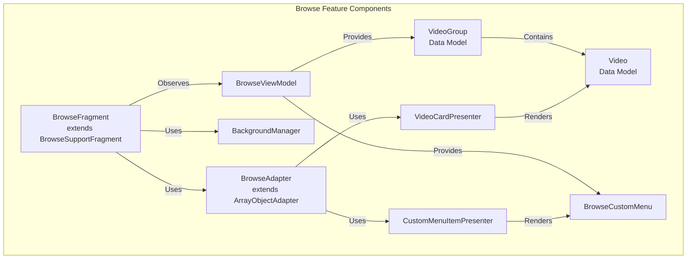
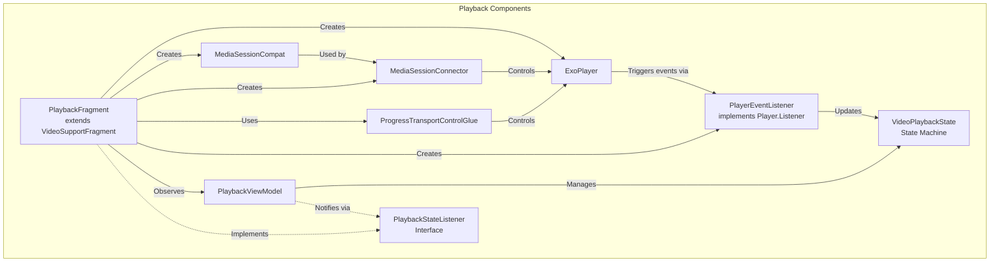
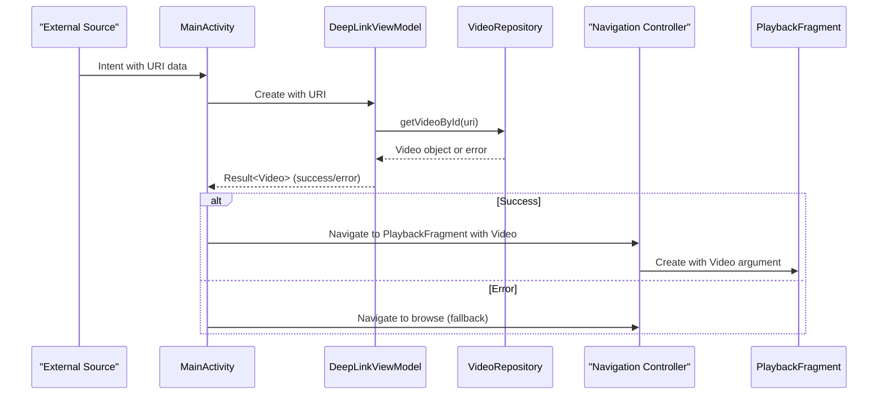

<!-- source: DeepWiki mcp.deepwiki.com · repo android/tv-samples · page 3 ReferenceAppKotlin · fetched 2026-10-23 -->

# ReferenceAppKotlin

Relevant source files

The following files were used as context for generating this wiki page:

- [ReferenceAppKotlin/CAST_CONNECT.md](ReferenceAppKotlin/CAST_CONNECT.md)
- [ReferenceAppKotlin/README.md](ReferenceAppKotlin/README.md)
- [ReferenceAppKotlin/app/build.gradle](ReferenceAppKotlin/app/build.gradle)
- [ReferenceAppKotlin/app/src/main/java/com/android/tv/reference/MainActivity.kt](ReferenceAppKotlin/app/src/main/java/com/android/tv/reference/MainActivity.kt)
- [ReferenceAppKotlin/app/src/main/java/com/android/tv/reference/auth/SignInFragment.kt](ReferenceAppKotlin/app/src/main/java/com/android/tv/reference/auth/SignInFragment.kt)
- [ReferenceAppKotlin/app/src/main/java/com/android/tv/reference/browse/BrowseAdapter.kt](ReferenceAppKotlin/app/src/main/java/com/android/tv/reference/browse/BrowseAdapter.kt)
- [ReferenceAppKotlin/app/src/main/java/com/android/tv/reference/browse/BrowseCustomMenu.kt](ReferenceAppKotlin/app/src/main/java/com/android/tv/reference/browse/BrowseCustomMenu.kt)
- [ReferenceAppKotlin/app/src/main/java/com/android/tv/reference/browse/BrowseFragment.kt](ReferenceAppKotlin/app/src/main/java/com/android/tv/reference/browse/BrowseFragment.kt)
- [ReferenceAppKotlin/app/src/main/java/com/android/tv/reference/deeplink/DeepLinkViewModel.kt](ReferenceAppKotlin/app/src/main/java/com/android/tv/reference/deeplink/DeepLinkViewModel.kt)
- [ReferenceAppKotlin/app/src/main/java/com/android/tv/reference/playback/PlaybackFragment.kt](ReferenceAppKotlin/app/src/main/java/com/android/tv/reference/playback/PlaybackFragment.kt)
- [ReferenceAppKotlin/app/src/main/res/layout/fragment_sign_in.xml](ReferenceAppKotlin/app/src/main/res/layout/fragment_sign_in.xml)
- [ReferenceAppKotlin/app/src/main/res/layout/presenter_menu_item.xml](ReferenceAppKotlin/app/src/main/res/layout/presenter_menu_item.xml)
- [ReferenceAppKotlin/app/src/main/res/navigation/nav_graph.xml](ReferenceAppKotlin/app/src/main/res/navigation/nav_graph.xml)
- [ReferenceAppKotlin/app/src/main/res/values/strings.xml](ReferenceAppKotlin/app/src/main/res/values/strings.xml)
- [ReferenceAppKotlin/build.gradle](ReferenceAppKotlin/build.gradle)
- [ReferenceAppKotlin/firebase/README.md](ReferenceAppKotlin/firebase/README.md)
- [ReferenceAppKotlin/firebase/server/test/authentication.test.ts](ReferenceAppKotlin/firebase/server/test/authentication.test.ts)
- [ReferenceAppKotlin/firebase/setup/save_content_to_firestore.js](ReferenceAppKotlin/firebase/setup/save_content_to_firestore.js)
- [ReferenceAppKotlin/firebase/web/index.html](ReferenceAppKotlin/firebase/web/index.html)
- [ReferenceAppKotlin/firebase/web/oauth/index.html](ReferenceAppKotlin/firebase/web/oauth/index.html)
- [ReferenceAppKotlin/firebase/web/oauth/scripts.js](ReferenceAppKotlin/firebase/web/oauth/scripts.js)
- [ReferenceAppKotlin/scripts/atv-create-media-feed.py](ReferenceAppKotlin/scripts/atv-create-media-feed.py)
- [ReferenceAppKotlin/scripts/atv-csv-to-json.py](ReferenceAppKotlin/scripts/atv-csv-to-json.py)
- [ReferenceAppKotlin/settings.gradle](ReferenceAppKotlin/settings.gradle)

This document provides an overview of the ReferenceAppKotlin application, a reference implementation that demonstrates key Android TV features. This app serves as a learning resource for developers creating video applications for Android TV and Google TV platforms.

For specific implementation details about the playback system, see [ReferenceApp Playback System](#3.2). For details about the browse interface, see [ReferenceApp Browse Interface](#3.3).

## Purpose

The ReferenceAppKotlin app demonstrates:

- Leanback UI library implementation for browse and playback interfaces
- Video playback with ExoPlayer integration
- MediaSession support for playback controls
- Deep linking functionality for Assistant, Cast, and home screen programs
- Home screen channel creation and management
- Watch Next row updates for supporting "continue watching" experiences
- Cast Connect functionality to act as a Cast receiver

Sources: [ReferenceAppKotlin/README.md:3-14]()

## System Architecture

The application follows a feature-based architecture, where code is organized by application features rather than technical layers. This approach groups related components (fragments, view models, adapters) within feature-specific packages.

Sources: [ReferenceAppKotlin/app/src/main/java/com/android/tv/reference/MainActivity.kt:37-149](), [ReferenceAppKotlin/app/src/main/java/com/android/tv/reference/browse/BrowseFragment.kt:42-204](), [ReferenceAppKotlin/app/src/main/java/com/android/tv/reference/playback/PlaybackFragment.kt:45-229]()

## Navigation System

The app uses Android's Navigation component with a navigation graph defined in XML. This handles fragment transitions and passing arguments between screens.

Sources: [ReferenceAppKotlin/app/src/main/res/navigation/nav_graph.xml:17-82](), [ReferenceAppKotlin/app/src/main/java/com/android/tv/reference/MainActivity.kt:50-52]()

## Key Components

### MainActivity

The main entry point of the application that:
- Sets up the navigation controller
- Handles deep links to content
- Manages Cast intent processing
- Determines the initial destination based on configuration

Sources: [ReferenceAppKotlin/app/src/main/java/com/android/tv/reference/MainActivity.kt:38-149]()

### Browse Feature

The browse experience is built around the `BrowseSupportFragment` from the Leanback library.

The Browse interface:
- Displays content in horizontal rows categorized by content type
- Updates background images when items are selected
- Provides custom menu items for user actions (like signing in/out)
- Handles item selection and navigation to playback

Sources: [ReferenceAppKotlin/app/src/main/java/com/android/tv/reference/browse/BrowseFragment.kt:42-204](), [ReferenceAppKotlin/app/src/main/java/com/android/tv/reference/browse/BrowseAdapter.kt:25-52](), [ReferenceAppKotlin/app/src/main/java/com/android/tv/reference/browse/BrowseCustomMenu.kt:21-28]()

### Playback Feature

The playback system is built on top of the Leanback `VideoSupportFragment` with ExoPlayer handling the actual media playback.

Key playback features:
- State management through `VideoPlaybackState` classes
- ExoPlayer integration for video playback
- MediaSession support for playback controls (play, pause, etc.)
- Handling of playback errors with recovery options
- Background playback capabilities

Sources: [ReferenceAppKotlin/app/src/main/java/com/android/tv/reference/playback/PlaybackFragment.kt:45-229]()

### Authentication Feature

Authentication is implemented with:
- Local mock auth client (default)
- Optional Firebase integration
- Google Account linking support

Sources: [ReferenceAppKotlin/app/src/main/java/com/android/tv/reference/auth/SignInFragment.kt:40-154](), [ReferenceAppKotlin/firebase/README.md:3-14]()

## Deep Linking Support

The app supports deep linking directly to content:

Sources: [ReferenceAppKotlin/app/src/main/java/com/android/tv/reference/MainActivity.kt:73-104](), [ReferenceAppKotlin/app/src/main/java/com/android/tv/reference/deeplink/DeepLinkViewModel.kt:36-69]()

## Firebase Integration (Optional)

The app can be configured to use Firebase for:
- User authentication
- Cloud storage of watch progress
- Account linking with Google

When Firebase is not configured, the app shows a warning message and uses local storage for watch progress.

Firebase integration is controlled by the `FIREBASE_ENABLED` build flag in the app's build.gradle file.

Sources: [ReferenceAppKotlin/firebase/README.md:3-14](), [ReferenceAppKotlin/app/build.gradle:40-43]()

## Dependencies and Technologies

The app uses several key libraries and technologies:

| Category | Component | Purpose |
|----------|-----------|---------|
| UI | Leanback Library | Provides TV-optimized UI components |
| Media | ExoPlayer | Video playback engine |
| Media | MediaSession | Enables playback controls |
| Cast | Cast Connect | Allows the app to act as a Cast receiver |
| Navigation | Navigation Component | Handles screen navigation and arguments |
| Persistence | Room | Local database for storing watch progress |
| Network | Retrofit & Moshi | API communication and JSON parsing |
| Images | Picasso | Image loading and caching |
| Background Tasks | WorkManager | Handles background processing |

Sources: [ReferenceAppKotlin/app/build.gradle:73-146]()

## Content Source

By default, the app uses a local JSON file for content data. The repository includes Python scripts to generate this content:
- `atv-csv-to-json.py`: Converts CSV data to JSON format
- `atv-create-media-feed.py`: Creates media feed for movies and TV episodes

Sources: [ReferenceAppKotlin/scripts/atv-csv-to-json.py:1-68](), [ReferenceAppKotlin/scripts/atv-create-media-feed.py:1-222]()

## Special Features

### Home Screen Channel

The app can create a home screen channel to showcase content directly on the Android TV home screen. This is triggered through a broadcast receiver.

### Watch Next Integration

The app supports the Watch Next row on Android TV/Google TV, which allows users to quickly resume content they've previously watched.

### Cast Connect

The app can function as a Cast receiver through the Cast Connect library, allowing mobile apps to cast content to it.

Sources: [ReferenceAppKotlin/README.md:75-109](), [ReferenceAppKotlin/CAST_CONNECT.md:1-88]()

## Configuration Options

The app includes several configuration options:

| Option | Description | Location |
|--------|-------------|----------|
| `FIREBASE_ENABLED` | Toggles Firebase features | app/build.gradle |
| `APP_ID` | Cast application ID (for Cast support) | Cast Sender App |
| Build Flavors | Standard configuration options | app/build.gradle |

Sources: [ReferenceAppKotlin/app/build.gradle:40-43](), [ReferenceAppKotlin/CAST_CONNECT.md:40-47]()

---

