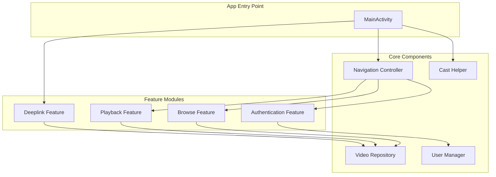
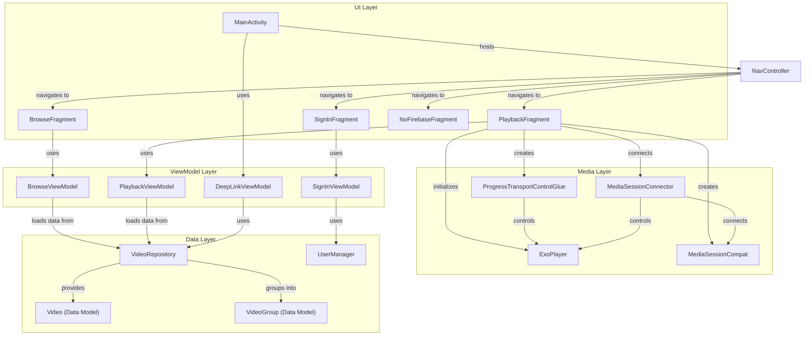
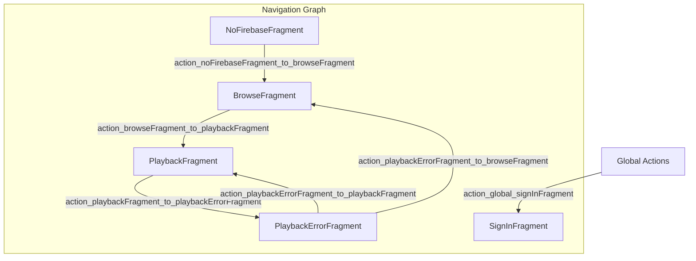
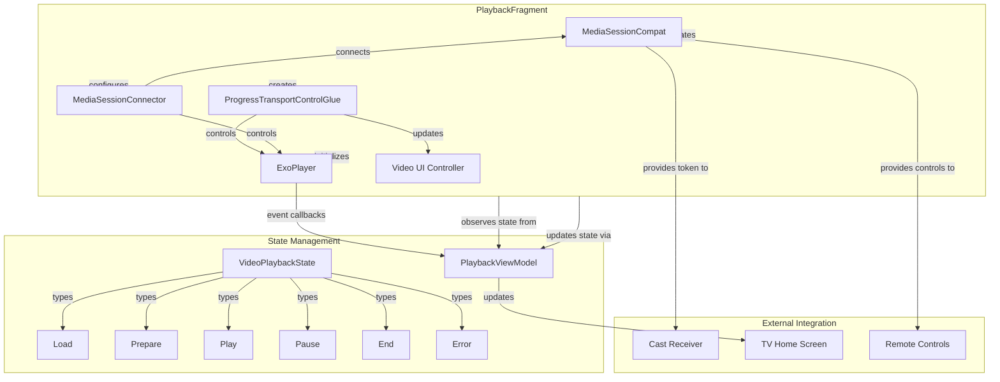
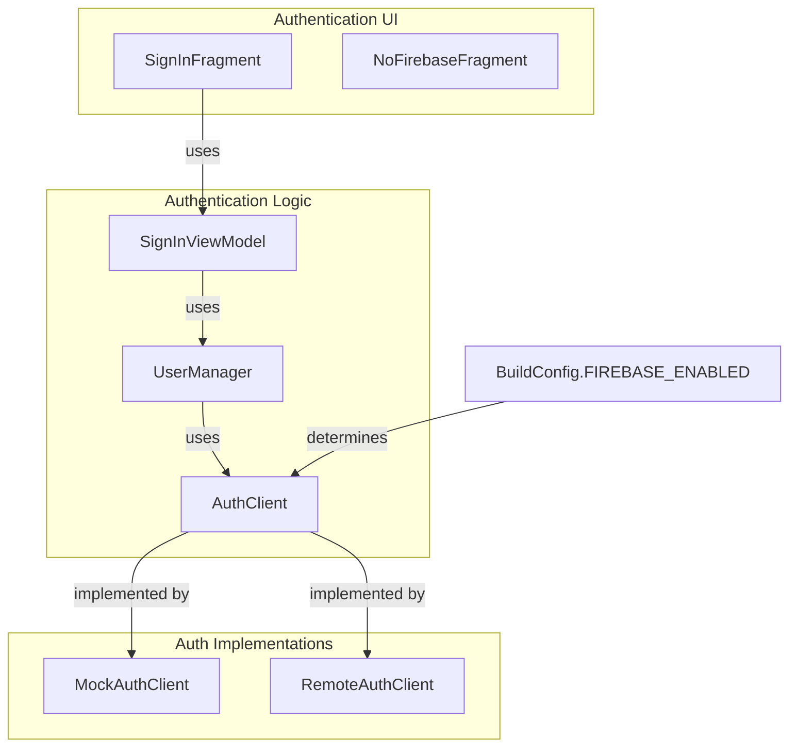
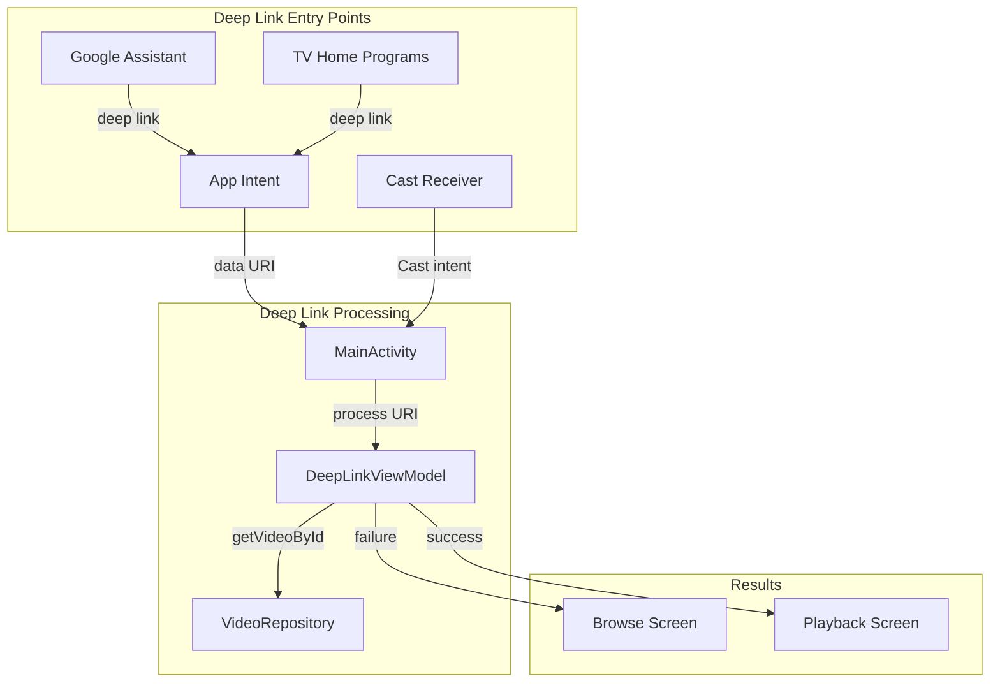

<!-- source: DeepWiki mcp.deepwiki.com · repo android/tv-samples · page 3.1 ReferenceApp Architecture · fetched 2026-10-23 -->

# ReferenceApp Architecture

<details>
<summary>Relevant source files</summary>

The following files were used as context for generating this wiki page:

- [ReferenceAppKotlin/CAST_CONNECT.md](ReferenceAppKotlin/CAST_CONNECT.md)
- [ReferenceAppKotlin/README.md](ReferenceAppKotlin/README.md)
- [ReferenceAppKotlin/app/build.gradle](ReferenceAppKotlin/app/build.gradle)
- [ReferenceAppKotlin/app/src/main/java/com/android/tv/reference/MainActivity.kt](ReferenceAppKotlin/app/src/main/java/com/android/tv/reference/MainActivity.kt)
- [ReferenceAppKotlin/app/src/main/java/com/android/tv/reference/auth/SignInFragment.kt](ReferenceAppKotlin/app/src/main/java/com/android/tv/reference/auth/SignInFragment.kt)
- [ReferenceAppKotlin/app/src/main/java/com/android/tv/reference/browse/BrowseAdapter.kt](ReferenceAppKotlin/app/src/main/java/com/android/tv/reference/browse/BrowseAdapter.kt)
- [ReferenceAppKotlin/app/src/main/java/com/android/tv/reference/browse/BrowseCustomMenu.kt](ReferenceAppKotlin/app/src/main/java/com/android/tv/reference/browse/BrowseCustomMenu.kt)
- [ReferenceAppKotlin/app/src/main/java/com/android/tv/reference/browse/BrowseFragment.kt](ReferenceAppKotlin/app/src/main/java/com/android/tv/reference/browse/BrowseFragment.kt)
- [ReferenceAppKotlin/app/src/main/java/com/android/tv/reference/deeplink/DeepLinkViewModel.kt](ReferenceAppKotlin/app/src/main/java/com/android/tv/reference/deeplink/DeepLinkViewModel.kt)
- [ReferenceAppKotlin/app/src/main/java/com/android/tv/reference/playback/PlaybackFragment.kt](ReferenceAppKotlin/app/src/main/java/com/android/tv/reference/playback/PlaybackFragment.kt)
- [ReferenceAppKotlin/app/src/main/res/layout/fragment_sign_in.xml](ReferenceAppKotlin/app/src/main/res/layout/fragment_sign_in.xml)
- [ReferenceAppKotlin/app/src/main/res/layout/presenter_menu_item.xml](ReferenceAppKotlin/app/src/main/res/layout/presenter_menu_item.xml)
- [ReferenceAppKotlin/app/src/main/res/navigation/nav_graph.xml](ReferenceAppKotlin/app/src/main/res/navigation/nav_graph.xml)
- [ReferenceAppKotlin/app/src/main/res/values/strings.xml](ReferenceAppKotlin/app/src/main/res/values/strings.xml)
- [ReferenceAppKotlin/build.gradle](ReferenceAppKotlin/build.gradle)
- [ReferenceAppKotlin/firebase/README.md](ReferenceAppKotlin/firebase/README.md)
- [ReferenceAppKotlin/firebase/server/test/authentication.test.ts](ReferenceAppKotlin/firebase/server/test/authentication.test.ts)
- [ReferenceAppKotlin/firebase/setup/save_content_to_firestore.js](ReferenceAppKotlin/firebase/setup/save_content_to_firestore.js)
- [ReferenceAppKotlin/firebase/web/index.html](ReferenceAppKotlin/firebase/web/index.html)
- [ReferenceAppKotlin/firebase/web/oauth/index.html](ReferenceAppKotlin/firebase/web/oauth/index.html)
- [ReferenceAppKotlin/firebase/web/oauth/scripts.js](ReferenceAppKotlin/firebase/web/oauth/scripts.js)
- [ReferenceAppKotlin/scripts/atv-create-media-feed.py](ReferenceAppKotlin/scripts/atv-create-media-feed.py)
- [ReferenceAppKotlin/scripts/atv-csv-to-json.py](ReferenceAppKotlin/scripts/atv-csv-to-json.py)
- [ReferenceAppKotlin/settings.gradle](ReferenceAppKotlin/settings.gradle)

</details>


This document explains the architecture of the ReferenceAppKotlin, which demonstrates key Android TV features including video playback, browsing, authentication, and integration with platform features. For information about specific features like playback implementation, see [ReferenceApp Playback System](#3.2), and for browse interface details, see [ReferenceApp Browse Interface](#3.3).

## Overall Architecture

The ReferenceAppKotlin follows a feature-based architecture rather than a layer-based one. Code is organized by feature (e.g., browse, playback, authentication) with each feature containing its related UI components, ViewModels, and other supporting classes.



Sources: [ReferenceAppKotlin/README.md:32-41](), [ReferenceAppKotlin/app/src/main/java/com/android/tv/reference/MainActivity.kt:16-149]()

## Component Relationships

The following diagram shows the main components of the app and their relationships:



Sources: [ReferenceAppKotlin/app/src/main/java/com/android/tv/reference/MainActivity.kt:38-148](), [ReferenceAppKotlin/app/src/main/java/com/android/tv/reference/browse/BrowseFragment.kt:42-204](), [ReferenceAppKotlin/app/src/main/java/com/android/tv/reference/playback/PlaybackFragment.kt:44-229](), [ReferenceAppKotlin/app/src/main/res/navigation/nav_graph.xml:16-82]()

## Navigation Architecture

The app uses the Jetpack Navigation component with a navigation graph defined in `nav_graph.xml`. This enables type-safe navigation between fragments with argument passing.



Sources: [ReferenceAppKotlin/app/src/main/res/navigation/nav_graph.xml:16-82](), [ReferenceAppKotlin/app/src/main/java/com/android/tv/reference/MainActivity.kt:50-54]()

## UI Components

### MainActivity

The main entry point of the application that:
- Sets up the Navigation Controller
- Handles deep links
- Initializes Cast Connect functionality
- Determines if Firebase is enabled and sets the appropriate starting destination

```kotlin
override fun onCreate(savedInstanceState: Bundle?) {
    // Initialize navigation components
    navController = navHostFragment.navController
    navGraph = navController.navInflater.inflate(R.navigation.nav_graph)
    
    // Initialize cast helper
    castHelper = CastHelper(
        { videoToCast -> loadPlaybackFragment(videoToCast) },
        application
    )
    
    // Process deep links or load starting page
    loadDeepLinkOrStartingPage(intent.data)
}
```

Sources: [ReferenceAppKotlin/app/src/main/java/com/android/tv/reference/MainActivity.kt:38-148]()

### BrowseFragment

The main content browsing UI that:
- Extends Leanback's `BrowseSupportFragment`
- Displays video content organized by category
- Updates background images based on selected content
- Provides navigation to video playback
- Handles sign-in/sign-out menu options

```kotlin
setOnItemViewClickedListener { _, item, _, _ ->
    when (item) {
        is Video ->
            findNavController().navigate(
                BrowseFragmentDirections.actionBrowseFragmentToPlaybackFragment(item)
            )
        is BrowseCustomMenu.MenuItem -> item.handler()
    }
}
```

Sources: [ReferenceAppKotlin/app/src/main/java/com/android/tv/reference/browse/BrowseFragment.kt:42-204](), [ReferenceAppKotlin/app/src/main/java/com/android/tv/reference/browse/BrowseAdapter.kt:16-52]()

### PlaybackFragment

Handles video playback using:
- Leanback's `VideoSupportFragment`
- ExoPlayer for media playback
- MediaSession for media controls integration
- State management for playback status

```kotlin
private fun initializePlayer() {
    val dataSourceFactory = DefaultDataSource.Factory(requireContext())
    val mediaSource = ProgressiveMediaSource.Factory(dataSourceFactory).
        createMediaSource(MediaItem.fromUri((video.videoUri)))
    exoplayer = ExoPlayer.Builder(requireContext()).build().apply {
        setMediaSource(mediaSource)
        prepare()
        addListener(PlayerEventListener())
        prepareGlue(this)
        mediaSessionConnector.setPlayer(object: ForwardingPlayer(this) {
            override fun stop() {
                // Treat stop commands as pause
                playWhenReady = false
            }
        })
        mediaSession.isActive = true
    }
}
```

Sources: [ReferenceAppKotlin/app/src/main/java/com/android/tv/reference/playback/PlaybackFragment.kt:44-229]()

### SignInFragment

Provides user authentication functionality:
- Email/password authentication
- Google One Tap sign-in
- Error handling and user feedback

Sources: [ReferenceAppKotlin/app/src/main/java/com/android/tv/reference/auth/SignInFragment.kt:16-154](), [ReferenceAppKotlin/app/src/main/res/layout/fragment_sign_in.xml:16-73]()

## ViewModel Layer

The app uses the ViewModel architecture component to manage UI-related data and handle business logic:

### BrowseViewModel

Manages the browse screen data:
- Loads video content from repository
- Organizes videos into categories
- Tracks sign-in state for UI updates

### PlaybackViewModel

Manages playback state:
- Implements a state machine for tracking video playback states
- Notifies registered listeners of state changes
- Handles playback errors

### SignInViewModel

Handles authentication logic:
- Processes sign-in attempts
- Manages authentication state
- Provides error feedback

### DeepLinkViewModel

Processes deep links:
- Validates deep link URIs
- Retrieves corresponding video content
- Provides results to the MainActivity

Sources: [ReferenceAppKotlin/app/src/main/java/com/android/tv/reference/browse/BrowseFragment.kt:88-100](), [ReferenceAppKotlin/app/src/main/java/com/android/tv/reference/deeplink/DeepLinkViewModel.kt:16-69]()

## Media Playback System

The app implements a comprehensive media playback system:



Sources: [ReferenceAppKotlin/app/src/main/java/com/android/tv/reference/playback/PlaybackFragment.kt:44-229](), [ReferenceAppKotlin/README.md:60-71]()

## Authentication Architecture

The app supports both Firebase authentication and a local mock authentication:



Sources: [ReferenceAppKotlin/app/src/main/java/com/android/tv/reference/auth/SignInFragment.kt:16-154](), [ReferenceAppKotlin/app/build.gradle:42-43](), [ReferenceAppKotlin/README.md:41-50]()

## Deep Linking System

The app implements deep linking to allow direct navigation to content:



Sources: [ReferenceAppKotlin/app/src/main/java/com/android/tv/reference/MainActivity.kt:65-104](), [ReferenceAppKotlin/app/src/main/java/com/android/tv/reference/deeplink/DeepLinkViewModel.kt:16-69]()

## Dependencies and Libraries

The app uses several key libraries and dependencies:

| Category | Libraries | Purpose |
|----------|-----------|---------|
| UI Framework | Leanback | TV-optimized UI components |
| | Navigation | Fragment navigation and deep linking |
| Media | ExoPlayer | Video playback |
| | MediaSession | Media control integration |
| Networking | Retrofit | HTTP requests |
| | Moshi | JSON parsing |
| Image Loading | Picasso | Image loading and caching |
| Local Storage | Room | Structured data storage |
| | SharedPreferences | Simple key-value storage |
| Background Work | WorkManager | Background task scheduling |
| Logging | Timber | Logging utility |
| Cast | Cast TV | Cast Connect integration |

Sources: [ReferenceAppKotlin/app/build.gradle:72-146](), [ReferenceAppKotlin/build.gradle:17-33]()

## Platform Feature Integration

The app integrates with several Android TV platform features:

### Home Screen Channels

The app can create and update home screen channels to showcase content directly on the Android TV home screen.

### Watch Next

The app supports the Watch Next feature to help users continue watching content they've started.

### Cast Connect

The app implements Cast Connect to act as a receiver for Cast operations from mobile devices.

Sources: [ReferenceAppKotlin/README.md:75-112](), [ReferenceAppKotlin/CAST_CONNECT.md:1-112]()

## Firebase Integration (Optional)

The app supports Firebase for:
- User authentication
- Content storage in Firestore
- Cloud functions for account linking

This is controlled by the `FIREBASE_ENABLED` flag in the build.gradle file.

Sources: [ReferenceAppKotlin/app/build.gradle:42-43](), [ReferenceAppKotlin/firebase/README.md:1-167]()

## Data Flow

The app follows a unidirectional data flow pattern:

1. User interacts with UI (Fragments)
2. UI delegates to ViewModels
3. ViewModels interact with repositories
4. Repositories provide data to ViewModels
5. ViewModels update LiveData
6. UI observes LiveData and updates

This architecture promotes separation of concerns and testability throughout the application.

Sources: [ReferenceAppKotlin/app/src/main/java/com/android/tv/reference/browse/BrowseFragment.kt:89-100](), [ReferenceAppKotlin/app/src/main/java/com/android/tv/reference/playback/PlaybackFragment.kt:54-82]()

---

