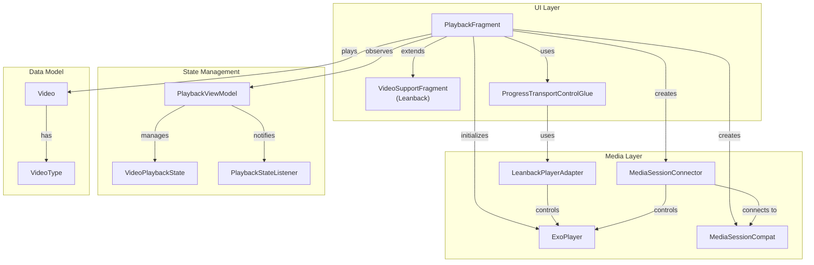
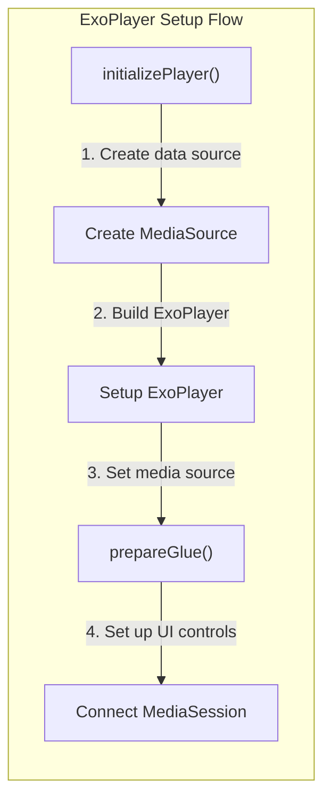
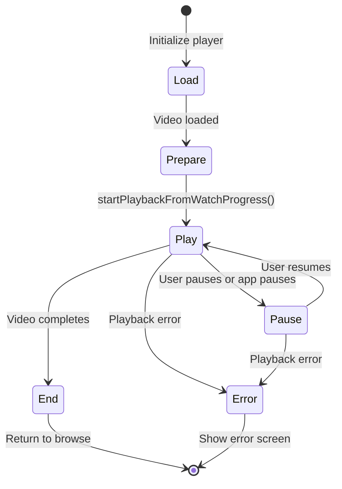
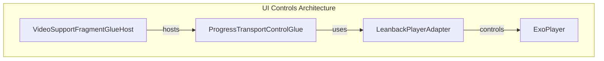
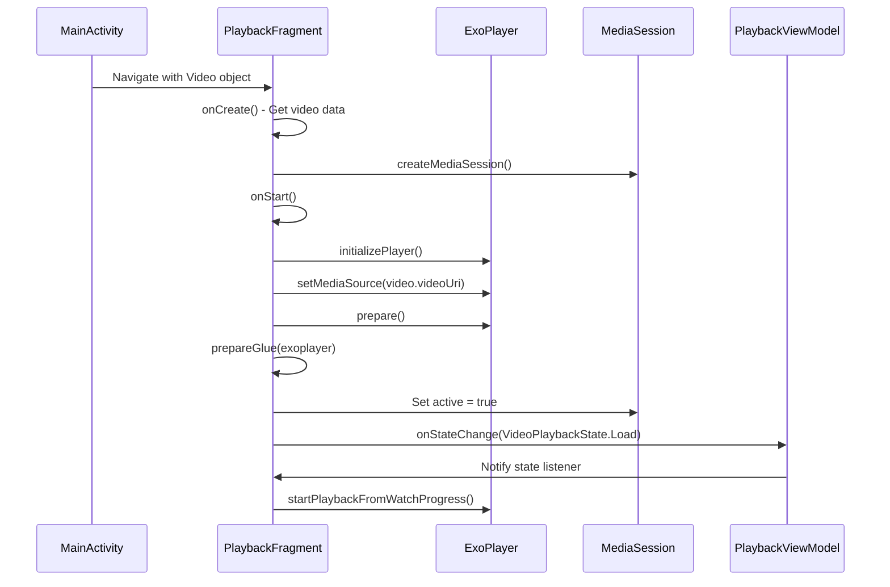

<!-- source: DeepWiki mcp.deepwiki.com · repo android/tv-samples · page 3.2 ReferenceApp Playback System · fetched 2026-10-23 -->

# ReferenceApp Playback System

Relevant source files

The following files were used as context for generating this wiki page:

- [ReferenceAppKotlin/app/build.gradle](ReferenceAppKotlin/app/build.gradle)
- [ReferenceAppKotlin/app/src/main/java/com/android/tv/reference/MainActivity.kt](ReferenceAppKotlin/app/src/main/java/com/android/tv/reference/MainActivity.kt)
- [ReferenceAppKotlin/app/src/main/java/com/android/tv/reference/browse/BrowseViewModel.kt](ReferenceAppKotlin/app/src/main/java/com/android/tv/reference/browse/BrowseViewModel.kt)
- [ReferenceAppKotlin/app/src/main/java/com/android/tv/reference/deeplink/DeepLinkViewModel.kt](ReferenceAppKotlin/app/src/main/java/com/android/tv/reference/deeplink/DeepLinkViewModel.kt)
- [ReferenceAppKotlin/app/src/main/java/com/android/tv/reference/playback/PlaybackFragment.kt](ReferenceAppKotlin/app/src/main/java/com/android/tv/reference/playback/PlaybackFragment.kt)
- [ReferenceAppKotlin/app/src/main/java/com/android/tv/reference/shared/datamodel/ApiResponse.kt](ReferenceAppKotlin/app/src/main/java/com/android/tv/reference/shared/datamodel/ApiResponse.kt)
- [ReferenceAppKotlin/app/src/main/java/com/android/tv/reference/shared/datamodel/Video.kt](ReferenceAppKotlin/app/src/main/java/com/android/tv/reference/shared/datamodel/Video.kt)
- [ReferenceAppKotlin/app/src/main/res/raw/api.json](ReferenceAppKotlin/app/src/main/res/raw/api.json)
- [ReferenceAppKotlin/app/src/main/res/values/dimens.xml](ReferenceAppKotlin/app/src/main/res/values/dimens.xml)

## Purpose and Scope

This document details the video playback implementation in the ReferenceAppKotlin application, focusing on how media content is played, controlled, and presented to users. The playback system integrates ExoPlayer with the Leanback library to provide a complete TV-optimized video playback experience.

For information about the overall ReferenceApp architecture, see [ReferenceApp Architecture](#3.1). For information about the browse interface that leads to playback, see [ReferenceApp Browse Interface](#3.3).

Sources: [ReferenceAppKotlin/app/src/main/java/com/android/tv/reference/playback/PlaybackFragment.kt:1-229]()

## System Architecture Overview

The playback system consists of several integrated components that work together to provide a cohesive video playback experience. The architecture follows established Android patterns while leveraging TV-specific libraries.

### Playback System Architecture Diagram

Sources: [ReferenceAppKotlin/app/src/main/java/com/android/tv/reference/playback/PlaybackFragment.kt:1-229](), [ReferenceAppKotlin/app/src/main/java/com/android/tv/reference/shared/datamodel/Video.kt:1-106]()

## Key Components

### 1. PlaybackFragment

`PlaybackFragment` is the primary UI component responsible for video playback. It extends Leanback's `VideoSupportFragment` and coordinates all aspects of video playback:

- Initializes and manages ExoPlayer instance
- Creates and configures the MediaSession
- Sets up transport controls for user interaction
- Observes and handles playback state changes
- Manages screen state (keeping screen on during playback)

Sources: [ReferenceAppKotlin/app/src/main/java/com/android/tv/reference/playback/PlaybackFragment.kt:45-229]()

### 2. ExoPlayer Integration

The app uses Google's ExoPlayer library for media playback functionality. The integration includes:

- Creation and configuration of the ExoPlayer instance
- Media source preparation from video URIs
- Playback control (play, pause, seek)
- Playback event handling through listener callbacks

Sources: [ReferenceAppKotlin/app/src/main/java/com/android/tv/reference/playback/PlaybackFragment.kt:122-147]()

### 3. Media Session Management

The application integrates with Android's media session framework for:
- System-level media controls
- Media metadata publication
- Playback state synchronization
- Cast Connect integration

The `MediaSessionCompat` and `MediaSessionConnector` classes handle the connection between the UI, ExoPlayer, and the Android system.

Sources: [ReferenceAppKotlin/app/src/main/java/com/android/tv/reference/playback/PlaybackFragment.kt:179-187](), [ReferenceAppKotlin/app/build.gradle:95-97]()

### 4. Video Data Model

The `Video` class represents playable content with essential metadata:

| Property | Description |
|----------|-------------|
| `id` | Unique identifier for the video |
| `name` | Display name of the video |
| `description` | Detailed description |
| `uri` | Content URI |
| `videoUri` | Direct URI to video file |
| `thumbnailUri` | URI to thumbnail image |
| `backgroundImageUri` | URI to background image |
| `category` | Content category |
| `videoType` | Type (MOVIE, EPISODE, CLIP) |
| `duration` | Length in ISO 8601 format |
| `seriesUri`, `seasonUri`, etc. | TV episode metadata |

Additionally, the `Video` class provides helper methods such as `duration()` and `isAfterEndCreditsPosition()` for playback-related logic.

Sources: [ReferenceAppKotlin/app/src/main/java/com/android/tv/reference/shared/datamodel/Video.kt:28-95]()

## Playback State Management

The playback system uses a state management approach to handle different playback conditions and transitions:

### Playback State Diagram

### State Implementation

The `VideoPlaybackState` class hierarchy represents different playback states:

1. **Load**: Initial state when preparing to play a video
2. **Prepare**: Ready to start playback from a specific position
3. **Play**: Video is actively playing
4. **Pause**: Playback is paused
5. **End**: Video has completed playback
6. **Error**: An error occurred during playback

State changes are managed through the `PlaybackViewModel` and observed by the `PlaybackFragment` through the `PlaybackStateListener` interface.

Sources: [ReferenceAppKotlin/app/src/main/java/com/android/tv/reference/playback/PlaybackFragment.kt:54-83](), [ReferenceAppKotlin/app/src/main/java/com/android/tv/reference/playback/PlaybackFragment.kt:202-217]()

## UI Control and Interaction

### Transport Controls

The playback system uses Leanback's `ProgressTransportControlGlue` for user interaction with the video:

- Play/pause functionality
- Seeking controls
- Progress tracking
- Time display

This glue connects the `LeanbackPlayerAdapter` (which controls ExoPlayer) with the Leanback UI framework.

The UI update frequency is controlled by the `PLAYER_UPDATE_INTERVAL_MILLIS` constant, which is set to 50 milliseconds for smooth progress updates.

Sources: [ReferenceAppKotlin/app/src/main/java/com/android/tv/reference/playback/PlaybackFragment.kt:160-177](), [ReferenceAppKotlin/app/src/main/java/com/android/tv/reference/playback/PlaybackFragment.kt:224-227]()

## Playback Lifecycle Management

### Initialization Flow

Sources: [ReferenceAppKotlin/app/src/main/java/com/android/tv/reference/playback/PlaybackFragment.kt:85-108](), [ReferenceAppKotlin/app/src/main/java/com/android/tv/reference/playback/PlaybackFragment.kt:189-195]()

### Resource Management

The PlaybackFragment carefully manages resources throughout its lifecycle:

1. **onStart()**: Initializes player and UI components
2. **onStop()**: Destroys player when no longer visible
3. **onDestroy()**: Releases MediaSession completely
4. **onViewCreated()/onDestroyView()**: Manages state listeners

This ensures proper resource usage and prevents memory leaks.

Sources: [ReferenceAppKotlin/app/src/main/java/com/android/tv/reference/playback/PlaybackFragment.kt:95-119]()

## Error Handling

The playback system has robust error handling to manage playback failures:

1. ExoPlayer errors are caught through the `PlayerEventListener`
2. Errors are propagated to the `PlaybackViewModel` as `VideoPlaybackState.Error`
3. The UI responds by navigating to a dedicated error screen
4. Error information is logged for debugging

Sources: [ReferenceAppKotlin/app/src/main/java/com/android/tv/reference/playback/PlaybackFragment.kt:70-77](), [ReferenceAppKotlin/app/src/main/java/com/android/tv/reference/playback/PlaybackFragment.kt:203-206]()

## Integration with Other Systems

### Deep Linking

The playback system integrates with the app's deep linking system, allowing users to launch directly into playback from external sources:

1. `MainActivity` handles incoming deep link intents
2. `DeepLinkViewModel` validates the link against available videos
3. When valid, the app navigates directly to the `PlaybackFragment` with the appropriate video

Sources: [ReferenceAppKotlin/app/src/main/java/com/android/tv/reference/MainActivity.kt:72-104](), [ReferenceAppKotlin/app/src/main/java/com/android/tv/reference/MainActivity.kt:140-148]()

### Cast Connect

The application supports Cast Connect for casting content to compatible devices:

1. `CastHelper` assists with validating and processing cast intents
2. MediaSession is integrated with the Cast system
3. The playback system is designed to handle transitions between local and cast playback

Sources: [ReferenceAppKotlin/app/src/main/java/com/android/tv/reference/playback/PlaybackFragment.kt:185-186](), [ReferenceAppKotlin/app/src/main/java/com/android/tv/reference/MainActivity.kt:55-63](), [ReferenceAppKotlin/app/src/main/java/com/android/tv/reference/MainActivity.kt:132-135]()

## Technical Configuration

The playback implementation depends on several key libraries configured in the build file:

| Library | Version | Purpose |
|---------|---------|---------|
| `exoplayer-core` | 2.17.1 | Core playback functionality |
| `extension-leanback` | 2.17.1 | TV UI integration for ExoPlayer |
| `extension-mediasession` | 2.17.1 | Media session support |
| `leanback` | 1.2.0-alpha02 | TV UI framework |
| `play-services-cast-tv` | 17.0.0 | Cast Connect support |

Sources: [ReferenceAppKotlin/app/build.gradle:111-115](), [ReferenceAppKotlin/app/build.gradle:86](), [ReferenceAppKotlin/app/build.gradle:95-97]()

## Summary

The ReferenceApp Playback System provides a fully-featured, TV-optimized video playback implementation using ExoPlayer and the Leanback library. It demonstrates best practices for Android TV app development including proper lifecycle management, state handling, and integration with Android's media framework. The system supports various content types and handles common scenarios such as playback errors, deep linking, and casting.

---

