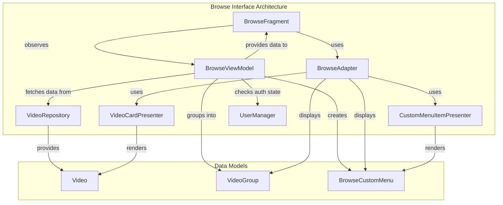
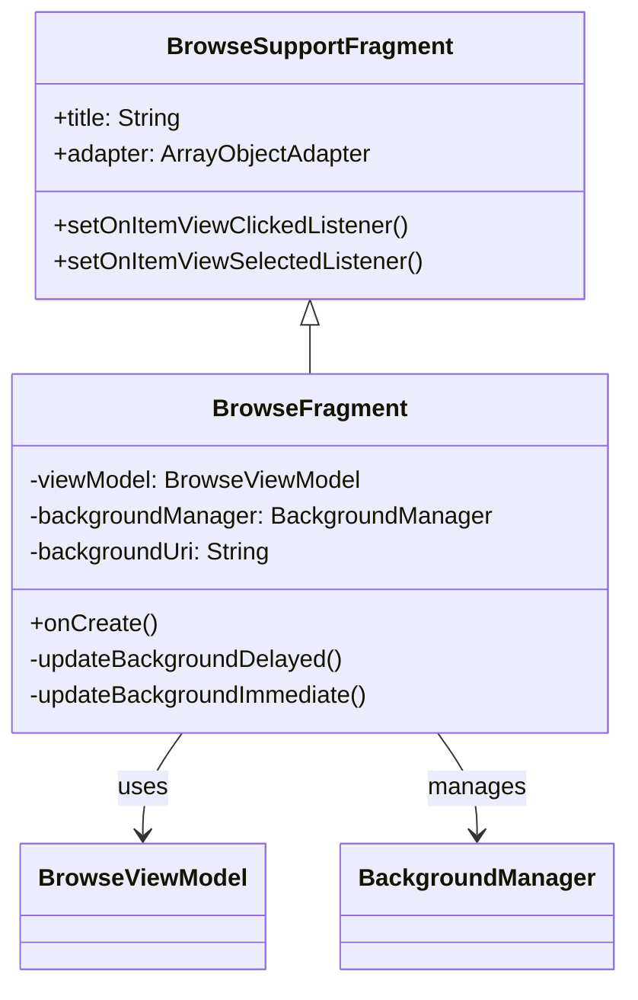
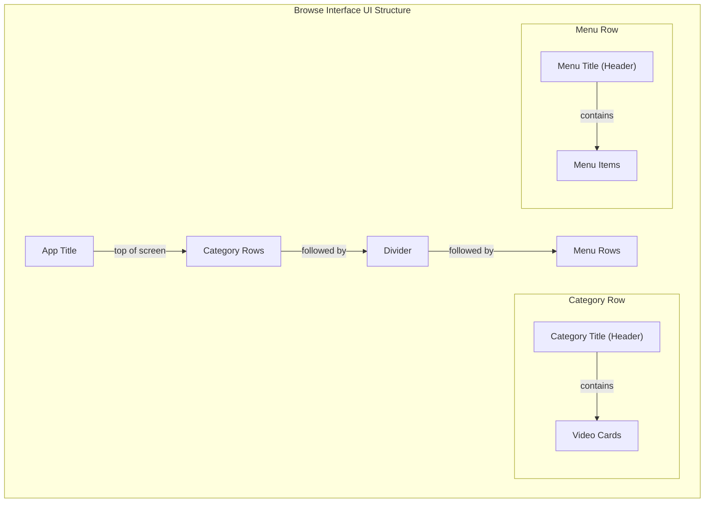
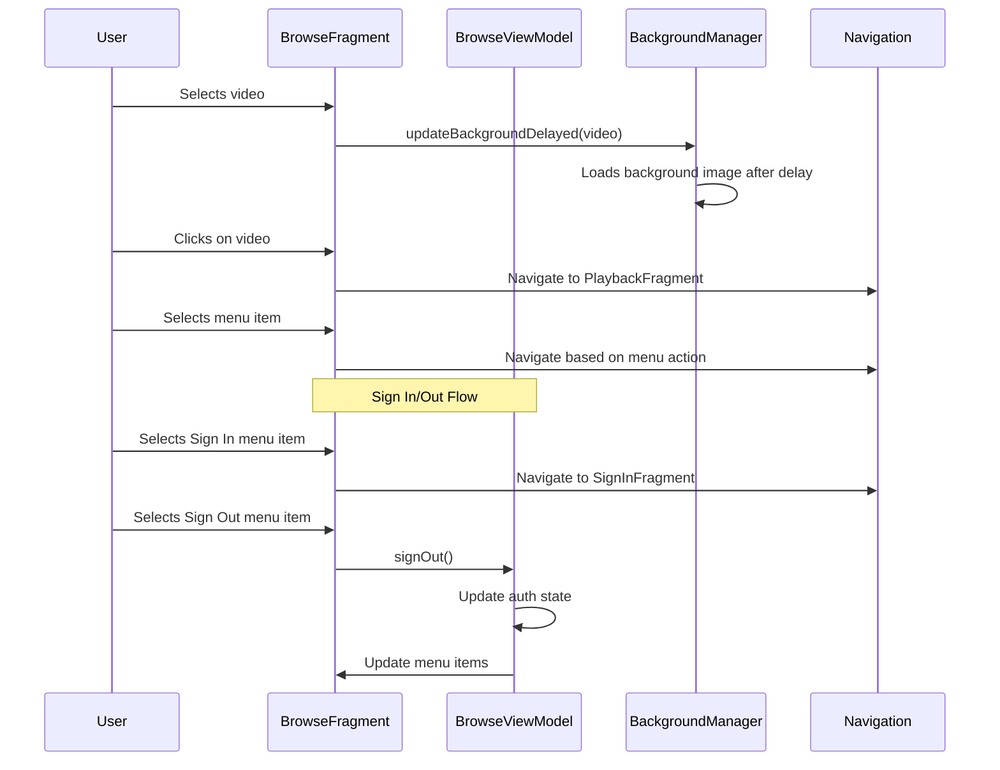
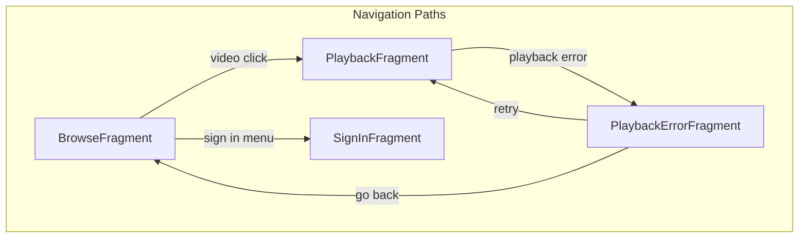
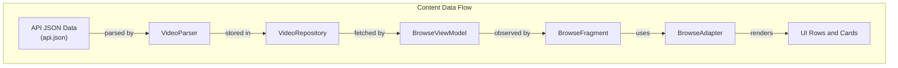

<!-- source: DeepWiki mcp.deepwiki.com · repo android/tv-samples · page 3.3 ReferenceApp Browse Interface · fetched 2026-10-23 -->

# ReferenceApp Browse Interface

<details>
<summary>Relevant source files</summary>

The following files were used as context for generating this wiki page:

- [ReferenceAppKotlin/app/src/main/java/com/android/tv/reference/auth/SignInFragment.kt](ReferenceAppKotlin/app/src/main/java/com/android/tv/reference/auth/SignInFragment.kt)
- [ReferenceAppKotlin/app/src/main/java/com/android/tv/reference/browse/BrowseAdapter.kt](ReferenceAppKotlin/app/src/main/java/com/android/tv/reference/browse/BrowseAdapter.kt)
- [ReferenceAppKotlin/app/src/main/java/com/android/tv/reference/browse/BrowseCustomMenu.kt](ReferenceAppKotlin/app/src/main/java/com/android/tv/reference/browse/BrowseCustomMenu.kt)
- [ReferenceAppKotlin/app/src/main/java/com/android/tv/reference/browse/BrowseFragment.kt](ReferenceAppKotlin/app/src/main/java/com/android/tv/reference/browse/BrowseFragment.kt)
- [ReferenceAppKotlin/app/src/main/java/com/android/tv/reference/browse/BrowseViewModel.kt](ReferenceAppKotlin/app/src/main/java/com/android/tv/reference/browse/BrowseViewModel.kt)
- [ReferenceAppKotlin/app/src/main/java/com/android/tv/reference/shared/datamodel/ApiResponse.kt](ReferenceAppKotlin/app/src/main/java/com/android/tv/reference/shared/datamodel/ApiResponse.kt)
- [ReferenceAppKotlin/app/src/main/java/com/android/tv/reference/shared/datamodel/Video.kt](ReferenceAppKotlin/app/src/main/java/com/android/tv/reference/shared/datamodel/Video.kt)
- [ReferenceAppKotlin/app/src/main/res/layout/fragment_sign_in.xml](ReferenceAppKotlin/app/src/main/res/layout/fragment_sign_in.xml)
- [ReferenceAppKotlin/app/src/main/res/layout/presenter_menu_item.xml](ReferenceAppKotlin/app/src/main/res/layout/presenter_menu_item.xml)
- [ReferenceAppKotlin/app/src/main/res/navigation/nav_graph.xml](ReferenceAppKotlin/app/src/main/res/navigation/nav_graph.xml)
- [ReferenceAppKotlin/app/src/main/res/raw/api.json](ReferenceAppKotlin/app/src/main/res/raw/api.json)
- [ReferenceAppKotlin/app/src/main/res/values/dimens.xml](ReferenceAppKotlin/app/src/main/res/values/dimens.xml)
- [ReferenceAppKotlin/app/src/main/res/values/strings.xml](ReferenceAppKotlin/app/src/main/res/values/strings.xml)
- [ReferenceAppKotlin/build.gradle](ReferenceAppKotlin/build.gradle)

</details>


## Purpose and Scope

This document explains the Browse Interface component of ReferenceAppKotlin, which is the primary content discovery interface that users interact with when using the app. It covers the architecture, components, functionality, and user interactions of the browse experience. For information about video playback implementation, see [ReferenceApp Playback System](#3.2), and for authentication functionality, see [ReferenceApp Authentication](#3.4).

## Overview

The Browse Interface provides a categorized view of video content using Android's Leanback library. It organizes content into horizontal rows, where each row represents a different content category. As users navigate through content, the background dynamically updates to reflect the selected item, creating an immersive browsing experience.

Sources: [ReferenceAppKotlin/app/src/main/java/com/android/tv/reference/browse/BrowseFragment.kt:37-41]()

## Architecture

The browse interface follows a standard MVVM (Model-View-ViewModel) architecture pattern:



Sources: 
- [ReferenceAppKotlin/app/src/main/java/com/android/tv/reference/browse/BrowseFragment.kt:42-100]()
- [ReferenceAppKotlin/app/src/main/java/com/android/tv/reference/browse/BrowseViewModel.kt:30-54]()

## Key Components

### BrowseFragment

The `BrowseFragment` is the main UI component extending Android's `BrowseSupportFragment` from the Leanback library. It handles:

1. Setting up the UI structure
2. Responding to user interactions
3. Managing the background display
4. Navigating to other destinations (like video playback or sign-in)

The fragment observes the ViewModel to receive content updates and authentication state changes.



Sources:
- [ReferenceAppKotlin/app/src/main/java/com/android/tv/reference/browse/BrowseFragment.kt:42-204]()

### BrowseViewModel

The `BrowseViewModel` manages the data for the browse interface. It:

1. Fetches videos from the repository
2. Groups videos by category
3. Manages authentication state
4. Provides custom menu items based on authentication state

```kotlin
val browseContent = MutableLiveData<List<VideoGroup>>()
val customMenuItems = MutableLiveData<List<BrowseCustomMenu>>(listOf())
val isSignedIn = Transformations.map(userManager.userInfo) { it != null }
```

Sources:
- [ReferenceAppKotlin/app/src/main/java/com/android/tv/reference/browse/BrowseViewModel.kt:33-35]()
- [ReferenceAppKotlin/app/src/main/java/com/android/tv/reference/browse/BrowseViewModel.kt:41-49]()

### BrowseAdapter

The `BrowseAdapter` converts data from the ViewModel into a format that can be displayed by the Leanback library. It creates:

1. Rows for each video category using `VideoCardPresenter`
2. A divider row to separate content from menus
3. Custom menu rows using `CustomMenuItemPresenter`

Sources:
- [ReferenceAppKotlin/app/src/main/java/com/android/tv/reference/browse/BrowseAdapter.kt:25-52]()

## UI Structure

The Browse Interface follows the standard Android TV browsing pattern with:



Sources:
- [ReferenceAppKotlin/app/src/main/java/com/android/tv/reference/browse/BrowseAdapter.kt:33-51]()
- [ReferenceAppKotlin/app/src/main/java/com/android/tv/reference/browse/BrowseFragment.kt:140]()

### Video Cards

Video cards display thumbnails of content and are rendered using the `VideoCardPresenter`. When a video is selected, its metadata is displayed, and the background changes to show an image related to the video.

Each video is represented by the `Video` data model which contains:

| Property | Description |
|----------|-------------|
| id | Unique identifier for the video |
| name | Title of the video |
| description | Description of the video |
| uri | URI to access the video |
| videoUri | URI to the video stream |
| thumbnailUri | URI to the thumbnail image |
| backgroundImageUri | URI to the background image |
| category | Category the video belongs to |
| videoType | Type of video (CLIP, EPISODE, MOVIE) |
| duration | Duration of the video in ISO 8601 format |

Sources:
- [ReferenceAppKotlin/app/src/main/java/com/android/tv/reference/shared/datamodel/Video.kt:30-49]()

### Custom Menus

Custom menus provide access to non-content functionality like authentication. The menu structure is defined in `BrowseCustomMenu`:

```kotlin
class BrowseCustomMenu(
    val title: String,
    val menuItems: List<MenuItem>
) {
    data class MenuItem(private val title: String, val handler: () -> Unit) {
        override fun toString(): String = title
    }
}
```

Sources:
- [ReferenceAppKotlin/app/src/main/java/com/android/tv/reference/browse/BrowseCustomMenu.kt:21-28]()
- [ReferenceAppKotlin/app/src/main/res/layout/presenter_menu_item.xml:17-24]()

## User Interaction Flow

When users interact with the Browse Interface, the following sequence occurs:



Sources:
- [ReferenceAppKotlin/app/src/main/java/com/android/tv/reference/browse/BrowseFragment.kt:121-135]()
- [ReferenceAppKotlin/app/src/main/java/com/android/tv/reference/browse/BrowseFragment.kt:82-86]()

## Background Management

The Browse Interface implements a sophisticated background management system to enhance the browsing experience:

1. When a user selects a video, the background is scheduled to update after a delay
2. This delay prevents rapid background flickering when browsing quickly
3. Images are loaded, cropped, resized, and transformed with blur and overlay effects

```mermaid
graph TD
    subgraph "Background Management Process"
        Select["User Selects Video"]
        CheckDiff["Check if Background URI Different"]
        Schedule["Schedule Update with Delay"]
        RemovePrev["Remove Previous Callbacks"]
        UpdateImg["Update Background Image"]
        LoadImg["Load Image with Picasso"]
        Transform["Apply Transformations<br>(Overlay, Blur)"]
        SetBg["Set as Background"]
        
        Select -->|"triggers"| CheckDiff
        CheckDiff -->|"if different"| RemovePrev
        RemovePrev --> Schedule
        Schedule -->|"after delay"| UpdateImg
        UpdateImg --> LoadImg
        LoadImg --> Transform
        Transform --> SetBg
    end
```



Sources:
- [ReferenceAppKotlin/app/src/main/java/com/android/tv/reference/browse/BrowseFragment.kt:149-158]()
- [ReferenceAppKotlin/app/src/main/java/com/android/tv/reference/browse/BrowseFragment.kt:167-179]()

## Navigation

Navigation in the Browse Interface is handled through the Android Navigation Component. The key navigation paths from the browse screen are:

1. To video playback (when a video is clicked)
2. To sign-in screen (when the sign-in menu item is clicked)



Sources:
- [ReferenceAppKotlin/app/src/main/res/navigation/nav_graph.xml:28-68]()
- [ReferenceAppKotlin/app/src/main/java/com/android/tv/reference/browse/BrowseFragment.kt:121-128]()

## Content Data Flow

The Browse Interface receives content data from the following flow:



In the application, videos are grouped by category. The sample provides a variety of content types including:

- Charlie Chaplin Movies
- Beverly Hillbillies episodes
- Supercharged Clips
- Misc Clips

Each category becomes a row in the browse interface, with videos displayed as cards within each row.

Sources:
- [ReferenceAppKotlin/app/src/main/res/raw/api.json:1-391]()
- [ReferenceAppKotlin/app/src/main/java/com/android/tv/reference/browse/BrowseViewModel.kt:41-49]()

## Authentication Integration

The Browse Interface integrates with the app's authentication system to:

1. Display a sign-in/sign-out menu based on the current authentication state
2. Update the UI when authentication status changes

When a user is not signed in, a "Sign In" menu item is displayed. When signed in, this changes to "Sign Out". This behavior is managed by the ViewModel observing changes in the authentication state.

Sources:
- [ReferenceAppKotlin/app/src/main/java/com/android/tv/reference/browse/BrowseFragment.kt:81-119]()
- [ReferenceAppKotlin/app/src/main/java/com/android/tv/reference/browse/BrowseViewModel.kt:35]()

## Summary

The ReferenceApp Browse Interface demonstrates best practices for creating a TV browsing experience using the Leanback library. It implements:

- Categorized content display
- Dynamic background updates
- MVVM architecture pattern
- Integration with authentication
- Navigation to video playback

This reference implementation serves as a foundation that developers can use to create their own TV browsing experiences while following recommended Android TV design patterns.

---

