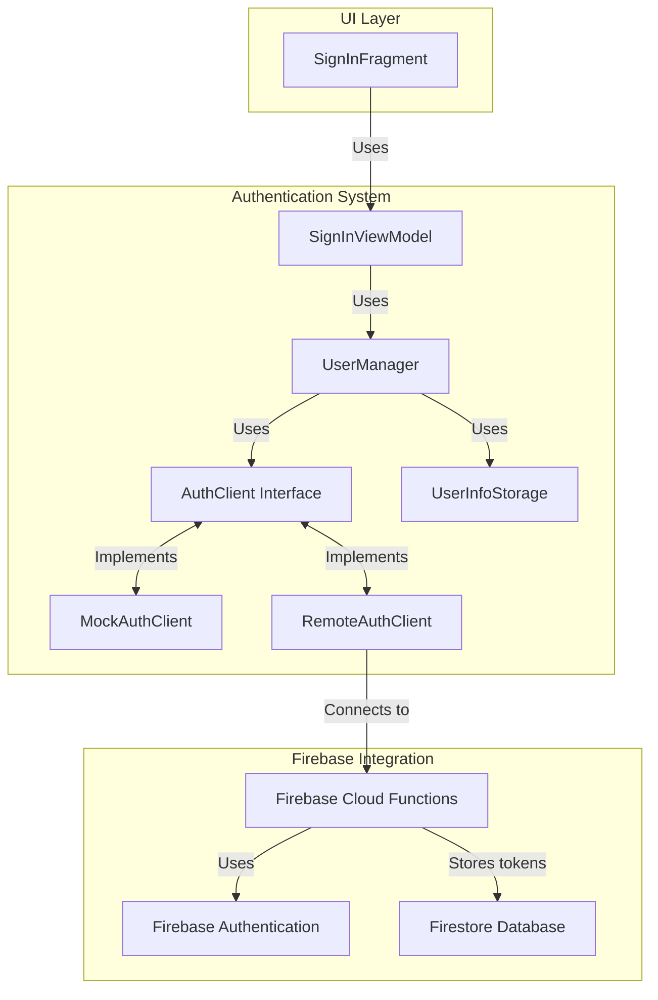
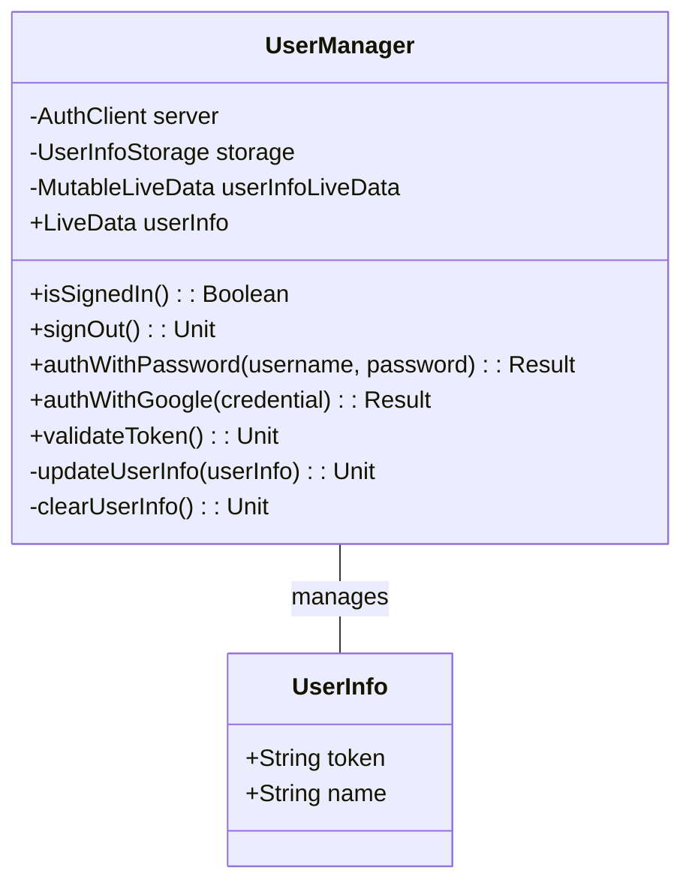
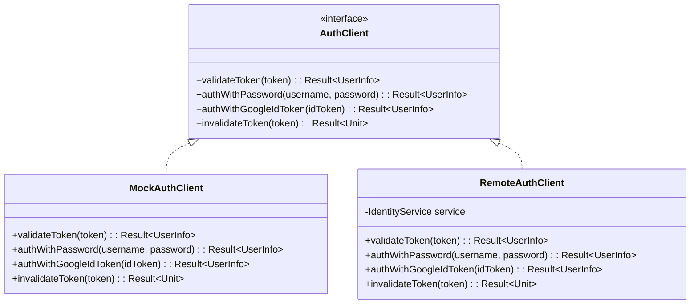
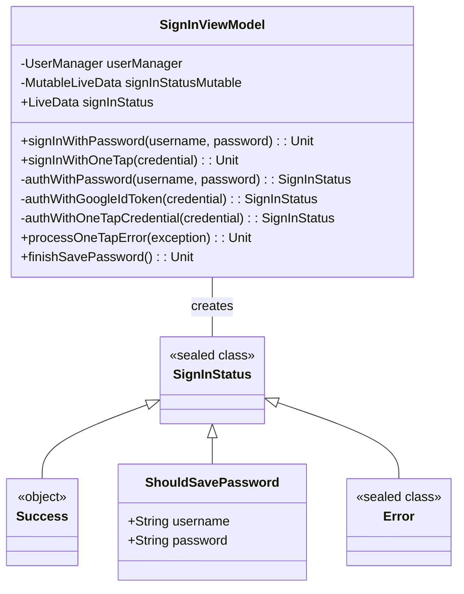
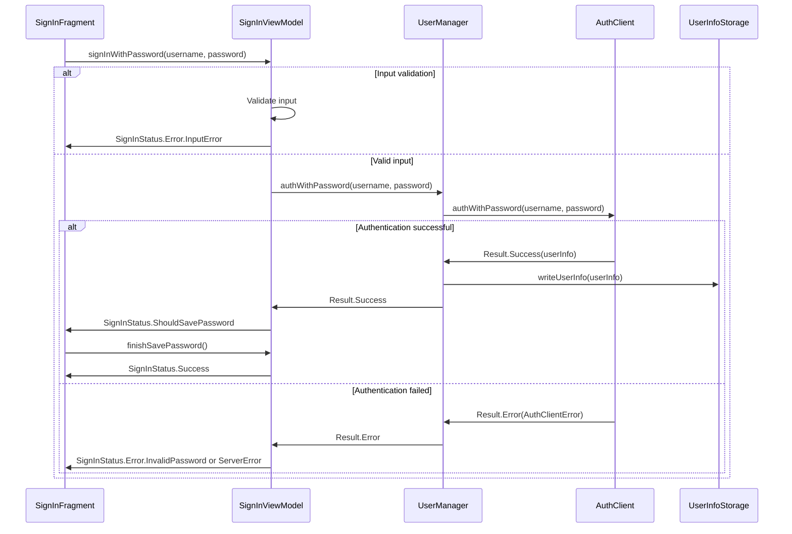
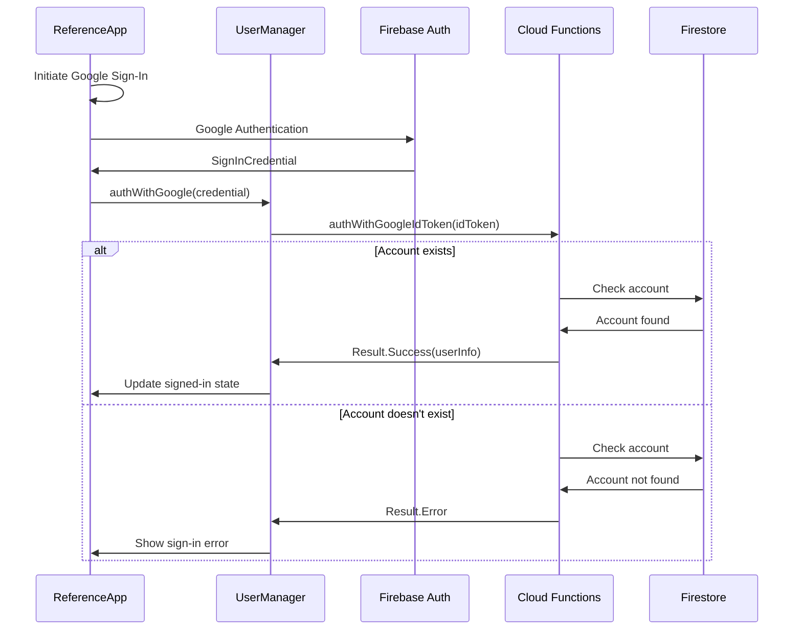
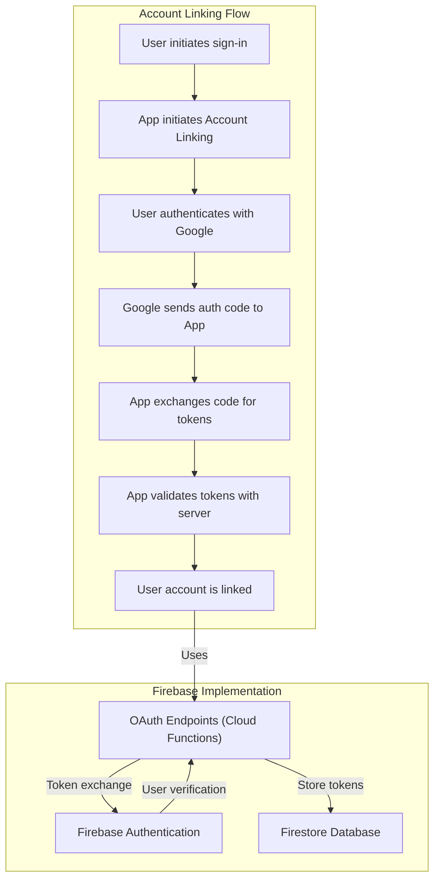

<!-- source: DeepWiki mcp.deepwiki.com · repo android/tv-samples · page 3.4 ReferenceApp Authentication · fetched 2026-10-23 -->

# ReferenceApp Authentication

<details>
<summary>Relevant source files</summary>

The following files were used as context for generating this wiki page:

- [ReferenceAppKotlin/CAST_CONNECT.md](ReferenceAppKotlin/CAST_CONNECT.md)
- [ReferenceAppKotlin/README.md](ReferenceAppKotlin/README.md)
- [ReferenceAppKotlin/app/src/main/java/com/android/tv/reference/auth/AuthClient.kt](ReferenceAppKotlin/app/src/main/java/com/android/tv/reference/auth/AuthClient.kt)
- [ReferenceAppKotlin/app/src/main/java/com/android/tv/reference/auth/RemoteAuthClient.kt](ReferenceAppKotlin/app/src/main/java/com/android/tv/reference/auth/RemoteAuthClient.kt)
- [ReferenceAppKotlin/app/src/main/java/com/android/tv/reference/auth/SignInViewModel.kt](ReferenceAppKotlin/app/src/main/java/com/android/tv/reference/auth/SignInViewModel.kt)
- [ReferenceAppKotlin/app/src/main/java/com/android/tv/reference/auth/UserManager.kt](ReferenceAppKotlin/app/src/main/java/com/android/tv/reference/auth/UserManager.kt)
- [ReferenceAppKotlin/app/src/test/java/com/android/tv/reference/auth/UserManagerUnitTest.kt](ReferenceAppKotlin/app/src/test/java/com/android/tv/reference/auth/UserManagerUnitTest.kt)
- [ReferenceAppKotlin/firebase/README.md](ReferenceAppKotlin/firebase/README.md)
- [ReferenceAppKotlin/firebase/server/test/authentication.test.ts](ReferenceAppKotlin/firebase/server/test/authentication.test.ts)
- [ReferenceAppKotlin/firebase/setup/save_content_to_firestore.js](ReferenceAppKotlin/firebase/setup/save_content_to_firestore.js)
- [ReferenceAppKotlin/firebase/web/index.html](ReferenceAppKotlin/firebase/web/index.html)
- [ReferenceAppKotlin/firebase/web/oauth/index.html](ReferenceAppKotlin/firebase/web/oauth/index.html)
- [ReferenceAppKotlin/firebase/web/oauth/scripts.js](ReferenceAppKotlin/firebase/web/oauth/scripts.js)
- [ReferenceAppKotlin/scripts/atv-create-media-feed.py](ReferenceAppKotlin/scripts/atv-create-media-feed.py)
- [ReferenceAppKotlin/scripts/atv-csv-to-json.py](ReferenceAppKotlin/scripts/atv-csv-to-json.py)
- [ReferenceAppKotlin/settings.gradle](ReferenceAppKotlin/settings.gradle)

</details>


## Purpose and Scope

This document describes the authentication system implemented in the TV Reference App. It covers how the app handles user authentication including sign-in, sign-out, and token management. The authentication system is designed to work both with a mock implementation for testing and with Firebase for production environments. For information about the overall ReferenceApp architecture, see [ReferenceApp Architecture](#3.1).

## Overview

The ReferenceApp authentication system provides a flexible framework for authenticating users. It supports different authentication methods, including email/password and Google authentication. The system can operate in two modes:

1. **Mock Mode** - A self-contained implementation for testing
2. **Firebase Mode** - Integration with Firebase Authentication for production use



Sources:
- [ReferenceAppKotlin/app/src/main/java/com/android/tv/reference/auth/UserManager.kt]()
- [ReferenceAppKotlin/app/src/main/java/com/android/tv/reference/auth/AuthClient.kt]()
- [ReferenceAppKotlin/app/src/main/java/com/android/tv/reference/auth/RemoteAuthClient.kt]()
- [ReferenceAppKotlin/app/src/main/java/com/android/tv/reference/auth/SignInViewModel.kt]()
- [ReferenceAppKotlin/README.md]()

## Key Components

### UserManager

The `UserManager` is the central component of the authentication system. It manages user authentication state, exposes methods for sign-in and sign-out, and maintains a LiveData object of the current user.



Sources:
- [ReferenceAppKotlin/app/src/main/java/com/android/tv/reference/auth/UserManager.kt]()
- [ReferenceAppKotlin/app/src/test/java/com/android/tv/reference/auth/UserManagerUnitTest.kt]()

### AuthClient Interface

The `AuthClient` interface defines the operations for authentication with a server. It includes methods for validating tokens, authenticating with password, authenticating with Google, and invalidating tokens.



Sources:
- [ReferenceAppKotlin/app/src/main/java/com/android/tv/reference/auth/AuthClient.kt]()
- [ReferenceAppKotlin/app/src/main/java/com/android/tv/reference/auth/RemoteAuthClient.kt]()

### Sign-In ViewModel

The `SignInViewModel` manages the UI state for sign-in and handles authentication logic. It communicates with the `UserManager` to perform authentication operations and exposes a LiveData of the sign-in status.



Sources:
- [ReferenceAppKotlin/app/src/main/java/com/android/tv/reference/auth/SignInViewModel.kt]()

## Authentication Flows

### Password Authentication Flow

This diagram illustrates the flow for authenticating a user with username and password:



Sources:
- [ReferenceAppKotlin/app/src/main/java/com/android/tv/reference/auth/SignInViewModel.kt]()
- [ReferenceAppKotlin/app/src/main/java/com/android/tv/reference/auth/UserManager.kt]()
- [ReferenceAppKotlin/app/src/test/java/com/android/tv/reference/auth/UserManagerUnitTest.kt]()

### Google Authentication Flow

When using Google authentication, the app can integrate with Firebase for a streamlined account linking experience:



Sources:
- [ReferenceAppKotlin/app/src/main/java/com/android/tv/reference/auth/UserManager.kt]()
- [ReferenceAppKotlin/firebase/README.md]()
- [ReferenceAppKotlin/firebase/server/test/authentication.test.ts]()

## Firebase Integration

The ReferenceApp can integrate with Firebase for authentication. This feature is controlled by the `FIREBASE_ENABLED` flag in the app's build.gradle file.

### Firebase Features Used

- **Firebase Authentication**: For managing user accounts and authentication
- **Cloud Functions**: For implementing OAuth server endpoints
- **Firestore**: For storing user tokens and session information

### OAuth Account Linking

The app supports Google Account Linking through OAuth. This allows users to link their Google accounts with the app for seamless authentication.



Sources:
- [ReferenceAppKotlin/firebase/README.md]()
- [ReferenceAppKotlin/firebase/server/test/authentication.test.ts]()
- [ReferenceAppKotlin/firebase/web/oauth/scripts.js]()

### Setting Up Firebase Authentication

To enable Firebase authentication in the app:

1. Create a Firebase project in the Firebase Console
2. Enable Firebase Authentication with Email/Password and Google providers
3. Set up Cloud Functions for account linking endpoints
4. Add your app's SHA-1 fingerprint for Google Sign-In
5. Configure the app with your Firebase project by adding the google-services.json file
6. Set the `FIREBASE_ENABLED` flag to true in the app's build.gradle file
7. Modify the `RemoteAuthClient` implementation to point to your Firebase endpoints

Sources:
- [ReferenceAppKotlin/firebase/README.md]()
- [ReferenceAppKotlin/app/src/main/java/com/android/tv/reference/auth/RemoteAuthClient.kt]()

## Testing Authentication

The authentication system is designed to be testable with both unit tests and integration tests.

### Unit Testing

The `UserManagerUnitTest` demonstrates how to test the `UserManager` with a mocked `AuthClient`. It tests:

- Signing in with valid credentials
- Handling sign-in failures
- Reading user information from storage
- Signing out

Example test methods:

- `authWithPassword_signsInWithValidPasswordAndSignsOut()`
- `authWithPassword_failsWithInvalidPassword()`
- `constructor_readsFromStorage()`

Sources:
- [ReferenceAppKotlin/app/src/test/java/com/android/tv/reference/auth/UserManagerUnitTest.kt]()

### Firebase Authentication Testing

For testing Firebase integration, the repository includes authentication tests in the Firebase directory. These tests verify:

- OAuth authentication endpoint
- User info endpoint
- Token exchange endpoint
- Account linking with Google ID tokens

Sources:
- [ReferenceAppKotlin/firebase/server/test/authentication.test.ts]()

## Mock Implementation

For development and testing, the app includes a `MockAuthClient` that simulates authentication without requiring a server. This implementation:

- Accepts sign-in with a predefined mock user email
- Always returns the same mock user information
- Simulates token validation

```kotlin
class MockAuthClient : AuthClient {
    private val mockUser = UserInfo("myUserToken", "A. N. Other")

    override suspend fun validateToken(token: String): Result<UserInfo> {
        if (token == mockUser.token) {
            return Result.Success(mockUser)
        }
        return Result.Error(AuthClientError.AuthenticationError)
    }

    override suspend fun authWithPassword(username: String, password: String): Result<UserInfo> {
        if (username == MOCK_USER_EMAIL) {
            return Result.Success(mockUser)
        }
        return Result.Error(AuthClientError.AuthenticationError)
    }
    
    // Other implementations...
    
    companion object {
        const val MOCK_USER_EMAIL = "user@gmail.com"
    }
}
```

The mock implementation is used by default when the Firebase integration is disabled.

Sources:
- [ReferenceAppKotlin/app/src/main/java/com/android/tv/reference/auth/AuthClient.kt]()

## Conclusion

The ReferenceApp authentication system provides a flexible framework for authenticating users in an Android TV application. It supports both mock authentication for development and Firebase integration for production, with features like Google account linking. The system follows a clean architecture with separation of concerns between UI, business logic, and data access.

---

