<!-- source: DeepWiki mcp.deepwiki.com · repo android/tv-samples · page 4 TvMaterialCatalog · fetched 2026-10-23 -->

# TvMaterialCatalog

Relevant source files

The following files were used as context for generating this wiki page:

- [TvMaterialCatalog/app/build.gradle.kts](TvMaterialCatalog/app/build.gradle.kts)
- [TvMaterialCatalog/app/src/main/java/com/google/tv/material/catalog/ExamplesScreenWithDottedBackground.kt](TvMaterialCatalog/app/src/main/java/com/google/tv/material/catalog/ExamplesScreenWithDottedBackground.kt)
- [TvMaterialCatalog/app/src/main/java/com/google/tv/material/catalog/FontScaleAndLayoutDirectionSelector.kt](TvMaterialCatalog/app/src/main/java/com/google/tv/material/catalog/FontScaleAndLayoutDirectionSelector.kt)
- [TvMaterialCatalog/app/src/main/java/com/google/tv/material/catalog/HomeGrid.kt](TvMaterialCatalog/app/src/main/java/com/google/tv/material/catalog/HomeGrid.kt)
- [TvMaterialCatalog/app/src/main/java/com/google/tv/material/catalog/HomeGridCard.kt](TvMaterialCatalog/app/src/main/java/com/google/tv/material/catalog/HomeGridCard.kt)
- [TvMaterialCatalog/app/src/main/java/com/google/tv/material/catalog/PositionFocusedItemInLazyLayout.kt](TvMaterialCatalog/app/src/main/java/com/google/tv/material/catalog/PositionFocusedItemInLazyLayout.kt)
- [TvMaterialCatalog/app/src/main/java/com/google/tv/material/catalog/ThemeAndColorModeSelector.kt](TvMaterialCatalog/app/src/main/java/com/google/tv/material/catalog/ThemeAndColorModeSelector.kt)
- [TvMaterialCatalog/app/src/main/java/com/google/tv/material/catalog/screens/CardsScreen.kt](TvMaterialCatalog/app/src/main/java/com/google/tv/material/catalog/screens/CardsScreen.kt)
- [TvMaterialCatalog/app/src/main/java/com/google/tv/material/catalog/screens/ColorsScreen.kt](TvMaterialCatalog/app/src/main/java/com/google/tv/material/catalog/screens/ColorsScreen.kt)
- [TvMaterialCatalog/app/src/main/java/com/google/tv/material/catalog/screens/FeaturedCarouselScreen.kt](TvMaterialCatalog/app/src/main/java/com/google/tv/material/catalog/screens/FeaturedCarouselScreen.kt)
- [TvMaterialCatalog/app/src/main/java/com/google/tv/material/catalog/screens/ImmersiveListScreen.kt](TvMaterialCatalog/app/src/main/java/com/google/tv/material/catalog/screens/ImmersiveListScreen.kt)
- [TvMaterialCatalog/gradle/libs.versions.toml](TvMaterialCatalog/gradle/libs.versions.toml)
- [TvMaterialCatalog/gradle/wrapper/gradle-wrapper.jar](TvMaterialCatalog/gradle/wrapper/gradle-wrapper.jar)
- [TvMaterialCatalog/gradle/wrapper/gradle-wrapper.properties](TvMaterialCatalog/gradle/wrapper/gradle-wrapper.properties)
- [TvMaterialCatalog/gradlew](TvMaterialCatalog/gradlew)
- [TvMaterialCatalog/gradlew.bat](TvMaterialCatalog/gradlew.bat)

The TvMaterialCatalog is a reference application that showcases Material Design components specifically optimized for Android TV interfaces. It serves as a living catalog demonstrating how to implement and use the various UI components provided by the AndroidX TV Material library (androidx.tv.material). This app is designed to help developers understand the proper implementation and appearance of TV-specific Material Design components in different states and configurations.

For information about Jetpack Compose TV implementation patterns in a full media application, see [JetStreamCompose](#2).

## Architecture Overview

The TvMaterialCatalog follows a straightforward showcase application architecture with navigation between examples and configuration options.

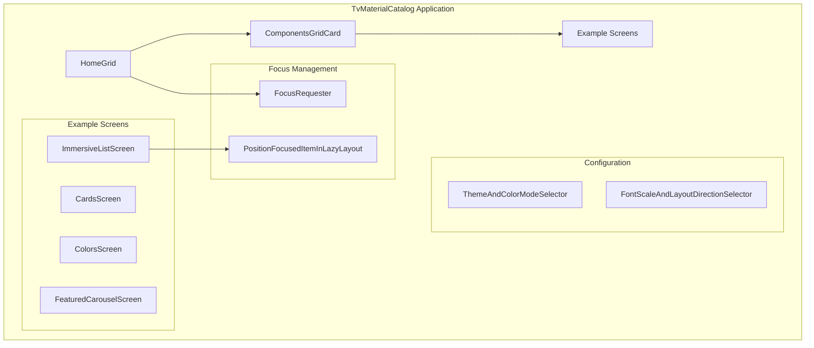

Sources:
- [TvMaterialCatalog/app/src/main/java/com/google/tv/material/catalog/HomeGrid.kt]()
- [TvMaterialCatalog/app/src/main/java/com/google/tv/material/catalog/PositionFocusedItemInLazyLayout.kt]()

## Core Dependencies

The TvMaterialCatalog relies on several key Android libraries:

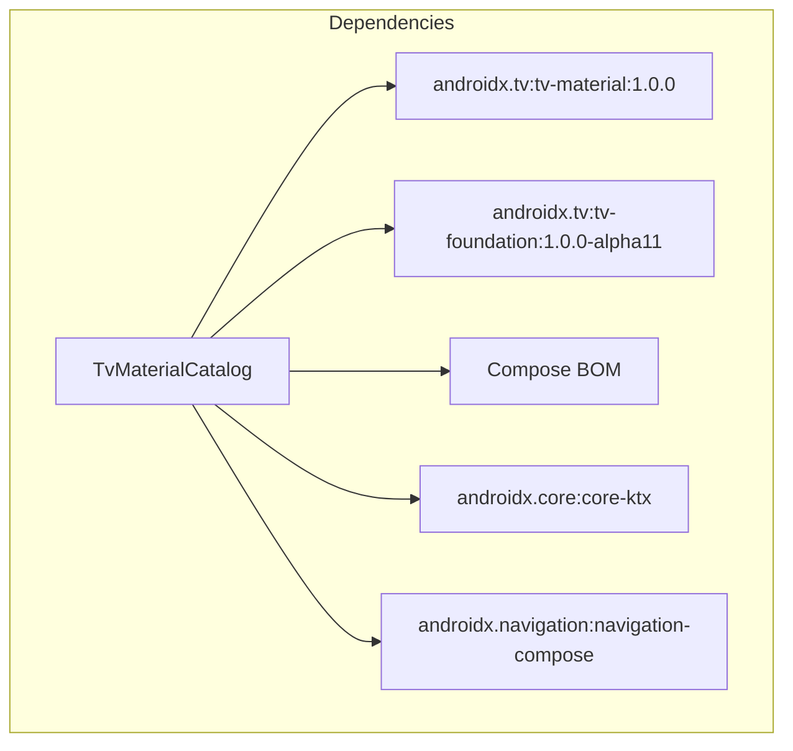

Sources:
- [TvMaterialCatalog/gradle/libs.versions.toml:1-32]()
- [TvMaterialCatalog/app/build.gradle.kts:50-62]()

## Key Components

### Home Grid and Navigation

The home screen is implemented as a grid layout that displays all available component examples organized into categories. It serves as the main navigation entry point for the application.

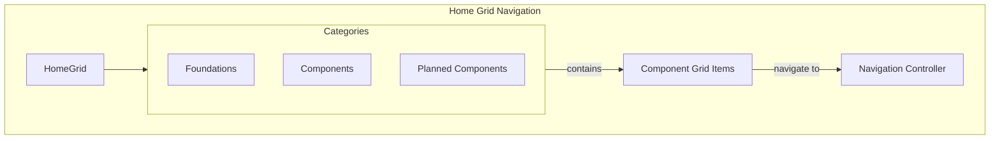

The `HomeGrid` is implemented as a `LazyVerticalGrid` with sections for different component categories, each with its own items. When a user selects a component, it navigates to the associated example screen.

Sources:
- [TvMaterialCatalog/app/src/main/java/com/google/tv/material/catalog/HomeGrid.kt:25-82]()
- [TvMaterialCatalog/app/src/main/java/com/google/tv/material/catalog/HomeGridCard.kt:16-43]()

### Component Grid Card

Each component in the home grid is represented by a `ComponentsGridCard` which includes:
- An image representation of the component
- A title describing the component

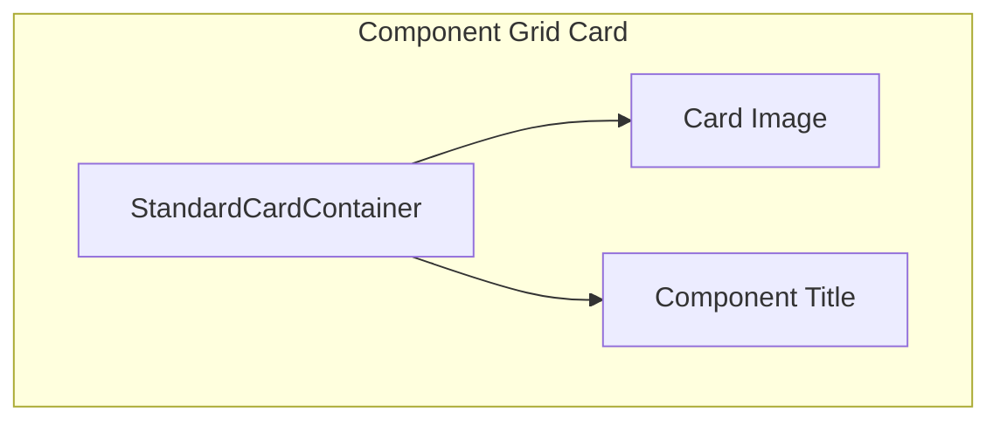

Sources:
- [TvMaterialCatalog/app/src/main/java/com/google/tv/material/catalog/HomeGridCard.kt:16-43]()

### Configuration Options

The TvMaterialCatalog includes configuration panels that allow users to adjust theme settings, color modes, font scaling, and layout direction to see how components adapt to different environments.

#### Theme and Color Mode Selector

The theme selector allows switching between light and dark themes, as well as selecting different seed colors for the Material color system.

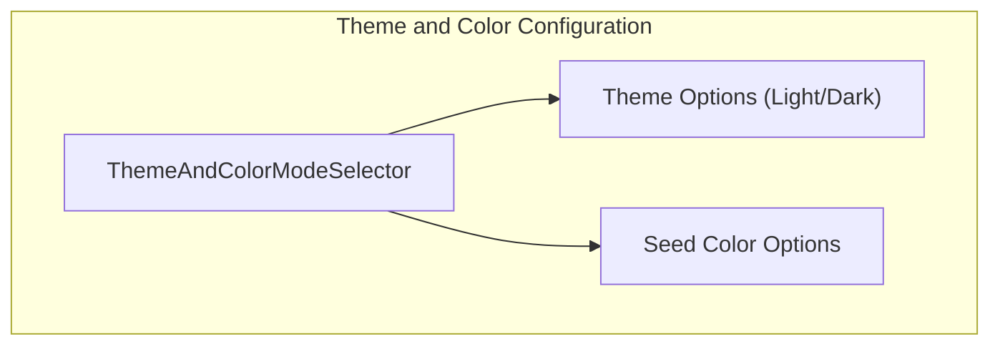

Sources:
- [TvMaterialCatalog/app/src/main/java/com/google/tv/material/catalog/ThemeAndColorModeSelector.kt:40-187]()

#### Font Scale and Layout Direction

This panel allows adjusting text size through font scaling and toggling between left-to-right (LTR) and right-to-left (RTL) layout directions.

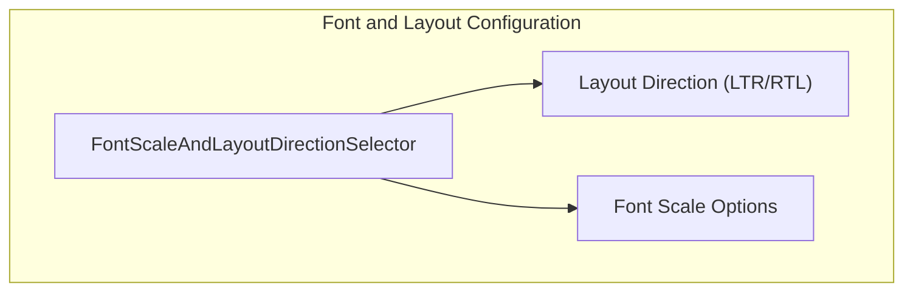

Sources:
- [TvMaterialCatalog/app/src/main/java/com/google/tv/material/catalog/FontScaleAndLayoutDirectionSelector.kt:41-207]()

### Example Screens

The catalog includes several example screens showcasing different UI components and patterns:

#### Cards Screen

Demonstrates different card types for TV interfaces:
- Standard Card
- Classic Card
- Compact Card
- Wide Standard Card
- Wide Classic Card

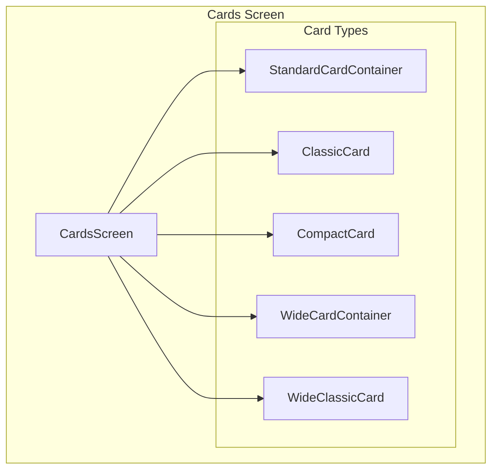

Sources:
- [TvMaterialCatalog/app/src/main/java/com/google/tv/material/catalog/screens/CardsScreen.kt:26-217]()

#### Immersive List Screen

Showcases an immersive browsing experience with a background image that changes based on the focused item, commonly used for content discovery interfaces.

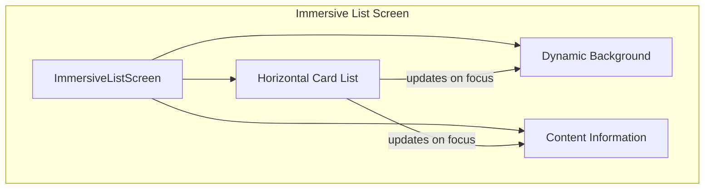

Sources:
- [TvMaterialCatalog/app/src/main/java/com/google/tv/material/catalog/screens/ImmersiveListScreen.kt:52-246]()

#### Colors Screen

Displays the Material Design color system palette specifically adapted for TV interfaces.

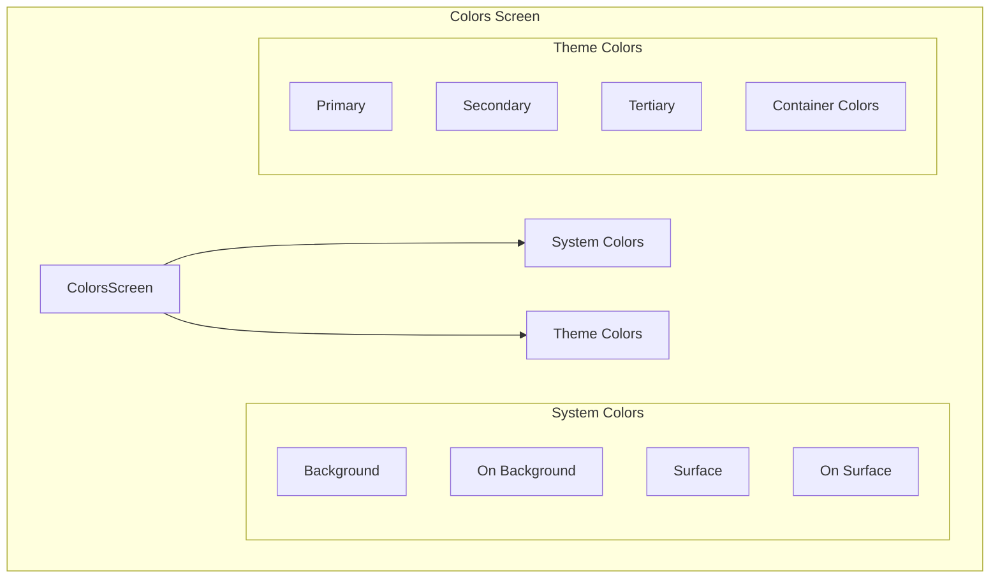

Sources:
- [TvMaterialCatalog/app/src/main/java/com/google/tv/material/catalog/screens/ColorsScreen.kt:25-158]()

#### Featured Carousel Screen

Demonstrates the Material TV carousel component for featured content, common in streaming applications.

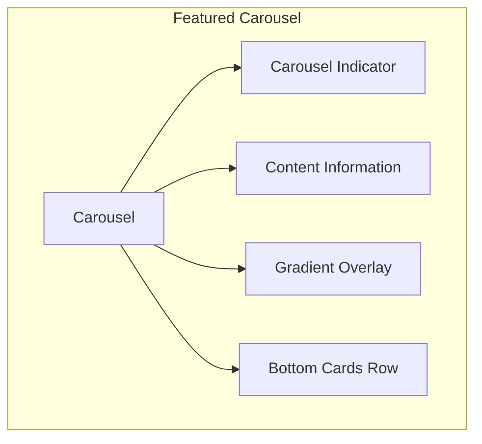

Sources:
- [TvMaterialCatalog/app/src/main/java/com/google/tv/material/catalog/screens/FeaturedCarouselScreen.kt:56-252]()

## TV-Specific Focus Management

One of the most important aspects of TV application development is proper focus management, as users navigate with a D-pad rather than touch. The TvMaterialCatalog demonstrates best practices for TV focus handling.

### Focus Requester

The application uses `FocusRequester` to control initial focus when screens are loaded, ensuring a good user experience on navigation.

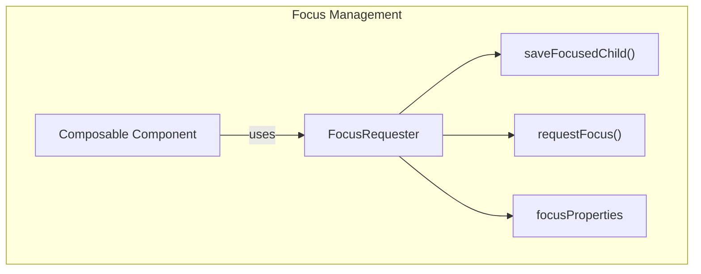

Sources:
- [TvMaterialCatalog/app/src/main/java/com/google/tv/material/catalog/HomeGrid.kt:27-29]()
- [TvMaterialCatalog/app/src/main/java/com/google/tv/material/catalog/screens/FeaturedCarouselScreen.kt:183-185]()

### Position Focused Item in Lazy Layout

The catalog includes a utility called `PositionFocusedItemInLazyLayout` which helps ensure that focused items in scrollable layouts (like rows and grids) are properly positioned on screen.

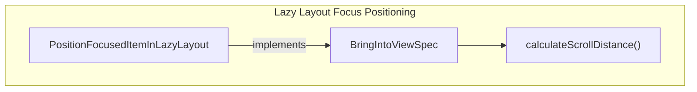

This utility:
- Calculates optimal scroll positions to ensure focused items are visible
- Provides customization for the positioning via `parentFraction` and `childFraction` parameters
- Ensures smooth scrolling transitions between focused items in lists and grids

Sources:
- [TvMaterialCatalog/app/src/main/java/com/google/tv/material/catalog/PositionFocusedItemInLazyLayout.kt:11-51]()
- [TvMaterialCatalog/app/src/main/java/com/google/tv/material/catalog/screens/ImmersiveListScreen.kt:105-148]()

## Example Components Implementation Pattern

The example screens in the catalog follow a consistent pattern for displaying components:

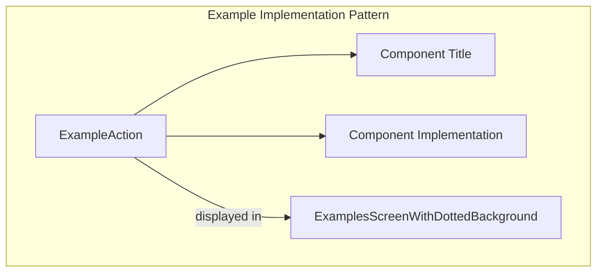

The `ExamplesScreenWithDottedBackground` provides a consistent visual framework for displaying component examples with:
- A selection panel on the left for choosing examples
- A dotted background area on the right for displaying the selected component

Sources:
- [TvMaterialCatalog/app/src/main/java/com/google/tv/material/catalog/ExamplesScreenWithDottedBackground.kt:42-129]()
- [TvMaterialCatalog/app/src/main/java/com/google/tv/material/catalog/screens/CardsScreen.kt:26-217]()

## Project Configuration

The TvMaterialCatalog is built using standard Android development tools:

| Component | Version |
|-----------|---------|
| Gradle | 8.10.2 |
| AGP | 8.7.2 |
| Kotlin | 1.9.0 |
| Compose BOM | 2024.11.00 |
| TV Material | 1.0.0 |
| TV Foundation | 1.0.0-alpha11 |
| Minimum SDK | 21 |
| Target SDK | 35 |

Sources:
- [TvMaterialCatalog/gradle/libs.versions.toml:1-32]()
- [TvMaterialCatalog/app/build.gradle.kts:11-48]()
- [TvMaterialCatalog/gradle/wrapper/gradle-wrapper.properties:1-8]()

## Summary

The TvMaterialCatalog serves as a comprehensive showcase of Material Design components for Android TV. It demonstrates how to implement a variety of UI patterns optimized for the 10-foot user interface, with particular attention to:

1. Proper focus management for D-pad navigation
2. Component scaling and visual feedback on focus
3. Immersive browsing experiences for content discovery
4. Adapting to different themes, colors, font scales, and layout directions

Developers can use this catalog both as a reference for how TV components should look and behave, and as a source of implementation patterns for their own TV applications.

---

