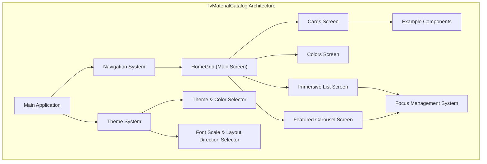
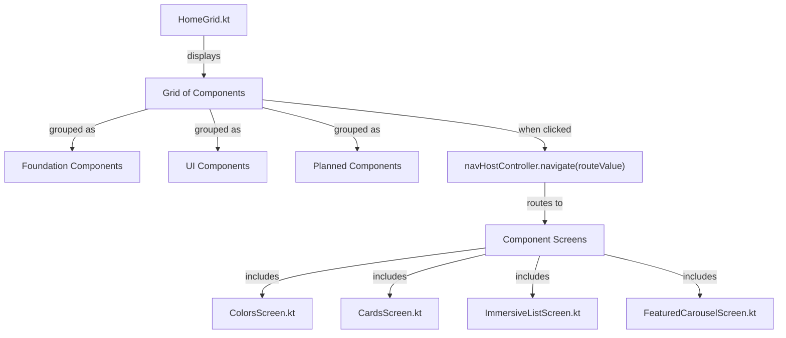
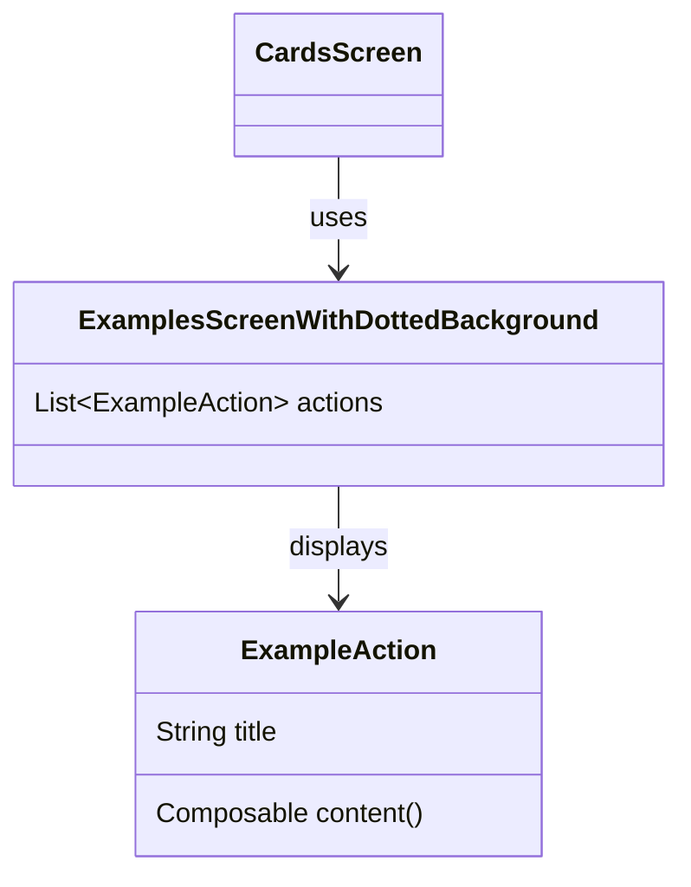
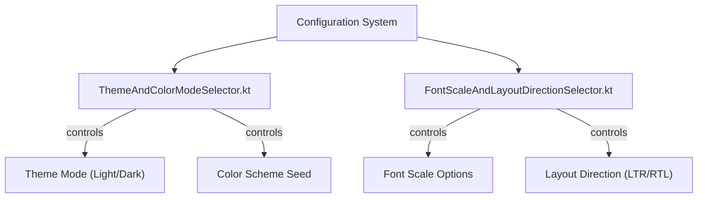
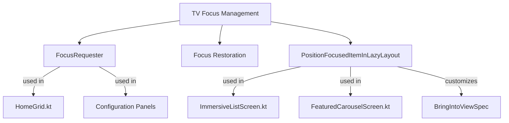
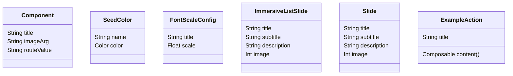

<!-- source: DeepWiki mcp.deepwiki.com · repo android/tv-samples · page 4.1 TvMaterialCatalog Architecture · fetched 2026-10-23 -->

# TvMaterialCatalog Architecture

<details>
<summary>Relevant source files</summary>

The following files were used as context for generating this wiki page:

- [TvMaterialCatalog/app/build.gradle.kts](TvMaterialCatalog/app/build.gradle.kts)
- [TvMaterialCatalog/app/src/main/java/com/google/tv/material/catalog/ExamplesScreenWithDottedBackground.kt](TvMaterialCatalog/app/src/main/java/com/google/tv/material/catalog/ExamplesScreenWithDottedBackground.kt)
- [TvMaterialCatalog/app/src/main/java/com/google/tv/material/catalog/FontScaleAndLayoutDirectionSelector.kt](TvMaterialCatalog/app/src/main/java/com/google/tv/material/catalog/FontScaleAndLayoutDirectionSelector.kt)
- [TvMaterialCatalog/app/src/main/java/com/google/tv/material/catalog/HomeGrid.kt](TvMaterialCatalog/app/src/main/java/com/google/tv/material/catalog/HomeGrid.kt)
- [TvMaterialCatalog/app/src/main/java/com/google/tv/material/catalog/HomeGridCard.kt](TvMaterialCatalog/app/src/main/java/com/google/tv/material/catalog/HomeGridCard.kt)
- [TvMaterialCatalog/app/src/main/java/com/google/tv/material/catalog/PositionFocusedItemInLazyLayout.kt](TvMaterialCatalog/app/src/main/java/com/google/tv/material/catalog/PositionFocusedItemInLazyLayout.kt)
- [TvMaterialCatalog/app/src/main/java/com/google/tv/material/catalog/ThemeAndColorModeSelector.kt](TvMaterialCatalog/app/src/main/java/com/google/tv/material/catalog/ThemeAndColorModeSelector.kt)
- [TvMaterialCatalog/app/src/main/java/com/google/tv/material/catalog/screens/CardsScreen.kt](TvMaterialCatalog/app/src/main/java/com/google/tv/material/catalog/screens/CardsScreen.kt)
- [TvMaterialCatalog/app/src/main/java/com/google/tv/material/catalog/screens/ColorsScreen.kt](TvMaterialCatalog/app/src/main/java/com/google/tv/material/catalog/screens/ColorsScreen.kt)
- [TvMaterialCatalog/app/src/main/java/com/google/tv/material/catalog/screens/FeaturedCarouselScreen.kt](TvMaterialCatalog/app/src/main/java/com/google/tv/material/catalog/screens/FeaturedCarouselScreen.kt)
- [TvMaterialCatalog/app/src/main/java/com/google/tv/material/catalog/screens/ImmersiveListScreen.kt](TvMaterialCatalog/app/src/main/java/com/google/tv/material/catalog/screens/ImmersiveListScreen.kt)
- [TvMaterialCatalog/gradle/libs.versions.toml](TvMaterialCatalog/gradle/libs.versions.toml)
- [TvMaterialCatalog/gradle/wrapper/gradle-wrapper.jar](TvMaterialCatalog/gradle/wrapper/gradle-wrapper.jar)
- [TvMaterialCatalog/gradle/wrapper/gradle-wrapper.properties](TvMaterialCatalog/gradle/wrapper/gradle-wrapper.properties)
- [TvMaterialCatalog/gradlew](TvMaterialCatalog/gradlew)
- [TvMaterialCatalog/gradlew.bat](TvMaterialCatalog/gradlew.bat)

</details>


The TvMaterialCatalog is a showcase application that demonstrates Material Design components and patterns specifically designed for TV interfaces. It serves as a reference implementation for developers building TV applications using Jetpack Compose with the tv-material and tv-foundation libraries. This document describes the architecture, key components, and design patterns used in the TvMaterialCatalog app.

## Overview and Purpose

TvMaterialCatalog provides a comprehensive collection of UI components and screens that follow the Material Design guidelines for TV interfaces. The app demonstrates:

- Material Design components for TV
- TV-specific UI patterns and layouts
- Focus management techniques for TV navigation
- Theme customization and configuration
- Font scaling and layout direction support

The app allows developers to explore various components, understand their implementation, and see how they behave with different configurations.

## High-Level Architecture

TvMaterialCatalog follows a modular architecture organized around screens and components. The app uses Jetpack Compose for UI, with TV-specific components from the `tv-material` and `tv-foundation` libraries.



Sources: 
- [TvMaterialCatalog/app/build.gradle.kts:1-62]()
- [TvMaterialCatalog/gradle/libs.versions.toml:1-32]()
- [TvMaterialCatalog/app/src/main/java/com/google/tv/material/catalog/HomeGrid.kt:1-82]()

## Core Components and Libraries

The app is built using the following key libraries and components:

| Component | Version | Purpose |
|-----------|---------|---------|
| tv-material | 1.0.0 | Material Design components for TV |
| tv-foundation | 1.0.0-alpha11 | Foundation components for TV UIs |
| Compose | 2024.11.00 | UI toolkit for building interfaces |
| Navigation Compose | 2.8.4 | Navigation between screens |
| Coil | 2.7.0 | Image loading and caching |

Sources:
- [TvMaterialCatalog/gradle/libs.versions.toml:1-32]()
- [TvMaterialCatalog/app/build.gradle.kts:50-62]()

## Navigation Structure

The app's navigation is centered around the HomeGrid screen, which serves as the entry point. From this grid, users can navigate to various component demonstration screens.



The navigation system uses `NavController` from the Navigation Compose library. Each component in the grid has a `routeValue` property that identifies the destination route for navigation.

Sources:
- [TvMaterialCatalog/app/src/main/java/com/google/tv/material/catalog/HomeGrid.kt:25-68]()
- [TvMaterialCatalog/app/src/main/java/com/google/tv/material/catalog/HomeGridCard.kt:16-43]()

## UI Components and Screens

### Home Grid

The HomeGrid is the main screen of the application. It displays a grid of component cards organized into categories.

Key features:
- Uses `LazyVerticalGrid` to display component cards
- Manages focus for TV navigation
- Groups components into categories (Foundations, Components, Planned)
- Handles navigation to component screens

Sources:
- [TvMaterialCatalog/app/src/main/java/com/google/tv/material/catalog/HomeGrid.kt:1-82]()
- [TvMaterialCatalog/app/src/main/java/com/google/tv/material/catalog/HomeGridCard.kt:1-43]()

### Component Screens

The app includes several demonstration screens for different component types:

1. **Cards Screen**: Demonstrates various card components for TV interfaces.
   - Standard cards
   - Classic cards
   - Compact cards
   - Wide cards

2. **Colors Screen**: Showcases the Material Design color system for TV.
   - Display of color palette
   - Surface variants
   - Primary, secondary, and tertiary colors

3. **Immersive List Screen**: Demonstrates an immersive browsing experience with large background images.
   - Background image that changes based on selection
   - Gradient overlay for text readability
   - Horizontal list navigation

4. **Featured Carousel Screen**: Shows a carousel pattern for featuring content.
   - Auto-scrolling carousel
   - Content cards
   - Indicator dots for carousel position

Sources:
- [TvMaterialCatalog/app/src/main/java/com/google/tv/material/catalog/screens/CardsScreen.kt:1-218]()
- [TvMaterialCatalog/app/src/main/java/com/google/tv/material/catalog/screens/ColorsScreen.kt:1-159]()
- [TvMaterialCatalog/app/src/main/java/com/google/tv/material/catalog/screens/ImmersiveListScreen.kt:1-247]()
- [TvMaterialCatalog/app/src/main/java/com/google/tv/material/catalog/screens/FeaturedCarouselScreen.kt:1-293]()
- [TvMaterialCatalog/app/src/main/java/com/google/tv/material/catalog/ExamplesScreenWithDottedBackground.kt:1-130]()

## Example Screen Structure

Each example screen follows a consistent pattern for displaying and explaining components:



The examples use a dotted background layout to visually separate different component examples. The left side of the screen shows a list of examples, and the right side displays the currently selected example.

Sources:
- [TvMaterialCatalog/app/src/main/java/com/google/tv/material/catalog/ExamplesScreenWithDottedBackground.kt:40-127]()
- [TvMaterialCatalog/app/src/main/java/com/google/tv/material/catalog/screens/CardsScreen.kt:26-216]()

## Theme and Configuration System

The app provides a configuration system that allows users to experiment with different themes, color schemes, font scales, and layout directions.



### Theme and Color Mode Selector

This component provides UI for changing:
- Theme mode (light/dark)
- Seed color for the Material color palette

The selector appears as an overlay panel triggered by user action.

Sources:
- [TvMaterialCatalog/app/src/main/java/com/google/tv/material/catalog/ThemeAndColorModeSelector.kt:1-188]()

### Font Scale and Layout Direction Selector

This component provides UI for changing:
- Font scale (text size)
- Layout direction (LTR or RTL)

Like the theme selector, it appears as an overlay panel.

Sources:
- [TvMaterialCatalog/app/src/main/java/com/google/tv/material/catalog/FontScaleAndLayoutDirectionSelector.kt:1-208]()

## Focus Management for TV

TV apps require careful focus management since users navigate with a D-pad rather than touch. TvMaterialCatalog implements several focus management techniques:



### Position Focused Item in Lazy Layout

A key focus management feature is the custom positioning of focused items in scrollable containers. The `PositionFocusedItemInLazyLayout` composable customizes the behavior for TV navigation:

- Controls where a focused item appears within a scrollable container
- Can be configured to position focused items at specific fractions of the container
- Makes navigation more predictable and visually appealing

Sources:
- [TvMaterialCatalog/app/src/main/java/com/google/tv/material/catalog/PositionFocusedItemInLazyLayout.kt:1-51]()
- [TvMaterialCatalog/app/src/main/java/com/google/tv/material/catalog/screens/ImmersiveListScreen.kt:105-118]()
- [TvMaterialCatalog/app/src/main/java/com/google/tv/material/catalog/screens/FeaturedCarouselScreen.kt:181-186]()

## Data Models

The app uses several data models to represent UI components and content:



These data models provide a consistent structure for representing UI components and content throughout the app.

Sources:
- [TvMaterialCatalog/app/src/main/java/com/google/tv/material/catalog/HomeGrid.kt:51-78]()
- [TvMaterialCatalog/app/src/main/java/com/google/tv/material/catalog/screens/ImmersiveListScreen.kt:157-213]()
- [TvMaterialCatalog/app/src/main/java/com/google/tv/material/catalog/screens/FeaturedCarouselScreen.kt:260-292]()
- [TvMaterialCatalog/app/src/main/java/com/google/tv/material/catalog/ExamplesScreenWithDottedBackground.kt:129]()

## Visual Effects and Styling

The app implements several visual effects for TV interfaces:

### Gradient Overlays
Used in immersive screens to ensure text readability over background images.

```kotlin
fun Modifier.immersiveListGradient(): Modifier = composed {
    val color = MaterialTheme.colorScheme.surface
    val colorAlphaList = listOf(1.0f, 0.2f, 0.0f)
    val colorStopList = listOf(0.2f, 0.8f, 0.9f)
    // More code to create gradient...
}
```

Sources:
- [TvMaterialCatalog/app/src/main/java/com/google/tv/material/catalog/screens/ImmersiveListScreen.kt:215-246]()
- [TvMaterialCatalog/app/src/main/java/com/google/tv/material/catalog/screens/FeaturedCarouselScreen.kt:189-220]()

## Build Configuration

TvMaterialCatalog uses Gradle for building, with the following key configuration:

- Kotlin 1.9.0
- Compose compiler extension 1.5.1
- Android target SDK 35
- Minimum SDK 21

Sources:
- [TvMaterialCatalog/app/build.gradle.kts:1-62]()
- [TvMaterialCatalog/gradle/libs.versions.toml:1-32]()
- [TvMaterialCatalog/gradle/wrapper/gradle-wrapper.properties:1-8]()

## Summary

TvMaterialCatalog demonstrates the implementation of Material Design components and patterns for TV interfaces. The architecture focuses on:

1. A home grid for component discovery
2. Individual component demonstration screens
3. Theme and configuration options
4. TV-specific focus management techniques

The app serves as a valuable reference for developers building TV applications with Jetpack Compose and the TV Material Design libraries. It showcases best practices for TV UI development, including considerations for focus management, responsive layouts, and visual styling appropriate for the 10-foot user experience.

---

