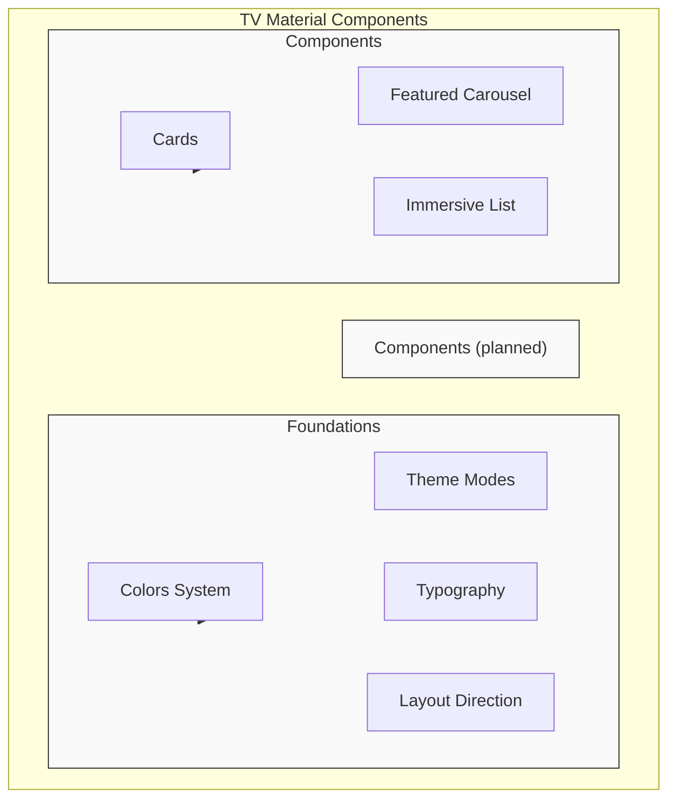
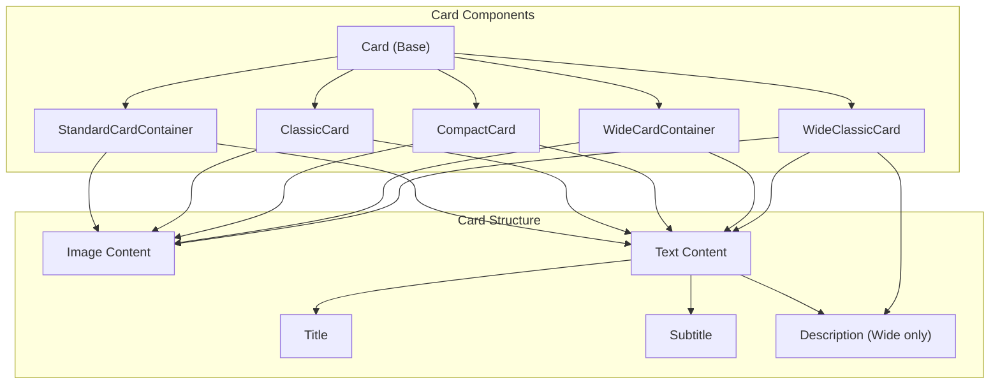
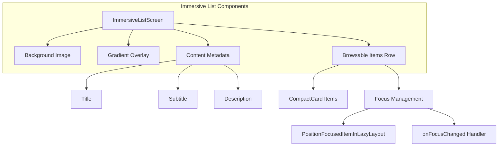
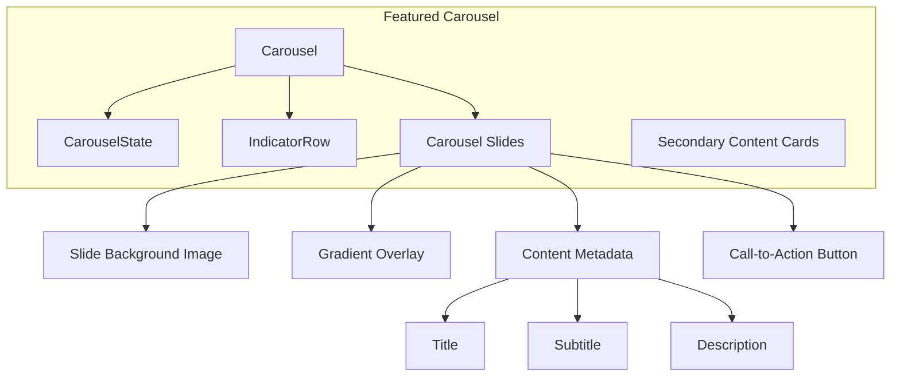
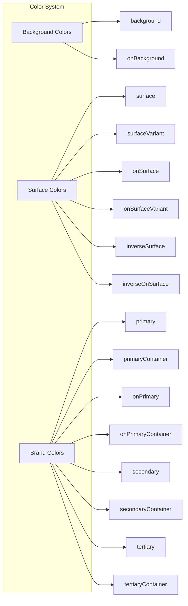
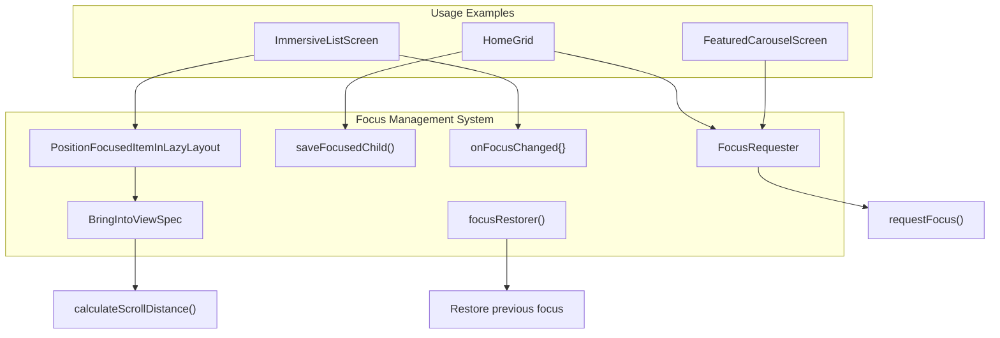
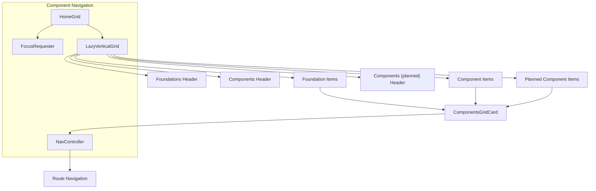

<!-- source: DeepWiki mcp.deepwiki.com · repo android/tv-samples · page 4.2 TV Material Components · fetched 2026-10-23 -->

# TV Material Components

<details>
<summary>Relevant source files</summary>

The following files were used as context for generating this wiki page:

- [TvMaterialCatalog/app/src/main/java/com/google/tv/material/catalog/ExamplesScreenWithDottedBackground.kt](TvMaterialCatalog/app/src/main/java/com/google/tv/material/catalog/ExamplesScreenWithDottedBackground.kt)
- [TvMaterialCatalog/app/src/main/java/com/google/tv/material/catalog/FontScaleAndLayoutDirectionSelector.kt](TvMaterialCatalog/app/src/main/java/com/google/tv/material/catalog/FontScaleAndLayoutDirectionSelector.kt)
- [TvMaterialCatalog/app/src/main/java/com/google/tv/material/catalog/HomeGrid.kt](TvMaterialCatalog/app/src/main/java/com/google/tv/material/catalog/HomeGrid.kt)
- [TvMaterialCatalog/app/src/main/java/com/google/tv/material/catalog/HomeGridCard.kt](TvMaterialCatalog/app/src/main/java/com/google/tv/material/catalog/HomeGridCard.kt)
- [TvMaterialCatalog/app/src/main/java/com/google/tv/material/catalog/PositionFocusedItemInLazyLayout.kt](TvMaterialCatalog/app/src/main/java/com/google/tv/material/catalog/PositionFocusedItemInLazyLayout.kt)
- [TvMaterialCatalog/app/src/main/java/com/google/tv/material/catalog/ThemeAndColorModeSelector.kt](TvMaterialCatalog/app/src/main/java/com/google/tv/material/catalog/ThemeAndColorModeSelector.kt)
- [TvMaterialCatalog/app/src/main/java/com/google/tv/material/catalog/screens/CardsScreen.kt](TvMaterialCatalog/app/src/main/java/com/google/tv/material/catalog/screens/CardsScreen.kt)
- [TvMaterialCatalog/app/src/main/java/com/google/tv/material/catalog/screens/ColorsScreen.kt](TvMaterialCatalog/app/src/main/java/com/google/tv/material/catalog/screens/ColorsScreen.kt)
- [TvMaterialCatalog/app/src/main/java/com/google/tv/material/catalog/screens/FeaturedCarouselScreen.kt](TvMaterialCatalog/app/src/main/java/com/google/tv/material/catalog/screens/FeaturedCarouselScreen.kt)
- [TvMaterialCatalog/app/src/main/java/com/google/tv/material/catalog/screens/ImmersiveListScreen.kt](TvMaterialCatalog/app/src/main/java/com/google/tv/material/catalog/screens/ImmersiveListScreen.kt)

</details>


This document details the Material Design components for TV interfaces showcased in the TvMaterialCatalog app. These components are specifically designed for 10-foot user experiences on Android TV, providing developers with a standardized set of UI elements optimized for d-pad navigation and large screen viewing.

For information about the overall architecture of the TvMaterialCatalog app, see [TvMaterialCatalog Architecture](#4.1).

## Component Organization

TvMaterialCatalog organizes components into three main categories as shown in the home grid:



Sources: [TvMaterialCatalog/app/src/main/java/com/google/tv/material/catalog/HomeGrid.kt:48-78]()

## Card Components

Cards are fundamental building blocks for TV interfaces, providing consistent containers for content display. The TvMaterialCatalog showcases five variants of cards:



Sources: [TvMaterialCatalog/app/src/main/java/com/google/tv/material/catalog/screens/CardsScreen.kt:26-217]()

### Card Types and Properties

| Card Type | Layout | Primary Use Case | Implementation Class |
|-----------|--------|------------------|---------------------|
| Standard Card | Vertical with text below | General content browsing | `StandardCardContainer` |
| Classic Card | Vertical with integrated text | Content with equal text/image importance | `ClassicCard` |
| Compact Card | Vertical with minimal padding | Space-efficient grids | `CompactCard` |
| Wide Standard Card | Horizontal with text beside image | Row-based content lists | `WideCardContainer` |
| Wide Classic Card | Horizontal with description | Detail-rich content rows | `WideClassicCard` |

Card components support a standard interaction model:
- Focus state with visual indicators
- Click/select actions
- Consistent spacing and layout

Implementation example of a Standard Card:

```kotlin
StandardCardContainer(
    modifier = Modifier.width(180.dp),
    imageCard = {
        Card(
            onClick = { /* action */ },
            interactionSource = it,
            colors = CardDefaults.colors(containerColor = Color.Transparent)
        ) {
            Image(
                modifier = Modifier
                    .fillMaxWidth()
                    .aspectRatio(CardDefaults.HorizontalImageAspectRatio),
                painter = painterResource(id = R.drawable.card_thumbnail),
                contentDescription = null,
            )
        }
    },
    title = { Text(text = "Title goes here") },
    subtitle = { Text(text = "Secondary · text") },
)
```

Sources: [TvMaterialCatalog/app/src/main/java/com/google/tv/material/catalog/screens/CardsScreen.kt:31-58](), [TvMaterialCatalog/app/src/main/java/com/google/tv/material/catalog/HomeGridCard.kt:15-43]()

## Immersive List

The Immersive List component provides a visually rich browsing experience where the selected item's content expands to fill the background while maintaining a browsable row of content items.



Key features:
- Background image changes based on the selected item
- Gradient overlay ensures text readability
- Horizontal row of selectable content items
- Specialized focus management for smooth scrolling

Sources: [TvMaterialCatalog/app/src/main/java/com/google/tv/material/catalog/screens/ImmersiveListScreen.kt:50-206](), [TvMaterialCatalog/app/src/main/java/com/google/tv/material/catalog/PositionFocusedItemInLazyLayout.kt:12-50]()

## Featured Carousel

The Featured Carousel component provides an auto-advancing showcase for featured content with rich visual presentation.



Key features:
- Carousel with multiple slide support
- Indicator row showing current position
- Rich metadata display for each slide
- Gradient overlay for text readability
- Optional call-to-action button

Sources: [TvMaterialCatalog/app/src/main/java/com/google/tv/material/catalog/screens/FeaturedCarouselScreen.kt:56-169]()

## Color System

The TV Material components use a comprehensive color system that supports both light and dark themes with appropriate contrast ratios for TV viewing.



The color system provides:
- Background colors for app surfaces
- Primary, secondary, and tertiary brand colors
- Container variants for nesting elements
- On-colors for text and icon contrast
- Inverse colors for contrast elements

Sources: [TvMaterialCatalog/app/src/main/java/com/google/tv/material/catalog/screens/ColorsScreen.kt:24-158](), [TvMaterialCatalog/app/src/main/java/com/google/tv/material/catalog/ThemeAndColorModeSelector.kt:40-187]()

## Configuration Options

TvMaterialCatalog provides UI components to configure appearance settings:

### Theme and Color Mode Selection

The `ThemeAndColorModeSelector` provides:
- Selection between light and dark themes
- Various seed colors for theme generation

Implementation:
```kotlin
ThemeAndColorModeSelector(
    isExpanded = isThemeSelectorExpanded,
    onClose = { isThemeSelectorExpanded = false },
    onSeedColorChange = { seedColor -> /* Update seed color */ },
    onThemeModeChange = { mode -> /* Update theme mode */ },
    content = { /* Main content */ }
)
```

Sources: [TvMaterialCatalog/app/src/main/java/com/google/tv/material/catalog/ThemeAndColorModeSelector.kt:40-187]()

### Font Scale and Layout Direction

The `FontScaleAndLayoutDirectionSelector` provides:
- Font scaling options for accessibility
- Layout direction options (LTR/RTL)

Implementation:
```kotlin
FontScaleAndLayoutDirectionSelector(
    isExpanded = isFontSelectorExpanded,
    onClose = { isFontSelectorExpanded = false },
    onLayoutDirectionChange = { direction -> /* Update layout direction */ },
    onFontScaleChange = { scale -> /* Update font scale */ },
    content = { /* Main content */ }
)
```

Sources: [TvMaterialCatalog/app/src/main/java/com/google/tv/material/catalog/FontScaleAndLayoutDirectionSelector.kt:41-207]()

## Focus Management

TV interfaces require specialized focus management for d-pad navigation. The TvMaterialCatalog includes several focus utilities:



### PositionFocusedItemInLazyLayout

A utility composable that controls how focused items are positioned within lazy layouts like `LazyRow` and `LazyColumn`. It ensures focused items are properly visible and aligned within the viewport.

```kotlin
PositionFocusedItemInLazyLayout(
    parentFraction = 58f / fullWidth,  // Position relative to parent
    childFraction = 0f                 // Position relative to child
) {
    LazyRow {
        // Row content
    }
}
```

This component creates a custom `BringIntoViewSpec` that controls:
- Where the focused item appears within the scrollable container
- How much of the container the focused item occupies
- Scroll behavior when navigating between items

Sources: [TvMaterialCatalog/app/src/main/java/com/google/tv/material/catalog/PositionFocusedItemInLazyLayout.kt:12-50](), [TvMaterialCatalog/app/src/main/java/com/google/tv/material/catalog/screens/ImmersiveListScreen.kt:105-148]()

## Navigation and Component Browsing

The TvMaterialCatalog uses a grid-based home screen to showcase available components:



The `HomeGrid` component:
- Organizes components into categories with headers
- Uses a `LazyVerticalGrid` for efficient layout
- Provides `ComponentsGridCard` items for each component
- Handles focus management for d-pad navigation
- Uses `NavController` for navigation between screens

The navigation flow works as follows:
1. User navigates to a component card on the home grid
2. `saveFocusedChild()` saves the current focus position
3. Navigation is triggered to the component's route
4. Upon returning to the home grid, focus is restored to the previous position

Sources: [TvMaterialCatalog/app/src/main/java/com/google/tv/material/catalog/HomeGrid.kt:25-82](), [TvMaterialCatalog/app/src/main/java/com/google/tv/material/catalog/HomeGridCard.kt:15-43]()

## Component Examples

The `ExamplesScreenWithDottedBackground` composable provides a consistent layout for showcasing component variants:

- Left side: Selection list of component variants
- Right side: Visual demonstration of the selected variant
- Dotted background grid for visual reference

This approach allows users to easily compare different implementations of a component family, such as the various card types.

Sources: [TvMaterialCatalog/app/src/main/java/com/google/tv/material/catalog/ExamplesScreenWithDottedBackground.kt:42-129](), [TvMaterialCatalog/app/src/main/java/com/google/tv/material/catalog/screens/CardsScreen.kt:26-217]()

---

