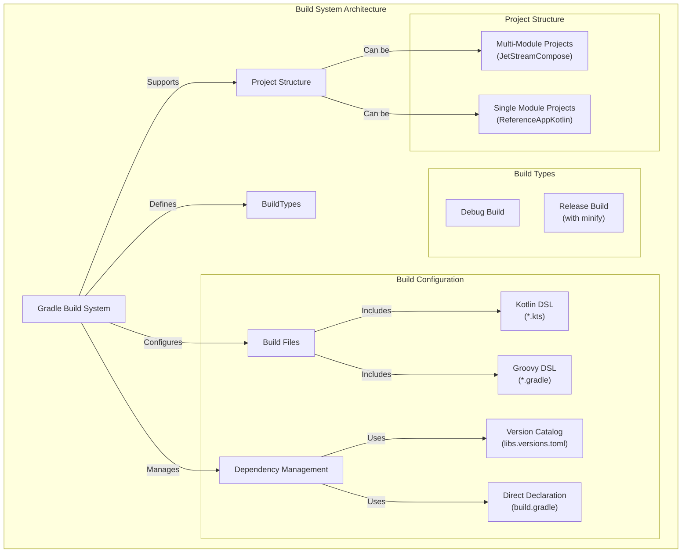
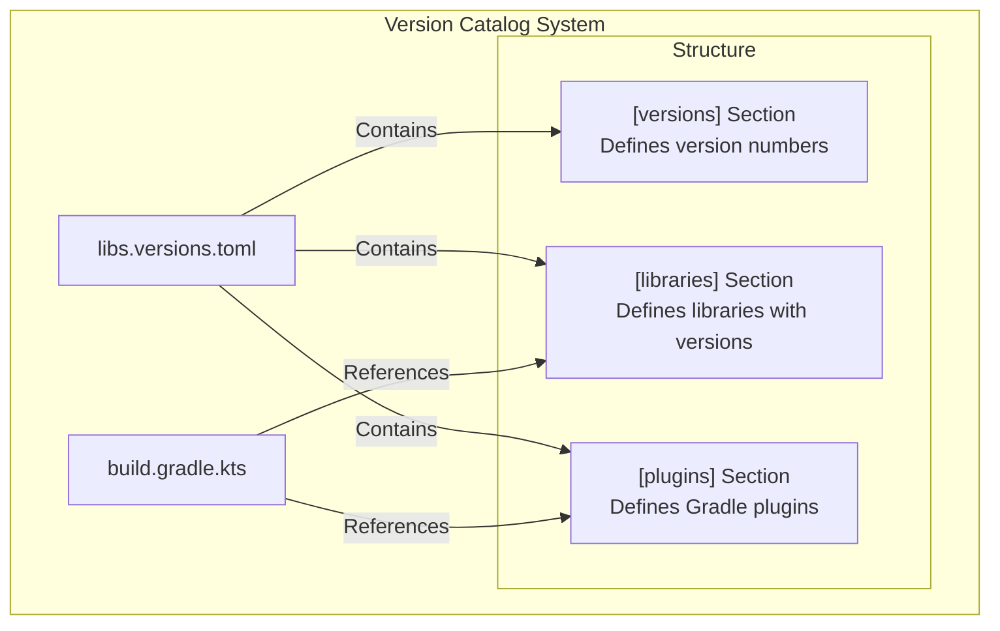
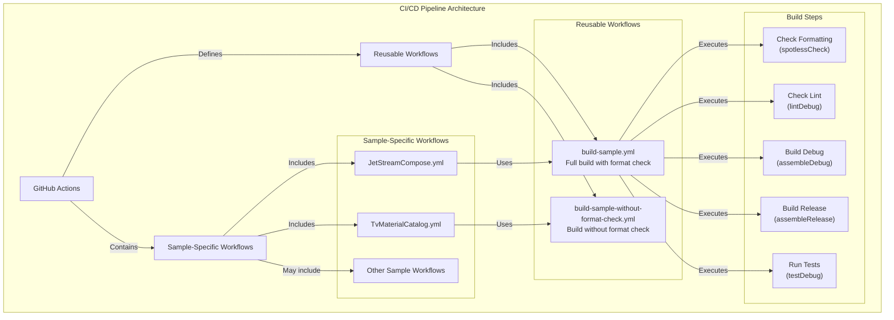
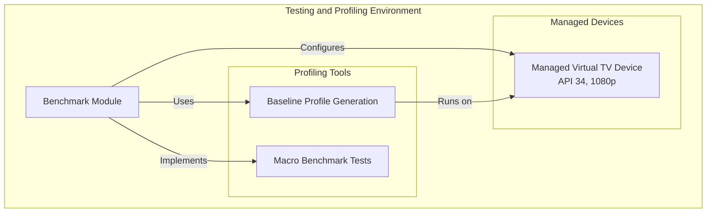

<!-- source: DeepWiki mcp.deepwiki.com · repo android/tv-samples · page 5 Build System and CI/CD · fetched 2026-10-23 -->

# Build System and CI/CD

<details>
<summary>Relevant source files</summary>

The following files were used as context for generating this wiki page:

- [.github/scripts/gradlew_recursive.sh](.github/scripts/gradlew_recursive.sh)
- [.github/workflows/JetStreamCompose.yml](.github/workflows/JetStreamCompose.yml)
- [.github/workflows/TvMaterialCatalog.yml](.github/workflows/TvMaterialCatalog.yml)
- [.github/workflows/build-sample.yml](.github/workflows/build-sample.yml)
- [JetStreamCompose/.gitignore](JetStreamCompose/.gitignore)
- [JetStreamCompose/benchmark/build.gradle.kts](JetStreamCompose/benchmark/build.gradle.kts)
- [JetStreamCompose/build.gradle.kts](JetStreamCompose/build.gradle.kts)
- [JetStreamCompose/gradle/libs.versions.toml](JetStreamCompose/gradle/libs.versions.toml)
- [JetStreamCompose/gradle/wrapper/gradle-wrapper.properties](JetStreamCompose/gradle/wrapper/gradle-wrapper.properties)
- [JetStreamCompose/jetstream/build.gradle.kts](JetStreamCompose/jetstream/build.gradle.kts)
- [JetStreamCompose/jetstream/proguard-rules.pro](JetStreamCompose/jetstream/proguard-rules.pro)
- [JetStreamCompose/jetstream/src/main/java/com/google/jetstream/presentation/screens/profile/AboutSection.kt](JetStreamCompose/jetstream/src/main/java/com/google/jetstream/presentation/screens/profile/AboutSection.kt)
- [ReferenceAppKotlin/app/build.gradle](ReferenceAppKotlin/app/build.gradle)
- [ReferenceAppKotlin/app/src/main/java/com/android/tv/reference/MainActivity.kt](ReferenceAppKotlin/app/src/main/java/com/android/tv/reference/MainActivity.kt)
- [ReferenceAppKotlin/app/src/main/java/com/android/tv/reference/deeplink/DeepLinkViewModel.kt](ReferenceAppKotlin/app/src/main/java/com/android/tv/reference/deeplink/DeepLinkViewModel.kt)
- [ReferenceAppKotlin/app/src/main/java/com/android/tv/reference/playback/PlaybackFragment.kt](ReferenceAppKotlin/app/src/main/java/com/android/tv/reference/playback/PlaybackFragment.kt)
- [scripts/checksum.sh](scripts/checksum.sh)

</details>


This document provides a technical overview of the build system configuration and continuous integration/continuous deployment (CI/CD) pipeline used across the Android TV Samples repository. It covers the Gradle build system implementation and the GitHub Actions workflows that automate building, testing, and validating the sample applications.

For detailed information about specific sample applications, see [JetStreamCompose](#2), [ReferenceAppKotlin](#3), or [TvMaterialCatalog](#4).

## Build System Architecture

The Android TV Samples repository uses Gradle as its build system with varying configurations across different sample applications. The build system is responsible for compiling code, managing dependencies, and generating APKs.



Sources:
- [JetStreamCompose/build.gradle.kts]()
- [JetStreamCompose/jetstream/build.gradle.kts]()
- [ReferenceAppKotlin/app/build.gradle]()
- [JetStreamCompose/gradle/libs.versions.toml]()

## Gradle Configuration

### Version Catalog (Modern Approach)

The JetStreamCompose sample uses a modern approach to dependency management with a version catalog defined in `libs.versions.toml`. This centralized approach makes dependency management more maintainable and reduces duplication.



The version catalog in JetStreamCompose defines:

1. **Versions**: Centralized version numbers for all dependencies
2. **Libraries**: References to specific libraries with their versions
3. **Plugins**: Gradle plugins used in the build process

Example from the version catalog:

- Dependency versions are defined in the `[versions]` section: [JetStreamCompose/gradle/libs.versions.toml:1-23]()
- Library definitions reference these versions: [JetStreamCompose/gradle/libs.versions.toml:25-50]()
- Plugins are defined for easy application across modules: [JetStreamCompose/gradle/libs.versions.toml:52-60]()

In the build files, these dependencies are referenced using the `libs` accessor:

```kotlin
dependencies {
    implementation(libs.androidx.core.ktx)
    implementation(libs.androidx.lifecycle.runtime.ktx)
}
```

Sources:
- [JetStreamCompose/gradle/libs.versions.toml]()
- [JetStreamCompose/jetstream/build.gradle.kts:74-120]()

### Traditional Dependency Management

The ReferenceAppKotlin sample uses a more traditional approach to dependency management, directly declaring dependencies in the build.gradle file with version variables.

Example from ReferenceAppKotlin:

```kotlin
dependencies {
    def leanback_version = "1.2.0-alpha02"
    def room_version = "2.4.2"
    implementation "androidx.leanback:leanback:$leanback_version"
    implementation "androidx.room:room-runtime:$room_version"
}
```

Sources:
- [ReferenceAppKotlin/app/build.gradle:72-146]()

### Build Types and Features

Both approaches configure similar build features:

1. **Build Types**: 
   - Debug build (for development)
   - Release build (optimized with minification)

2. **Build Features**:
   - ViewBinding for ReferenceAppKotlin: [ReferenceAppKotlin/app/build.gradle:53-57]()
   - Compose for JetStreamCompose: [JetStreamCompose/jetstream/build.gradle.kts:58-61]()

3. **Kotlin Configuration**:
   - Java compatibility: [ReferenceAppKotlin/app/build.gradle:59-69]()
   - JVM Toolchain: [JetStreamCompose/jetstream/build.gradle.kts:26-28]()

Sources:
- [JetStreamCompose/jetstream/build.gradle.kts:30-72]()
- [ReferenceAppKotlin/app/build.gradle:28-70]()

### Gradle Wrapper

The Gradle Wrapper ensures consistent builds across different environments by providing a specific Gradle version. The repository uses Gradle 8.10.2 for JetStreamCompose, as specified in [JetStreamCompose/gradle/wrapper/gradle-wrapper.properties]().

Sources:
- [JetStreamCompose/gradle/wrapper/gradle-wrapper.properties]()

## CI/CD Pipeline

The repository uses GitHub Actions for CI/CD to automate building, testing, and validating sample applications. The workflow structure is designed for reusability across different samples.



Sources:
- [.github/workflows/build-sample.yml]()
- [.github/workflows/JetStreamCompose.yml]()
- [.github/workflows/TvMaterialCatalog.yml]()

### Reusable Workflows

The repository implements a reusable workflow pattern to avoid duplication across sample-specific workflows.

#### Main Build Workflow

The `build-sample.yml` workflow defines a standardized build process that any sample can use:

1. **Inputs**:
   - `name`: The name of the sample
   - `path`: The relative path to the sample's directory

2. **Build Steps**:
   - Checkout code
   - Set up JDK 17
   - Generate and use cache key for faster builds
   - Check code formatting with Spotless
   - Check lint rules
   - Build debug APK
   - Build release APK
   - Run local tests
   - Upload build artifacts

Source: [.github/workflows/build-sample.yml:15-88]()

### Sample-Specific Workflows

Each sample has its own workflow file that calls the reusable workflow with specific parameters:

#### JetStreamCompose Workflow

```yaml
name: JetStreamCompose

on:
  push:
    branches:
      - main
    paths:
      - '.github/workflows/JetStreamCompose.yml'
      - 'JetStreamCompose/**'
  pull_request:
    paths:
      - '.github/workflows/JetStreamCompose.yml'
      - 'JetStreamCompose/**'
  workflow_dispatch:

jobs:
  build:
    uses: ./.github/workflows/build-sample.yml
    with:
      name: JetStreamCompose
      path: JetStreamCompose
```

This workflow is triggered when:
- Changes are pushed to the `main` branch affecting JetStreamCompose files
- A pull request changes JetStreamCompose files
- Manual dispatch

Source: [.github/workflows/JetStreamCompose.yml]()

#### TvMaterialCatalog Workflow

The TvMaterialCatalog workflow is similar but uses the workflow without formatting checks:

```yaml
jobs:
  build:
    uses: ./.github/workflows/build-sample-without-check.yml
    with:
      name: TvMaterialCatalog
      path: TvMaterialCatalog
```

Source: [.github/workflows/TvMaterialCatalog.yml:16-21]()

### Build Optimization

Several techniques are used to optimize the CI/CD process:

1. **Caching**: Gradle dependencies are cached between runs to speed up builds:
   ```yaml
   - uses: actions/cache@v4
     with:
       path: |
         ~/.gradle/caches/modules-*
         ~/.gradle/caches/jars-*
         ~/.gradle/caches/build-cache-*
       key: gradle-${{ hashFiles('checksum.txt') }}
   ```

2. **Checksum Generation**: A script generates checksums of Gradle files to create deterministic cache keys:
   ```yaml
   - name: Generate cache key
     run: ./scripts/checksum.sh ${{ inputs.path }} checksum.txt
   ```

   The script identifies Gradle-related files and creates a checksum for caching:
   [scripts/checksum.sh:26-40]()

Sources:
- [.github/workflows/build-sample.yml:46-55]()
- [scripts/checksum.sh]()

## Environment Configuration for Testing and Profiling

JetStreamCompose includes configuration for Baseline Profiles and benchmark testing with managed virtual devices:



The Benchmark module:
- Defines virtual TV device configurations
- Sets up baseline profiling for performance optimization
- Configures benchmarking tools for performance testing

Sources:
- [JetStreamCompose/benchmark/build.gradle.kts:48-53]()
- [JetStreamCompose/benchmark/build.gradle.kts:59-62]()

## Gradle Properties and Configuration

The build system uses various Gradle properties to optimize performance and configure the build environment:

1. **JVM Memory Settings**:
   ```
   org.gradle.jvmargs=-Xmx2048m -Dfile.encoding=UTF-8
   ```

2. **Parallel Execution**: Disabled in CI environments for stability:
   ```
   bash "$GRADLEW" -p "$SAMPLE" -Pci --no-parallel --stacktrace $@
   ```

Sources:
- [.github/scripts/gradlew_recursive.sh:19-28]()

## Build System Integration with App Features

The build system integrates with application features through BuildConfig flags and similar mechanisms:

```kotlin
buildConfigField("boolean", "FIREBASE_ENABLED", "false")
```

This allows the application to conditionally enable features based on build configuration:

```kotlin
if (BuildConfig.FIREBASE_ENABLED) {
    Timber.d("Firebase is enabled, loading browse")
    navGraph.setStartDestination(R.id.browseFragment)
} else {
    Timber.d("Firebase is not enabled; showing notice")
    navGraph.setStartDestination(R.id.noFirebaseFragment)
}
```

Sources:
- [ReferenceAppKotlin/app/build.gradle:43]()
- [ReferenceAppKotlin/app/src/main/java/com/android/tv/reference/MainActivity.kt:112-118]()

## Summary

The Android TV Samples repository employs a modern, flexible build system with:

1. **Gradle Build System**:
   - Modern approach with Kotlin DSL and version catalogs in JetStreamCompose
   - Traditional approach with direct dependency declarations in ReferenceAppKotlin

2. **CI/CD Pipeline**:
   - Reusable GitHub Actions workflows
   - Sample-specific workflow configurations
   - Optimized build process with caching

This architecture ensures:
- Consistent builds across different environments
- Automated testing and validation
- Efficient CI/CD pipeline with reusable components
- Support for different project structures and dependency management approaches

---

