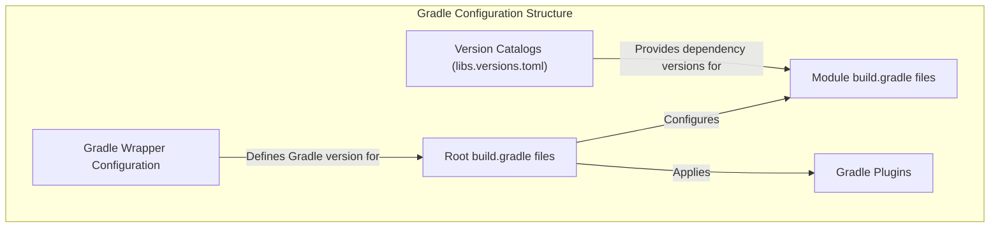
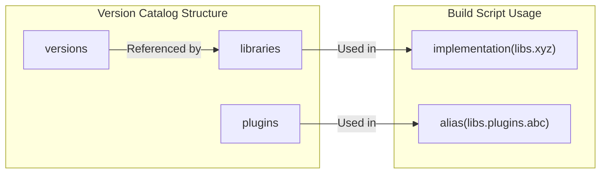
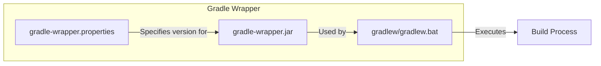
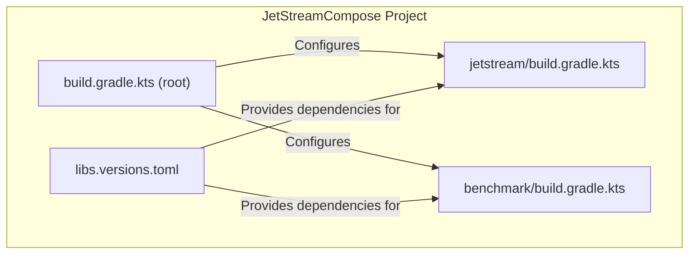
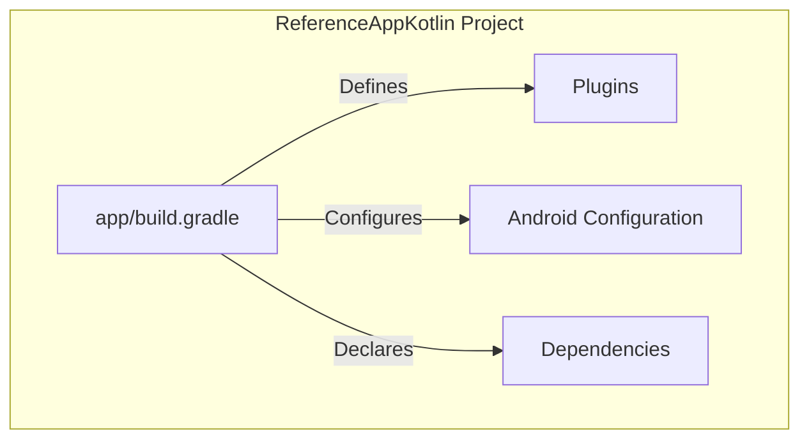
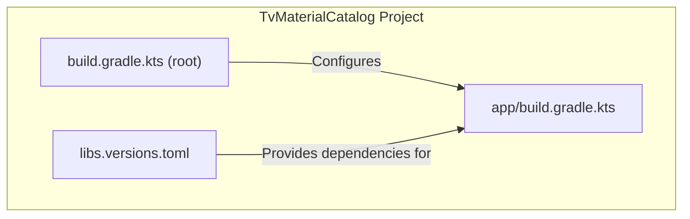

<!-- source: DeepWiki mcp.deepwiki.com · repo android/tv-samples · page 5.1 Gradle Configuration · fetched 2026-10-23 -->

# Gradle Configuration

<details>
<summary>Relevant source files</summary>

The following files were used as context for generating this wiki page:

- [JetStreamCompose/.gitignore](JetStreamCompose/.gitignore)
- [JetStreamCompose/benchmark/build.gradle.kts](JetStreamCompose/benchmark/build.gradle.kts)
- [JetStreamCompose/build.gradle.kts](JetStreamCompose/build.gradle.kts)
- [JetStreamCompose/gradle/libs.versions.toml](JetStreamCompose/gradle/libs.versions.toml)
- [JetStreamCompose/gradle/wrapper/gradle-wrapper.properties](JetStreamCompose/gradle/wrapper/gradle-wrapper.properties)
- [JetStreamCompose/jetstream/build.gradle.kts](JetStreamCompose/jetstream/build.gradle.kts)
- [JetStreamCompose/jetstream/proguard-rules.pro](JetStreamCompose/jetstream/proguard-rules.pro)
- [JetStreamCompose/jetstream/src/main/java/com/google/jetstream/presentation/screens/profile/AboutSection.kt](JetStreamCompose/jetstream/src/main/java/com/google/jetstream/presentation/screens/profile/AboutSection.kt)
- [ReferenceAppKotlin/app/build.gradle](ReferenceAppKotlin/app/build.gradle)
- [ReferenceAppKotlin/app/src/main/java/com/android/tv/reference/MainActivity.kt](ReferenceAppKotlin/app/src/main/java/com/android/tv/reference/MainActivity.kt)
- [ReferenceAppKotlin/app/src/main/java/com/android/tv/reference/deeplink/DeepLinkViewModel.kt](ReferenceAppKotlin/app/src/main/java/com/android/tv/reference/deeplink/DeepLinkViewModel.kt)
- [ReferenceAppKotlin/app/src/main/java/com/android/tv/reference/playback/PlaybackFragment.kt](ReferenceAppKotlin/app/src/main/java/com/android/tv/reference/playback/PlaybackFragment.kt)
- [TvMaterialCatalog/app/build.gradle.kts](TvMaterialCatalog/app/build.gradle.kts)
- [TvMaterialCatalog/gradle/libs.versions.toml](TvMaterialCatalog/gradle/libs.versions.toml)
- [TvMaterialCatalog/gradle/wrapper/gradle-wrapper.jar](TvMaterialCatalog/gradle/wrapper/gradle-wrapper.jar)
- [TvMaterialCatalog/gradle/wrapper/gradle-wrapper.properties](TvMaterialCatalog/gradle/wrapper/gradle-wrapper.properties)
- [TvMaterialCatalog/gradlew](TvMaterialCatalog/gradlew)
- [TvMaterialCatalog/gradlew.bat](TvMaterialCatalog/gradlew.bat)

</details>


This page explains the Gradle build system configuration used across the Android TV Samples repository. It covers how each sample project configures its build files, dependency management, and build-related settings. For information about CI/CD pipeline configuration, see [CI/CD Pipeline](#5.2).

## Overview

The Android TV Samples repository uses Gradle as its build system with different configuration styles across the sample projects. While some projects use the Kotlin DSL for build scripts (with `.kts` extension), others use the traditional Groovy DSL. Additionally, the newer samples leverage version catalogs (`libs.versions.toml`) for dependency management.



Sources: [JetStreamCompose/build.gradle.kts](), [ReferenceAppKotlin/app/build.gradle](), [JetStreamCompose/gradle/wrapper/gradle-wrapper.properties]()

## Build Script Types

The Android TV Samples repository demonstrates both Kotlin DSL and Groovy DSL for Gradle build scripts:

| Sample Project | Build Script Type | Main Build File |
|----------------|------------------|-----------------|
| JetStreamCompose | Kotlin DSL | build.gradle.kts |
| ReferenceAppKotlin | Groovy DSL | build.gradle |
| TvMaterialCatalog | Kotlin DSL | build.gradle.kts |

Sources: [JetStreamCompose/jetstream/build.gradle.kts](), [ReferenceAppKotlin/app/build.gradle](), [TvMaterialCatalog/app/build.gradle.kts]()

## Version Catalogs

The newer projects (JetStreamCompose and TvMaterialCatalog) use Gradle's version catalogs to manage dependencies centrally through `libs.versions.toml` files. This approach offers several advantages:

- Centralized version management
- Type-safe accessors for dependencies
- Simplified dependency declarations
- Consistent versioning across modules



### Example: Version Catalog (JetStreamCompose)

The JetStreamCompose project uses a comprehensive version catalog with these sections:

- `versions`: Defines version numbers for dependencies
- `libraries`: Defines library dependencies with their coordinates
- `plugins`: Defines Gradle plugins with their IDs and versions

Sources: [JetStreamCompose/gradle/libs.versions.toml](), [TvMaterialCatalog/gradle/libs.versions.toml]()

## Gradle Wrapper Configuration

All samples use the Gradle wrapper, which ensures a consistent build environment by specifying a fixed Gradle version:



The JetStreamCompose and TvMaterialCatalog projects both use Gradle 8.10.2:

```
distributionUrl=https\://services.gradle.org/distributions/gradle-8.10.2-bin.zip
```

Sources: [JetStreamCompose/gradle/wrapper/gradle-wrapper.properties](), [TvMaterialCatalog/gradle/wrapper/gradle-wrapper.properties]()

## JetStreamCompose Gradle Configuration

The JetStreamCompose project uses the Kotlin DSL for build scripts and has a multi-module structure.

### Project Structure and Build Files



### Root Build File

The root build file applies plugins globally but doesn't apply them to itself:

```kotlin
plugins {
    alias(libs.plugins.android.application) apply false
    alias(libs.plugins.kotlin.android) apply false
    alias(libs.plugins.kotlin.serialization) apply false
    alias(libs.plugins.compose.compiler) apply false
    alias(libs.plugins.android.test) apply false
    alias(libs.plugins.hilt) apply false
    alias(libs.plugins.ksp) apply false
}
```

### Module Build Files

The `jetstream` module applies these plugins and configures Android-specific settings:

```kotlin
plugins {
    alias(libs.plugins.android.application)
    alias(libs.plugins.kotlin.android)
    alias(libs.plugins.kotlin.serialization)
    alias(libs.plugins.compose.compiler)
    alias(libs.plugins.hilt)
    alias(libs.plugins.ksp)
    alias(libs.plugins.androidx.baselineprofile)
}

android {
    namespace = "com.google.jetstream"
    compileSdk = 35
    
    defaultConfig {
        applicationId = "com.google.jetstream"
        minSdk = 28
        targetSdk = 35
        // ...
    }
    
    buildFeatures {
        compose = true
        buildConfig = true
    }
    // ...
}
```

### Dependencies

The JetStreamCompose project's dependencies are organized into categories, including:

- AndroidX core libraries
- Compose UI libraries
- Material components for TV
- Navigation components
- Hilt for dependency injection
- Media3 for media playback

Sources: [JetStreamCompose/build.gradle.kts](), [JetStreamCompose/jetstream/build.gradle.kts](), [JetStreamCompose/benchmark/build.gradle.kts](), [JetStreamCompose/gradle/libs.versions.toml]()

## ReferenceAppKotlin Gradle Configuration

ReferenceAppKotlin uses the traditional Groovy DSL for its build scripts.

### Build File Structure



### Plugins

The project applies several plugins for Android development, Kotlin support, and navigation:

```groovy
apply plugin: "com.android.application"
apply plugin: "kotlin-android"
apply plugin: "kotlin-parcelize"
apply plugin: "androidx.navigation.safeargs.kotlin"
apply plugin: 'kotlin-kapt'
```

### Android Configuration

The Android block configures essential build settings:

```groovy
android {
    compileSdkVersion 32
    defaultConfig {
        applicationId "com.android.tv.reference"
        minSdkVersion 23
        targetSdkVersion 32
        // ...
        buildConfigField("boolean", "FIREBASE_ENABLED", "false")
    }
    
    buildTypes {
        release {
            minifyEnabled false
            proguardFiles getDefaultProguardFile('proguard-android-optimize.txt'), 'proguard-rules.pro'
        }
    }
    
    buildFeatures {
        viewBinding = true
    }
    // ...
}
```

### Dependencies

Dependencies are declared directly in the build file, grouped by type and with versions declared inline or through variables:

```groovy
dependencies {
    // AndroidX libraries
    def leanback_version = "1.2.0-alpha02"
    def room_version = "2.4.2"
    // ...
    
    implementation "androidx.leanback:leanback:$leanback_version"
    implementation "androidx.room:room-runtime:$room_version"
    kapt "androidx.room:room-compiler:$room_version"
    
    // Exoplayer for playback
    def exoplayer_version = "2.17.1"
    implementation "com.google.android.exoplayer:exoplayer-core:$exoplayer_version"
    // ...
}
```

Sources: [ReferenceAppKotlin/app/build.gradle]()

## TvMaterialCatalog Gradle Configuration

The TvMaterialCatalog project uses Kotlin DSL with version catalogs, similar to JetStreamCompose.

### Build Structure



### Android Configuration

```kotlin
android {
    namespace = "com.google.tv.material.catalog"
    compileSdk = 35

    defaultConfig {
        applicationId = "com.google.tv.material.catalog"
        minSdk = 21
        targetSdk = 35
        // ...
    }
    
    buildFeatures {
        compose = true
    }
    // ...
}
```

### Dependencies

Dependencies are declared using version catalog accessor functions:

```kotlin
dependencies {
    implementation(libs.core.ktx)
    implementation(libs.appcompat)
    implementation(platform(libs.compose.bom))
    implementation(libs.ui)
    implementation(libs.foundation)
    implementation(libs.tv.foundation)
    implementation(libs.tv.material)
    // ...
}
```

Sources: [TvMaterialCatalog/app/build.gradle.kts](), [TvMaterialCatalog/gradle/libs.versions.toml]()

## Common Build Configuration Patterns

Despite the differences in build script languages and structure, there are common patterns across the sample projects:

### Common Android Configuration

| Configuration | JetStreamCompose | ReferenceAppKotlin | TvMaterialCatalog |
|---------------|-----------------|-------------------|-------------------|
| compileSdk | 35 | 32 | 35 |
| minSdk | 28 | 23 | 21 |
| targetSdk | 35 | 32 | 35 |
| Compose Enabled | Yes | No | Yes |
| BuildConfig Enabled | Yes | Yes (implicit) | No |

### Common TV-Specific Dependencies

| Dependency | JetStreamCompose | ReferenceAppKotlin | TvMaterialCatalog |
|------------|-----------------|-------------------|-------------------|
| Leanback | No | Yes | No |
| TV Foundation | No | No | Yes |
| TV Material | Yes | No | Yes |
| Media/ExoPlayer | Media3 | ExoPlayer 2.x | No |

### Common Gradle Plugins

- Kotlin Android Plugin
- Android Application Plugin
- Kotlin Serialization (in newer samples)
- Compose Compiler (in Compose-based samples)

Sources: [JetStreamCompose/jetstream/build.gradle.kts](), [ReferenceAppKotlin/app/build.gradle](), [TvMaterialCatalog/app/build.gradle.kts]()

## ProGuard/R8 Configuration

The samples include ProGuard configuration files for code shrinking and optimization:

- JetStreamCompose includes basic ProGuard rules with most settings commented out for demonstration purposes
- Release builds typically have minification enabled, but some samples have it disabled for simplicity

Sources: [JetStreamCompose/jetstream/proguard-rules.pro]()

## Gradle Version Compatibility

The Gradle versions used in the samples are compatible with the Android Gradle Plugin versions specified in their build files:

| Project | Gradle Version | Android Gradle Plugin |
|---------|---------------|----------------------|
| JetStreamCompose | 8.10.2 | 8.8.2 |
| TvMaterialCatalog | 8.10.2 | 8.7.2 |
| ReferenceAppKotlin | Not specified directly | Depends on project setup |

Sources: [JetStreamCompose/gradle/wrapper/gradle-wrapper.properties](), [TvMaterialCatalog/gradle/wrapper/gradle-wrapper.properties](), [JetStreamCompose/gradle/libs.versions.toml](), [TvMaterialCatalog/gradle/libs.versions.toml]()

---

