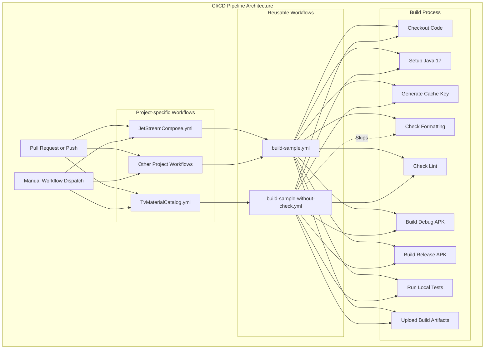
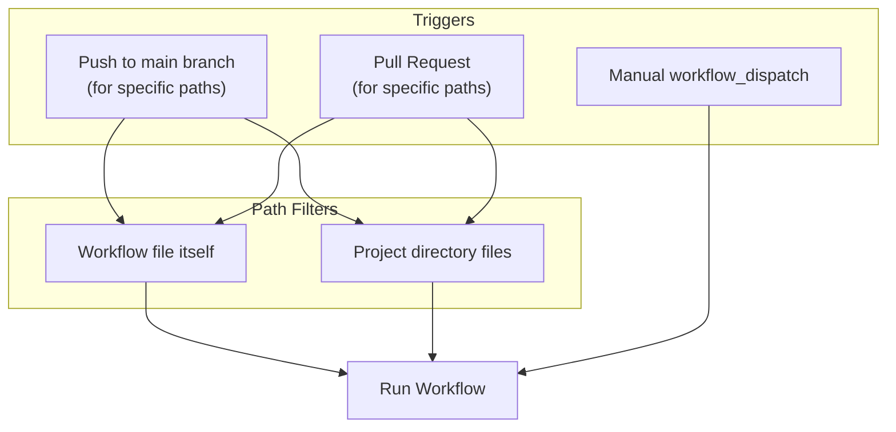
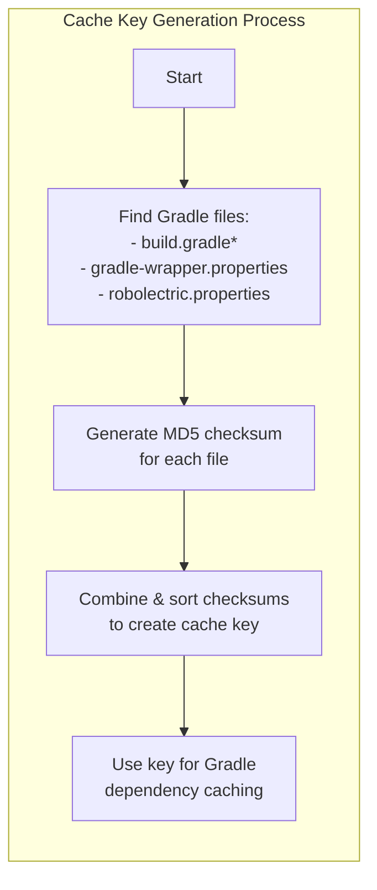
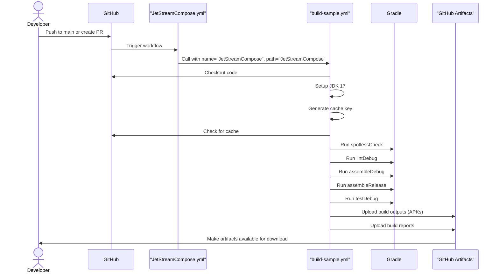

<!-- source: DeepWiki mcp.deepwiki.com · repo android/tv-samples · page 5.2 CI/CD Pipeline · fetched 2026-10-23 -->

# CI/CD Pipeline

<details>
<summary>Relevant source files</summary>

The following files were used as context for generating this wiki page:

- [.github/scripts/gradlew_recursive.sh](.github/scripts/gradlew_recursive.sh)
- [.github/workflows/JetStreamCompose.yml](.github/workflows/JetStreamCompose.yml)
- [.github/workflows/TvMaterialCatalog.yml](.github/workflows/TvMaterialCatalog.yml)
- [.github/workflows/build-sample.yml](.github/workflows/build-sample.yml)
- [scripts/checksum.sh](scripts/checksum.sh)

</details>


This document details the Continuous Integration and Continuous Delivery (CI/CD) pipeline implemented for the Android TV Samples repository. It covers the GitHub Actions workflows, build processes, and related scripts that ensure code quality and build integrity across all sample projects. For information about the Gradle build system configuration, see [Gradle Configuration](#5.1).

## Pipeline Overview

The Android TV Samples repository employs a modular CI/CD architecture with reusable workflows to maintain consistency across different samples while allowing for project-specific configurations.



Sources: [.github/workflows/build-sample.yml](), [.github/workflows/JetStreamCompose.yml](), [.github/workflows/TvMaterialCatalog.yml]()

## Workflow Structure

The CI/CD pipeline is designed around reusable workflow templates that are called by project-specific workflow definitions.

### Reusable Workflows

The repository provides two primary reusable workflow templates:

1. **build-sample.yml**: Full build workflow including formatting checks
2. **build-sample-without-check.yml**: Build workflow that skips formatting checks (for projects with custom formatting requirements)

The reusable workflows accept two required inputs:
- `name`: The name of the sample project
- `path`: The file path to the sample project

```mermaid
classDiagram
    class "build-sample.yml" {
        +workflow_call
        +name: string
        +path: string
        +concurrency group
        +build job
    }
    
    class "Build Job Steps" {
        +Checkout
        +Setup JDK 17
        +Generate cache key
        +Cache Gradle dependencies
        +Check formatting
        +Check lint
        +Build debug
        +Build release
        +Run local tests
        +Upload build outputs
        +Upload build reports
    }
    
    "build-sample.yml" --> "Build Job Steps"
```

Sources: [.github/workflows/build-sample.yml:15-87]()

### Project-specific Workflows

Each sample project has its own workflow file that defines:
- Trigger conditions (which branches, file paths)
- Which reusable workflow to call
- Project-specific parameters

For example, the JetStreamCompose workflow:

```mermaid
classDiagram
    class "JetStreamCompose.yml" {
        +on: push, pull_request, workflow_dispatch
        +paths filter: .github/workflows/JetStreamCompose.yml, JetStreamCompose/**
        +jobs: build
    }
    
    class "Build Job" {
        +uses: ./.github/workflows/build-sample.yml
        +with:
        +name: JetStreamCompose
        +path: JetStreamCompose
    }
    
    "JetStreamCompose.yml" --> "Build Job"
```

Sources: [.github/workflows/JetStreamCompose.yml:1-21]()

## Build Process

The CI/CD pipeline executes a standardized build process for each sample project. This section details each step in the process.

| Step | Purpose | Implementation |
|------|---------|----------------|
| Checkout | Clone the repository | Uses `actions/checkout@v4` |
| Setup Java | Set up JDK 17 | Uses `actions/setup-java@v4` with Zulu distribution |
| Cache Generation | Create hash for build cache | Runs `./scripts/checksum.sh` to generate checksums of Gradle files |
| Dependency Caching | Cache Gradle dependencies | Uses `actions/cache@v4` with the generated checksum |
| Format Check | Verify code formatting | Runs `./gradlew spotlessCheck` |
| Lint Check | Check for code quality issues | Runs `./gradlew lintDebug` |
| Debug Build | Build debug version | Runs `./gradlew assembleDebug` |
| Release Build | Build release version | Runs `./gradlew assembleRelease` |
| Testing | Run unit tests | Runs `./gradlew testDebug` |
| Artifact Upload | Upload build outputs (APKs) | Uses `actions/upload-artifact@v4` |
| Report Upload | Upload build reports | Uses `actions/upload-artifact@v4` |

Sources: [.github/workflows/build-sample.yml:36-88]()

## Workflow Triggers

Each project-specific workflow is configured with specific triggers to determine when the CI/CD pipeline should execute.

### Standard Triggers



For example, `JetStreamCompose.yml` is triggered when:
- A push to the `main` branch occurs that changes either:
  - The workflow file itself (`.github/workflows/JetStreamCompose.yml`)
  - Any file in the JetStreamCompose directory
- A pull request is opened that changes the same files
- A manual workflow dispatch is triggered

Sources: [.github/workflows/JetStreamCompose.yml:3-14](), [.github/workflows/TvMaterialCatalog.yml:3-14]()

## Caching and Performance Optimization

Build performance is optimized through strategic caching of Gradle dependencies.

### Cache Key Generation

The pipeline uses a script to generate a unique cache key based on Gradle configuration files:



The script `scripts/checksum.sh` finds all Gradle configuration files in the specified sample project, generates MD5 checksums for each, and combines them into a single sorted file that serves as the cache key.

Sources: [scripts/checksum.sh:18-40](), [.github/workflows/build-sample.yml:46-55]()

### Cache Configuration

The workflow caches:
- Gradle module caches
- Gradle jar caches
- Gradle build caches

This caching strategy significantly reduces build times for subsequent runs when dependencies haven't changed.

## Concurrency Control

The CI/CD pipeline implements concurrency controls to manage resource usage and avoid redundant builds:

```yaml
concurrency:
  group: ${{ inputs.name }}-build-${{ github.ref }}
  cancel-in-progress: true
```

This configuration ensures that:
- Only one workflow runs at a time for a given sample and branch
- If a new commit is pushed, any currently running workflow for the same branch is canceled

Source: [.github/workflows/build-sample.yml:27-29]()

## Practical Example: JetStreamCompose Build Flow

This example shows how the pipeline executes for the JetStreamCompose sample:



Sources: [.github/workflows/JetStreamCompose.yml](), [.github/workflows/build-sample.yml]()

## Summary

The CI/CD pipeline for the Android TV Samples repository implements a modular, reusable approach to continuous integration and delivery. The system ensures consistent build quality across all sample projects while allowing for project-specific customizations. The pipeline performs comprehensive validation including formatting checks, lint analysis, builds for both debug and release configurations, and unit testing.

By using GitHub Actions with optimized caching strategies and concurrent build management, the pipeline provides efficient feedback on code changes, ensuring sample projects remain in a buildable, high-quality state.

Sources: [.github/workflows/build-sample.yml](), [.github/workflows/JetStreamCompose.yml](), [.github/workflows/TvMaterialCatalog.yml](), [scripts/checksum.sh]()