# Page: Overview

# Overview

<details>
<summary>Relevant source files</summary>

The following files were used as context for generating this wiki page:

- [.gitignore](.gitignore)
- [CONTRIBUTING.md](CONTRIBUTING.md)
- [ClassicsKotlin/README.md](ClassicsKotlin/README.md)
- [LICENSE](LICENSE)
- [Leanback/README.md](Leanback/README.md)
- [LeanbackShowcase/README.md](LeanbackShowcase/README.md)
- [README.md](README.md)

</details>


This document provides a comprehensive introduction to the Android TV Samples repository. This collection of sample applications demonstrates recommended implementation patterns and best practices for developing applications for the Android TV platform.

## Purpose

The Android TV Samples repository serves as a practical learning resource for developers building applications for Android TV and Google TV devices. Each sample project focuses on specific aspects of TV application development, from basic UI components to complex media playback systems. The repository demonstrates how to leverage various Android TV libraries and frameworks to create engaging, user-friendly TV experiences.

Sources: [README.md:1-13]()

## Repository Structure

The repository consists of multiple standalone projects, each showcasing different features and implementation approaches:

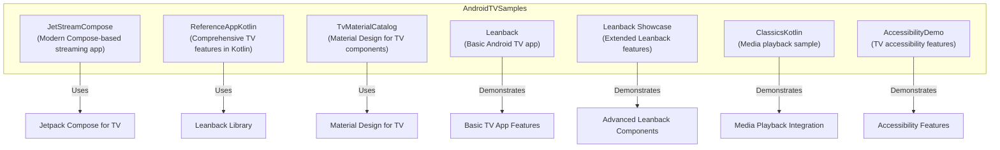

Sources: [README.md:4-13]()

## Key Sample Applications

The repository contains the following primary sample applications:

### JetStreamCompose

A modern streaming application built with Jetpack Compose for TV. This sample demonstrates how to implement a video streaming interface using declarative UI with Compose, including browse screens, video playback, and navigation patterns.

### ReferenceAppKotlin

The most comprehensive sample that demonstrates a variety of Android TV and Google TV integrations in Kotlin, including:
- Media playback with ExoPlayer
- Video browsing interfaces
- Authentication flows
- Deep linking

### TvMaterialCatalog

Showcases Material Design components specifically optimized for TV interfaces using Jetpack Compose. This sample demonstrates how to implement TV-specific UI patterns following Material Design guidelines.

### Leanback & Leanback Showcase

These Java-based samples demonstrate the usage of the Leanback support library:
- Leanback: A basic implementation of an Android TV app
- Leanback Showcase: Demonstrates various components of the Leanback library in isolation

### ClassicsKotlin

A modern implementation of a media playback application that demonstrates:
- MediaSession support
- ExoPlayer integration
- TV launcher home screen channels
- Content provider implementation for global search and Google Assistant
- Leanback browsing experience

### AccessibilityDemo

Demonstrates best practices for implementing accessibility features in TV applications.

Sources: [README.md:6-12](), [ClassicsKotlin/README.md:1-11](), [Leanback/README.md:1-3](), [LeanbackShowcase/README.md:1-7]()

## Feature Comparison Across Samples

The following table highlights the key features demonstrated in each sample application:

| Feature | JetStreamCompose | ReferenceAppKotlin | TvMaterialCatalog | Leanback | LeanbackShowcase | ClassicsKotlin |
|---------|------------------|-------------------|-------------------|---------|-----------------|---------------|
| UI Framework | Jetpack Compose | Leanback (XML) | Jetpack Compose | Leanback (XML) | Leanback (XML) | Leanback (XML) |
| Language | Kotlin | Kotlin | Kotlin | Java | Java | Kotlin |
| Video Playback | ✓ | ✓ | - | ✓ | ✓ | ✓ |
| Browse Interface | ✓ | ✓ | ✓ | ✓ | ✓ | ✓ |
| Search | ✓ | ✓ | - | ✓ | ✓ | ✓ |
| Home Screen Channels | - | ✓ | - | - | - | ✓ |
| Content Provider | - | ✓ | - | ✓ | - | ✓ |
| Authentication | - | ✓ | - | - | - | - |
| Material Design | ✓ | - | ✓ | - | - | - |
| Accessibility | - | - | - | - | - | - |

Sources: [README.md:6-12](), [ClassicsKotlin/README.md:4-10](), [Leanback/README.md:19-39]()

## Technical Architecture Overview

The following diagram illustrates the key technical components and their relationships across the sample applications:

```mermaid
graph TD
    subgraph "User Interface Frameworks"
        ComposeTV["androidx.tv.compose<br>(Jetpack Compose for TV)"]
        LeanbackLib["androidx.leanback<br>(Leanback Support Library)"]
    end
    
    subgraph "Media Playback"
        ExoPlayer["androidx.media3.exoplayer<br>(ExoPlayer)"]
        MediaSession["androidx.media3.session<br>(MediaSession)"]
        PlaybackTransportControls["Playback Transport Controls"]
    end
    
    subgraph "Content Integration"
        ContentProvider["android.content.ContentProvider"]
        HomeScreenChannels["Home Screen Channels API"]
        SearchableProvider["Searchable Content Provider"]
        DeepLinking["Deep Linking"]
    end
    
    subgraph "Common Components"
        BrowseFragment["BrowseFragment"]
        VideoDetailsFragment["VideoDetailsFragment"]
        PlaybackFragment["PlaybackFragment"]
        SearchFragment["SearchFragment"]
        GuidedStepFragment["GuidedStepFragment"]
    end
    
    ComposeTV -->|Used by| JetStreamCompose
    ComposeTV -->|Used by| TvMaterialCatalog
    
    LeanbackLib -->|Used by| ReferenceAppKotlin
    LeanbackLib -->|Used by| Leanback
    LeanbackLib -->|Used by| LeanbackShowcase
    LeanbackLib -->|Used by| ClassicsKotlin
    
    ExoPlayer -->|Used by| JetStreamCompose
    ExoPlayer -->|Used by| ReferenceAppKotlin
    ExoPlayer -->|Used by| ClassicsKotlin
    
    MediaSession -->|Used by| ReferenceAppKotlin
    MediaSession -->|Used by| ClassicsKotlin
    
    ContentProvider -->|Implemented by| ReferenceAppKotlin
    ContentProvider -->|Implemented by| ClassicsKotlin
    
    HomeScreenChannels -->|Implemented by| ClassicsKotlin
    
    BrowseFragment -->|Extended by| Leanback
    BrowseFragment -->|Extended by| ReferenceAppKotlin
    BrowseFragment -->|Extended by| ClassicsKotlin
    
    VideoDetailsFragment -->|Extended by| Leanback
    VideoDetailsFragment -->|Extended by| ReferenceAppKotlin
    
    PlaybackFragment -->|Extended by| Leanback
    PlaybackFragment -->|Extended by| ReferenceAppKotlin
    PlaybackFragment -->|Extended by| ClassicsKotlin
```

Sources: [README.md:6-12](), [ClassicsKotlin/README.md:4-10](), [Leanback/README.md:20-39]()

## Getting Started

To get started with the Android TV Samples repository:

1. Clone the repository:
   ```
   git clone https://github.com/android/tv-samples.git
   ```

2. Open the specific project you're interested in using Android Studio

3. Build and run the sample on an Android TV emulator or physical device

For detailed information about getting started with a specific sample, refer to the README file in each project's directory.

For more information about getting started with Android TV development in general, see [Getting Started with Android TV](1.1).

Sources: [README.md:14-24]()

## Additional Resources

- [Android TV Introduction](http://www.android.com/tv/)
- [Android TV Developer Documentation](http://developer.android.com/tv)
- [Android TV Apps in Google Play Store](http://play.google.com/store/apps/collection/promotion_3000e26_androidtv_apps_all)

Sources: [README.md:26-30]()

## License

The Android TV Samples repository is licensed under the Apache License, Version 2.0.

Sources: [README.md:38-45](), [LICENSE:1-203]()

---

# Page: Getting Started

# Getting Started

<details>
<summary>Relevant source files</summary>

The following files were used as context for generating this wiki page:

- [.github/scripts/gradlew_recursive.sh](.github/scripts/gradlew_recursive.sh)
- [.github/workflows/JetStreamCompose.yml](.github/workflows/JetStreamCompose.yml)
- [.github/workflows/TvMaterialCatalog.yml](.github/workflows/TvMaterialCatalog.yml)
- [.github/workflows/build-sample.yml](.github/workflows/build-sample.yml)
- [.gitignore](.gitignore)
- [CONTRIBUTING.md](CONTRIBUTING.md)
- [ClassicsKotlin/README.md](ClassicsKotlin/README.md)
- [LICENSE](LICENSE)
- [Leanback/README.md](Leanback/README.md)
- [LeanbackShowcase/README.md](LeanbackShowcase/README.md)
- [README.md](README.md)
- [scripts/checksum.sh](scripts/checksum.sh)

</details>


This document provides instructions for setting up and running the Android TV Samples repository projects. It covers the prerequisites, environment setup, project configuration, and execution steps needed to successfully work with these samples. For information about the overall repository structure and the specific samples included, see [Repository Structure](#1.2).

## Prerequisites

Before you begin working with the Android TV samples, ensure you have the following prerequisites installed on your development machine:

| Requirement | Version/Details | Purpose |
|-------------|----------------|---------|
| JDK (Java Development Kit) | 17 or newer | Required for Android development |
| Android Studio | Latest stable version | Primary IDE for Android development |
| Android SDK | API level 30+ | Core Android development libraries |
| Android TV Emulator or Device | TV emulator or physical device (ADT-2, ADT-3) | For testing the applications |
| Git | Latest version | For cloning the repository |

Sources: [.github/workflows/build-sample.yml:40-44]()

## Repository Overview

The Android TV Samples repository contains multiple sample applications demonstrating different aspects of Android TV development:

```mermaid
graph TD
    subgraph "Android TV Samples Repository"
        JetStreamCompose["JetStreamCompose<br>(Jetpack Compose for TV)"]
        ReferenceAppKotlin["ReferenceAppKotlin<br>(TV Reference App)"]
        TvMaterialCatalog["TvMaterialCatalog<br>(Material Design Components)"]
        Leanback["Leanback<br>(Basic TV UI Patterns)"]
        LeanbackShowcase["LeanbackShowcase<br>(Advanced Leanback Features)"]
        ClassicsKotlin["ClassicsKotlin<br>(Modern Android TV App)"]
        AccessibilityDemo["AccessibilityDemo<br>(TV Accessibility)"]
    end
    
    Developer["Developer<br>Environment"] -->|"Clone & Setup"| "Android TV Samples Repository"
    "Android TV Samples Repository" -->|"Deploy & Test"| TVDevice["Android TV<br>Device/Emulator"]
```

Sources: [README.md:1-13]()

## Setting Up the Project

Follow these steps to set up the Android TV Samples on your machine:

### 1. Clone the Repository

Open a terminal or command prompt and run:

```
git clone https://github.com/android/tv-samples.git
```

This will create a local copy of the repository on your machine.

Sources: [README.md:16-20]()

### 2. Open a Sample Project in Android Studio

Android Studio is the recommended IDE for working with these samples. To open a specific sample:

1. Launch Android Studio
2. Select "Open an existing Android Studio project"
3. Navigate to the directory where you cloned the repository
4. Select the specific sample project you're interested in (e.g., JetStreamCompose, ReferenceAppKotlin, etc.)
5. Wait for Android Studio to import and index the project

Each sample is an independent Android project with its own Gradle configuration.

Sources: [README.md:22](), [ClassicsKotlin/README.md:24-25]()

## Building and Running a Sample

Once you've opened a sample project, follow these steps to build and run it:

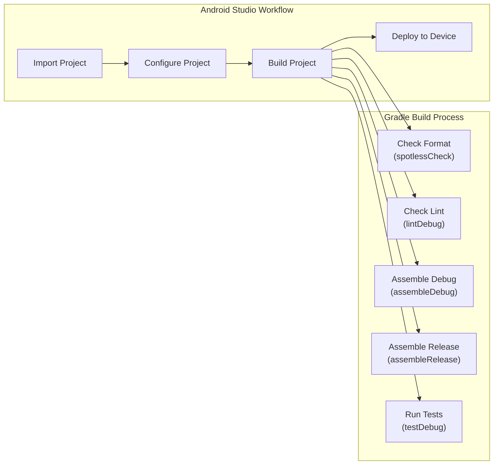

Sources: [.github/workflows/build-sample.yml:57-75]()

### Configure the Project

1. Update `local.properties` if needed to point to your Android SDK location
2. Ensure you have the required SDK versions installed through the SDK Manager
3. Sync the project with Gradle files

### Build the Project

To build the project, you can:

- Use the Android Studio UI: Select **Build** > **Make Project**
- Or use the Gradle wrapper from the terminal:
  ```
  cd path/to/sample
  ./gradlew assembleDebug
  ```

The CI/CD pipeline for the repository performs several checks during the build process:
- Format checking with Spotless
- Lint checking to identify potential issues
- Building debug and release versions
- Running tests

Sources: [.github/workflows/build-sample.yml:57-75]()

### Run on an Emulator or Device

To run the sample on an Android TV emulator or device:

1. Connect an Android TV device or start an Android TV emulator
2. In Android Studio, select **Run** > **Run 'app'**
3. Choose your device from the deployment target dialog
4. Wait for the application to build and install

For best results, test on a physical Android TV device (such as an ADT-2 or ADT-3 developer device) or a properly configured Android TV emulator.

Sources: [ClassicsKotlin/README.md:25](), [Leanback/README.md:15]()

## Troubleshooting Common Issues

If you encounter issues while setting up or running the samples:

| Issue | Potential Solution |
|-------|-------------------|
| Build failures | Ensure you have the correct JDK version (17) installed and selected in Android Studio |
| Missing dependencies | Run Gradle sync to download required dependencies |
| Emulator not starting | Verify your hardware acceleration settings in the Android Studio SDK Manager |
| Deployment errors | Make sure your device is properly connected and has developer options enabled |

## Next Steps

After successfully setting up and running the samples, you may want to:

1. Explore the code structure of each sample to understand the implementation patterns
2. Modify the samples to experiment with different features
3. Use these samples as references for your own Android TV application development

For detailed information about each sample project, refer to the other sections of this wiki:
- For JetStreamCompose, see [JetStreamCompose](#2)
- For ReferenceAppKotlin, see [ReferenceAppKotlin](#3)
- For TvMaterialCatalog, see [TvMaterialCatalog](#4)

Sources: [README.md:14-24]()

---

# Page: Repository Structure

# Repository Structure

<details>
<summary>Relevant source files</summary>

The following files were used as context for generating this wiki page:

- [.gitignore](.gitignore)
- [CONTRIBUTING.md](CONTRIBUTING.md)
- [ClassicsKotlin/README.md](ClassicsKotlin/README.md)
- [LICENSE](LICENSE)
- [Leanback/README.md](Leanback/README.md)
- [LeanbackShowcase/README.md](LeanbackShowcase/README.md)
- [README.md](README.md)
- [ReferenceAppKotlin/CAST_CONNECT.md](ReferenceAppKotlin/CAST_CONNECT.md)
- [ReferenceAppKotlin/README.md](ReferenceAppKotlin/README.md)
- [ReferenceAppKotlin/firebase/README.md](ReferenceAppKotlin/firebase/README.md)
- [ReferenceAppKotlin/firebase/server/test/authentication.test.ts](ReferenceAppKotlin/firebase/server/test/authentication.test.ts)
- [ReferenceAppKotlin/firebase/setup/save_content_to_firestore.js](ReferenceAppKotlin/firebase/setup/save_content_to_firestore.js)
- [ReferenceAppKotlin/firebase/web/index.html](ReferenceAppKotlin/firebase/web/index.html)
- [ReferenceAppKotlin/firebase/web/oauth/index.html](ReferenceAppKotlin/firebase/web/oauth/index.html)
- [ReferenceAppKotlin/firebase/web/oauth/scripts.js](ReferenceAppKotlin/firebase/web/oauth/scripts.js)
- [ReferenceAppKotlin/scripts/atv-create-media-feed.py](ReferenceAppKotlin/scripts/atv-create-media-feed.py)
- [ReferenceAppKotlin/scripts/atv-csv-to-json.py](ReferenceAppKotlin/scripts/atv-csv-to-json.py)
- [ReferenceAppKotlin/settings.gradle](ReferenceAppKotlin/settings.gradle)

</details>


This document provides an overview of the Android TV Samples repository organization, explaining the various sample applications and how they relate to each other. The purpose is to help developers understand the structure and navigate the codebase efficiently.

## Repository Overview

The Android TV Samples repository contains a collection of individual projects that demonstrate different aspects of Android TV application development. Each sample focuses on specific features or technologies relevant to TV app development.

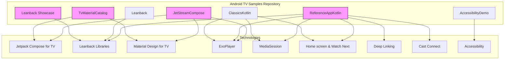

Sources: [README.md:4-13]()

## Main Sample Applications

The repository contains several key sample applications, each focusing on different aspects of Android TV development:

| Sample | Language | UI Framework | Key Focus Areas |
|--------|----------|--------------|-----------------|
| JetStreamCompose | Kotlin | Jetpack Compose | Modern UI with Compose, Video playback |
| ReferenceAppKotlin | Kotlin | Leanback | Comprehensive TV features, ExoPlayer, Cast |
| TvMaterialCatalog | Kotlin | Jetpack Compose | Material Design components for TV |
| Leanback & Showcase | Java | Leanback | Traditional TV UI patterns |
| ClassicsKotlin | Kotlin | Leanback | Media playback, home screen integration |
| AccessibilityDemo | Java | Traditional | Accessibility features for TV |

Sources: [README.md:4-13](), [ReferenceAppKotlin/README.md:1-13](), [Leanback/README.md:1-4]()

### JetStreamCompose

JetStreamCompose demonstrates building Android TV applications using Jetpack Compose for TV. This modern UI toolkit approach replaces the traditional XML-based layouts with a declarative programming model.

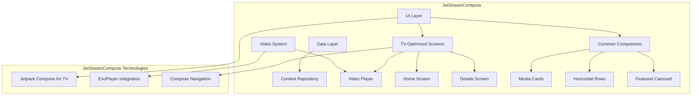

Sources: [README.md:9]()

### ReferenceAppKotlin

ReferenceAppKotlin is the most comprehensive sample, demonstrating a variety of Android TV and Google TV integrations in Kotlin. It serves as a reference implementation for modern TV app development.

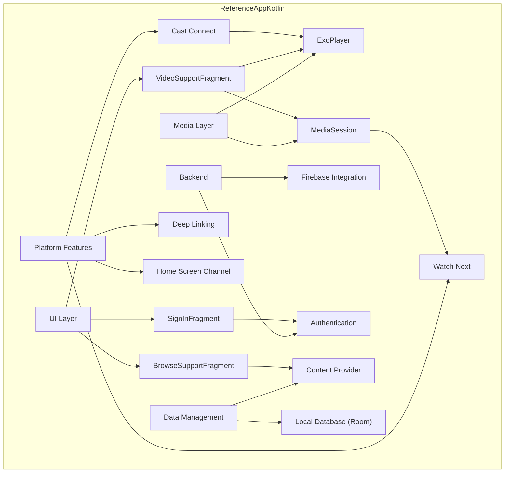

Sources: [ReferenceAppKotlin/README.md:1-101]()

### TvMaterialCatalog

TvMaterialCatalog showcases Material Design components from the Compose for TV libraries, providing a reference for implementing Google's Material Design guidelines on TV interfaces.

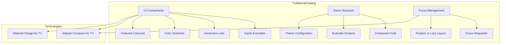

Sources: [README.md:8]()

### Leanback and Leanback Showcase

These samples demonstrate using the traditional Leanback Support library, which provides TV-specific UI components and patterns. The Leanback Showcase expands on the basic sample with more complex implementations.

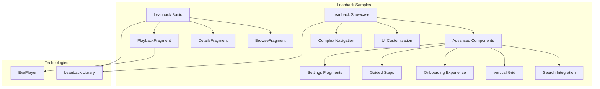

Sources: [Leanback/README.md:1-70](), [LeanbackShowcase/README.md:1-31]()

## Additional Samples

### ClassicsKotlin

A modern Android TV app written in Kotlin, focused on demonstrating media playback of classic videos with platform integrations like MediaSession, home screen channels, and global search.

Sources: [ClassicsKotlin/README.md:1-17]()

### AccessibilityDemo

A Java sample specifically focused on demonstrating accessibility features for TV applications, helping developers create more inclusive apps.

Sources: [README.md:6]()

## Scripts and Utilities

The repository includes several utility scripts, particularly in the ReferenceAppKotlin project, that help with content management and deployment:

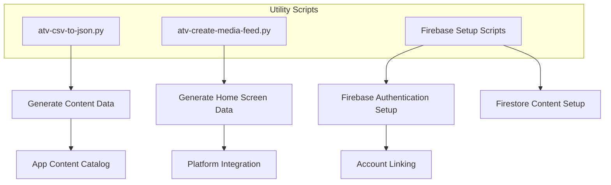

Sources: [ReferenceAppKotlin/scripts/atv-csv-to-json.py:1-68](), [ReferenceAppKotlin/scripts/atv-create-media-feed.py:1-223](), [ReferenceAppKotlin/firebase/README.md:1-178]()

## Build System and CI/CD

The repository uses Gradle for build configuration and GitHub Actions for continuous integration and delivery.

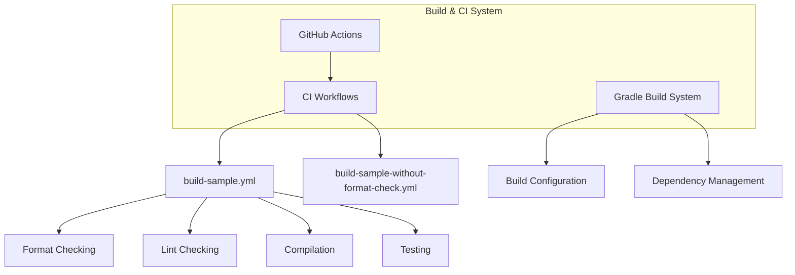

Sources: [ReferenceAppKotlin/settings.gradle:1-18]()

## Firebase Integration

Several samples, particularly ReferenceAppKotlin, offer Firebase integration for authentication, cloud functions, and data storage.

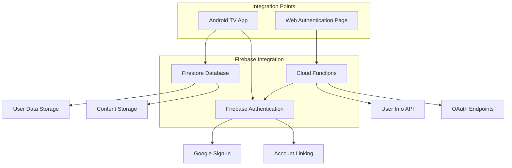

Sources: [ReferenceAppKotlin/firebase/README.md:1-178](), [ReferenceAppKotlin/firebase/setup/save_content_to_firestore.js:1-58](), [ReferenceAppKotlin/firebase/web/oauth/index.html:1-63]()

## Repository License

The entire repository is licensed under the Apache License, Version 2.0, which allows for commercial use, modification, distribution, and private use with appropriate attribution.

Sources: [LICENSE:1-203](), [CONTRIBUTING.md:1-29]()

## Related Documentation

For more detailed information about specific parts of the repository, please refer to:

- For JetStream architecture details, see [JetStream Architecture](#2.1)
- For ReferenceApp architecture details, see [ReferenceApp Architecture](#3.1)
- For TvMaterialCatalog architecture details, see [TvMaterialCatalog Architecture](#4.1)
- For build system details, see [Build System and CI/CD](#5)

---

# Page: JetStreamCompose

# JetStreamCompose

<details>
<summary>Relevant source files</summary>

The following files were used as context for generating this wiki page:

- [JetStreamCompose/.gitignore](JetStreamCompose/.gitignore)
- [JetStreamCompose/benchmark/build.gradle.kts](JetStreamCompose/benchmark/build.gradle.kts)
- [JetStreamCompose/build.gradle.kts](JetStreamCompose/build.gradle.kts)
- [JetStreamCompose/gradle/libs.versions.toml](JetStreamCompose/gradle/libs.versions.toml)
- [JetStreamCompose/gradle/wrapper/gradle-wrapper.properties](JetStreamCompose/gradle/wrapper/gradle-wrapper.properties)
- [JetStreamCompose/jetstream/build.gradle.kts](JetStreamCompose/jetstream/build.gradle.kts)
- [JetStreamCompose/jetstream/proguard-rules.pro](JetStreamCompose/jetstream/proguard-rules.pro)
- [JetStreamCompose/jetstream/src/main/java/com/google/jetstream/JetStreamApplication.kt](JetStreamCompose/jetstream/src/main/java/com/google/jetstream/JetStreamApplication.kt)
- [JetStreamCompose/jetstream/src/main/java/com/google/jetstream/presentation/screens/profile/AboutSection.kt](JetStreamCompose/jetstream/src/main/java/com/google/jetstream/presentation/screens/profile/AboutSection.kt)

</details>


JetStreamCompose is a sample Android TV application that demonstrates how to build TV applications using Jetpack Compose. This document provides an overview of the JetStreamCompose sample, including its architecture, key features, and implementation details.

For more detailed information about the specific components and systems within JetStreamCompose, see [JetStream Architecture](#2.1), [JetStream Video Player](#2.2), [JetStream UI Components](#2.3), and [JetStream Data Management](#2.4).

## Overview

JetStreamCompose showcases a modern TV streaming application built entirely with Jetpack Compose, Android's modern toolkit for building native UI. The sample demonstrates how to implement common TV app patterns including browsable content catalogs, video playback, and user profiles using Compose for TV components.

Key technologies demonstrated in this sample include:
- Jetpack Compose for TV
- Media3 for video playback
- Hilt for dependency injection
- Navigation Compose for screen navigation
- Coil for image loading

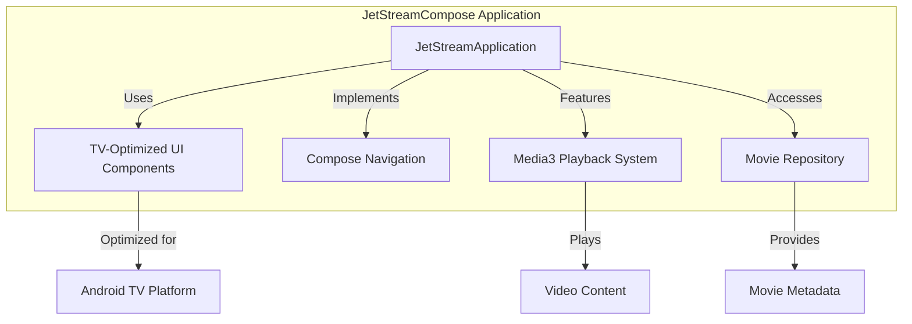

Sources: [JetStreamCompose/jetstream/build.gradle.kts:1-121](), [JetStreamCompose/jetstream/src/main/java/com/google/jetstream/JetStreamApplication.kt:1-40]()

## Technical Implementation

JetStreamCompose is built on modern Android development practices and libraries, with a focus on Jetpack Compose for TV.

### Dependencies and Build Configuration

The application is built with the following key dependencies:

| Category | Libraries | Purpose |
|----------|-----------|---------|
| UI Framework | Jetpack Compose, TV Material | TV-optimized UI components |
| Media | Media3, ExoPlayer | Video playback functionality |
| Navigation | Navigation Compose | Screen navigation |
| Image Loading | Coil | Efficient image loading and caching |
| Dependency Injection | Hilt | Dependency management |
| JSON Parsing | KotlinX Serialization | Data parsing |
| Baseline Profiling | ProfileInstaller | Performance optimization |

The app targets Android TV with:
- Minimum SDK: 28
- Target SDK: 35
- Compose BOM Version: 2025.02.00
- TV Material Version: 1.0.0
- Media3 Version: 1.6.0-beta01

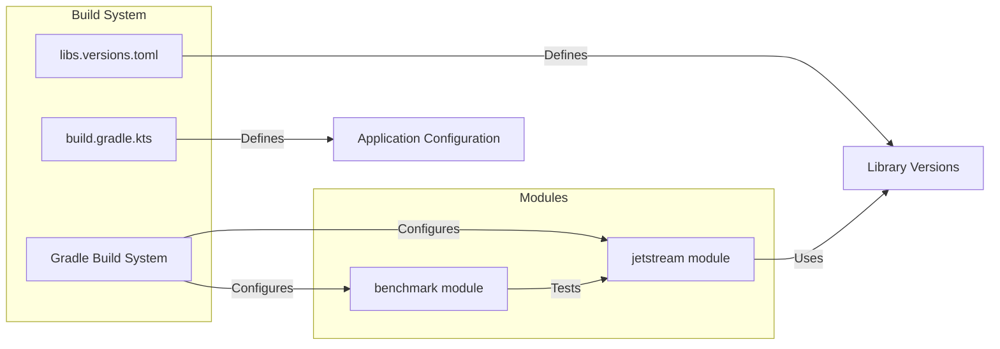

Sources: [JetStreamCompose/jetstream/build.gradle.kts:1-121](), [JetStreamCompose/gradle/libs.versions.toml:1-61](), [JetStreamCompose/build.gradle.kts:1-34]()

### Application Architecture

JetStreamCompose follows a modern Android architecture pattern with clear separation of concerns:

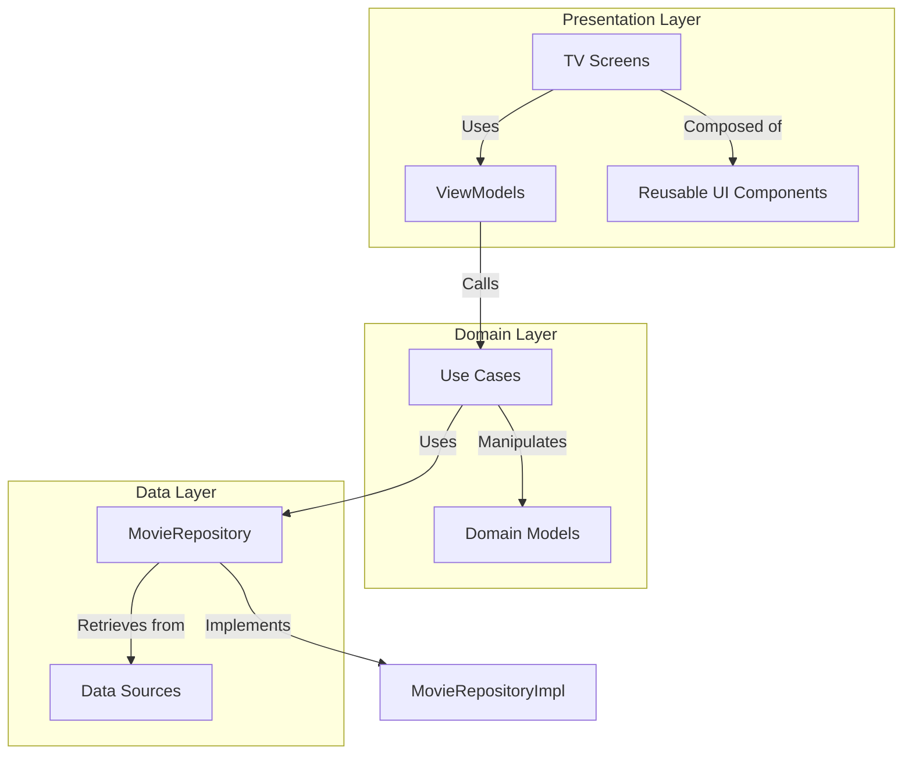

Sources: [JetStreamCompose/jetstream/src/main/java/com/google/jetstream/JetStreamApplication.kt:1-40]()

### Screen Structure

The application includes several key screens that provide a complete TV viewing experience:

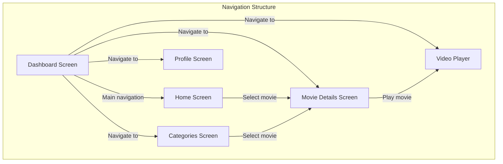

Sources: [JetStreamCompose/jetstream/src/main/java/com/google/jetstream/presentation/screens/profile/AboutSection.kt:1-86]()

## Key Features

### Jetpack Compose for TV

JetStreamCompose is built entirely with Jetpack Compose, demonstrating how to use Compose for TV applications. It uses the TV Material library (`androidx.tv.material`) which provides TV-optimized components.

Key UI patterns demonstrated:
- Focus management for D-pad navigation
- TV-specific layouts and components
- Immersive video playback
- TV-optimized card layouts and carousels

### Dependency Injection with Hilt

The application uses Hilt for dependency injection, which simplifies the management of dependencies and promotes better testability:

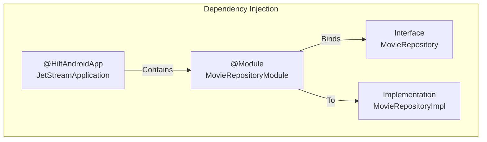

Sources: [JetStreamCompose/jetstream/src/main/java/com/google/jetstream/JetStreamApplication.kt:19-39]()

### Media Playback

JetStreamCompose uses Media3 (the successor to ExoPlayer) for video playback, demonstrating how to integrate video content in a TV application:

- Media3 ExoPlayer for core video playback
- Media3 UI Compose for playback controls
- Integration with Jetpack Compose

### Performance Optimization

The sample includes baseline profiles for optimizing performance:

- Uses the Baseline Profile API for startup and rendering performance
- Includes a benchmark module for measuring performance
- Configures R8 for release builds to optimize code size and performance

## Getting Started

The JetStreamCompose sample can be built and run on an Android TV emulator or device. It requires:

- Android Studio Iguana or newer
- Android SDK with TV support
- A TV emulator or physical Android TV device

Performance can be analyzed using the included benchmark module, which uses the Baseline Profile API and Macrobenchmark library to measure key user journeys.

Sources: [JetStreamCompose/benchmark/build.gradle.kts:1-83]()

---

# Page: JetStream Architecture

# JetStream Architecture

<details>
<summary>Relevant source files</summary>

The following files were used as context for generating this wiki page:

- [JetStreamCompose/gradle.properties](JetStreamCompose/gradle.properties)
- [JetStreamCompose/jetstream/src/main/java/com/google/jetstream/JetStreamApplication.kt](JetStreamCompose/jetstream/src/main/java/com/google/jetstream/JetStreamApplication.kt)
- [JetStreamCompose/jetstream/src/main/java/com/google/jetstream/MainActivity.kt](JetStreamCompose/jetstream/src/main/java/com/google/jetstream/MainActivity.kt)
- [JetStreamCompose/jetstream/src/main/java/com/google/jetstream/data/entities/Movie.kt](JetStreamCompose/jetstream/src/main/java/com/google/jetstream/data/entities/Movie.kt)
- [JetStreamCompose/jetstream/src/main/java/com/google/jetstream/data/entities/MovieCast.kt](JetStreamCompose/jetstream/src/main/java/com/google/jetstream/data/entities/MovieCast.kt)
- [JetStreamCompose/jetstream/src/main/java/com/google/jetstream/data/entities/MovieCategory.kt](JetStreamCompose/jetstream/src/main/java/com/google/jetstream/data/entities/MovieCategory.kt)
- [JetStreamCompose/jetstream/src/main/java/com/google/jetstream/data/models/MoviesResponse.kt](JetStreamCompose/jetstream/src/main/java/com/google/jetstream/data/models/MoviesResponse.kt)
- [JetStreamCompose/jetstream/src/main/java/com/google/jetstream/data/repositories/CachedDataReader.kt](JetStreamCompose/jetstream/src/main/java/com/google/jetstream/data/repositories/CachedDataReader.kt)
- [JetStreamCompose/jetstream/src/main/java/com/google/jetstream/data/repositories/MovieCastDataSource.kt](JetStreamCompose/jetstream/src/main/java/com/google/jetstream/data/repositories/MovieCastDataSource.kt)
- [JetStreamCompose/jetstream/src/main/java/com/google/jetstream/data/repositories/MovieCategoryDataSource.kt](JetStreamCompose/jetstream/src/main/java/com/google/jetstream/data/repositories/MovieCategoryDataSource.kt)
- [JetStreamCompose/jetstream/src/main/java/com/google/jetstream/data/repositories/MovieDataSource.kt](JetStreamCompose/jetstream/src/main/java/com/google/jetstream/data/repositories/MovieDataSource.kt)
- [JetStreamCompose/jetstream/src/main/java/com/google/jetstream/data/repositories/TvDataSource.kt](JetStreamCompose/jetstream/src/main/java/com/google/jetstream/data/repositories/TvDataSource.kt)
- [JetStreamCompose/jetstream/src/main/java/com/google/jetstream/presentation/screens/Screens.kt](JetStreamCompose/jetstream/src/main/java/com/google/jetstream/presentation/screens/Screens.kt)
- [JetStreamCompose/jetstream/src/main/java/com/google/jetstream/presentation/screens/categories/CategoriesScreen.kt](JetStreamCompose/jetstream/src/main/java/com/google/jetstream/presentation/screens/categories/CategoriesScreen.kt)
- [JetStreamCompose/jetstream/src/main/java/com/google/jetstream/presentation/screens/categories/CategoryMovieListScreen.kt](JetStreamCompose/jetstream/src/main/java/com/google/jetstream/presentation/screens/categories/CategoryMovieListScreen.kt)
- [JetStreamCompose/jetstream/src/main/java/com/google/jetstream/presentation/screens/dashboard/DashboardScreen.kt](JetStreamCompose/jetstream/src/main/java/com/google/jetstream/presentation/screens/dashboard/DashboardScreen.kt)
- [JetStreamCompose/jetstream/src/main/java/com/google/jetstream/presentation/screens/dashboard/DashboardTopBar.kt](JetStreamCompose/jetstream/src/main/java/com/google/jetstream/presentation/screens/dashboard/DashboardTopBar.kt)
- [JetStreamCompose/jetstream/src/main/java/com/google/jetstream/presentation/screens/favourites/FavouritesScreen.kt](JetStreamCompose/jetstream/src/main/java/com/google/jetstream/presentation/screens/favourites/FavouritesScreen.kt)
- [JetStreamCompose/jetstream/src/main/java/com/google/jetstream/presentation/screens/favourites/FilteredMoviesGrid.kt](JetStreamCompose/jetstream/src/main/java/com/google/jetstream/presentation/screens/favourites/FilteredMoviesGrid.kt)
- [JetStreamCompose/jetstream/src/main/java/com/google/jetstream/presentation/screens/home/FeaturedMoviesCarousel.kt](JetStreamCompose/jetstream/src/main/java/com/google/jetstream/presentation/screens/home/FeaturedMoviesCarousel.kt)
- [JetStreamCompose/jetstream/src/main/java/com/google/jetstream/presentation/screens/home/HomeScreen.kt](JetStreamCompose/jetstream/src/main/java/com/google/jetstream/presentation/screens/home/HomeScreen.kt)
- [JetStreamCompose/jetstream/src/main/java/com/google/jetstream/presentation/screens/movies/MovieDetailsScreen.kt](JetStreamCompose/jetstream/src/main/java/com/google/jetstream/presentation/screens/movies/MovieDetailsScreen.kt)
- [JetStreamCompose/jetstream/src/main/java/com/google/jetstream/presentation/screens/movies/MovieReviews.kt](JetStreamCompose/jetstream/src/main/java/com/google/jetstream/presentation/screens/movies/MovieReviews.kt)
- [JetStreamCompose/jetstream/src/main/java/com/google/jetstream/presentation/screens/movies/MoviesScreen.kt](JetStreamCompose/jetstream/src/main/java/com/google/jetstream/presentation/screens/movies/MoviesScreen.kt)
- [JetStreamCompose/jetstream/src/main/java/com/google/jetstream/presentation/screens/profile/AccountsSelectionItem.kt](JetStreamCompose/jetstream/src/main/java/com/google/jetstream/presentation/screens/profile/AccountsSelectionItem.kt)
- [JetStreamCompose/jetstream/src/main/java/com/google/jetstream/presentation/screens/search/SearchScreen.kt](JetStreamCompose/jetstream/src/main/java/com/google/jetstream/presentation/screens/search/SearchScreen.kt)
- [JetStreamCompose/jetstream/src/main/java/com/google/jetstream/presentation/screens/shows/ShowsScreen.kt](JetStreamCompose/jetstream/src/main/java/com/google/jetstream/presentation/screens/shows/ShowsScreen.kt)
- [JetStreamCompose/jetstream/src/main/java/com/google/jetstream/presentation/screens/videoPlayer/components/VideoPlayerMainFrame.kt](JetStreamCompose/jetstream/src/main/java/com/google/jetstream/presentation/screens/videoPlayer/components/VideoPlayerMainFrame.kt)
- [JetStreamCompose/jetstream/src/main/java/com/google/jetstream/presentation/screens/videoPlayer/components/VideoPlayerMediaTitle.kt](JetStreamCompose/jetstream/src/main/java/com/google/jetstream/presentation/screens/videoPlayer/components/VideoPlayerMediaTitle.kt)
- [JetStreamCompose/jetstream/src/main/java/com/google/jetstream/presentation/screens/videoPlayer/components/VideoPlayerPulse.kt](JetStreamCompose/jetstream/src/main/java/com/google/jetstream/presentation/screens/videoPlayer/components/VideoPlayerPulse.kt)

</details>


This document outlines the architecture of the JetStreamCompose application, which is a TV app sample demonstrating Jetpack Compose for TV. It covers the main architectural components, navigation system, data flow, and UI structure of the application. For specific details about the video player implementation, refer to [JetStream Video Player](#2.2), and for UI components information, see [JetStream UI Components](#2.3).

## Overview

JetStreamCompose is designed as a streaming content discovery and playback application for Android TV, built entirely with Jetpack Compose for TV. The application demonstrates best practices for TV app development, including a focus on the "10-foot UI" experience and D-pad navigation.

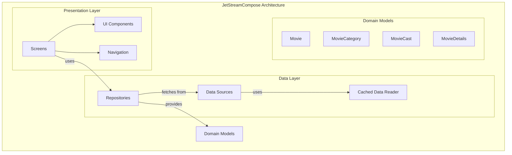

Sources: [JetStreamCompose/jetstream/src/main/java/com/google/jetstream/MainActivity.kt:35-56](), [JetStreamCompose/jetstream/src/main/java/com/google/jetstream/JetStreamApplication.kt:19-39]()

## Application Entry Point

The application begins from `MainActivity`, which is annotated with `@AndroidEntryPoint` for Hilt dependency injection. The `onCreate` method sets up the app content with the JetStreamTheme:

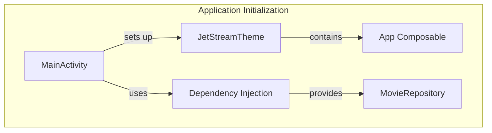

Sources: [JetStreamCompose/jetstream/src/main/java/com/google/jetstream/MainActivity.kt:35-56](), [JetStreamCompose/jetstream/src/main/java/com/google/jetstream/JetStreamApplication.kt:28-39]()

## Screen Navigation Architecture

The JetStream app uses a two-level navigation system:

1. **Main Navigation**: Navigates between major app sections like Dashboard and standalone screens
2. **Dashboard Navigation**: Within the Dashboard, a TabRow navigates between content categories

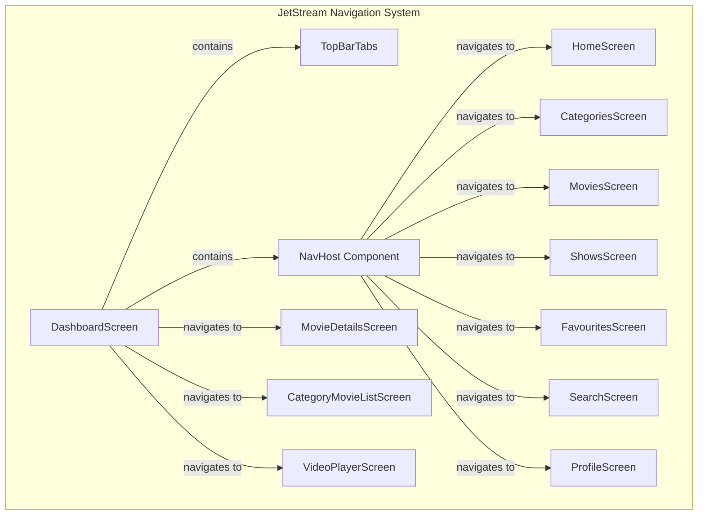

Sources: [JetStreamCompose/jetstream/src/main/java/com/google/jetstream/presentation/screens/dashboard/DashboardScreen.kt:84-283](), [JetStreamCompose/jetstream/src/main/java/com/google/jetstream/presentation/screens/Screens.kt:26-57]()

### Dashboard Screen

The DashboardScreen serves as the main container for most of the app's UI. It provides:

1. A TopBar for navigation between major sections
2. A content area for displaying the selected section
3. Logic for hiding/showing the TopBar based on scroll position

```mermaid
graph TB
    subgraph "DashboardScreen Components"
        DashboardTopBar["DashboardTopBar"]
        Body["Body (NavHost)"]
        Screens["Screens enum"]
        FocusRequesters["TopBarFocusRequesters"]
        
        DashboardTopBar --> |"uses"| FocusRequesters
        DashboardTopBar --> |"displays"| Screens
        
        Body --> |"renders"| HomeScreen["HomeScreen"]
        Body --> |"renders"| CategoriesScreen["CategoriesScreen"]
        Body --> |"renders"| MoviesScreen["MoviesScreen"]
        Body --> |"renders"| ShowsScreen["ShowsScreen"]
        Body --> |"renders"| FavouritesScreen["FavouritesScreen"]
        Body --> |"renders"| SearchScreen["SearchScreen"]
        Body --> |"renders"| ProfileScreen["ProfileScreen"]
    end
```

Sources: [JetStreamCompose/jetstream/src/main/java/com/google/jetstream/presentation/screens/dashboard/DashboardScreen.kt:84-283](), [JetStreamCompose/jetstream/src/main/java/com/google/jetstream/presentation/screens/dashboard/DashboardTopBar.kt:65-69]()

## Content Screens

JetStream organizes its content into several main screens, each with its own layout and purpose.

### Home Screen

The HomeScreen displays the main content discovery interface featuring:

- Featured movies carousel
- Trending movies row
- Top 10 movies list
- Now playing movies row

```mermaid
graph TB
    subgraph "HomeScreen Components"
        HomeScreen["HomeScreen"]
        Catalog["Catalog Composable"]
        LazyColumn["LazyColumn"]
        
        HomeScreen --> |"contains"| Catalog
        Catalog --> |"uses"| LazyColumn
        
        LazyColumn --> |"contains"| FeaturedMoviesCarousel["FeaturedMoviesCarousel"]
        LazyColumn --> |"contains"| TrendingMovies["MoviesRow (Trending)"]
        LazyColumn --> |"contains"| Top10List["Top10MoviesList"]
        LazyColumn --> |"contains"| NowPlaying["MoviesRow (Now Playing)"]
    end
```

Sources: [JetStreamCompose/jetstream/src/main/java/com/google/jetstream/presentation/screens/home/HomeScreen.kt:46-154](), [JetStreamCompose/jetstream/src/main/java/com/google/jetstream/presentation/screens/home/FeaturedMoviesCarousel.kt:84-143]()

### Categories Screen

The CategoriesScreen displays a grid of movie categories that users can explore:

```mermaid
graph TD
    subgraph "Categories Screen Flow"
        CategoriesScreen["CategoriesScreen"]
        Catalog["Catalog Composable"]
        LazyVerticalGrid["LazyVerticalGrid"]
        MovieCard["MovieCard"]
        CategoryClick["onCategoryClick"]
        
        CategoriesScreen --> |"contains"| Catalog
        Catalog --> |"uses"| LazyVerticalGrid
        LazyVerticalGrid --> |"renders"| MovieCard
        MovieCard --> |"triggers"| CategoryClick
        CategoryClick --> |"navigates to"| CategoryMovieList["CategoryMovieListScreen"]
    end
```

Sources: [JetStreamCompose/jetstream/src/main/java/com/google/jetstream/presentation/screens/categories/CategoriesScreen.kt:56-154](), [JetStreamCompose/jetstream/src/main/java/com/google/jetstream/presentation/screens/categories/CategoryMovieListScreen.kt:50-133]()

### Movies, Shows, and Favourites Screens

These screens follow similar patterns, displaying grids or lists of content with specialized layouts:

```mermaid
graph TD
    subgraph "Content Screens"
        MoviesScreen["MoviesScreen"]
        ShowsScreen["ShowsScreen"]
        FavouritesScreen["FavouritesScreen"]
        
        MoviesScreen --> |"contains"| MoviesScreenCatalog["Catalog"]
        MoviesScreenCatalog --> |"uses"| MoviesLazyColumn["LazyColumn"]
        MoviesLazyColumn --> |"contains"| MoviesScreenMovieList["MoviesScreenMovieList"]
        MoviesLazyColumn --> |"contains"| MoviesScreenRow["MoviesRow"]
        
        ShowsScreen --> |"similar to"| MoviesScreen
        
        FavouritesScreen --> |"contains"| FavouritesCatalog["Catalog"]
        FavouritesCatalog --> |"contains"| MovieFilterChipRow["MovieFilterChipRow"]
        FavouritesCatalog --> |"contains"| FilteredMoviesGrid["FilteredMoviesGrid"]
    end
```

Sources: [JetStreamCompose/jetstream/src/main/java/com/google/jetstream/presentation/screens/movies/MoviesScreen.kt:41-108](), [JetStreamCompose/jetstream/src/main/java/com/google/jetstream/presentation/screens/shows/ShowsScreen.kt:42-112](), [JetStreamCompose/jetstream/src/main/java/com/google/jetstream/presentation/screens/favourites/FavouritesScreen.kt:39-112](), [JetStreamCompose/jetstream/src/main/java/com/google/jetstream/presentation/screens/favourites/FilteredMoviesGrid.kt:36-58]()

## Data Architecture

The JetStream app follows a clean architecture approach for data management, separating data sources from repositories and presentation.

```mermaid
graph TD
    subgraph "Data Architecture"
        MovieRepository["MovieRepository"]
        MovieRepositoryImpl["MovieRepositoryImpl"]
        
        MovieDataSource["MovieDataSource"]
        MovieCategoryDataSource["MovieCategoryDataSource"]
        MovieCastDataSource["MovieCastDataSource"]
        TvDataSource["TvDataSource"]
        
        CachedDataReader["CachedDataReader"]
        AssetsReader["AssetsReader"]
        
        MovieRepository <-- |"implemented by"| MovieRepositoryImpl
        MovieRepositoryImpl --> |"uses"| MovieDataSource
        MovieRepositoryImpl --> |"uses"| MovieCategoryDataSource
        MovieRepositoryImpl --> |"uses"| MovieCastDataSource
        MovieRepositoryImpl --> |"uses"| TvDataSource
        
        MovieDataSource --> |"uses"| CachedDataReader
        MovieCategoryDataSource --> |"uses"| CachedDataReader
        MovieCastDataSource --> |"uses"| CachedDataReader
        TvDataSource --> |"uses"| CachedDataReader
        
        CachedDataReader --> |"accesses"| AssetsReader
    end
```

Sources: [JetStreamCompose/jetstream/src/main/java/com/google/jetstream/JetStreamApplication.kt:31-39](), [JetStreamCompose/jetstream/src/main/java/com/google/jetstream/data/repositories/CachedDataReader.kt:31-75](), [JetStreamCompose/jetstream/src/main/java/com/google/jetstream/data/repositories/MovieDataSource.kt:25-82]()

### CachedDataReader

A key component in the data architecture is the `CachedDataReader`, which:
- Implements a simple caching mechanism using mutex for thread safety
- Ensures data is only loaded once and stored in memory
- Used by all data sources to efficiently load JSON data from assets

```mermaid
graph LR
    subgraph "CachedDataReader Mechanism"
        DataSource["DataSource"]
        CachedReader["CachedDataReader"]
        Cache["In-Memory Cache"]
        Reader["Data Reader Function"]
        
        DataSource --> |"1. read() call"| CachedReader
        CachedReader --> |"2. check if initialized"| Cache
        CachedReader --> |"3. if not cached"| Reader
        Reader --> |"4. read data"| Cache
        Cache --> |"5. return data"| DataSource
    end
```

Sources: [JetStreamCompose/jetstream/src/main/java/com/google/jetstream/data/repositories/CachedDataReader.kt:31-43]()

### Domain Models

The app uses several domain models to represent data:

1. **Movie**: Represents a movie or TV show with metadata
2. **MovieCategory**: Represents a category of movies
3. **MovieCast**: Represents cast information for a movie
4. **MovieDetails**: Contains detailed information about a movie

```mermaid
graph TD
    subgraph "Domain Models"
        MoviesResponseItem["MoviesResponseItem (JSON)"]
        MovieCategoriesResponseItem["MovieCategoriesResponseItem (JSON)"]
        MovieCastResponseItem["MovieCastResponseItem (JSON)"]
        
        Movie["Movie"]
        MovieCategory["MovieCategory"]
        MovieCast["MovieCast"]
        
        MoviesResponseItem --> |"toMovie()"| Movie
        MovieCategoriesResponseItem --> |"toMovieCategory()"| MovieCategory
        MovieCastResponseItem --> |"toMovieCast()"| MovieCast
    end
```

Sources: [JetStreamCompose/jetstream/src/main/java/com/google/jetstream/data/entities/Movie.kt:21-48](), [JetStreamCompose/jetstream/src/main/java/com/google/jetstream/data/entities/MovieCategory.kt:21-27](), [JetStreamCompose/jetstream/src/main/java/com/google/jetstream/data/entities/MovieCast.kt:21-34](), [JetStreamCompose/jetstream/src/main/java/com/google/jetstream/data/models/MoviesResponse.kt:21-45]()

## UI State Management

JetStream uses a unidirectional data flow pattern with ViewModels and UI State objects:

```mermaid
graph TD
    subgraph "UI State Flow"
        ViewModel["ViewModel"]
        UIState["UI State Classes"]
        StateFlow["StateFlow<UIState>"]
        Screen["Screen Composable"]
        Repository["Repository"]
        
        Repository --> |"provides data"| ViewModel
        ViewModel --> |"updates"| StateFlow
        StateFlow --> |"collectAsStateWithLifecycle()"| Screen
        Screen --> |"renders based on"| UIState
    end
```

Sources: [JetStreamCompose/jetstream/src/main/java/com/google/jetstream/presentation/screens/home/HomeScreen.kt:46-73](), [JetStreamCompose/jetstream/src/main/java/com/google/jetstream/presentation/screens/movies/MoviesScreen.kt:41-61]()

## Focus Management

As a TV application, JetStream pays special attention to focus management for D-pad navigation:

```mermaid
graph TD
    subgraph "Focus Management"
        FocusRequesters["TopBarFocusRequesters"]
        BackHandler["BackPressHandledArea"]
        TopBar["DashboardTopBar"]
        Content["Screen Content"]
        
        BackHandler --> |"manages back press"| TopBar
        BackHandler --> |"manages back press"| Content
        TopBar --> |"uses"| FocusRequesters
        Content --> |"receives focus from"| TopBar
    end
```

Sources: [JetStreamCompose/jetstream/src/main/java/com/google/jetstream/presentation/screens/dashboard/DashboardScreen.kt:119-219](), [JetStreamCompose/jetstream/src/main/java/com/google/jetstream/presentation/screens/dashboard/DashboardTopBar.kt:65-169]()

## Video Player Integration

The Video Player is a key feature of JetStream, providing playback functionality with controls:

```mermaid
graph TD
    subgraph "Video Player Components"
        VideoPlayer["VideoPlayerScreen"]
        Controls["VideoPlayerControls"]
        MediaTitle["VideoPlayerMediaTitle"]
        Pulse["VideoPlayerPulse"]
        MainFrame["VideoPlayerMainFrame"]
        
        VideoPlayer --> |"contains"| MainFrame
        MainFrame --> |"contains"| MediaTitle
        MainFrame --> |"contains"| Controls
        VideoPlayer --> |"shows"| Pulse
    end
```

Sources: [JetStreamCompose/jetstream/src/main/java/com/google/jetstream/presentation/screens/videoPlayer/components/VideoPlayerPulse.kt:48-90](), [JetStreamCompose/jetstream/src/main/java/com/google/jetstream/presentation/screens/videoPlayer/components/VideoPlayerMediaTitle.kt:44-99](), [JetStreamCompose/jetstream/src/main/java/com/google/jetstream/presentation/screens/videoPlayer/components/VideoPlayerMainFrame.kt:37-61]()

## Dependency Injection

JetStream uses Hilt for dependency injection, simplifying component management:

```mermaid
graph TD
    subgraph "Dependency Injection"
        HiltAndroidApp["@HiltAndroidApp"]
        AndroidEntryPoint["@AndroidEntryPoint"]
        Binds["@Binds"]
        HiltViewModel["@HiltViewModel"]
        
        HiltAndroidApp --> |"annotates"| JetStreamApplication["JetStreamApplication"]
        AndroidEntryPoint --> |"annotates"| MainActivity["MainActivity"]
        Binds --> |"binds"| MovieRepositoryImpl["MovieRepositoryImpl"]
        Binds --> |"to"| MovieRepository["MovieRepository"]
        HiltViewModel --> |"annotates"| ViewModels["ViewModels"]
    end
```

Sources: [JetStreamCompose/jetstream/src/main/java/com/google/jetstream/JetStreamApplication.kt:28-39](), [JetStreamCompose/jetstream/src/main/java/com/google/jetstream/MainActivity.kt:34-56]()

## Summary

JetStreamCompose demonstrates an architecture optimized for Android TV applications using Jetpack Compose. Its key architectural components include:

1. **Clean Separation of Concerns**:
   - Presentation layer with screens and UI components
   - Data layer with repositories and data sources
   - Domain models for data representation

2. **Efficient Data Management**:
   - `CachedDataReader` for optimized data loading
   - Repository pattern for data access abstraction

3. **TV-Optimized UI**:
   - Focus management for D-pad navigation
   - Animations and transitions designed for large screens
   - Hierarchical navigation with tabs and screens

4. **Modern Android Technologies**:
   - Jetpack Compose for UI
   - Hilt for dependency injection
   - StateFlow for UI state management

This architecture provides a solid foundation for building feature-rich TV applications with a great user experience.

---

# Page: JetStream Video Player

# JetStream Video Player

<details>
<summary>Relevant source files</summary>

The following files were used as context for generating this wiki page:

- [JetStreamCompose/jetstream/src/main/assets/movies.json](JetStreamCompose/jetstream/src/main/assets/movies.json)
- [JetStreamCompose/jetstream/src/main/java/com/google/jetstream/data/entities/MovieDetails.kt](JetStreamCompose/jetstream/src/main/java/com/google/jetstream/data/entities/MovieDetails.kt)
- [JetStreamCompose/jetstream/src/main/java/com/google/jetstream/data/repositories/MovieRepositoryImpl.kt](JetStreamCompose/jetstream/src/main/java/com/google/jetstream/data/repositories/MovieRepositoryImpl.kt)
- [JetStreamCompose/jetstream/src/main/java/com/google/jetstream/data/util/StringConstants.kt](JetStreamCompose/jetstream/src/main/java/com/google/jetstream/data/util/StringConstants.kt)
- [JetStreamCompose/jetstream/src/main/java/com/google/jetstream/presentation/common/MovieCard.kt](JetStreamCompose/jetstream/src/main/java/com/google/jetstream/presentation/common/MovieCard.kt)
- [JetStreamCompose/jetstream/src/main/java/com/google/jetstream/presentation/common/PosterImage.kt](JetStreamCompose/jetstream/src/main/java/com/google/jetstream/presentation/common/PosterImage.kt)
- [JetStreamCompose/jetstream/src/main/java/com/google/jetstream/presentation/screens/videoPlayer/VideoPlayerScreen.kt](JetStreamCompose/jetstream/src/main/java/com/google/jetstream/presentation/screens/videoPlayer/VideoPlayerScreen.kt)
- [JetStreamCompose/jetstream/src/main/java/com/google/jetstream/presentation/screens/videoPlayer/VideoPlayerScreenViewModel.kt](JetStreamCompose/jetstream/src/main/java/com/google/jetstream/presentation/screens/videoPlayer/VideoPlayerScreenViewModel.kt)
- [JetStreamCompose/jetstream/src/main/java/com/google/jetstream/presentation/screens/videoPlayer/components/RememberPlayer.kt](JetStreamCompose/jetstream/src/main/java/com/google/jetstream/presentation/screens/videoPlayer/components/RememberPlayer.kt)
- [JetStreamCompose/jetstream/src/main/java/com/google/jetstream/presentation/screens/videoPlayer/components/VideoPlayerControls.kt](JetStreamCompose/jetstream/src/main/java/com/google/jetstream/presentation/screens/videoPlayer/components/VideoPlayerControls.kt)
- [JetStreamCompose/jetstream/src/main/java/com/google/jetstream/presentation/screens/videoPlayer/components/VideoPlayerControlsIcon.kt](JetStreamCompose/jetstream/src/main/java/com/google/jetstream/presentation/screens/videoPlayer/components/VideoPlayerControlsIcon.kt)
- [JetStreamCompose/jetstream/src/main/java/com/google/jetstream/presentation/screens/videoPlayer/components/VideoPlayerIndicator.kt](JetStreamCompose/jetstream/src/main/java/com/google/jetstream/presentation/screens/videoPlayer/components/VideoPlayerIndicator.kt)
- [JetStreamCompose/jetstream/src/main/java/com/google/jetstream/presentation/screens/videoPlayer/components/VideoPlayerOverlay.kt](JetStreamCompose/jetstream/src/main/java/com/google/jetstream/presentation/screens/videoPlayer/components/VideoPlayerOverlay.kt)
- [JetStreamCompose/jetstream/src/main/java/com/google/jetstream/presentation/screens/videoPlayer/components/VideoPlayerSeeker.kt](JetStreamCompose/jetstream/src/main/java/com/google/jetstream/presentation/screens/videoPlayer/components/VideoPlayerSeeker.kt)
- [JetStreamCompose/jetstream/src/main/java/com/google/jetstream/presentation/screens/videoPlayer/components/VideoPlayerState.kt](JetStreamCompose/jetstream/src/main/java/com/google/jetstream/presentation/screens/videoPlayer/components/VideoPlayerState.kt)
- [JetStreamCompose/jetstream/src/main/java/com/google/jetstream/presentation/utils/ModifierUtils.kt](JetStreamCompose/jetstream/src/main/java/com/google/jetstream/presentation/utils/ModifierUtils.kt)

</details>


This document provides a technical overview of the video player implementation within the JetStreamCompose sample application. For information about the overall JetStream application architecture, see [JetStream Architecture](#2.1). For details about UI components used throughout JetStream, see [JetStream UI Components](#2.3).

## 1. Overview

The JetStream Video Player is a Jetpack Compose implementation of a video player for Android TV, designed to showcase best practices for media playback on the TV platform. It demonstrates:

- Integration with ExoPlayer for video playback
- TV-optimized controls with D-pad navigation
- Auto-hiding player controls
- Visual seeking indicators
- Support for subtitles
- Custom UI overlay components
- Movie information display
- Next/previous navigation for playlists

Sources: [JetStreamCompose/jetstream/src/main/java/com/google/jetstream/presentation/screens/videoPlayer/VideoPlayerScreen.kt:58-218]()

## 2. Architecture

The video player follows a layered architecture pattern with clear separation of concerns:

```mermaid
flowchart TB
    subgraph "Presentation Layer"
        VPS["VideoPlayerScreen"]
        VPC["VideoPlayerControls"]
        VPVM["VideoPlayerScreenViewModel"]
        VPO["VideoPlayerOverlay"]
        VPI["VideoPlayerIndicator"]
        VPS --> VPO
        VPS --> VPVM
        VPO --> VPC
        VPC --> VPI
    end
    
    subgraph "Media Layer"
        EP["ExoPlayer"]
        MS["MediaSourceFactory"]
        MI["MediaItem"]
        VPS --> EP
        EP --> MS
        EP --> MI
    end
    
    subgraph "State Management"
        VPState["VideoPlayerState"]
        VPPulse["VideoPlayerPulseState"]
        VPS --> VPState
        VPS --> VPPulse
    end
    
    subgraph "Data Layer"
        MR["MovieRepository"]
        MD["MovieDetails"]
        VPVM --> MR
        MR --> MD
        MD --> MI
    end
    
    subgraph "Input Handling"
        DPad["D-Pad Event Handler"]
        VPS --> DPad
        DPad --> EP
    end
```

**Player Component Hierarchy**

Sources: [JetStreamCompose/jetstream/src/main/java/com/google/jetstream/presentation/screens/videoPlayer/VideoPlayerScreen.kt:68-153](), [JetStreamCompose/jetstream/src/main/java/com/google/jetstream/presentation/screens/videoPlayer/components/VideoPlayerOverlay.kt:1-153]()

## 3. Key Components

### 3.1 VideoPlayerScreen

The `VideoPlayerScreen` is the main container composable that orchestrates the video playback experience.

```mermaid
classDiagram
    class VideoPlayerScreen {
        +onBackPressed: () -> Unit
        +videoPlayerScreenViewModel: VideoPlayerScreenViewModel
    }
    
    class VideoPlayerScreenContent {
        +movieDetails: MovieDetails
        +onBackPressed: () -> Unit
    }
    
    VideoPlayerScreen --> VideoPlayerScreenContent: renders when data loaded
    VideoPlayerScreenContent --> PlayerSurface: displays video
    VideoPlayerScreenContent --> VideoPlayerOverlay: shows controls
    VideoPlayerScreenContent --> BackHandler: handles back navigation
```

The screen manages the following responsibilities:
- Initializing and configuring the ExoPlayer instance
- Loading media from MovieDetails
- Managing control visibility through VideoPlayerState
- Handling D-pad input for navigation and seeking
- Creating a playlist from the current movie and similar movies

Sources: [JetStreamCompose/jetstream/src/main/java/com/google/jetstream/presentation/screens/videoPlayer/VideoPlayerScreen.kt:68-153]()

### 3.2 Media Playback Integration

The video player uses ExoPlayer for media playback, configured through a custom `rememberPlayer` composable function:

```mermaid
flowchart LR
    subgraph "ExoPlayer Setup"
        RP["rememberPlayer()"]
        EP["ExoPlayer"]
        PMF["ProgressiveMediaSource.Factory"]
        DSF["DefaultDataSource.Factory"]
        
        RP --> EP
        EP --> PMF
        PMF --> DSF
    end
    
    subgraph "Media Configuration"
        MI["MediaItem"]
        SC["SubtitleConfiguration"]
        MI --> SC
    end
    
    subgraph "Playback Settings"
        SI["seekIncrement: 10s"]
        PR["playWhenReady: true"]
        RM["repeatMode: REPEAT_MODE_OFF"]
        EP --> SI
        EP --> PR
        EP --> RM
    end
    
    MD["MovieDetails"] --> MI
    MI --> EP
```

Key ExoPlayer configuration:
- 10-second forward/backward seek increments
- Auto-play when ready
- Scale-to-fit-with-cropping video scaling mode
- Progressive media source loading
- Subtitle support through MediaItem configuration

Sources: [JetStreamCompose/jetstream/src/main/java/com/google/jetstream/presentation/screens/videoPlayer/components/RememberPlayer.kt:31-44](), [JetStreamCompose/jetstream/src/main/java/com/google/jetstream/presentation/screens/videoPlayer/VideoPlayerScreen.kt:180-217]()

### 3.3 UI Controls and Overlay

The player provides a rich set of controls through the `VideoPlayerOverlay` component:

```mermaid
flowchart TD
    subgraph "VideoPlayerOverlay"
        VPO["VideoPlayerOverlay"]
        CB["CenterButton"]
        ST["Subtitles"]
        CLS["Controls"]
        
        VPO --> CB
        VPO --> ST
        VPO --> CLS
    end
    
    subgraph "Controls Component"
        VPC["VideoPlayerControls"]
        MT["MediaTitle"]
        MA["MediaActions"]
        SK["Seeker"]
        
        CLS --> VPC
        VPC --> MT
        VPC --> MA
        VPC --> SK
    end
    
    subgraph "Media Actions"
        PB["PreviousButton"]
        NB["NextButton"]
        RB["RepeatButton"]
        PLB["PlaylistButton"]
        CCB["ClosedCaptionButton"]
        SB["SettingsButton"]
        
        MA --> PB
        MA --> NB
        MA --> RB
        MA --> PLB
        MA --> CCB
        MA --> SB
    end
    
    subgraph "Seeker Component"
        VPS["VideoPlayerSeeker"]
        PPB["PlayPauseButton"]
        PT["ProgressText"]
        IND["VideoPlayerControllerIndicator"]
        DT["DurationText"]
        
        SK --> VPS
        VPS --> PPB
        VPS --> PT
        VPS --> IND
        VPS --> DT
    end
```

The overlay includes:
- Animated visibility for controls that auto-hide after a configurable timeout
- Cinematic background gradient for better text legibility
- Center pulse indicator for seek feedback
- Comprehensive playback controls
- Seek bar with interactive functionality

Sources: [JetStreamCompose/jetstream/src/main/java/com/google/jetstream/presentation/screens/videoPlayer/components/VideoPlayerOverlay.kt:49-102](), [JetStreamCompose/jetstream/src/main/java/com/google/jetstream/presentation/screens/videoPlayer/components/VideoPlayerControls.kt:36-103](), [JetStreamCompose/jetstream/src/main/java/com/google/jetstream/presentation/screens/videoPlayer/components/VideoPlayerSeeker.kt:44-105]()

### 3.4 State Management

The player employs several state management mechanisms:

#### VideoPlayerState

Manages the visibility of player controls with auto-hide functionality:

```mermaid
stateDiagram-v2
    [*] --> ControlsVisible
    ControlsVisible --> ControlsHidden: After hideSeconds timeout
    ControlsHidden --> ControlsVisible: User input (D-pad)
    ControlsVisible --> ControlsVisible: showControls() while paused
    ControlsVisible --> ControlsVisible: showControls() resets timer
```

Sources: [JetStreamCompose/jetstream/src/main/java/com/google/jetstream/presentation/screens/videoPlayer/components/VideoPlayerState.kt:34-81]()

#### VideoPlayerPulseState

Provides visual feedback during seek operations (forward/backward).

#### D-Pad Input Handling

The player handles D-pad navigation events for intuitive TV remote control:

| D-Pad Key | Action (Controls Hidden) | Action (Controls Visible) |
|-----------|--------------------------|---------------------------|
| Left      | Seek backward 10s        | Navigate controls         |
| Right     | Seek forward 10s         | Navigate controls         |
| Up        | Show controls            | Navigate controls         |
| Down      | Show controls            | Navigate controls         |
| Center    | Pause and show controls  | Activate focused control  |

Sources: [JetStreamCompose/jetstream/src/main/java/com/google/jetstream/presentation/utils/ModifierUtils.kt:76-108](), [JetStreamCompose/jetstream/src/main/java/com/google/jetstream/presentation/screens/videoPlayer/VideoPlayerScreen.kt:155-178]()

### 3.5 Seek Indicator Implementation

The player includes an interactive seek indicator that allows precise control over playback position:

```mermaid
flowchart TD
    subgraph "VideoPlayerControllerIndicator"
        VPI["VideoPlayerControllerIndicator"]
        IS["isSelected State"]
        SP["seekProgress State"]
        IFS["isFocused State"]
        
        VPI --> IS
        VPI --> SP
        VPI --> IFS
    end
    
    subgraph "Interaction Modes"
        BM["Browsing Mode"]
        SM["Selection Mode"]
        
        IS -- "false" --> BM
        IS -- "true" --> SM
    end
    
    subgraph "Input Handling"
        BM --> SMT["Enter: Switch to Selection"]
        SM --> BMT["Enter: Confirm and seek"]
        SM --> SL["Left: Decrease seekProgress"]
        SM --> SR["Right: Increase seekProgress"]
    end
    
    subgraph "Visual Representation"
        CA["Canvas Drawing"]
        BL["Background Line"]
        PL["Progress Line"]
        
        VPI --> CA
        CA --> BL
        CA --> PL
        SM --> SPL["Show seekProgress"]
        BM --> CPL["Show current progress"]
    end
```

The indicator provides:
- Visual representation of current playback progress
- Interactive seeking by entering selection mode
- Fine-grained control using left/right D-pad keys
- Animated height changes based on focus state

Sources: [JetStreamCompose/jetstream/src/main/java/com/google/jetstream/presentation/screens/videoPlayer/components/VideoPlayerIndicator.kt:44-117]()

## 4. Data Flow

The diagram below illustrates how movie data flows through the video player system:

```mermaid
sequenceDiagram
    participant Navigation
    participant VPSVM as VideoPlayerScreenViewModel
    participant MR as MovieRepository
    participant VPS as VideoPlayerScreen
    participant EP as ExoPlayer
    
    Navigation->>VPSVM: Navigate with movieId
    VPSVM->>MR: getMovieDetails(movieId)
    MR-->>VPSVM: MovieDetails
    VPSVM-->>VPS: VideoPlayerScreenUiState.Done(movieDetails)
    VPS->>EP: Create player & set configuration
    VPS->>EP: Add MediaItem(movieDetails.videoUri)
    VPS->>EP: Add MediaItems for similarMovies
    VPS->>EP: prepare() & playWhenReady = true
    EP-->>VPS: Playback state updates
    VPS->>VPS: Update UI based on playback state
```

Key data points:
1. The video player screen receives a movie ID through navigation or saved state
2. The ViewModel fetches detailed movie data including video and subtitle URIs
3. The player converts MovieDetails into ExoPlayer MediaItems
4. Similar movies are added to the playlist for continuous playback
5. Playback state from ExoPlayer drives UI updates

Sources: [JetStreamCompose/jetstream/src/main/java/com/google/jetstream/presentation/screens/videoPlayer/VideoPlayerScreenViewModel.kt:32-57](), [JetStreamCompose/jetstream/src/main/java/com/google/jetstream/data/repositories/MovieRepositoryImpl.kt:80-121](), [JetStreamCompose/jetstream/src/main/java/com/google/jetstream/presentation/screens/videoPlayer/VideoPlayerScreen.kt:104-110]()

## 5. Media Sources and Configuration

The player supports two primary video sources from the sample data:

```
http://commondatastorage.googleapis.com/gtv-videos-bucket/sample/BigBuckBunny.mp4
http://commondatastorage.googleapis.com/gtv-videos-bucket/sample/ElephantsDream.mp4
```

Subtitles are provided through WebVTT files when available:
```
https://thepaciellogroup.github.io/AT-browser-tests/video/subtitles-en.vtt
```

Movie metadata is structured as follows:

| Field | Description | Example |
|-------|-------------|---------|
| id | Unique identifier | "8daa7d22d13a9" |
| videoUri | Video content URL | "http://commondatastorage.googleapis.com/gtv-videos-bucket/sample/BigBuckBunny.mp4" |
| subtitleUri | Optional subtitle URL | "https://thepaciellogroup.github.io/AT-browser-tests/video/subtitles-en.vtt" |
| name | Movie title | "On the Bridge" |
| description | Plot summary | "A documentary film exploring..." |
| posterUri | Thumbnail image URL | "https://storage.googleapis.com/androiddevelopers/samples/media/posters/16_9-400/on-the-bridge.jpg" |

Sources: [JetStreamCompose/jetstream/src/main/assets/movies.json:1-646](), [JetStreamCompose/jetstream/src/main/java/com/google/jetstream/data/entities/MovieDetails.kt:19-40]()

## 6. Implementation Details

### 6.1 MediaItem Creation

The player converts movie data entities into ExoPlayer MediaItems:

```kotlin
private fun MovieDetails.intoMediaItem(): MediaItem {
    return MediaItem.Builder()
        .setUri(videoUri)
        .setSubtitleConfigurations(
            if (subtitleUri == null) {
                emptyList()
            } else {
                listOf(
                    MediaItem.SubtitleConfiguration
                        .Builder(Uri.parse(subtitleUri))
                        .setMimeType("application/vtt")
                        .setLanguage("en")
                        .setSelectionFlags(C.SELECTION_FLAG_DEFAULT)
                        .build()
                )
            }
        ).build()
}
```

This transformation:
- Sets the primary content URI from the movie data
- Conditionally adds subtitle configuration when available
- Configures WebVTT subtitles with English language setting
- Marks subtitles as default when present

Sources: [JetStreamCompose/jetstream/src/main/java/com/google/jetstream/presentation/screens/videoPlayer/VideoPlayerScreen.kt:180-197]()

### 6.2 D-Pad Event Handling

The player implements custom D-pad event handling to provide an intuitive TV experience:

```kotlin
private fun Modifier.dPadEvents(
    exoPlayer: ExoPlayer,
    videoPlayerState: VideoPlayerState,
    pulseState: VideoPlayerPulseState
): Modifier = this.handleDPadKeyEvents(
    onLeft = {
        if (!videoPlayerState.isControlsVisible) {
            exoPlayer.seekBack()
            pulseState.setType(BACK)
        }
    },
    onRight = {
        if (!videoPlayerState.isControlsVisible) {
            exoPlayer.seekForward()
            pulseState.setType(FORWARD)
        }
    },
    onUp = { videoPlayerState.showControls() },
    onDown = { videoPlayerState.showControls() },
    onEnter = {
        exoPlayer.pause()
        videoPlayerState.showControls()
    }
)
```

This approach provides:
- Context-sensitive controls depending on UI state
- Visual feedback during seek operations through the pulse state
- Simple navigation that maps naturally to remote control usage

Sources: [JetStreamCompose/jetstream/src/main/java/com/google/jetstream/presentation/screens/videoPlayer/VideoPlayerScreen.kt:155-178]()

### 6.3 Control Visibility Management

The player implements a debounce mechanism to auto-hide controls after a configurable period of inactivity:

```kotlin
@OptIn(FlowPreview::class)
suspend fun observe() {
    channel.consumeAsFlow()
        .debounce { it.toLong() * 1000 }
        .collect { isControlsVisible = false }
}
```

This implementation:
- Uses Kotlin Flow with debounce to manage timing
- Allows configuration of hide delay in seconds
- Resets the timer whenever controls are shown
- Prevents hiding when the player is paused

Sources: [JetStreamCompose/jetstream/src/main/java/com/google/jetstream/presentation/screens/videoPlayer/components/VideoPlayerState.kt:56-61]()

## 7. Integration with JetStream App

The video player integrates with the larger JetStream application through:

1. Navigation - The player receives a movieId parameter through the Navigation component
2. Repository access - Uses the shared MovieRepository to fetch details
3. Design language - Follows the JetStream design system for visual consistency
4. UI components - Uses shared components like MovieCard and PosterImage for thumbnails

When a user selects a movie from browsing interfaces, the app navigates to the VideoPlayerScreen with the selected movie's ID, initiating the playback flow described above.

Sources: [JetStreamCompose/jetstream/src/main/java/com/google/jetstream/presentation/screens/videoPlayer/VideoPlayerScreen.kt:58-60](), [JetStreamCompose/jetstream/src/main/java/com/google/jetstream/presentation/common/MovieCard.kt:1-60](), [JetStreamCompose/jetstream/src/main/java/com/google/jetstream/presentation/common/PosterImage.kt:1-43]()

---

# Page: JetStream UI Components

# JetStream UI Components

<details>
<summary>Relevant source files</summary>

The following files were used as context for generating this wiki page:

- [JetStreamCompose/jetstream/src/main/java/com/google/jetstream/presentation/common/MoviesRow.kt](JetStreamCompose/jetstream/src/main/java/com/google/jetstream/presentation/common/MoviesRow.kt)
- [JetStreamCompose/jetstream/src/main/java/com/google/jetstream/presentation/screens/favourites/MovieFilterChip.kt](JetStreamCompose/jetstream/src/main/java/com/google/jetstream/presentation/screens/favourites/MovieFilterChip.kt)
- [JetStreamCompose/jetstream/src/main/java/com/google/jetstream/presentation/screens/favourites/MovieFilterChipRow.kt](JetStreamCompose/jetstream/src/main/java/com/google/jetstream/presentation/screens/favourites/MovieFilterChipRow.kt)
- [JetStreamCompose/jetstream/src/main/java/com/google/jetstream/presentation/screens/home/Top10MoviesList.kt](JetStreamCompose/jetstream/src/main/java/com/google/jetstream/presentation/screens/home/Top10MoviesList.kt)
- [JetStreamCompose/jetstream/src/main/java/com/google/jetstream/presentation/screens/movies/CastAndCrewList.kt](JetStreamCompose/jetstream/src/main/java/com/google/jetstream/presentation/screens/movies/CastAndCrewList.kt)
- [JetStreamCompose/jetstream/src/main/java/com/google/jetstream/presentation/screens/movies/MoviesScreenMovieList.kt](JetStreamCompose/jetstream/src/main/java/com/google/jetstream/presentation/screens/movies/MoviesScreenMovieList.kt)
- [JetStreamCompose/jetstream/src/main/java/com/google/jetstream/presentation/screens/profile/AccountsSection.kt](JetStreamCompose/jetstream/src/main/java/com/google/jetstream/presentation/screens/profile/AccountsSection.kt)
- [JetStreamCompose/jetstream/src/main/java/com/google/jetstream/presentation/screens/profile/HelpAndSupportSection.kt](JetStreamCompose/jetstream/src/main/java/com/google/jetstream/presentation/screens/profile/HelpAndSupportSection.kt)
- [JetStreamCompose/jetstream/src/main/java/com/google/jetstream/presentation/screens/profile/LanguageSection.kt](JetStreamCompose/jetstream/src/main/java/com/google/jetstream/presentation/screens/profile/LanguageSection.kt)
- [JetStreamCompose/jetstream/src/main/java/com/google/jetstream/presentation/screens/profile/ProfileScreen.kt](JetStreamCompose/jetstream/src/main/java/com/google/jetstream/presentation/screens/profile/ProfileScreen.kt)
- [JetStreamCompose/jetstream/src/main/java/com/google/jetstream/presentation/screens/profile/SearchHistorySection.kt](JetStreamCompose/jetstream/src/main/java/com/google/jetstream/presentation/screens/profile/SearchHistorySection.kt)
- [JetStreamCompose/jetstream/src/main/java/com/google/jetstream/presentation/screens/profile/SubtitlesSection.kt](JetStreamCompose/jetstream/src/main/java/com/google/jetstream/presentation/screens/profile/SubtitlesSection.kt)
- [JetStreamCompose/jetstream/src/main/java/com/google/jetstream/presentation/utils/BringIntoViewIfChildrenAreFocused.kt](JetStreamCompose/jetstream/src/main/java/com/google/jetstream/presentation/utils/BringIntoViewIfChildrenAreFocused.kt)

</details>


This page documents the key UI components used throughout the JetStreamCompose app. These reusable UI elements form the building blocks of the app's visual interface and help maintain consistency across different screens.

For information about the JetStream architecture, see [JetStream Architecture](#2.1). For details about the video player implementation, see [JetStream Video Player](#2.2).

## Component Overview

JetStreamCompose leverages a collection of reusable UI components to create a consistent and intuitive TV interface. These components are designed for optimal TV navigation using D-pad controls, with special attention to focus management and visual feedback.

```mermaid
graph TD
    subgraph "JetStream UI Component Hierarchy"
        MoviesContainer["MoviesRow/ImmersiveListMoviesRow"]
        MovieItem["MovieCard"]
        ImageComponent["PosterImage"]
        ListItems["TV List Items"]
        FilterComponents["Filter Components"]
        
        MoviesContainer -->|Contains| MovieItem
        MovieItem -->|Uses| ImageComponent
        
        ListItems -->|Types| StandardListItem["Standard ListItem"]
        ListItems -->|Types| SwitchListItem["Switch ListItem"]
        ListItems -->|Types| SelectableListItem["Selectable ListItem"]
        
        FilterComponents -->|Contains| MovieFilterChip["MovieFilterChip"]
        FilterComponents -->|Contains| MovieFilterChipRow["MovieFilterChipRow"]
    end
```

Sources: [JetStreamCompose/jetstream/src/main/java/com/google/jetstream/presentation/common/MoviesRow.kt:69-136](), [JetStreamCompose/jetstream/src/main/java/com/google/jetstream/presentation/common/MoviesRow.kt:214-260](), [JetStreamCompose/jetstream/src/main/java/com/google/jetstream/presentation/screens/profile/HelpAndSupportSection.kt:56-95](), [JetStreamCompose/jetstream/src/main/java/com/google/jetstream/presentation/screens/favourites/MovieFilterChip.kt:48-107](), [JetStreamCompose/jetstream/src/main/java/com/google/jetstream/presentation/screens/favourites/MovieFilterChipRow.kt:29-64]()

## Key UI Components

### MoviesRow

`MoviesRow` is a fundamental component that displays a horizontal row of movies with an optional title. It's used extensively throughout the app to showcase different categories of movies.

```mermaid
classDiagram
    class MoviesRow {
        +movieList: MovieList
        +itemDirection: ItemDirection
        +title: String?
        +showItemTitle: Boolean
        +showIndexOverImage: Boolean
        +onMovieSelected(movie: Movie)
    }
    
    class ImmersiveListMoviesRow {
        +movieList: MovieList
        +itemDirection: ItemDirection
        +title: String?
        +showItemTitle: Boolean
        +showIndexOverImage: Boolean
        +onMovieSelected(movie: Movie)
        +onMovieFocused(movie: Movie)
    }

    class MovieCard {
        +onClick: () -> Unit
        +title: @Composable () -> Unit
        +content: @Composable () -> Unit
    }
    
    class PosterImage {
        +movie: Movie
    }
    
    class ItemDirection {
        <<enumeration>>
        Vertical
        Horizontal
    }

    MoviesRow --> MovieCard: uses
    ImmersiveListMoviesRow --> MovieCard: uses
    MovieCard --> PosterImage: contains
    MoviesRow --> ItemDirection: configures
    ImmersiveListMoviesRow --> ItemDirection: configures
```

Sources: [JetStreamCompose/jetstream/src/main/java/com/google/jetstream/presentation/common/MoviesRow.kt:69-136](), [JetStreamCompose/jetstream/src/main/java/com/google/jetstream/presentation/common/MoviesRow.kt:140-212]()

#### MoviesRow Features:

1. **Configurable Layout**: Supports both vertical and horizontal poster orientations via the `ItemDirection` enum
2. **Focus Management**: Implements proper focus management for TV navigation
3. **Title Customization**: Optional section title with customizable style
4. **Item Titles**: Can show or hide movie titles beneath posters
5. **Special Indices**: Optional index overlay on images (used for Top 10 lists)

Example usage in the home screen:

```
MoviesRow(
    movieList = movieList,
    title = "Action Movies",
    onMovieSelected = { movie -> navigateToDetails(movie) }
)
```

Sources: [JetStreamCompose/jetstream/src/main/java/com/google/jetstream/presentation/common/MoviesRow.kt:62-136]()

### ImmersiveListMoviesRow

An enhanced version of `MoviesRow` that adds immersive capabilities, allowing the background to change based on the focused movie. Used in the Top10MoviesList to create a more dynamic and engaging experience.

Key features:

1. All `MoviesRow` capabilities
2. **Movie Focus Callbacks**: Additional callback for when a movie gains focus
3. **Background Integration**: Works with background transitions in immersive lists

Sources: [JetStreamCompose/jetstream/src/main/java/com/google/jetstream/presentation/common/MoviesRow.kt:140-212](), [JetStreamCompose/jetstream/src/main/java/com/google/jetstream/presentation/screens/home/Top10MoviesList.kt:60-93]()

### Top10MoviesList

A specialized implementation using `ImmersiveListMoviesRow` to create an immersive experience for the top 10 movies section.

```mermaid
graph TD
    subgraph "Top10MoviesList Component Structure"
        Top10MoviesList["Top10MoviesList"]
        ImmersiveList["ImmersiveList"]
        Background["Background"]
        MovieDescription["MovieDescription"]
        ImmersiveListMoviesRow["ImmersiveListMoviesRow"]
        
        Top10MoviesList -->|Contains| ImmersiveList
        ImmersiveList -->|Contains| Background
        ImmersiveList -->|Contains| MovieDescription
        ImmersiveList -->|Contains| ImmersiveListMoviesRow
        
        ImmersiveListMoviesRow -->|Shows| MovieItems["Movie Items"]
        Background -->|Displays| PosterImage["PosterImage"]
    end
```

Key features:

1. **Dynamic Backgrounds**: Shows a large background image of the currently focused movie
2. **Gradient Overlays**: Applies subtle gradients for better text readability
3. **Movie Descriptions**: Shows movie details when a movie is focused
4. **Index Display**: Displays "#1", "#2", etc. over movie posters

Sources: [JetStreamCompose/jetstream/src/main/java/com/google/jetstream/presentation/screens/home/Top10MoviesList.kt:60-223]()

### MovieCard

A reusable card component used to display movies throughout the app.

Key features:

1. **Click Action**: Handles movie selection
2. **Focus States**: Visual feedback when focused
3. **Content Container**: Standardized container for movie posters
4. **Title Display**: Optional movie title below the card

Sources: [JetStreamCompose/jetstream/src/main/java/com/google/jetstream/presentation/common/MoviesRow.kt:214-260]()

### PosterImage

A component for displaying movie posters with proper aspect ratio and loading handling.

Sources: [JetStreamCompose/jetstream/src/main/java/com/google/jetstream/presentation/common/MoviesRow.kt:263-301]()

### Filter Components

Components used for filtering movie lists, primarily in the favorites screen.

#### MovieFilterChip

A selectable chip component used for filtering movies by category, genre, or other attributes.

Key features:

1. **Toggle Selection**: Users can select/deselect filters
2. **Visual Feedback**: Displays check icon when selected
3. **Focus States**: Custom focus indication

#### MovieFilterChipRow

A container for multiple `MovieFilterChip` components, managing their layout and state.

Key features:

1. **Horizontal Layout**: Displays chips in a row
2. **State Management**: Handles the currently selected filters
3. **Focus Management**: Proper focus behavior for TV navigation

Sources: [JetStreamCompose/jetstream/src/main/java/com/google/jetstream/presentation/screens/favourites/MovieFilterChip.kt:48-121](), [JetStreamCompose/jetstream/src/main/java/com/google/jetstream/presentation/screens/favourites/MovieFilterChipRow.kt:29-64]()

## Profile Screen Components

The Profile screen uses several specialized UI components to display user settings and preferences.

```mermaid
graph TD
    subgraph "Profile Screen Components"
        ProfileScreen["ProfileScreen"]
        AccountsSection["AccountsSection"]
        AboutSection["AboutSection"]
        SubtitlesSection["SubtitlesSection"]
        LanguageSection["LanguageSection"]
        SearchHistorySection["SearchHistorySection"]
        HelpAndSupportSection["HelpAndSupportSection"]
        
        ProfileScreen -->|Navigation| AccountsSection
        ProfileScreen -->|Navigation| AboutSection
        ProfileScreen -->|Navigation| SubtitlesSection
        ProfileScreen -->|Navigation| LanguageSection
        ProfileScreen -->|Navigation| SearchHistorySection
        ProfileScreen -->|Navigation| HelpAndSupportSection
        
        AccountsSection -->|Contains| AccountsSelectionItem["AccountsSelectionItem"]
        AccountsSection -->|Contains| AccountsSectionDeleteDialog["AccountsSectionDeleteDialog"]
        
        HelpAndSupportSection -->|Contains| HelpAndSupportSectionItem["HelpAndSupportSectionItem"]
        
        SubtitlesSection -->|Contains| Switch["Switch"]
        LanguageSection -->|Contains| LanguageListItem["ListItem with selection"]
        
        SearchHistorySection -->|Contains| HistoryListItem["History ListItem"]
        SearchHistorySection -->|Contains| ClearButton["Clear Button"]
    end
```

Sources: [JetStreamCompose/jetstream/src/main/java/com/google/jetstream/presentation/screens/profile/ProfileScreen.kt:75-211](), [JetStreamCompose/jetstream/src/main/java/com/google/jetstream/presentation/screens/profile/HelpAndSupportSection.kt:39-95](), [JetStreamCompose/jetstream/src/main/java/com/google/jetstream/presentation/screens/profile/LanguageSection.kt:38-81](), [JetStreamCompose/jetstream/src/main/java/com/google/jetstream/presentation/screens/profile/SearchHistorySection.kt:36-69](), [JetStreamCompose/jetstream/src/main/java/com/google/jetstream/presentation/screens/profile/SubtitlesSection.kt:35-93](), [JetStreamCompose/jetstream/src/main/java/com/google/jetstream/presentation/screens/profile/AccountsSection.kt:44-100]()

### ListItem Variants

The profile section uses several variants of the Material Design `ListItem` component:

1. **Standard ListItem**: For navigation and simple text display
2. **Switch ListItem**: For toggling features like subtitles
3. **Selectable ListItem**: For selecting options like language

Each ListItem is customized with:
- Custom container color using `surfaceColorAtElevation`
- Custom shapes using `JetStreamCardShape`
- Proper focus and selection colors

Sources: [JetStreamCompose/jetstream/src/main/java/com/google/jetstream/presentation/screens/profile/HelpAndSupportSection.kt:56-95](), [JetStreamCompose/jetstream/src/main/java/com/google/jetstream/presentation/screens/profile/SubtitlesSection.kt:35-93](), [JetStreamCompose/jetstream/src/main/java/com/google/jetstream/presentation/screens/profile/LanguageSection.kt:38-81]()

## Movie Details Components

### CastAndCrewList

A component that displays a horizontal scrollable list of cast and crew members for a movie.

Key features:

1. **Horizontal Scrolling**: Displays cast members in a row
2. **Card-Based UI**: Each cast member is displayed in a card
3. **Character Information**: Shows both the actor's name and character name

Sources: [JetStreamCompose/jetstream/src/main/java/com/google/jetstream/presentation/screens/movies/CastAndCrewList.kt:54-135]()

### MoviesScreenMovieList

A component used to display a scrollable list of movies on the Movies screen.

Key features:

1. **Horizontal Scrolling**: Movies displayed in a horizontally scrollable row
2. **Dynamic Content**: Uses AnimatedContent for smooth transitions
3. **Aspect Ratio Control**: Maintains proper poster aspect ratios
4. **Focus Effects**: Enhanced visuals for focused items

Sources: [JetStreamCompose/jetstream/src/main/java/com/google/jetstream/presentation/screens/movies/MoviesScreenMovieList.kt:60-160]()

## Focus Management and Utilities

JetStreamCompose includes several utilities to improve navigation and focus management on TV interfaces.

### BringIntoViewIfChildrenAreFocused

A utility modifier that ensures focused items are brought into view, especially useful for scrollable lists.

```kotlin
Modifier.bringIntoViewIfChildrenAreFocused(PaddingValues(bottom = 116.dp))
```

This modifier helps ensure that when a child element receives focus, the parent container adjusts to keep it in view, which is crucial for TV interfaces with limited scrolling capabilities.

Sources: [JetStreamCompose/jetstream/src/main/java/com/google/jetstream/presentation/utils/BringIntoViewIfChildrenAreFocused.kt:34-66]()

## Component Usage Patterns

The following diagram illustrates how these UI components are used across different screens in the application:

```mermaid
flowchart TD
    subgraph "Screens"
        HomeScreen["Home Screen"]
        MoviesScreen["Movies Screen"]
        MovieDetailsScreen["Movie Details Screen"]
        FavoritesScreen["Favorites Screen"]
        ProfileScreen["Profile Screen"]
    end
    
    subgraph "UI Components"
        MoviesRow["MoviesRow"]
        ImmersiveListMoviesRow["ImmersiveListMoviesRow"]
        Top10MoviesList["Top10MoviesList"]
        MovieCard["MovieCard"]
        PosterImage["PosterImage"]
        MovieFilterChipRow["MovieFilterChipRow"]
        CastAndCrewList["CastAndCrewList"]
        ListItem["ListItem Variants"]
        MoviesScreenMovieList["MoviesScreenMovieList"]
    end
    
    HomeScreen -->|Uses| MoviesRow
    HomeScreen -->|Uses| Top10MoviesList
    MoviesScreen -->|Uses| MoviesScreenMovieList
    FavoritesScreen -->|Uses| MovieFilterChipRow
    FavoritesScreen -->|Uses| MoviesRow
    MovieDetailsScreen -->|Uses| CastAndCrewList
    MovieDetailsScreen -->|Uses| PosterImage
    ProfileScreen -->|Uses| ListItem
    
    Top10MoviesList -->|Uses| ImmersiveListMoviesRow
    MoviesRow -->|Uses| MovieCard
    ImmersiveListMoviesRow -->|Uses| MovieCard
    MoviesScreenMovieList -->|Uses| MovieCard
    MovieCard -->|Uses| PosterImage
```

This diagram shows how JetStreamCompose's UI components are organized into a cohesive system, with lower-level components like `PosterImage` and `MovieCard` being used by higher-level components like `MoviesRow`, which are then used by screens like the home screen.

Sources: [JetStreamCompose/jetstream/src/main/java/com/google/jetstream/presentation/common/MoviesRow.kt:69-136](), [JetStreamCompose/jetstream/src/main/java/com/google/jetstream/presentation/screens/home/Top10MoviesList.kt:60-93](), [JetStreamCompose/jetstream/src/main/java/com/google/jetstream/presentation/screens/movies/CastAndCrewList.kt:54-135](), [JetStreamCompose/jetstream/src/main/java/com/google/jetstream/presentation/screens/profile/ProfileScreen.kt:75-211](), [JetStreamCompose/jetstream/src/main/java/com/google/jetstream/presentation/screens/favourites/MovieFilterChipRow.kt:29-64]()

## Component Customization

Many JetStream UI components accept customization parameters:

| Component | Key Customization Parameters |
|-----------|------------------------------|
| MoviesRow | `itemDirection`, `title`, `titleStyle`, `showItemTitle`, `showIndexOverImage` |
| ImmersiveListMoviesRow | Same as MoviesRow, plus `onMovieFocused` |
| Top10MoviesList | `gradientColor` for background overlay |
| MovieCard | Custom `title` and `content` slots |
| MovieFilterChip | `label`, `isChecked`, `onCheckedChange` |
| ListItem variants | Various `colors`, `shape`, and `content` slots |

This customization allows for consistent visual language while accommodating the specific needs of different screens and sections.

Sources: [JetStreamCompose/jetstream/src/main/java/com/google/jetstream/presentation/common/MoviesRow.kt:69-83](), [JetStreamCompose/jetstream/src/main/java/com/google/jetstream/presentation/common/MoviesRow.kt:140-154](), [JetStreamCompose/jetstream/src/main/java/com/google/jetstream/presentation/screens/favourites/MovieFilterChip.kt:48-53]()

## Summary

JetStreamCompose's UI components form a cohesive design system that enables consistent and engaging TV interfaces. The components emphasize:

1. **TV-First Design**: Optimized for D-pad navigation and focus management
2. **Reusability**: Components are designed to be used across multiple screens
3. **Customization**: Flexible parameters allow for adaptation to different contexts
4. **Visual Consistency**: Shared styling and behavior create a unified experience

These components demonstrate best practices for building Jetpack Compose TV interfaces and can be used as reference for other TV application development.

---

# Page: JetStream Data Management

# JetStream Data Management

<details>
<summary>Relevant source files</summary>

The following files were used as context for generating this wiki page:

- [JetStreamCompose/gradle.properties](JetStreamCompose/gradle.properties)
- [JetStreamCompose/jetstream/src/main/java/com/google/jetstream/JetStreamApplication.kt](JetStreamCompose/jetstream/src/main/java/com/google/jetstream/JetStreamApplication.kt)
- [JetStreamCompose/jetstream/src/main/java/com/google/jetstream/data/entities/Movie.kt](JetStreamCompose/jetstream/src/main/java/com/google/jetstream/data/entities/Movie.kt)
- [JetStreamCompose/jetstream/src/main/java/com/google/jetstream/data/entities/MovieCast.kt](JetStreamCompose/jetstream/src/main/java/com/google/jetstream/data/entities/MovieCast.kt)
- [JetStreamCompose/jetstream/src/main/java/com/google/jetstream/data/entities/MovieCategory.kt](JetStreamCompose/jetstream/src/main/java/com/google/jetstream/data/entities/MovieCategory.kt)
- [JetStreamCompose/jetstream/src/main/java/com/google/jetstream/data/entities/MovieDetails.kt](JetStreamCompose/jetstream/src/main/java/com/google/jetstream/data/entities/MovieDetails.kt)
- [JetStreamCompose/jetstream/src/main/java/com/google/jetstream/data/repositories/CachedDataReader.kt](JetStreamCompose/jetstream/src/main/java/com/google/jetstream/data/repositories/CachedDataReader.kt)
- [JetStreamCompose/jetstream/src/main/java/com/google/jetstream/data/repositories/MovieCastDataSource.kt](JetStreamCompose/jetstream/src/main/java/com/google/jetstream/data/repositories/MovieCastDataSource.kt)
- [JetStreamCompose/jetstream/src/main/java/com/google/jetstream/data/repositories/MovieCategoryDataSource.kt](JetStreamCompose/jetstream/src/main/java/com/google/jetstream/data/repositories/MovieCategoryDataSource.kt)
- [JetStreamCompose/jetstream/src/main/java/com/google/jetstream/data/repositories/MovieDataSource.kt](JetStreamCompose/jetstream/src/main/java/com/google/jetstream/data/repositories/MovieDataSource.kt)
- [JetStreamCompose/jetstream/src/main/java/com/google/jetstream/data/repositories/TvDataSource.kt](JetStreamCompose/jetstream/src/main/java/com/google/jetstream/data/repositories/TvDataSource.kt)
- [JetStreamCompose/jetstream/src/main/java/com/google/jetstream/data/util/StringConstants.kt](JetStreamCompose/jetstream/src/main/java/com/google/jetstream/data/util/StringConstants.kt)
- [JetStreamCompose/jetstream/src/main/java/com/google/jetstream/presentation/common/MovieCard.kt](JetStreamCompose/jetstream/src/main/java/com/google/jetstream/presentation/common/MovieCard.kt)
- [JetStreamCompose/jetstream/src/main/java/com/google/jetstream/presentation/common/PosterImage.kt](JetStreamCompose/jetstream/src/main/java/com/google/jetstream/presentation/common/PosterImage.kt)
- [JetStreamCompose/jetstream/src/main/java/com/google/jetstream/presentation/screens/dashboard/DashboardTopBar.kt](JetStreamCompose/jetstream/src/main/java/com/google/jetstream/presentation/screens/dashboard/DashboardTopBar.kt)
- [JetStreamCompose/jetstream/src/main/java/com/google/jetstream/presentation/screens/videoPlayer/VideoPlayerScreenViewModel.kt](JetStreamCompose/jetstream/src/main/java/com/google/jetstream/presentation/screens/videoPlayer/VideoPlayerScreenViewModel.kt)

</details>


This document explains how data is managed, retrieved, and utilized throughout the JetStreamCompose application. It covers the data architecture, entities, data sources, caching mechanisms, and the repository pattern implementation. For information about UI components that consume this data, see [JetStream UI Components](#2.3).

## Data Architecture Overview

JetStreamCompose uses a repository pattern with multiple data sources to provide movie and TV show information to the UI layer. The data flow follows a unidirectional pattern where:

1. UI components request data through viewmodels
2. Viewmodels get data from repositories
3. Repositories coordinate data sources
4. Data sources fetch and cache JSON data from local assets

```mermaid
flowchart TD
    subgraph "UI Layer"
        UIComponents["UI Components"]
        ViewModels["ViewModels"]
    end
    
    subgraph "Data Layer"
        Repository["MovieRepository"]
        
        subgraph "Data Sources"
            MovieDS["MovieDataSource"]
            CastDS["MovieCastDataSource"]
            CategoryDS["MovieCategoryDataSource"]
            TvDS["TvDataSource"]
        end
        
        subgraph "Caching"
            CachedReader["CachedDataReader"]
        end
        
        subgraph "Assets"
            JsonAssets["JSON Asset Files"]
        end
    end
    
    UIComponents --> ViewModels
    ViewModels --> Repository
    Repository --> MovieDS
    Repository --> CastDS
    Repository --> CategoryDS
    Repository --> TvDS
    
    MovieDS --> CachedReader
    CastDS --> CachedReader
    CategoryDS --> CachedReader
    TvDS --> CachedReader
    
    CachedReader --> JsonAssets
```

Sources: [JetStreamCompose/jetstream/src/main/java/com/google/jetstream/data/repositories/MovieRepositoryImpl.kt](), [JetStreamCompose/jetstream/src/main/java/com/google/jetstream/data/repositories/CachedDataReader.kt]()

## Data Entities

JetStream uses several key data entities to represent movies, TV shows, and associated information:

```mermaid
classDiagram
    class Movie {
        +String id
        +String videoUri
        +String? subtitleUri
        +String posterUri
        +String name
        +String description
    }
    
    class MovieDetails {
        +String id
        +String videoUri
        +String? subtitleUri
        +String posterUri
        +String name
        +String description
        +String pgRating
        +String releaseDate
        +List~String~ categories
        +String duration
        +String director
        +String screenplay
        +String music
        +List~MovieCast~ castAndCrew
        +String status
        +String originalLanguage
        +String budget
        +String revenue
        +MovieList similarMovies
        +List~MovieReviewsAndRatings~ reviewsAndRatings
    }
    
    class MovieCategory {
        +String id
        +String name
    }
    
    class MovieCast {
        +String id
        +String characterName
        +String realName
        +String avatarUrl
    }
    
    Movie <|-- MovieDetails : extends
    MovieDetails o-- MovieCast : contains
    MovieDetails o-- MovieCategory : references
```

Sources: [JetStreamCompose/jetstream/src/main/java/com/google/jetstream/data/entities/Movie.kt](), [JetStreamCompose/jetstream/src/main/java/com/google/jetstream/data/entities/MovieDetails.kt](), [JetStreamCompose/jetstream/src/main/java/com/google/jetstream/data/entities/MovieCategory.kt](), [JetStreamCompose/jetstream/src/main/java/com/google/jetstream/data/entities/MovieCast.kt]()

### Movie Entity

The `Movie` entity represents the basic movie information used throughout the application:

| Property | Type | Description |
|----------|------|-------------|
| id | String | Unique identifier for the movie |
| videoUri | String | URI pointing to the video content |
| subtitleUri | String? | Optional URI for subtitle content |
| posterUri | String | URI for the movie poster image |
| name | String | Movie title |
| description | String | Movie description/synopsis |

The `Movie` class includes a utility method to convert from the `MoviesResponseItem` model to a `Movie` entity with either standard or long thumbnail type:

```kotlin
enum class ThumbnailType {
    Standard,
    Long
}

fun MoviesResponseItem.toMovie(thumbnailType: ThumbnailType = ThumbnailType.Standard): Movie {
    // Conversion logic
}
```

Sources: [JetStreamCompose/jetstream/src/main/java/com/google/jetstream/data/entities/Movie.kt:20-48]()

### MovieDetails Entity

`MovieDetails` extends the basic `Movie` information with additional fields for movie details screens:

```kotlin
data class MovieDetails(
    // Basic movie fields
    val id: String,
    val videoUri: String,
    val subtitleUri: String?,
    val posterUri: String,
    val name: String,
    val description: String,
    
    // Additional detail fields
    val pgRating: String,
    val releaseDate: String,
    val categories: List<String>,
    val duration: String,
    val director: String,
    val screenplay: String,
    val music: String,
    val castAndCrew: List<MovieCast>,
    val status: String,
    val originalLanguage: String,
    val budget: String,
    val revenue: String,
    val similarMovies: MovieList,
    val reviewsAndRatings: List<MovieReviewsAndRatings>,
)
```

Sources: [JetStreamCompose/jetstream/src/main/java/com/google/jetstream/data/entities/MovieDetails.kt:19-40]()

## Data Sources and Caching

JetStream fetches data from JSON assets in the app and employs a caching mechanism for efficient data retrieval.

### Asset-based Data Sources

The application uses multiple data sources, each responsible for a specific type of data:

1. **MovieDataSource**: Provides movie information from various asset files
2. **MovieCategoryDataSource**: Provides category information
3. **MovieCastDataSource**: Provides cast information
4. **TvDataSource**: Provides TV show information

All data sources follow a similar pattern of using the `CachedDataReader` for efficient data access.

Sources: [JetStreamCompose/jetstream/src/main/java/com/google/jetstream/data/repositories/MovieDataSource.kt](), [JetStreamCompose/jetstream/src/main/java/com/google/jetstream/data/repositories/MovieCategoryDataSource.kt](), [JetStreamCompose/jetstream/src/main/java/com/google/jetstream/data/repositories/MovieCastDataSource.kt](), [JetStreamCompose/jetstream/src/main/java/com/google/jetstream/data/repositories/TvDataSource.kt]()

### CachedDataReader Mechanism

The `CachedDataReader` provides in-memory caching for data sources:

```mermaid
sequenceDiagram
    participant DS as DataSource
    participant CDR as CachedDataReader
    participant AR as AssetsReader
    participant Cache as In-Memory Cache
    
    DS->>CDR: read()
    alt Cache not initialized
        CDR->>AR: getJsonDataFromAsset()
        AR-->>CDR: JSON string
        CDR->>CDR: Deserialize JSON
        CDR->>Cache: Store in cache
    end
    CDR->>DS: Return cached data
```

Key features of the `CachedDataReader`:

1. Uses a mutex to ensure thread-safety
2. Lazily initializes the cache on first read
3. Returns cached data for subsequent reads
4. Parametrized with generic type for flexibility

```kotlin
internal class CachedDataReader<T>(private val reader: suspend () -> List<T>) {
    private val mutex = Mutex()
    private lateinit var cache: List<T>

    suspend fun read(): List<T> {
        mutex.withLock {
            if (!::cache.isInitialized) {
                cache = reader()
            }
        }
        return cache
    }
}
```

Sources: [JetStreamCompose/jetstream/src/main/java/com/google/jetstream/data/repositories/CachedDataReader.kt:31-43]()

## Repository Pattern Implementation

JetStream follows the repository pattern to abstract the data sources from the UI layer. The repository is implemented using dependency injection with Hilt.

### MovieRepository Interface and Implementation

The `MovieRepository` interface defines methods to access movie data, while its implementation coordinates the various data sources:

```mermaid
classDiagram
    class MovieRepository {
        <<interface>>
        +suspend getTop250Movies() List~Movie~
        +suspend getFeaturedMovies() List~Movie~
        +suspend getMovieDetails(movieId: String) MovieDetails
        +suspend getMovieCategories() List~MovieCategory~
        +suspend getMoviesByCategory(categoryId: String) List~Movie~
        +suspend searchMovies(query: String) List~Movie~
    }
    
    class MovieRepositoryImpl {
        -MovieDataSource movieDataSource
        -MovieCategoryDataSource categoryDataSource
        -MovieCastDataSource castDataSource
        -TvDataSource tvDataSource
        +suspend getTop250Movies() List~Movie~
        +suspend getFeaturedMovies() List~Movie~
        +suspend getMovieDetails(movieId: String) MovieDetails
        +suspend getMovieCategories() List~MovieCategory~
        +suspend getMoviesByCategory(categoryId: String) List~Movie~
        +suspend searchMovies(query: String) List~Movie~
    }
    
    MovieRepository <|.. MovieRepositoryImpl : implements
```

The binding of the repository interface to its implementation is configured in the `MovieRepositoryModule`:

```kotlin
@InstallIn(SingletonComponent::class)
@Module
abstract class MovieRepositoryModule {
    @Binds
    abstract fun bindMovieRepository(
        movieRepositoryImpl: MovieRepositoryImpl
    ): MovieRepository
}
```

Sources: [JetStreamCompose/jetstream/src/main/java/com/google/jetstream/JetStreamApplication.kt:31-39]()

## Data Usage in ViewModels

ViewModels use the `MovieRepository` to fetch data and provide it to the UI layer. A good example is the `VideoPlayerScreenViewModel`:

```kotlin
@HiltViewModel
class VideoPlayerScreenViewModel @Inject constructor(
    savedStateHandle: SavedStateHandle,
    repository: MovieRepository,
) : ViewModel() {
    val uiState = savedStateHandle
        .getStateFlow<String?>(VideoPlayerScreen.MovieIdBundleKey, null)
        .map { id ->
            if (id == null) {
                VideoPlayerScreenUiState.Error
            } else {
                val details = repository.getMovieDetails(movieId = id)
                VideoPlayerScreenUiState.Done(movieDetails = details)
            }
        }.stateIn(
            scope = viewModelScope,
            started = SharingStarted.WhileSubscribed(5_000),
            initialValue = VideoPlayerScreenUiState.Loading
        )
}
```

Sources: [JetStreamCompose/jetstream/src/main/java/com/google/jetstream/presentation/screens/videoPlayer/VideoPlayerScreenViewModel.kt:32-50]()

## Asset Configuration and Constants

JetStream uses JSON assets to store movie data. The asset file paths are defined in `StringConstants`:

```kotlin
object Assets {
    const val Top250Movies = "movies.json"
    const val MostPopularMovies = "movies.json"
    const val InTheaters = "movies.json"
    const val MostPopularTVShows = "movies.json"
    const val MovieCategories = "movieCategories.json"
    const val MovieCast = "movieCast.json"
}
```

Sources: [JetStreamCompose/jetstream/src/main/java/com/google/jetstream/data/util/StringConstants.kt:35-42]()

## UI Components Consuming the Data

Data flows from the repository to the UI components through ViewModels. The UI components then display the data to users.

```mermaid
flowchart TD
    subgraph "UI Components"
        PosterImage["PosterImage Composable"]
        MovieCard["MovieCard Composable"]
        MoviesRow["MoviesRow Composable"]
        Dashboard["Dashboard Screen"]
        HomeScreen["Home Screen"]
        MovieDetails["Movie Details Screen"]
        VideoPlayer["Video Player Screen"]
    end
    
    subgraph "ViewModels"
        HomeVM["HomeViewModel"]
        CategoryVM["CategoryViewModel"]
        MovieDetailsVM["MovieDetailsViewModel"]
        VideoPlayerVM["VideoPlayerScreenViewModel"]
    end
    
    subgraph "Data Layer"
        Repository["MovieRepository"]
    end
    
    Repository --> HomeVM
    Repository --> CategoryVM
    Repository --> MovieDetailsVM
    Repository --> VideoPlayerVM
    
    HomeVM --> HomeScreen
    HomeVM --> Dashboard
    CategoryVM --> MoviesRow
    MovieDetailsVM --> MovieDetails
    VideoPlayerVM --> VideoPlayer
    
    HomeScreen --> MoviesRow
    MoviesRow --> MovieCard
    MovieCard --> PosterImage
```

For example, the `PosterImage` composable displays poster images from `Movie` entities:

```kotlin
@Composable
fun PosterImage(
    movie: Movie,
    modifier: Modifier = Modifier,
) {
    AsyncImage(
        modifier = modifier,
        model = ImageRequest.Builder(LocalContext.current)
            .crossfade(true)
            .data(movie.posterUri)
            .build(),
        contentDescription = StringConstants.Composable.ContentDescription.moviePoster(movie.name),
        contentScale = ContentScale.Crop
    )
}
```

Sources: [JetStreamCompose/jetstream/src/main/java/com/google/jetstream/presentation/common/PosterImage.kt:29-42](), [JetStreamCompose/jetstream/src/main/java/com/google/jetstream/presentation/common/MovieCard.kt:32-59]()

---

# Page: ReferenceAppKotlin

# ReferenceAppKotlin

<details>
<summary>Relevant source files</summary>

The following files were used as context for generating this wiki page:

- [ReferenceAppKotlin/CAST_CONNECT.md](ReferenceAppKotlin/CAST_CONNECT.md)
- [ReferenceAppKotlin/README.md](ReferenceAppKotlin/README.md)
- [ReferenceAppKotlin/app/build.gradle](ReferenceAppKotlin/app/build.gradle)
- [ReferenceAppKotlin/app/src/main/java/com/android/tv/reference/MainActivity.kt](ReferenceAppKotlin/app/src/main/java/com/android/tv/reference/MainActivity.kt)
- [ReferenceAppKotlin/app/src/main/java/com/android/tv/reference/auth/SignInFragment.kt](ReferenceAppKotlin/app/src/main/java/com/android/tv/reference/auth/SignInFragment.kt)
- [ReferenceAppKotlin/app/src/main/java/com/android/tv/reference/browse/BrowseAdapter.kt](ReferenceAppKotlin/app/src/main/java/com/android/tv/reference/browse/BrowseAdapter.kt)
- [ReferenceAppKotlin/app/src/main/java/com/android/tv/reference/browse/BrowseCustomMenu.kt](ReferenceAppKotlin/app/src/main/java/com/android/tv/reference/browse/BrowseCustomMenu.kt)
- [ReferenceAppKotlin/app/src/main/java/com/android/tv/reference/browse/BrowseFragment.kt](ReferenceAppKotlin/app/src/main/java/com/android/tv/reference/browse/BrowseFragment.kt)
- [ReferenceAppKotlin/app/src/main/java/com/android/tv/reference/deeplink/DeepLinkViewModel.kt](ReferenceAppKotlin/app/src/main/java/com/android/tv/reference/deeplink/DeepLinkViewModel.kt)
- [ReferenceAppKotlin/app/src/main/java/com/android/tv/reference/playback/PlaybackFragment.kt](ReferenceAppKotlin/app/src/main/java/com/android/tv/reference/playback/PlaybackFragment.kt)
- [ReferenceAppKotlin/app/src/main/res/layout/fragment_sign_in.xml](ReferenceAppKotlin/app/src/main/res/layout/fragment_sign_in.xml)
- [ReferenceAppKotlin/app/src/main/res/layout/presenter_menu_item.xml](ReferenceAppKotlin/app/src/main/res/layout/presenter_menu_item.xml)
- [ReferenceAppKotlin/app/src/main/res/navigation/nav_graph.xml](ReferenceAppKotlin/app/src/main/res/navigation/nav_graph.xml)
- [ReferenceAppKotlin/app/src/main/res/values/strings.xml](ReferenceAppKotlin/app/src/main/res/values/strings.xml)
- [ReferenceAppKotlin/build.gradle](ReferenceAppKotlin/build.gradle)
- [ReferenceAppKotlin/firebase/README.md](ReferenceAppKotlin/firebase/README.md)
- [ReferenceAppKotlin/firebase/server/test/authentication.test.ts](ReferenceAppKotlin/firebase/server/test/authentication.test.ts)
- [ReferenceAppKotlin/firebase/setup/save_content_to_firestore.js](ReferenceAppKotlin/firebase/setup/save_content_to_firestore.js)
- [ReferenceAppKotlin/firebase/web/index.html](ReferenceAppKotlin/firebase/web/index.html)
- [ReferenceAppKotlin/firebase/web/oauth/index.html](ReferenceAppKotlin/firebase/web/oauth/index.html)
- [ReferenceAppKotlin/firebase/web/oauth/scripts.js](ReferenceAppKotlin/firebase/web/oauth/scripts.js)
- [ReferenceAppKotlin/scripts/atv-create-media-feed.py](ReferenceAppKotlin/scripts/atv-create-media-feed.py)
- [ReferenceAppKotlin/scripts/atv-csv-to-json.py](ReferenceAppKotlin/scripts/atv-csv-to-json.py)
- [ReferenceAppKotlin/settings.gradle](ReferenceAppKotlin/settings.gradle)

</details>


This document provides an overview of the ReferenceAppKotlin application, a reference implementation that demonstrates key Android TV features. This app serves as a learning resource for developers creating video applications for Android TV and Google TV platforms.

For specific implementation details about the playback system, see [ReferenceApp Playback System](#3.2). For details about the browse interface, see [ReferenceApp Browse Interface](#3.3).

## Purpose

The ReferenceAppKotlin app demonstrates:

- Leanback UI library implementation for browse and playback interfaces
- Video playback with ExoPlayer integration
- MediaSession support for playback controls
- Deep linking functionality for Assistant, Cast, and home screen programs
- Home screen channel creation and management
- Watch Next row updates for supporting "continue watching" experiences
- Cast Connect functionality to act as a Cast receiver

Sources: [ReferenceAppKotlin/README.md:3-14]()

## System Architecture

The application follows a feature-based architecture, where code is organized by application features rather than technical layers. This approach groups related components (fragments, view models, adapters) within feature-specific packages.

```mermaid
graph TD
    subgraph "Application Entry"
        MainActivity["MainActivity"]
        DeepLinkViewModel["DeepLinkViewModel"]
    end
    
    subgraph "Navigation"
        NavController["NavController"]
        NavGraph["Navigation Graph"]
    end
    
    subgraph "Browse Feature"
        BrowseFragment["BrowseFragment"]
        BrowseViewModel["BrowseViewModel"]
        BrowseAdapter["BrowseAdapter"]
        VideoCardPresenter["VideoCardPresenter"]
    end
    
    subgraph "Playback Feature"
        PlaybackFragment["PlaybackFragment"]
        PlaybackViewModel["PlaybackViewModel"]
        VideoPlaybackState["VideoPlaybackState"]
        ExoPlayer["ExoPlayer"]
        MediaSession["MediaSessionCompat"]
    end
    
    subgraph "Authentication Feature"
        SignInFragment["SignInFragment"]
        SignInViewModel["SignInViewModel"]
        UserManager["UserManager"]
    end
    
    subgraph "Data Management"
        VideoRepository["VideoRepository"]
        LocalDatabase["Room Database"]
    end
    
    MainActivity -->|"Uses"| NavController
    MainActivity -->|"Handles deep links with"| DeepLinkViewModel
    NavController -->|"Configured by"| NavGraph
    
    MainActivity -->|"Navigates to"| BrowseFragment
    MainActivity -->|"Navigates to"| PlaybackFragment
    MainActivity -->|"Navigates to"| SignInFragment
    
    BrowseFragment -->|"Uses"| BrowseViewModel
    BrowseFragment -->|"Displays content with"| BrowseAdapter
    BrowseAdapter -->|"Uses"| VideoCardPresenter
    
    PlaybackFragment -->|"Uses"| PlaybackViewModel
    PlaybackFragment -->|"Uses"| ExoPlayer
    PlaybackFragment -->|"Creates"| MediaSession
    PlaybackViewModel -->|"Manages"| VideoPlaybackState
    
    SignInFragment -->|"Uses"| SignInViewModel
    SignInViewModel -->|"Uses"| UserManager
    
    BrowseViewModel -->|"Gets data from"| VideoRepository
    PlaybackViewModel -->|"Gets data from"| VideoRepository
    VideoRepository -->|"Stores progress in"| LocalDatabase
```

Sources: [ReferenceAppKotlin/app/src/main/java/com/android/tv/reference/MainActivity.kt:37-149](), [ReferenceAppKotlin/app/src/main/java/com/android/tv/reference/browse/BrowseFragment.kt:42-204](), [ReferenceAppKotlin/app/src/main/java/com/android/tv/reference/playback/PlaybackFragment.kt:45-229]()

## Navigation System

The app uses Android's Navigation component with a navigation graph defined in XML. This handles fragment transitions and passing arguments between screens.

```mermaid
flowchart TD
    subgraph "Navigation Graph"
        direction LR
        NavStart["App Start"]
        NoFirebaseFragment["NoFirebaseFragment"]
        BrowseFragment["BrowseFragment"]
        PlaybackFragment["PlaybackFragment"]
        PlaybackErrorFragment["PlaybackErrorFragment"]
        SignInFragment["SignInFragment"]
        
        NavStart -->|"Firebase disabled"| NoFirebaseFragment
        NavStart -->|"Firebase enabled"| BrowseFragment
        
        NoFirebaseFragment -->|"action_noFirebaseFragment_to_browseFragment"| BrowseFragment
        
        BrowseFragment -->|"action_browseFragment_to_playbackFragment<br>with Video object"| PlaybackFragment
        
        PlaybackFragment -->|"action_playbackFragment_to_playbackErrorFragment<br>with Video & Error"| PlaybackErrorFragment
        
        PlaybackErrorFragment -->|"action_playbackErrorFragment_to_playbackFragment<br>Retry"| PlaybackFragment
        PlaybackErrorFragment -->|"action_playbackErrorFragment_to_browseFragment<br>Go back"| BrowseFragment
        
        %% Global action to sign in from anywhere
        BrowseFragment -.->|"action_global_signInFragment"| SignInFragment
    end
```

Sources: [ReferenceAppKotlin/app/src/main/res/navigation/nav_graph.xml:17-82](), [ReferenceAppKotlin/app/src/main/java/com/android/tv/reference/MainActivity.kt:50-52]()

## Key Components

### MainActivity

The main entry point of the application that:
- Sets up the navigation controller
- Handles deep links to content
- Manages Cast intent processing
- Determines the initial destination based on configuration

Sources: [ReferenceAppKotlin/app/src/main/java/com/android/tv/reference/MainActivity.kt:38-149]()

### Browse Feature

The browse experience is built around the `BrowseSupportFragment` from the Leanback library.

```mermaid
graph TD
    subgraph "Browse Feature Components"
        BrowseFragment["BrowseFragment<br>extends BrowseSupportFragment"]
        BrowseViewModel["BrowseViewModel"]
        BrowseAdapter["BrowseAdapter<br>extends ArrayObjectAdapter"]
        VideoCardPresenter["VideoCardPresenter"]
        CustomMenuItemPresenter["CustomMenuItemPresenter"]
        
        BrowseCustomMenu["BrowseCustomMenu"]
        VideoGroup["VideoGroup<br>Data Model"]
        Video["Video<br>Data Model"]
        
        BackgroundManager["BackgroundManager"]
    end
    
    BrowseFragment -->|"Observes"| BrowseViewModel
    BrowseViewModel -->|"Provides"| VideoGroup
    VideoGroup -->|"Contains"| Video
    
    BrowseViewModel -->|"Provides"| BrowseCustomMenu
    BrowseFragment -->|"Uses"| BackgroundManager
    
    BrowseFragment -->|"Uses"| BrowseAdapter
    BrowseAdapter -->|"Uses"| VideoCardPresenter
    BrowseAdapter -->|"Uses"| CustomMenuItemPresenter
    
    VideoCardPresenter -->|"Renders"| Video
    CustomMenuItemPresenter -->|"Renders"| BrowseCustomMenu
```

The Browse interface:
- Displays content in horizontal rows categorized by content type
- Updates background images when items are selected
- Provides custom menu items for user actions (like signing in/out)
- Handles item selection and navigation to playback

Sources: [ReferenceAppKotlin/app/src/main/java/com/android/tv/reference/browse/BrowseFragment.kt:42-204](), [ReferenceAppKotlin/app/src/main/java/com/android/tv/reference/browse/BrowseAdapter.kt:25-52](), [ReferenceAppKotlin/app/src/main/java/com/android/tv/reference/browse/BrowseCustomMenu.kt:21-28]()

### Playback Feature

The playback system is built on top of the Leanback `VideoSupportFragment` with ExoPlayer handling the actual media playback.

```mermaid
graph TD
    subgraph "Playback Components"
        PlaybackFragment["PlaybackFragment<br>extends VideoSupportFragment"]
        VideoPlaybackState["VideoPlaybackState<br>State Machine"]
        PlaybackViewModel["PlaybackViewModel"]
        
        ExoPlayer["ExoPlayer"]
        MediaSessionCompat["MediaSessionCompat"]
        MediaSessionConnector["MediaSessionConnector"]
        
        VideoPlayerGlue["ProgressTransportControlGlue"]
        PlayerEventListener["PlayerEventListener<br>implements Player.Listener"]
        
        StateListener["PlaybackStateListener<br>Interface"]
    end
    
    PlaybackFragment -->|"Creates"| ExoPlayer
    PlaybackFragment -->|"Creates"| MediaSessionCompat
    PlaybackFragment -->|"Creates"| MediaSessionConnector
    PlaybackFragment -->|"Uses"| VideoPlayerGlue
    PlaybackFragment -->|"Creates"| PlayerEventListener
    
    ExoPlayer -->|"Triggers events via"| PlayerEventListener
    PlayerEventListener -->|"Updates"| VideoPlaybackState
    
    PlaybackFragment -->|"Observes"| PlaybackViewModel
    PlaybackViewModel -->|"Manages"| VideoPlaybackState
    PlaybackViewModel -.->|"Notifies via"| StateListener
    PlaybackFragment -.->|"Implements"| StateListener
    
    MediaSessionCompat -->|"Used by"| MediaSessionConnector
    MediaSessionConnector -->|"Controls"| ExoPlayer
    VideoPlayerGlue -->|"Controls"| ExoPlayer
```

Key playback features:
- State management through `VideoPlaybackState` classes
- ExoPlayer integration for video playback
- MediaSession support for playback controls (play, pause, etc.)
- Handling of playback errors with recovery options
- Background playback capabilities

Sources: [ReferenceAppKotlin/app/src/main/java/com/android/tv/reference/playback/PlaybackFragment.kt:45-229]()

### Authentication Feature

Authentication is implemented with:
- Local mock auth client (default)
- Optional Firebase integration
- Google Account linking support

Sources: [ReferenceAppKotlin/app/src/main/java/com/android/tv/reference/auth/SignInFragment.kt:40-154](), [ReferenceAppKotlin/firebase/README.md:3-14]()

## Deep Linking Support

The app supports deep linking directly to content:

```mermaid
sequenceDiagram
    participant External as "External Source"
    participant MainActivity
    participant DeepLinkViewModel
    participant VideoRepository
    participant Navigation as "Navigation Controller"
    participant PlaybackFragment
    
    External->>MainActivity: Intent with URI data
    MainActivity->>DeepLinkViewModel: Create with URI
    DeepLinkViewModel->>VideoRepository: getVideoById(uri)
    VideoRepository-->>DeepLinkViewModel: Video object or error
    DeepLinkViewModel-->>MainActivity: Result<Video> (success/error)
    
    alt Success
        MainActivity->>Navigation: Navigate to PlaybackFragment with Video
        Navigation->>PlaybackFragment: Create with Video argument
    else Error
        MainActivity->>Navigation: Navigate to browse (fallback)
    end
```

Sources: [ReferenceAppKotlin/app/src/main/java/com/android/tv/reference/MainActivity.kt:73-104](), [ReferenceAppKotlin/app/src/main/java/com/android/tv/reference/deeplink/DeepLinkViewModel.kt:36-69]()

## Firebase Integration (Optional)

The app can be configured to use Firebase for:
- User authentication
- Cloud storage of watch progress
- Account linking with Google

When Firebase is not configured, the app shows a warning message and uses local storage for watch progress.

Firebase integration is controlled by the `FIREBASE_ENABLED` build flag in the app's build.gradle file.

Sources: [ReferenceAppKotlin/firebase/README.md:3-14](), [ReferenceAppKotlin/app/build.gradle:40-43]()

## Dependencies and Technologies

The app uses several key libraries and technologies:

| Category | Component | Purpose |
|----------|-----------|---------|
| UI | Leanback Library | Provides TV-optimized UI components |
| Media | ExoPlayer | Video playback engine |
| Media | MediaSession | Enables playback controls |
| Cast | Cast Connect | Allows the app to act as a Cast receiver |
| Navigation | Navigation Component | Handles screen navigation and arguments |
| Persistence | Room | Local database for storing watch progress |
| Network | Retrofit & Moshi | API communication and JSON parsing |
| Images | Picasso | Image loading and caching |
| Background Tasks | WorkManager | Handles background processing |

Sources: [ReferenceAppKotlin/app/build.gradle:73-146]()

## Content Source

By default, the app uses a local JSON file for content data. The repository includes Python scripts to generate this content:
- `atv-csv-to-json.py`: Converts CSV data to JSON format
- `atv-create-media-feed.py`: Creates media feed for movies and TV episodes

Sources: [ReferenceAppKotlin/scripts/atv-csv-to-json.py:1-68](), [ReferenceAppKotlin/scripts/atv-create-media-feed.py:1-222]()

## Special Features

### Home Screen Channel

The app can create a home screen channel to showcase content directly on the Android TV home screen. This is triggered through a broadcast receiver.

### Watch Next Integration

The app supports the Watch Next row on Android TV/Google TV, which allows users to quickly resume content they've previously watched.

### Cast Connect

The app can function as a Cast receiver through the Cast Connect library, allowing mobile apps to cast content to it.

Sources: [ReferenceAppKotlin/README.md:75-109](), [ReferenceAppKotlin/CAST_CONNECT.md:1-88]()

## Configuration Options

The app includes several configuration options:

| Option | Description | Location |
|--------|-------------|----------|
| `FIREBASE_ENABLED` | Toggles Firebase features | app/build.gradle |
| `APP_ID` | Cast application ID (for Cast support) | Cast Sender App |
| Build Flavors | Standard configuration options | app/build.gradle |

Sources: [ReferenceAppKotlin/app/build.gradle:40-43](), [ReferenceAppKotlin/CAST_CONNECT.md:40-47]()

---

# Page: ReferenceApp Architecture

# ReferenceApp Architecture

<details>
<summary>Relevant source files</summary>

The following files were used as context for generating this wiki page:

- [ReferenceAppKotlin/CAST_CONNECT.md](ReferenceAppKotlin/CAST_CONNECT.md)
- [ReferenceAppKotlin/README.md](ReferenceAppKotlin/README.md)
- [ReferenceAppKotlin/app/build.gradle](ReferenceAppKotlin/app/build.gradle)
- [ReferenceAppKotlin/app/src/main/java/com/android/tv/reference/MainActivity.kt](ReferenceAppKotlin/app/src/main/java/com/android/tv/reference/MainActivity.kt)
- [ReferenceAppKotlin/app/src/main/java/com/android/tv/reference/auth/SignInFragment.kt](ReferenceAppKotlin/app/src/main/java/com/android/tv/reference/auth/SignInFragment.kt)
- [ReferenceAppKotlin/app/src/main/java/com/android/tv/reference/browse/BrowseAdapter.kt](ReferenceAppKotlin/app/src/main/java/com/android/tv/reference/browse/BrowseAdapter.kt)
- [ReferenceAppKotlin/app/src/main/java/com/android/tv/reference/browse/BrowseCustomMenu.kt](ReferenceAppKotlin/app/src/main/java/com/android/tv/reference/browse/BrowseCustomMenu.kt)
- [ReferenceAppKotlin/app/src/main/java/com/android/tv/reference/browse/BrowseFragment.kt](ReferenceAppKotlin/app/src/main/java/com/android/tv/reference/browse/BrowseFragment.kt)
- [ReferenceAppKotlin/app/src/main/java/com/android/tv/reference/deeplink/DeepLinkViewModel.kt](ReferenceAppKotlin/app/src/main/java/com/android/tv/reference/deeplink/DeepLinkViewModel.kt)
- [ReferenceAppKotlin/app/src/main/java/com/android/tv/reference/playback/PlaybackFragment.kt](ReferenceAppKotlin/app/src/main/java/com/android/tv/reference/playback/PlaybackFragment.kt)
- [ReferenceAppKotlin/app/src/main/res/layout/fragment_sign_in.xml](ReferenceAppKotlin/app/src/main/res/layout/fragment_sign_in.xml)
- [ReferenceAppKotlin/app/src/main/res/layout/presenter_menu_item.xml](ReferenceAppKotlin/app/src/main/res/layout/presenter_menu_item.xml)
- [ReferenceAppKotlin/app/src/main/res/navigation/nav_graph.xml](ReferenceAppKotlin/app/src/main/res/navigation/nav_graph.xml)
- [ReferenceAppKotlin/app/src/main/res/values/strings.xml](ReferenceAppKotlin/app/src/main/res/values/strings.xml)
- [ReferenceAppKotlin/build.gradle](ReferenceAppKotlin/build.gradle)
- [ReferenceAppKotlin/firebase/README.md](ReferenceAppKotlin/firebase/README.md)
- [ReferenceAppKotlin/firebase/server/test/authentication.test.ts](ReferenceAppKotlin/firebase/server/test/authentication.test.ts)
- [ReferenceAppKotlin/firebase/setup/save_content_to_firestore.js](ReferenceAppKotlin/firebase/setup/save_content_to_firestore.js)
- [ReferenceAppKotlin/firebase/web/index.html](ReferenceAppKotlin/firebase/web/index.html)
- [ReferenceAppKotlin/firebase/web/oauth/index.html](ReferenceAppKotlin/firebase/web/oauth/index.html)
- [ReferenceAppKotlin/firebase/web/oauth/scripts.js](ReferenceAppKotlin/firebase/web/oauth/scripts.js)
- [ReferenceAppKotlin/scripts/atv-create-media-feed.py](ReferenceAppKotlin/scripts/atv-create-media-feed.py)
- [ReferenceAppKotlin/scripts/atv-csv-to-json.py](ReferenceAppKotlin/scripts/atv-csv-to-json.py)
- [ReferenceAppKotlin/settings.gradle](ReferenceAppKotlin/settings.gradle)

</details>


This document explains the architecture of the ReferenceAppKotlin, which demonstrates key Android TV features including video playback, browsing, authentication, and integration with platform features. For information about specific features like playback implementation, see [ReferenceApp Playback System](#3.2), and for browse interface details, see [ReferenceApp Browse Interface](#3.3).

## Overall Architecture

The ReferenceAppKotlin follows a feature-based architecture rather than a layer-based one. Code is organized by feature (e.g., browse, playback, authentication) with each feature containing its related UI components, ViewModels, and other supporting classes.

```mermaid
graph TD
    subgraph "App Entry Point"
        MainActivity["MainActivity"]
    end

    subgraph "Feature Modules"
        BrowseFeature["Browse Feature"]
        PlaybackFeature["Playback Feature"]
        AuthFeature["Authentication Feature"]
        DeeplinkFeature["Deeplink Feature"]
    end

    subgraph "Core Components"
        NavController["Navigation Controller"]
        VideoRepository["Video Repository"]
        UserManager["User Manager"]
        CastHelper["Cast Helper"]
    end

    MainActivity --> NavController
    NavController --> BrowseFeature
    NavController --> PlaybackFeature
    NavController --> AuthFeature

    MainActivity --> DeeplinkFeature
    MainActivity --> CastHelper
    
    BrowseFeature --> VideoRepository
    PlaybackFeature --> VideoRepository
    AuthFeature --> UserManager
    DeeplinkFeature --> VideoRepository
```

Sources: [ReferenceAppKotlin/README.md:32-41](), [ReferenceAppKotlin/app/src/main/java/com/android/tv/reference/MainActivity.kt:16-149]()

## Component Relationships

The following diagram shows the main components of the app and their relationships:

```mermaid
graph TD
    subgraph "UI Layer"
        MainActivity["MainActivity"]
        BrowseFragment["BrowseFragment"]
        PlaybackFragment["PlaybackFragment"]
        SignInFragment["SignInFragment"]
        NoFirebaseFragment["NoFirebaseFragment"]
    end

    subgraph "ViewModel Layer"
        BrowseViewModel["BrowseViewModel"]
        PlaybackViewModel["PlaybackViewModel"]
        SignInViewModel["SignInViewModel"]
        DeepLinkViewModel["DeepLinkViewModel"]
    end

    subgraph "Media Layer"
        ExoPlayer["ExoPlayer"]
        MediaSession["MediaSessionCompat"]
        MediaSessionConnector["MediaSessionConnector"]
        VideoPlayerGlue["ProgressTransportControlGlue"]
    end

    subgraph "Data Layer"
        VideoRepository["VideoRepository"]
        UserManager["UserManager"]
        Video["Video (Data Model)"]
        VideoGroup["VideoGroup (Data Model)"]
    end

    MainActivity -->|"hosts"| NavController["NavController"]
    NavController -->|"navigates to"| BrowseFragment
    NavController -->|"navigates to"| PlaybackFragment
    NavController -->|"navigates to"| SignInFragment
    NavController -->|"navigates to"| NoFirebaseFragment
    
    BrowseFragment -->|"uses"| BrowseViewModel
    PlaybackFragment -->|"uses"| PlaybackViewModel
    SignInFragment -->|"uses"| SignInViewModel
    MainActivity -->|"uses"| DeepLinkViewModel
    
    BrowseViewModel -->|"loads data from"| VideoRepository
    PlaybackViewModel -->|"loads data from"| VideoRepository
    SignInViewModel -->|"uses"| UserManager
    DeepLinkViewModel -->|"uses"| VideoRepository
    
    PlaybackFragment -->|"initializes"| ExoPlayer
    PlaybackFragment -->|"creates"| MediaSession
    PlaybackFragment -->|"connects"| MediaSessionConnector
    PlaybackFragment -->|"creates"| VideoPlayerGlue
    
    VideoPlayerGlue -->|"controls"| ExoPlayer
    MediaSessionConnector -->|"connects"| MediaSession
    MediaSessionConnector -->|"controls"| ExoPlayer
    
    VideoRepository -->|"provides"| Video
    VideoRepository -->|"groups into"| VideoGroup
```

Sources: [ReferenceAppKotlin/app/src/main/java/com/android/tv/reference/MainActivity.kt:38-148](), [ReferenceAppKotlin/app/src/main/java/com/android/tv/reference/browse/BrowseFragment.kt:42-204](), [ReferenceAppKotlin/app/src/main/java/com/android/tv/reference/playback/PlaybackFragment.kt:44-229](), [ReferenceAppKotlin/app/src/main/res/navigation/nav_graph.xml:16-82]()

## Navigation Architecture

The app uses the Jetpack Navigation component with a navigation graph defined in `nav_graph.xml`. This enables type-safe navigation between fragments with argument passing.

```mermaid
graph TD
    subgraph "Navigation Graph"
        BrowseFragment["BrowseFragment"]
        PlaybackFragment["PlaybackFragment"]
        PlaybackErrorFragment["PlaybackErrorFragment"]
        SignInFragment["SignInFragment"]
        NoFirebaseFragment["NoFirebaseFragment"]
    end
    
    BrowseFragment -->|"action_browseFragment_to_playbackFragment"| PlaybackFragment
    PlaybackFragment -->|"action_playbackFragment_to_playbackErrorFragment"| PlaybackErrorFragment
    PlaybackErrorFragment -->|"action_playbackErrorFragment_to_playbackFragment"| PlaybackFragment
    PlaybackErrorFragment -->|"action_playbackErrorFragment_to_browseFragment"| BrowseFragment
    NoFirebaseFragment -->|"action_noFirebaseFragment_to_browseFragment"| BrowseFragment
    
    GlobalAction["Global Actions"] -->|"action_global_signInFragment"| SignInFragment
```

Sources: [ReferenceAppKotlin/app/src/main/res/navigation/nav_graph.xml:16-82](), [ReferenceAppKotlin/app/src/main/java/com/android/tv/reference/MainActivity.kt:50-54]()

## UI Components

### MainActivity

The main entry point of the application that:
- Sets up the Navigation Controller
- Handles deep links
- Initializes Cast Connect functionality
- Determines if Firebase is enabled and sets the appropriate starting destination

```kotlin
override fun onCreate(savedInstanceState: Bundle?) {
    // Initialize navigation components
    navController = navHostFragment.navController
    navGraph = navController.navInflater.inflate(R.navigation.nav_graph)
    
    // Initialize cast helper
    castHelper = CastHelper(
        { videoToCast -> loadPlaybackFragment(videoToCast) },
        application
    )
    
    // Process deep links or load starting page
    loadDeepLinkOrStartingPage(intent.data)
}
```

Sources: [ReferenceAppKotlin/app/src/main/java/com/android/tv/reference/MainActivity.kt:38-148]()

### BrowseFragment

The main content browsing UI that:
- Extends Leanback's `BrowseSupportFragment`
- Displays video content organized by category
- Updates background images based on selected content
- Provides navigation to video playback
- Handles sign-in/sign-out menu options

```kotlin
setOnItemViewClickedListener { _, item, _, _ ->
    when (item) {
        is Video ->
            findNavController().navigate(
                BrowseFragmentDirections.actionBrowseFragmentToPlaybackFragment(item)
            )
        is BrowseCustomMenu.MenuItem -> item.handler()
    }
}
```

Sources: [ReferenceAppKotlin/app/src/main/java/com/android/tv/reference/browse/BrowseFragment.kt:42-204](), [ReferenceAppKotlin/app/src/main/java/com/android/tv/reference/browse/BrowseAdapter.kt:16-52]()

### PlaybackFragment

Handles video playback using:
- Leanback's `VideoSupportFragment`
- ExoPlayer for media playback
- MediaSession for media controls integration
- State management for playback status

```kotlin
private fun initializePlayer() {
    val dataSourceFactory = DefaultDataSource.Factory(requireContext())
    val mediaSource = ProgressiveMediaSource.Factory(dataSourceFactory).
        createMediaSource(MediaItem.fromUri((video.videoUri)))
    exoplayer = ExoPlayer.Builder(requireContext()).build().apply {
        setMediaSource(mediaSource)
        prepare()
        addListener(PlayerEventListener())
        prepareGlue(this)
        mediaSessionConnector.setPlayer(object: ForwardingPlayer(this) {
            override fun stop() {
                // Treat stop commands as pause
                playWhenReady = false
            }
        })
        mediaSession.isActive = true
    }
}
```

Sources: [ReferenceAppKotlin/app/src/main/java/com/android/tv/reference/playback/PlaybackFragment.kt:44-229]()

### SignInFragment

Provides user authentication functionality:
- Email/password authentication
- Google One Tap sign-in
- Error handling and user feedback

Sources: [ReferenceAppKotlin/app/src/main/java/com/android/tv/reference/auth/SignInFragment.kt:16-154](), [ReferenceAppKotlin/app/src/main/res/layout/fragment_sign_in.xml:16-73]()

## ViewModel Layer

The app uses the ViewModel architecture component to manage UI-related data and handle business logic:

### BrowseViewModel

Manages the browse screen data:
- Loads video content from repository
- Organizes videos into categories
- Tracks sign-in state for UI updates

### PlaybackViewModel

Manages playback state:
- Implements a state machine for tracking video playback states
- Notifies registered listeners of state changes
- Handles playback errors

### SignInViewModel

Handles authentication logic:
- Processes sign-in attempts
- Manages authentication state
- Provides error feedback

### DeepLinkViewModel

Processes deep links:
- Validates deep link URIs
- Retrieves corresponding video content
- Provides results to the MainActivity

Sources: [ReferenceAppKotlin/app/src/main/java/com/android/tv/reference/browse/BrowseFragment.kt:88-100](), [ReferenceAppKotlin/app/src/main/java/com/android/tv/reference/deeplink/DeepLinkViewModel.kt:16-69]()

## Media Playback System

The app implements a comprehensive media playback system:

```mermaid
graph TD
    subgraph "PlaybackFragment"
        ExoPlayer["ExoPlayer"]
        MediaSession["MediaSessionCompat"]
        MediaSessionConnector["MediaSessionConnector"]
        VideoPlayerGlue["ProgressTransportControlGlue"]
        PlaybackUiController["Video UI Controller"]
    end
    
    subgraph "State Management"
        PlaybackViewModel["PlaybackViewModel"]
        PlaybackStates["VideoPlaybackState"]
        PlaybackStates -->|types| LoadState["Load"]
        PlaybackStates -->|types| PrepareState["Prepare"]
        PlaybackStates -->|types| PlayState["Play"]
        PlaybackStates -->|types| PauseState["Pause"]
        PlaybackStates -->|types| EndState["End"]
        PlaybackStates -->|types| ErrorState["Error"]
    end
    
    subgraph "External Integration"
        CastReceiverContext["Cast Receiver"]
        TVHome["TV Home Screen"]
        RemoteControls["Remote Controls"]
    end
    
    PlaybackFragment -->|"initializes"| ExoPlayer
    PlaybackFragment -->|"creates"| MediaSession
    PlaybackFragment -->|"configures"| MediaSessionConnector
    PlaybackFragment -->|"creates"| VideoPlayerGlue
    
    PlaybackFragment -->|"observes state from"| PlaybackViewModel
    PlaybackFragment -->|"updates state via"| PlaybackViewModel
    ExoPlayer -->|"event callbacks"| PlaybackViewModel
    
    VideoPlayerGlue -->|"controls"| ExoPlayer
    VideoPlayerGlue -->|"updates"| PlaybackUiController
    
    MediaSessionConnector -->|"connects"| MediaSession
    MediaSessionConnector -->|"controls"| ExoPlayer
    
    MediaSession -->|"provides token to"| CastReceiverContext
    MediaSession -->|"provides controls to"| RemoteControls
    PlaybackViewModel -->|"updates"| TVHome
```

Sources: [ReferenceAppKotlin/app/src/main/java/com/android/tv/reference/playback/PlaybackFragment.kt:44-229](), [ReferenceAppKotlin/README.md:60-71]()

## Authentication Architecture

The app supports both Firebase authentication and a local mock authentication:

```mermaid
graph TD
    subgraph "Authentication UI"
        SignInFragment["SignInFragment"]
        NoFirebaseFragment["NoFirebaseFragment"]
    end
    
    subgraph "Authentication Logic"
        SignInViewModel["SignInViewModel"]
        UserManager["UserManager"]
        AuthClient["AuthClient"]
    end
    
    subgraph "Auth Implementations"
        MockAuthClient["MockAuthClient"]
        RemoteAuthClient["RemoteAuthClient"]
    end
    
    SignInFragment -->|"uses"| SignInViewModel
    SignInViewModel -->|"uses"| UserManager
    UserManager -->|"uses"| AuthClient
    
    AuthClient -->|"implemented by"| MockAuthClient
    AuthClient -->|"implemented by"| RemoteAuthClient
    
    BuildConfig["BuildConfig.FIREBASE_ENABLED"] -->|"determines"| AuthClient
```

Sources: [ReferenceAppKotlin/app/src/main/java/com/android/tv/reference/auth/SignInFragment.kt:16-154](), [ReferenceAppKotlin/app/build.gradle:42-43](), [ReferenceAppKotlin/README.md:41-50]()

## Deep Linking System

The app implements deep linking to allow direct navigation to content:

```mermaid
graph TD
    subgraph "Deep Link Entry Points"
        AppIntent["App Intent"]
        Assistant["Google Assistant"]
        TVHomePrograms["TV Home Programs"]
        CastReceiver["Cast Receiver"]
    end
    
    subgraph "Deep Link Processing"
        MainActivity["MainActivity"]
        DeepLinkViewModel["DeepLinkViewModel"]
        VideoRepository["VideoRepository"]
    end
    
    subgraph "Results"
        BrowseDestination["Browse Screen"]
        PlaybackDestination["Playback Screen"]
    end
    
    AppIntent -->|"data URI"| MainActivity
    Assistant -->|"deep link"| AppIntent
    TVHomePrograms -->|"deep link"| AppIntent
    CastReceiver -->|"Cast intent"| MainActivity
    
    MainActivity -->|"process URI"| DeepLinkViewModel
    DeepLinkViewModel -->|"getVideoById"| VideoRepository
    
    DeepLinkViewModel -->|"success"| PlaybackDestination
    DeepLinkViewModel -->|"failure"| BrowseDestination
```

Sources: [ReferenceAppKotlin/app/src/main/java/com/android/tv/reference/MainActivity.kt:65-104](), [ReferenceAppKotlin/app/src/main/java/com/android/tv/reference/deeplink/DeepLinkViewModel.kt:16-69]()

## Dependencies and Libraries

The app uses several key libraries and dependencies:

| Category | Libraries | Purpose |
|----------|-----------|---------|
| UI Framework | Leanback | TV-optimized UI components |
| | Navigation | Fragment navigation and deep linking |
| Media | ExoPlayer | Video playback |
| | MediaSession | Media control integration |
| Networking | Retrofit | HTTP requests |
| | Moshi | JSON parsing |
| Image Loading | Picasso | Image loading and caching |
| Local Storage | Room | Structured data storage |
| | SharedPreferences | Simple key-value storage |
| Background Work | WorkManager | Background task scheduling |
| Logging | Timber | Logging utility |
| Cast | Cast TV | Cast Connect integration |

Sources: [ReferenceAppKotlin/app/build.gradle:72-146](), [ReferenceAppKotlin/build.gradle:17-33]()

## Platform Feature Integration

The app integrates with several Android TV platform features:

### Home Screen Channels

The app can create and update home screen channels to showcase content directly on the Android TV home screen.

### Watch Next

The app supports the Watch Next feature to help users continue watching content they've started.

### Cast Connect

The app implements Cast Connect to act as a receiver for Cast operations from mobile devices.

Sources: [ReferenceAppKotlin/README.md:75-112](), [ReferenceAppKotlin/CAST_CONNECT.md:1-112]()

## Firebase Integration (Optional)

The app supports Firebase for:
- User authentication
- Content storage in Firestore
- Cloud functions for account linking

This is controlled by the `FIREBASE_ENABLED` flag in the build.gradle file.

Sources: [ReferenceAppKotlin/app/build.gradle:42-43](), [ReferenceAppKotlin/firebase/README.md:1-167]()

## Data Flow

The app follows a unidirectional data flow pattern:

1. User interacts with UI (Fragments)
2. UI delegates to ViewModels
3. ViewModels interact with repositories
4. Repositories provide data to ViewModels
5. ViewModels update LiveData
6. UI observes LiveData and updates

This architecture promotes separation of concerns and testability throughout the application.

Sources: [ReferenceAppKotlin/app/src/main/java/com/android/tv/reference/browse/BrowseFragment.kt:89-100](), [ReferenceAppKotlin/app/src/main/java/com/android/tv/reference/playback/PlaybackFragment.kt:54-82]()

---

# Page: ReferenceApp Playback System

# ReferenceApp Playback System

<details>
<summary>Relevant source files</summary>

The following files were used as context for generating this wiki page:

- [ReferenceAppKotlin/app/build.gradle](ReferenceAppKotlin/app/build.gradle)
- [ReferenceAppKotlin/app/src/main/java/com/android/tv/reference/MainActivity.kt](ReferenceAppKotlin/app/src/main/java/com/android/tv/reference/MainActivity.kt)
- [ReferenceAppKotlin/app/src/main/java/com/android/tv/reference/browse/BrowseViewModel.kt](ReferenceAppKotlin/app/src/main/java/com/android/tv/reference/browse/BrowseViewModel.kt)
- [ReferenceAppKotlin/app/src/main/java/com/android/tv/reference/deeplink/DeepLinkViewModel.kt](ReferenceAppKotlin/app/src/main/java/com/android/tv/reference/deeplink/DeepLinkViewModel.kt)
- [ReferenceAppKotlin/app/src/main/java/com/android/tv/reference/playback/PlaybackFragment.kt](ReferenceAppKotlin/app/src/main/java/com/android/tv/reference/playback/PlaybackFragment.kt)
- [ReferenceAppKotlin/app/src/main/java/com/android/tv/reference/shared/datamodel/ApiResponse.kt](ReferenceAppKotlin/app/src/main/java/com/android/tv/reference/shared/datamodel/ApiResponse.kt)
- [ReferenceAppKotlin/app/src/main/java/com/android/tv/reference/shared/datamodel/Video.kt](ReferenceAppKotlin/app/src/main/java/com/android/tv/reference/shared/datamodel/Video.kt)
- [ReferenceAppKotlin/app/src/main/res/raw/api.json](ReferenceAppKotlin/app/src/main/res/raw/api.json)
- [ReferenceAppKotlin/app/src/main/res/values/dimens.xml](ReferenceAppKotlin/app/src/main/res/values/dimens.xml)

</details>


## Purpose and Scope

This document details the video playback implementation in the ReferenceAppKotlin application, focusing on how media content is played, controlled, and presented to users. The playback system integrates ExoPlayer with the Leanback library to provide a complete TV-optimized video playback experience.

For information about the overall ReferenceApp architecture, see [ReferenceApp Architecture](#3.1). For information about the browse interface that leads to playback, see [ReferenceApp Browse Interface](#3.3).

Sources: [ReferenceAppKotlin/app/src/main/java/com/android/tv/reference/playback/PlaybackFragment.kt:1-229]()

## System Architecture Overview

The playback system consists of several integrated components that work together to provide a cohesive video playback experience. The architecture follows established Android patterns while leveraging TV-specific libraries.

### Playback System Architecture Diagram

```mermaid
graph TD
    subgraph "UI Layer"
        PlaybackFragment["PlaybackFragment"]
        VideoSupportFragment["VideoSupportFragment<br>(Leanback)"]
        ProgressTransportGlue["ProgressTransportControlGlue"]
    end
    
    subgraph "Media Layer"
        ExoPlayer["ExoPlayer"]
        MediaSession["MediaSessionCompat"]
        MediaSessionConnector["MediaSessionConnector"]
        LeanbackPlayerAdapter["LeanbackPlayerAdapter"]
    end
    
    subgraph "State Management"
        PlaybackViewModel["PlaybackViewModel"]
        VideoPlaybackState["VideoPlaybackState"]
        PlaybackStateListener["PlaybackStateListener"]
    end
    
    subgraph "Data Model"
        Video["Video"]
        VideoType["VideoType"]
    end
    
    PlaybackFragment -->|"extends"| VideoSupportFragment
    PlaybackFragment -->|"initializes"| ExoPlayer
    PlaybackFragment -->|"creates"| MediaSession
    PlaybackFragment -->|"creates"| MediaSessionConnector
    PlaybackFragment -->|"uses"| ProgressTransportGlue
    PlaybackFragment -->|"observes"| PlaybackViewModel
    
    ProgressTransportGlue -->|"uses"| LeanbackPlayerAdapter
    LeanbackPlayerAdapter -->|"controls"| ExoPlayer
    
    MediaSessionConnector -->|"connects to"| MediaSession
    MediaSessionConnector -->|"controls"| ExoPlayer
    
    PlaybackViewModel -->|"manages"| VideoPlaybackState
    PlaybackViewModel -->|"notifies"| PlaybackStateListener
    
    PlaybackFragment -->|"plays"| Video
    Video -->|"has"| VideoType
```

Sources: [ReferenceAppKotlin/app/src/main/java/com/android/tv/reference/playback/PlaybackFragment.kt:1-229](), [ReferenceAppKotlin/app/src/main/java/com/android/tv/reference/shared/datamodel/Video.kt:1-106]()

## Key Components

### 1. PlaybackFragment

`PlaybackFragment` is the primary UI component responsible for video playback. It extends Leanback's `VideoSupportFragment` and coordinates all aspects of video playback:

- Initializes and manages ExoPlayer instance
- Creates and configures the MediaSession
- Sets up transport controls for user interaction
- Observes and handles playback state changes
- Manages screen state (keeping screen on during playback)

Sources: [ReferenceAppKotlin/app/src/main/java/com/android/tv/reference/playback/PlaybackFragment.kt:45-229]()

### 2. ExoPlayer Integration

The app uses Google's ExoPlayer library for media playback functionality. The integration includes:

- Creation and configuration of the ExoPlayer instance
- Media source preparation from video URIs
- Playback control (play, pause, seek)
- Playback event handling through listener callbacks

```mermaid
graph LR
    subgraph "ExoPlayer Setup Flow"
        initPlayer["initializePlayer()"]
        createSource["Create MediaSource"]
        setupPlayer["Setup ExoPlayer"]
        prepareGlue["prepareGlue()"]
        connectSession["Connect MediaSession"]
    end
    
    initPlayer -->|"1. Create data source"| createSource
    createSource -->|"2. Build ExoPlayer"| setupPlayer
    setupPlayer -->|"3. Set media source"| prepareGlue
    prepareGlue -->|"4. Set up UI controls"| connectSession
```

Sources: [ReferenceAppKotlin/app/src/main/java/com/android/tv/reference/playback/PlaybackFragment.kt:122-147]()

### 3. Media Session Management

The application integrates with Android's media session framework for:
- System-level media controls
- Media metadata publication
- Playback state synchronization
- Cast Connect integration

The `MediaSessionCompat` and `MediaSessionConnector` classes handle the connection between the UI, ExoPlayer, and the Android system.

Sources: [ReferenceAppKotlin/app/src/main/java/com/android/tv/reference/playback/PlaybackFragment.kt:179-187](), [ReferenceAppKotlin/app/build.gradle:95-97]()

### 4. Video Data Model

The `Video` class represents playable content with essential metadata:

| Property | Description |
|----------|-------------|
| `id` | Unique identifier for the video |
| `name` | Display name of the video |
| `description` | Detailed description |
| `uri` | Content URI |
| `videoUri` | Direct URI to video file |
| `thumbnailUri` | URI to thumbnail image |
| `backgroundImageUri` | URI to background image |
| `category` | Content category |
| `videoType` | Type (MOVIE, EPISODE, CLIP) |
| `duration` | Length in ISO 8601 format |
| `seriesUri`, `seasonUri`, etc. | TV episode metadata |

Additionally, the `Video` class provides helper methods such as `duration()` and `isAfterEndCreditsPosition()` for playback-related logic.

Sources: [ReferenceAppKotlin/app/src/main/java/com/android/tv/reference/shared/datamodel/Video.kt:28-95]()

## Playback State Management

The playback system uses a state management approach to handle different playback conditions and transitions:

### Playback State Diagram

```mermaid
stateDiagram-v2
    [*] --> Load: Initialize player
    Load --> Prepare: Video loaded
    Prepare --> Play: startPlaybackFromWatchProgress()
    Play --> Pause: User pauses or app pauses
    Pause --> Play: User resumes
    Play --> End: Video completes
    Play --> Error: Playback error
    Pause --> Error: Playback error
    End --> [*]: Return to browse
    Error --> [*]: Show error screen
```

### State Implementation

The `VideoPlaybackState` class hierarchy represents different playback states:

1. **Load**: Initial state when preparing to play a video
2. **Prepare**: Ready to start playback from a specific position
3. **Play**: Video is actively playing
4. **Pause**: Playback is paused
5. **End**: Video has completed playback
6. **Error**: An error occurred during playback

State changes are managed through the `PlaybackViewModel` and observed by the `PlaybackFragment` through the `PlaybackStateListener` interface.

Sources: [ReferenceAppKotlin/app/src/main/java/com/android/tv/reference/playback/PlaybackFragment.kt:54-83](), [ReferenceAppKotlin/app/src/main/java/com/android/tv/reference/playback/PlaybackFragment.kt:202-217]()

## UI Control and Interaction

### Transport Controls

The playback system uses Leanback's `ProgressTransportControlGlue` for user interaction with the video:

- Play/pause functionality
- Seeking controls
- Progress tracking
- Time display

This glue connects the `LeanbackPlayerAdapter` (which controls ExoPlayer) with the Leanback UI framework.

```mermaid
graph TD
    subgraph "UI Controls Architecture"
        VideoSupportFragmentGlueHost["VideoSupportFragmentGlueHost"]
        ProgressTransportControlGlue["ProgressTransportControlGlue"]
        LeanbackPlayerAdapter["LeanbackPlayerAdapter"]
        ExoPlayer["ExoPlayer"]
        
        VideoSupportFragmentGlueHost -->|"hosts"| ProgressTransportControlGlue
        ProgressTransportControlGlue -->|"uses"| LeanbackPlayerAdapter
        LeanbackPlayerAdapter -->|"controls"| ExoPlayer
    end
```

The UI update frequency is controlled by the `PLAYER_UPDATE_INTERVAL_MILLIS` constant, which is set to 50 milliseconds for smooth progress updates.

Sources: [ReferenceAppKotlin/app/src/main/java/com/android/tv/reference/playback/PlaybackFragment.kt:160-177](), [ReferenceAppKotlin/app/src/main/java/com/android/tv/reference/playback/PlaybackFragment.kt:224-227]()

## Playback Lifecycle Management

### Initialization Flow

```mermaid
sequenceDiagram
    participant MainActivity
    participant PlaybackFragment
    participant ExoPlayer
    participant MediaSession
    participant PlaybackViewModel
    
    MainActivity->>PlaybackFragment: Navigate with Video object
    PlaybackFragment->>PlaybackFragment: onCreate() - Get video data
    PlaybackFragment->>MediaSession: createMediaSession()
    PlaybackFragment->>PlaybackFragment: onStart()
    PlaybackFragment->>ExoPlayer: initializePlayer()
    PlaybackFragment->>ExoPlayer: setMediaSource(video.videoUri)
    PlaybackFragment->>ExoPlayer: prepare()
    PlaybackFragment->>PlaybackFragment: prepareGlue(exoplayer)
    PlaybackFragment->>MediaSession: Set active = true
    PlaybackFragment->>PlaybackViewModel: onStateChange(VideoPlaybackState.Load)
    PlaybackViewModel->>PlaybackFragment: Notify state listener
    PlaybackFragment->>ExoPlayer: startPlaybackFromWatchProgress()
```

Sources: [ReferenceAppKotlin/app/src/main/java/com/android/tv/reference/playback/PlaybackFragment.kt:85-108](), [ReferenceAppKotlin/app/src/main/java/com/android/tv/reference/playback/PlaybackFragment.kt:189-195]()

### Resource Management

The PlaybackFragment carefully manages resources throughout its lifecycle:

1. **onStart()**: Initializes player and UI components
2. **onStop()**: Destroys player when no longer visible
3. **onDestroy()**: Releases MediaSession completely
4. **onViewCreated()/onDestroyView()**: Manages state listeners

This ensures proper resource usage and prevents memory leaks.

Sources: [ReferenceAppKotlin/app/src/main/java/com/android/tv/reference/playback/PlaybackFragment.kt:95-119]()

## Error Handling

The playback system has robust error handling to manage playback failures:

1. ExoPlayer errors are caught through the `PlayerEventListener`
2. Errors are propagated to the `PlaybackViewModel` as `VideoPlaybackState.Error`
3. The UI responds by navigating to a dedicated error screen
4. Error information is logged for debugging

Sources: [ReferenceAppKotlin/app/src/main/java/com/android/tv/reference/playback/PlaybackFragment.kt:70-77](), [ReferenceAppKotlin/app/src/main/java/com/android/tv/reference/playback/PlaybackFragment.kt:203-206]()

## Integration with Other Systems

### Deep Linking

The playback system integrates with the app's deep linking system, allowing users to launch directly into playback from external sources:

1. `MainActivity` handles incoming deep link intents
2. `DeepLinkViewModel` validates the link against available videos
3. When valid, the app navigates directly to the `PlaybackFragment` with the appropriate video

Sources: [ReferenceAppKotlin/app/src/main/java/com/android/tv/reference/MainActivity.kt:72-104](), [ReferenceAppKotlin/app/src/main/java/com/android/tv/reference/MainActivity.kt:140-148]()

### Cast Connect

The application supports Cast Connect for casting content to compatible devices:

1. `CastHelper` assists with validating and processing cast intents
2. MediaSession is integrated with the Cast system
3. The playback system is designed to handle transitions between local and cast playback

Sources: [ReferenceAppKotlin/app/src/main/java/com/android/tv/reference/playback/PlaybackFragment.kt:185-186](), [ReferenceAppKotlin/app/src/main/java/com/android/tv/reference/MainActivity.kt:55-63](), [ReferenceAppKotlin/app/src/main/java/com/android/tv/reference/MainActivity.kt:132-135]()

## Technical Configuration

The playback implementation depends on several key libraries configured in the build file:

| Library | Version | Purpose |
|---------|---------|---------|
| `exoplayer-core` | 2.17.1 | Core playback functionality |
| `extension-leanback` | 2.17.1 | TV UI integration for ExoPlayer |
| `extension-mediasession` | 2.17.1 | Media session support |
| `leanback` | 1.2.0-alpha02 | TV UI framework |
| `play-services-cast-tv` | 17.0.0 | Cast Connect support |

Sources: [ReferenceAppKotlin/app/build.gradle:111-115](), [ReferenceAppKotlin/app/build.gradle:86](), [ReferenceAppKotlin/app/build.gradle:95-97]()

## Summary

The ReferenceApp Playback System provides a fully-featured, TV-optimized video playback implementation using ExoPlayer and the Leanback library. It demonstrates best practices for Android TV app development including proper lifecycle management, state handling, and integration with Android's media framework. The system supports various content types and handles common scenarios such as playback errors, deep linking, and casting.

---

# Page: ReferenceApp Browse Interface

# ReferenceApp Browse Interface

<details>
<summary>Relevant source files</summary>

The following files were used as context for generating this wiki page:

- [ReferenceAppKotlin/app/src/main/java/com/android/tv/reference/auth/SignInFragment.kt](ReferenceAppKotlin/app/src/main/java/com/android/tv/reference/auth/SignInFragment.kt)
- [ReferenceAppKotlin/app/src/main/java/com/android/tv/reference/browse/BrowseAdapter.kt](ReferenceAppKotlin/app/src/main/java/com/android/tv/reference/browse/BrowseAdapter.kt)
- [ReferenceAppKotlin/app/src/main/java/com/android/tv/reference/browse/BrowseCustomMenu.kt](ReferenceAppKotlin/app/src/main/java/com/android/tv/reference/browse/BrowseCustomMenu.kt)
- [ReferenceAppKotlin/app/src/main/java/com/android/tv/reference/browse/BrowseFragment.kt](ReferenceAppKotlin/app/src/main/java/com/android/tv/reference/browse/BrowseFragment.kt)
- [ReferenceAppKotlin/app/src/main/java/com/android/tv/reference/browse/BrowseViewModel.kt](ReferenceAppKotlin/app/src/main/java/com/android/tv/reference/browse/BrowseViewModel.kt)
- [ReferenceAppKotlin/app/src/main/java/com/android/tv/reference/shared/datamodel/ApiResponse.kt](ReferenceAppKotlin/app/src/main/java/com/android/tv/reference/shared/datamodel/ApiResponse.kt)
- [ReferenceAppKotlin/app/src/main/java/com/android/tv/reference/shared/datamodel/Video.kt](ReferenceAppKotlin/app/src/main/java/com/android/tv/reference/shared/datamodel/Video.kt)
- [ReferenceAppKotlin/app/src/main/res/layout/fragment_sign_in.xml](ReferenceAppKotlin/app/src/main/res/layout/fragment_sign_in.xml)
- [ReferenceAppKotlin/app/src/main/res/layout/presenter_menu_item.xml](ReferenceAppKotlin/app/src/main/res/layout/presenter_menu_item.xml)
- [ReferenceAppKotlin/app/src/main/res/navigation/nav_graph.xml](ReferenceAppKotlin/app/src/main/res/navigation/nav_graph.xml)
- [ReferenceAppKotlin/app/src/main/res/raw/api.json](ReferenceAppKotlin/app/src/main/res/raw/api.json)
- [ReferenceAppKotlin/app/src/main/res/values/dimens.xml](ReferenceAppKotlin/app/src/main/res/values/dimens.xml)
- [ReferenceAppKotlin/app/src/main/res/values/strings.xml](ReferenceAppKotlin/app/src/main/res/values/strings.xml)
- [ReferenceAppKotlin/build.gradle](ReferenceAppKotlin/build.gradle)

</details>


## Purpose and Scope

This document explains the Browse Interface component of ReferenceAppKotlin, which is the primary content discovery interface that users interact with when using the app. It covers the architecture, components, functionality, and user interactions of the browse experience. For information about video playback implementation, see [ReferenceApp Playback System](#3.2), and for authentication functionality, see [ReferenceApp Authentication](#3.4).

## Overview

The Browse Interface provides a categorized view of video content using Android's Leanback library. It organizes content into horizontal rows, where each row represents a different content category. As users navigate through content, the background dynamically updates to reflect the selected item, creating an immersive browsing experience.

Sources: [ReferenceAppKotlin/app/src/main/java/com/android/tv/reference/browse/BrowseFragment.kt:37-41]()

## Architecture

The browse interface follows a standard MVVM (Model-View-ViewModel) architecture pattern:

```mermaid
graph TD
    subgraph "Browse Interface Architecture"
        BF["BrowseFragment"]
        BVM["BrowseViewModel"]
        BA["BrowseAdapter"]
        VCP["VideoCardPresenter"]
        CMIP["CustomMenuItemPresenter"]
        VR["VideoRepository"]
        UM["UserManager"]
        
        BF -->|"observes"| BVM
        BVM -->|"provides data to"| BF
        BVM -->|"fetches data from"| VR
        BVM -->|"checks auth state"| UM
        BF -->|"uses"| BA
        BA -->|"uses"| VCP
        BA -->|"uses"| CMIP
    end
    
    subgraph "Data Models"
        Video["Video"]
        VideoGroup["VideoGroup"]
        CustomMenu["BrowseCustomMenu"]
    end
    
    VR -->|"provides"| Video
    BVM -->|"groups into"| VideoGroup
    BVM -->|"creates"| CustomMenu
    BA -->|"displays"| VideoGroup
    BA -->|"displays"| CustomMenu
    VCP -->|"renders"| Video
    CMIP -->|"renders"| CustomMenu
```

Sources: 
- [ReferenceAppKotlin/app/src/main/java/com/android/tv/reference/browse/BrowseFragment.kt:42-100]()
- [ReferenceAppKotlin/app/src/main/java/com/android/tv/reference/browse/BrowseViewModel.kt:30-54]()

## Key Components

### BrowseFragment

The `BrowseFragment` is the main UI component extending Android's `BrowseSupportFragment` from the Leanback library. It handles:

1. Setting up the UI structure
2. Responding to user interactions
3. Managing the background display
4. Navigating to other destinations (like video playback or sign-in)

The fragment observes the ViewModel to receive content updates and authentication state changes.

```mermaid
classDiagram
    class BrowseSupportFragment {
        +setOnItemViewClickedListener()
        +setOnItemViewSelectedListener()
        +title: String
        +adapter: ArrayObjectAdapter
    }
    
    class BrowseFragment {
        -viewModel: BrowseViewModel
        -backgroundManager: BackgroundManager
        -backgroundUri: String
        +onCreate()
        -updateBackgroundDelayed()
        -updateBackgroundImmediate()
    }
    
    BrowseSupportFragment <|-- BrowseFragment
    BrowseFragment --> BrowseViewModel: uses
    BrowseFragment --> BackgroundManager: manages
```

Sources:
- [ReferenceAppKotlin/app/src/main/java/com/android/tv/reference/browse/BrowseFragment.kt:42-204]()

### BrowseViewModel

The `BrowseViewModel` manages the data for the browse interface. It:

1. Fetches videos from the repository
2. Groups videos by category
3. Manages authentication state
4. Provides custom menu items based on authentication state

```kotlin
val browseContent = MutableLiveData<List<VideoGroup>>()
val customMenuItems = MutableLiveData<List<BrowseCustomMenu>>(listOf())
val isSignedIn = Transformations.map(userManager.userInfo) { it != null }
```

Sources:
- [ReferenceAppKotlin/app/src/main/java/com/android/tv/reference/browse/BrowseViewModel.kt:33-35]()
- [ReferenceAppKotlin/app/src/main/java/com/android/tv/reference/browse/BrowseViewModel.kt:41-49]()

### BrowseAdapter

The `BrowseAdapter` converts data from the ViewModel into a format that can be displayed by the Leanback library. It creates:

1. Rows for each video category using `VideoCardPresenter`
2. A divider row to separate content from menus
3. Custom menu rows using `CustomMenuItemPresenter`

Sources:
- [ReferenceAppKotlin/app/src/main/java/com/android/tv/reference/browse/BrowseAdapter.kt:25-52]()

## UI Structure

The Browse Interface follows the standard Android TV browsing pattern with:

```mermaid
graph TD
    subgraph "Browse Interface UI Structure"
        AppTitle["App Title"]
        CategoryRows["Category Rows"]
        Divider["Divider"]
        MenuRows["Menu Rows"]
        
        AppTitle -->|"top of screen"| CategoryRows
        CategoryRows -->|"followed by"| Divider
        Divider -->|"followed by"| MenuRows
        
        subgraph "Category Row"
            CategoryTitle["Category Title (Header)"]
            VideoCards["Video Cards"]
            
            CategoryTitle -->|"contains"| VideoCards
        end
        
        subgraph "Menu Row"
            MenuTitle["Menu Title (Header)"]
            MenuItems["Menu Items"]
            
            MenuTitle -->|"contains"| MenuItems
        end
    end
```

Sources:
- [ReferenceAppKotlin/app/src/main/java/com/android/tv/reference/browse/BrowseAdapter.kt:33-51]()
- [ReferenceAppKotlin/app/src/main/java/com/android/tv/reference/browse/BrowseFragment.kt:140]()

### Video Cards

Video cards display thumbnails of content and are rendered using the `VideoCardPresenter`. When a video is selected, its metadata is displayed, and the background changes to show an image related to the video.

Each video is represented by the `Video` data model which contains:

| Property | Description |
|----------|-------------|
| id | Unique identifier for the video |
| name | Title of the video |
| description | Description of the video |
| uri | URI to access the video |
| videoUri | URI to the video stream |
| thumbnailUri | URI to the thumbnail image |
| backgroundImageUri | URI to the background image |
| category | Category the video belongs to |
| videoType | Type of video (CLIP, EPISODE, MOVIE) |
| duration | Duration of the video in ISO 8601 format |

Sources:
- [ReferenceAppKotlin/app/src/main/java/com/android/tv/reference/shared/datamodel/Video.kt:30-49]()

### Custom Menus

Custom menus provide access to non-content functionality like authentication. The menu structure is defined in `BrowseCustomMenu`:

```kotlin
class BrowseCustomMenu(
    val title: String,
    val menuItems: List<MenuItem>
) {
    data class MenuItem(private val title: String, val handler: () -> Unit) {
        override fun toString(): String = title
    }
}
```

Sources:
- [ReferenceAppKotlin/app/src/main/java/com/android/tv/reference/browse/BrowseCustomMenu.kt:21-28]()
- [ReferenceAppKotlin/app/src/main/res/layout/presenter_menu_item.xml:17-24]()

## User Interaction Flow

When users interact with the Browse Interface, the following sequence occurs:

```mermaid
sequenceDiagram
    participant User
    participant BrowseFragment
    participant BrowseViewModel
    participant BackgroundManager
    participant Navigation
    
    User->>BrowseFragment: Selects video
    BrowseFragment->>BackgroundManager: updateBackgroundDelayed(video)
    BackgroundManager->>BackgroundManager: Loads background image after delay
    User->>BrowseFragment: Clicks on video
    BrowseFragment->>Navigation: Navigate to PlaybackFragment
    
    User->>BrowseFragment: Selects menu item
    BrowseFragment->>Navigation: Navigate based on menu action
    
    Note over BrowseFragment,BrowseViewModel: Sign In/Out Flow
    User->>BrowseFragment: Selects Sign In menu item
    BrowseFragment->>Navigation: Navigate to SignInFragment
    User->>BrowseFragment: Selects Sign Out menu item
    BrowseFragment->>BrowseViewModel: signOut()
    BrowseViewModel->>BrowseViewModel: Update auth state
    BrowseViewModel->>BrowseFragment: Update menu items
```

Sources:
- [ReferenceAppKotlin/app/src/main/java/com/android/tv/reference/browse/BrowseFragment.kt:121-135]()
- [ReferenceAppKotlin/app/src/main/java/com/android/tv/reference/browse/BrowseFragment.kt:82-86]()

## Background Management

The Browse Interface implements a sophisticated background management system to enhance the browsing experience:

1. When a user selects a video, the background is scheduled to update after a delay
2. This delay prevents rapid background flickering when browsing quickly
3. Images are loaded, cropped, resized, and transformed with blur and overlay effects

```mermaid
graph TD
    subgraph "Background Management Process"
        Select["User Selects Video"]
        CheckDiff["Check if Background URI Different"]
        Schedule["Schedule Update with Delay"]
        RemovePrev["Remove Previous Callbacks"]
        UpdateImg["Update Background Image"]
        LoadImg["Load Image with Picasso"]
        Transform["Apply Transformations<br>(Overlay, Blur)"]
        SetBg["Set as Background"]
        
        Select -->|"triggers"| CheckDiff
        CheckDiff -->|"if different"| RemovePrev
        RemovePrev --> Schedule
        Schedule -->|"after delay"| UpdateImg
        UpdateImg --> LoadImg
        LoadImg --> Transform
        Transform --> SetBg
    end
```

Sources:
- [ReferenceAppKotlin/app/src/main/java/com/android/tv/reference/browse/BrowseFragment.kt:149-158]()
- [ReferenceAppKotlin/app/src/main/java/com/android/tv/reference/browse/BrowseFragment.kt:167-179]()

## Navigation

Navigation in the Browse Interface is handled through the Android Navigation Component. The key navigation paths from the browse screen are:

1. To video playback (when a video is clicked)
2. To sign-in screen (when the sign-in menu item is clicked)

```mermaid
graph TD
    subgraph "Navigation Paths"
        BF["BrowseFragment"]
        PF["PlaybackFragment"]
        SIF["SignInFragment"]
        PEF["PlaybackErrorFragment"]
        
        BF -->|"video click"| PF
        BF -->|"sign in menu"| SIF
        PF -->|"playback error"| PEF
        PEF -->|"retry"| PF
        PEF -->|"go back"| BF
    end
```

Sources:
- [ReferenceAppKotlin/app/src/main/res/navigation/nav_graph.xml:28-68]()
- [ReferenceAppKotlin/app/src/main/java/com/android/tv/reference/browse/BrowseFragment.kt:121-128]()

## Content Data Flow

The Browse Interface receives content data from the following flow:

```mermaid
flowchart TD
    subgraph "Content Data Flow"
        JSON["API JSON Data<br>(api.json)"]
        Parser["VideoParser"]
        Repo["VideoRepository"]
        VM["BrowseViewModel"]
        BF["BrowseFragment"]
        Adapter["BrowseAdapter"]
        UI["UI Rows and Cards"]
        
        JSON -->|"parsed by"| Parser
        Parser -->|"stored in"| Repo
        Repo -->|"fetched by"| VM
        VM -->|"observed by"| BF
        BF -->|"uses"| Adapter
        Adapter -->|"renders"| UI
    end
```

In the application, videos are grouped by category. The sample provides a variety of content types including:

- Charlie Chaplin Movies
- Beverly Hillbillies episodes
- Supercharged Clips
- Misc Clips

Each category becomes a row in the browse interface, with videos displayed as cards within each row.

Sources:
- [ReferenceAppKotlin/app/src/main/res/raw/api.json:1-391]()
- [ReferenceAppKotlin/app/src/main/java/com/android/tv/reference/browse/BrowseViewModel.kt:41-49]()

## Authentication Integration

The Browse Interface integrates with the app's authentication system to:

1. Display a sign-in/sign-out menu based on the current authentication state
2. Update the UI when authentication status changes

When a user is not signed in, a "Sign In" menu item is displayed. When signed in, this changes to "Sign Out". This behavior is managed by the ViewModel observing changes in the authentication state.

Sources:
- [ReferenceAppKotlin/app/src/main/java/com/android/tv/reference/browse/BrowseFragment.kt:81-119]()
- [ReferenceAppKotlin/app/src/main/java/com/android/tv/reference/browse/BrowseViewModel.kt:35]()

## Summary

The ReferenceApp Browse Interface demonstrates best practices for creating a TV browsing experience using the Leanback library. It implements:

- Categorized content display
- Dynamic background updates
- MVVM architecture pattern
- Integration with authentication
- Navigation to video playback

This reference implementation serves as a foundation that developers can use to create their own TV browsing experiences while following recommended Android TV design patterns.

---

# Page: ReferenceApp Authentication

# ReferenceApp Authentication

<details>
<summary>Relevant source files</summary>

The following files were used as context for generating this wiki page:

- [ReferenceAppKotlin/CAST_CONNECT.md](ReferenceAppKotlin/CAST_CONNECT.md)
- [ReferenceAppKotlin/README.md](ReferenceAppKotlin/README.md)
- [ReferenceAppKotlin/app/src/main/java/com/android/tv/reference/auth/AuthClient.kt](ReferenceAppKotlin/app/src/main/java/com/android/tv/reference/auth/AuthClient.kt)
- [ReferenceAppKotlin/app/src/main/java/com/android/tv/reference/auth/RemoteAuthClient.kt](ReferenceAppKotlin/app/src/main/java/com/android/tv/reference/auth/RemoteAuthClient.kt)
- [ReferenceAppKotlin/app/src/main/java/com/android/tv/reference/auth/SignInViewModel.kt](ReferenceAppKotlin/app/src/main/java/com/android/tv/reference/auth/SignInViewModel.kt)
- [ReferenceAppKotlin/app/src/main/java/com/android/tv/reference/auth/UserManager.kt](ReferenceAppKotlin/app/src/main/java/com/android/tv/reference/auth/UserManager.kt)
- [ReferenceAppKotlin/app/src/test/java/com/android/tv/reference/auth/UserManagerUnitTest.kt](ReferenceAppKotlin/app/src/test/java/com/android/tv/reference/auth/UserManagerUnitTest.kt)
- [ReferenceAppKotlin/firebase/README.md](ReferenceAppKotlin/firebase/README.md)
- [ReferenceAppKotlin/firebase/server/test/authentication.test.ts](ReferenceAppKotlin/firebase/server/test/authentication.test.ts)
- [ReferenceAppKotlin/firebase/setup/save_content_to_firestore.js](ReferenceAppKotlin/firebase/setup/save_content_to_firestore.js)
- [ReferenceAppKotlin/firebase/web/index.html](ReferenceAppKotlin/firebase/web/index.html)
- [ReferenceAppKotlin/firebase/web/oauth/index.html](ReferenceAppKotlin/firebase/web/oauth/index.html)
- [ReferenceAppKotlin/firebase/web/oauth/scripts.js](ReferenceAppKotlin/firebase/web/oauth/scripts.js)
- [ReferenceAppKotlin/scripts/atv-create-media-feed.py](ReferenceAppKotlin/scripts/atv-create-media-feed.py)
- [ReferenceAppKotlin/scripts/atv-csv-to-json.py](ReferenceAppKotlin/scripts/atv-csv-to-json.py)
- [ReferenceAppKotlin/settings.gradle](ReferenceAppKotlin/settings.gradle)

</details>


## Purpose and Scope

This document describes the authentication system implemented in the TV Reference App. It covers how the app handles user authentication including sign-in, sign-out, and token management. The authentication system is designed to work both with a mock implementation for testing and with Firebase for production environments. For information about the overall ReferenceApp architecture, see [ReferenceApp Architecture](#3.1).

## Overview

The ReferenceApp authentication system provides a flexible framework for authenticating users. It supports different authentication methods, including email/password and Google authentication. The system can operate in two modes:

1. **Mock Mode** - A self-contained implementation for testing
2. **Firebase Mode** - Integration with Firebase Authentication for production use

```mermaid
graph TD
    subgraph "Authentication System"
        UserManager["UserManager"]
        AuthClient["AuthClient Interface"]
        MockAuthClient["MockAuthClient"]
        RemoteAuthClient["RemoteAuthClient"]
        SignInViewModel["SignInViewModel"]
        UserInfoStorage["UserInfoStorage"]
        
        UserManager -->|"Uses"| AuthClient
        AuthClient <-- "Implements" --> MockAuthClient
        AuthClient <-- "Implements" --> RemoteAuthClient
        UserManager -->|"Uses"| UserInfoStorage
        SignInViewModel -->|"Uses"| UserManager
    end
    
    subgraph "Firebase Integration"
        Firebase["Firebase Authentication"]
        CloudFunctions["Firebase Cloud Functions"]
        Firestore["Firestore Database"]
        
        RemoteAuthClient -->|"Connects to"| CloudFunctions
        CloudFunctions -->|"Uses"| Firebase
        CloudFunctions -->|"Stores tokens"| Firestore
    end
    
    subgraph "UI Layer"
        SignInFragment["SignInFragment"]
        SignInFragment -->|"Uses"| SignInViewModel
    end
```

Sources:
- [ReferenceAppKotlin/app/src/main/java/com/android/tv/reference/auth/UserManager.kt]()
- [ReferenceAppKotlin/app/src/main/java/com/android/tv/reference/auth/AuthClient.kt]()
- [ReferenceAppKotlin/app/src/main/java/com/android/tv/reference/auth/RemoteAuthClient.kt]()
- [ReferenceAppKotlin/app/src/main/java/com/android/tv/reference/auth/SignInViewModel.kt]()
- [ReferenceAppKotlin/README.md]()

## Key Components

### UserManager

The `UserManager` is the central component of the authentication system. It manages user authentication state, exposes methods for sign-in and sign-out, and maintains a LiveData object of the current user.

```mermaid
classDiagram
    class UserManager {
        -AuthClient server
        -UserInfoStorage storage
        -MutableLiveData userInfoLiveData
        +LiveData userInfo
        +isSignedIn(): Boolean
        +signOut(): Unit
        +authWithPassword(username, password): Result
        +authWithGoogle(credential): Result
        +validateToken(): Unit
        -updateUserInfo(userInfo): Unit
        -clearUserInfo(): Unit
    }
    
    class UserInfo {
        +String token
        +String name
    }
    
    UserManager -- UserInfo : manages
```

Sources:
- [ReferenceAppKotlin/app/src/main/java/com/android/tv/reference/auth/UserManager.kt]()
- [ReferenceAppKotlin/app/src/test/java/com/android/tv/reference/auth/UserManagerUnitTest.kt]()

### AuthClient Interface

The `AuthClient` interface defines the operations for authentication with a server. It includes methods for validating tokens, authenticating with password, authenticating with Google, and invalidating tokens.

```mermaid
classDiagram
    class AuthClient {
        <<interface>>
        +validateToken(token): Result~UserInfo~
        +authWithPassword(username, password): Result~UserInfo~
        +authWithGoogleIdToken(idToken): Result~UserInfo~
        +invalidateToken(token): Result~Unit~
    }
    
    class MockAuthClient {
        +validateToken(token): Result~UserInfo~
        +authWithPassword(username, password): Result~UserInfo~
        +authWithGoogleIdToken(idToken): Result~UserInfo~
        +invalidateToken(token): Result~Unit~
    }
    
    class RemoteAuthClient {
        -IdentityService service
        +validateToken(token): Result~UserInfo~
        +authWithPassword(username, password): Result~UserInfo~
        +authWithGoogleIdToken(idToken): Result~UserInfo~
        +invalidateToken(token): Result~Unit~
    }
    
    AuthClient <|.. MockAuthClient
    AuthClient <|.. RemoteAuthClient
```

Sources:
- [ReferenceAppKotlin/app/src/main/java/com/android/tv/reference/auth/AuthClient.kt]()
- [ReferenceAppKotlin/app/src/main/java/com/android/tv/reference/auth/RemoteAuthClient.kt]()

### Sign-In ViewModel

The `SignInViewModel` manages the UI state for sign-in and handles authentication logic. It communicates with the `UserManager` to perform authentication operations and exposes a LiveData of the sign-in status.

```mermaid
classDiagram
    class SignInViewModel {
        -UserManager userManager
        -MutableLiveData signInStatusMutable
        +LiveData signInStatus
        +signInWithPassword(username, password): Unit
        +signInWithOneTap(credential): Unit
        -authWithPassword(username, password): SignInStatus
        -authWithGoogleIdToken(credential): SignInStatus
        -authWithOneTapCredential(credential): SignInStatus
        +processOneTapError(exception): Unit
        +finishSavePassword(): Unit
    }
    
    class SignInStatus {
        <<sealed class>>
    }
    
    class Success {
        <<object>>
    }
    
    class ShouldSavePassword {
        +String username
        +String password
    }
    
    class Error {
        <<sealed class>>
    }
    
    SignInViewModel -- SignInStatus : creates
    SignInStatus <|-- Success
    SignInStatus <|-- ShouldSavePassword
    SignInStatus <|-- Error
```

Sources:
- [ReferenceAppKotlin/app/src/main/java/com/android/tv/reference/auth/SignInViewModel.kt]()

## Authentication Flows

### Password Authentication Flow

This diagram illustrates the flow for authenticating a user with username and password:

```mermaid
sequenceDiagram
    participant UI as SignInFragment
    participant ViewModel as SignInViewModel
    participant Manager as UserManager
    participant Client as AuthClient
    participant Storage as UserInfoStorage
    
    UI->>ViewModel: signInWithPassword(username, password)
    
    alt Input validation
        ViewModel->>ViewModel: Validate input
        ViewModel->>UI: SignInStatus.Error.InputError
    else Valid input
        ViewModel->>Manager: authWithPassword(username, password)
        Manager->>Client: authWithPassword(username, password)
        
        alt Authentication successful
            Client->>Manager: Result.Success(userInfo)
            Manager->>Storage: writeUserInfo(userInfo)
            Manager->>ViewModel: Result.Success
            ViewModel->>UI: SignInStatus.ShouldSavePassword
            UI->>ViewModel: finishSavePassword()
            ViewModel->>UI: SignInStatus.Success
        else Authentication failed
            Client->>Manager: Result.Error(AuthClientError)
            Manager->>ViewModel: Result.Error
            ViewModel->>UI: SignInStatus.Error.InvalidPassword or ServerError
        end
    end
```

Sources:
- [ReferenceAppKotlin/app/src/main/java/com/android/tv/reference/auth/SignInViewModel.kt]()
- [ReferenceAppKotlin/app/src/main/java/com/android/tv/reference/auth/UserManager.kt]()
- [ReferenceAppKotlin/app/src/test/java/com/android/tv/reference/auth/UserManagerUnitTest.kt]()

### Google Authentication Flow

When using Google authentication, the app can integrate with Firebase for a streamlined account linking experience:

```mermaid
sequenceDiagram
    participant App as ReferenceApp
    participant Manager as UserManager
    participant Firebase as Firebase Auth
    participant Functions as Cloud Functions
    participant Firestore as Firestore
    
    App->>App: Initiate Google Sign-In
    App->>Firebase: Google Authentication
    Firebase->>App: SignInCredential
    App->>Manager: authWithGoogle(credential)
    Manager->>Functions: authWithGoogleIdToken(idToken)
    
    alt Account exists
        Functions->>Firestore: Check account
        Firestore->>Functions: Account found
        Functions->>Manager: Result.Success(userInfo)
        Manager->>App: Update signed-in state
    else Account doesn't exist
        Functions->>Firestore: Check account
        Firestore->>Functions: Account not found
        Functions->>Manager: Result.Error
        Manager->>App: Show sign-in error
    end
```

Sources:
- [ReferenceAppKotlin/app/src/main/java/com/android/tv/reference/auth/UserManager.kt]()
- [ReferenceAppKotlin/firebase/README.md]()
- [ReferenceAppKotlin/firebase/server/test/authentication.test.ts]()

## Firebase Integration

The ReferenceApp can integrate with Firebase for authentication. This feature is controlled by the `FIREBASE_ENABLED` flag in the app's build.gradle file.

### Firebase Features Used

- **Firebase Authentication**: For managing user accounts and authentication
- **Cloud Functions**: For implementing OAuth server endpoints
- **Firestore**: For storing user tokens and session information

### OAuth Account Linking

The app supports Google Account Linking through OAuth. This allows users to link their Google accounts with the app for seamless authentication.

```mermaid
graph TD
    subgraph "Account Linking Flow"
        A["User initiates sign-in"] --> B["App initiates Account Linking"]
        B --> C["User authenticates with Google"]
        C --> D["Google sends auth code to App"]
        D --> E["App exchanges code for tokens"]
        E --> F["App validates tokens with server"]
        F --> G["User account is linked"]
    end
    
    subgraph "Firebase Implementation"
        OAuth["OAuth Endpoints (Cloud Functions)"]
        Auth["Firebase Authentication"]
        DB["Firestore Database"]
        
        OAuth -->|"Token exchange"| Auth
        OAuth -->|"Store tokens"| DB
        Auth -->|"User verification"| OAuth
    end
    
    G -->|"Uses"| OAuth
```

Sources:
- [ReferenceAppKotlin/firebase/README.md]()
- [ReferenceAppKotlin/firebase/server/test/authentication.test.ts]()
- [ReferenceAppKotlin/firebase/web/oauth/scripts.js]()

### Setting Up Firebase Authentication

To enable Firebase authentication in the app:

1. Create a Firebase project in the Firebase Console
2. Enable Firebase Authentication with Email/Password and Google providers
3. Set up Cloud Functions for account linking endpoints
4. Add your app's SHA-1 fingerprint for Google Sign-In
5. Configure the app with your Firebase project by adding the google-services.json file
6. Set the `FIREBASE_ENABLED` flag to true in the app's build.gradle file
7. Modify the `RemoteAuthClient` implementation to point to your Firebase endpoints

Sources:
- [ReferenceAppKotlin/firebase/README.md]()
- [ReferenceAppKotlin/app/src/main/java/com/android/tv/reference/auth/RemoteAuthClient.kt]()

## Testing Authentication

The authentication system is designed to be testable with both unit tests and integration tests.

### Unit Testing

The `UserManagerUnitTest` demonstrates how to test the `UserManager` with a mocked `AuthClient`. It tests:

- Signing in with valid credentials
- Handling sign-in failures
- Reading user information from storage
- Signing out

Example test methods:

- `authWithPassword_signsInWithValidPasswordAndSignsOut()`
- `authWithPassword_failsWithInvalidPassword()`
- `constructor_readsFromStorage()`

Sources:
- [ReferenceAppKotlin/app/src/test/java/com/android/tv/reference/auth/UserManagerUnitTest.kt]()

### Firebase Authentication Testing

For testing Firebase integration, the repository includes authentication tests in the Firebase directory. These tests verify:

- OAuth authentication endpoint
- User info endpoint
- Token exchange endpoint
- Account linking with Google ID tokens

Sources:
- [ReferenceAppKotlin/firebase/server/test/authentication.test.ts]()

## Mock Implementation

For development and testing, the app includes a `MockAuthClient` that simulates authentication without requiring a server. This implementation:

- Accepts sign-in with a predefined mock user email
- Always returns the same mock user information
- Simulates token validation

```kotlin
class MockAuthClient : AuthClient {
    private val mockUser = UserInfo("myUserToken", "A. N. Other")

    override suspend fun validateToken(token: String): Result<UserInfo> {
        if (token == mockUser.token) {
            return Result.Success(mockUser)
        }
        return Result.Error(AuthClientError.AuthenticationError)
    }

    override suspend fun authWithPassword(username: String, password: String): Result<UserInfo> {
        if (username == MOCK_USER_EMAIL) {
            return Result.Success(mockUser)
        }
        return Result.Error(AuthClientError.AuthenticationError)
    }
    
    // Other implementations...
    
    companion object {
        const val MOCK_USER_EMAIL = "user@gmail.com"
    }
}
```

The mock implementation is used by default when the Firebase integration is disabled.

Sources:
- [ReferenceAppKotlin/app/src/main/java/com/android/tv/reference/auth/AuthClient.kt]()

## Conclusion

The ReferenceApp authentication system provides a flexible framework for authenticating users in an Android TV application. It supports both mock authentication for development and Firebase integration for production, with features like Google account linking. The system follows a clean architecture with separation of concerns between UI, business logic, and data access.

---

# Page: TvMaterialCatalog

# TvMaterialCatalog

<details>
<summary>Relevant source files</summary>

The following files were used as context for generating this wiki page:

- [TvMaterialCatalog/app/build.gradle.kts](TvMaterialCatalog/app/build.gradle.kts)
- [TvMaterialCatalog/app/src/main/java/com/google/tv/material/catalog/ExamplesScreenWithDottedBackground.kt](TvMaterialCatalog/app/src/main/java/com/google/tv/material/catalog/ExamplesScreenWithDottedBackground.kt)
- [TvMaterialCatalog/app/src/main/java/com/google/tv/material/catalog/FontScaleAndLayoutDirectionSelector.kt](TvMaterialCatalog/app/src/main/java/com/google/tv/material/catalog/FontScaleAndLayoutDirectionSelector.kt)
- [TvMaterialCatalog/app/src/main/java/com/google/tv/material/catalog/HomeGrid.kt](TvMaterialCatalog/app/src/main/java/com/google/tv/material/catalog/HomeGrid.kt)
- [TvMaterialCatalog/app/src/main/java/com/google/tv/material/catalog/HomeGridCard.kt](TvMaterialCatalog/app/src/main/java/com/google/tv/material/catalog/HomeGridCard.kt)
- [TvMaterialCatalog/app/src/main/java/com/google/tv/material/catalog/PositionFocusedItemInLazyLayout.kt](TvMaterialCatalog/app/src/main/java/com/google/tv/material/catalog/PositionFocusedItemInLazyLayout.kt)
- [TvMaterialCatalog/app/src/main/java/com/google/tv/material/catalog/ThemeAndColorModeSelector.kt](TvMaterialCatalog/app/src/main/java/com/google/tv/material/catalog/ThemeAndColorModeSelector.kt)
- [TvMaterialCatalog/app/src/main/java/com/google/tv/material/catalog/screens/CardsScreen.kt](TvMaterialCatalog/app/src/main/java/com/google/tv/material/catalog/screens/CardsScreen.kt)
- [TvMaterialCatalog/app/src/main/java/com/google/tv/material/catalog/screens/ColorsScreen.kt](TvMaterialCatalog/app/src/main/java/com/google/tv/material/catalog/screens/ColorsScreen.kt)
- [TvMaterialCatalog/app/src/main/java/com/google/tv/material/catalog/screens/FeaturedCarouselScreen.kt](TvMaterialCatalog/app/src/main/java/com/google/tv/material/catalog/screens/FeaturedCarouselScreen.kt)
- [TvMaterialCatalog/app/src/main/java/com/google/tv/material/catalog/screens/ImmersiveListScreen.kt](TvMaterialCatalog/app/src/main/java/com/google/tv/material/catalog/screens/ImmersiveListScreen.kt)
- [TvMaterialCatalog/gradle/libs.versions.toml](TvMaterialCatalog/gradle/libs.versions.toml)
- [TvMaterialCatalog/gradle/wrapper/gradle-wrapper.jar](TvMaterialCatalog/gradle/wrapper/gradle-wrapper.jar)
- [TvMaterialCatalog/gradle/wrapper/gradle-wrapper.properties](TvMaterialCatalog/gradle/wrapper/gradle-wrapper.properties)
- [TvMaterialCatalog/gradlew](TvMaterialCatalog/gradlew)
- [TvMaterialCatalog/gradlew.bat](TvMaterialCatalog/gradlew.bat)

</details>


The TvMaterialCatalog is a reference application that showcases Material Design components specifically optimized for Android TV interfaces. It serves as a living catalog demonstrating how to implement and use the various UI components provided by the AndroidX TV Material library (androidx.tv.material). This app is designed to help developers understand the proper implementation and appearance of TV-specific Material Design components in different states and configurations.

For information about Jetpack Compose TV implementation patterns in a full media application, see [JetStreamCompose](#2).

## Architecture Overview

The TvMaterialCatalog follows a straightforward showcase application architecture with navigation between examples and configuration options.

```mermaid
graph TD
    subgraph "TvMaterialCatalog Application"
        HomeGrid["HomeGrid"] --> ComponentsGridCard["ComponentsGridCard"]
        ComponentsGridCard --> ExampleScreens["Example Screens"]
        
        subgraph "Example Screens"
            CardsScreen["CardsScreen"]
            ImmersiveListScreen["ImmersiveListScreen"]
            ColorsScreen["ColorsScreen"]
            FeaturedCarouselScreen["FeaturedCarouselScreen"]
        end
        
        subgraph "Configuration"
            ThemeSelector["ThemeAndColorModeSelector"]
            FontSelector["FontScaleAndLayoutDirectionSelector"]
        end
        
        subgraph "Focus Management"
            FocusRequester["FocusRequester"]
            PositionFocusedItem["PositionFocusedItemInLazyLayout"]
        end
        
        HomeGrid --> FocusRequester
        ImmersiveListScreen --> PositionFocusedItem
    end
```

Sources:
- [TvMaterialCatalog/app/src/main/java/com/google/tv/material/catalog/HomeGrid.kt]()
- [TvMaterialCatalog/app/src/main/java/com/google/tv/material/catalog/PositionFocusedItemInLazyLayout.kt]()

## Core Dependencies

The TvMaterialCatalog relies on several key Android libraries:

```mermaid
graph TD
    subgraph "Dependencies"
        TvMaterialCatalog["TvMaterialCatalog"]
        TvMaterialLib["androidx.tv:tv-material:1.0.0"]
        TvFoundationLib["androidx.tv:tv-foundation:1.0.0-alpha11"]
        ComposeLib["Compose BOM"]
        CoreKtx["androidx.core:core-ktx"]
        NavigationCompose["androidx.navigation:navigation-compose"]
        
        TvMaterialCatalog --> TvMaterialLib
        TvMaterialCatalog --> TvFoundationLib
        TvMaterialCatalog --> ComposeLib
        TvMaterialCatalog --> CoreKtx
        TvMaterialCatalog --> NavigationCompose
    end
```

Sources:
- [TvMaterialCatalog/gradle/libs.versions.toml:1-32]()
- [TvMaterialCatalog/app/build.gradle.kts:50-62]()

## Key Components

### Home Grid and Navigation

The home screen is implemented as a grid layout that displays all available component examples organized into categories. It serves as the main navigation entry point for the application.

```mermaid
graph TD
    subgraph "Home Grid Navigation"
        HomeGrid["HomeGrid"]
        Categories["Component Categories"]
        GridItems["Component Grid Items"]
        Navigation["Navigation Controller"]
        
        HomeGrid --> Categories
        Categories -->|"contains"| GridItems
        GridItems -->|"navigate to"| Navigation
        
        subgraph "Categories"
            Foundations["Foundations"]
            Components["Components"]
            PlannedComponents["Planned Components"]
        end
    end
```

The `HomeGrid` is implemented as a `LazyVerticalGrid` with sections for different component categories, each with its own items. When a user selects a component, it navigates to the associated example screen.

Sources:
- [TvMaterialCatalog/app/src/main/java/com/google/tv/material/catalog/HomeGrid.kt:25-82]()
- [TvMaterialCatalog/app/src/main/java/com/google/tv/material/catalog/HomeGridCard.kt:16-43]()

### Component Grid Card

Each component in the home grid is represented by a `ComponentsGridCard` which includes:
- An image representation of the component
- A title describing the component

```mermaid
graph TD
    subgraph "Component Grid Card"
        Card["StandardCardContainer"]
        Image["Card Image"]
        Title["Component Title"]
        
        Card --> Image
        Card --> Title
    end
```

Sources:
- [TvMaterialCatalog/app/src/main/java/com/google/tv/material/catalog/HomeGridCard.kt:16-43]()

### Configuration Options

The TvMaterialCatalog includes configuration panels that allow users to adjust theme settings, color modes, font scaling, and layout direction to see how components adapt to different environments.

#### Theme and Color Mode Selector

The theme selector allows switching between light and dark themes, as well as selecting different seed colors for the Material color system.

```mermaid
graph TD
    subgraph "Theme and Color Configuration"
        ThemeSelector["ThemeAndColorModeSelector"]
        ThemeOptions["Theme Options (Light/Dark)"]
        ColorOptions["Seed Color Options"]
        
        ThemeSelector --> ThemeOptions
        ThemeSelector --> ColorOptions
    end
```

Sources:
- [TvMaterialCatalog/app/src/main/java/com/google/tv/material/catalog/ThemeAndColorModeSelector.kt:40-187]()

#### Font Scale and Layout Direction

This panel allows adjusting text size through font scaling and toggling between left-to-right (LTR) and right-to-left (RTL) layout directions.

```mermaid
graph TD
    subgraph "Font and Layout Configuration"
        FontSelector["FontScaleAndLayoutDirectionSelector"]
        TextDirection["Layout Direction (LTR/RTL)"]
        FontScaling["Font Scale Options"]
        
        FontSelector --> TextDirection
        FontSelector --> FontScaling
    end
```

Sources:
- [TvMaterialCatalog/app/src/main/java/com/google/tv/material/catalog/FontScaleAndLayoutDirectionSelector.kt:41-207]()

### Example Screens

The catalog includes several example screens showcasing different UI components and patterns:

#### Cards Screen

Demonstrates different card types for TV interfaces:
- Standard Card
- Classic Card
- Compact Card
- Wide Standard Card
- Wide Classic Card

```mermaid
graph TD
    subgraph "Cards Screen"
        CardsScreen["CardsScreen"]
        
        subgraph "Card Types"
            StandardCard["StandardCardContainer"]
            ClassicCard["ClassicCard"]
            CompactCard["CompactCard"]
            WideStandardCard["WideCardContainer"]
            WideClassicCard["WideClassicCard"]
        end
        
        CardsScreen --> StandardCard
        CardsScreen --> ClassicCard
        CardsScreen --> CompactCard
        CardsScreen --> WideStandardCard
        CardsScreen --> WideClassicCard
    end
```

Sources:
- [TvMaterialCatalog/app/src/main/java/com/google/tv/material/catalog/screens/CardsScreen.kt:26-217]()

#### Immersive List Screen

Showcases an immersive browsing experience with a background image that changes based on the focused item, commonly used for content discovery interfaces.

```mermaid
graph TD
    subgraph "Immersive List Screen"
        ImmersiveList["ImmersiveListScreen"]
        Background["Dynamic Background"]
        ContentInfo["Content Information"]
        HorizontalList["Horizontal Card List"]
        
        ImmersiveList --> Background
        ImmersiveList --> ContentInfo
        ImmersiveList --> HorizontalList
        HorizontalList -->|"updates on focus"| Background
        HorizontalList -->|"updates on focus"| ContentInfo
    end
```

Sources:
- [TvMaterialCatalog/app/src/main/java/com/google/tv/material/catalog/screens/ImmersiveListScreen.kt:52-246]()

#### Colors Screen

Displays the Material Design color system palette specifically adapted for TV interfaces.

```mermaid
graph TD
    subgraph "Colors Screen"
        ColorsScreen["ColorsScreen"]
        SystemColors["System Colors"]
        ThemeColors["Theme Colors"]
        
        ColorsScreen --> SystemColors
        ColorsScreen --> ThemeColors
        
        subgraph "System Colors"
            Background["Background"]
            OnBackground["On Background"]
            Surface["Surface"]
            OnSurface["On Surface"]
        end
        
        subgraph "Theme Colors"
            Primary["Primary"]
            Secondary["Secondary"]
            Tertiary["Tertiary"]
            Containers["Container Colors"]
        end
    end
```

Sources:
- [TvMaterialCatalog/app/src/main/java/com/google/tv/material/catalog/screens/ColorsScreen.kt:25-158]()

#### Featured Carousel Screen

Demonstrates the Material TV carousel component for featured content, common in streaming applications.

```mermaid
graph TD
    subgraph "Featured Carousel"
        Carousel["Carousel"]
        CarouselIndicator["Carousel Indicator"]
        ContentInfo["Content Information"]
        GradientOverlay["Gradient Overlay"]
        BottomCards["Bottom Cards Row"]
        
        Carousel --> CarouselIndicator
        Carousel --> ContentInfo
        Carousel --> GradientOverlay
        Carousel --> BottomCards
    end
```

Sources:
- [TvMaterialCatalog/app/src/main/java/com/google/tv/material/catalog/screens/FeaturedCarouselScreen.kt:56-252]()

## TV-Specific Focus Management

One of the most important aspects of TV application development is proper focus management, as users navigate with a D-pad rather than touch. The TvMaterialCatalog demonstrates best practices for TV focus handling.

### Focus Requester

The application uses `FocusRequester` to control initial focus when screens are loaded, ensuring a good user experience on navigation.

```mermaid
graph TD
    subgraph "Focus Management"
        FocusRequester["FocusRequester"]
        SaveFocus["saveFocusedChild()"]
        RequestFocus["requestFocus()"]
        FocusProperties["focusProperties"]
        
        Component["Composable Component"]
        Component -->|"uses"| FocusRequester
        FocusRequester --> SaveFocus
        FocusRequester --> RequestFocus
        FocusRequester --> FocusProperties
    end
```

Sources:
- [TvMaterialCatalog/app/src/main/java/com/google/tv/material/catalog/HomeGrid.kt:27-29]()
- [TvMaterialCatalog/app/src/main/java/com/google/tv/material/catalog/screens/FeaturedCarouselScreen.kt:183-185]()

### Position Focused Item in Lazy Layout

The catalog includes a utility called `PositionFocusedItemInLazyLayout` which helps ensure that focused items in scrollable layouts (like rows and grids) are properly positioned on screen.

```mermaid
graph TD
    subgraph "Lazy Layout Focus Positioning"
        PositionFocusedItem["PositionFocusedItemInLazyLayout"]
        BringIntoViewSpec["BringIntoViewSpec"]
        CalculateScroll["calculateScrollDistance()"]
        
        PositionFocusedItem -->|"implements"| BringIntoViewSpec
        BringIntoViewSpec --> CalculateScroll
    end
```

This utility:
- Calculates optimal scroll positions to ensure focused items are visible
- Provides customization for the positioning via `parentFraction` and `childFraction` parameters
- Ensures smooth scrolling transitions between focused items in lists and grids

Sources:
- [TvMaterialCatalog/app/src/main/java/com/google/tv/material/catalog/PositionFocusedItemInLazyLayout.kt:11-51]()
- [TvMaterialCatalog/app/src/main/java/com/google/tv/material/catalog/screens/ImmersiveListScreen.kt:105-148]()

## Example Components Implementation Pattern

The example screens in the catalog follow a consistent pattern for displaying components:

```mermaid
graph TD
    subgraph "Example Implementation Pattern"
        ExampleAction["ExampleAction"]
        ExampleTitle["Component Title"]
        ExampleContent["Component Implementation"]
        DottedBackground["ExamplesScreenWithDottedBackground"]
        
        ExampleAction --> ExampleTitle
        ExampleAction --> ExampleContent
        ExampleAction -->|"displayed in"| DottedBackground
    end
```

The `ExamplesScreenWithDottedBackground` provides a consistent visual framework for displaying component examples with:
- A selection panel on the left for choosing examples
- A dotted background area on the right for displaying the selected component

Sources:
- [TvMaterialCatalog/app/src/main/java/com/google/tv/material/catalog/ExamplesScreenWithDottedBackground.kt:42-129]()
- [TvMaterialCatalog/app/src/main/java/com/google/tv/material/catalog/screens/CardsScreen.kt:26-217]()

## Project Configuration

The TvMaterialCatalog is built using standard Android development tools:

| Component | Version |
|-----------|---------|
| Gradle | 8.10.2 |
| AGP | 8.7.2 |
| Kotlin | 1.9.0 |
| Compose BOM | 2024.11.00 |
| TV Material | 1.0.0 |
| TV Foundation | 1.0.0-alpha11 |
| Minimum SDK | 21 |
| Target SDK | 35 |

Sources:
- [TvMaterialCatalog/gradle/libs.versions.toml:1-32]()
- [TvMaterialCatalog/app/build.gradle.kts:11-48]()
- [TvMaterialCatalog/gradle/wrapper/gradle-wrapper.properties:1-8]()

## Summary

The TvMaterialCatalog serves as a comprehensive showcase of Material Design components for Android TV. It demonstrates how to implement a variety of UI patterns optimized for the 10-foot user interface, with particular attention to:

1. Proper focus management for D-pad navigation
2. Component scaling and visual feedback on focus
3. Immersive browsing experiences for content discovery
4. Adapting to different themes, colors, font scales, and layout directions

Developers can use this catalog both as a reference for how TV components should look and behave, and as a source of implementation patterns for their own TV applications.

---

# Page: TvMaterialCatalog Architecture

# TvMaterialCatalog Architecture

<details>
<summary>Relevant source files</summary>

The following files were used as context for generating this wiki page:

- [TvMaterialCatalog/app/build.gradle.kts](TvMaterialCatalog/app/build.gradle.kts)
- [TvMaterialCatalog/app/src/main/java/com/google/tv/material/catalog/ExamplesScreenWithDottedBackground.kt](TvMaterialCatalog/app/src/main/java/com/google/tv/material/catalog/ExamplesScreenWithDottedBackground.kt)
- [TvMaterialCatalog/app/src/main/java/com/google/tv/material/catalog/FontScaleAndLayoutDirectionSelector.kt](TvMaterialCatalog/app/src/main/java/com/google/tv/material/catalog/FontScaleAndLayoutDirectionSelector.kt)
- [TvMaterialCatalog/app/src/main/java/com/google/tv/material/catalog/HomeGrid.kt](TvMaterialCatalog/app/src/main/java/com/google/tv/material/catalog/HomeGrid.kt)
- [TvMaterialCatalog/app/src/main/java/com/google/tv/material/catalog/HomeGridCard.kt](TvMaterialCatalog/app/src/main/java/com/google/tv/material/catalog/HomeGridCard.kt)
- [TvMaterialCatalog/app/src/main/java/com/google/tv/material/catalog/PositionFocusedItemInLazyLayout.kt](TvMaterialCatalog/app/src/main/java/com/google/tv/material/catalog/PositionFocusedItemInLazyLayout.kt)
- [TvMaterialCatalog/app/src/main/java/com/google/tv/material/catalog/ThemeAndColorModeSelector.kt](TvMaterialCatalog/app/src/main/java/com/google/tv/material/catalog/ThemeAndColorModeSelector.kt)
- [TvMaterialCatalog/app/src/main/java/com/google/tv/material/catalog/screens/CardsScreen.kt](TvMaterialCatalog/app/src/main/java/com/google/tv/material/catalog/screens/CardsScreen.kt)
- [TvMaterialCatalog/app/src/main/java/com/google/tv/material/catalog/screens/ColorsScreen.kt](TvMaterialCatalog/app/src/main/java/com/google/tv/material/catalog/screens/ColorsScreen.kt)
- [TvMaterialCatalog/app/src/main/java/com/google/tv/material/catalog/screens/FeaturedCarouselScreen.kt](TvMaterialCatalog/app/src/main/java/com/google/tv/material/catalog/screens/FeaturedCarouselScreen.kt)
- [TvMaterialCatalog/app/src/main/java/com/google/tv/material/catalog/screens/ImmersiveListScreen.kt](TvMaterialCatalog/app/src/main/java/com/google/tv/material/catalog/screens/ImmersiveListScreen.kt)
- [TvMaterialCatalog/gradle/libs.versions.toml](TvMaterialCatalog/gradle/libs.versions.toml)
- [TvMaterialCatalog/gradle/wrapper/gradle-wrapper.jar](TvMaterialCatalog/gradle/wrapper/gradle-wrapper.jar)
- [TvMaterialCatalog/gradle/wrapper/gradle-wrapper.properties](TvMaterialCatalog/gradle/wrapper/gradle-wrapper.properties)
- [TvMaterialCatalog/gradlew](TvMaterialCatalog/gradlew)
- [TvMaterialCatalog/gradlew.bat](TvMaterialCatalog/gradlew.bat)

</details>


The TvMaterialCatalog is a showcase application that demonstrates Material Design components and patterns specifically designed for TV interfaces. It serves as a reference implementation for developers building TV applications using Jetpack Compose with the tv-material and tv-foundation libraries. This document describes the architecture, key components, and design patterns used in the TvMaterialCatalog app.

## Overview and Purpose

TvMaterialCatalog provides a comprehensive collection of UI components and screens that follow the Material Design guidelines for TV interfaces. The app demonstrates:

- Material Design components for TV
- TV-specific UI patterns and layouts
- Focus management techniques for TV navigation
- Theme customization and configuration
- Font scaling and layout direction support

The app allows developers to explore various components, understand their implementation, and see how they behave with different configurations.

## High-Level Architecture

TvMaterialCatalog follows a modular architecture organized around screens and components. The app uses Jetpack Compose for UI, with TV-specific components from the `tv-material` and `tv-foundation` libraries.

```mermaid
graph TD
    subgraph "TvMaterialCatalog Architecture"
        App["Main Application"] --> NavSystem["Navigation System"]
        App --> ThemeSystem["Theme System"]
        
        NavSystem --> HomeGrid["HomeGrid (Main Screen)"]
        HomeGrid --> Cards["Cards Screen"]
        HomeGrid --> Colors["Colors Screen"]
        HomeGrid --> Immersive["Immersive List Screen"]
        HomeGrid --> Carousel["Featured Carousel Screen"]
        
        ThemeSystem --> ThemeSelector["Theme & Color Selector"]
        ThemeSystem --> FontSelector["Font Scale & Layout Direction Selector"]
        
        Cards --> Examples["Example Components"]
        Immersive --> FocusSystem["Focus Management System"]
        Carousel --> FocusSystem
    end
```

Sources: 
- [TvMaterialCatalog/app/build.gradle.kts:1-62]()
- [TvMaterialCatalog/gradle/libs.versions.toml:1-32]()
- [TvMaterialCatalog/app/src/main/java/com/google/tv/material/catalog/HomeGrid.kt:1-82]()

## Core Components and Libraries

The app is built using the following key libraries and components:

| Component | Version | Purpose |
|-----------|---------|---------|
| tv-material | 1.0.0 | Material Design components for TV |
| tv-foundation | 1.0.0-alpha11 | Foundation components for TV UIs |
| Compose | 2024.11.00 | UI toolkit for building interfaces |
| Navigation Compose | 2.8.4 | Navigation between screens |
| Coil | 2.7.0 | Image loading and caching |

Sources:
- [TvMaterialCatalog/gradle/libs.versions.toml:1-32]()
- [TvMaterialCatalog/app/build.gradle.kts:50-62]()

## Navigation Structure

The app's navigation is centered around the HomeGrid screen, which serves as the entry point. From this grid, users can navigate to various component demonstration screens.

```mermaid
graph TD
    HomeGrid["HomeGrid.kt"] -->|"displays"| GridItems["Grid of Components"]
    GridItems -->|"grouped as"| Foundations["Foundation Components"]
    GridItems -->|"grouped as"| Components["UI Components"]
    GridItems -->|"grouped as"| PlannedComponents["Planned Components"]
    
    GridItems -->|"when clicked"| Navigate["navHostController.navigate(routeValue)"]
    
    Navigate -->|"routes to"| ComponentScreens["Component Screens"]
    
    ComponentScreens -->|"includes"| ColorsScreen["ColorsScreen.kt"]
    ComponentScreens -->|"includes"| CardsScreen["CardsScreen.kt"]
    ComponentScreens -->|"includes"| ImmersiveScreen["ImmersiveListScreen.kt"]
    ComponentScreens -->|"includes"| FeaturedScreen["FeaturedCarouselScreen.kt"]
```

The navigation system uses `NavController` from the Navigation Compose library. Each component in the grid has a `routeValue` property that identifies the destination route for navigation.

Sources:
- [TvMaterialCatalog/app/src/main/java/com/google/tv/material/catalog/HomeGrid.kt:25-68]()
- [TvMaterialCatalog/app/src/main/java/com/google/tv/material/catalog/HomeGridCard.kt:16-43]()

## UI Components and Screens

### Home Grid

The HomeGrid is the main screen of the application. It displays a grid of component cards organized into categories.

Key features:
- Uses `LazyVerticalGrid` to display component cards
- Manages focus for TV navigation
- Groups components into categories (Foundations, Components, Planned)
- Handles navigation to component screens

Sources:
- [TvMaterialCatalog/app/src/main/java/com/google/tv/material/catalog/HomeGrid.kt:1-82]()
- [TvMaterialCatalog/app/src/main/java/com/google/tv/material/catalog/HomeGridCard.kt:1-43]()

### Component Screens

The app includes several demonstration screens for different component types:

1. **Cards Screen**: Demonstrates various card components for TV interfaces.
   - Standard cards
   - Classic cards
   - Compact cards
   - Wide cards

2. **Colors Screen**: Showcases the Material Design color system for TV.
   - Display of color palette
   - Surface variants
   - Primary, secondary, and tertiary colors

3. **Immersive List Screen**: Demonstrates an immersive browsing experience with large background images.
   - Background image that changes based on selection
   - Gradient overlay for text readability
   - Horizontal list navigation

4. **Featured Carousel Screen**: Shows a carousel pattern for featuring content.
   - Auto-scrolling carousel
   - Content cards
   - Indicator dots for carousel position

Sources:
- [TvMaterialCatalog/app/src/main/java/com/google/tv/material/catalog/screens/CardsScreen.kt:1-218]()
- [TvMaterialCatalog/app/src/main/java/com/google/tv/material/catalog/screens/ColorsScreen.kt:1-159]()
- [TvMaterialCatalog/app/src/main/java/com/google/tv/material/catalog/screens/ImmersiveListScreen.kt:1-247]()
- [TvMaterialCatalog/app/src/main/java/com/google/tv/material/catalog/screens/FeaturedCarouselScreen.kt:1-293]()
- [TvMaterialCatalog/app/src/main/java/com/google/tv/material/catalog/ExamplesScreenWithDottedBackground.kt:1-130]()

## Example Screen Structure

Each example screen follows a consistent pattern for displaying and explaining components:

```mermaid
classDiagram
    class ExampleAction {
        String title
        Composable content()
    }
    
    class ExamplesScreenWithDottedBackground {
        List~ExampleAction~ actions
    }
    
    ExamplesScreenWithDottedBackground --> ExampleAction : displays
    CardsScreen --> ExamplesScreenWithDottedBackground : uses
```

The examples use a dotted background layout to visually separate different component examples. The left side of the screen shows a list of examples, and the right side displays the currently selected example.

Sources:
- [TvMaterialCatalog/app/src/main/java/com/google/tv/material/catalog/ExamplesScreenWithDottedBackground.kt:40-127]()
- [TvMaterialCatalog/app/src/main/java/com/google/tv/material/catalog/screens/CardsScreen.kt:26-216]()

## Theme and Configuration System

The app provides a configuration system that allows users to experiment with different themes, color schemes, font scales, and layout directions.

```mermaid
graph TD
    ConfigSystem["Configuration System"] --> ThemeSelector["ThemeAndColorModeSelector.kt"]
    ConfigSystem --> FontSelector["FontScaleAndLayoutDirectionSelector.kt"]
    
    ThemeSelector -->|"controls"| Mode["Theme Mode (Light/Dark)"]
    ThemeSelector -->|"controls"| SeedColor["Color Scheme Seed"]
    
    FontSelector -->|"controls"| FontScale["Font Scale Options"]
    FontSelector -->|"controls"| LayoutDir["Layout Direction (LTR/RTL)"]
```

### Theme and Color Mode Selector

This component provides UI for changing:
- Theme mode (light/dark)
- Seed color for the Material color palette

The selector appears as an overlay panel triggered by user action.

Sources:
- [TvMaterialCatalog/app/src/main/java/com/google/tv/material/catalog/ThemeAndColorModeSelector.kt:1-188]()

### Font Scale and Layout Direction Selector

This component provides UI for changing:
- Font scale (text size)
- Layout direction (LTR or RTL)

Like the theme selector, it appears as an overlay panel.

Sources:
- [TvMaterialCatalog/app/src/main/java/com/google/tv/material/catalog/FontScaleAndLayoutDirectionSelector.kt:1-208]()

## Focus Management for TV

TV apps require careful focus management since users navigate with a D-pad rather than touch. TvMaterialCatalog implements several focus management techniques:

```mermaid
graph TD
    FocusSystem["TV Focus Management"] --> FocusRequester["FocusRequester"]
    FocusSystem --> FocusRestorer["Focus Restoration"]
    FocusSystem --> PositionFocusedItem["PositionFocusedItemInLazyLayout"]
    
    FocusRequester -->|"used in"| HomeGrid["HomeGrid.kt"]
    FocusRequester -->|"used in"| ConfigPanels["Configuration Panels"]
    
    PositionFocusedItem -->|"used in"| ImmersiveList["ImmersiveListScreen.kt"]
    PositionFocusedItem -->|"used in"| FeaturedCarousel["FeaturedCarouselScreen.kt"]
    
    PositionFocusedItem -->|"customizes"| BringIntoViewSpec["BringIntoViewSpec"]
```

### Position Focused Item in Lazy Layout

A key focus management feature is the custom positioning of focused items in scrollable containers. The `PositionFocusedItemInLazyLayout` composable customizes the behavior for TV navigation:

- Controls where a focused item appears within a scrollable container
- Can be configured to position focused items at specific fractions of the container
- Makes navigation more predictable and visually appealing

Sources:
- [TvMaterialCatalog/app/src/main/java/com/google/tv/material/catalog/PositionFocusedItemInLazyLayout.kt:1-51]()
- [TvMaterialCatalog/app/src/main/java/com/google/tv/material/catalog/screens/ImmersiveListScreen.kt:105-118]()
- [TvMaterialCatalog/app/src/main/java/com/google/tv/material/catalog/screens/FeaturedCarouselScreen.kt:181-186]()

## Data Models

The app uses several data models to represent UI components and content:

```mermaid
classDiagram
    class Component {
        String title
        String imageArg
        String routeValue
    }
    
    class SeedColor {
        String name
        Color color
    }
    
    class FontScaleConfig {
        String title
        Float scale
    }
    
    class ImmersiveListSlide {
        String title
        String subtitle
        String description
        Int image
    }
    
    class Slide {
        String title
        String subtitle
        String description
        Int image
    }
    
    class ExampleAction {
        String title
        Composable content()
    }
```

These data models provide a consistent structure for representing UI components and content throughout the app.

Sources:
- [TvMaterialCatalog/app/src/main/java/com/google/tv/material/catalog/HomeGrid.kt:51-78]()
- [TvMaterialCatalog/app/src/main/java/com/google/tv/material/catalog/screens/ImmersiveListScreen.kt:157-213]()
- [TvMaterialCatalog/app/src/main/java/com/google/tv/material/catalog/screens/FeaturedCarouselScreen.kt:260-292]()
- [TvMaterialCatalog/app/src/main/java/com/google/tv/material/catalog/ExamplesScreenWithDottedBackground.kt:129]()

## Visual Effects and Styling

The app implements several visual effects for TV interfaces:

### Gradient Overlays
Used in immersive screens to ensure text readability over background images.

```kotlin
fun Modifier.immersiveListGradient(): Modifier = composed {
    val color = MaterialTheme.colorScheme.surface
    val colorAlphaList = listOf(1.0f, 0.2f, 0.0f)
    val colorStopList = listOf(0.2f, 0.8f, 0.9f)
    // More code to create gradient...
}
```

Sources:
- [TvMaterialCatalog/app/src/main/java/com/google/tv/material/catalog/screens/ImmersiveListScreen.kt:215-246]()
- [TvMaterialCatalog/app/src/main/java/com/google/tv/material/catalog/screens/FeaturedCarouselScreen.kt:189-220]()

## Build Configuration

TvMaterialCatalog uses Gradle for building, with the following key configuration:

- Kotlin 1.9.0
- Compose compiler extension 1.5.1
- Android target SDK 35
- Minimum SDK 21

Sources:
- [TvMaterialCatalog/app/build.gradle.kts:1-62]()
- [TvMaterialCatalog/gradle/libs.versions.toml:1-32]()
- [TvMaterialCatalog/gradle/wrapper/gradle-wrapper.properties:1-8]()

## Summary

TvMaterialCatalog demonstrates the implementation of Material Design components and patterns for TV interfaces. The architecture focuses on:

1. A home grid for component discovery
2. Individual component demonstration screens
3. Theme and configuration options
4. TV-specific focus management techniques

The app serves as a valuable reference for developers building TV applications with Jetpack Compose and the TV Material Design libraries. It showcases best practices for TV UI development, including considerations for focus management, responsive layouts, and visual styling appropriate for the 10-foot user experience.

---

# Page: TV Material Components

# TV Material Components

<details>
<summary>Relevant source files</summary>

The following files were used as context for generating this wiki page:

- [TvMaterialCatalog/app/src/main/java/com/google/tv/material/catalog/ExamplesScreenWithDottedBackground.kt](TvMaterialCatalog/app/src/main/java/com/google/tv/material/catalog/ExamplesScreenWithDottedBackground.kt)
- [TvMaterialCatalog/app/src/main/java/com/google/tv/material/catalog/FontScaleAndLayoutDirectionSelector.kt](TvMaterialCatalog/app/src/main/java/com/google/tv/material/catalog/FontScaleAndLayoutDirectionSelector.kt)
- [TvMaterialCatalog/app/src/main/java/com/google/tv/material/catalog/HomeGrid.kt](TvMaterialCatalog/app/src/main/java/com/google/tv/material/catalog/HomeGrid.kt)
- [TvMaterialCatalog/app/src/main/java/com/google/tv/material/catalog/HomeGridCard.kt](TvMaterialCatalog/app/src/main/java/com/google/tv/material/catalog/HomeGridCard.kt)
- [TvMaterialCatalog/app/src/main/java/com/google/tv/material/catalog/PositionFocusedItemInLazyLayout.kt](TvMaterialCatalog/app/src/main/java/com/google/tv/material/catalog/PositionFocusedItemInLazyLayout.kt)
- [TvMaterialCatalog/app/src/main/java/com/google/tv/material/catalog/ThemeAndColorModeSelector.kt](TvMaterialCatalog/app/src/main/java/com/google/tv/material/catalog/ThemeAndColorModeSelector.kt)
- [TvMaterialCatalog/app/src/main/java/com/google/tv/material/catalog/screens/CardsScreen.kt](TvMaterialCatalog/app/src/main/java/com/google/tv/material/catalog/screens/CardsScreen.kt)
- [TvMaterialCatalog/app/src/main/java/com/google/tv/material/catalog/screens/ColorsScreen.kt](TvMaterialCatalog/app/src/main/java/com/google/tv/material/catalog/screens/ColorsScreen.kt)
- [TvMaterialCatalog/app/src/main/java/com/google/tv/material/catalog/screens/FeaturedCarouselScreen.kt](TvMaterialCatalog/app/src/main/java/com/google/tv/material/catalog/screens/FeaturedCarouselScreen.kt)
- [TvMaterialCatalog/app/src/main/java/com/google/tv/material/catalog/screens/ImmersiveListScreen.kt](TvMaterialCatalog/app/src/main/java/com/google/tv/material/catalog/screens/ImmersiveListScreen.kt)

</details>


This document details the Material Design components for TV interfaces showcased in the TvMaterialCatalog app. These components are specifically designed for 10-foot user experiences on Android TV, providing developers with a standardized set of UI elements optimized for d-pad navigation and large screen viewing.

For information about the overall architecture of the TvMaterialCatalog app, see [TvMaterialCatalog Architecture](#4.1).

## Component Organization

TvMaterialCatalog organizes components into three main categories as shown in the home grid:

```mermaid
graph TD
    subgraph "TV Material Components"
        Foundations["Foundations"]
        Components["Components"]
        PlannedComponents["Components (planned)"]
    end

    subgraph "Foundations"
        Colors["Colors System"]
        ThemeMode["Theme Modes"]
        Typography["Typography"]
        LayoutDirection["Layout Direction"]
    end

    subgraph "Components"
        Cards["Cards"]
        Carousel["Featured Carousel"]
        ImmersiveList["Immersive List"]
    end

    Foundations --> Colors
    Foundations --> ThemeMode
    Foundations --> Typography
    Foundations --> LayoutDirection

    Components --> Cards
    Components --> Carousel
    Components --> ImmersiveList

    style Foundations fill:#f9f9f9,stroke:#333
    style Components fill:#f9f9f9,stroke:#333
    style PlannedComponents fill:#f9f9f9,stroke:#333
```

Sources: [TvMaterialCatalog/app/src/main/java/com/google/tv/material/catalog/HomeGrid.kt:48-78]()

## Card Components

Cards are fundamental building blocks for TV interfaces, providing consistent containers for content display. The TvMaterialCatalog showcases five variants of cards:

```mermaid
graph TD
    subgraph "Card Components"
        Card["Card (Base)"]
        
        StandardCard["StandardCardContainer"]
        ClassicCard["ClassicCard"]
        CompactCard["CompactCard"]
        WideStandardCard["WideCardContainer"]
        WideClassicCard["WideClassicCard"]
    end
    
    Card --> StandardCard
    Card --> ClassicCard
    Card --> CompactCard
    Card --> WideStandardCard
    Card --> WideClassicCard
    
    subgraph "Card Structure"
        ImageContent["Image Content"]
        TextContent["Text Content"]
        TextContent --> Title["Title"]
        TextContent --> Subtitle["Subtitle"]
        TextContent --> Description["Description (Wide only)"]
    end
    
    StandardCard --> ImageContent
    StandardCard --> TextContent
    ClassicCard --> ImageContent
    ClassicCard --> TextContent
    CompactCard --> ImageContent
    CompactCard --> TextContent
    WideStandardCard --> ImageContent
    WideStandardCard --> TextContent
    WideClassicCard --> ImageContent
    WideClassicCard --> TextContent
    WideClassicCard --> Description
```

Sources: [TvMaterialCatalog/app/src/main/java/com/google/tv/material/catalog/screens/CardsScreen.kt:26-217]()

### Card Types and Properties

| Card Type | Layout | Primary Use Case | Implementation Class |
|-----------|--------|------------------|---------------------|
| Standard Card | Vertical with text below | General content browsing | `StandardCardContainer` |
| Classic Card | Vertical with integrated text | Content with equal text/image importance | `ClassicCard` |
| Compact Card | Vertical with minimal padding | Space-efficient grids | `CompactCard` |
| Wide Standard Card | Horizontal with text beside image | Row-based content lists | `WideCardContainer` |
| Wide Classic Card | Horizontal with description | Detail-rich content rows | `WideClassicCard` |

Card components support a standard interaction model:
- Focus state with visual indicators
- Click/select actions
- Consistent spacing and layout

Implementation example of a Standard Card:

```kotlin
StandardCardContainer(
    modifier = Modifier.width(180.dp),
    imageCard = {
        Card(
            onClick = { /* action */ },
            interactionSource = it,
            colors = CardDefaults.colors(containerColor = Color.Transparent)
        ) {
            Image(
                modifier = Modifier
                    .fillMaxWidth()
                    .aspectRatio(CardDefaults.HorizontalImageAspectRatio),
                painter = painterResource(id = R.drawable.card_thumbnail),
                contentDescription = null,
            )
        }
    },
    title = { Text(text = "Title goes here") },
    subtitle = { Text(text = "Secondary · text") },
)
```

Sources: [TvMaterialCatalog/app/src/main/java/com/google/tv/material/catalog/screens/CardsScreen.kt:31-58](), [TvMaterialCatalog/app/src/main/java/com/google/tv/material/catalog/HomeGridCard.kt:15-43]()

## Immersive List

The Immersive List component provides a visually rich browsing experience where the selected item's content expands to fill the background while maintaining a browsable row of content items.

```mermaid
graph TD
    subgraph "Immersive List Components"
        ImmersiveListScreen["ImmersiveListScreen"]
        BackgroundImage["Background Image"]
        GradientOverlay["Gradient Overlay"]
        ContentMetadata["Content Metadata"]
        ItemsRow["Browsable Items Row"]
    end
    
    ImmersiveListScreen --> BackgroundImage
    ImmersiveListScreen --> GradientOverlay
    ImmersiveListScreen --> ContentMetadata
    ImmersiveListScreen --> ItemsRow
    
    ContentMetadata --> Title["Title"]
    ContentMetadata --> Subtitle["Subtitle"]
    ContentMetadata --> Description["Description"]
    
    ItemsRow --> CompactCards["CompactCard Items"]
    ItemsRow --> FocusManagement["Focus Management"]
    
    FocusManagement --> PositionFocused["PositionFocusedItemInLazyLayout"]
    FocusManagement --> FocusChanged["onFocusChanged Handler"]
```

Key features:
- Background image changes based on the selected item
- Gradient overlay ensures text readability
- Horizontal row of selectable content items
- Specialized focus management for smooth scrolling

Sources: [TvMaterialCatalog/app/src/main/java/com/google/tv/material/catalog/screens/ImmersiveListScreen.kt:50-206](), [TvMaterialCatalog/app/src/main/java/com/google/tv/material/catalog/PositionFocusedItemInLazyLayout.kt:12-50]()

## Featured Carousel

The Featured Carousel component provides an auto-advancing showcase for featured content with rich visual presentation.

```mermaid
graph TD
    subgraph "Featured Carousel"
        CarouselComponent["Carousel"]
        CarouselState["CarouselState"]
        IndicatorRow["IndicatorRow"]
        Slides["Carousel Slides"]
        BottomCards["Secondary Content Cards"]
    end
    
    CarouselComponent --> CarouselState
    CarouselComponent --> IndicatorRow
    CarouselComponent --> Slides
    
    Slides --> SlideBackground["Slide Background Image"]
    Slides --> GradientOverlay["Gradient Overlay"]
    Slides --> ContentMetadata["Content Metadata"]
    Slides --> ActionButton["Call-to-Action Button"]
    
    ContentMetadata --> Title["Title"]
    ContentMetadata --> Subtitle["Subtitle"]
    ContentMetadata --> Description["Description"]
```

Key features:
- Carousel with multiple slide support
- Indicator row showing current position
- Rich metadata display for each slide
- Gradient overlay for text readability
- Optional call-to-action button

Sources: [TvMaterialCatalog/app/src/main/java/com/google/tv/material/catalog/screens/FeaturedCarouselScreen.kt:56-169]()

## Color System

The TV Material components use a comprehensive color system that supports both light and dark themes with appropriate contrast ratios for TV viewing.

```mermaid
graph LR
    subgraph "Color System"
        Background["Background Colors"]
        Surface["Surface Colors"]
        Brand["Brand Colors"]
    end
    
    Background --> BgColor["background"]
    Background --> OnBgColor["onBackground"]
    
    Surface --> SurfaceColor["surface"]
    Surface --> SurfaceVariant["surfaceVariant"]
    Surface --> OnSurface["onSurface"]
    Surface --> OnSurfaceVariant["onSurfaceVariant"]
    Surface --> InverseSurface["inverseSurface"]
    Surface --> InverseOnSurface["inverseOnSurface"]
    
    Brand --> Primary["primary"]
    Brand --> PrimaryContainer["primaryContainer"]
    Brand --> OnPrimary["onPrimary"]
    Brand --> OnPrimaryContainer["onPrimaryContainer"]
    Brand --> Secondary["secondary"]
    Brand --> SecondaryContainer["secondaryContainer"]
    Brand --> Tertiary["tertiary"]
    Brand --> TertiaryContainer["tertiaryContainer"]
```

The color system provides:
- Background colors for app surfaces
- Primary, secondary, and tertiary brand colors
- Container variants for nesting elements
- On-colors for text and icon contrast
- Inverse colors for contrast elements

Sources: [TvMaterialCatalog/app/src/main/java/com/google/tv/material/catalog/screens/ColorsScreen.kt:24-158](), [TvMaterialCatalog/app/src/main/java/com/google/tv/material/catalog/ThemeAndColorModeSelector.kt:40-187]()

## Configuration Options

TvMaterialCatalog provides UI components to configure appearance settings:

### Theme and Color Mode Selection

The `ThemeAndColorModeSelector` provides:
- Selection between light and dark themes
- Various seed colors for theme generation

Implementation:
```kotlin
ThemeAndColorModeSelector(
    isExpanded = isThemeSelectorExpanded,
    onClose = { isThemeSelectorExpanded = false },
    onSeedColorChange = { seedColor -> /* Update seed color */ },
    onThemeModeChange = { mode -> /* Update theme mode */ },
    content = { /* Main content */ }
)
```

Sources: [TvMaterialCatalog/app/src/main/java/com/google/tv/material/catalog/ThemeAndColorModeSelector.kt:40-187]()

### Font Scale and Layout Direction

The `FontScaleAndLayoutDirectionSelector` provides:
- Font scaling options for accessibility
- Layout direction options (LTR/RTL)

Implementation:
```kotlin
FontScaleAndLayoutDirectionSelector(
    isExpanded = isFontSelectorExpanded,
    onClose = { isFontSelectorExpanded = false },
    onLayoutDirectionChange = { direction -> /* Update layout direction */ },
    onFontScaleChange = { scale -> /* Update font scale */ },
    content = { /* Main content */ }
)
```

Sources: [TvMaterialCatalog/app/src/main/java/com/google/tv/material/catalog/FontScaleAndLayoutDirectionSelector.kt:41-207]()

## Focus Management

TV interfaces require specialized focus management for d-pad navigation. The TvMaterialCatalog includes several focus utilities:

```mermaid
graph TD
    subgraph "Focus Management System"
        FocusRequester["FocusRequester"]
        FocusRestorer["focusRestorer()"]
        FocusSaver["saveFocusedChild()"]
        FocusHandler["onFocusChanged{}"]
        
        PositionFocused["PositionFocusedItemInLazyLayout"]
        BringIntoViewSpec["BringIntoViewSpec"]
    end
    
    FocusRequester --> RequestFocus["requestFocus()"]
    FocusRestorer --> RestoreFocus["Restore previous focus"]
    
    PositionFocused --> BringIntoViewSpec
    BringIntoViewSpec --> CalculateScroll["calculateScrollDistance()"]
    
    subgraph "Usage Examples"
        HomeGrid["HomeGrid"]
        ImmersiveList["ImmersiveListScreen"]
        Carousel["FeaturedCarouselScreen"]
    end
    
    HomeGrid --> FocusRequester
    HomeGrid --> FocusSaver
    
    ImmersiveList --> PositionFocused
    ImmersiveList --> FocusHandler
    
    Carousel --> FocusRequester
```

### PositionFocusedItemInLazyLayout

A utility composable that controls how focused items are positioned within lazy layouts like `LazyRow` and `LazyColumn`. It ensures focused items are properly visible and aligned within the viewport.

```kotlin
PositionFocusedItemInLazyLayout(
    parentFraction = 58f / fullWidth,  // Position relative to parent
    childFraction = 0f                 // Position relative to child
) {
    LazyRow {
        // Row content
    }
}
```

This component creates a custom `BringIntoViewSpec` that controls:
- Where the focused item appears within the scrollable container
- How much of the container the focused item occupies
- Scroll behavior when navigating between items

Sources: [TvMaterialCatalog/app/src/main/java/com/google/tv/material/catalog/PositionFocusedItemInLazyLayout.kt:12-50](), [TvMaterialCatalog/app/src/main/java/com/google/tv/material/catalog/screens/ImmersiveListScreen.kt:105-148]()

## Navigation and Component Browsing

The TvMaterialCatalog uses a grid-based home screen to showcase available components:

```mermaid
graph TD
    subgraph "Component Navigation"
        HomeGrid["HomeGrid"]
        FocusRequester["FocusRequester"]
        LazyVerticalGrid["LazyVerticalGrid"]
        NavController["NavController"]
    end
    
    HomeGrid --> FocusRequester
    HomeGrid --> LazyVerticalGrid
    
    LazyVerticalGrid --> FoundationsHeader["Foundations Header"]
    LazyVerticalGrid --> FoundationsItems["Foundation Items"]
    LazyVerticalGrid --> ComponentsHeader["Components Header"]
    LazyVerticalGrid --> ComponentItems["Component Items"]
    LazyVerticalGrid --> PlannedHeader["Components (planned) Header"]
    LazyVerticalGrid --> PlannedItems["Planned Component Items"]
    
    FoundationsItems --> ComponentsGridCard["ComponentsGridCard"]
    ComponentItems --> ComponentsGridCard
    PlannedItems --> ComponentsGridCard
    
    ComponentsGridCard --> NavController
    NavController --> RouteNavigation["Route Navigation"]
```

The `HomeGrid` component:
- Organizes components into categories with headers
- Uses a `LazyVerticalGrid` for efficient layout
- Provides `ComponentsGridCard` items for each component
- Handles focus management for d-pad navigation
- Uses `NavController` for navigation between screens

The navigation flow works as follows:
1. User navigates to a component card on the home grid
2. `saveFocusedChild()` saves the current focus position
3. Navigation is triggered to the component's route
4. Upon returning to the home grid, focus is restored to the previous position

Sources: [TvMaterialCatalog/app/src/main/java/com/google/tv/material/catalog/HomeGrid.kt:25-82](), [TvMaterialCatalog/app/src/main/java/com/google/tv/material/catalog/HomeGridCard.kt:15-43]()

## Component Examples

The `ExamplesScreenWithDottedBackground` composable provides a consistent layout for showcasing component variants:

- Left side: Selection list of component variants
- Right side: Visual demonstration of the selected variant
- Dotted background grid for visual reference

This approach allows users to easily compare different implementations of a component family, such as the various card types.

Sources: [TvMaterialCatalog/app/src/main/java/com/google/tv/material/catalog/ExamplesScreenWithDottedBackground.kt:42-129](), [TvMaterialCatalog/app/src/main/java/com/google/tv/material/catalog/screens/CardsScreen.kt:26-217]()

---

# Page: Build System and CI/CD

# Build System and CI/CD

<details>
<summary>Relevant source files</summary>

The following files were used as context for generating this wiki page:

- [.github/scripts/gradlew_recursive.sh](.github/scripts/gradlew_recursive.sh)
- [.github/workflows/JetStreamCompose.yml](.github/workflows/JetStreamCompose.yml)
- [.github/workflows/TvMaterialCatalog.yml](.github/workflows/TvMaterialCatalog.yml)
- [.github/workflows/build-sample.yml](.github/workflows/build-sample.yml)
- [JetStreamCompose/.gitignore](JetStreamCompose/.gitignore)
- [JetStreamCompose/benchmark/build.gradle.kts](JetStreamCompose/benchmark/build.gradle.kts)
- [JetStreamCompose/build.gradle.kts](JetStreamCompose/build.gradle.kts)
- [JetStreamCompose/gradle/libs.versions.toml](JetStreamCompose/gradle/libs.versions.toml)
- [JetStreamCompose/gradle/wrapper/gradle-wrapper.properties](JetStreamCompose/gradle/wrapper/gradle-wrapper.properties)
- [JetStreamCompose/jetstream/build.gradle.kts](JetStreamCompose/jetstream/build.gradle.kts)
- [JetStreamCompose/jetstream/proguard-rules.pro](JetStreamCompose/jetstream/proguard-rules.pro)
- [JetStreamCompose/jetstream/src/main/java/com/google/jetstream/presentation/screens/profile/AboutSection.kt](JetStreamCompose/jetstream/src/main/java/com/google/jetstream/presentation/screens/profile/AboutSection.kt)
- [ReferenceAppKotlin/app/build.gradle](ReferenceAppKotlin/app/build.gradle)
- [ReferenceAppKotlin/app/src/main/java/com/android/tv/reference/MainActivity.kt](ReferenceAppKotlin/app/src/main/java/com/android/tv/reference/MainActivity.kt)
- [ReferenceAppKotlin/app/src/main/java/com/android/tv/reference/deeplink/DeepLinkViewModel.kt](ReferenceAppKotlin/app/src/main/java/com/android/tv/reference/deeplink/DeepLinkViewModel.kt)
- [ReferenceAppKotlin/app/src/main/java/com/android/tv/reference/playback/PlaybackFragment.kt](ReferenceAppKotlin/app/src/main/java/com/android/tv/reference/playback/PlaybackFragment.kt)
- [scripts/checksum.sh](scripts/checksum.sh)

</details>


This document provides a technical overview of the build system configuration and continuous integration/continuous deployment (CI/CD) pipeline used across the Android TV Samples repository. It covers the Gradle build system implementation and the GitHub Actions workflows that automate building, testing, and validating the sample applications.

For detailed information about specific sample applications, see [JetStreamCompose](#2), [ReferenceAppKotlin](#3), or [TvMaterialCatalog](#4).

## Build System Architecture

The Android TV Samples repository uses Gradle as its build system with varying configurations across different sample applications. The build system is responsible for compiling code, managing dependencies, and generating APKs.

```mermaid
graph TD
    subgraph "Build System Architecture"
        GradleSystem["Gradle Build System"]
        
        subgraph "Build Configuration"
            BuildFiles["Build Files"]
            BuildFiles -->|Includes| KotlinDSL["Kotlin DSL<br>(*.kts)"]
            BuildFiles -->|Includes| GroovyDSL["Groovy DSL<br>(*.gradle)"]
            
            Dependencies["Dependency Management"]
            Dependencies -->|Uses| VersionCatalog["Version Catalog<br>(libs.versions.toml)"]
            Dependencies -->|Uses| DirectDeclaration["Direct Declaration<br>(build.gradle)"]
        end
        
        subgraph "Build Types"
            Debug["Debug Build"]
            Release["Release Build<br>(with minify)"]
        end
        
        subgraph "Project Structure"
            MultiModule["Multi-Module Projects<br>(JetStreamCompose)"]
            SingleModule["Single Module Projects<br>(ReferenceAppKotlin)"]
        end
        
        GradleSystem -->|Configures| BuildFiles
        GradleSystem -->|Manages| Dependencies
        GradleSystem -->|Defines| BuildTypes
        GradleSystem -->|Supports| ProjectStructure["Project Structure"]
        ProjectStructure -->|Can be| MultiModule
        ProjectStructure -->|Can be| SingleModule
    end
```

Sources:
- [JetStreamCompose/build.gradle.kts]()
- [JetStreamCompose/jetstream/build.gradle.kts]()
- [ReferenceAppKotlin/app/build.gradle]()
- [JetStreamCompose/gradle/libs.versions.toml]()

## Gradle Configuration

### Version Catalog (Modern Approach)

The JetStreamCompose sample uses a modern approach to dependency management with a version catalog defined in `libs.versions.toml`. This centralized approach makes dependency management more maintainable and reduces duplication.

```mermaid
graph TD
    subgraph "Version Catalog System"
        VersionsToml["libs.versions.toml"]
        
        subgraph "Structure"
            Versions["[versions] Section<br>Defines version numbers"]
            Libraries["[libraries] Section<br>Defines libraries with versions"]
            Plugins["[plugins] Section<br>Defines Gradle plugins"]
        end
        
        BuildGradle["build.gradle.kts"]
        
        VersionsToml -->|Contains| Versions
        VersionsToml -->|Contains| Libraries
        VersionsToml -->|Contains| Plugins
        
        BuildGradle -->|References| Libraries
        BuildGradle -->|References| Plugins
    end
```

The version catalog in JetStreamCompose defines:

1. **Versions**: Centralized version numbers for all dependencies
2. **Libraries**: References to specific libraries with their versions
3. **Plugins**: Gradle plugins used in the build process

Example from the version catalog:

- Dependency versions are defined in the `[versions]` section: [JetStreamCompose/gradle/libs.versions.toml:1-23]()
- Library definitions reference these versions: [JetStreamCompose/gradle/libs.versions.toml:25-50]()
- Plugins are defined for easy application across modules: [JetStreamCompose/gradle/libs.versions.toml:52-60]()

In the build files, these dependencies are referenced using the `libs` accessor:

```kotlin
dependencies {
    implementation(libs.androidx.core.ktx)
    implementation(libs.androidx.lifecycle.runtime.ktx)
}
```

Sources:
- [JetStreamCompose/gradle/libs.versions.toml]()
- [JetStreamCompose/jetstream/build.gradle.kts:74-120]()

### Traditional Dependency Management

The ReferenceAppKotlin sample uses a more traditional approach to dependency management, directly declaring dependencies in the build.gradle file with version variables.

Example from ReferenceAppKotlin:

```kotlin
dependencies {
    def leanback_version = "1.2.0-alpha02"
    def room_version = "2.4.2"
    implementation "androidx.leanback:leanback:$leanback_version"
    implementation "androidx.room:room-runtime:$room_version"
}
```

Sources:
- [ReferenceAppKotlin/app/build.gradle:72-146]()

### Build Types and Features

Both approaches configure similar build features:

1. **Build Types**: 
   - Debug build (for development)
   - Release build (optimized with minification)

2. **Build Features**:
   - ViewBinding for ReferenceAppKotlin: [ReferenceAppKotlin/app/build.gradle:53-57]()
   - Compose for JetStreamCompose: [JetStreamCompose/jetstream/build.gradle.kts:58-61]()

3. **Kotlin Configuration**:
   - Java compatibility: [ReferenceAppKotlin/app/build.gradle:59-69]()
   - JVM Toolchain: [JetStreamCompose/jetstream/build.gradle.kts:26-28]()

Sources:
- [JetStreamCompose/jetstream/build.gradle.kts:30-72]()
- [ReferenceAppKotlin/app/build.gradle:28-70]()

### Gradle Wrapper

The Gradle Wrapper ensures consistent builds across different environments by providing a specific Gradle version. The repository uses Gradle 8.10.2 for JetStreamCompose, as specified in [JetStreamCompose/gradle/wrapper/gradle-wrapper.properties]().

Sources:
- [JetStreamCompose/gradle/wrapper/gradle-wrapper.properties]()

## CI/CD Pipeline

The repository uses GitHub Actions for CI/CD to automate building, testing, and validating sample applications. The workflow structure is designed for reusability across different samples.

```mermaid
graph TD
    subgraph "CI/CD Pipeline Architecture"
        GithubActions["GitHub Actions"]
        
        subgraph "Reusable Workflows"
            BuildSample["build-sample.yml<br>Full build with format check"]
            BuildSampleNoCheck["build-sample-without-format-check.yml<br>Build without format check"]
        end
        
        subgraph "Sample-Specific Workflows"
            JetStreamWorkflow["JetStreamCompose.yml"]
            TvMaterialWorkflow["TvMaterialCatalog.yml"]
            OtherWorkflows["Other Sample Workflows"]
        end
        
        subgraph "Build Steps"
            FormatCheck["Check Formatting<br>(spotlessCheck)"]
            LintCheck["Check Lint<br>(lintDebug)"]
            DebugBuild["Build Debug<br>(assembleDebug)"]
            ReleaseBuild["Build Release<br>(assembleRelease)"]
            RunTests["Run Tests<br>(testDebug)"]
        end
        
        GithubActions -->|Defines| ReusableWorkflows["Reusable Workflows"]
        ReusableWorkflows -->|Includes| BuildSample
        ReusableWorkflows -->|Includes| BuildSampleNoCheck
        
        GithubActions -->|Contains| SampleWorkflows["Sample-Specific Workflows"]
        SampleWorkflows -->|Includes| JetStreamWorkflow
        SampleWorkflows -->|Includes| TvMaterialWorkflow
        SampleWorkflows -->|May include| OtherWorkflows
        
        JetStreamWorkflow -->|Uses| BuildSample
        TvMaterialWorkflow -->|Uses| BuildSampleNoCheck
        
        BuildSample -->|Executes| FormatCheck
        BuildSample -->|Executes| LintCheck
        BuildSample -->|Executes| DebugBuild
        BuildSample -->|Executes| ReleaseBuild
        BuildSample -->|Executes| RunTests
    end
```

Sources:
- [.github/workflows/build-sample.yml]()
- [.github/workflows/JetStreamCompose.yml]()
- [.github/workflows/TvMaterialCatalog.yml]()

### Reusable Workflows

The repository implements a reusable workflow pattern to avoid duplication across sample-specific workflows.

#### Main Build Workflow

The `build-sample.yml` workflow defines a standardized build process that any sample can use:

1. **Inputs**:
   - `name`: The name of the sample
   - `path`: The relative path to the sample's directory

2. **Build Steps**:
   - Checkout code
   - Set up JDK 17
   - Generate and use cache key for faster builds
   - Check code formatting with Spotless
   - Check lint rules
   - Build debug APK
   - Build release APK
   - Run local tests
   - Upload build artifacts

Source: [.github/workflows/build-sample.yml:15-88]()

### Sample-Specific Workflows

Each sample has its own workflow file that calls the reusable workflow with specific parameters:

#### JetStreamCompose Workflow

```yaml
name: JetStreamCompose

on:
  push:
    branches:
      - main
    paths:
      - '.github/workflows/JetStreamCompose.yml'
      - 'JetStreamCompose/**'
  pull_request:
    paths:
      - '.github/workflows/JetStreamCompose.yml'
      - 'JetStreamCompose/**'
  workflow_dispatch:

jobs:
  build:
    uses: ./.github/workflows/build-sample.yml
    with:
      name: JetStreamCompose
      path: JetStreamCompose
```

This workflow is triggered when:
- Changes are pushed to the `main` branch affecting JetStreamCompose files
- A pull request changes JetStreamCompose files
- Manual dispatch

Source: [.github/workflows/JetStreamCompose.yml]()

#### TvMaterialCatalog Workflow

The TvMaterialCatalog workflow is similar but uses the workflow without formatting checks:

```yaml
jobs:
  build:
    uses: ./.github/workflows/build-sample-without-check.yml
    with:
      name: TvMaterialCatalog
      path: TvMaterialCatalog
```

Source: [.github/workflows/TvMaterialCatalog.yml:16-21]()

### Build Optimization

Several techniques are used to optimize the CI/CD process:

1. **Caching**: Gradle dependencies are cached between runs to speed up builds:
   ```yaml
   - uses: actions/cache@v4
     with:
       path: |
         ~/.gradle/caches/modules-*
         ~/.gradle/caches/jars-*
         ~/.gradle/caches/build-cache-*
       key: gradle-${{ hashFiles('checksum.txt') }}
   ```

2. **Checksum Generation**: A script generates checksums of Gradle files to create deterministic cache keys:
   ```yaml
   - name: Generate cache key
     run: ./scripts/checksum.sh ${{ inputs.path }} checksum.txt
   ```

   The script identifies Gradle-related files and creates a checksum for caching:
   [scripts/checksum.sh:26-40]()

Sources:
- [.github/workflows/build-sample.yml:46-55]()
- [scripts/checksum.sh]()

## Environment Configuration for Testing and Profiling

JetStreamCompose includes configuration for Baseline Profiles and benchmark testing with managed virtual devices:

```mermaid
graph TD
    subgraph "Testing and Profiling Environment"
        Benchmark["Benchmark Module"]
        
        subgraph "Managed Devices"
            TVDevice["Managed Virtual TV Device<br>API 34, 1080p"]
        end
        
        subgraph "Profiling Tools"
            BaselineProfile["Baseline Profile Generation"]
            MacroBenchmark["Macro Benchmark Tests"]
        end
        
        Benchmark -->|Configures| TVDevice
        Benchmark -->|Uses| BaselineProfile
        Benchmark -->|Implements| MacroBenchmark
        
        BaselineProfile -->|Runs on| TVDevice
    end
```

The Benchmark module:
- Defines virtual TV device configurations
- Sets up baseline profiling for performance optimization
- Configures benchmarking tools for performance testing

Sources:
- [JetStreamCompose/benchmark/build.gradle.kts:48-53]()
- [JetStreamCompose/benchmark/build.gradle.kts:59-62]()

## Gradle Properties and Configuration

The build system uses various Gradle properties to optimize performance and configure the build environment:

1. **JVM Memory Settings**:
   ```
   org.gradle.jvmargs=-Xmx2048m -Dfile.encoding=UTF-8
   ```

2. **Parallel Execution**: Disabled in CI environments for stability:
   ```
   bash "$GRADLEW" -p "$SAMPLE" -Pci --no-parallel --stacktrace $@
   ```

Sources:
- [.github/scripts/gradlew_recursive.sh:19-28]()

## Build System Integration with App Features

The build system integrates with application features through BuildConfig flags and similar mechanisms:

```kotlin
buildConfigField("boolean", "FIREBASE_ENABLED", "false")
```

This allows the application to conditionally enable features based on build configuration:

```kotlin
if (BuildConfig.FIREBASE_ENABLED) {
    Timber.d("Firebase is enabled, loading browse")
    navGraph.setStartDestination(R.id.browseFragment)
} else {
    Timber.d("Firebase is not enabled; showing notice")
    navGraph.setStartDestination(R.id.noFirebaseFragment)
}
```

Sources:
- [ReferenceAppKotlin/app/build.gradle:43]()
- [ReferenceAppKotlin/app/src/main/java/com/android/tv/reference/MainActivity.kt:112-118]()

## Summary

The Android TV Samples repository employs a modern, flexible build system with:

1. **Gradle Build System**:
   - Modern approach with Kotlin DSL and version catalogs in JetStreamCompose
   - Traditional approach with direct dependency declarations in ReferenceAppKotlin

2. **CI/CD Pipeline**:
   - Reusable GitHub Actions workflows
   - Sample-specific workflow configurations
   - Optimized build process with caching

This architecture ensures:
- Consistent builds across different environments
- Automated testing and validation
- Efficient CI/CD pipeline with reusable components
- Support for different project structures and dependency management approaches

---

# Page: Gradle Configuration

# Gradle Configuration

<details>
<summary>Relevant source files</summary>

The following files were used as context for generating this wiki page:

- [JetStreamCompose/.gitignore](JetStreamCompose/.gitignore)
- [JetStreamCompose/benchmark/build.gradle.kts](JetStreamCompose/benchmark/build.gradle.kts)
- [JetStreamCompose/build.gradle.kts](JetStreamCompose/build.gradle.kts)
- [JetStreamCompose/gradle/libs.versions.toml](JetStreamCompose/gradle/libs.versions.toml)
- [JetStreamCompose/gradle/wrapper/gradle-wrapper.properties](JetStreamCompose/gradle/wrapper/gradle-wrapper.properties)
- [JetStreamCompose/jetstream/build.gradle.kts](JetStreamCompose/jetstream/build.gradle.kts)
- [JetStreamCompose/jetstream/proguard-rules.pro](JetStreamCompose/jetstream/proguard-rules.pro)
- [JetStreamCompose/jetstream/src/main/java/com/google/jetstream/presentation/screens/profile/AboutSection.kt](JetStreamCompose/jetstream/src/main/java/com/google/jetstream/presentation/screens/profile/AboutSection.kt)
- [ReferenceAppKotlin/app/build.gradle](ReferenceAppKotlin/app/build.gradle)
- [ReferenceAppKotlin/app/src/main/java/com/android/tv/reference/MainActivity.kt](ReferenceAppKotlin/app/src/main/java/com/android/tv/reference/MainActivity.kt)
- [ReferenceAppKotlin/app/src/main/java/com/android/tv/reference/deeplink/DeepLinkViewModel.kt](ReferenceAppKotlin/app/src/main/java/com/android/tv/reference/deeplink/DeepLinkViewModel.kt)
- [ReferenceAppKotlin/app/src/main/java/com/android/tv/reference/playback/PlaybackFragment.kt](ReferenceAppKotlin/app/src/main/java/com/android/tv/reference/playback/PlaybackFragment.kt)
- [TvMaterialCatalog/app/build.gradle.kts](TvMaterialCatalog/app/build.gradle.kts)
- [TvMaterialCatalog/gradle/libs.versions.toml](TvMaterialCatalog/gradle/libs.versions.toml)
- [TvMaterialCatalog/gradle/wrapper/gradle-wrapper.jar](TvMaterialCatalog/gradle/wrapper/gradle-wrapper.jar)
- [TvMaterialCatalog/gradle/wrapper/gradle-wrapper.properties](TvMaterialCatalog/gradle/wrapper/gradle-wrapper.properties)
- [TvMaterialCatalog/gradlew](TvMaterialCatalog/gradlew)
- [TvMaterialCatalog/gradlew.bat](TvMaterialCatalog/gradlew.bat)

</details>


This page explains the Gradle build system configuration used across the Android TV Samples repository. It covers how each sample project configures its build files, dependency management, and build-related settings. For information about CI/CD pipeline configuration, see [CI/CD Pipeline](#5.2).

## Overview

The Android TV Samples repository uses Gradle as its build system with different configuration styles across the sample projects. While some projects use the Kotlin DSL for build scripts (with `.kts` extension), others use the traditional Groovy DSL. Additionally, the newer samples leverage version catalogs (`libs.versions.toml`) for dependency management.

```mermaid
flowchart TB
    subgraph "Gradle Configuration Structure"
        GradleRoot["Root build.gradle files"]
        ModuleBuild["Module build.gradle files"]
        VersionCatalogs["Version Catalogs (libs.versions.toml)"]
        GradleWrapper["Gradle Wrapper Configuration"]
        Plugins["Gradle Plugins"]
        
        GradleRoot -->|"Configures"| ModuleBuild
        VersionCatalogs -->|"Provides dependency versions for"| ModuleBuild
        GradleRoot -->|"Applies"| Plugins
        GradleWrapper -->|"Defines Gradle version for"| GradleRoot
    end
```

Sources: [JetStreamCompose/build.gradle.kts](), [ReferenceAppKotlin/app/build.gradle](), [JetStreamCompose/gradle/wrapper/gradle-wrapper.properties]()

## Build Script Types

The Android TV Samples repository demonstrates both Kotlin DSL and Groovy DSL for Gradle build scripts:

| Sample Project | Build Script Type | Main Build File |
|----------------|------------------|-----------------|
| JetStreamCompose | Kotlin DSL | build.gradle.kts |
| ReferenceAppKotlin | Groovy DSL | build.gradle |
| TvMaterialCatalog | Kotlin DSL | build.gradle.kts |

Sources: [JetStreamCompose/jetstream/build.gradle.kts](), [ReferenceAppKotlin/app/build.gradle](), [TvMaterialCatalog/app/build.gradle.kts]()

## Version Catalogs

The newer projects (JetStreamCompose and TvMaterialCatalog) use Gradle's version catalogs to manage dependencies centrally through `libs.versions.toml` files. This approach offers several advantages:

- Centralized version management
- Type-safe accessors for dependencies
- Simplified dependency declarations
- Consistent versioning across modules

```mermaid
flowchart LR
    subgraph "Version Catalog Structure"
        Versions["versions"]
        Libraries["libraries"]
        Plugins["plugins"]
    end
    
    subgraph "Build Script Usage"
        Implementation["implementation(libs.xyz)"]
        PluginApplication["alias(libs.plugins.abc)"]
    end
    
    Versions -->|"Referenced by"| Libraries
    Libraries -->|"Used in"| Implementation
    Plugins -->|"Used in"| PluginApplication
```

### Example: Version Catalog (JetStreamCompose)

The JetStreamCompose project uses a comprehensive version catalog with these sections:

- `versions`: Defines version numbers for dependencies
- `libraries`: Defines library dependencies with their coordinates
- `plugins`: Defines Gradle plugins with their IDs and versions

Sources: [JetStreamCompose/gradle/libs.versions.toml](), [TvMaterialCatalog/gradle/libs.versions.toml]()

## Gradle Wrapper Configuration

All samples use the Gradle wrapper, which ensures a consistent build environment by specifying a fixed Gradle version:

```mermaid
flowchart LR
    subgraph "Gradle Wrapper"
        Properties["gradle-wrapper.properties"]
        JAR["gradle-wrapper.jar"]
        Scripts["gradlew/gradlew.bat"]
    end
    
    Properties -->|"Specifies version for"| JAR
    JAR -->|"Used by"| Scripts
    Scripts -->|"Executes"| BuildProcess["Build Process"]
```

The JetStreamCompose and TvMaterialCatalog projects both use Gradle 8.10.2:

```
distributionUrl=https\://services.gradle.org/distributions/gradle-8.10.2-bin.zip
```

Sources: [JetStreamCompose/gradle/wrapper/gradle-wrapper.properties](), [TvMaterialCatalog/gradle/wrapper/gradle-wrapper.properties]()

## JetStreamCompose Gradle Configuration

The JetStreamCompose project uses the Kotlin DSL for build scripts and has a multi-module structure.

### Project Structure and Build Files

```mermaid
flowchart TB
    subgraph "JetStreamCompose Project"
        RootBuild["build.gradle.kts (root)"]
        Libs["libs.versions.toml"]
        JetstreamBuild["jetstream/build.gradle.kts"]
        BenchmarkBuild["benchmark/build.gradle.kts"]
        
        RootBuild -->|"Configures"| JetstreamBuild
        RootBuild -->|"Configures"| BenchmarkBuild
        Libs -->|"Provides dependencies for"| JetstreamBuild
        Libs -->|"Provides dependencies for"| BenchmarkBuild
    end
```

### Root Build File

The root build file applies plugins globally but doesn't apply them to itself:

```kotlin
plugins {
    alias(libs.plugins.android.application) apply false
    alias(libs.plugins.kotlin.android) apply false
    alias(libs.plugins.kotlin.serialization) apply false
    alias(libs.plugins.compose.compiler) apply false
    alias(libs.plugins.android.test) apply false
    alias(libs.plugins.hilt) apply false
    alias(libs.plugins.ksp) apply false
}
```

### Module Build Files

The `jetstream` module applies these plugins and configures Android-specific settings:

```kotlin
plugins {
    alias(libs.plugins.android.application)
    alias(libs.plugins.kotlin.android)
    alias(libs.plugins.kotlin.serialization)
    alias(libs.plugins.compose.compiler)
    alias(libs.plugins.hilt)
    alias(libs.plugins.ksp)
    alias(libs.plugins.androidx.baselineprofile)
}

android {
    namespace = "com.google.jetstream"
    compileSdk = 35
    
    defaultConfig {
        applicationId = "com.google.jetstream"
        minSdk = 28
        targetSdk = 35
        // ...
    }
    
    buildFeatures {
        compose = true
        buildConfig = true
    }
    // ...
}
```

### Dependencies

The JetStreamCompose project's dependencies are organized into categories, including:

- AndroidX core libraries
- Compose UI libraries
- Material components for TV
- Navigation components
- Hilt for dependency injection
- Media3 for media playback

Sources: [JetStreamCompose/build.gradle.kts](), [JetStreamCompose/jetstream/build.gradle.kts](), [JetStreamCompose/benchmark/build.gradle.kts](), [JetStreamCompose/gradle/libs.versions.toml]()

## ReferenceAppKotlin Gradle Configuration

ReferenceAppKotlin uses the traditional Groovy DSL for its build scripts.

### Build File Structure

```mermaid
flowchart TB
    subgraph "ReferenceAppKotlin Project"
        AppBuild["app/build.gradle"]
        
        Plugins["Plugins"]
        AndroidConfig["Android Configuration"]
        Dependencies["Dependencies"]
        
        AppBuild -->|"Defines"| Plugins
        AppBuild -->|"Configures"| AndroidConfig
        AppBuild -->|"Declares"| Dependencies
    end
```

### Plugins

The project applies several plugins for Android development, Kotlin support, and navigation:

```groovy
apply plugin: "com.android.application"
apply plugin: "kotlin-android"
apply plugin: "kotlin-parcelize"
apply plugin: "androidx.navigation.safeargs.kotlin"
apply plugin: 'kotlin-kapt'
```

### Android Configuration

The Android block configures essential build settings:

```groovy
android {
    compileSdkVersion 32
    defaultConfig {
        applicationId "com.android.tv.reference"
        minSdkVersion 23
        targetSdkVersion 32
        // ...
        buildConfigField("boolean", "FIREBASE_ENABLED", "false")
    }
    
    buildTypes {
        release {
            minifyEnabled false
            proguardFiles getDefaultProguardFile('proguard-android-optimize.txt'), 'proguard-rules.pro'
        }
    }
    
    buildFeatures {
        viewBinding = true
    }
    // ...
}
```

### Dependencies

Dependencies are declared directly in the build file, grouped by type and with versions declared inline or through variables:

```groovy
dependencies {
    // AndroidX libraries
    def leanback_version = "1.2.0-alpha02"
    def room_version = "2.4.2"
    // ...
    
    implementation "androidx.leanback:leanback:$leanback_version"
    implementation "androidx.room:room-runtime:$room_version"
    kapt "androidx.room:room-compiler:$room_version"
    
    // Exoplayer for playback
    def exoplayer_version = "2.17.1"
    implementation "com.google.android.exoplayer:exoplayer-core:$exoplayer_version"
    // ...
}
```

Sources: [ReferenceAppKotlin/app/build.gradle]()

## TvMaterialCatalog Gradle Configuration

The TvMaterialCatalog project uses Kotlin DSL with version catalogs, similar to JetStreamCompose.

### Build Structure

```mermaid
flowchart TB
    subgraph "TvMaterialCatalog Project"
        RootBuild["build.gradle.kts (root)"]
        Libs["libs.versions.toml"]
        AppBuild["app/build.gradle.kts"]
        
        RootBuild -->|"Configures"| AppBuild
        Libs -->|"Provides dependencies for"| AppBuild
    end
```

### Android Configuration

```kotlin
android {
    namespace = "com.google.tv.material.catalog"
    compileSdk = 35

    defaultConfig {
        applicationId = "com.google.tv.material.catalog"
        minSdk = 21
        targetSdk = 35
        // ...
    }
    
    buildFeatures {
        compose = true
    }
    // ...
}
```

### Dependencies

Dependencies are declared using version catalog accessor functions:

```kotlin
dependencies {
    implementation(libs.core.ktx)
    implementation(libs.appcompat)
    implementation(platform(libs.compose.bom))
    implementation(libs.ui)
    implementation(libs.foundation)
    implementation(libs.tv.foundation)
    implementation(libs.tv.material)
    // ...
}
```

Sources: [TvMaterialCatalog/app/build.gradle.kts](), [TvMaterialCatalog/gradle/libs.versions.toml]()

## Common Build Configuration Patterns

Despite the differences in build script languages and structure, there are common patterns across the sample projects:

### Common Android Configuration

| Configuration | JetStreamCompose | ReferenceAppKotlin | TvMaterialCatalog |
|---------------|-----------------|-------------------|-------------------|
| compileSdk | 35 | 32 | 35 |
| minSdk | 28 | 23 | 21 |
| targetSdk | 35 | 32 | 35 |
| Compose Enabled | Yes | No | Yes |
| BuildConfig Enabled | Yes | Yes (implicit) | No |

### Common TV-Specific Dependencies

| Dependency | JetStreamCompose | ReferenceAppKotlin | TvMaterialCatalog |
|------------|-----------------|-------------------|-------------------|
| Leanback | No | Yes | No |
| TV Foundation | No | No | Yes |
| TV Material | Yes | No | Yes |
| Media/ExoPlayer | Media3 | ExoPlayer 2.x | No |

### Common Gradle Plugins

- Kotlin Android Plugin
- Android Application Plugin
- Kotlin Serialization (in newer samples)
- Compose Compiler (in Compose-based samples)

Sources: [JetStreamCompose/jetstream/build.gradle.kts](), [ReferenceAppKotlin/app/build.gradle](), [TvMaterialCatalog/app/build.gradle.kts]()

## ProGuard/R8 Configuration

The samples include ProGuard configuration files for code shrinking and optimization:

- JetStreamCompose includes basic ProGuard rules with most settings commented out for demonstration purposes
- Release builds typically have minification enabled, but some samples have it disabled for simplicity

Sources: [JetStreamCompose/jetstream/proguard-rules.pro]()

## Gradle Version Compatibility

The Gradle versions used in the samples are compatible with the Android Gradle Plugin versions specified in their build files:

| Project | Gradle Version | Android Gradle Plugin |
|---------|---------------|----------------------|
| JetStreamCompose | 8.10.2 | 8.8.2 |
| TvMaterialCatalog | 8.10.2 | 8.7.2 |
| ReferenceAppKotlin | Not specified directly | Depends on project setup |

Sources: [JetStreamCompose/gradle/wrapper/gradle-wrapper.properties](), [TvMaterialCatalog/gradle/wrapper/gradle-wrapper.properties](), [JetStreamCompose/gradle/libs.versions.toml](), [TvMaterialCatalog/gradle/libs.versions.toml]()

---

# Page: CI/CD Pipeline

# CI/CD Pipeline

<details>
<summary>Relevant source files</summary>

The following files were used as context for generating this wiki page:

- [.github/scripts/gradlew_recursive.sh](.github/scripts/gradlew_recursive.sh)
- [.github/workflows/JetStreamCompose.yml](.github/workflows/JetStreamCompose.yml)
- [.github/workflows/TvMaterialCatalog.yml](.github/workflows/TvMaterialCatalog.yml)
- [.github/workflows/build-sample.yml](.github/workflows/build-sample.yml)
- [scripts/checksum.sh](scripts/checksum.sh)

</details>


This document details the Continuous Integration and Continuous Delivery (CI/CD) pipeline implemented for the Android TV Samples repository. It covers the GitHub Actions workflows, build processes, and related scripts that ensure code quality and build integrity across all sample projects. For information about the Gradle build system configuration, see [Gradle Configuration](#5.1).

## Pipeline Overview

The Android TV Samples repository employs a modular CI/CD architecture with reusable workflows to maintain consistency across different samples while allowing for project-specific configurations.

```mermaid
flowchart TD
    subgraph "CI/CD Pipeline Architecture"
        PR["Pull Request or Push"]
        WD["Manual Workflow Dispatch"]
        
        subgraph "Project-specific Workflows"
            JSC["JetStreamCompose.yml"]
            TVMC["TvMaterialCatalog.yml"]
            Other["Other Project Workflows"]
        end
        
        subgraph "Reusable Workflows"
            BS["build-sample.yml"]
            BSNC["build-sample-without-check.yml"]
        end
        
        subgraph "Build Process"
            Checkout["Checkout Code"]
            SetupJava["Setup Java 17"]
            GenCache["Generate Cache Key"]
            CheckFormat["Check Formatting"]
            CheckLint["Check Lint"]
            BuildDebug["Build Debug APK"]
            BuildRelease["Build Release APK"]
            RunTests["Run Local Tests"]
            UploadArtifacts["Upload Build Artifacts"]
        end
        
        PR --> JSC
        PR --> TVMC
        PR --> Other
        WD --> JSC
        WD --> TVMC
        WD --> Other
        
        JSC --> BS
        TVMC --> BSNC
        Other --> BS
        
        BS --> Checkout
        BS --> SetupJava
        BS --> GenCache
        BS --> CheckFormat
        BS --> CheckLint
        BS --> BuildDebug
        BS --> BuildRelease
        BS --> RunTests
        BS --> UploadArtifacts
        
        BSNC --> Checkout
        BSNC --> SetupJava
        BSNC --> GenCache
        BSNC -.-> |"Skips"| CheckFormat
        BSNC --> CheckLint
        BSNC --> BuildDebug
        BSNC --> BuildRelease
        BSNC --> RunTests
        BSNC --> UploadArtifacts
    end
```

Sources: [.github/workflows/build-sample.yml](), [.github/workflows/JetStreamCompose.yml](), [.github/workflows/TvMaterialCatalog.yml]()

## Workflow Structure

The CI/CD pipeline is designed around reusable workflow templates that are called by project-specific workflow definitions.

### Reusable Workflows

The repository provides two primary reusable workflow templates:

1. **build-sample.yml**: Full build workflow including formatting checks
2. **build-sample-without-check.yml**: Build workflow that skips formatting checks (for projects with custom formatting requirements)

The reusable workflows accept two required inputs:
- `name`: The name of the sample project
- `path`: The file path to the sample project

```mermaid
classDiagram
    class "build-sample.yml" {
        +workflow_call
        +name: string
        +path: string
        +concurrency group
        +build job
    }
    
    class "Build Job Steps" {
        +Checkout
        +Setup JDK 17
        +Generate cache key
        +Cache Gradle dependencies
        +Check formatting
        +Check lint
        +Build debug
        +Build release
        +Run local tests
        +Upload build outputs
        +Upload build reports
    }
    
    "build-sample.yml" --> "Build Job Steps"
```

Sources: [.github/workflows/build-sample.yml:15-87]()

### Project-specific Workflows

Each sample project has its own workflow file that defines:
- Trigger conditions (which branches, file paths)
- Which reusable workflow to call
- Project-specific parameters

For example, the JetStreamCompose workflow:

```mermaid
classDiagram
    class "JetStreamCompose.yml" {
        +on: push, pull_request, workflow_dispatch
        +paths filter: .github/workflows/JetStreamCompose.yml, JetStreamCompose/**
        +jobs: build
    }
    
    class "Build Job" {
        +uses: ./.github/workflows/build-sample.yml
        +with:
        +name: JetStreamCompose
        +path: JetStreamCompose
    }
    
    "JetStreamCompose.yml" --> "Build Job"
```

Sources: [.github/workflows/JetStreamCompose.yml:1-21]()

## Build Process

The CI/CD pipeline executes a standardized build process for each sample project. This section details each step in the process.

| Step | Purpose | Implementation |
|------|---------|----------------|
| Checkout | Clone the repository | Uses `actions/checkout@v4` |
| Setup Java | Set up JDK 17 | Uses `actions/setup-java@v4` with Zulu distribution |
| Cache Generation | Create hash for build cache | Runs `./scripts/checksum.sh` to generate checksums of Gradle files |
| Dependency Caching | Cache Gradle dependencies | Uses `actions/cache@v4` with the generated checksum |
| Format Check | Verify code formatting | Runs `./gradlew spotlessCheck` |
| Lint Check | Check for code quality issues | Runs `./gradlew lintDebug` |
| Debug Build | Build debug version | Runs `./gradlew assembleDebug` |
| Release Build | Build release version | Runs `./gradlew assembleRelease` |
| Testing | Run unit tests | Runs `./gradlew testDebug` |
| Artifact Upload | Upload build outputs (APKs) | Uses `actions/upload-artifact@v4` |
| Report Upload | Upload build reports | Uses `actions/upload-artifact@v4` |

Sources: [.github/workflows/build-sample.yml:36-88]()

## Workflow Triggers

Each project-specific workflow is configured with specific triggers to determine when the CI/CD pipeline should execute.

### Standard Triggers

```mermaid
flowchart TD
    subgraph "Triggers"
        Push["Push to main branch<br>(for specific paths)"]
        PR["Pull Request<br>(for specific paths)"]
        Manual["Manual workflow_dispatch"]
    end
    
    subgraph "Path Filters"
        WorkflowFile["Workflow file itself"]
        ProjectFiles["Project directory files"]
    end
    
    Push --> WorkflowFile
    Push --> ProjectFiles
    PR --> WorkflowFile
    PR --> ProjectFiles
    
    WorkflowFile --> RunWorkflow["Run Workflow"]
    ProjectFiles --> RunWorkflow
    Manual --> RunWorkflow
```

For example, `JetStreamCompose.yml` is triggered when:
- A push to the `main` branch occurs that changes either:
  - The workflow file itself (`.github/workflows/JetStreamCompose.yml`)
  - Any file in the JetStreamCompose directory
- A pull request is opened that changes the same files
- A manual workflow dispatch is triggered

Sources: [.github/workflows/JetStreamCompose.yml:3-14](), [.github/workflows/TvMaterialCatalog.yml:3-14]()

## Caching and Performance Optimization

Build performance is optimized through strategic caching of Gradle dependencies.

### Cache Key Generation

The pipeline uses a script to generate a unique cache key based on Gradle configuration files:

```mermaid
flowchart LR
    subgraph "Cache Key Generation Process"
        Start["Start"]
        FindFiles["Find Gradle files:<br>- build.gradle*<br>- gradle-wrapper.properties<br>- robolectric.properties"]
        Checksum["Generate MD5 checksum<br>for each file"]
        Combine["Combine & sort checksums<br>to create cache key"]
        UseKey["Use key for Gradle<br>dependency caching"]
    end
    
    Start --> FindFiles
    FindFiles --> Checksum
    Checksum --> Combine
    Combine --> UseKey
```

The script `scripts/checksum.sh` finds all Gradle configuration files in the specified sample project, generates MD5 checksums for each, and combines them into a single sorted file that serves as the cache key.

Sources: [scripts/checksum.sh:18-40](), [.github/workflows/build-sample.yml:46-55]()

### Cache Configuration

The workflow caches:
- Gradle module caches
- Gradle jar caches
- Gradle build caches

This caching strategy significantly reduces build times for subsequent runs when dependencies haven't changed.

## Concurrency Control

The CI/CD pipeline implements concurrency controls to manage resource usage and avoid redundant builds:

```yaml
concurrency:
  group: ${{ inputs.name }}-build-${{ github.ref }}
  cancel-in-progress: true
```

This configuration ensures that:
- Only one workflow runs at a time for a given sample and branch
- If a new commit is pushed, any currently running workflow for the same branch is canceled

Source: [.github/workflows/build-sample.yml:27-29]()

## Practical Example: JetStreamCompose Build Flow

This example shows how the pipeline executes for the JetStreamCompose sample:

```mermaid
sequenceDiagram
    actor Developer
    participant GitHub
    participant JetStreamWorkflow as "JetStreamCompose.yml"
    participant BuildSample as "build-sample.yml"
    participant Gradle
    participant Artifacts as "GitHub Artifacts"
    
    Developer->>GitHub: Push to main or create PR
    GitHub->>JetStreamWorkflow: Trigger workflow
    JetStreamWorkflow->>BuildSample: Call with name="JetStreamCompose", path="JetStreamCompose"
    BuildSample->>GitHub: Checkout code
    BuildSample->>BuildSample: Setup JDK 17
    BuildSample->>BuildSample: Generate cache key
    BuildSample->>GitHub: Check for cache
    BuildSample->>Gradle: Run spotlessCheck
    BuildSample->>Gradle: Run lintDebug
    BuildSample->>Gradle: Run assembleDebug
    BuildSample->>Gradle: Run assembleRelease
    BuildSample->>Gradle: Run testDebug
    BuildSample->>Artifacts: Upload build outputs (APKs)
    BuildSample->>Artifacts: Upload build reports
    Artifacts->>Developer: Make artifacts available for download
```

Sources: [.github/workflows/JetStreamCompose.yml](), [.github/workflows/build-sample.yml]()

## Summary

The CI/CD pipeline for the Android TV Samples repository implements a modular, reusable approach to continuous integration and delivery. The system ensures consistent build quality across all sample projects while allowing for project-specific customizations. The pipeline performs comprehensive validation including formatting checks, lint analysis, builds for both debug and release configurations, and unit testing.

By using GitHub Actions with optimized caching strategies and concurrent build management, the pipeline provides efficient feedback on code changes, ensuring sample projects remain in a buildable, high-quality state.

Sources: [.github/workflows/build-sample.yml](), [.github/workflows/JetStreamCompose.yml](), [.github/workflows/TvMaterialCatalog.yml](), [scripts/checksum.sh]()