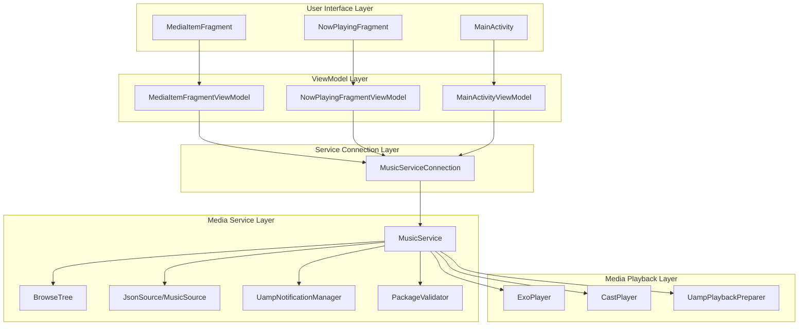
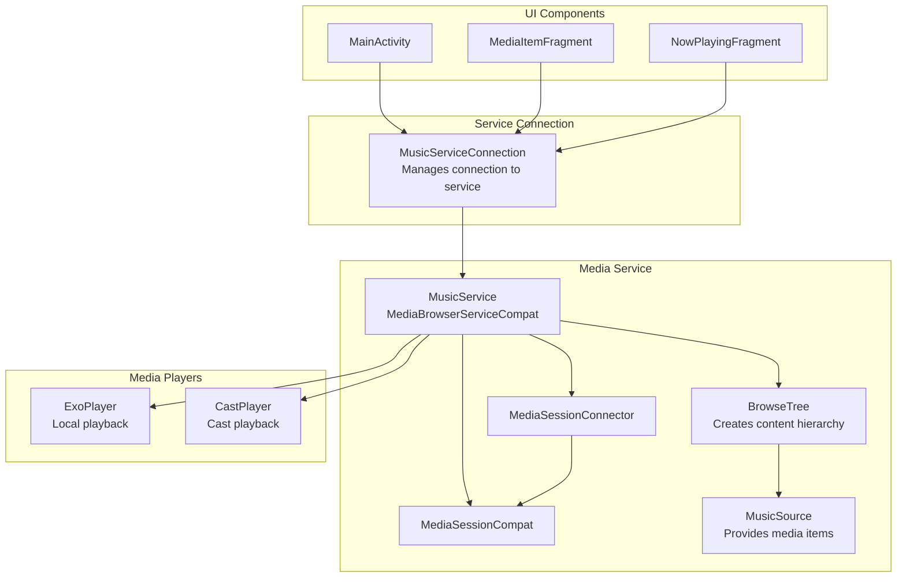
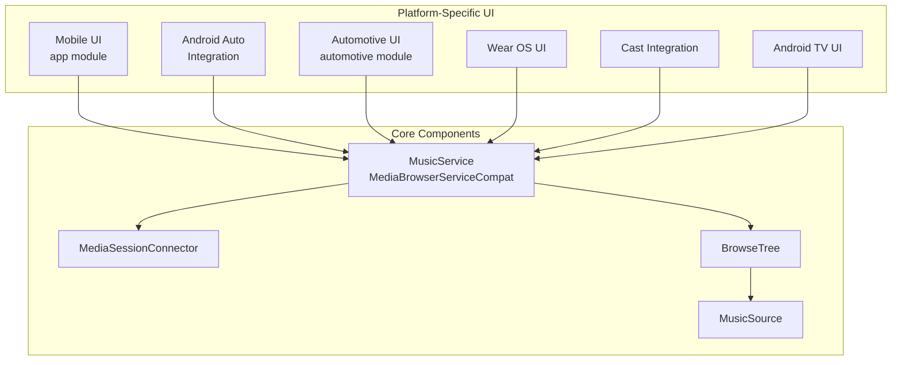

<!-- source: DeepWiki mcp.deepwiki.com · repo android/uamp · page 1 Overview · fetched 2026-10-23 -->

# Overview

Relevant source files

The following files were used as context for generating this wiki page:

- [.google/packaging.yaml](.google/packaging.yaml)
- [.idea/codeStyles/codeStyleConfig.xml](.idea/codeStyles/codeStyleConfig.xml)
- [.idea/vcs.xml](.idea/vcs.xml)
- [CONTRIBUTING.md](CONTRIBUTING.md)
- [README.md](README.md)

This document provides an introduction to the Universal Android Music Player (UAMP), a sample application that demonstrates how to implement an audio media app that works across multiple Android platforms while providing a consistent user experience. For detailed information about specific components, please refer to the relevant sections in the architecture documentation [Architecture](#2).

## What is UAMP?

The Universal Android Music Player (UAMP) is a sample application designed to showcase best practices for building media applications on Android. It demonstrates how to create a consistent media playback experience across multiple form factors and platforms in the Android ecosystem.

UAMP serves as a reference implementation for developers building audio applications, highlighting proper architecture, media API usage, and platform-specific integrations.

Sources: [README.md:1-6](), [.google/packaging.yaml:5-9]()

## Project Goals

UAMP was created with the following goals:

1. Demonstrate implementation of a fully-featured audio media app
2. Showcase a consistent user experience across multiple platforms
3. Illustrate proper MediaBrowserService pattern implementation
4. Provide a reference for platform-specific integrations (Android Auto, Wear, etc.)
5. Present a modern Android architecture using MVVM and best practices

The sample follows intermediate-level implementation patterns and is intended for developers already familiar with Android development.

Sources: [README.md:3-6](), [.google/packaging.yaml:14]()

## Supported Platforms

UAMP demonstrates how to build a media application that works seamlessly across the following platforms:

| Platform | Description |
|----------|-------------|
| Android phones & tablets | Core mobile experience with full UI |
| Android Auto | Car-optimized UI following Auto guidelines |
| Android Automotive OS | Built-in vehicle infotainment systems |
| Android Wear | Wearable-optimized controls |
| Android TV | Television-optimized interface |
| Google Cast devices | Cast functionality for external playback |
| Google Assistant | Voice control integration |

This multi-platform support is achieved through a shared core architecture with platform-specific UI layers.

Sources: [README.md:3-6](), [.google/packaging.yaml:7]()

## System Architecture Overview

### High-Level Architecture

The UAMP application follows a layered architecture pattern with clear separation of concerns, allowing for code reuse across platforms while accommodating platform-specific requirements.

Sources: Provided system architecture diagrams

### Core Components and Their Relationships

The following diagram illustrates the key code components of UAMP and their relationships:

Sources: Provided system architecture diagrams

## Platform Support Implementation

UAMP demonstrates how to support multiple platforms through a unified codebase with platform-specific UI layers. The architecture enables a consistent media experience while respecting platform-specific UI guidelines and capabilities.

Sources: Provided system architecture diagrams, [.google/packaging.yaml:7]()

## Key Architectural Patterns

UAMP demonstrates several important architectural patterns for media applications:

1. **MediaBrowserService Pattern**: The core of the application is built around the `MediaBrowserServiceCompat` class, enabling multiple clients (UI, Android Auto, Google Assistant) to connect to and control media playback.

2. **MVVM Architecture**: The application uses the Model-View-ViewModel (MVVM) pattern with LiveData for UI updates, maintaining a clean separation of concerns.

3. **Modular Design**: The project is divided into modules (common, app, automotive) to promote code reuse and separation of concerns.

4. **Connection Management**: A dedicated `MusicServiceConnection` class manages the connection between UI components and the media service.

5. **Content Browsing**: The `BrowseTree` class organizes media content into a browsable hierarchy that works across platforms.

Sources: Provided system architecture diagrams, [.google/packaging.yaml:18-25]()

## Technology Stack

UAMP is built using the following key technologies:

| Component | Technology |
|-----------|------------|
| Programming Language | Kotlin |
| Media Player | ExoPlayer |
| Media API | MediaBrowserServiceCompat, MediaSessionCompat |
| Architecture | MVVM with LiveData |
| UI | AndroidX components |
| Notifications | MediaStyle notifications |
| Cast Support | CastPlayer |

Sources: [.google/packaging.yaml:9-25]()

## Getting Started

To get started with UAMP:

1. Clone the repository from GitHub
2. Open the project in Android Studio 3.x or higher
3. Build using Gradle: `gradlew build` or use "Import Project" in Android Studio

The sample demonstrates various aspects of media app development, including:
- Media browsing and playback
- Media notifications and transport controls
- Platform-specific integrations
- MVVM architecture implementation

For more detailed guidance, refer to the full architecture documentation [Architecture](#2).

Sources: [README.md:13-22]()

## Project Structure

UAMP is organized into several modules to support different platforms:

| Module | Purpose |
|--------|---------|
| app | Mobile UI implementation |
| automotive | Android Automotive OS implementation |
| common | Core library with shared functionality |
| media | Media functionality |

This modular approach allows for maximum code reuse while accommodating platform-specific requirements.

Sources: Provided system architecture diagrams

---

