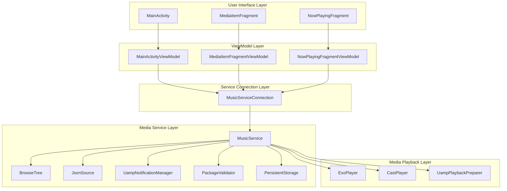
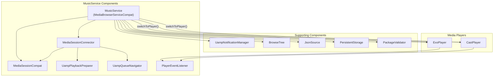
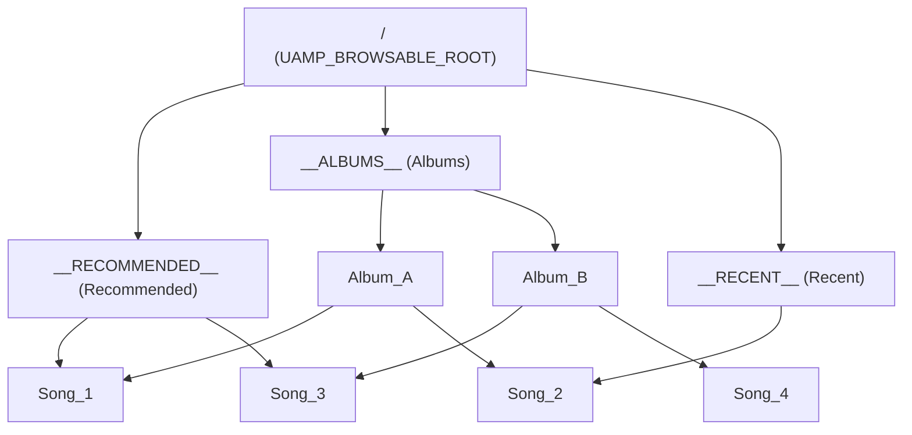
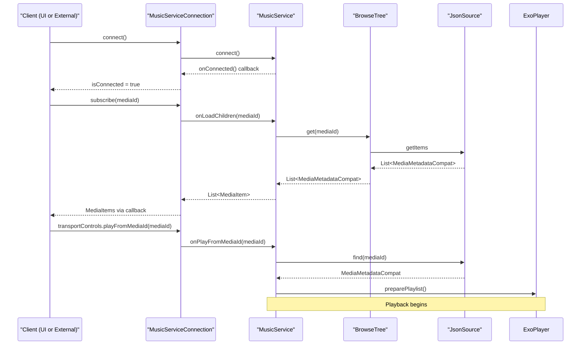
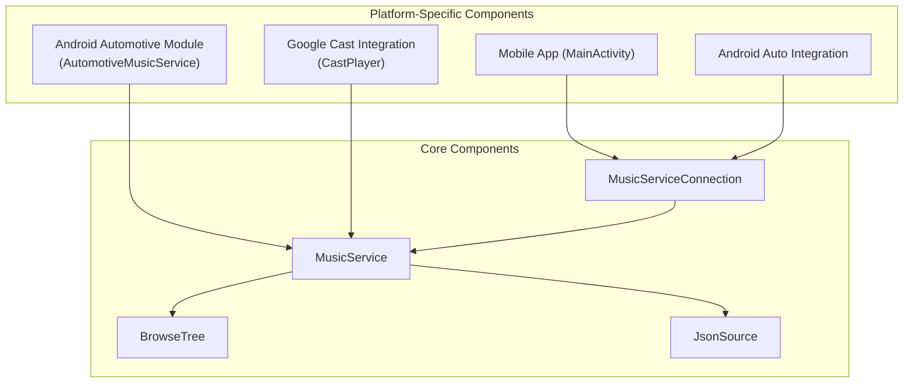

<!-- source: DeepWiki mcp.deepwiki.com · repo android/uamp · page 2 Architecture · fetched 2026-10-23 -->

# Architecture

Relevant source files

The following files were used as context for generating this wiki page:

- [app/src/main/java/com/example/android/uamp/MainActivity.kt](app/src/main/java/com/example/android/uamp/MainActivity.kt)
- [app/src/main/java/com/example/android/uamp/MediaItemAdapter.kt](app/src/main/java/com/example/android/uamp/MediaItemAdapter.kt)
- [app/src/main/java/com/example/android/uamp/MediaItemData.kt](app/src/main/java/com/example/android/uamp/MediaItemData.kt)
- [app/src/main/java/com/example/android/uamp/viewmodels/MainActivityViewModel.kt](app/src/main/java/com/example/android/uamp/viewmodels/MainActivityViewModel.kt)
- [app/src/main/java/com/example/android/uamp/viewmodels/MediaItemFragmentViewModel.kt](app/src/main/java/com/example/android/uamp/viewmodels/MediaItemFragmentViewModel.kt)
- [app/src/main/java/com/example/android/uamp/viewmodels/NowPlayingFragmentViewModel.kt](app/src/main/java/com/example/android/uamp/viewmodels/NowPlayingFragmentViewModel.kt)
- [app/src/main/res/layout/fragment_mediaitem.xml](app/src/main/res/layout/fragment_mediaitem.xml)
- [app/src/main/res/layout/fragment_mediaitem_list.xml](app/src/main/res/layout/fragment_mediaitem_list.xml)
- [automotive/src/main/java/com/example/android/uamp/automotive/AutomotiveMusicService.kt](automotive/src/main/java/com/example/android/uamp/automotive/AutomotiveMusicService.kt)
- [automotive/src/main/java/com/example/android/uamp/automotive/SignInActivityViewModel.kt](automotive/src/main/java/com/example/android/uamp/automotive/SignInActivityViewModel.kt)
- [common/src/main/java/com/example/android/uamp/common/MusicServiceConnection.kt](common/src/main/java/com/example/android/uamp/common/MusicServiceConnection.kt)
- [common/src/main/java/com/example/android/uamp/media/CastMediaItemConverter.kt](common/src/main/java/com/example/android/uamp/media/CastMediaItemConverter.kt)
- [common/src/main/java/com/example/android/uamp/media/MusicService.kt](common/src/main/java/com/example/android/uamp/media/MusicService.kt)
- [common/src/main/java/com/example/android/uamp/media/PackageValidator.kt](common/src/main/java/com/example/android/uamp/media/PackageValidator.kt)
- [common/src/main/java/com/example/android/uamp/media/PersistentStorage.kt](common/src/main/java/com/example/android/uamp/media/PersistentStorage.kt)
- [common/src/main/java/com/example/android/uamp/media/UampNotificationManager.kt](common/src/main/java/com/example/android/uamp/media/UampNotificationManager.kt)
- [common/src/main/java/com/example/android/uamp/media/extensions/MediaMetadataCompatExt.kt](common/src/main/java/com/example/android/uamp/media/extensions/MediaMetadataCompatExt.kt)
- [common/src/main/java/com/example/android/uamp/media/library/AlbumArtContentProvider.kt](common/src/main/java/com/example/android/uamp/media/library/AlbumArtContentProvider.kt)
- [common/src/main/java/com/example/android/uamp/media/library/BrowseTree.kt](common/src/main/java/com/example/android/uamp/media/library/BrowseTree.kt)
- [common/src/main/java/com/example/android/uamp/media/library/JsonSource.kt](common/src/main/java/com/example/android/uamp/media/library/JsonSource.kt)

This document describes the overall architecture of the Universal Android Music Player (UAMP) application, covering its key components and their interactions. UAMP demonstrates best practices for audio playback on Android across multiple form factors and platforms.

For specific details about the media service implementation, see [Media Service](#2.1). For information about how media content is organized, see [Media Content Organization](#2.2).

## High-Level Architecture Overview

UAMP follows the MVVM (Model-View-ViewModel) architecture pattern and is built around Android's MediaBrowserService API, which enables an application to expose its media catalog and playback controls to multiple clients.

### Key Architecture Components Diagram

Sources: [common/src/main/java/com/example/android/uamp/media/MusicService.kt](), [app/src/main/java/com/example/android/uamp/MainActivity.kt](), [common/src/main/java/com/example/android/uamp/common/MusicServiceConnection.kt](), [app/src/main/java/com/example/android/uamp/viewmodels/MediaItemFragmentViewModel.kt](), [app/src/main/java/com/example/android/uamp/viewmodels/MainActivityViewModel.kt](), [app/src/main/java/com/example/android/uamp/viewmodels/NowPlayingFragmentViewModel.kt]()

## Core Architecture Components

### MusicService

The `MusicService` class [common/src/main/java/com/example/android/uamp/media/MusicService.kt:93-653]() is the central component of UAMP, extending `MediaBrowserServiceCompat` to provide media browsing and playback functionality. It serves as the entry point for browsing and playback commands from both the app's UI and external clients (like Android Auto or Google Assistant).

Key responsibilities:
- Managing the media session
- Handling media browsing requests
- Controlling media playback
- Switching between local (ExoPlayer) and cast (CastPlayer) playback
- Providing notifications for media controls

Sources: [common/src/main/java/com/example/android/uamp/media/MusicService.kt:93-653](), [common/src/main/java/com/example/android/uamp/media/UampNotificationManager.kt]()

### MusicServiceConnection

The `MusicServiceConnection` class [common/src/main/java/com/example/android/uamp/common/MusicServiceConnection.kt:54-186]() manages the connection between the UI components and the `MusicService`. It wraps a `MediaBrowserCompat` instance and provides LiveData objects that expose the current state of the media session.

Key responsibilities:
- Connecting to the MusicService
- Providing access to transport controls
- Exposing playback state and now playing metadata as LiveData
- Managing subscriptions to media content

Sources: [common/src/main/java/com/example/android/uamp/common/MusicServiceConnection.kt:54-186]()

### ViewModels

UAMP uses ViewModels to separate UI logic from the business logic and to survive configuration changes:

1. **MainActivityViewModel** [app/src/main/java/com/example/android/uamp/viewmodels/MainActivityViewModel.kt:42-171]()
   - Manages navigation between media items
   - Provides the root media ID
   - Handles media playback commands

2. **MediaItemFragmentViewModel** [app/src/main/java/com/example/android/uamp/viewmodels/MediaItemFragmentViewModel.kt:42-181]()
   - Subscribes to a specific media ID
   - Provides a list of media items
   - Updates the UI based on playback state

3. **NowPlayingFragmentViewModel** [app/src/main/java/com/example/android/uamp/viewmodels/NowPlayingFragmentViewModel.kt:50-201]()
   - Provides metadata for the currently playing item
   - Tracks playback position
   - Updates media controls

Sources: [app/src/main/java/com/example/android/uamp/viewmodels/MainActivityViewModel.kt](), [app/src/main/java/com/example/android/uamp/viewmodels/MediaItemFragmentViewModel.kt](), [app/src/main/java/com/example/android/uamp/viewmodels/NowPlayingFragmentViewModel.kt]()

### Media Content Management

#### BrowseTree

The `BrowseTree` class [common/src/main/java/com/example/android/uamp/media/library/BrowseTree.kt:57-153]() organizes media content into a browsable hierarchy. It maps media IDs to their children, creating a tree structure that clients can browse.

The browse tree has several root categories:
- `/` (UAMP_BROWSABLE_ROOT): The top-level root
- `__RECOMMENDED__` (UAMP_RECOMMENDED_ROOT): Featured or recommended content
- `__ALBUMS__` (UAMP_ALBUMS_ROOT): All albums
- `__RECENT__` (UAMP_RECENT_ROOT): Recently played items

Sources: [common/src/main/java/com/example/android/uamp/media/library/BrowseTree.kt:57-153](), [common/src/main/java/com/example/android/uamp/media/MusicService.kt:118-120]()

#### JsonSource

The `JsonSource` class [common/src/main/java/com/example/android/uamp/media/library/JsonSource.kt:55-174]() implements the `AbstractMusicSource` interface and loads media items from a JSON file. It converts the JSON data into MediaMetadataCompat objects that can be used by other components.

Sources: [common/src/main/java/com/example/android/uamp/media/library/JsonSource.kt:55-174](), [common/src/main/java/com/example/android/uamp/media/MusicService.kt:208-211]()

## MediaBrowser Pattern Implementation

UAMP follows the MediaBrowser pattern, which enables a client-server architecture for media playback:

Sources: [common/src/main/java/com/example/android/uamp/common/MusicServiceConnection.kt:76-84](), [common/src/main/java/com/example/android/uamp/media/MusicService.kt:267-348](), [common/src/main/java/com/example/android/uamp/media/MusicService.kt:493-518]()

## Platform Integration Architecture

UAMP is designed to work across multiple Android platforms through a shared core implementation:

Sources: [common/src/main/java/com/example/android/uamp/media/MusicService.kt](), [common/src/main/java/com/example/android/uamp/common/MusicServiceConnection.kt](), [automotive/src/main/java/com/example/android/uamp/automotive/AutomotiveMusicService.kt](), [common/src/main/java/com/example/android/uamp/media/CastMediaItemConverter.kt]()

### Android Automotive OS Integration

For Android Automotive OS, UAMP provides an extended version of the `MusicService` called `AutomotiveMusicService` [automotive/src/main/java/com/example/android/uamp/automotive/AutomotiveMusicService.kt:55-175]() that includes authentication functionality.

Sources: [automotive/src/main/java/com/example/android/uamp/automotive/AutomotiveMusicService.kt:55-175]()

### Google Cast Integration

UAMP supports Google Cast through the `CastPlayer` class from ExoPlayer's Cast extension. The `MusicService` [common/src/main/java/com/example/android/uamp/media/MusicService.kt:149-165]() detects when a Cast session is available and switches playback to the Cast device.

The `CastMediaItemConverter` [common/src/main/java/com/example/android/uamp/media/CastMediaItemConverter.kt:26-77]() handles the conversion between ExoPlayer's `MediaItem` and Cast's `MediaQueueItem`.

Sources: [common/src/main/java/com/example/android/uamp/media/MusicService.kt:149-165](), [common/src/main/java/com/example/android/uamp/media/CastMediaItemConverter.kt:26-77]()

## Cross-Component Communication

Communication between components in UAMP is primarily done using Android Architecture Components:

| Component | Communication Mechanism | Subscribers |
|-----------|-------------------------|-------------|
| MusicService | MediaBrowserServiceCompat API | MusicServiceConnection |
| MusicServiceConnection | LiveData (playbackState, nowPlaying) | ViewModels |
| ViewModels | LiveData | UI Fragments |

The key LiveData objects exposed by `MusicServiceConnection` include:
- `isConnected`: Connection state with the service
- `playbackState`: Current playback state (playing, paused, etc.)
- `nowPlaying`: Metadata of the currently playing item
- `networkFailure`: Network error indicator

Sources: [common/src/main/java/com/example/android/uamp/common/MusicServiceConnection.kt:55-65](), [app/src/main/java/com/example/android/uamp/viewmodels/MediaItemFragmentViewModel.kt:81-101]()

## Media Notification Management

The `UampNotificationManager` [common/src/main/java/com/example/android/uamp/media/UampNotificationManager.kt:44-130]() manages the media playback notification, which allows users to control playback from outside the app. It uses ExoPlayer's `PlayerNotificationManager` to create and update the notification.

The `PlayerNotificationListener` in `MusicService` [common/src/main/java/com/example/android/uamp/media/MusicService.kt:567-590]() handles notification events, managing the service's foreground state accordingly.

Sources: [common/src/main/java/com/example/android/uamp/media/UampNotificationManager.kt:44-130](), [common/src/main/java/com/example/android/uamp/media/MusicService.kt:567-590]()

## Security Architecture

UAMP implements the `PackageValidator` [common/src/main/java/com/example/android/uamp/media/PackageValidator.kt:51-353]() to ensure that only authorized applications can connect to the `MusicService`. This validation happens in the `onGetRoot` method of `MusicService` [common/src/main/java/com/example/android/uamp/media/MusicService.kt:267-307]().

Authorized clients include:
- The app itself
- System applications
- Applications with the MEDIA_CONTENT_CONTROL permission
- Applications with notification listener services
- Applications on an allow list defined in XML

Sources: [common/src/main/java/com/example/android/uamp/media/PackageValidator.kt:51-353](), [common/src/main/java/com/example/android/uamp/media/MusicService.kt:267-307]()

## Persistence

UAMP uses `PersistentStorage` [common/src/main/java/com/example/android/uamp/media/PersistentStorage.kt:31-97]() to save and retrieve information about the most recently played song. This allows the app to resume playback after a reboot or when reopened.

Sources: [common/src/main/java/com/example/android/uamp/media/PersistentStorage.kt:31-97](), [common/src/main/java/com/example/android/uamp/media/MusicService.kt:423-439]()

## Summary

The UAMP architecture demonstrates a well-structured approach to building a media playback application on Android:

1. It uses the MediaBrowserService pattern to support multiple clients
2. It follows the MVVM architecture to separate concerns
3. It provides a modular design that supports multiple platforms
4. It leverages LiveData for reactive UI updates
5. It implements security measures to validate client access

This architecture serves as a reference implementation for building robust media applications on Android, highlighting best practices for handling media playback across different devices and contexts.

---

