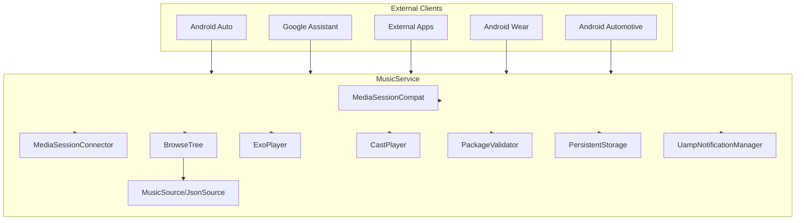
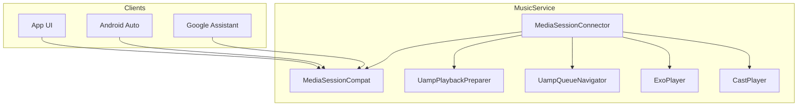
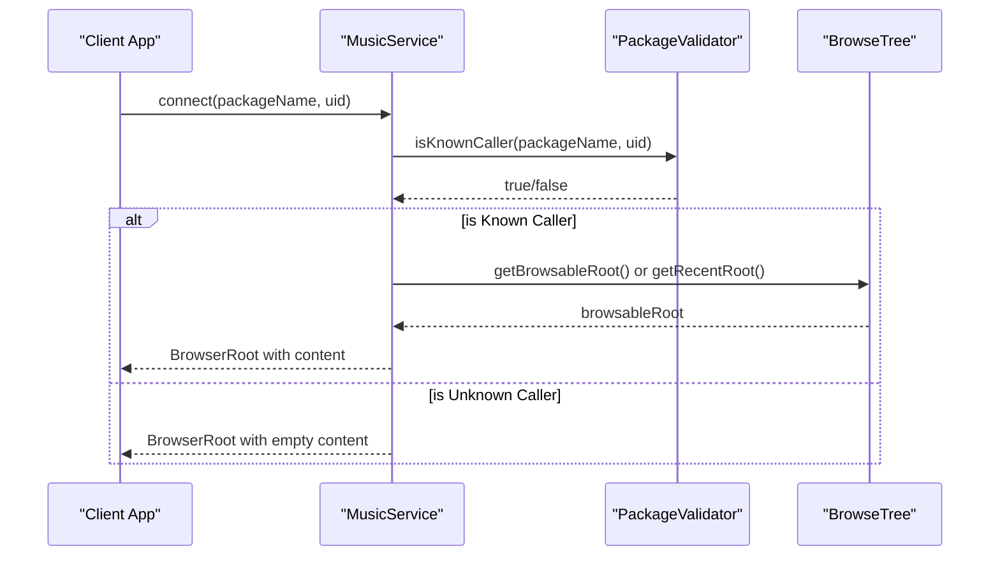
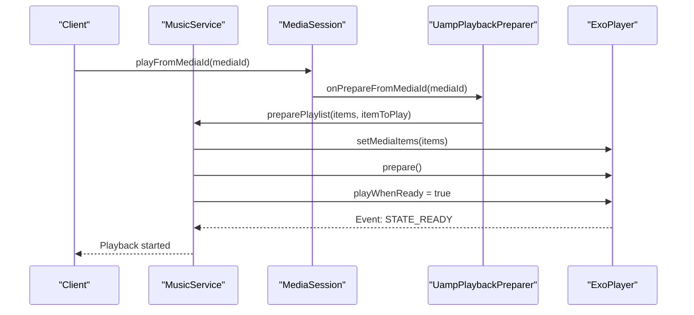
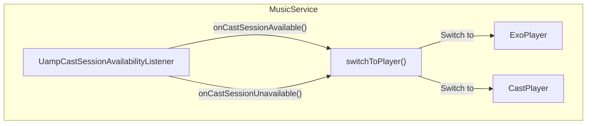
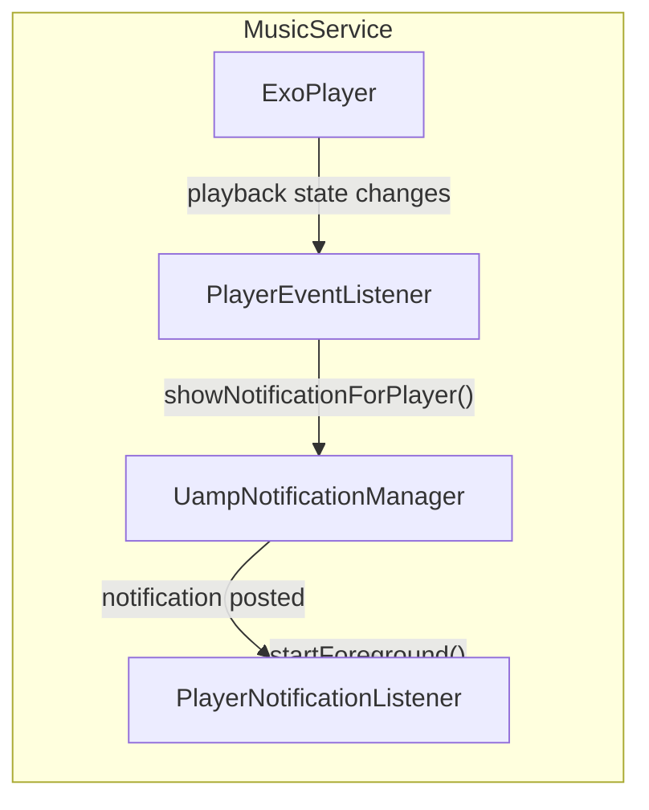

<!-- source: DeepWiki mcp.deepwiki.com · repo android/uamp · page 2.1 Media Service · fetched 2026-10-23 -->

# Media Service

Relevant source files

The following files were used as context for generating this wiki page:

- [app/src/main/AndroidManifest.xml](app/src/main/AndroidManifest.xml)
- [app/src/main/java/com/example/android/uamp/cast/UampCastOptionsProvider.kt](app/src/main/java/com/example/android/uamp/cast/UampCastOptionsProvider.kt)
- [automotive/src/main/java/com/example/android/uamp/automotive/AutomotiveMusicService.kt](automotive/src/main/java/com/example/android/uamp/automotive/AutomotiveMusicService.kt)
- [common/src/main/java/com/example/android/uamp/media/CastMediaItemConverter.kt](common/src/main/java/com/example/android/uamp/media/CastMediaItemConverter.kt)
- [common/src/main/java/com/example/android/uamp/media/MusicService.kt](common/src/main/java/com/example/android/uamp/media/MusicService.kt)
- [common/src/main/java/com/example/android/uamp/media/PackageValidator.kt](common/src/main/java/com/example/android/uamp/media/PackageValidator.kt)
- [common/src/main/java/com/example/android/uamp/media/PersistentStorage.kt](common/src/main/java/com/example/android/uamp/media/PersistentStorage.kt)
- [common/src/main/java/com/example/android/uamp/media/UampNotificationManager.kt](common/src/main/java/com/example/android/uamp/media/UampNotificationManager.kt)
- [common/src/main/java/com/example/android/uamp/media/extensions/MediaMetadataCompatExt.kt](common/src/main/java/com/example/android/uamp/media/extensions/MediaMetadataCompatExt.kt)
- [common/src/main/java/com/example/android/uamp/media/extensions/PlaybackStateCompatExt.kt](common/src/main/java/com/example/android/uamp/media/extensions/PlaybackStateCompatExt.kt)
- [common/src/main/java/com/example/android/uamp/media/library/AlbumArtContentProvider.kt](common/src/main/java/com/example/android/uamp/media/library/AlbumArtContentProvider.kt)
- [common/src/main/java/com/example/android/uamp/media/library/JsonSource.kt](common/src/main/java/com/example/android/uamp/media/library/JsonSource.kt)
- [common/src/main/java/com/example/android/uamp/media/library/MusicSource.kt](common/src/main/java/com/example/android/uamp/media/library/MusicSource.kt)
- [common/src/main/res/menu/main_activity_menu.xml](common/src/main/res/menu/main_activity_menu.xml)
- [common/src/main/res/values/strings.xml](common/src/main/res/values/strings.xml)

The Media Service is the core component of the UAMP (Universal Android Music Player) architecture responsible for handling media browsing and playback commands. It implements Android's `MediaBrowserServiceCompat` and serves as the central hub for all media-related operations, allowing multiple clients (such as the app UI, Android Auto, and Google Assistant) to connect and control media playback.

For information about how media content is organized and browsed, see [Media Content Organization](#2.2). For details about how notifications and media controls are implemented, see [Notifications and Media Controls](#2.3).

## Overview

The Media Service acts as an entry point for browsing and playback commands from various sources:

- The UAMP app's UI
- Android Auto
- Android Automotive OS
- Google Assistant
- Google Cast devices
- External apps with appropriate permissions

It maintains a single source of truth for the app's media playback state, manages media sessions, and handles transitions between local and remote (cast) playback.

Diagram Title: Media Service and its client interactions

Sources: [common/src/main/java/com/example/android/uamp/media/MusicService.kt:77-92](), [app/src/main/AndroidManifest.xml:83-93]()

## Core Components

### MusicService

The `MusicService` class is the main implementation of the MediaBrowserServiceCompat. It handles the initialization of all other components and coordinates interactions between them.

Key responsibilities:

- Creating and managing the MediaSession
- Handling media browsing requests
- Managing playback state and controls
- Switching between ExoPlayer and CastPlayer
- Validating caller packages
- Saving and restoring playback state

Sources: [common/src/main/java/com/example/android/uamp/media/MusicService.kt:93-672]()

### Media Session

The Media Session is the central interface for controlling media playback. It allows clients to:

- View information about the currently playing media
- Control playback (play, pause, skip, etc.)
- Receive updates about playback state changes

The `MusicService` creates and manages a `MediaSessionCompat` instance and connects it to ExoPlayer or CastPlayer using the `MediaSessionConnector`.

Diagram Title: Media Session and related components

Sources: [common/src/main/java/com/example/android/uamp/media/MusicService.kt:176-216](), [common/src/main/java/com/example/android/uamp/media/MusicService.kt:459-468](), [common/src/main/java/com/example/android/uamp/media/MusicService.kt:470-562]()

## Media Browsing

The browsing functionality is a key part of the Media Service. It allows clients to:

1. Connect to the service
2. Retrieve a hierarchical structure of media content
3. Navigate through this structure to find content to play

### Root and Package Validation

When a client attempts to connect to the service, the `onGetRoot` method is called. This method:

1. Validates the calling package using `PackageValidator`
2. Returns an appropriate browsing root based on the caller
3. Provides additional information via `rootExtras`

Diagram Title: Connection and root validation flow

Sources: [common/src/main/java/com/example/android/uamp/media/MusicService.kt:266-307](), [common/src/main/java/com/example/android/uamp/media/PackageValidator.kt:76-149]()

### Media Item Loading

Once connected, clients can request children of the root or other nodes using `onLoadChildren`:

- If the requested mediaId is the recent root, return the most recently played song
- Otherwise, use the BrowseTree to get the appropriate media items
- If the media source is not ready yet, detach the result to send it later

Sources: [common/src/main/java/com/example/android/uamp/media/MusicService.kt:314-348]()

## Media Playback

The Media Service manages playback through ExoPlayer (for local playback) or CastPlayer (for remote playback).

### Playback Components

| Component | Role |
|-----------|------|
| `ExoPlayer` | Handles local media playback |
| `CastPlayer` | Handles remote playback via Google Cast |
| `UampPlaybackPreparer` | Prepares media for playback in response to client requests |
| `UampQueueNavigator` | Provides queue navigation functionality |
| `PlayerEventListener` | Responds to player events |

Sources: [common/src/main/java/com/example/android/uamp/media/MusicService.kt:138-144](), [common/src/main/java/com/example/android/uamp/media/MusicService.kt:149-165](), [common/src/main/java/com/example/android/uamp/media/MusicService.kt:470-562](), [common/src/main/java/com/example/android/uamp/media/MusicService.kt:459-468](), [common/src/main/java/com/example/android/uamp/media/MusicService.kt:595-652]()

### Playback Flow

Diagram Title: Media playback preparation and execution flow

Sources: [common/src/main/java/com/example/android/uamp/media/MusicService.kt:378-396](), [common/src/main/java/com/example/android/uamp/media/MusicService.kt:493-518]()

### Player Switching

A unique feature of the Music Service is its ability to switch between local and remote playback:

- When a Cast session becomes available, playback is transferred to the CastPlayer
- When a Cast session ends, playback returns to ExoPlayer
- The transition preserves playback position and state

Diagram Title: Player switching mechanism

Sources: [common/src/main/java/com/example/android/uamp/media/MusicService.kt:398-421](), [common/src/main/java/com/example/android/uamp/media/MusicService.kt:441-457]()

## Notification Management

The `UampNotificationManager` handles media playback notifications. It:

- Creates and updates notifications based on playback state
- Handles foreground service promotion when needed
- Customizes notification appearance with media metadata

Diagram Title: Notification management flow

Sources: [common/src/main/java/com/example/android/uamp/media/MusicService.kt:200-204](), [common/src/main/java/com/example/android/uamp/media/MusicService.kt:567-590](), [common/src/main/java/com/example/android/uamp/media/UampNotificationManager.kt:44-130]()

## Persistent Storage

The `PersistentStorage` component enables "media resumption" functionality:

- Saves information about the most recently played song
- Saves the playback position
- Converts remote artwork URIs to local URIs for offline access
- Allows playback to resume between app restarts or device reboots

When `onPrepare` is called without a specific media ID, the service will attempt to resume the most recently played song.

Sources: [common/src/main/java/com/example/android/uamp/media/MusicService.kt:423-439](), [common/src/main/java/com/example/android/uamp/media/MusicService.kt:484-491](), [common/src/main/java/com/example/android/uamp/media/PersistentStorage.kt:31-97]()

## Cross-Platform Support

The Media Service is designed to work across multiple Android platforms:

### Android Automotive OS Integration

The `AutomotiveMusicService` extends `MusicService` to add features specific to Android Automotive:

- Authentication/login handling
- Custom error messages with resolution actions
- Automotive-specific command handling

Sources: [automotive/src/main/java/com/example/android/uamp/automotive/AutomotiveMusicService.kt:55-175]()

### Google Cast Integration

For Google Cast support, the Media Service:

- Switches between ExoPlayer and CastPlayer as needed
- Converts media metadata to a format suitable for Cast
- Preserves playback state during transitions

Sources: [common/src/main/java/com/example/android/uamp/media/MusicService.kt:149-165](), [common/src/main/java/com/example/android/uamp/media/MusicService.kt:441-457](), [common/src/main/java/com/example/android/uamp/media/CastMediaItemConverter.kt:26-77]()

## Security Considerations

The `PackageValidator` component ensures that only authorized clients can fully interact with the Media Service:

- Validates the calling package's certificate
- Allows system apps and those with special permissions
- Provides different browsing roots based on caller validation

This is important because the Media Service is exported in the manifest (to allow external clients to connect), which creates security considerations.

Sources: [common/src/main/java/com/example/android/uamp/media/PackageValidator.kt:51-353](), [app/src/main/AndroidManifest.xml:83-93]()

## Summary

The Media Service is a sophisticated component that implements Android's MediaBrowserServiceCompat to provide media browsing and playback capabilities to multiple clients. It manages:

1. Media browsing (content hierarchy and metadata)
2. Media playback (via ExoPlayer or CastPlayer)
3. Media session state and controls
4. Notifications and foreground service status
5. Playback persistence for media resumption
6. Security and package validation
7. Cross-platform support

This architecture follows Android's recommended patterns for media apps and ensures seamless integration with the Android media ecosystem.

---

