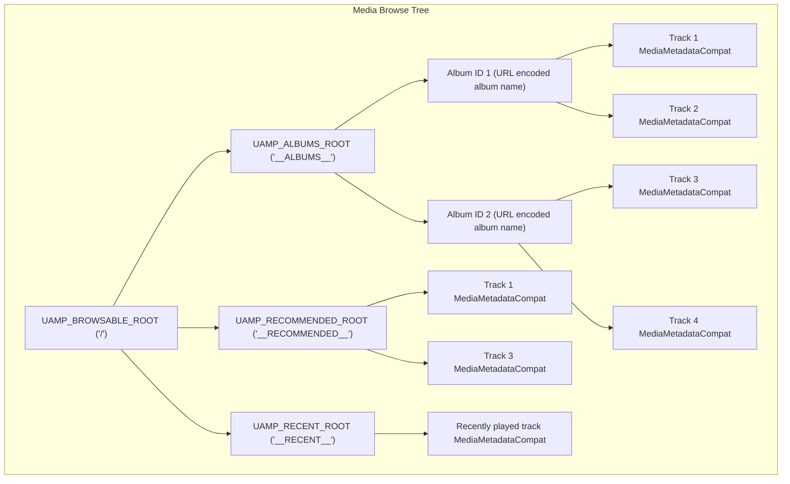
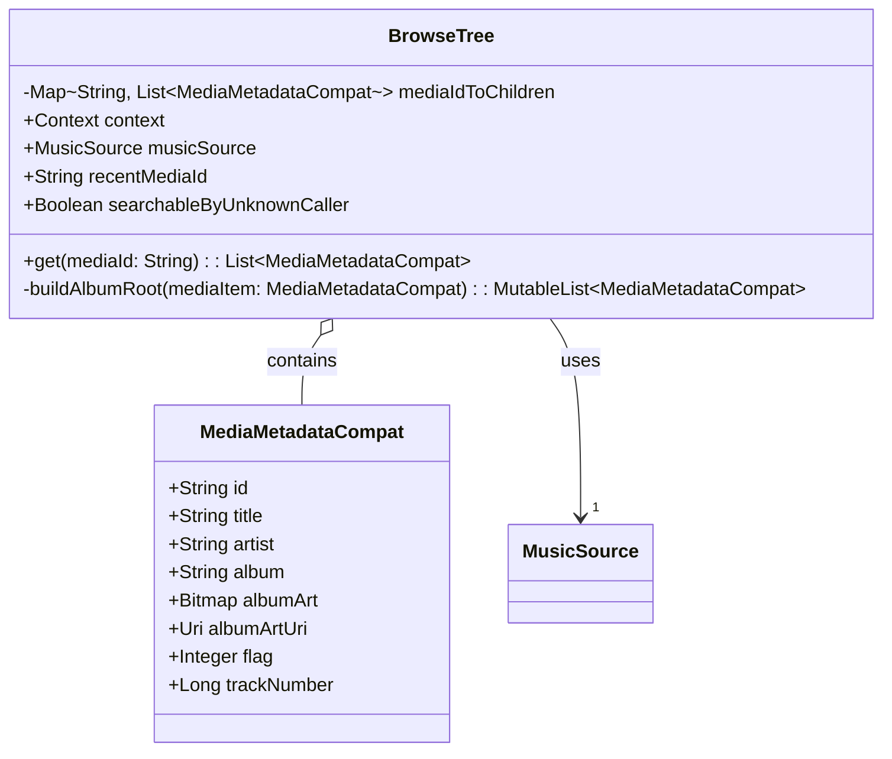
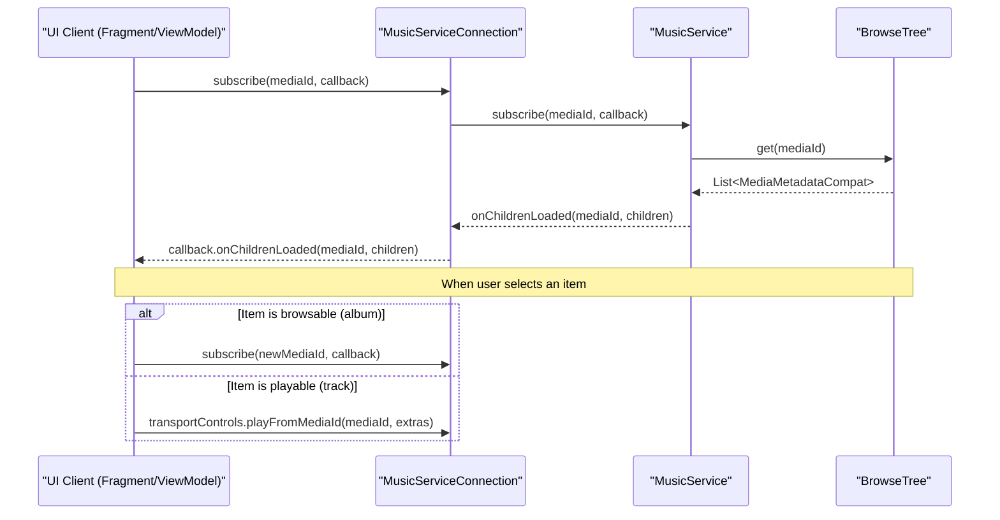

<!-- source: DeepWiki mcp.deepwiki.com · repo android/uamp · page 2.2 Media Content Organization · fetched 2026-10-23 -->

# Media Content Organization

<details>
<summary>Relevant source files</summary>

The following files were used as context for generating this wiki page:

- [TODO.md](TODO.md)
- [app/src/main/java/com/example/android/uamp/viewmodels/NowPlayingFragmentViewModel.kt](app/src/main/java/com/example/android/uamp/viewmodels/NowPlayingFragmentViewModel.kt)
- [automotive/src/main/java/com/example/android/uamp/automotive/SignInActivityViewModel.kt](automotive/src/main/java/com/example/android/uamp/automotive/SignInActivityViewModel.kt)
- [common/src/main/java/com/example/android/uamp/common/MusicServiceConnection.kt](common/src/main/java/com/example/android/uamp/common/MusicServiceConnection.kt)
- [common/src/main/java/com/example/android/uamp/media/library/BrowseTree.kt](common/src/main/java/com/example/android/uamp/media/library/BrowseTree.kt)

</details>


## Purpose and Overview

This document explains how media content is organized and browsed in UAMP (Universal Android Music Player). It covers the hierarchical structure of media content, the implementation of the browse tree, and how clients interact with this structure to navigate and display media items.

This page focuses specifically on the content organization aspect of the media system. For information about media playback and controls, see [Notifications and Media Controls](#2.3), and for details about the core media service functionality, see [Media Service](#2.1).

## Media Content Hierarchy

UAMP organizes media content in a hierarchical tree structure to provide a consistent browsing experience across different platforms and clients. This organization enables features like categorizing music by albums, creating recommended playlists, and tracking recently played items.



**Diagram: Media Content Hierarchy**

Sources: [common/src/main/java/com/example/android/uamp/media/library/BrowseTree.kt:35-56]()

The hierarchy consists of:

1. **Root Node** (`UAMP_BROWSABLE_ROOT` or `/`) - The top-level entry point for browsing
2. **Category Nodes**:
   - **Recommended** (`UAMP_RECOMMENDED_ROOT` or `__RECOMMENDED__`) - Contains the first track from each album
   - **Albums** (`UAMP_ALBUMS_ROOT` or `__ALBUMS__`) - Contains all available albums
   - **Recent** (`UAMP_RECENT_ROOT` or `__RECENT__`) - Contains the most recently played track (if provided)
3. **Album Nodes** - Each representing an album, with the album name URL-encoded as its ID
4. **Track Nodes** - Individual tracks (songs) represented as `MediaMetadataCompat` objects

This organization makes it easy for clients to browse either by category or directly to specific albums and tracks.

## BrowseTree Implementation

The `BrowseTree` class is the central component that maintains the hierarchical media structure. It maps media IDs to their children, allowing for efficient navigation through the content.



**Diagram: BrowseTree Class Structure**

Sources: [common/src/main/java/com/example/android/uamp/media/library/BrowseTree.kt:57-152]()

### Key Components of BrowseTree:

1. **mediaIdToChildren**: A mapping from media IDs to lists of `MediaMetadataCompat` objects representing their children.

2. **Initialization**: The constructor sets up the root structure and organizes media items from the provided `MusicSource`:
   ```
   - Creates root list with Recommended and Albums categories
   - Iterates through all media items
   - Groups items by album
   - Adds first track of each album to Recommended section
   - Adds recently played track to Recent section (if available)
   ```

3. **Operator Overloading**: The class overloads the `get` operator, allowing access to children using array-like syntax:
   ```kotlin
   operator fun get(mediaId: String) = mediaIdToChildren[mediaId]
   ```

4. **Album Building**: The `buildAlbumRoot` private method creates album nodes and adds them to the Albums category:
   ```kotlin
   private fun buildAlbumRoot(mediaItem: MediaMetadataCompat): MutableList<MediaMetadataCompat>
   ```

Sources: [common/src/main/java/com/example/android/uamp/media/library/BrowseTree.kt:57-152]()

## Browsing Media Content

The browsing process involves clients (such as UI components) subscribing to media IDs to receive their children. This is facilitated by the `MusicServiceConnection` class, which serves as the bridge between UI components and the media service.



**Diagram: Media Browsing Flow**

Sources: 
- [common/src/main/java/com/example/android/uamp/common/MusicServiceConnection.kt:78-84]()
- [common/src/main/java/com/example/android/uamp/media/library/BrowseTree.kt:125]()

### Key Browsing Components:

1. **MusicServiceConnection.subscribe()**: Allows clients to subscribe to a media ID and receive its children:
   ```kotlin
   fun subscribe(parentId: String, callback: MediaBrowserCompat.SubscriptionCallback) {
       mediaBrowser.subscribe(parentId, callback)
   }
   ```

2. **MediaBrowserCompat.SubscriptionCallback**: Clients implement this callback to receive children when subscribing to a media ID.

3. **Navigation Process**:
   - Clients start by subscribing to the root media ID (`UAMP_BROWSABLE_ROOT`)
   - When a user selects a browsable item (like an album), the client subscribes to that item's ID
   - When a user selects a playable item (like a track), the client requests playback of that item

Sources: [common/src/main/java/com/example/android/uamp/common/MusicServiceConnection.kt:78-84]()

## Media Content Types and Flags

The media browser system distinguishes between two types of media items:

1. **Browsable Items** (like categories and albums)
   - Contain children items
   - Marked with `MediaItem.FLAG_BROWSABLE`
   - Examples: "Albums" category, individual album entries

2. **Playable Items** (like tracks/songs)
   - Can be played by the media player
   - Marked with `MediaItem.FLAG_PLAYABLE`
   - Examples: Individual music tracks

This distinction helps client applications determine appropriate UI behavior and actions for each item.

```
For example:
- When a user selects a browsable item → Open a new list view showing its children
- When a user selects a playable item → Begin playback of that item
```

Sources: [common/src/main/java/com/example/android/uamp/media/library/BrowseTree.kt:86-94](), [common/src/main/java/com/example/android/uamp/media/library/BrowseTree.kt:140]()

## Media Content Organization in View Models

The media content organization is reflected in the ViewModels that drive the UI. The ViewModels subscribe to media IDs and present the resulting content to the UI components.

For example, the `NowPlayingFragmentViewModel` transforms the raw `MediaMetadataCompat` objects into UI-friendly `NowPlayingMetadata` objects that contain only the information needed for display.

```kotlin
data class NowPlayingMetadata(
    val id: String,
    val albumArtUri: Uri,
    val title: String?,
    val subtitle: String?,
    val duration: String
)
```

This transformation helps create a clean separation between the underlying media content organization and the UI presentation.

Sources: [app/src/main/java/com/example/android/uamp/viewmodels/NowPlayingFragmentViewModel.kt:59-79]()

## Summary

The media content organization in UAMP follows a hierarchical tree structure implemented by the `BrowseTree` class. This structure enables efficient browsing of media content across different categories, albums, and tracks. The `MusicServiceConnection` provides the interface for UI components to interact with this tree, subscribing to media IDs to receive their children and requesting playback of specific items.

This architecture supports a variety of browsing patterns and provides a consistent experience across different platforms, from mobile devices to automotive systems.

---

