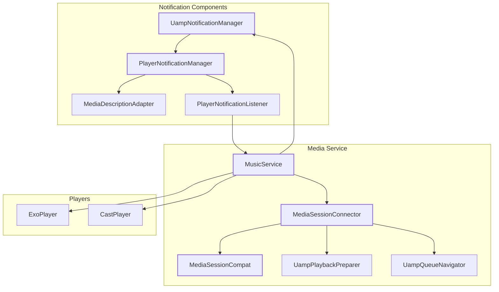
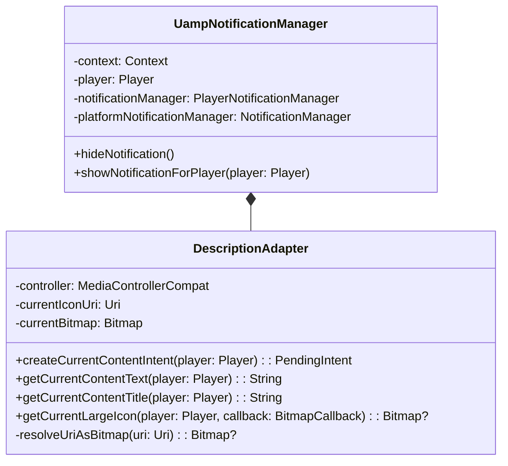
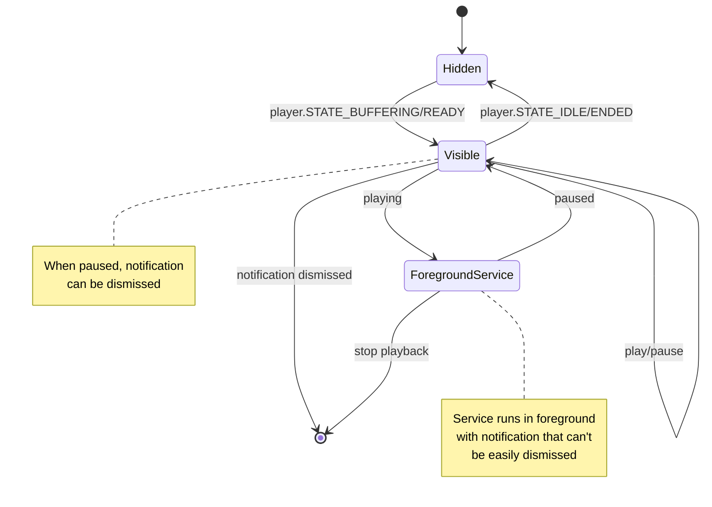
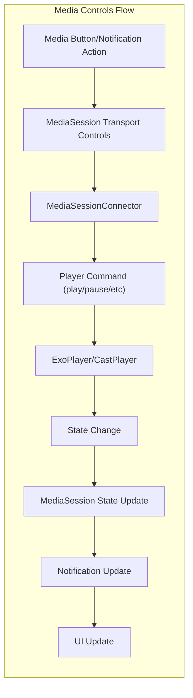
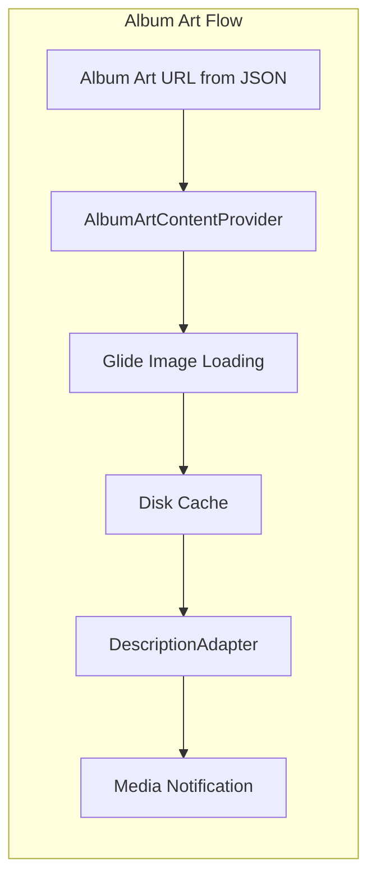

<!-- source: DeepWiki mcp.deepwiki.com · repo android/uamp · page 2.3 Notifications and Media Controls · fetched 2026-10-23 -->

# Notifications and Media Controls

<details>
<summary>Relevant source files</summary>

The following files were used as context for generating this wiki page:

- [.idea/codeStyles/Project.xml](.idea/codeStyles/Project.xml)
- [app/src/main/res/xml/automotive_app_desc.xml](app/src/main/res/xml/automotive_app_desc.xml)
- [automotive/src/main/java/com/example/android/uamp/automotive/AutomotiveMusicService.kt](automotive/src/main/java/com/example/android/uamp/automotive/AutomotiveMusicService.kt)
- [common/src/main/AndroidManifest.xml](common/src/main/AndroidManifest.xml)
- [common/src/main/assets/default_art.png](common/src/main/assets/default_art.png)
- [common/src/main/java/com/example/android/uamp/media/CastMediaItemConverter.kt](common/src/main/java/com/example/android/uamp/media/CastMediaItemConverter.kt)
- [common/src/main/java/com/example/android/uamp/media/MusicService.kt](common/src/main/java/com/example/android/uamp/media/MusicService.kt)
- [common/src/main/java/com/example/android/uamp/media/PackageValidator.kt](common/src/main/java/com/example/android/uamp/media/PackageValidator.kt)
- [common/src/main/java/com/example/android/uamp/media/PersistentStorage.kt](common/src/main/java/com/example/android/uamp/media/PersistentStorage.kt)
- [common/src/main/java/com/example/android/uamp/media/UampNotificationManager.kt](common/src/main/java/com/example/android/uamp/media/UampNotificationManager.kt)
- [common/src/main/java/com/example/android/uamp/media/extensions/FileExt.kt](common/src/main/java/com/example/android/uamp/media/extensions/FileExt.kt)
- [common/src/main/java/com/example/android/uamp/media/extensions/MediaMetadataCompatExt.kt](common/src/main/java/com/example/android/uamp/media/extensions/MediaMetadataCompatExt.kt)
- [common/src/main/java/com/example/android/uamp/media/library/AlbumArtContentProvider.kt](common/src/main/java/com/example/android/uamp/media/library/AlbumArtContentProvider.kt)
- [common/src/main/java/com/example/android/uamp/media/library/JsonSource.kt](common/src/main/java/com/example/android/uamp/media/library/JsonSource.kt)

</details>


This document describes the notification and media control system used in UAMP (Universal Android Music Player). It covers how media playback notifications are created, displayed, and updated, as well as how they integrate with Android's media session framework to provide consistent media controls across the system. For information about media content browsing and organization, see [Media Content Organization](#2.2).

## Overview

UAMP implements media notifications that allow users to control playback from outside the app. These notifications are visible in the notification drawer, lock screen, and other system interfaces. They display metadata about the currently playing media (title, artist, album art) and provide transport controls like play, pause, previous, and next.



Sources: [common/src/main/java/com/example/android/uamp/media/MusicService.kt](), [common/src/main/java/com/example/android/uamp/media/UampNotificationManager.kt]()

## Notification Architecture

### UampNotificationManager

`UampNotificationManager` is a wrapper class for ExoPlayer's `PlayerNotificationManager`. It's responsible for creating and managing the media playback notification.



Sources: [common/src/main/java/com/example/android/uamp/media/UampNotificationManager.kt:44-130]()

The notification manager is created in `MusicService.onCreate()` and is initialized with:
1. The application context
2. The media session token
3. A notification listener (which handles foreground service state)

```
notificationManager = UampNotificationManager(
    this,
    mediaSession.sessionToken,
    PlayerNotificationListener()
)
```

Sources: [common/src/main/java/com/example/android/uamp/media/MusicService.kt:200-204]()

### MediaDescriptionAdapter

Inside `UampNotificationManager`, a `MediaDescriptionAdapter` handles extracting metadata for the notification:

- **Title**: Retrieved from the media session metadata's title
- **Content text**: Retrieved from the media session metadata's subtitle
- **Intent**: Uses the media session's activity to create a PendingIntent
- **Artwork**: Loads bitmap images using Glide, with caching to prevent repeated loads

The adapter implements bitmap caching by:
1. Checking if the current icon URI matches the requested URI
2. Using a cached bitmap if available
3. Asynchronously loading the bitmap with Glide if needed
4. Providing the bitmap to the notification when loaded

Sources: [common/src/main/java/com/example/android/uamp/media/UampNotificationManager.kt:82-128]()

## Notification Lifecycle

Notifications are closely tied to the playback state of the media player. The `PlayerEventListener` in `MusicService` responds to player state changes and updates notifications accordingly.



Sources: [common/src/main/java/com/example/android/uamp/media/MusicService.kt:595-623]()

### Notification Listener

The `PlayerNotificationListener` inner class in `MusicService` handles important events related to the notification:

1. **Notification posted**: When a notification is posted with `ongoing=true`, it starts the service as a foreground service
2. **Notification cancelled**: When the notification is dismissed, it stops the foreground service and eventually stops the service

```
private inner class PlayerNotificationListener :
    PlayerNotificationManager.NotificationListener {
    override fun onNotificationPosted(
        notificationId: Int,
        notification: Notification,
        ongoing: Boolean
    ) {
        if (ongoing && !isForegroundService) {
            ContextCompat.startForegroundService(
                applicationContext,
                Intent(applicationContext, this@MusicService.javaClass)
            )

            startForeground(notificationId, notification)
            isForegroundService = true
        }
    }

    override fun onNotificationCancelled(notificationId: Int, dismissedByUser: Boolean) {
        stopForeground(true)
        isForegroundService = false
        stopSelf()
    }
}
```

Sources: [common/src/main/java/com/example/android/uamp/media/MusicService.kt:567-590]()

## Media Session Integration

The media session is the central component that coordinates media playback information and controls. It connects the notification controls with the actual playback functionality.



Sources: [common/src/main/java/com/example/android/uamp/media/MusicService.kt:177-183](), [common/src/main/java/com/example/android/uamp/media/MusicService.kt:214-216]()

### MediaSessionConnector

UAMP uses ExoPlayer's `MediaSessionConnector` to connect the media session with the player. This connector:

1. Handles transport controls (play, pause, skip, etc.)
2. Updates playback state based on player state
3. Provides player and queue information to the media session

The connector is configured with:
- `UampPlaybackPreparer`: Prepares media for playback
- `UampQueueNavigator`: Provides queue navigation functionality

Sources: [common/src/main/java/com/example/android/uamp/media/MusicService.kt:214-216]()

### Player Event Handling

The `PlayerEventListener` class monitors player events and updates the notification accordingly:

- When buffering/playing: Show notification
- When playing: Keep service in foreground
- When paused: Allow service to run in background
- When idle/ended: Hide notification

It also tracks the current media item to maintain the correct playback position during transitions.

Sources: [common/src/main/java/com/example/android/uamp/media/MusicService.kt:595-635]()

## Album Art in Notifications

UAMP implements custom handling for album art in notifications through several components:



Sources: [common/src/main/java/com/example/android/uamp/media/library/AlbumArtContentProvider.kt](), [common/src/main/java/com/example/android/uamp/media/UampNotificationManager.kt:97-116]()

### AlbumArtContentProvider

UAMP uses a custom `ContentProvider` called `AlbumArtContentProvider` to:

1. Convert remote image URLs to content:// URIs
2. Download and cache album artwork using Glide
3. Provide local access to album art even when offline

This approach ensures that:
- Album art is available for media notifications
- Images are properly cached to avoid repeated downloads
- System components can access the images via content:// URIs

The content provider maps remote URIs to local files and handles image caching. When a request for album art comes in, it:

1. Checks if the file exists in the cache
2. If not, downloads it using Glide
3. Returns a ParcelFileDescriptor for the file

Sources: [common/src/main/java/com/example/android/uamp/media/library/AlbumArtContentProvider.kt:33-72](), [common/src/main/java/com/example/android/uamp/media/library/JsonSource.kt:101-107]()

## Background Playback Behavior

UAMP is designed to continue playback when the app is in the background but stop when the app is swiped away from recents. This behavior is implemented in `MusicService.onTaskRemoved()`:

```
override fun onTaskRemoved(rootIntent: Intent) {
    saveRecentSongToStorage()
    super.onTaskRemoved(rootIntent)

    currentPlayer.stop(/* reset= */true)
}
```

When the player stops, it triggers a chain of events:
1. Player state changes to IDLE
2. The notification is hidden
3. Foreground service is stopped
4. Service stops itself

Before stopping, the service saves the most recently played song to allow for later resumption.

Sources: [common/src/main/java/com/example/android/uamp/media/MusicService.kt:234-247](), [common/src/main/java/com/example/android/uamp/media/PersistentStorage.kt:52-74]()

## Notification Channel Configuration

The media notification uses a dedicated notification channel with the ID `"com.example.android.uamp.media.NOW_PLAYING"`. The channel name and description are set from resources:

```
setChannelNameResourceId(R.string.notification_channel)
setChannelDescriptionResourceId(R.string.notification_channel_description)
```

The notification is configured with:
- A small icon (R.drawable.ic_notification)
- No rewind or fast-forward actions (only previous/next)
- Standard play/pause actions

Sources: [common/src/main/java/com/example/android/uamp/media/UampNotificationManager.kt:37-71]()

## Platform Integration

### Cast Integration

When casting to external devices, UAMP switches between the local ExoPlayer and a CastPlayer. The notification follows this transition, continuing to show playback controls that now affect the cast session.

The `switchToPlayer` method handles the transition between players, maintaining the current playlist and playback position:

```
private fun switchToPlayer(previousPlayer: Player?, newPlayer: Player) {
    if (previousPlayer == newPlayer) {
        return
    }
    currentPlayer = newPlayer
    // ... setup the new player with the current state ...
    mediaSessionConnector.setPlayer(newPlayer)
    previousPlayer?.stop(/* reset= */true)
}
```

Sources: [common/src/main/java/com/example/android/uamp/media/MusicService.kt:398-421]()

### Android Auto

UAMP supports Android Auto through the MediaBrowserService pattern. The same notification and media session are used to provide controls in the Auto interface.

The Android Auto integration is declared in the app manifest with an automotive app descriptor:

```xml
<automotiveApp>
    <uses name="media" />
</automotiveApp>
```

Sources: [app/src/main/res/xml/automotive_app_desc.xml:17-23]()

## Summary

UAMP's notification and media controls system provides a seamless playback experience through:

1. `UampNotificationManager`: Manages media notifications with album art and playback controls
2. Media Session integration: Connects transport controls to the underlying player
3. Content Provider for album art: Provides cached access to artwork
4. Foreground service management: Handles service lifecycle based on playback state
5. Platform integration: Supports Android Auto and Cast seamlessly

This system allows users to control media playback from notifications, the lock screen, Android Auto, and other system interfaces, creating a consistent experience across the platform.

---

