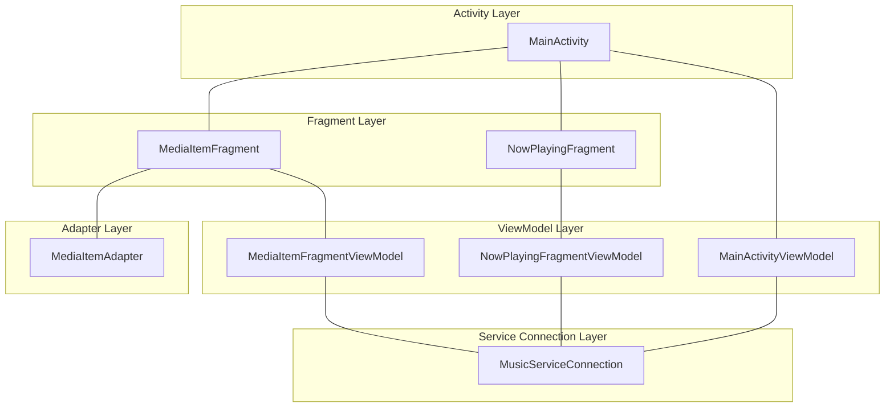
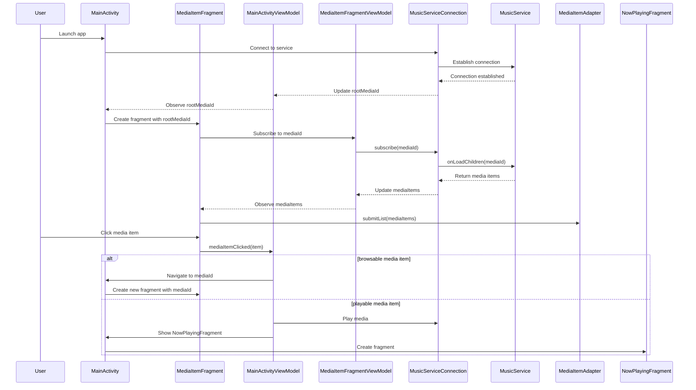

<!-- source: DeepWiki mcp.deepwiki.com · repo android/uamp · page 3 User Interface · fetched 2026-10-23 -->

# User Interface

<details>
<summary>Relevant source files</summary>

The following files were used as context for generating this wiki page:

- [app/build.gradle](app/build.gradle)
- [app/src/main/java/com/example/android/uamp/MainActivity.kt](app/src/main/java/com/example/android/uamp/MainActivity.kt)
- [app/src/main/java/com/example/android/uamp/MediaItemAdapter.kt](app/src/main/java/com/example/android/uamp/MediaItemAdapter.kt)
- [app/src/main/java/com/example/android/uamp/MediaItemData.kt](app/src/main/java/com/example/android/uamp/MediaItemData.kt)
- [app/src/main/java/com/example/android/uamp/fragments/MediaItemFragment.kt](app/src/main/java/com/example/android/uamp/fragments/MediaItemFragment.kt)
- [app/src/main/java/com/example/android/uamp/fragments/NowPlayingFragment.kt](app/src/main/java/com/example/android/uamp/fragments/NowPlayingFragment.kt)
- [app/src/main/java/com/example/android/uamp/viewmodels/MainActivityViewModel.kt](app/src/main/java/com/example/android/uamp/viewmodels/MainActivityViewModel.kt)
- [app/src/main/java/com/example/android/uamp/viewmodels/MediaItemFragmentViewModel.kt](app/src/main/java/com/example/android/uamp/viewmodels/MediaItemFragmentViewModel.kt)
- [app/src/main/res/layout/fragment_mediaitem.xml](app/src/main/res/layout/fragment_mediaitem.xml)
- [app/src/main/res/layout/fragment_mediaitem_list.xml](app/src/main/res/layout/fragment_mediaitem_list.xml)
- [automotive/src/main/java/com/example/android/uamp/automotive/SettingsFragment.kt](automotive/src/main/java/com/example/android/uamp/automotive/SettingsFragment.kt)

</details>


This page documents the user interface architecture of the Universal Android Music Player (UAMP). It covers the main UI components, their relationships, the UI data flow, and how the user interface connects to the underlying media service. For information about the core media functionality, see [Media Service](#2.1) and [Media Content Organization](#2.2).

## UI Architecture Overview

UAMP follows the Model-View-ViewModel (MVVM) architecture pattern, using AndroidX lifecycle components. The UI is built using Fragments hosted by a single Activity, with ViewModels managing the UI state and communication with the media service.



Sources: [app/src/main/java/com/example/android/uamp/MainActivity.kt](), [app/src/main/java/com/example/android/uamp/fragments/MediaItemFragment.kt](), [app/src/main/java/com/example/android/uamp/fragments/NowPlayingFragment.kt](), [app/src/main/java/com/example/android/uamp/viewmodels/MainActivityViewModel.kt](), [app/src/main/java/com/example/android/uamp/viewmodels/MediaItemFragmentViewModel.kt]()

## Main UI Components

### MainActivity

`MainActivity` serves as the host for all UI fragments. It handles the fragment transactions and provides a shared ViewModel (`MainActivityViewModel`) to its fragments. It also:

- Initializes the Cast context for Google Cast integration
- Sets up the media route button for casting
- Observes navigation events from its ViewModel to switch fragments
- Sets the audio stream to `STREAM_MUSIC` for proper volume control

Sources: [app/src/main/java/com/example/android/uamp/MainActivity.kt:34-117]()

### MediaItemFragment

`MediaItemFragment` displays a browsable list of media items (e.g., albums, playlists, tracks). It:

- Displays media items in a RecyclerView using `MediaItemAdapter`
- Shows a progress spinner while loading content
- Shows a network error icon when connectivity issues occur
- Handles user clicks on media items by delegating to the MainActivityViewModel

Sources: [app/src/main/java/com/example/android/uamp/fragments/MediaItemFragment.kt:36-97]()

### NowPlayingFragment

`NowPlayingFragment` displays the currently playing media item with playback controls. It:

- Shows album art, title, and subtitle of the current track
- Displays a play/pause button with current state
- Shows playback position and duration
- Updates UI in response to playback state changes

Sources: [app/src/main/java/com/example/android/uamp/fragments/NowPlayingFragment.kt:39-104]()

### MediaItemAdapter

`MediaItemAdapter` is a `ListAdapter` implementation for displaying media items in a `RecyclerView`. It:

- Efficiently updates the UI using DiffUtil
- Handles partial updates for playback state changes
- Loads album art using Glide image library
- Passes click events to a listener function

Sources: [app/src/main/java/com/example/android/uamp/MediaItemAdapter.kt:33-102]()

## Data Flow and User Interaction

The following diagram illustrates how data flows through the UI components and how user interactions are handled:



Sources: [app/src/main/java/com/example/android/uamp/MainActivity.kt:58-87](), [app/src/main/java/com/example/android/uamp/viewmodels/MainActivityViewModel.kt:79-98](), [app/src/main/java/com/example/android/uamp/viewmodels/MediaItemFragmentViewModel.kt:59-74]()

## Data Models

### MediaItemData

The `MediaItemData` class encapsulates the UI representation of a media item. It contains:

- `mediaId`: Unique identifier for the media item
- `title`: The title of the media item
- `subtitle`: Secondary text (artist, album, etc.)
- `albumArtUri`: URI for the album artwork
- `browsable`: Flag indicating if the item has children
- `playbackRes`: Resource ID for the playback state icon

It also includes a DiffUtil.ItemCallback for efficient RecyclerView updates, particularly for playback state changes.

Sources: [app/src/main/java/com/example/android/uamp/MediaItemData.kt:34-85]()

## ViewModels

The ViewModels in UAMP act as intermediaries between UI components and the underlying media service. They:

1. Manage UI state
2. Handle user interactions
3. Connect to the MusicServiceConnection to control playback
4. Expose LiveData for UI components to observe

### MainActivityViewModel

`MainActivityViewModel` manages the overall UI state for the MainActivity. Key responsibilities:

- Tracks the root media ID from the MusicServiceConnection
- Manages fragment navigation
- Handles media item clicks and determines whether to browse or play
- Controls media playback through the MusicServiceConnection

Sources: [app/src/main/java/com/example/android/uamp/viewmodels/MainActivityViewModel.kt:42-171]()

### MediaItemFragmentViewModel

`MediaItemFragmentViewModel` manages the data for a specific MediaItemFragment. Key responsibilities:

- Subscribes to a specific media ID to get child items
- Observes playback state and metadata changes
- Updates the UI state of media items based on playback state
- Provides network error information

Sources: [app/src/main/java/com/example/android/uamp/viewmodels/MediaItemFragmentViewModel.kt:42-181]()

## UI Layouts

The UI is built with XML layouts and uses both ViewBinding and DataBinding for view interactions.

### Key Layout Files

| Layout File | Purpose |
|-------------|---------|
| `activity_main.xml` | Main container with a fragmentContainer view |
| `fragment_mediaitem_list.xml` | RecyclerView list for media items with loading and error states |
| `fragment_mediaitem.xml` | Individual media item card with album art and text |
| `fragment_nowplaying.xml` | Now playing screen with media controls |

Sources: [app/src/main/res/layout/fragment_mediaitem_list.xml:17-50](), [app/src/main/res/layout/fragment_mediaitem.xml:17-91](), [app/build.gradle:47-50]()

## Component Relationships

This diagram shows the code-level relationship between UI components and how they connect to the media service:

```mermaid
classDiagram
    class MainActivity {
        -MainActivityViewModel viewModel
        -CastContext castContext
        +onCreate()
        +onCreateOptionsMenu()
        -navigateToMediaItem(mediaId)
    }
    
    class MediaItemFragment {
        -MainActivityViewModel mainActivityViewModel
        -MediaItemFragmentViewModel mediaItemFragmentViewModel
        -MediaItemAdapter listAdapter
        -String mediaId
        +onCreateView()
        +onActivityCreated()
    }
    
    class NowPlayingFragment {
        -MainActivityViewModel mainActivityViewModel
        -NowPlayingFragmentViewModel nowPlayingViewModel
        +onCreateView()
        +onViewCreated()
        -updateUI(metadata)
    }
    
    class MediaItemAdapter {
        -ItemClickedListener itemClickedListener
        +onCreateViewHolder()
        +onBindViewHolder()
    }
    
    class MediaViewHolder {
        +TextView titleView
        +TextView subtitleView
        +ImageView albumArt
        +ImageView playbackState
        +MediaItemData item
    }
    
    class MediaItemData {
        +String mediaId
        +String title
        +String subtitle
        +Uri albumArtUri
        +boolean browsable
        +int playbackRes
        +DiffUtil.ItemCallback diffCallback
    }
    
    class MainActivityViewModel {
        -MusicServiceConnection musicServiceConnection
        +LiveData rootMediaId
        +LiveData navigateToMediaItem
        +LiveData navigateToFragment
        +mediaItemClicked(MediaItemData)
        +showFragment(Fragment)
        -browseToItem(MediaItemData)
        +playMedia(MediaItemData)
    }
    
    class MediaItemFragmentViewModel {
        -String mediaId
        -MusicServiceConnection musicServiceConnection
        +LiveData mediaItems
        +LiveData networkError
        -SubscriptionCallback subscriptionCallback
    }
    
    MainActivity --> MediaItemFragment : creates
    MainActivity --> NowPlayingFragment : creates
    MainActivity --> MainActivityViewModel : observes
    
    MediaItemFragment --> MediaItemAdapter : uses
    MediaItemFragment --> MediaItemFragmentViewModel : observes
    MediaItemFragment --> MainActivityViewModel : uses
    
    NowPlayingFragment --> MainActivityViewModel : uses
    
    MediaItemAdapter --> MediaViewHolder : creates
    MediaItemAdapter --> MediaItemData : displays
    
    MediaViewHolder --> MediaItemData : holds
    
    MainActivityViewModel --> "MusicServiceConnection" : controls
    MediaItemFragmentViewModel --> "MusicServiceConnection" : subscribes
```

Sources: [app/src/main/java/com/example/android/uamp/MainActivity.kt](), [app/src/main/java/com/example/android/uamp/fragments/MediaItemFragment.kt](), [app/src/main/java/com/example/android/uamp/fragments/NowPlayingFragment.kt](), [app/src/main/java/com/example/android/uamp/MediaItemAdapter.kt](), [app/src/main/java/com/example/android/uamp/MediaItemData.kt](), [app/src/main/java/com/example/android/uamp/viewmodels/MainActivityViewModel.kt](), [app/src/main/java/com/example/android/uamp/viewmodels/MediaItemFragmentViewModel.kt]()

## Google Cast Integration

The UI integrates with Google Cast, allowing users to cast media to supported devices:

- MainActivity initializes CastContext in onCreate()
- MediaRouteButton is added to the app bar menu
- CastButtonFactory configures the button

Sources: [app/src/main/java/com/example/android/uamp/MainActivity.kt:46-46](), [app/src/main/java/com/example/android/uamp/MainActivity.kt:98-98]()

## Styling and Resources

The app uses custom styles for consistent UI appearance across all screens. Some notable styling aspects:

- Custom TextAppearance styles for titles and subtitles
- Media item background with selectable item backgrounds
- Default album art placeholder for items without artwork
- Custom playback control button styling

Through the combination of these UI components and the MVVM architecture, UAMP provides a responsive and maintainable user interface that works across various Android form factors.

---

