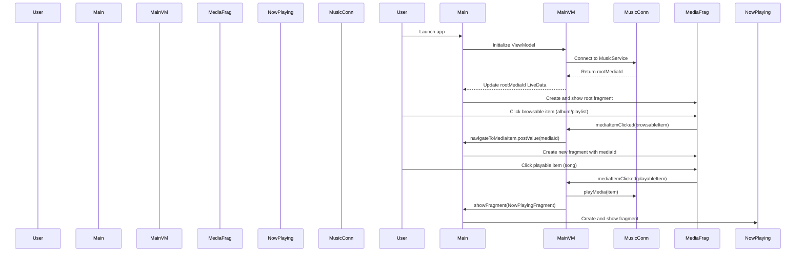
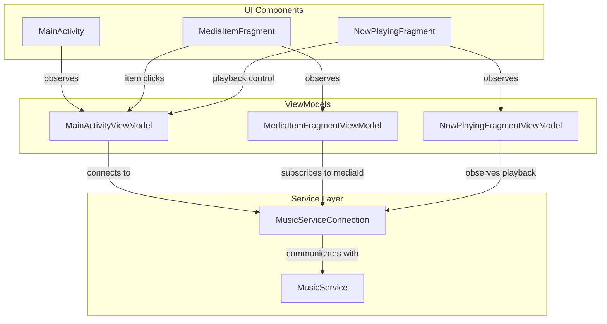

<!-- source: DeepWiki mcp.deepwiki.com · repo android/uamp · page 3.1 MainActivity and Fragments · fetched 2026-10-23 -->

# MainActivity and Fragments

<details>
<summary>Relevant source files</summary>

The following files were used as context for generating this wiki page:

- [app/build.gradle](app/build.gradle)
- [app/src/main/java/com/example/android/uamp/MainActivity.kt](app/src/main/java/com/example/android/uamp/MainActivity.kt)
- [app/src/main/java/com/example/android/uamp/MediaItemAdapter.kt](app/src/main/java/com/example/android/uamp/MediaItemAdapter.kt)
- [app/src/main/java/com/example/android/uamp/MediaItemData.kt](app/src/main/java/com/example/android/uamp/MediaItemData.kt)
- [app/src/main/java/com/example/android/uamp/fragments/MediaItemFragment.kt](app/src/main/java/com/example/android/uamp/fragments/MediaItemFragment.kt)
- [app/src/main/java/com/example/android/uamp/fragments/NowPlayingFragment.kt](app/src/main/java/com/example/android/uamp/fragments/NowPlayingFragment.kt)
- [app/src/main/java/com/example/android/uamp/viewmodels/MainActivityViewModel.kt](app/src/main/java/com/example/android/uamp/viewmodels/MainActivityViewModel.kt)
- [app/src/main/java/com/example/android/uamp/viewmodels/MediaItemFragmentViewModel.kt](app/src/main/java/com/example/android/uamp/viewmodels/MediaItemFragmentViewModel.kt)
- [app/src/main/res/layout/fragment_mediaitem.xml](app/src/main/res/layout/fragment_mediaitem.xml)
- [app/src/main/res/layout/fragment_mediaitem_list.xml](app/src/main/res/layout/fragment_mediaitem_list.xml)
- [automotive/src/main/java/com/example/android/uamp/automotive/SettingsFragment.kt](automotive/src/main/java/com/example/android/uamp/automotive/SettingsFragment.kt)

</details>


This document describes the primary UI components of the UAMP (Universal Android Music Player) application, focusing on the MainActivity and its associated fragments. These components form the visual interface that users interact with to browse and play media content.

For information about the ViewModels that power these UI components, see [ViewModels](#3.2).

## Overview

UAMP uses a single-activity architecture with multiple fragments. The MainActivity serves as the container for all UI fragments, while handling navigation, playback control, and Google Cast integration. The main fragments include:

1. **MediaItemFragment** - Displays browsable lists of media items (albums, playlists, songs)
2. **NowPlayingFragment** - Shows the currently playing media with playback controls

## Architecture

### Class Relationships

```mermaid
classDiagram
    direction LR
    
    class "MainActivity" {
        -viewModel: MainActivityViewModel
        -castContext: CastContext
        +onCreate()
        +onCreateOptionsMenu()
        -navigateToMediaItem()
    }
    
    class "MediaItemFragment" {
        -mainActivityViewModel: MainActivityViewModel
        -mediaItemFragmentViewModel: MediaItemFragmentViewModel
        -listAdapter: MediaItemAdapter
        +newInstance(mediaId: String)
    }
    
    class "MediaItemAdapter" {
        -itemClickedListener: (MediaItemData) -> Unit
    }
    
    class "NowPlayingFragment" {
        -mainActivityViewModel: MainActivityViewModel
        -nowPlayingViewModel: NowPlayingFragmentViewModel
        +newInstance()
    }
    
    "MainActivity" --> "MediaItemFragment" : hosts
    "MainActivity" --> "NowPlayingFragment" : hosts
    "MediaItemFragment" --> "MediaItemAdapter" : uses
    "MediaItemAdapter" --> "MediaItemData" : displays
```

Sources: [app/src/main/java/com/example/android/uamp/MainActivity.kt](), [app/src/main/java/com/example/android/uamp/fragments/MediaItemFragment.kt](), [app/src/main/java/com/example/android/uamp/fragments/NowPlayingFragment.kt](), [app/src/main/java/com/example/android/uamp/MediaItemAdapter.kt]()

### Navigation Flow



Sources: [app/src/main/java/com/example/android/uamp/MainActivity.kt:58-87](), [app/src/main/java/com/example/android/uamp/viewmodels/MainActivityViewModel.kt:79-98]()

## MainActivity

The MainActivity serves as the container for all UI fragments and coordinates the navigation flow of the application.

### Key Responsibilities

1. Initializing the Cast context for Google Cast integration
2. Managing fragment transactions
3. Responding to navigation events from MainActivityViewModel
4. Setting up the media route button in the action bar
5. Configuring volume controls for music playback

### Code Structure

MainActivity uses LiveData observation to handle three main types of events:

1. Fragment navigation requests
2. Root media ID updates when connected to MusicService
3. Navigation to specific media items

```
MainActivity
├── onCreate() - Sets up UI and LiveData observers
├── onCreateOptionsMenu() - Creates Cast button
├── navigateToMediaItem() - Handles navigation to media content
├── isRootId() - Checks if mediaId is the root
└── getBrowseFragment() - Retrieves existing fragment instances
```

Sources: [app/src/main/java/com/example/android/uamp/MainActivity.kt]()

## MediaItemFragment

MediaItemFragment displays a list of media items that can be either browsable (such as albums) or playable (such as songs).

### Key Components

| Component | Description |
|-----------|-------------|
| RecyclerView | Displays the list of media items |
| MediaItemAdapter | Adapter for the RecyclerView |
| ProgressBar | Shows loading state |
| NetworkError view | Displays connection error state |

### Implementation Details

The fragment uses two ViewModels:
- **MainActivityViewModel** (shared with activity) - Handles item click events
- **MediaItemFragmentViewModel** (fragment-specific) - Provides media item data and network state

Each instance of MediaItemFragment is associated with a specific `mediaId` which determines what content it displays. When an item is clicked, the event is forwarded to the MainActivityViewModel.

Sources: [app/src/main/java/com/example/android/uamp/fragments/MediaItemFragment.kt](), [app/src/main/java/com/example/android/uamp/MediaItemAdapter.kt](), [app/src/main/res/layout/fragment_mediaitem_list.xml]()

## MediaItemAdapter

The MediaItemAdapter is responsible for displaying media items in a RecyclerView and handling click events.

### Features

1. Uses DiffUtil for efficient updates to the RecyclerView
2. Supports partial updates for playback state changes
3. Displays album art using Glide library
4. Shows playback state indicators (play/pause icons)

### Media Item Visualization

Each media item in the list displays:
- Album art
- Title
- Subtitle (artist/album)
- Playback state indicator (for the currently playing item)

Sources: [app/src/main/java/com/example/android/uamp/MediaItemAdapter.kt](), [app/src/main/res/layout/fragment_mediaitem.xml]()

## NowPlayingFragment

The NowPlayingFragment displays detailed information about the currently playing media item and provides playback controls.

### UI Components

- Large album art
- Title and subtitle
- Playback control button
- Progress position and duration indicators

### Implementation

Like MediaItemFragment, NowPlayingFragment uses two ViewModels:
- **MainActivityViewModel** - For playback control
- **NowPlayingFragmentViewModel** - For current media metadata and playback state

The fragment observes LiveData from the NowPlayingFragmentViewModel to update the UI when the playback state changes or when a new item starts playing.

Sources: [app/src/main/java/com/example/android/uamp/fragments/NowPlayingFragment.kt]()

## Data Model

### MediaItemData

The `MediaItemData` class represents a media item in the UI layer. It encapsulates properties needed to display an item in the list.

```
MediaItemData
├── mediaId: String - Unique identifier for the media item
├── title: String - Title of the media item
├── subtitle: String - Subtitle (artist, album, etc.)
├── albumArtUri: Uri - URI for album art
├── browsable: Boolean - Whether the item is browsable
└── playbackRes: Int - Resource ID for playback state icon
```

The class also provides a `DiffUtil.ItemCallback` to efficiently update the RecyclerView when the data changes.

Sources: [app/src/main/java/com/example/android/uamp/MediaItemData.kt]()

## Fragment-ViewModel Communication



Sources: [app/src/main/java/com/example/android/uamp/viewmodels/MainActivityViewModel.kt](), [app/src/main/java/com/example/android/uamp/viewmodels/MediaItemFragmentViewModel.kt]()

## Integration Points

### Google Cast

MainActivity integrates with Google Cast by initializing the CastContext and setting up a media route button in the app bar. This allows users to cast media to compatible devices.

```
// In MainActivity.onCreate()
castContext = CastContext.getSharedInstance(this)

// In MainActivity.onCreateOptionsMenu()
CastButtonFactory.setUpMediaRouteButton(this, menu, R.id.media_route_menu_item)
```

Sources: [app/src/main/java/com/example/android/uamp/MainActivity.kt:41-46](), [app/src/main/java/com/example/android/uamp/MainActivity.kt:91-99]()

### Android ViewModel Components

The fragments use the AndroidX ViewModel components:
- `activityViewModels()` - For shared ViewModels (MainActivityViewModel)
- `viewModels()` - For fragment-specific ViewModels

This separation allows for proper lifecycle management and data sharing between fragments.

Sources: [app/src/main/java/com/example/android/uamp/fragments/MediaItemFragment.kt:37-42](), [app/src/main/java/com/example/android/uamp/fragments/NowPlayingFragment.kt:40-45]()

## Summary

The MainActivity and Fragments in UAMP implement a single-activity architecture with multiple fragments for different screens. The MainActivity serves as the primary container and navigation controller, while the fragments display media content and playback controls. Communication between components follows the MVVM pattern using ViewModels and LiveData, ensuring a clean separation of concerns and proper lifecycle management.

---

