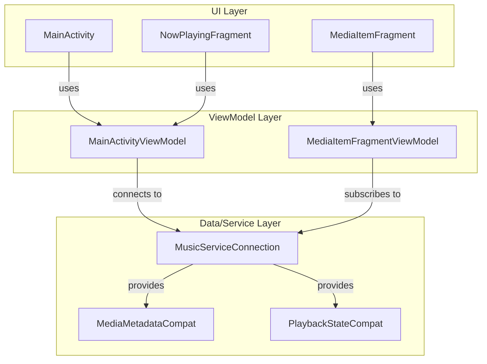
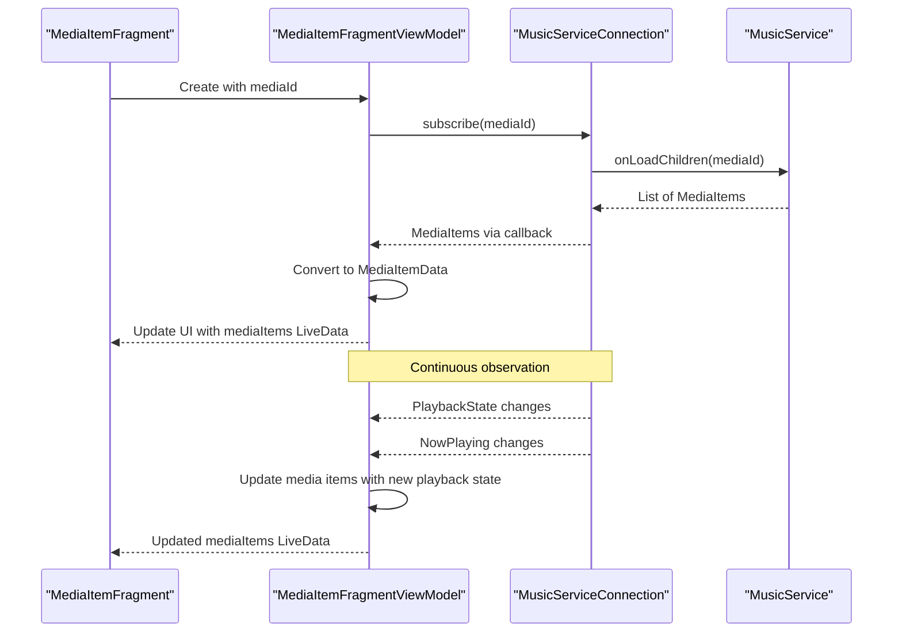
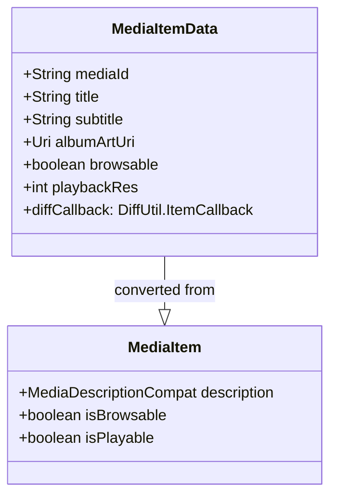
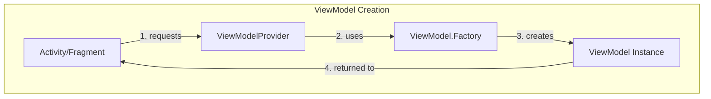

<!-- source: DeepWiki mcp.deepwiki.com · repo android/uamp · page 3.2 ViewModels · fetched 2026-10-23 -->

# ViewModels

<details>
<summary>Relevant source files</summary>

The following files were used as context for generating this wiki page:

- [app/src/main/java/com/example/android/uamp/MainActivity.kt](app/src/main/java/com/example/android/uamp/MainActivity.kt)
- [app/src/main/java/com/example/android/uamp/MediaItemAdapter.kt](app/src/main/java/com/example/android/uamp/MediaItemAdapter.kt)
- [app/src/main/java/com/example/android/uamp/MediaItemData.kt](app/src/main/java/com/example/android/uamp/MediaItemData.kt)
- [app/src/main/java/com/example/android/uamp/viewmodels/MainActivityViewModel.kt](app/src/main/java/com/example/android/uamp/viewmodels/MainActivityViewModel.kt)
- [app/src/main/java/com/example/android/uamp/viewmodels/MediaItemFragmentViewModel.kt](app/src/main/java/com/example/android/uamp/viewmodels/MediaItemFragmentViewModel.kt)
- [app/src/main/res/layout/fragment_mediaitem.xml](app/src/main/res/layout/fragment_mediaitem.xml)
- [app/src/main/res/layout/fragment_mediaitem_list.xml](app/src/main/res/layout/fragment_mediaitem_list.xml)

</details>


This document provides a comprehensive explanation of the ViewModel architecture used in the Universal Android Music Player (UAMP) application. ViewModels serve as the crucial layer connecting the user interface with the media service and handling UI state management. For information about the specific UI components that use these ViewModels, see [MainActivity and Fragments](#3.1).

## Overview of ViewModel Architecture

ViewModels in UAMP follow the Model-View-ViewModel (MVVM) pattern, leveraging Android Architecture Components. They provide a clean separation of concerns by isolating UI logic from the underlying media service connection and data handling.



Sources: [app/src/main/java/com/example/android/uamp/viewmodels/MainActivityViewModel.kt](), [app/src/main/java/com/example/android/uamp/viewmodels/MediaItemFragmentViewModel.kt](), [app/src/main/java/com/example/android/uamp/MainActivity.kt]()

## ViewModel Implementation Details

### MainActivityViewModel

The `MainActivityViewModel` serves as the primary connection point between the UI and the music service. It handles media navigation, playback control, and fragment navigation requests.

Key responsibilities:
- Establishing and maintaining connection to the `MusicServiceConnection`
- Exposing the root media ID from the connected service 
- Handling media item clicks (browsing or playing)
- Managing fragment navigation through `LiveData` events

Notable properties and methods:

| Property/Method | Description |
|-----------------|-------------|
| `rootMediaId` | LiveData that provides the root media ID when connected |
| `navigateToMediaItem` | LiveData event for media ID navigation |
| `navigateToFragment` | LiveData event for fragment navigation |
| `mediaItemClicked()` | Entry point for handling media item selection |
| `playMedia()` | Controls media playback based on item state |
| `showFragment()` | Triggers fragment navigation |

The `mediaItemClicked()` method is a crucial dispatch point that determines whether to browse to a media item's children (if browsable) or play the item (if playable).

Sources: [app/src/main/java/com/example/android/uamp/viewmodels/MainActivityViewModel.kt:42-170]()

### MediaItemFragmentViewModel

The `MediaItemFragmentViewModel` focuses on loading and managing media items for a specific media ID. It's responsible for:
- Subscribing to a media ID to retrieve its children
- Converting media items to a displayable format
- Updating the playback state of media items based on service updates



Sources: [app/src/main/java/com/example/android/uamp/viewmodels/MediaItemFragmentViewModel.kt]()

The `MediaItemFragmentViewModel` uses a more complex pattern for LiveData updates. Rather than using simple Transformations, it:

1. Subscribes to a media ID to get media items
2. Observes playback state changes from the service connection
3. Observes now playing metadata changes from the service connection
4. Updates the displayed media items when any of these sources change

This allows the UI to reflect the current playback state with play/pause buttons on the correct items.

Sources: [app/src/main/java/com/example/android/uamp/viewmodels/MediaItemFragmentViewModel.kt:42-143]()

## Data Model for UI

### MediaItemData

`MediaItemData` is a key data class that serves as the bridge between media service data and UI display. It encapsulates the properties of a `MediaItem` in a format suitable for UI rendering.



Sources: [app/src/main/java/com/example/android/uamp/MediaItemData.kt]()

The `MediaItemData` class includes:
- Basic media metadata (title, subtitle, artwork URI)
- Navigation information (whether it's browsable)
- Current playback state visualization (which icon to display)
- DiffUtil implementation for efficient RecyclerView updates

The `diffCallback` implementation is particularly notable as it provides efficient updates to the UI when only the playback state changes, avoiding full item redraws.

Sources: [app/src/main/java/com/example/android/uamp/MediaItemData.kt:34-84]()

## ViewModel Factory Pattern

Both ViewModels in UAMP use the Factory pattern to create instances with the necessary dependencies. This approach:

1. Enables dependency injection of the `MusicServiceConnection`
2. Allows passing media IDs or other initialization parameters
3. Integrates with the Android ViewModel system



Examples of Factory implementations:

```kotlin
// MainActivityViewModel.Factory
class Factory(
    private val musicServiceConnection: MusicServiceConnection
) : ViewModelProvider.NewInstanceFactory() {
    @Suppress("unchecked_cast")
    override fun <T : ViewModel?> create(modelClass: Class<T>): T {
        return MainActivityViewModel(musicServiceConnection) as T
    }
}

// MediaItemFragmentViewModel.Factory
class Factory(
    private val mediaId: String,
    private val musicServiceConnection: MusicServiceConnection
) : ViewModelProvider.NewInstanceFactory() {
    @Suppress("unchecked_cast")
    override fun <T : ViewModel?> create(modelClass: Class<T>): T {
        return MediaItemFragmentViewModel(mediaId, musicServiceConnection) as T
    }
}
```

Sources: [app/src/main/java/com/example/android/uamp/viewmodels/MainActivityViewModel.kt:162-170](), [app/src/main/java/com/example/android/uamp/viewmodels/MediaItemFragmentViewModel.kt:171-180]()

## Resource Management and Lifecycle

The ViewModels properly manage resources by unsubscribing from LiveData observers and media service subscriptions in their `onCleared()` methods. This is particularly important for `MediaItemFragmentViewModel` which adds permanent observers to LiveData objects from the `MusicServiceConnection`.

```kotlin
override fun onCleared() {
    super.onCleared()
    // Remove the permanent observers from the MusicServiceConnection.
    musicServiceConnection.playbackState.removeObserver(playbackStateObserver)
    musicServiceConnection.nowPlaying.removeObserver(mediaMetadataObserver)
    // And then, finally, unsubscribe the media ID that was being watched.
    musicServiceConnection.unsubscribe(mediaId, subscriptionCallback)
}
```

This cleanup ensures that resources are properly released when the ViewModel is no longer in use, preventing memory leaks and unnecessary processing.

Sources: [app/src/main/java/com/example/android/uamp/viewmodels/MediaItemFragmentViewModel.kt:134-143]()

## ViewModel Integration with UI

In the MainActivity, the ViewModel is initialized using the `viewModels` delegate:

```kotlin
private val viewModel by viewModels<MainActivityViewModel> {
    InjectorUtils.provideMainActivityViewModel(this)
}
```

The MainActivity then observes LiveData from the ViewModel to respond to navigation events and root media ID changes.

For fragment navigation:
```kotlin
viewModel.navigateToFragment.observe(this, Observer {
    it?.getContentIfNotHandled()?.let { fragmentRequest ->
        val transaction = supportFragmentManager.beginTransaction()
        transaction.replace(
            R.id.fragmentContainer, fragmentRequest.fragment, fragmentRequest.tag
        )
        if (fragmentRequest.backStack) transaction.addToBackStack(null)
        transaction.commit()
    }
})
```

Sources: [app/src/main/java/com/example/android/uamp/MainActivity.kt:36-77]()

The use of LiveData with Event wrappers provides a clean way to handle one-time events like navigation, preventing them from being re-consumed after configuration changes.

---

