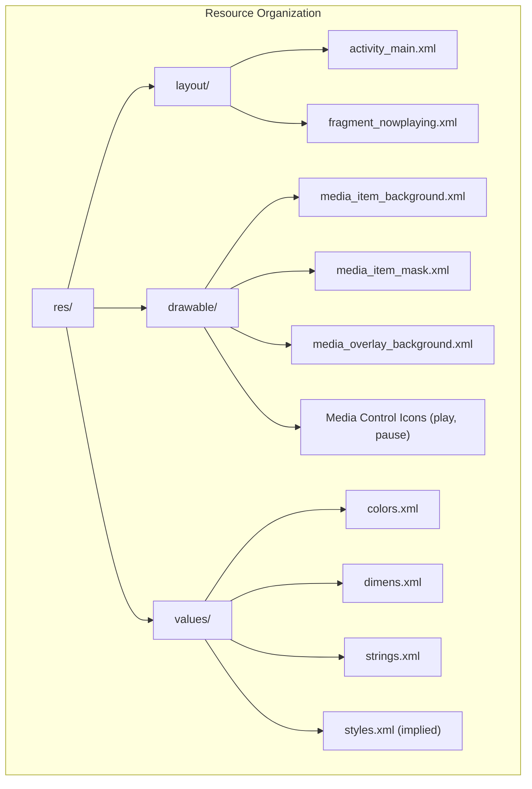
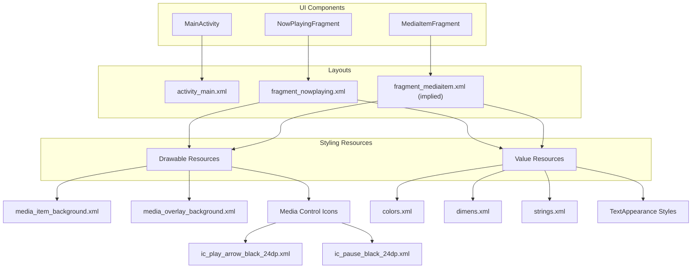
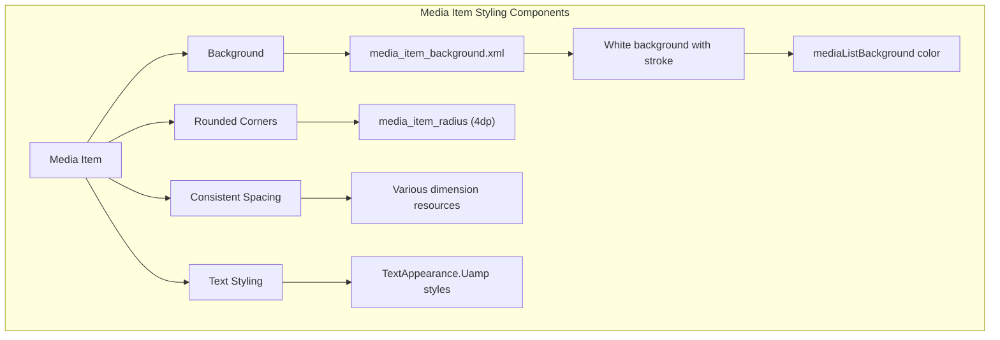
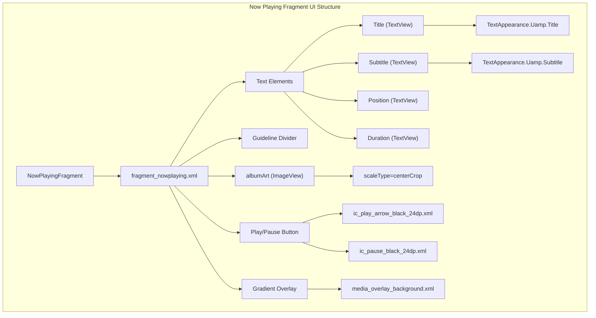
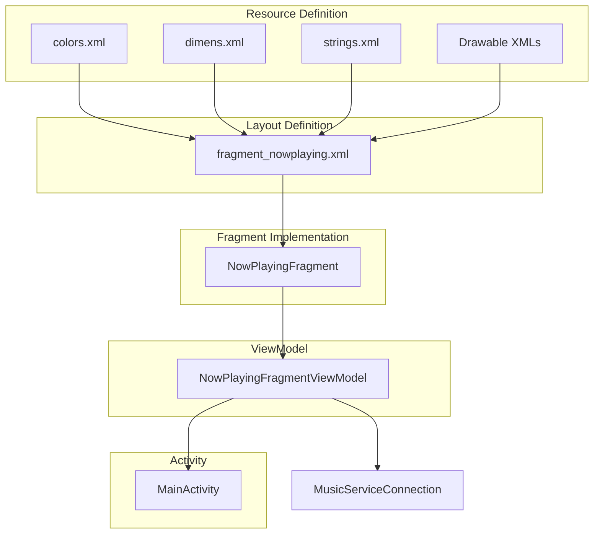

<!-- source: DeepWiki mcp.deepwiki.com · repo android/uamp · page 3.3 UI Styling and Resources · fetched 2026-10-23 -->

# UI Styling and Resources

Relevant source files

The following files were used as context for generating this wiki page:

- [app/src/main/java/com/example/android/uamp/utils/InjectorUtils.kt](app/src/main/java/com/example/android/uamp/utils/InjectorUtils.kt)
- [app/src/main/res/drawable/ic_pause_black_24dp.xml](app/src/main/res/drawable/ic_pause_black_24dp.xml)
- [app/src/main/res/drawable/ic_play_arrow_black_24dp.xml](app/src/main/res/drawable/ic_play_arrow_black_24dp.xml)
- [app/src/main/res/drawable/media_item_background.xml](app/src/main/res/drawable/media_item_background.xml)
- [app/src/main/res/drawable/media_item_mask.xml](app/src/main/res/drawable/media_item_mask.xml)
- [app/src/main/res/drawable/media_overlay_background.xml](app/src/main/res/drawable/media_overlay_background.xml)
- [app/src/main/res/layout/activity_main.xml](app/src/main/res/layout/activity_main.xml)
- [app/src/main/res/layout/fragment_nowplaying.xml](app/src/main/res/layout/fragment_nowplaying.xml)
- [app/src/main/res/values/colors.xml](app/src/main/res/values/colors.xml)
- [app/src/main/res/values/dimens.xml](app/src/main/res/values/dimens.xml)
- [app/src/main/res/values/strings.xml](app/src/main/res/values/strings.xml)

## Purpose and Scope

This document describes the UI styling approach and resource organization in the UAMP (Universal Android Music Player) application. It covers the layout resources, drawable resources, value resources (colors, dimensions, strings), and how these elements work together to create a consistent user interface across the application. For information about the UI components and their functionality, see [MainActivity and Fragments](#3.1) and [ViewModels](#3.2).

## Resource Organization

UAMP follows Android's standard resource organization pattern, with resources separated into different directories based on type. The app uses a flat resource structure without extensive resource qualifiers for different screen sizes or configurations.

Sources:
- [app/src/main/res/layout/activity_main.xml]()
- [app/src/main/res/layout/fragment_nowplaying.xml]()
- [app/src/main/res/drawable/media_item_background.xml]()
- [app/src/main/res/drawable/media_item_mask.xml]()
- [app/src/main/res/drawable/media_overlay_background.xml]()
- [app/src/main/res/values/colors.xml]()
- [app/src/main/res/values/dimens.xml]()
- [app/src/main/res/values/strings.xml]()

## Color Scheme

UAMP uses a primary burgundy color scheme with teal accents. The defined colors support both the main UI as well as specific elements like media controls and backgrounds.

| Color Name | Hex Value | Usage |
|------------|-----------|-------|
| colorPrimary | #840255 | Primary app color |
| colorPrimaryDark | #710144 | Status bar and app bar color |
| colorAccent | #14A5A1 | Accent color for controls |
| mediaListBackground | #F1F1F1 | Background for media item lists |
| nowPlayingBackground | #eff0f0 | Background for now playing screen |
| nowPlayingWhiteBackground | #fdfdfd | Alternative now playing background |

Sources:
- [app/src/main/res/values/colors.xml:18-31]()

## Dimensions and Spacing

The app maintains consistent spacing through defined dimension resources. These dimensions are used throughout the layouts to ensure UI consistency.

| Dimension Name | Value | Usage |
|----------------|-------|-------|
| text_margin | 16dp | Standard text margin |
| media_item_height | 72dp | Height of media items in lists |
| media_item_radius | 4dp | Corner radius for media items |
| media_item_art | 72dp | Size of album art thumbnails |
| now_playing_title_size | 32sp | Size of now playing title text |
| now_playing_artist_size | 18sp | Size of now playing artist text |

Sources:
- [app/src/main/res/values/dimens.xml:17-44]()

## UI Component Styling Relationship

The following diagram illustrates how UI components in UAMP utilize the various resources for styling and appearance:

Sources:
- [app/src/main/res/layout/activity_main.xml]()
- [app/src/main/res/layout/fragment_nowplaying.xml]()
- [app/src/main/res/drawable/media_item_background.xml]()
- [app/src/main/res/drawable/media_overlay_background.xml]()
- [app/src/main/res/drawable/ic_play_arrow_black_24dp.xml]()
- [app/src/main/res/drawable/ic_pause_black_24dp.xml]()

## Media Item Styling

Media items in UAMP have a consistent visual styling with rounded corners and specific spacing. This styling is implemented through drawable resources and dimension values.

Sources:
- [app/src/main/res/drawable/media_item_background.xml:17-31]()
- [app/src/main/res/values/dimens.xml:20-29]()
- [app/src/main/res/layout/fragment_nowplaying.xml:68-82]()

### Media Item Background

The media item background is defined in `media_item_background.xml` as a layer-list with a rectangle shape that has:
- A white background
- A thin stroke with the `mediaListBackground` color
- Rounded corners with a radius defined by `media_item_radius` (4dp)

This creates a consistent card-like appearance for media items throughout the app.

Sources:
- [app/src/main/res/drawable/media_item_background.xml:17-31]()

### Media Overlay

For better text visibility on album art or other background images, UAMP uses a gradient overlay defined in `media_overlay_background.xml`. This overlay provides a semi-transparent white gradient that ensures text remains readable regardless of the underlying image.

Sources:
- [app/src/main/res/drawable/media_overlay_background.xml:17-24]()

## Now Playing Fragment UI

The Now Playing Fragment features a more elaborate UI with album art, playback controls, and text information. It uses:

1. A full-screen album art display with a gradient overlay for text visibility
2. Playback control button (play/pause)
3. Title and artist information with specific text styling
4. Position and duration information

The layout uses ConstraintLayout with guidelines to position elements consistently.

Sources:
- [app/src/main/res/layout/fragment_nowplaying.xml:17-115]()

### Text Styling

The Now Playing Fragment uses two main text appearance styles:
- `TextAppearance.Uamp.Title`: Used for song titles and position information
- `TextAppearance.Uamp.Subtitle`: Used for artist names and duration information

These text appearance styles help maintain consistency across the UI.

Sources:
- [app/src/main/res/layout/fragment_nowplaying.xml:68]()
- [app/src/main/res/layout/fragment_nowplaying.xml:82]()
- [app/src/main/res/layout/fragment_nowplaying.xml:97]()
- [app/src/main/res/layout/fragment_nowplaying.xml:110]()

## Media Control Icons

UAMP uses vector drawables for media control icons, which ensures they look crisp at any screen density:
- `ic_play_arrow_black_24dp.xml`: Play icon
- `ic_pause_black_24dp.xml`: Pause icon

These icons follow the Material Design guidelines and are colored black, allowing them to be tinted as needed in the UI.

Sources:
- [app/src/main/res/drawable/ic_play_arrow_black_24dp.xml:17-25]()
- [app/src/main/res/drawable/ic_pause_black_24dp.xml:17-25]()

## String Resources

Text content in the UAMP UI is defined in `strings.xml`, providing a centralized location for all user-facing text. This makes localization easier and ensures consistent terminology throughout the app.

Key string resources include:
- App name
- Media control descriptions (play, pause, skip)
- Duration formatting pattern

Sources:
- [app/src/main/res/values/strings.xml:17-31]()

## Resource Application Flow

The following diagram illustrates how resources flow from definition to appearance in the UAMP UI:

Sources:
- [app/src/main/java/com/example/android/uamp/utils/InjectorUtils.kt:52-59]()
- [app/src/main/res/layout/fragment_nowplaying.xml]()

## Summary

UAMP implements a clean and consistent UI styling approach through organized resources:

1. **Layout Resources**: Define the structure of UI components
2. **Drawable Resources**: Provide backgrounds, masks, and icons
3. **Value Resources**: Define colors, dimensions, and strings
4. **Text Appearances**: Ensure consistent typography

The UI is built with ConstraintLayout for responsive design, with careful attention to consistent spacing, rounded corners for media items, and clear text hierarchy. The styling approach focuses on readability and usability while maintaining a cohesive visual identity throughout the app.

Sources:
- All files reviewed in this document

---

