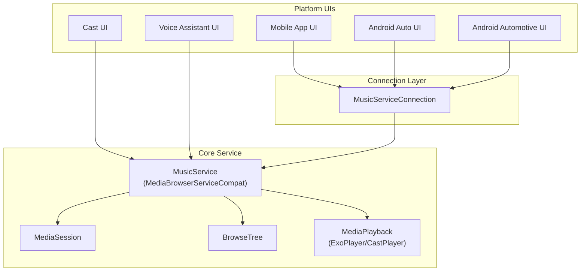
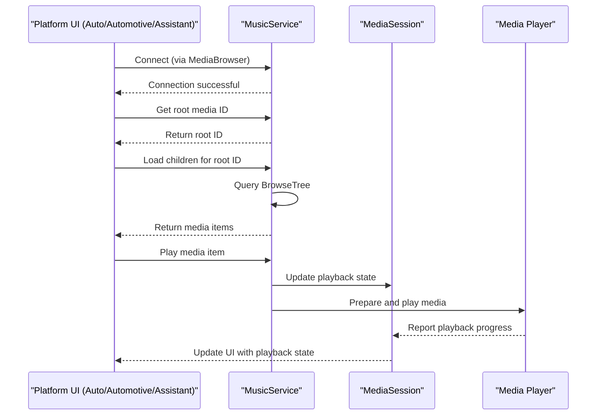
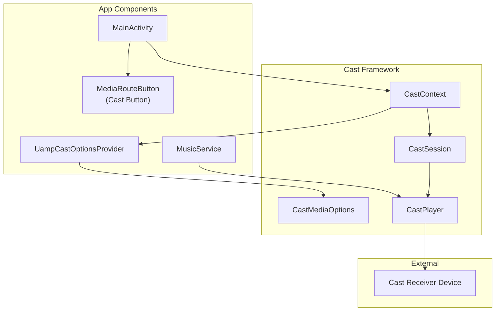
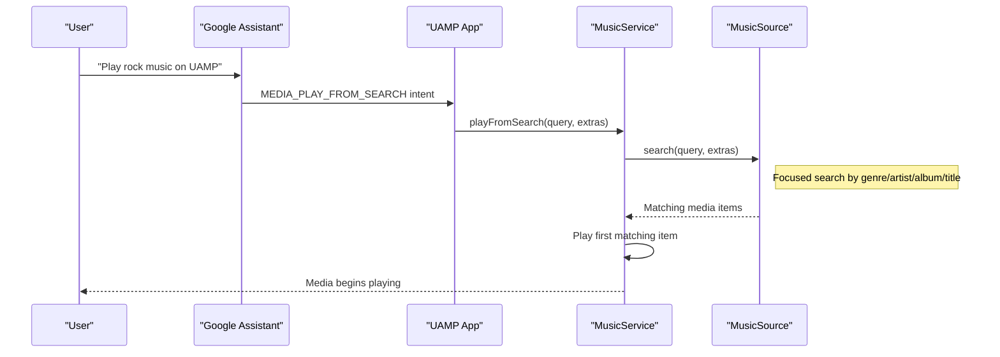

<!-- source: DeepWiki mcp.deepwiki.com · repo android/uamp · page 4 Platform Integration · fetched 2026-10-23 -->

# Platform Integration

<details>
<summary>Relevant source files</summary>

The following files were used as context for generating this wiki page:

- [CONTRIBUTING.md](CONTRIBUTING.md)
- [README.md](README.md)
- [app/src/main/AndroidManifest.xml](app/src/main/AndroidManifest.xml)
- [app/src/main/java/com/example/android/uamp/cast/UampCastOptionsProvider.kt](app/src/main/java/com/example/android/uamp/cast/UampCastOptionsProvider.kt)
- [common/src/main/java/com/example/android/uamp/media/extensions/PlaybackStateCompatExt.kt](common/src/main/java/com/example/android/uamp/media/extensions/PlaybackStateCompatExt.kt)
- [common/src/main/java/com/example/android/uamp/media/library/MusicSource.kt](common/src/main/java/com/example/android/uamp/media/library/MusicSource.kt)
- [common/src/main/res/menu/main_activity_menu.xml](common/src/main/res/menu/main_activity_menu.xml)
- [common/src/main/res/values/strings.xml](common/src/main/res/values/strings.xml)

</details>


## Purpose and Scope

This document provides an overview of how UAMP (Universal Android Music Player) integrates with various Android platforms and technologies. UAMP is designed to provide a consistent media playback experience across multiple platforms including mobile devices, Android Auto, Android Automotive OS, Google Cast devices, and voice assistants. This page covers the high-level integration architecture and patterns common to all platforms.

For detailed information about specific platform integrations, see:
- [Android Automotive Integration](#4.1)
- [Google Cast Integration](#4.2)
- [Android Auto Integration](#4.3)

Sources: [README.md:3-6]()

## Integration Architecture Overview

UAMP achieves cross-platform support by implementing the MediaBrowserService pattern, which enables multiple client UIs to connect to a common media service. This architecture facilitates a consistent user experience across different platforms while allowing platform-specific UI implementations.

### Media Service Integration Pattern



The MusicService exposes a standardized interface through MediaBrowserServiceCompat that allows different platform UIs to browse and play media content. Platform-specific code is isolated to UI layers, while core playback functionality remains consistent.

Sources: [app/src/main/AndroidManifest.xml:81-93]()

### Platform Connection Flow



Sources: [common/src/main/java/com/example/android/uamp/media/library/MusicSource.kt:33-53]()

## Android Auto Integration

Android Auto integration allows UAMP to be used safely while driving. The integration is declared in the AndroidManifest.xml with a metadata entry pointing to the automotive app description resource.

```xml
<meta-data
    android:name="com.google.android.gms.car.application"
    android:resource="@xml/automotive_app_desc" />
```

The MusicService is exposed to Android Auto through the standard MediaBrowserService interface, allowing the Auto UI to browse and play media content using a car-optimized interface.

Sources: [app/src/main/AndroidManifest.xml:34-37](), [app/src/main/AndroidManifest.xml:81-93]()

## Google Cast Integration

UAMP integrates with Google Cast devices (like Chromecast) through the CastOptionsProvider, which configures how the app interacts with Cast devices.

### Cast Architecture



The `UampCastOptionsProvider` class configures Cast options for the app, including specifying the receiver application ID and media options. When a user selects a Cast device, the `MusicService` transitions playback from the local ExoPlayer to the CastPlayer, which handles streaming to the Cast device.

Sources: [app/src/main/AndroidManifest.xml:39-41](), [app/src/main/java/com/example/android/uamp/cast/UampCastOptionsProvider.kt:27-46](), [common/src/main/res/menu/main_activity_menu.xml:19-23]()

## Voice Assistant Integration

UAMP supports voice commands through integration with the Google Assistant, allowing users to search and play media using voice commands.

### Voice Search Flow



The `MusicSource` interface provides a `search` method that handles voice queries from the Google Assistant. It supports focused searches by genre, artist, album, or title, making it easy for users to request specific content by voice.

Sources: [app/src/main/AndroidManifest.xml:75-77](), [common/src/main/java/com/example/android/uamp/media/library/MusicSource.kt:126-197]()

## Deep Linking and App Links

UAMP supports deep linking through HTTP and HTTPS intent filters, which allow users to open the app and navigate to specific content directly from web links.

```xml
<!-- App links for http -->
<intent-filter>
    <action android:name="android.intent.action.VIEW" />
    <category android:name="android.intent.category.DEFAULT" />
    <category android:name="android.intent.category.BROWSABLE" />
    <data
        android:host="example.android.com"
        android:pathPattern="/uamp"
        android:scheme="http" />
</intent-filter>

<!-- App links for https -->
<intent-filter>
    <action android:name="android.intent.action.VIEW" />
    <category android:name="android.intent.category.DEFAULT" />
    <category android:name="android.intent.category.BROWSABLE" />
    <data
        android:host="example.android.com"
        android:pathPattern="/uamp"
        android:scheme="https" />
</intent-filter>
```

This allows linking to the app from websites or other apps, providing a seamless user experience across platforms.

Sources: [app/src/main/AndroidManifest.xml:49-73]()

## Platform Support Components

The following table summarizes the key components involved in each platform integration:

| Platform | Key Components | Manifest Declarations | Support Classes |
|----------|----------------|----------------------|-----------------|
| Android Mobile | MainActivity, MusicService | Main activity intent filter | MusicServiceConnection |
| Android Auto | MediaBrowserServiceCompat | `com.google.android.gms.car.application` metadata | - |
| Google Cast | CastContext | `com.google.android.gms.cast.framework.OPTIONS_PROVIDER_CLASS_NAME` metadata | UampCastOptionsProvider |
| Voice Assistant | MusicSource search | `android.media.action.MEDIA_PLAY_FROM_SEARCH` intent filter | AbstractMusicSource |
| Deep Links | - | HTTP/HTTPS intent filters | - |

Sources: [app/src/main/AndroidManifest.xml:22-95]()

## Integration Testing Considerations

When implementing platform integrations, consider these testing approaches:

1. **Auto/Automotive**: Test with the respective emulators or dedicated hardware
2. **Cast**: Test with physical Cast devices or the Cast emulator
3. **Voice Assistant**: Test voice commands through the Assistant test tool
4. **Deep Links**: Test intent filters using adb commands:
   ```
   adb shell am start -a android.intent.action.VIEW -d "http://example.android.com/uamp"
   ```

Proper testing ensures a consistent user experience across all supported platforms.

Sources: [README.md:19-22]()

---

