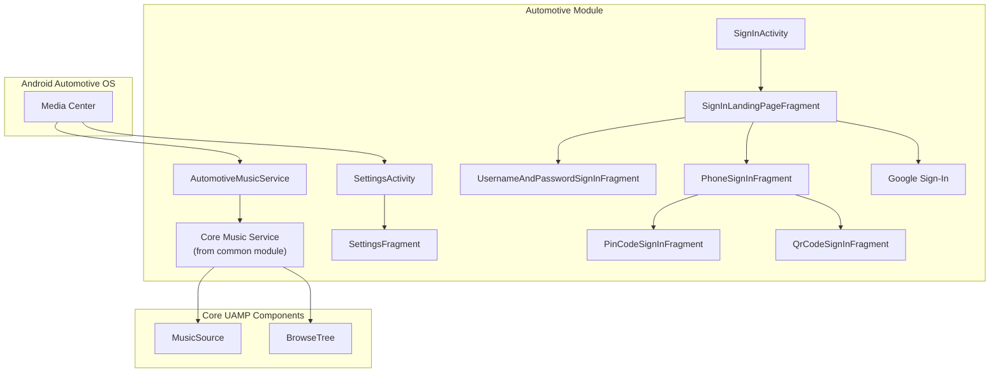
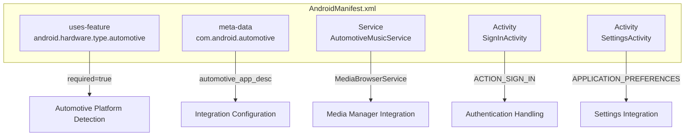
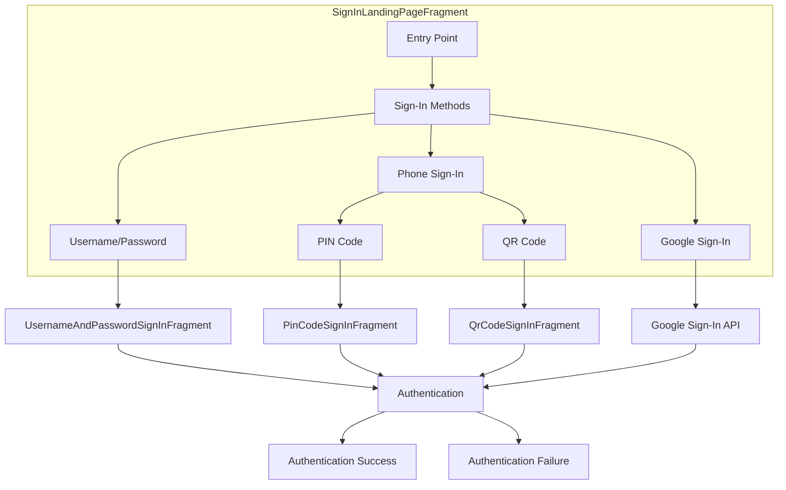
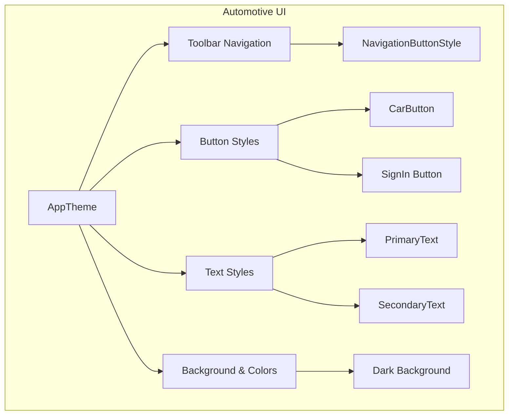

<!-- source: DeepWiki mcp.deepwiki.com · repo android/uamp · page 4.1 Android Automotive Integration · fetched 2026-10-23 -->

# Android Automotive Integration

<details>
<summary>Relevant source files</summary>

The following files were used as context for generating this wiki page:

- [automotive/build.gradle](automotive/build.gradle)
- [automotive/src/main/AndroidManifest.xml](automotive/src/main/AndroidManifest.xml)
- [automotive/src/main/java/com/example/android/uamp/automotive/PhoneSignInFragment.kt](automotive/src/main/java/com/example/android/uamp/automotive/PhoneSignInFragment.kt)
- [automotive/src/main/java/com/example/android/uamp/automotive/PinCodeSignInFragment.kt](automotive/src/main/java/com/example/android/uamp/automotive/PinCodeSignInFragment.kt)
- [automotive/src/main/java/com/example/android/uamp/automotive/QrCodeSignInFragment.kt](automotive/src/main/java/com/example/android/uamp/automotive/QrCodeSignInFragment.kt)
- [automotive/src/main/java/com/example/android/uamp/automotive/SettingsActivity.kt](automotive/src/main/java/com/example/android/uamp/automotive/SettingsActivity.kt)
- [automotive/src/main/java/com/example/android/uamp/automotive/SignInActivity.kt](automotive/src/main/java/com/example/android/uamp/automotive/SignInActivity.kt)
- [automotive/src/main/java/com/example/android/uamp/automotive/SignInLandingPageFragment.kt](automotive/src/main/java/com/example/android/uamp/automotive/SignInLandingPageFragment.kt)
- [automotive/src/main/java/com/example/android/uamp/automotive/UsernameAndPasswordSignInFragment.kt](automotive/src/main/java/com/example/android/uamp/automotive/UsernameAndPasswordSignInFragment.kt)
- [automotive/src/main/res/drawable-v24/ic_launcher_foreground.xml](automotive/src/main/res/drawable-v24/ic_launcher_foreground.xml)
- [automotive/src/main/res/drawable/ic_launcher_background.xml](automotive/src/main/res/drawable/ic_launcher_background.xml)
- [automotive/src/main/res/layout/activity_settings.xml](automotive/src/main/res/layout/activity_settings.xml)
- [automotive/src/main/res/mipmap-anydpi-v26/ic_launcher.xml](automotive/src/main/res/mipmap-anydpi-v26/ic_launcher.xml)
- [automotive/src/main/res/mipmap-anydpi-v26/ic_launcher_round.xml](automotive/src/main/res/mipmap-anydpi-v26/ic_launcher_round.xml)
- [automotive/src/main/res/values/colors.xml](automotive/src/main/res/values/colors.xml)
- [automotive/src/main/res/values/strings.xml](automotive/src/main/res/values/strings.xml)
- [automotive/src/main/res/values/styles.xml](automotive/src/main/res/values/styles.xml)

</details>


## Purpose and Scope

This document details how the Universal Android Music Player (UAMP) integrates with Android Automotive OS. It covers the specific components, configurations, and authentication mechanisms implemented in the automotive module to enable UAMP to function optimally in automotive environments. For information about Android Auto integration (which is different from Android Automotive), see [Android Auto Integration](#4.3).

## Architecture Overview

The UAMP Automotive module is designed as a dedicated application module that extends the core UAMP functionality to work specifically within the Android Automotive OS environment.

### Automotive Module Structure



Sources: [automotive/src/main/AndroidManifest.xml:79-88](), [automotive/src/main/java/com/example/android/uamp/automotive/SignInActivity.kt:25-47](), [automotive/src/main/java/com/example/android/uamp/automotive/SettingsActivity.kt:27-53]()

### Key Components

The Automotive integration consists of several specialized components:

| Component | Purpose | Source File |
|-----------|---------|-------------|
| AutomotiveMusicService | MediaBrowserService implementation specifically for Android Automotive | [automotive/src/main/AndroidManifest.xml:79-88]() |
| SignInActivity | Entry point for automotive authentication | [automotive/src/main/java/com/example/android/uamp/automotive/SignInActivity.kt:25-47]() |
| SettingsActivity | Settings implementation for automotive | [automotive/src/main/java/com/example/android/uamp/automotive/SettingsActivity.kt:27-53]() |

Sources: [automotive/src/main/AndroidManifest.xml:53-89]()

## Integration Configuration

For the app to be recognized as an Android Automotive app, specific configurations are required in the manifest file.

### Manifest Configurations



Key manifest elements include:

1. Required `android.hardware.type.automotive` feature
2. Media service declaration with proper intent filter
3. Automotive metadata reference
4. Sign-in activity with `ACTION_SIGN_IN` intent filter
5. Settings activity with `APPLICATION_PREFERENCES` intent filter

Sources: [automotive/src/main/AndroidManifest.xml:27-29](), [automotive/src/main/AndroidManifest.xml:53-55](), [automotive/src/main/AndroidManifest.xml:79-88](), [automotive/src/main/AndroidManifest.xml:57-63](), [automotive/src/main/AndroidManifest.xml:66-73]()

### Build Configuration

The automotive module depends on the common module for core functionality and includes automotive-specific libraries:

```
dependencies {
    implementation project(':common')
    implementation "androidx.car:car:$androidx_car_version"
    // Other dependencies...
}
```

Sources: [automotive/build.gradle:58-60](), [automotive/build.gradle:65]()

## Authentication System

The Android Automotive implementation includes a comprehensive authentication system with multiple sign-in methods designed specifically for the automotive environment.

### Authentication Methods



Sources: [automotive/src/main/java/com/example/android/uamp/automotive/SignInLandingPageFragment.kt:59-245](), [automotive/src/main/java/com/example/android/uamp/automotive/PhoneSignInFragment.kt:31-70]()

### Authentication Flow Detail

The authentication system uses a multi-step approach:

1. **Entry point**: `SignInActivity` which hosts the sign-in fragments
2. **Landing page**: `SignInLandingPageFragment` displays available sign-in options
3. **Method selection**: User selects preferred sign-in method
4. **Method-specific flow**: Each method has its own fragment and UI flow
5. **Completion**: Upon success or failure, the UI notifies the user and returns to the app

#### Sign-In Methods

| Method | Fragment | Description |
|--------|----------|-------------|
| Username/Password | UsernameAndPasswordSignInFragment | Traditional username and password authentication |
| PIN Code | PinCodeSignInFragment | Generates a PIN for users to enter on another device |
| QR Code | QrCodeSignInFragment | Displays a QR code that can be scanned with a mobile device |
| Google Sign-In | Via Google Sign-In API | Authenticates using Google credentials |

Sources: [automotive/src/main/java/com/example/android/uamp/automotive/SignInLandingPageFragment.kt:124-149](), [automotive/src/main/java/com/example/android/uamp/automotive/PinCodeSignInFragment.kt:37-78](), [automotive/src/main/java/com/example/android/uamp/automotive/QrCodeSignInFragment.kt:35-57](), [automotive/src/main/java/com/example/android/uamp/automotive/SignInLandingPageFragment.kt:185-203]()

## UI Adaptation for Automotive

The UAMP Automotive module includes specialized UI components and styling adapted for automotive displays.

### UI Components Structure



Sources: [automotive/src/main/res/values/styles.xml:20-31](), [automotive/src/main/res/values/styles.xml:40-44](), [automotive/src/main/res/values/styles.xml:50-61](), [automotive/src/main/res/values/styles.xml:71-85]()

### Settings Integration

The `SettingsActivity` and its associated `SettingsFragment` provide automotive-specific settings and integrate with the Android Automotive Media Center.

Key features of the settings implementation:
- Uses car-specific styling defined in `AppTheme.Drawer`
- Provides a standardized toolbar for navigation
- Integrates with the Android Automotive system preferences

Sources: [automotive/src/main/java/com/example/android/uamp/automotive/SettingsActivity.kt:27-53](), [automotive/src/main/res/values/styles.xml:46-48](), [automotive/src/main/res/layout/activity_settings.xml:23-33]()

## Authentication UI Examples

The authentication UI is specifically designed for the automotive environment, with large touch targets and readable text suitable for in-car use.

### Sign-In Screen Components

| Component | Purpose | Styling |
|-----------|---------|---------|
| Toolbar | Navigation | Transparent background, standardized back button |
| App Icon | Branding | Displayed prominently at the top |
| Primary Message | Main instruction | Large display text |
| Input Fields | User data entry | Outlined boxes with adequate touch targets |
| Buttons | Actions | Car-specific styling with proper sizing |
| Footer | Legal information | Clickable links for terms and privacy policy |

Sources: [automotive/src/main/java/com/example/android/uamp/automotive/QrCodeSignInFragment.kt:37-57](), [automotive/src/main/java/com/example/android/uamp/automotive/PinCodeSignInFragment.kt:39-77](), [automotive/src/main/res/values/styles.xml:50-69]()

## Integration Testing

When testing Android Automotive integration, consider:

1. Using the Android Automotive emulator in Android Studio
2. Testing with real automotive hardware when available
3. Verifying that all sign-in methods function correctly
4. Ensuring that the UI scales appropriately for different automotive displays
5. Validating that media browsing and playback work within the automotive environment

Sources: [automotive/build.gradle:72-75]()

---

