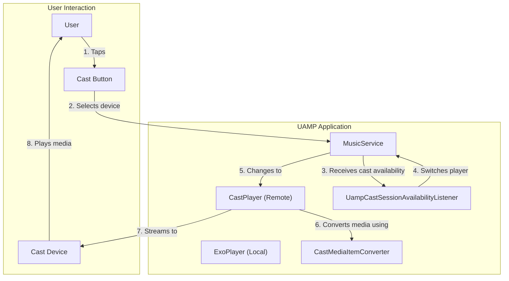
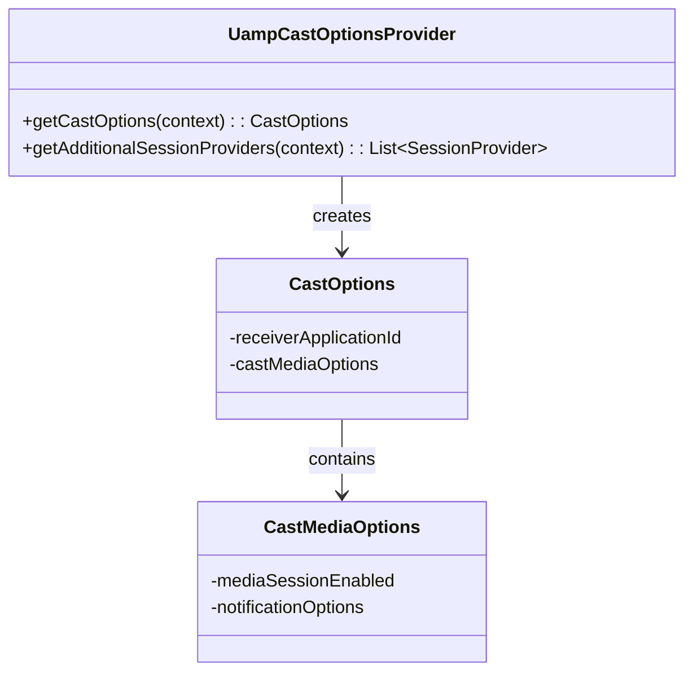
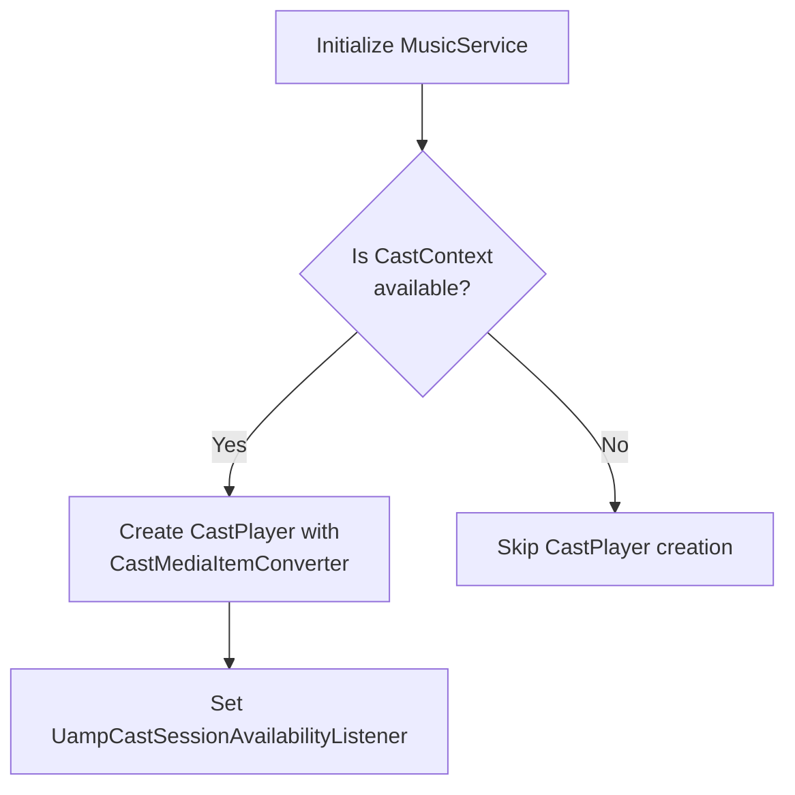
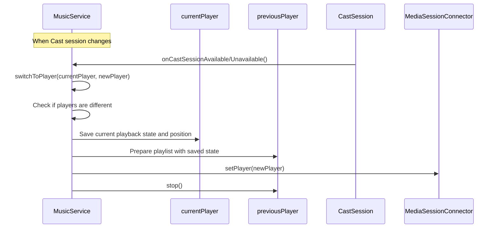
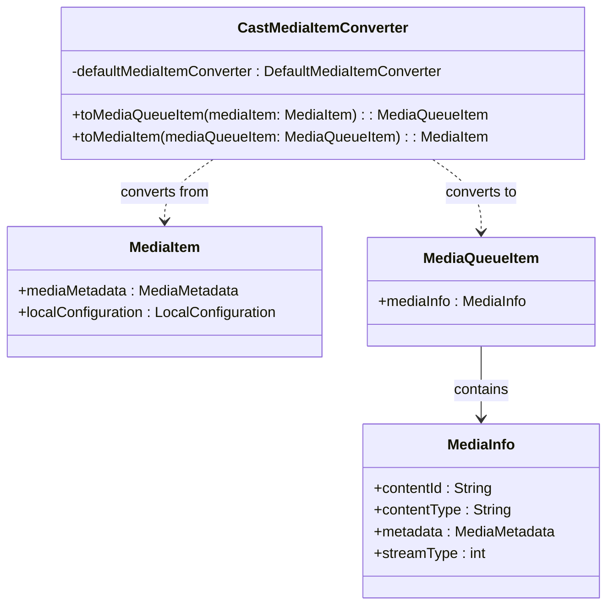
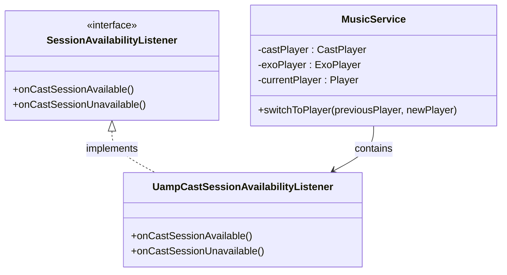
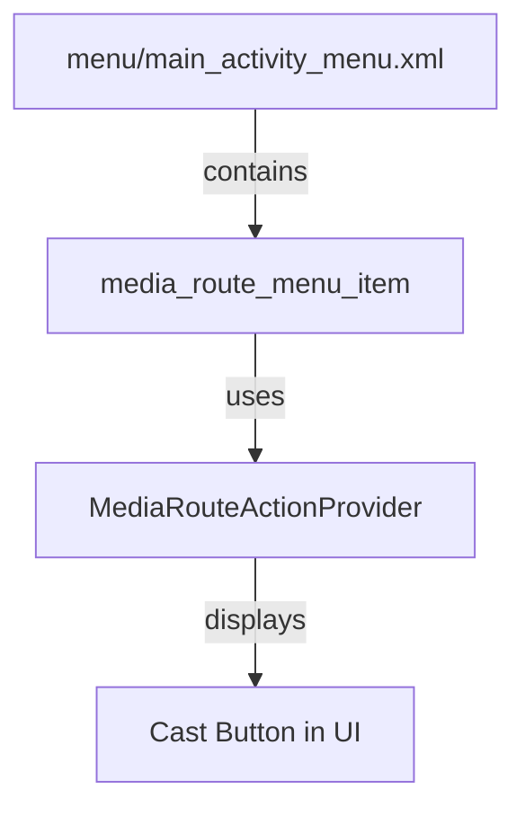

<!-- source: DeepWiki mcp.deepwiki.com · repo android/uamp · page 4.2 Google Cast Integration · fetched 2026-10-23 -->

# Google Cast Integration

<details>
<summary>Relevant source files</summary>

The following files were used as context for generating this wiki page:

- [app/src/main/AndroidManifest.xml](app/src/main/AndroidManifest.xml)
- [app/src/main/java/com/example/android/uamp/cast/UampCastOptionsProvider.kt](app/src/main/java/com/example/android/uamp/cast/UampCastOptionsProvider.kt)
- [automotive/src/main/java/com/example/android/uamp/automotive/AutomotiveMusicService.kt](automotive/src/main/java/com/example/android/uamp/automotive/AutomotiveMusicService.kt)
- [common/src/main/java/com/example/android/uamp/media/CastMediaItemConverter.kt](common/src/main/java/com/example/android/uamp/media/CastMediaItemConverter.kt)
- [common/src/main/java/com/example/android/uamp/media/MusicService.kt](common/src/main/java/com/example/android/uamp/media/MusicService.kt)
- [common/src/main/java/com/example/android/uamp/media/PackageValidator.kt](common/src/main/java/com/example/android/uamp/media/PackageValidator.kt)
- [common/src/main/java/com/example/android/uamp/media/PersistentStorage.kt](common/src/main/java/com/example/android/uamp/media/PersistentStorage.kt)
- [common/src/main/java/com/example/android/uamp/media/UampNotificationManager.kt](common/src/main/java/com/example/android/uamp/media/UampNotificationManager.kt)
- [common/src/main/java/com/example/android/uamp/media/extensions/MediaMetadataCompatExt.kt](common/src/main/java/com/example/android/uamp/media/extensions/MediaMetadataCompatExt.kt)
- [common/src/main/java/com/example/android/uamp/media/extensions/PlaybackStateCompatExt.kt](common/src/main/java/com/example/android/uamp/media/extensions/PlaybackStateCompatExt.kt)
- [common/src/main/java/com/example/android/uamp/media/library/AlbumArtContentProvider.kt](common/src/main/java/com/example/android/uamp/media/library/AlbumArtContentProvider.kt)
- [common/src/main/java/com/example/android/uamp/media/library/JsonSource.kt](common/src/main/java/com/example/android/uamp/media/library/JsonSource.kt)
- [common/src/main/java/com/example/android/uamp/media/library/MusicSource.kt](common/src/main/java/com/example/android/uamp/media/library/MusicSource.kt)
- [common/src/main/res/menu/main_activity_menu.xml](common/src/main/res/menu/main_activity_menu.xml)
- [common/src/main/res/values/strings.xml](common/src/main/res/values/strings.xml)

</details>


This page documents how UAMP integrates with Google Cast, allowing users to stream music from the app to Cast-enabled devices such as Chromecast, Google Home speakers, and other Cast-compatible devices. For information about other platform integrations, see [Android Automotive Integration](#4.1) and [Android Auto Integration](#4.3).

## Overview

Google Cast integration enables UAMP users to:
- Discover and connect to available Cast devices
- Stream music to Cast devices
- Control playback remotely
- Maintain proper metadata for media being cast

UAMP handles Cast support by implementing a player switching mechanism that seamlessly transitions between local playback (via ExoPlayer) and remote playback (via CastPlayer) when users connect to or disconnect from Cast devices.



Sources: [common/src/main/java/com/example/android/uamp/media/MusicService.kt:149-165](), [app/src/main/java/com/example/android/uamp/cast/UampCastOptionsProvider.kt]()

## Cast Configuration

### Manifest Declaration

UAMP declares Cast support in the Android manifest by specifying a metadata element that points to the Cast options provider:

```xml
<meta-data 
    android:name="com.google.android.gms.cast.framework.OPTIONS_PROVIDER_CLASS_NAME"
    android:value="com.example.android.uamp.cast.UampCastOptionsProvider"/>
```

Sources: [app/src/main/AndroidManifest.xml:40-41]()

### Cast Options Provider

The `UampCastOptionsProvider` class configures how Cast should function within the app:



Key aspects of UAMP's Cast configuration:
- Uses the default media receiver with DRM support
- Disables the built-in media session and notification handling since UAMP manages these itself
- Sets the flag to stop the receiver application when ending a session

Sources: [app/src/main/java/com/example/android/uamp/cast/UampCastOptionsProvider.kt:29-42]()

## Player Management

### Player Initialization

The `MusicService` class conditionally creates a `CastPlayer` if the Cast framework is available on the device:



If the Cast framework is not available (e.g., on devices without Google Play Services), UAMP gracefully handles this by catching the exception and continuing with only local playback.

Sources: [common/src/main/java/com/example/android/uamp/media/MusicService.kt:149-165]()

### Player Switching Mechanism

UAMP implements a smart switching mechanism between the local ExoPlayer and remote CastPlayer:



When switching between players, UAMP ensures:
- The current playback state is preserved
- The current playlist is transferred to the new player
- The current position is maintained when possible
- The media session is updated to use the new player

Sources: [common/src/main/java/com/example/android/uamp/media/MusicService.kt:398-421](), [common/src/main/java/com/example/android/uamp/media/MusicService.kt:441-457]()

## Media Metadata Conversion

UAMP implements `CastMediaItemConverter` to convert between ExoPlayer's `MediaItem` format and the Cast SDK's `MediaQueueItem` format:



The converter handles several special cases:
1. Converting standard metadata (title, artist, album, etc.)
2. Handling artwork URIs correctly for Cast devices
3. Setting the proper MIME type and stream type for audio content

A critical aspect of this conversion is the handling of artwork URIs. UAMP locally uses `content://` URIs (through `AlbumArtContentProvider`) for artwork, but these URIs won't work on Cast devices. The converter uses the original HTTP URI stored in the metadata extras with the key `JsonSource.ORIGINAL_ARTWORK_URI_KEY`.

Sources: [common/src/main/java/com/example/android/uamp/media/CastMediaItemConverter.kt:26-77](), [common/src/main/java/com/example/android/uamp/media/library/JsonSource.kt:114]()

## Cast Session Management

UAMP uses the `UampCastSessionAvailabilityListener` inner class to respond to Cast session changes:



When a Cast session becomes available:
1. The listener calls `switchToPlayer(currentPlayer, castPlayer)`
2. The `MusicService` transfers playback to the `CastPlayer`
3. Media metadata is converted and sent to the Cast device

When a Cast session becomes unavailable:
1. The listener calls `switchToPlayer(currentPlayer, exoPlayer)`
2. The `MusicService` transfers playback back to the local `ExoPlayer`
3. Playback continues locally from the same position

Sources: [common/src/main/java/com/example/android/uamp/media/MusicService.kt:441-457]()

## User Interface Integration

UAMP integrates the Cast button into the app's UI using the `MediaRouteActionProvider` from the AndroidX MediaRouter library:



The Cast button:
- Appears in the app's toolbar
- Shows the Cast icon when Cast devices are available
- Provides a device selection dialog when tapped
- Changes appearance to indicate when casting is active

Sources: [common/src/main/res/menu/main_activity_menu.xml:19-23](), [common/src/main/res/values/strings.xml:41]()

## Technical Implementation Details

### Cast Device Detection

UAMP initializes the Cast context when the app starts, which begins scanning for available Cast devices on the network. When devices are found, the Cast button becomes active.

### Media Loading and Control

When a user initiates casting:

1. The `CastPlayer` becomes the active player
2. The current playlist is transferred to the `CastPlayer`
3. `CastMediaItemConverter` converts media metadata
4. Media is streamed to the Cast device
5. Media controls (play/pause, skip, etc.) are sent through the `MediaSessionConnector`

UAMP's architecture ensures that all the existing media controls work seamlessly with both local and Cast playback, without requiring separate implementation paths.

Sources: [common/src/main/java/com/example/android/uamp/media/MusicService.kt:215-222](), [common/src/main/java/com/example/android/uamp/media/MusicService.kt:398-421]()

## Troubleshooting

Cast integration may not work if:

1. The device doesn't have Google Play Services installed
2. The app doesn't have the necessary permissions
3. The Cast device and mobile device aren't on the same network
4. The Cast SDK is not properly initialized

UAMP handles these cases by:
- Catching exceptions when initializing the Cast context
- Gracefully falling back to local playback when Cast is unavailable
- Logging appropriate error messages

Sources: [common/src/main/java/com/example/android/uamp/media/MusicService.kt:156-163]()

---

