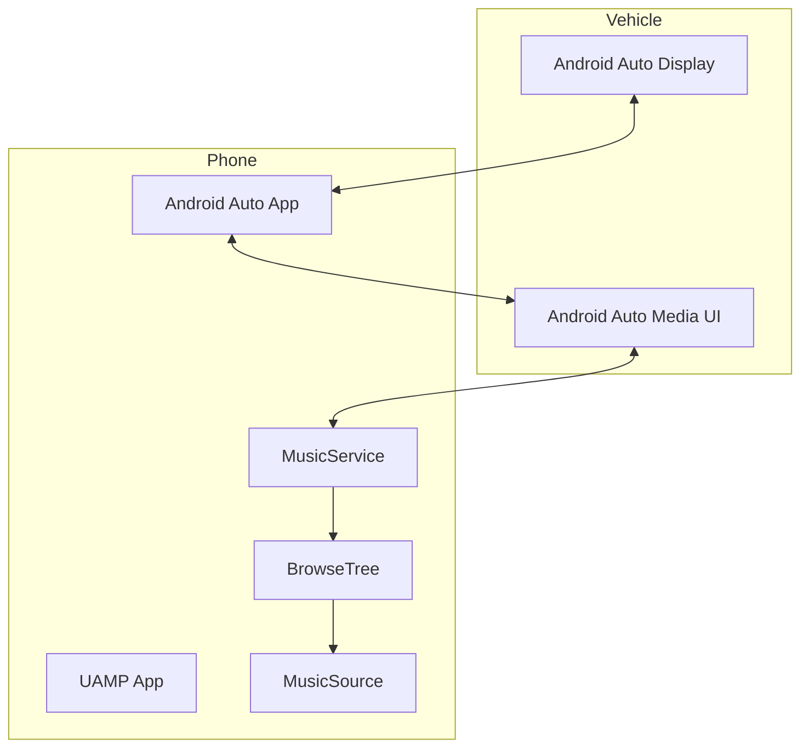
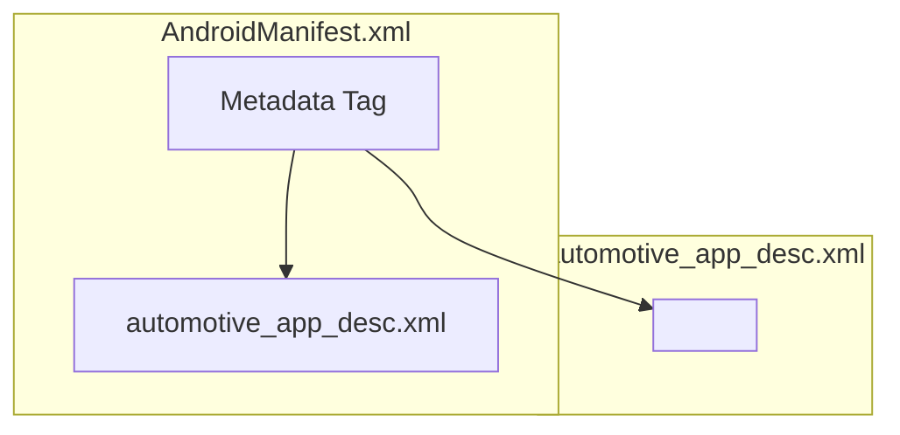
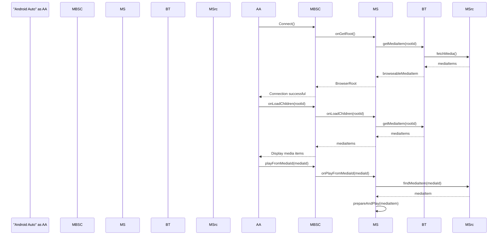
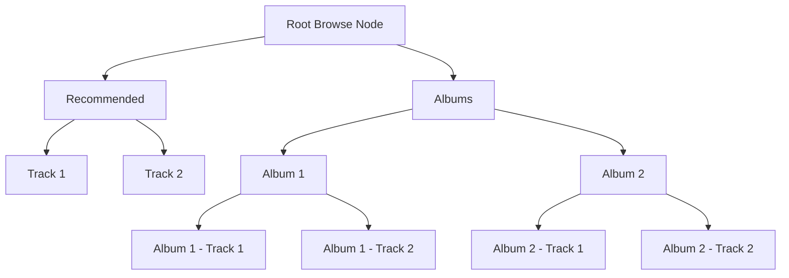
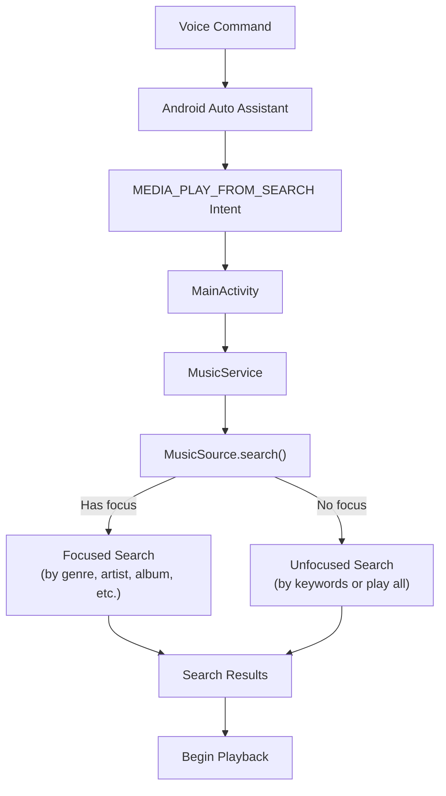

<!-- source: DeepWiki mcp.deepwiki.com · repo android/uamp · page 4.3 Android Auto Integration · fetched 2026-10-23 -->

# Android Auto Integration

<details>
<summary>Relevant source files</summary>

The following files were used as context for generating this wiki page:

- [.idea/codeStyles/Project.xml](.idea/codeStyles/Project.xml)
- [app/src/main/AndroidManifest.xml](app/src/main/AndroidManifest.xml)
- [app/src/main/java/com/example/android/uamp/cast/UampCastOptionsProvider.kt](app/src/main/java/com/example/android/uamp/cast/UampCastOptionsProvider.kt)
- [app/src/main/res/xml/automotive_app_desc.xml](app/src/main/res/xml/automotive_app_desc.xml)
- [common/src/main/AndroidManifest.xml](common/src/main/AndroidManifest.xml)
- [common/src/main/assets/default_art.png](common/src/main/assets/default_art.png)
- [common/src/main/java/com/example/android/uamp/media/extensions/FileExt.kt](common/src/main/java/com/example/android/uamp/media/extensions/FileExt.kt)
- [common/src/main/java/com/example/android/uamp/media/extensions/PlaybackStateCompatExt.kt](common/src/main/java/com/example/android/uamp/media/extensions/PlaybackStateCompatExt.kt)
- [common/src/main/java/com/example/android/uamp/media/library/MusicSource.kt](common/src/main/java/com/example/android/uamp/media/library/MusicSource.kt)
- [common/src/main/res/menu/main_activity_menu.xml](common/src/main/res/menu/main_activity_menu.xml)
- [common/src/main/res/values/strings.xml](common/src/main/res/values/strings.xml)

</details>


## Purpose and Scope

This document describes how UAMP (Universal Android Music Player) integrates with Android Auto to provide a seamless media playback experience in vehicles. It covers the configuration requirements, architectural components, and implementation details needed for Android Auto integration. For information about Android Automotive OS integration (which is different from Android Auto), see [Android Automotive Integration](#4.1).

## Overview

Android Auto is Google's platform that allows mobile apps to be displayed and controlled through a vehicle's head unit. For media apps like UAMP, integration with Android Auto enables users to browse and play music from their vehicle's display while driving.

UAMP's Android Auto integration leverages the standard Android MediaBrowserService architecture, allowing the app to expose its media content and playback controls to the Android Auto system.



Sources: [app/src/main/AndroidManifest.xml:34-37](), [app/src/main/res/xml/automotive_app_desc.xml:17-23]()

## Configuration Requirements

### Manifest Declaration

To integrate with Android Auto, UAMP declares its capability in the app's manifest with a metadata tag. This tells the Android Auto system that UAMP can provide media content.



Sources: [app/src/main/AndroidManifest.xml:34-37](), [app/src/main/res/xml/automotive_app_desc.xml:17-23]()

The manifest declaration includes:

1. A metadata tag with name `com.google.android.gms.car.application`
2. A reference to the `automotive_app_desc.xml` resource
3. The XML resource declaring that UAMP uses Android Auto for media playback

Here's the relevant code from the AndroidManifest.xml:

```xml
<meta-data
    android:name="com.google.android.gms.car.application"
    android:resource="@xml/automotive_app_desc" />
```

And the content of automotive_app_desc.xml:

```xml
<automotiveApp>
    <uses name="media" />
</automotiveApp>
```

Sources: [app/src/main/AndroidManifest.xml:34-37](), [app/src/main/res/xml/automotive_app_desc.xml:17-23]()

## Architecture

### Component Interaction

Android Auto integration in UAMP leverages the existing `MusicService` component, which extends `MediaBrowserServiceCompat`. This service is the core component that handles media browsing and playback requests from both the main app UI and external clients like Android Auto.



Sources: [app/src/main/AndroidManifest.xml:84-93](), [common/src/main/java/com/example/android/uamp/media/library/MusicSource.kt:39-56]()

### MediaBrowserService Lifecycle

When an Android Auto client connects to UAMP, the following sequence occurs:

1. Android Auto calls `connect()` on the MediaBrowserServiceCompat
2. The service's `onGetRoot()` method is called, returning a root ID for browsing
3. Android Auto calls `onLoadChildren()` with the root ID
4. MusicService provides a list of media items from the BrowseTree
5. The user can then browse the media hierarchy and control playback

The exported `MusicService` in AndroidManifest.xml is specifically commented as serving both the mobile app and Android Auto:

```xml
<!--
Declare the common MediaBrowserService for use in the mobile app, including
with the Android Auto app.
-->
<service
    android:name=".media.MusicService"
    android:enabled="true"
    android:exported="true"
    tools:ignore="ExportedService">
    <intent-filter>
        <action android:name="android.media.browse.MediaBrowserService" />
    </intent-filter>
</service>
```

Sources: [app/src/main/AndroidManifest.xml:80-93]()

## Media Browsing Structure for Android Auto

Android Auto uses the same browsing structure provided by UAMP's `BrowseTree` class. However, there are specific considerations for automotive contexts:



Sources: [common/src/main/res/values/strings.xml:44-45](), [common/src/main/java/com/example/android/uamp/media/library/MusicSource.kt:39-56]()

The browse tree is organized with:
- A root node with browsable categories
- "Recommended" and "Albums" sections as shown in the strings.xml file
- Playable media items as leaf nodes

## Voice Search Support

Android Auto heavily relies on voice commands for safe driving. UAMP supports voice search through the `MusicSource` interface's `search()` method, which handles focused searches from the Google Assistant.

The `search()` method in `MusicSource` handles different types of voice searches:
- Genre-focused searches
- Artist-focused searches
- Album-focused searches
- Song-focused searches
- Generic unfocused searches

Here's how the search functionality works:



Sources: [common/src/main/java/com/example/android/uamp/media/library/MusicSource.kt:126-197](), [app/src/main/AndroidManifest.xml:75-77]()

This search functionality is critical for Android Auto integration, as it enables users to request music hands-free while driving.

## Playback Controls and Notifications

When using Android Auto, playback controls are displayed on the vehicle's screen. These controls communicate with UAMP's `MusicService` using the standard MediaSession interface.

The notification system in UAMP is also used by Android Auto to display current track information and transport controls. This integration ensures a consistent user experience across devices.

Sources: [common/src/main/res/values/strings.xml:18-26](), [common/src/main/java/com/example/android/uamp/media/extensions/PlaybackStateCompatExt.kt:25-74]()

## Best Practices for Android Auto Integration

When extending UAMP's Android Auto integration, consider the following best practices:

1. **Focus on glanceability**: Keep UI elements large and simple to minimize driver distraction
2. **Optimize for voice interaction**: Ensure media items have clear, pronounceable titles
3. **Handle configuration changes**: The connection to Android Auto should survive device rotation and other configuration changes
4. **Test on actual Android Auto**: Either with a vehicle head unit or the Android Auto desktop head unit emulator
5. **Provide album artwork**: Use high-quality album art for better visual identification in the vehicle

## Troubleshooting Android Auto Integration

Common issues with Android Auto integration include:

1. **Media content not appearing in Android Auto**: Verify that the `MusicService` is properly exported and has the correct intent filter
2. **Playback controls not working**: Check that the MediaSession is properly configured and transport controls are set up correctly
3. **Search not functioning**: Ensure the MainActivity handles the `MEDIA_PLAY_FROM_SEARCH` intent and that the `MusicSource.search()` method is implemented correctly

## Summary

UAMP integrates with Android Auto by:

1. Declaring support in the manifest via metadata pointing to automotive_app_desc.xml
2. Exposing a MediaBrowserServiceCompat (MusicService) for Android Auto to connect to
3. Organizing media content in a browsable tree structure
4. Supporting voice search for hands-free media selection
5. Providing playback controls and notifications

This integration allows UAMP to deliver a seamless and safe media browsing and playback experience in vehicles equipped with Android Auto.

---

