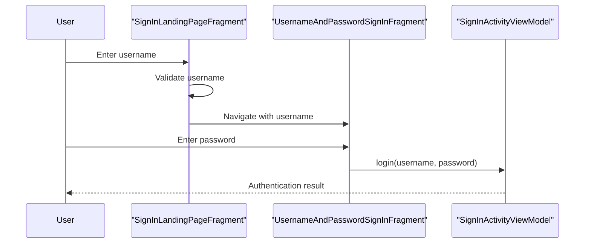
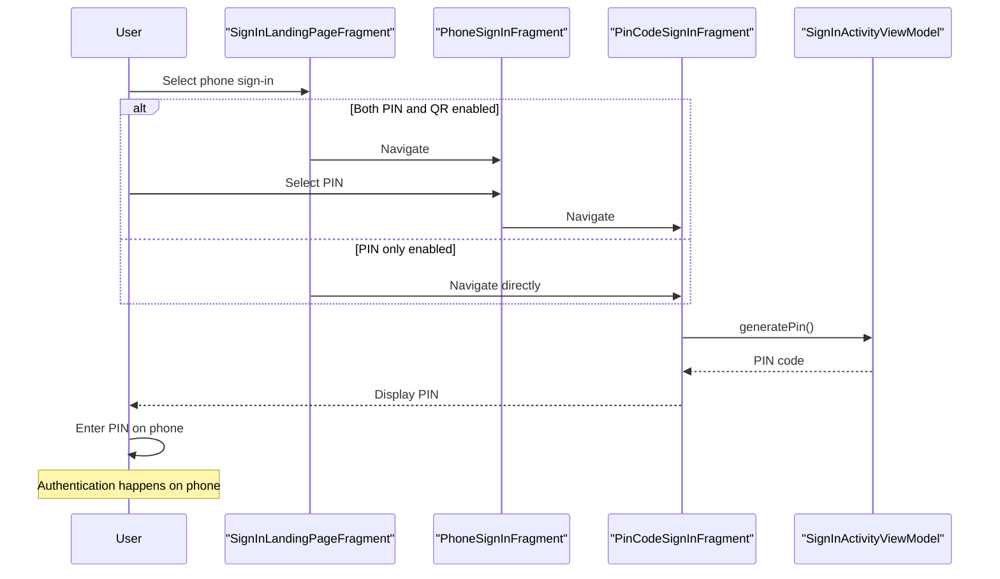
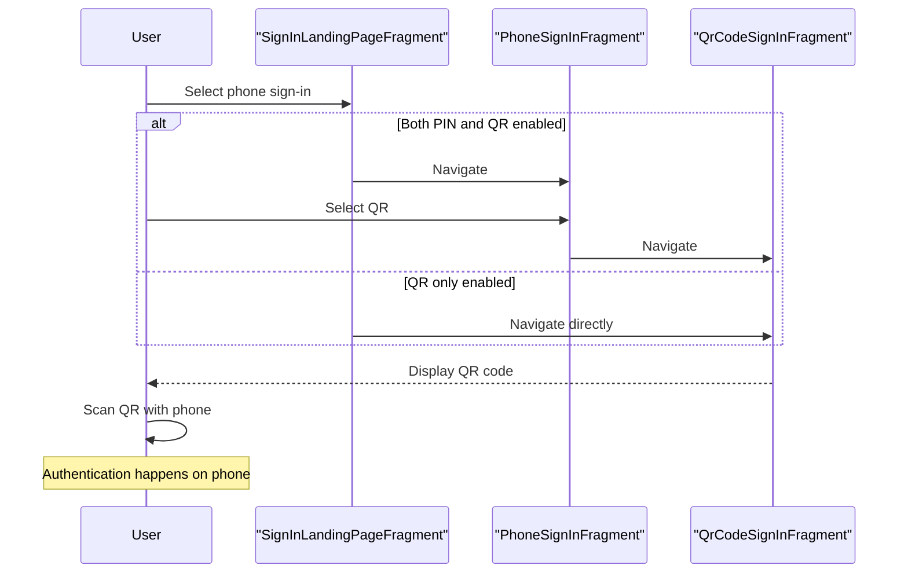
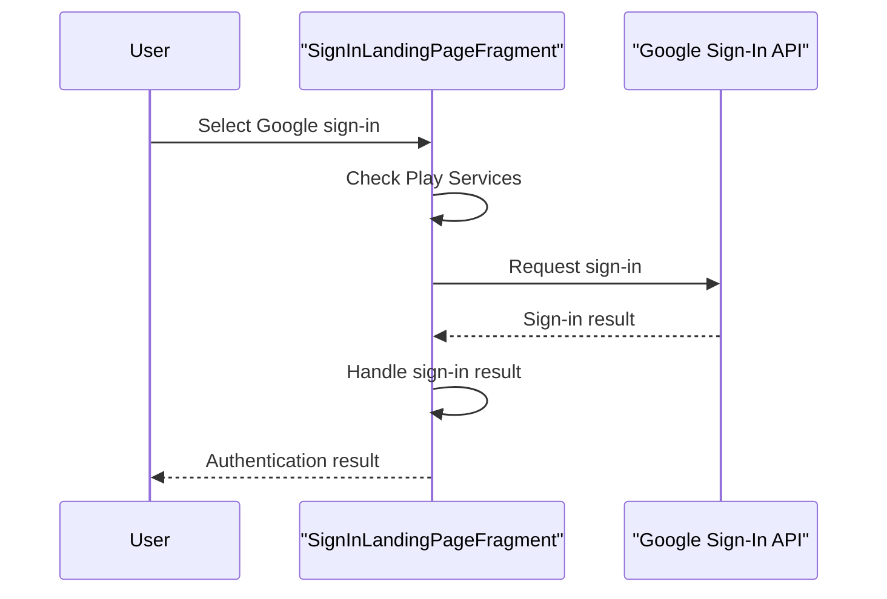
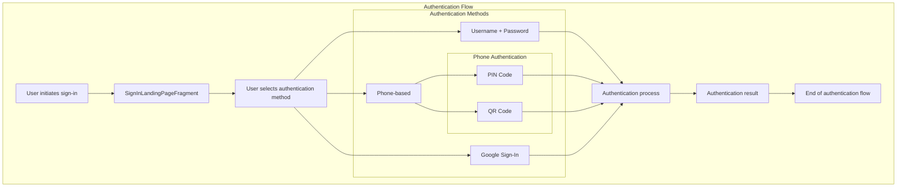

<!-- source: DeepWiki mcp.deepwiki.com · repo android/uamp · page 5 Authentication Flow · fetched 2026-10-23 -->

# Authentication Flow

<details>
<summary>Relevant source files</summary>

The following files were used as context for generating this wiki page:

- [automotive/build.gradle](automotive/build.gradle)
- [automotive/src/main/java/com/example/android/uamp/automotive/PhoneSignInFragment.kt](automotive/src/main/java/com/example/android/uamp/automotive/PhoneSignInFragment.kt)
- [automotive/src/main/java/com/example/android/uamp/automotive/PinCodeSignInFragment.kt](automotive/src/main/java/com/example/android/uamp/automotive/PinCodeSignInFragment.kt)
- [automotive/src/main/java/com/example/android/uamp/automotive/QrCodeSignInFragment.kt](automotive/src/main/java/com/example/android/uamp/automotive/QrCodeSignInFragment.kt)
- [automotive/src/main/java/com/example/android/uamp/automotive/SettingsActivity.kt](automotive/src/main/java/com/example/android/uamp/automotive/SettingsActivity.kt)
- [automotive/src/main/java/com/example/android/uamp/automotive/SignInActivity.kt](automotive/src/main/java/com/example/android/uamp/automotive/SignInActivity.kt)
- [automotive/src/main/java/com/example/android/uamp/automotive/SignInLandingPageFragment.kt](automotive/src/main/java/com/example/android/uamp/automotive/SignInLandingPageFragment.kt)
- [automotive/src/main/java/com/example/android/uamp/automotive/UsernameAndPasswordSignInFragment.kt](automotive/src/main/java/com/example/android/uamp/automotive/UsernameAndPasswordSignInFragment.kt)
- [automotive/src/main/res/values/strings.xml](automotive/src/main/res/values/strings.xml)

</details>


## Purpose and Scope

This document describes the authentication flow in the UAMP (Universal Android Music Player) application, with a focus on the Android Automotive implementation. The authentication system enables users to sign in using various methods, including username/password, PIN code, QR code, and Google Sign-In. This document covers the user interface components, interactions between these components, and the overall authentication process.

Sources: [automotive/src/main/java/com/example/android/uamp/automotive/SignInActivity.kt]()

## Authentication Overview

The UAMP Android Automotive application implements multiple authentication methods to provide users with flexible sign-in options. The authentication flow is designed with automotive use cases in mind, offering options that are suitable for in-car usage while maintaining security and user privacy.

```mermaid
graph TD
    subgraph "Authentication Components"
        SignInActivity["SignInActivity"]
        SignInViewModel["SignInActivityViewModel"]
        LandingPage["SignInLandingPageFragment"]
        
        subgraph "Authentication Methods"
            UsernamePassword["UsernameAndPasswordSignInFragment"]
            Phone["PhoneSignInFragment"]
            PinCode["PinCodeSignInFragment"]
            QrCode["QrCodeSignInFragment"]
            Google["Google Sign-In"]
        end
    end
    
    SignInActivity --> SignInViewModel
    SignInActivity --> LandingPage
    
    LandingPage --> UsernamePassword
    LandingPage --> Phone
    LandingPage --> Google
    
    Phone --> PinCode
    Phone --> QrCode
    
    SignInViewModel -.-> "Authentication Result"
```

Sources: 
- [automotive/src/main/java/com/example/android/uamp/automotive/SignInActivity.kt]()
- [automotive/src/main/java/com/example/android/uamp/automotive/SignInLandingPageFragment.kt]()

## Authentication Flow Components

### SignInActivity

The `SignInActivity` serves as the entry point for the authentication flow. It hosts the various fragments used for authentication and observes the authentication state through a ViewModel.

### SignInActivityViewModel

The `SignInActivityViewModel` manages the authentication state and provides methods for login operations. It exposes a `loggedIn` LiveData object that the `SignInActivity` observes to determine when authentication is complete.

### SignInLandingPageFragment

This fragment provides the initial UI for the authentication flow, displaying the available sign-in methods. The available methods can be configured through constants:

- `ENABLE_PIN_SIGN_IN`
- `ENABLE_QR_CODE_SIGN_IN`
- `ENABLE_GOOGLE_SIGN_IN`
- `ENABLE_USERNAME_PASSWORD_SIGN_IN`

Sources:
- [automotive/src/main/java/com/example/android/uamp/automotive/SignInActivity.kt:26-46]()
- [automotive/src/main/java/com/example/android/uamp/automotive/SignInLandingPageFragment.kt:50-54]()

## Authentication Methods

### Username and Password Authentication

The username and password authentication method consists of two steps:
1. Enter username (in `SignInLandingPageFragment`)
2. Enter password (in `UsernameAndPasswordSignInFragment`)



Sources:
- [automotive/src/main/java/com/example/android/uamp/automotive/SignInLandingPageFragment.kt:124-149]()
- [automotive/src/main/java/com/example/android/uamp/automotive/UsernameAndPasswordSignInFragment.kt:36-99]()

### Phone-based Authentication

Phone-based authentication offers two methods: PIN code and QR code. If both methods are enabled, the `PhoneSignInFragment` is displayed first to allow the user to choose between them.

#### PIN Code Authentication

PIN code authentication generates a PIN that the user enters on their phone to authenticate. The PIN is generated by the `SignInActivityViewModel.generatePin()` method.



Sources:
- [automotive/src/main/java/com/example/android/uamp/automotive/PinCodeSignInFragment.kt:37-78]()
- [automotive/src/main/java/com/example/android/uamp/automotive/PhoneSignInFragment.kt:31-69]()

#### QR Code Authentication

QR code authentication displays a QR code that the user scans with their phone to authenticate. The QR code URL is defined in the `strings.xml` file.



Sources:
- [automotive/src/main/java/com/example/android/uamp/automotive/QrCodeSignInFragment.kt:35-57]()
- [automotive/src/main/java/com/example/android/uamp/automotive/PhoneSignInFragment.kt:31-69]()
- [automotive/src/main/res/values/strings.xml:46]()

### Google Sign-In

Google Sign-In integration is provided using the Google Sign-In API. The implementation includes checking for Google Play Services availability and handling the sign-in result.



Sources:
- [automotive/src/main/java/com/example/android/uamp/automotive/SignInLandingPageFragment.kt:185-244]()
- [automotive/build.gradle:70]()

## Complete Authentication Flow

The following diagram illustrates the complete authentication flow from the user initiating sign-in to completion:



Sources:
- [automotive/src/main/java/com/example/android/uamp/automotive/SignInActivity.kt]()
- [automotive/src/main/java/com/example/android/uamp/automotive/SignInLandingPageFragment.kt]()

## Configuration Options

The authentication flow can be configured with the following constants in `SignInLandingPageFragment.kt`:

| Constant | Description | Default Value |
|----------|-------------|--------------|
| `ENABLE_PIN_SIGN_IN` | Enables PIN code sign-in | `true` |
| `ENABLE_QR_CODE_SIGN_IN` | Enables QR code sign-in | `true` |
| `ENABLE_GOOGLE_SIGN_IN` | Enables Google Sign-In | `true` |
| `ENABLE_USERNAME_PASSWORD_SIGN_IN` | Enables username and password sign-in | `true` |

These constants control which authentication methods are available to the user.

Sources:
- [automotive/src/main/java/com/example/android/uamp/automotive/SignInLandingPageFragment.kt:50-53]()

## Resource Files

The authentication flow relies on various resource files:

| Resource Type | Description |
|---------------|-------------|
| Layouts | UI layouts for different authentication screens |
| Strings | Text resources for UI elements |
| Drawables | Images and icons used in the authentication flow |

Key string resources include:
- Sign-in button labels
- Error messages
- Instructional text
- URLs for QR codes

Sources:
- [automotive/src/main/res/values/strings.xml:21-50]()

## Integration with Settings

The authentication flow is integrated with the application settings through the `SettingsActivity` and `SettingsFragment`. This allows users to manage their authentication status and preferences from the application settings.

Sources:
- [automotive/src/main/java/com/example/android/uamp/automotive/SettingsActivity.kt:27-52]()

## Conclusion

The authentication flow in UAMP's Android Automotive implementation provides a flexible and user-friendly way for users to authenticate, with multiple methods suitable for in-car usage. The modular design allows for easy configuration of available authentication methods, and the implementation demonstrates best practices for automotive applications.

---

