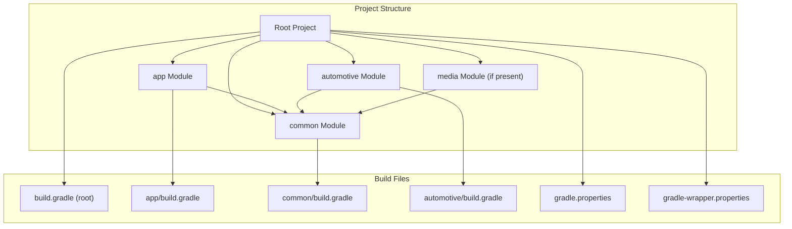
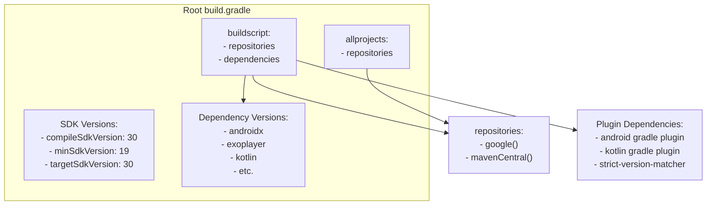
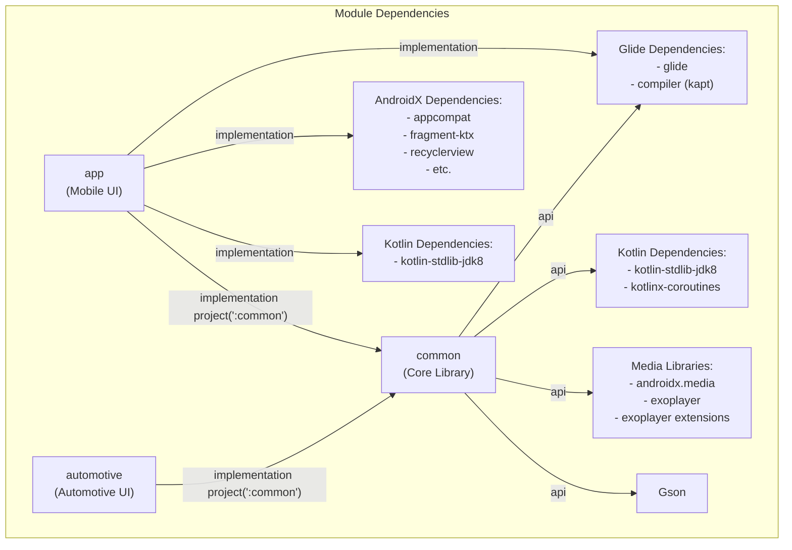
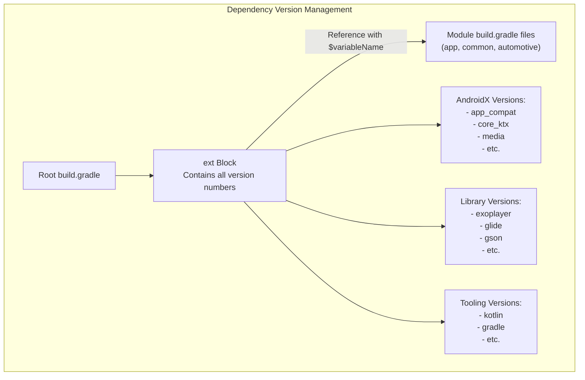
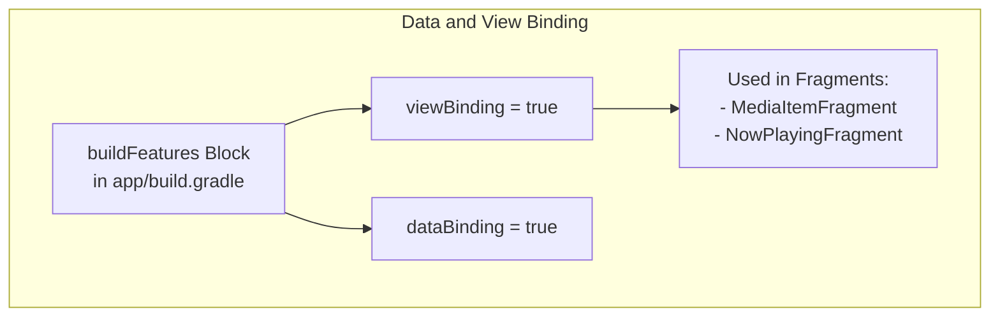
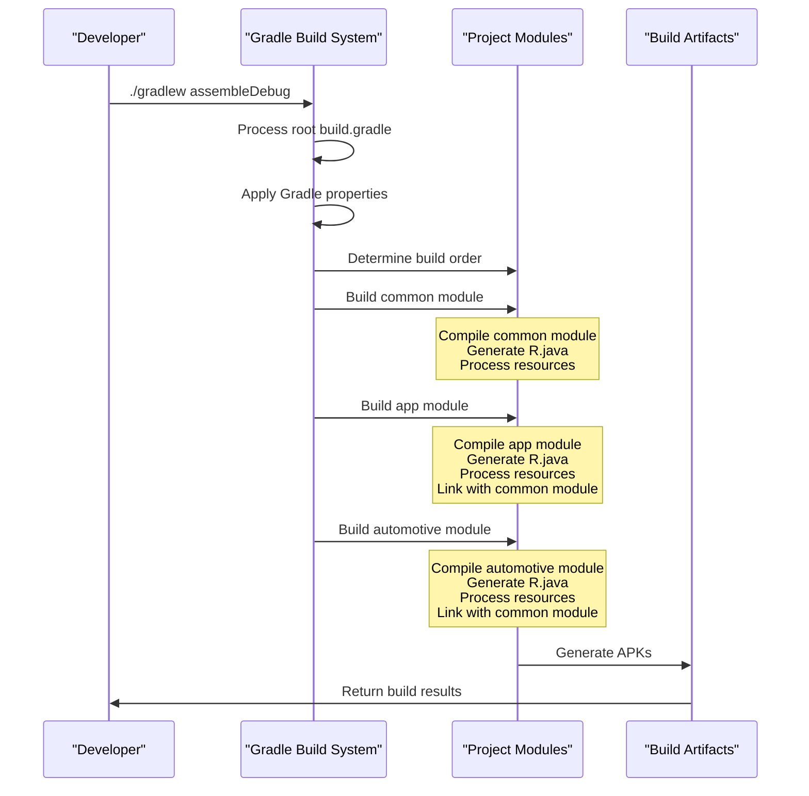

<!-- source: DeepWiki mcp.deepwiki.com · repo android/uamp · page 6 Build System · fetched 2026-10-23 -->

# Build System

<details>
<summary>Relevant source files</summary>

The following files were used as context for generating this wiki page:

- [app/build.gradle](app/build.gradle)
- [app/src/main/java/com/example/android/uamp/fragments/MediaItemFragment.kt](app/src/main/java/com/example/android/uamp/fragments/MediaItemFragment.kt)
- [app/src/main/java/com/example/android/uamp/fragments/NowPlayingFragment.kt](app/src/main/java/com/example/android/uamp/fragments/NowPlayingFragment.kt)
- [automotive/src/main/java/com/example/android/uamp/automotive/SettingsFragment.kt](automotive/src/main/java/com/example/android/uamp/automotive/SettingsFragment.kt)
- [build.gradle](build.gradle)
- [common/build.gradle](common/build.gradle)
- [common/proguard-rules.pro](common/proguard-rules.pro)
- [common/src/test/java/com/example/android/uamp/media/library/MusicSourceTest.kt](common/src/test/java/com/example/android/uamp/media/library/MusicSourceTest.kt)
- [gradle.properties](gradle.properties)
- [gradle/wrapper/gradle-wrapper.properties](gradle/wrapper/gradle-wrapper.properties)

</details>


This document provides a comprehensive overview of the UAMP (Universal Android Music Player) build system, covering the project structure, Gradle configuration, module organization, and dependency management. For information about the overall architecture of the application, see [Architecture](#2).

## 1. Project Structure Overview

UAMP is organized as a multi-module Android project built with Gradle. The modular architecture enables code reuse and separation of concerns, with shared functionality in a common module and platform-specific implementations in separate modules.



Sources: [build.gradle](), [app/build.gradle](), [common/build.gradle](), [gradle.properties](), [gradle/wrapper/gradle-wrapper.properties]()

## 2. Gradle Configuration

UAMP uses Gradle as its build system with a specific version defined in the Gradle wrapper properties.

### 2.1 Gradle Wrapper

The project uses Gradle 6.1.1 as specified in the gradle-wrapper.properties file:

Sources: [gradle/wrapper/gradle-wrapper.properties:1-6]()

### 2.2 Root Build Configuration

The root build.gradle file defines project-wide configurations:

- SDK versions (compile, minimum, target)
- Dependency versions for the entire project
- Repository configurations (Google and Maven Central)
- Gradle and plugin versions



Sources: [build.gradle:17-75]()

## 3. Module Structure and Configurations

### 3.1 Module Dependencies

The project is organized into multiple modules with specific dependencies:



Sources: [app/build.gradle:60-77](), [common/build.gradle:48-82]()

### 3.2 App Module Configuration

The app module is configured as an Android application:

- Applies Android application plugin and Kotlin plugins
- Configures Android SDK versions from root project
- Enables view binding and data binding
- Defines build types with ProGuard settings
- Specifies dependencies on common module and external libraries

Sources: [app/build.gradle:17-77]()

### 3.3 Common Module Configuration

The common module is configured as an Android library:

- Applies Android library plugin and Kotlin plugins
- Configures SDK versions
- Sets up ExoPlayer dependencies with conditional logic
- Defines test configurations

```
common (library)
├── Core functionality
├── Media playback features
└── Shared resources
```

Sources: [common/build.gradle:17-82]()

## 4. Dependency Management

### 4.1 Centralized Version Management

UAMP employs a centralized approach to dependency version management using the `ext` block in the root build.gradle file:



Sources: [build.gradle:20-50]()

### 4.2 ExoPlayer Dependency Logic

The common module has special logic for ExoPlayer dependencies:

- Checks if a local ExoPlayer project is available
- Uses local ExoPlayer modules if available, otherwise uses published artifacts

Sources: [common/build.gradle:58-73]()

## 5. Gradle Properties and Settings

The project contains several important Gradle settings in gradle.properties:

- `android.useAndroidX=true`: Enables AndroidX libraries
- `android.enableJetifier=true`: Enables translation of support libraries to AndroidX
- `org.gradle.jvmargs=-Xmx1536m`: Sets memory allocation for Gradle daemon

Sources: [gradle.properties:16-32]()

## 6. Build Features and Customizations

### 6.1 View Binding and Data Binding

The app module enables both view binding and data binding for easier UI implementation:



Sources: [app/build.gradle:47-50](), [app/src/main/java/com/example/android/uamp/fragments/MediaItemFragment.kt:36-68](), [app/src/main/java/com/example/android/uamp/fragments/NowPlayingFragment.kt:39-59]()

### 6.2 ProGuard Configuration

The project has basic ProGuard settings for release builds. The common module includes a proguard-rules.pro file with default rules.

Sources: [app/build.gradle:52-57](), [common/proguard-rules.pro:1-22]()

## 7. Build Process Overview

The following diagram illustrates the high-level build process flow:



Sources: [build.gradle](), [app/build.gradle](), [common/build.gradle]()

## 8. Testing Configuration

The common module includes testing configurations:

- Robolectric for unit testing with Android dependencies
- JUnit for standard unit tests
- AndroidJUnitRunner for instrumentation tests

There's also a test example that demonstrates testing with Robolectric:

Sources: [common/build.gradle:80-82](), [common/src/test/java/com/example/android/uamp/media/library/MusicSourceTest.kt:1-163]()

---

