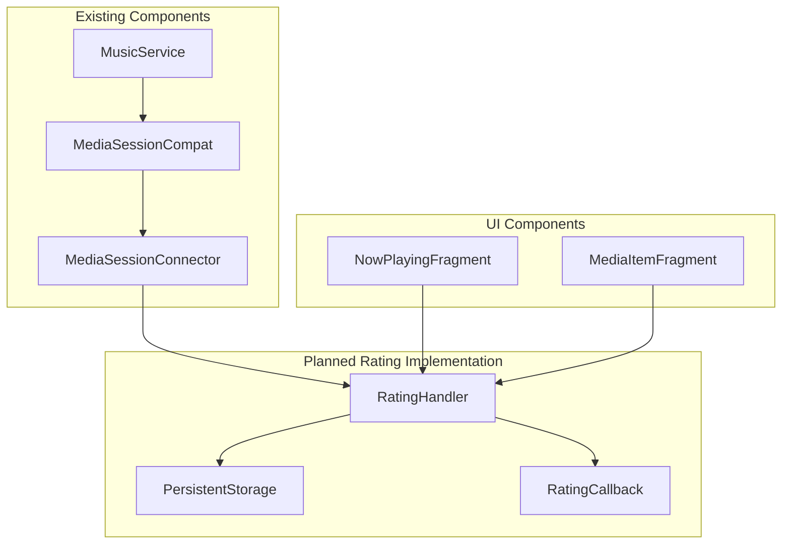
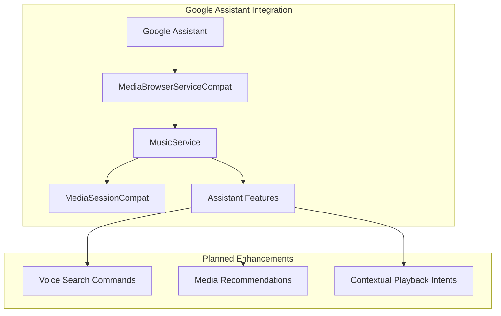
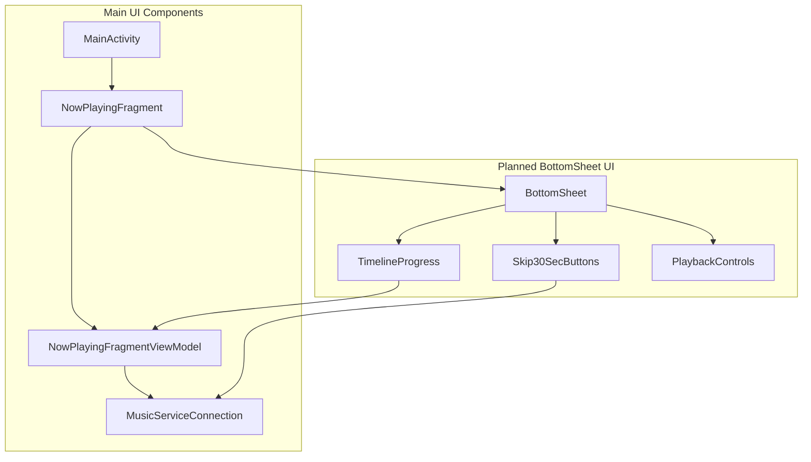
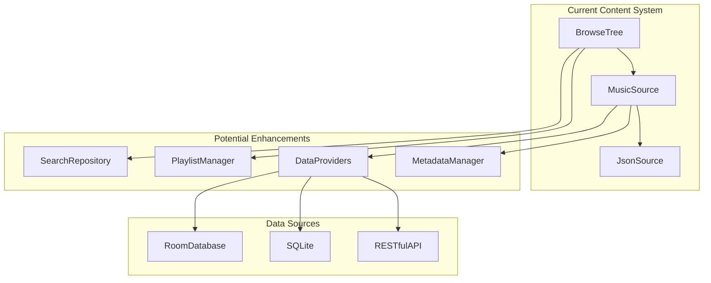
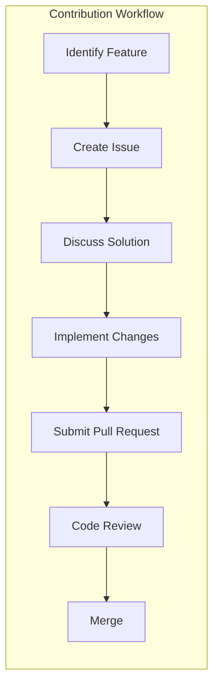

<!-- source: DeepWiki mcp.deepwiki.com · repo android/uamp · page 7 Future Development · fetched 2026-10-23 -->

# Future Development

Relevant source files

The following files were used as context for generating this wiki page:

- [CONTRIBUTING.md](CONTRIBUTING.md)
- [README.md](README.md)
- [TODO.md](TODO.md)

## Purpose and Scope

This document outlines planned improvements, potential features, and areas of ongoing development for the Universal Android Music Player (UAMP). It serves as a roadmap for both project maintainers and potential contributors, detailing specific tasks that have been identified for implementation. For information about the current architecture, see [Architecture](#2).

## Current Development Priorities

Based on the project's TODO list, several specific improvements have been targeted for future development.

### Service-Side Tasks

#### Rating Implementation

A priority for future development is implementing a rating system for media content, with a focus on "favorite" functionality rather than traditional "thumbs up/down" ratings.

This rating system would allow users to mark favorite songs and potentially create favorite playlists, enhancing the personalization of the app experience.

Sources: [TODO.md:13-14]()

#### Google Assistant Integration

Improving integration with the Google Assistant is another planned enhancement. This would provide more robust voice control and media search capabilities.

Sources: [TODO.md:14-15]()

### UI Tasks

#### Now Playing UI with BottomSheet

A significant UI enhancement planned is implementing a more comprehensive "now playing" interface using a persistent BottomSheet component following Material Design guidelines. This would include:

- Current position indicator
- Skip forward/backward 30 seconds controls
- Enhanced playback controls
- Seamless transition between minimized and expanded views

Sources: [TODO.md:19-20]()

## Potential Architecture Enhancements

Beyond the explicitly listed TODO items, several architectural improvements could enhance UAMP's functionality and extensibility:

### Media Content Organization

The current `BrowseTree` and `MusicSource` implementation could be extended to support:

1. User-created playlists
2. Enhanced metadata support
3. Advanced search and filtering capabilities
4. Multiple content sources beyond JSON

### Cross-Platform Consistency

As UAMP supports multiple platforms (phones, tablets, Android Auto, Automotive OS, Wear, TV, and Cast devices), ensuring consistent user experience across all platforms remains an ongoing focus area.

| Platform | Current Support | Enhancement Opportunities |
|----------|----------------|---------------------------|
| Mobile | Full implementation | UI refinements, performance optimizations |
| Android Auto | Basic implementation | Enhanced browsing, voice interaction |
| Android Automotive | Basic implementation | Vehicle-specific optimizations, deeper integration |
| Wear OS | Limited implementation | Optimized controls for small screens |
| Android TV | Basic implementation | Remote-friendly UI, visual enhancements |
| Google Cast | Integration via CastPlayer | Richer cast controls, visual feedback |

## Implementation Roadmap Table

The following table outlines a potential implementation roadmap with estimated complexity:

| Feature | Complexity | Affected Components | Dependencies |
|---------|------------|---------------------|-------------|
| Rating System | Medium | MusicService, MediaSession, UI | PersistentStorage improvements |
| Google Assistant Integration | High | MusicService, Platform extensions | None |
| Now Playing BottomSheet | Medium | UI, ViewModels | None |
| User Playlists | High | BrowseTree, MusicSource, Storage | Rating system |
| Multi-source Media Content | High | MusicSource, JsonSource | None |
| Search Improvements | Medium | BrowseTree, MusicService | None |

## How to Contribute

UAMP welcomes community contributions to these future development initiatives. The process for contributing involves:

1. Identifying a task from the TODO list or roadmap
2. Creating an issue on GitHub to discuss implementation approach
3. Forking the repository and developing the feature
4. Submitting a pull request for review

Contributors should ensure their code adheres to the project's coding standards and includes appropriate tests. For more details, see the [CONTRIBUTING.md]() file.

Sources: [CONTRIBUTING.md](), [README.md:32-35]()

## Conclusion

The future development of UAMP focuses on enhancing user experience, extending platform integration capabilities, and providing a more robust reference implementation for media apps on Android. By addressing the planned improvements and exploring potential enhancements, UAMP will continue to demonstrate best practices for media app development across the Android ecosystem.