# Page: Overview

# Overview

<details>
<summary>Relevant source files</summary>

The following files were used as context for generating this wiki page:

- [.google/packaging.yaml](.google/packaging.yaml)
- [.idea/codeStyles/codeStyleConfig.xml](.idea/codeStyles/codeStyleConfig.xml)
- [.idea/vcs.xml](.idea/vcs.xml)
- [CONTRIBUTING.md](CONTRIBUTING.md)
- [README.md](README.md)

</details>


This document provides an introduction to the Universal Android Music Player (UAMP), a sample application that demonstrates how to implement an audio media app that works across multiple Android platforms while providing a consistent user experience. For detailed information about specific components, please refer to the relevant sections in the architecture documentation [Architecture](#2).

## What is UAMP?

The Universal Android Music Player (UAMP) is a sample application designed to showcase best practices for building media applications on Android. It demonstrates how to create a consistent media playback experience across multiple form factors and platforms in the Android ecosystem.

UAMP serves as a reference implementation for developers building audio applications, highlighting proper architecture, media API usage, and platform-specific integrations.

Sources: [README.md:1-6](), [.google/packaging.yaml:5-9]()

## Project Goals

UAMP was created with the following goals:

1. Demonstrate implementation of a fully-featured audio media app
2. Showcase a consistent user experience across multiple platforms
3. Illustrate proper MediaBrowserService pattern implementation
4. Provide a reference for platform-specific integrations (Android Auto, Wear, etc.)
5. Present a modern Android architecture using MVVM and best practices

The sample follows intermediate-level implementation patterns and is intended for developers already familiar with Android development.

Sources: [README.md:3-6](), [.google/packaging.yaml:14]()

## Supported Platforms

UAMP demonstrates how to build a media application that works seamlessly across the following platforms:

| Platform | Description |
|----------|-------------|
| Android phones & tablets | Core mobile experience with full UI |
| Android Auto | Car-optimized UI following Auto guidelines |
| Android Automotive OS | Built-in vehicle infotainment systems |
| Android Wear | Wearable-optimized controls |
| Android TV | Television-optimized interface |
| Google Cast devices | Cast functionality for external playback |
| Google Assistant | Voice control integration |

This multi-platform support is achieved through a shared core architecture with platform-specific UI layers.

Sources: [README.md:3-6](), [.google/packaging.yaml:7]()

## System Architecture Overview

### High-Level Architecture

The UAMP application follows a layered architecture pattern with clear separation of concerns, allowing for code reuse across platforms while accommodating platform-specific requirements.

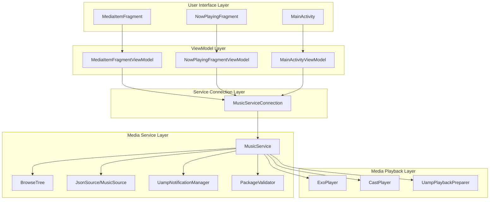

Sources: Provided system architecture diagrams

### Core Components and Their Relationships

The following diagram illustrates the key code components of UAMP and their relationships:

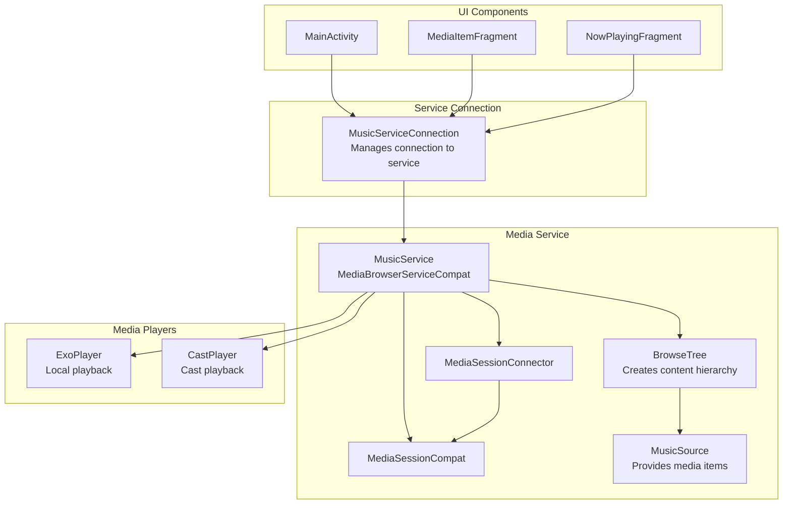

Sources: Provided system architecture diagrams

## Platform Support Implementation

UAMP demonstrates how to support multiple platforms through a unified codebase with platform-specific UI layers. The architecture enables a consistent media experience while respecting platform-specific UI guidelines and capabilities.

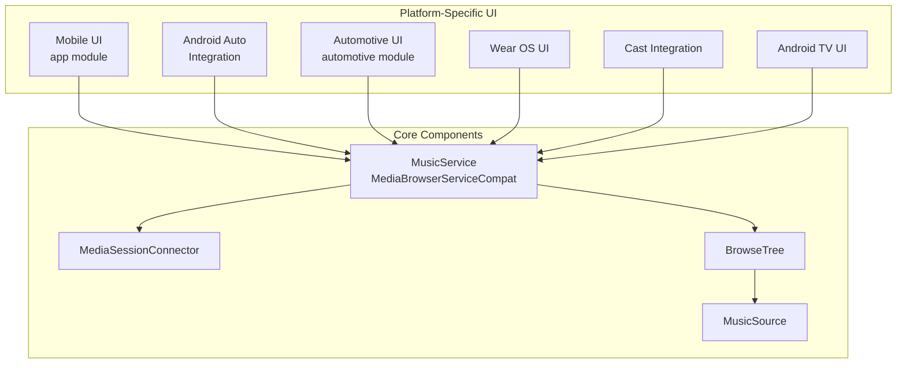

Sources: Provided system architecture diagrams, [.google/packaging.yaml:7]()

## Key Architectural Patterns

UAMP demonstrates several important architectural patterns for media applications:

1. **MediaBrowserService Pattern**: The core of the application is built around the `MediaBrowserServiceCompat` class, enabling multiple clients (UI, Android Auto, Google Assistant) to connect to and control media playback.

2. **MVVM Architecture**: The application uses the Model-View-ViewModel (MVVM) pattern with LiveData for UI updates, maintaining a clean separation of concerns.

3. **Modular Design**: The project is divided into modules (common, app, automotive) to promote code reuse and separation of concerns.

4. **Connection Management**: A dedicated `MusicServiceConnection` class manages the connection between UI components and the media service.

5. **Content Browsing**: The `BrowseTree` class organizes media content into a browsable hierarchy that works across platforms.

Sources: Provided system architecture diagrams, [.google/packaging.yaml:18-25]()

## Technology Stack

UAMP is built using the following key technologies:

| Component | Technology |
|-----------|------------|
| Programming Language | Kotlin |
| Media Player | ExoPlayer |
| Media API | MediaBrowserServiceCompat, MediaSessionCompat |
| Architecture | MVVM with LiveData |
| UI | AndroidX components |
| Notifications | MediaStyle notifications |
| Cast Support | CastPlayer |

Sources: [.google/packaging.yaml:9-25]()

## Getting Started

To get started with UAMP:

1. Clone the repository from GitHub
2. Open the project in Android Studio 3.x or higher
3. Build using Gradle: `gradlew build` or use "Import Project" in Android Studio

The sample demonstrates various aspects of media app development, including:
- Media browsing and playback
- Media notifications and transport controls
- Platform-specific integrations
- MVVM architecture implementation

For more detailed guidance, refer to the full architecture documentation [Architecture](#2).

Sources: [README.md:13-22]()

## Project Structure

UAMP is organized into several modules to support different platforms:

| Module | Purpose |
|--------|---------|
| app | Mobile UI implementation |
| automotive | Android Automotive OS implementation |
| common | Core library with shared functionality |
| media | Media functionality |

This modular approach allows for maximum code reuse while accommodating platform-specific requirements.

Sources: Provided system architecture diagrams

---

# Page: Architecture

# Architecture

<details>
<summary>Relevant source files</summary>

The following files were used as context for generating this wiki page:

- [app/src/main/java/com/example/android/uamp/MainActivity.kt](app/src/main/java/com/example/android/uamp/MainActivity.kt)
- [app/src/main/java/com/example/android/uamp/MediaItemAdapter.kt](app/src/main/java/com/example/android/uamp/MediaItemAdapter.kt)
- [app/src/main/java/com/example/android/uamp/MediaItemData.kt](app/src/main/java/com/example/android/uamp/MediaItemData.kt)
- [app/src/main/java/com/example/android/uamp/viewmodels/MainActivityViewModel.kt](app/src/main/java/com/example/android/uamp/viewmodels/MainActivityViewModel.kt)
- [app/src/main/java/com/example/android/uamp/viewmodels/MediaItemFragmentViewModel.kt](app/src/main/java/com/example/android/uamp/viewmodels/MediaItemFragmentViewModel.kt)
- [app/src/main/java/com/example/android/uamp/viewmodels/NowPlayingFragmentViewModel.kt](app/src/main/java/com/example/android/uamp/viewmodels/NowPlayingFragmentViewModel.kt)
- [app/src/main/res/layout/fragment_mediaitem.xml](app/src/main/res/layout/fragment_mediaitem.xml)
- [app/src/main/res/layout/fragment_mediaitem_list.xml](app/src/main/res/layout/fragment_mediaitem_list.xml)
- [automotive/src/main/java/com/example/android/uamp/automotive/AutomotiveMusicService.kt](automotive/src/main/java/com/example/android/uamp/automotive/AutomotiveMusicService.kt)
- [automotive/src/main/java/com/example/android/uamp/automotive/SignInActivityViewModel.kt](automotive/src/main/java/com/example/android/uamp/automotive/SignInActivityViewModel.kt)
- [common/src/main/java/com/example/android/uamp/common/MusicServiceConnection.kt](common/src/main/java/com/example/android/uamp/common/MusicServiceConnection.kt)
- [common/src/main/java/com/example/android/uamp/media/CastMediaItemConverter.kt](common/src/main/java/com/example/android/uamp/media/CastMediaItemConverter.kt)
- [common/src/main/java/com/example/android/uamp/media/MusicService.kt](common/src/main/java/com/example/android/uamp/media/MusicService.kt)
- [common/src/main/java/com/example/android/uamp/media/PackageValidator.kt](common/src/main/java/com/example/android/uamp/media/PackageValidator.kt)
- [common/src/main/java/com/example/android/uamp/media/PersistentStorage.kt](common/src/main/java/com/example/android/uamp/media/PersistentStorage.kt)
- [common/src/main/java/com/example/android/uamp/media/UampNotificationManager.kt](common/src/main/java/com/example/android/uamp/media/UampNotificationManager.kt)
- [common/src/main/java/com/example/android/uamp/media/extensions/MediaMetadataCompatExt.kt](common/src/main/java/com/example/android/uamp/media/extensions/MediaMetadataCompatExt.kt)
- [common/src/main/java/com/example/android/uamp/media/library/AlbumArtContentProvider.kt](common/src/main/java/com/example/android/uamp/media/library/AlbumArtContentProvider.kt)
- [common/src/main/java/com/example/android/uamp/media/library/BrowseTree.kt](common/src/main/java/com/example/android/uamp/media/library/BrowseTree.kt)
- [common/src/main/java/com/example/android/uamp/media/library/JsonSource.kt](common/src/main/java/com/example/android/uamp/media/library/JsonSource.kt)

</details>


This document describes the overall architecture of the Universal Android Music Player (UAMP) application, covering its key components and their interactions. UAMP demonstrates best practices for audio playback on Android across multiple form factors and platforms.

For specific details about the media service implementation, see [Media Service](#2.1). For information about how media content is organized, see [Media Content Organization](#2.2).

## High-Level Architecture Overview

UAMP follows the MVVM (Model-View-ViewModel) architecture pattern and is built around Android's MediaBrowserService API, which enables an application to expose its media catalog and playback controls to multiple clients.

### Key Architecture Components Diagram

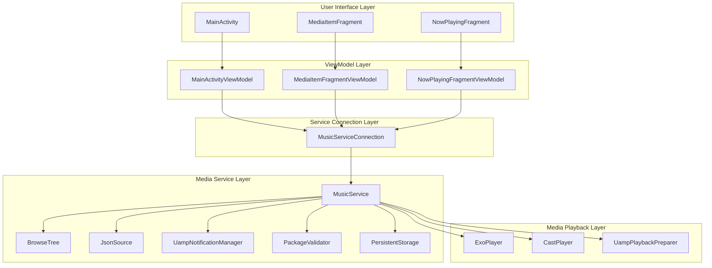

Sources: [common/src/main/java/com/example/android/uamp/media/MusicService.kt](), [app/src/main/java/com/example/android/uamp/MainActivity.kt](), [common/src/main/java/com/example/android/uamp/common/MusicServiceConnection.kt](), [app/src/main/java/com/example/android/uamp/viewmodels/MediaItemFragmentViewModel.kt](), [app/src/main/java/com/example/android/uamp/viewmodels/MainActivityViewModel.kt](), [app/src/main/java/com/example/android/uamp/viewmodels/NowPlayingFragmentViewModel.kt]()

## Core Architecture Components

### MusicService

The `MusicService` class [common/src/main/java/com/example/android/uamp/media/MusicService.kt:93-653]() is the central component of UAMP, extending `MediaBrowserServiceCompat` to provide media browsing and playback functionality. It serves as the entry point for browsing and playback commands from both the app's UI and external clients (like Android Auto or Google Assistant).

Key responsibilities:
- Managing the media session
- Handling media browsing requests
- Controlling media playback
- Switching between local (ExoPlayer) and cast (CastPlayer) playback
- Providing notifications for media controls

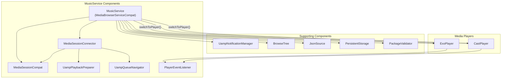

Sources: [common/src/main/java/com/example/android/uamp/media/MusicService.kt:93-653](), [common/src/main/java/com/example/android/uamp/media/UampNotificationManager.kt]()

### MusicServiceConnection

The `MusicServiceConnection` class [common/src/main/java/com/example/android/uamp/common/MusicServiceConnection.kt:54-186]() manages the connection between the UI components and the `MusicService`. It wraps a `MediaBrowserCompat` instance and provides LiveData objects that expose the current state of the media session.

Key responsibilities:
- Connecting to the MusicService
- Providing access to transport controls
- Exposing playback state and now playing metadata as LiveData
- Managing subscriptions to media content

Sources: [common/src/main/java/com/example/android/uamp/common/MusicServiceConnection.kt:54-186]()

### ViewModels

UAMP uses ViewModels to separate UI logic from the business logic and to survive configuration changes:

1. **MainActivityViewModel** [app/src/main/java/com/example/android/uamp/viewmodels/MainActivityViewModel.kt:42-171]()
   - Manages navigation between media items
   - Provides the root media ID
   - Handles media playback commands

2. **MediaItemFragmentViewModel** [app/src/main/java/com/example/android/uamp/viewmodels/MediaItemFragmentViewModel.kt:42-181]()
   - Subscribes to a specific media ID
   - Provides a list of media items
   - Updates the UI based on playback state

3. **NowPlayingFragmentViewModel** [app/src/main/java/com/example/android/uamp/viewmodels/NowPlayingFragmentViewModel.kt:50-201]()
   - Provides metadata for the currently playing item
   - Tracks playback position
   - Updates media controls

Sources: [app/src/main/java/com/example/android/uamp/viewmodels/MainActivityViewModel.kt](), [app/src/main/java/com/example/android/uamp/viewmodels/MediaItemFragmentViewModel.kt](), [app/src/main/java/com/example/android/uamp/viewmodels/NowPlayingFragmentViewModel.kt]()

### Media Content Management

#### BrowseTree

The `BrowseTree` class [common/src/main/java/com/example/android/uamp/media/library/BrowseTree.kt:57-153]() organizes media content into a browsable hierarchy. It maps media IDs to their children, creating a tree structure that clients can browse.

The browse tree has several root categories:
- `/` (UAMP_BROWSABLE_ROOT): The top-level root
- `__RECOMMENDED__` (UAMP_RECOMMENDED_ROOT): Featured or recommended content
- `__ALBUMS__` (UAMP_ALBUMS_ROOT): All albums
- `__RECENT__` (UAMP_RECENT_ROOT): Recently played items

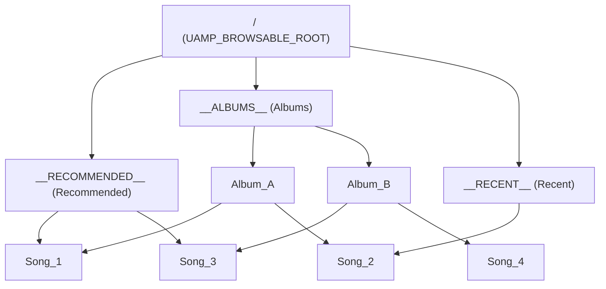

Sources: [common/src/main/java/com/example/android/uamp/media/library/BrowseTree.kt:57-153](), [common/src/main/java/com/example/android/uamp/media/MusicService.kt:118-120]()

#### JsonSource

The `JsonSource` class [common/src/main/java/com/example/android/uamp/media/library/JsonSource.kt:55-174]() implements the `AbstractMusicSource` interface and loads media items from a JSON file. It converts the JSON data into MediaMetadataCompat objects that can be used by other components.

Sources: [common/src/main/java/com/example/android/uamp/media/library/JsonSource.kt:55-174](), [common/src/main/java/com/example/android/uamp/media/MusicService.kt:208-211]()

## MediaBrowser Pattern Implementation

UAMP follows the MediaBrowser pattern, which enables a client-server architecture for media playback:

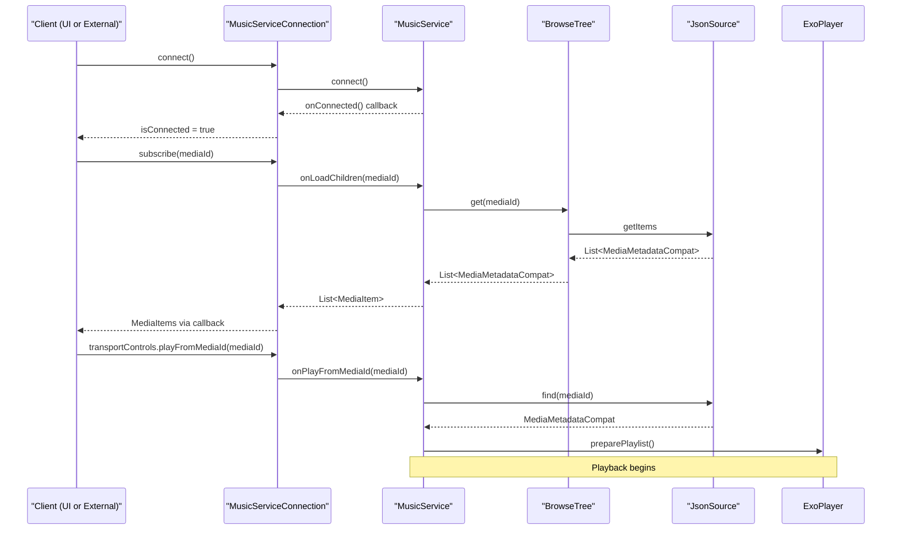

Sources: [common/src/main/java/com/example/android/uamp/common/MusicServiceConnection.kt:76-84](), [common/src/main/java/com/example/android/uamp/media/MusicService.kt:267-348](), [common/src/main/java/com/example/android/uamp/media/MusicService.kt:493-518]()

## Platform Integration Architecture

UAMP is designed to work across multiple Android platforms through a shared core implementation:

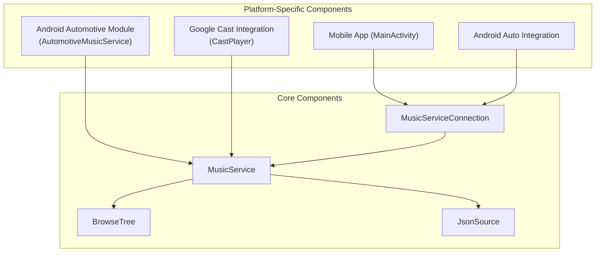

Sources: [common/src/main/java/com/example/android/uamp/media/MusicService.kt](), [common/src/main/java/com/example/android/uamp/common/MusicServiceConnection.kt](), [automotive/src/main/java/com/example/android/uamp/automotive/AutomotiveMusicService.kt](), [common/src/main/java/com/example/android/uamp/media/CastMediaItemConverter.kt]()

### Android Automotive OS Integration

For Android Automotive OS, UAMP provides an extended version of the `MusicService` called `AutomotiveMusicService` [automotive/src/main/java/com/example/android/uamp/automotive/AutomotiveMusicService.kt:55-175]() that includes authentication functionality.

Sources: [automotive/src/main/java/com/example/android/uamp/automotive/AutomotiveMusicService.kt:55-175]()

### Google Cast Integration

UAMP supports Google Cast through the `CastPlayer` class from ExoPlayer's Cast extension. The `MusicService` [common/src/main/java/com/example/android/uamp/media/MusicService.kt:149-165]() detects when a Cast session is available and switches playback to the Cast device.

The `CastMediaItemConverter` [common/src/main/java/com/example/android/uamp/media/CastMediaItemConverter.kt:26-77]() handles the conversion between ExoPlayer's `MediaItem` and Cast's `MediaQueueItem`.

Sources: [common/src/main/java/com/example/android/uamp/media/MusicService.kt:149-165](), [common/src/main/java/com/example/android/uamp/media/CastMediaItemConverter.kt:26-77]()

## Cross-Component Communication

Communication between components in UAMP is primarily done using Android Architecture Components:

| Component | Communication Mechanism | Subscribers |
|-----------|-------------------------|-------------|
| MusicService | MediaBrowserServiceCompat API | MusicServiceConnection |
| MusicServiceConnection | LiveData (playbackState, nowPlaying) | ViewModels |
| ViewModels | LiveData | UI Fragments |

The key LiveData objects exposed by `MusicServiceConnection` include:
- `isConnected`: Connection state with the service
- `playbackState`: Current playback state (playing, paused, etc.)
- `nowPlaying`: Metadata of the currently playing item
- `networkFailure`: Network error indicator

Sources: [common/src/main/java/com/example/android/uamp/common/MusicServiceConnection.kt:55-65](), [app/src/main/java/com/example/android/uamp/viewmodels/MediaItemFragmentViewModel.kt:81-101]()

## Media Notification Management

The `UampNotificationManager` [common/src/main/java/com/example/android/uamp/media/UampNotificationManager.kt:44-130]() manages the media playback notification, which allows users to control playback from outside the app. It uses ExoPlayer's `PlayerNotificationManager` to create and update the notification.

The `PlayerNotificationListener` in `MusicService` [common/src/main/java/com/example/android/uamp/media/MusicService.kt:567-590]() handles notification events, managing the service's foreground state accordingly.

Sources: [common/src/main/java/com/example/android/uamp/media/UampNotificationManager.kt:44-130](), [common/src/main/java/com/example/android/uamp/media/MusicService.kt:567-590]()

## Security Architecture

UAMP implements the `PackageValidator` [common/src/main/java/com/example/android/uamp/media/PackageValidator.kt:51-353]() to ensure that only authorized applications can connect to the `MusicService`. This validation happens in the `onGetRoot` method of `MusicService` [common/src/main/java/com/example/android/uamp/media/MusicService.kt:267-307]().

Authorized clients include:
- The app itself
- System applications
- Applications with the MEDIA_CONTENT_CONTROL permission
- Applications with notification listener services
- Applications on an allow list defined in XML

Sources: [common/src/main/java/com/example/android/uamp/media/PackageValidator.kt:51-353](), [common/src/main/java/com/example/android/uamp/media/MusicService.kt:267-307]()

## Persistence

UAMP uses `PersistentStorage` [common/src/main/java/com/example/android/uamp/media/PersistentStorage.kt:31-97]() to save and retrieve information about the most recently played song. This allows the app to resume playback after a reboot or when reopened.

Sources: [common/src/main/java/com/example/android/uamp/media/PersistentStorage.kt:31-97](), [common/src/main/java/com/example/android/uamp/media/MusicService.kt:423-439]()

## Summary

The UAMP architecture demonstrates a well-structured approach to building a media playback application on Android:

1. It uses the MediaBrowserService pattern to support multiple clients
2. It follows the MVVM architecture to separate concerns
3. It provides a modular design that supports multiple platforms
4. It leverages LiveData for reactive UI updates
5. It implements security measures to validate client access

This architecture serves as a reference implementation for building robust media applications on Android, highlighting best practices for handling media playback across different devices and contexts.

---

# Page: Media Service

# Media Service

<details>
<summary>Relevant source files</summary>

The following files were used as context for generating this wiki page:

- [app/src/main/AndroidManifest.xml](app/src/main/AndroidManifest.xml)
- [app/src/main/java/com/example/android/uamp/cast/UampCastOptionsProvider.kt](app/src/main/java/com/example/android/uamp/cast/UampCastOptionsProvider.kt)
- [automotive/src/main/java/com/example/android/uamp/automotive/AutomotiveMusicService.kt](automotive/src/main/java/com/example/android/uamp/automotive/AutomotiveMusicService.kt)
- [common/src/main/java/com/example/android/uamp/media/CastMediaItemConverter.kt](common/src/main/java/com/example/android/uamp/media/CastMediaItemConverter.kt)
- [common/src/main/java/com/example/android/uamp/media/MusicService.kt](common/src/main/java/com/example/android/uamp/media/MusicService.kt)
- [common/src/main/java/com/example/android/uamp/media/PackageValidator.kt](common/src/main/java/com/example/android/uamp/media/PackageValidator.kt)
- [common/src/main/java/com/example/android/uamp/media/PersistentStorage.kt](common/src/main/java/com/example/android/uamp/media/PersistentStorage.kt)
- [common/src/main/java/com/example/android/uamp/media/UampNotificationManager.kt](common/src/main/java/com/example/android/uamp/media/UampNotificationManager.kt)
- [common/src/main/java/com/example/android/uamp/media/extensions/MediaMetadataCompatExt.kt](common/src/main/java/com/example/android/uamp/media/extensions/MediaMetadataCompatExt.kt)
- [common/src/main/java/com/example/android/uamp/media/extensions/PlaybackStateCompatExt.kt](common/src/main/java/com/example/android/uamp/media/extensions/PlaybackStateCompatExt.kt)
- [common/src/main/java/com/example/android/uamp/media/library/AlbumArtContentProvider.kt](common/src/main/java/com/example/android/uamp/media/library/AlbumArtContentProvider.kt)
- [common/src/main/java/com/example/android/uamp/media/library/JsonSource.kt](common/src/main/java/com/example/android/uamp/media/library/JsonSource.kt)
- [common/src/main/java/com/example/android/uamp/media/library/MusicSource.kt](common/src/main/java/com/example/android/uamp/media/library/MusicSource.kt)
- [common/src/main/res/menu/main_activity_menu.xml](common/src/main/res/menu/main_activity_menu.xml)
- [common/src/main/res/values/strings.xml](common/src/main/res/values/strings.xml)

</details>


The Media Service is the core component of the UAMP (Universal Android Music Player) architecture responsible for handling media browsing and playback commands. It implements Android's `MediaBrowserServiceCompat` and serves as the central hub for all media-related operations, allowing multiple clients (such as the app UI, Android Auto, and Google Assistant) to connect and control media playback.

For information about how media content is organized and browsed, see [Media Content Organization](#2.2). For details about how notifications and media controls are implemented, see [Notifications and Media Controls](#2.3).

## Overview

The Media Service acts as an entry point for browsing and playback commands from various sources:

- The UAMP app's UI
- Android Auto
- Android Automotive OS
- Google Assistant
- Google Cast devices
- External apps with appropriate permissions

It maintains a single source of truth for the app's media playback state, manages media sessions, and handles transitions between local and remote (cast) playback.

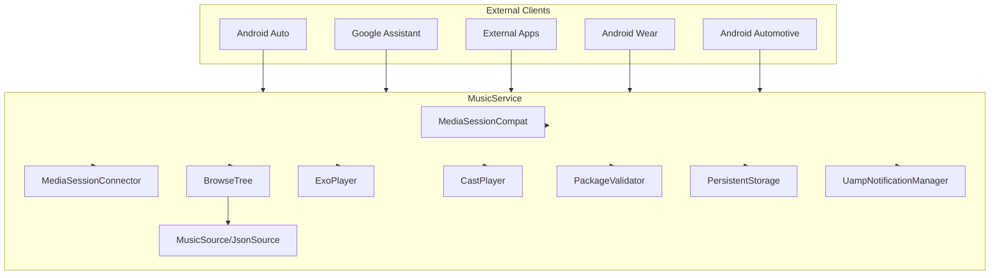

Diagram Title: Media Service and its client interactions

Sources: [common/src/main/java/com/example/android/uamp/media/MusicService.kt:77-92](), [app/src/main/AndroidManifest.xml:83-93]()

## Core Components

### MusicService

The `MusicService` class is the main implementation of the MediaBrowserServiceCompat. It handles the initialization of all other components and coordinates interactions between them.

Key responsibilities:

- Creating and managing the MediaSession
- Handling media browsing requests
- Managing playback state and controls
- Switching between ExoPlayer and CastPlayer
- Validating caller packages
- Saving and restoring playback state

Sources: [common/src/main/java/com/example/android/uamp/media/MusicService.kt:93-672]()

### Media Session

The Media Session is the central interface for controlling media playback. It allows clients to:

- View information about the currently playing media
- Control playback (play, pause, skip, etc.)
- Receive updates about playback state changes

The `MusicService` creates and manages a `MediaSessionCompat` instance and connects it to ExoPlayer or CastPlayer using the `MediaSessionConnector`.

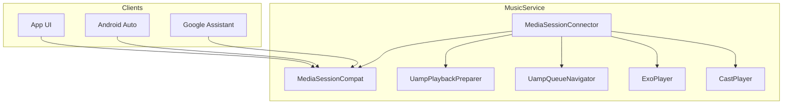

Diagram Title: Media Session and related components

Sources: [common/src/main/java/com/example/android/uamp/media/MusicService.kt:176-216](), [common/src/main/java/com/example/android/uamp/media/MusicService.kt:459-468](), [common/src/main/java/com/example/android/uamp/media/MusicService.kt:470-562]()

## Media Browsing

The browsing functionality is a key part of the Media Service. It allows clients to:

1. Connect to the service
2. Retrieve a hierarchical structure of media content
3. Navigate through this structure to find content to play

### Root and Package Validation

When a client attempts to connect to the service, the `onGetRoot` method is called. This method:

1. Validates the calling package using `PackageValidator`
2. Returns an appropriate browsing root based on the caller
3. Provides additional information via `rootExtras`

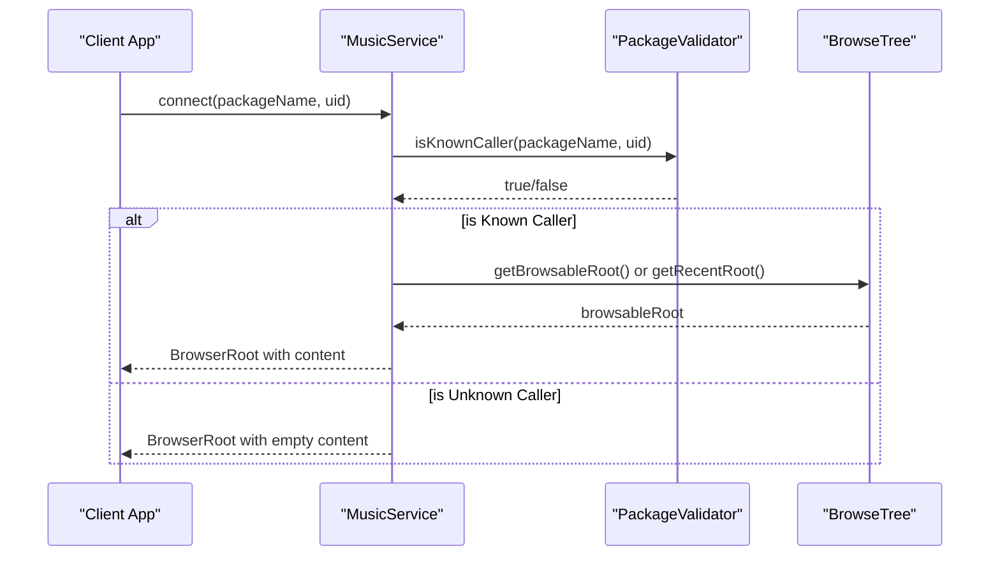

Diagram Title: Connection and root validation flow

Sources: [common/src/main/java/com/example/android/uamp/media/MusicService.kt:266-307](), [common/src/main/java/com/example/android/uamp/media/PackageValidator.kt:76-149]()

### Media Item Loading

Once connected, clients can request children of the root or other nodes using `onLoadChildren`:

- If the requested mediaId is the recent root, return the most recently played song
- Otherwise, use the BrowseTree to get the appropriate media items
- If the media source is not ready yet, detach the result to send it later

Sources: [common/src/main/java/com/example/android/uamp/media/MusicService.kt:314-348]()

## Media Playback

The Media Service manages playback through ExoPlayer (for local playback) or CastPlayer (for remote playback).

### Playback Components

| Component | Role |
|-----------|------|
| `ExoPlayer` | Handles local media playback |
| `CastPlayer` | Handles remote playback via Google Cast |
| `UampPlaybackPreparer` | Prepares media for playback in response to client requests |
| `UampQueueNavigator` | Provides queue navigation functionality |
| `PlayerEventListener` | Responds to player events |

Sources: [common/src/main/java/com/example/android/uamp/media/MusicService.kt:138-144](), [common/src/main/java/com/example/android/uamp/media/MusicService.kt:149-165](), [common/src/main/java/com/example/android/uamp/media/MusicService.kt:470-562](), [common/src/main/java/com/example/android/uamp/media/MusicService.kt:459-468](), [common/src/main/java/com/example/android/uamp/media/MusicService.kt:595-652]()

### Playback Flow

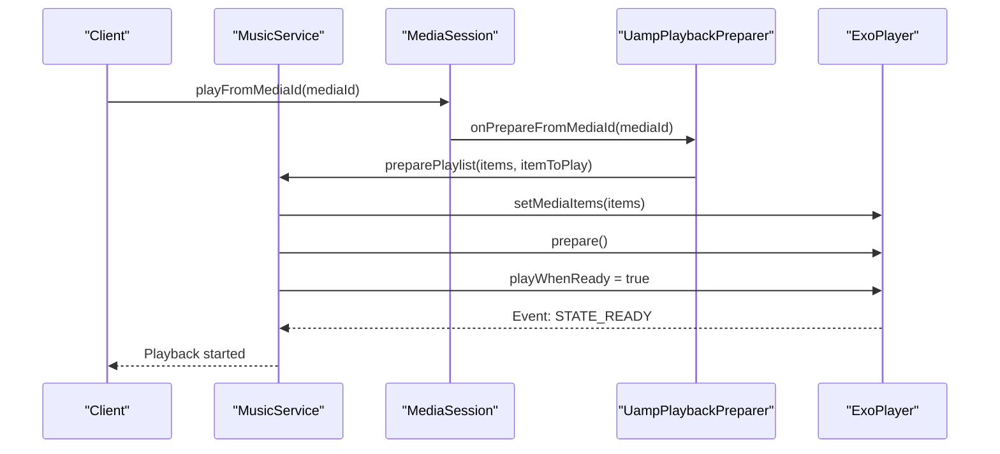

Diagram Title: Media playback preparation and execution flow

Sources: [common/src/main/java/com/example/android/uamp/media/MusicService.kt:378-396](), [common/src/main/java/com/example/android/uamp/media/MusicService.kt:493-518]()

### Player Switching

A unique feature of the Music Service is its ability to switch between local and remote playback:

- When a Cast session becomes available, playback is transferred to the CastPlayer
- When a Cast session ends, playback returns to ExoPlayer
- The transition preserves playback position and state

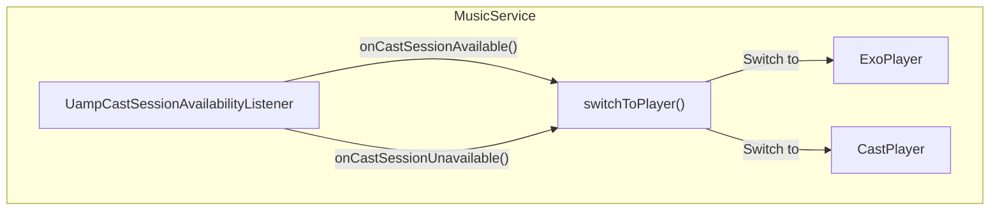

Diagram Title: Player switching mechanism

Sources: [common/src/main/java/com/example/android/uamp/media/MusicService.kt:398-421](), [common/src/main/java/com/example/android/uamp/media/MusicService.kt:441-457]()

## Notification Management

The `UampNotificationManager` handles media playback notifications. It:

- Creates and updates notifications based on playback state
- Handles foreground service promotion when needed
- Customizes notification appearance with media metadata

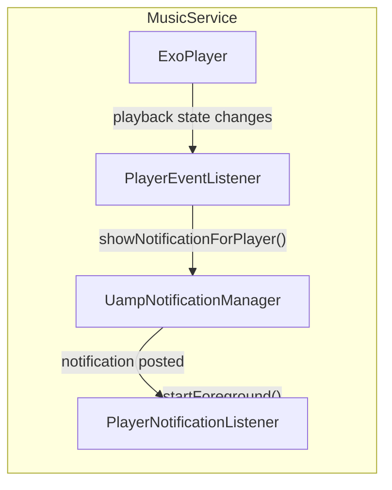

Diagram Title: Notification management flow

Sources: [common/src/main/java/com/example/android/uamp/media/MusicService.kt:200-204](), [common/src/main/java/com/example/android/uamp/media/MusicService.kt:567-590](), [common/src/main/java/com/example/android/uamp/media/UampNotificationManager.kt:44-130]()

## Persistent Storage

The `PersistentStorage` component enables "media resumption" functionality:

- Saves information about the most recently played song
- Saves the playback position
- Converts remote artwork URIs to local URIs for offline access
- Allows playback to resume between app restarts or device reboots

When `onPrepare` is called without a specific media ID, the service will attempt to resume the most recently played song.

Sources: [common/src/main/java/com/example/android/uamp/media/MusicService.kt:423-439](), [common/src/main/java/com/example/android/uamp/media/MusicService.kt:484-491](), [common/src/main/java/com/example/android/uamp/media/PersistentStorage.kt:31-97]()

## Cross-Platform Support

The Media Service is designed to work across multiple Android platforms:

### Android Automotive OS Integration

The `AutomotiveMusicService` extends `MusicService` to add features specific to Android Automotive:

- Authentication/login handling
- Custom error messages with resolution actions
- Automotive-specific command handling

Sources: [automotive/src/main/java/com/example/android/uamp/automotive/AutomotiveMusicService.kt:55-175]()

### Google Cast Integration

For Google Cast support, the Media Service:

- Switches between ExoPlayer and CastPlayer as needed
- Converts media metadata to a format suitable for Cast
- Preserves playback state during transitions

Sources: [common/src/main/java/com/example/android/uamp/media/MusicService.kt:149-165](), [common/src/main/java/com/example/android/uamp/media/MusicService.kt:441-457](), [common/src/main/java/com/example/android/uamp/media/CastMediaItemConverter.kt:26-77]()

## Security Considerations

The `PackageValidator` component ensures that only authorized clients can fully interact with the Media Service:

- Validates the calling package's certificate
- Allows system apps and those with special permissions
- Provides different browsing roots based on caller validation

This is important because the Media Service is exported in the manifest (to allow external clients to connect), which creates security considerations.

Sources: [common/src/main/java/com/example/android/uamp/media/PackageValidator.kt:51-353](), [app/src/main/AndroidManifest.xml:83-93]()

## Summary

The Media Service is a sophisticated component that implements Android's MediaBrowserServiceCompat to provide media browsing and playback capabilities to multiple clients. It manages:

1. Media browsing (content hierarchy and metadata)
2. Media playback (via ExoPlayer or CastPlayer)
3. Media session state and controls
4. Notifications and foreground service status
5. Playback persistence for media resumption
6. Security and package validation
7. Cross-platform support

This architecture follows Android's recommended patterns for media apps and ensures seamless integration with the Android media ecosystem.

---

# Page: Media Content Organization

# Media Content Organization

<details>
<summary>Relevant source files</summary>

The following files were used as context for generating this wiki page:

- [TODO.md](TODO.md)
- [app/src/main/java/com/example/android/uamp/viewmodels/NowPlayingFragmentViewModel.kt](app/src/main/java/com/example/android/uamp/viewmodels/NowPlayingFragmentViewModel.kt)
- [automotive/src/main/java/com/example/android/uamp/automotive/SignInActivityViewModel.kt](automotive/src/main/java/com/example/android/uamp/automotive/SignInActivityViewModel.kt)
- [common/src/main/java/com/example/android/uamp/common/MusicServiceConnection.kt](common/src/main/java/com/example/android/uamp/common/MusicServiceConnection.kt)
- [common/src/main/java/com/example/android/uamp/media/library/BrowseTree.kt](common/src/main/java/com/example/android/uamp/media/library/BrowseTree.kt)

</details>


## Purpose and Overview

This document explains how media content is organized and browsed in UAMP (Universal Android Music Player). It covers the hierarchical structure of media content, the implementation of the browse tree, and how clients interact with this structure to navigate and display media items.

This page focuses specifically on the content organization aspect of the media system. For information about media playback and controls, see [Notifications and Media Controls](#2.3), and for details about the core media service functionality, see [Media Service](#2.1).

## Media Content Hierarchy

UAMP organizes media content in a hierarchical tree structure to provide a consistent browsing experience across different platforms and clients. This organization enables features like categorizing music by albums, creating recommended playlists, and tracking recently played items.

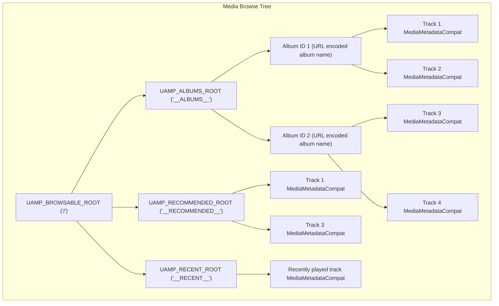

**Diagram: Media Content Hierarchy**

Sources: [common/src/main/java/com/example/android/uamp/media/library/BrowseTree.kt:35-56]()

The hierarchy consists of:

1. **Root Node** (`UAMP_BROWSABLE_ROOT` or `/`) - The top-level entry point for browsing
2. **Category Nodes**:
   - **Recommended** (`UAMP_RECOMMENDED_ROOT` or `__RECOMMENDED__`) - Contains the first track from each album
   - **Albums** (`UAMP_ALBUMS_ROOT` or `__ALBUMS__`) - Contains all available albums
   - **Recent** (`UAMP_RECENT_ROOT` or `__RECENT__`) - Contains the most recently played track (if provided)
3. **Album Nodes** - Each representing an album, with the album name URL-encoded as its ID
4. **Track Nodes** - Individual tracks (songs) represented as `MediaMetadataCompat` objects

This organization makes it easy for clients to browse either by category or directly to specific albums and tracks.

## BrowseTree Implementation

The `BrowseTree` class is the central component that maintains the hierarchical media structure. It maps media IDs to their children, allowing for efficient navigation through the content.

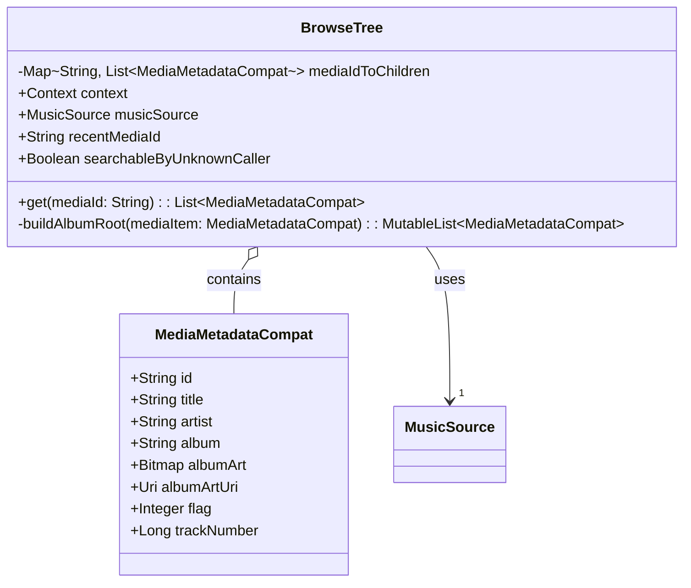

**Diagram: BrowseTree Class Structure**

Sources: [common/src/main/java/com/example/android/uamp/media/library/BrowseTree.kt:57-152]()

### Key Components of BrowseTree:

1. **mediaIdToChildren**: A mapping from media IDs to lists of `MediaMetadataCompat` objects representing their children.

2. **Initialization**: The constructor sets up the root structure and organizes media items from the provided `MusicSource`:
   ```
   - Creates root list with Recommended and Albums categories
   - Iterates through all media items
   - Groups items by album
   - Adds first track of each album to Recommended section
   - Adds recently played track to Recent section (if available)
   ```

3. **Operator Overloading**: The class overloads the `get` operator, allowing access to children using array-like syntax:
   ```kotlin
   operator fun get(mediaId: String) = mediaIdToChildren[mediaId]
   ```

4. **Album Building**: The `buildAlbumRoot` private method creates album nodes and adds them to the Albums category:
   ```kotlin
   private fun buildAlbumRoot(mediaItem: MediaMetadataCompat): MutableList<MediaMetadataCompat>
   ```

Sources: [common/src/main/java/com/example/android/uamp/media/library/BrowseTree.kt:57-152]()

## Browsing Media Content

The browsing process involves clients (such as UI components) subscribing to media IDs to receive their children. This is facilitated by the `MusicServiceConnection` class, which serves as the bridge between UI components and the media service.

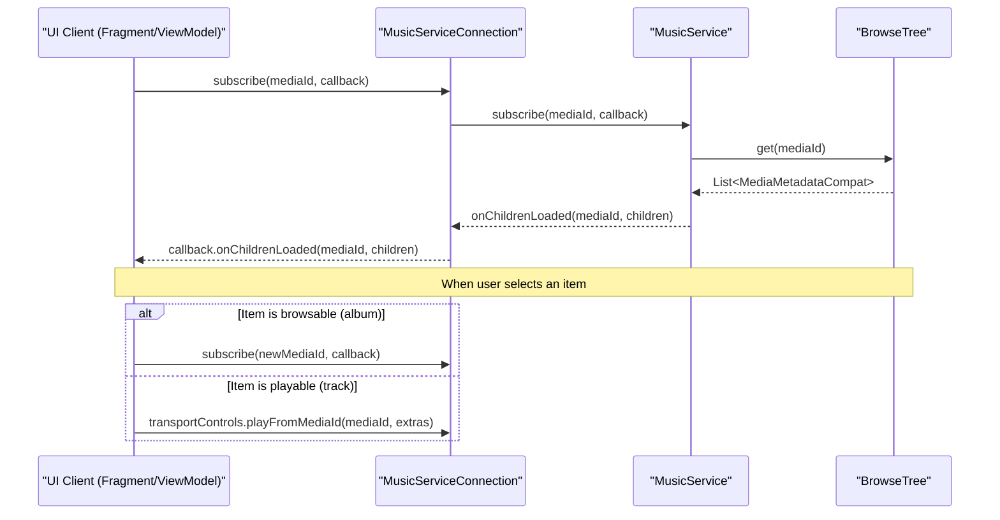

**Diagram: Media Browsing Flow**

Sources: 
- [common/src/main/java/com/example/android/uamp/common/MusicServiceConnection.kt:78-84]()
- [common/src/main/java/com/example/android/uamp/media/library/BrowseTree.kt:125]()

### Key Browsing Components:

1. **MusicServiceConnection.subscribe()**: Allows clients to subscribe to a media ID and receive its children:
   ```kotlin
   fun subscribe(parentId: String, callback: MediaBrowserCompat.SubscriptionCallback) {
       mediaBrowser.subscribe(parentId, callback)
   }
   ```

2. **MediaBrowserCompat.SubscriptionCallback**: Clients implement this callback to receive children when subscribing to a media ID.

3. **Navigation Process**:
   - Clients start by subscribing to the root media ID (`UAMP_BROWSABLE_ROOT`)
   - When a user selects a browsable item (like an album), the client subscribes to that item's ID
   - When a user selects a playable item (like a track), the client requests playback of that item

Sources: [common/src/main/java/com/example/android/uamp/common/MusicServiceConnection.kt:78-84]()

## Media Content Types and Flags

The media browser system distinguishes between two types of media items:

1. **Browsable Items** (like categories and albums)
   - Contain children items
   - Marked with `MediaItem.FLAG_BROWSABLE`
   - Examples: "Albums" category, individual album entries

2. **Playable Items** (like tracks/songs)
   - Can be played by the media player
   - Marked with `MediaItem.FLAG_PLAYABLE`
   - Examples: Individual music tracks

This distinction helps client applications determine appropriate UI behavior and actions for each item.

```
For example:
- When a user selects a browsable item → Open a new list view showing its children
- When a user selects a playable item → Begin playback of that item
```

Sources: [common/src/main/java/com/example/android/uamp/media/library/BrowseTree.kt:86-94](), [common/src/main/java/com/example/android/uamp/media/library/BrowseTree.kt:140]()

## Media Content Organization in View Models

The media content organization is reflected in the ViewModels that drive the UI. The ViewModels subscribe to media IDs and present the resulting content to the UI components.

For example, the `NowPlayingFragmentViewModel` transforms the raw `MediaMetadataCompat` objects into UI-friendly `NowPlayingMetadata` objects that contain only the information needed for display.

```kotlin
data class NowPlayingMetadata(
    val id: String,
    val albumArtUri: Uri,
    val title: String?,
    val subtitle: String?,
    val duration: String
)
```

This transformation helps create a clean separation between the underlying media content organization and the UI presentation.

Sources: [app/src/main/java/com/example/android/uamp/viewmodels/NowPlayingFragmentViewModel.kt:59-79]()

## Summary

The media content organization in UAMP follows a hierarchical tree structure implemented by the `BrowseTree` class. This structure enables efficient browsing of media content across different categories, albums, and tracks. The `MusicServiceConnection` provides the interface for UI components to interact with this tree, subscribing to media IDs to receive their children and requesting playback of specific items.

This architecture supports a variety of browsing patterns and provides a consistent experience across different platforms, from mobile devices to automotive systems.

---

# Page: Notifications and Media Controls

# Notifications and Media Controls

<details>
<summary>Relevant source files</summary>

The following files were used as context for generating this wiki page:

- [.idea/codeStyles/Project.xml](.idea/codeStyles/Project.xml)
- [app/src/main/res/xml/automotive_app_desc.xml](app/src/main/res/xml/automotive_app_desc.xml)
- [automotive/src/main/java/com/example/android/uamp/automotive/AutomotiveMusicService.kt](automotive/src/main/java/com/example/android/uamp/automotive/AutomotiveMusicService.kt)
- [common/src/main/AndroidManifest.xml](common/src/main/AndroidManifest.xml)
- [common/src/main/assets/default_art.png](common/src/main/assets/default_art.png)
- [common/src/main/java/com/example/android/uamp/media/CastMediaItemConverter.kt](common/src/main/java/com/example/android/uamp/media/CastMediaItemConverter.kt)
- [common/src/main/java/com/example/android/uamp/media/MusicService.kt](common/src/main/java/com/example/android/uamp/media/MusicService.kt)
- [common/src/main/java/com/example/android/uamp/media/PackageValidator.kt](common/src/main/java/com/example/android/uamp/media/PackageValidator.kt)
- [common/src/main/java/com/example/android/uamp/media/PersistentStorage.kt](common/src/main/java/com/example/android/uamp/media/PersistentStorage.kt)
- [common/src/main/java/com/example/android/uamp/media/UampNotificationManager.kt](common/src/main/java/com/example/android/uamp/media/UampNotificationManager.kt)
- [common/src/main/java/com/example/android/uamp/media/extensions/FileExt.kt](common/src/main/java/com/example/android/uamp/media/extensions/FileExt.kt)
- [common/src/main/java/com/example/android/uamp/media/extensions/MediaMetadataCompatExt.kt](common/src/main/java/com/example/android/uamp/media/extensions/MediaMetadataCompatExt.kt)
- [common/src/main/java/com/example/android/uamp/media/library/AlbumArtContentProvider.kt](common/src/main/java/com/example/android/uamp/media/library/AlbumArtContentProvider.kt)
- [common/src/main/java/com/example/android/uamp/media/library/JsonSource.kt](common/src/main/java/com/example/android/uamp/media/library/JsonSource.kt)

</details>


This document describes the notification and media control system used in UAMP (Universal Android Music Player). It covers how media playback notifications are created, displayed, and updated, as well as how they integrate with Android's media session framework to provide consistent media controls across the system. For information about media content browsing and organization, see [Media Content Organization](#2.2).

## Overview

UAMP implements media notifications that allow users to control playback from outside the app. These notifications are visible in the notification drawer, lock screen, and other system interfaces. They display metadata about the currently playing media (title, artist, album art) and provide transport controls like play, pause, previous, and next.

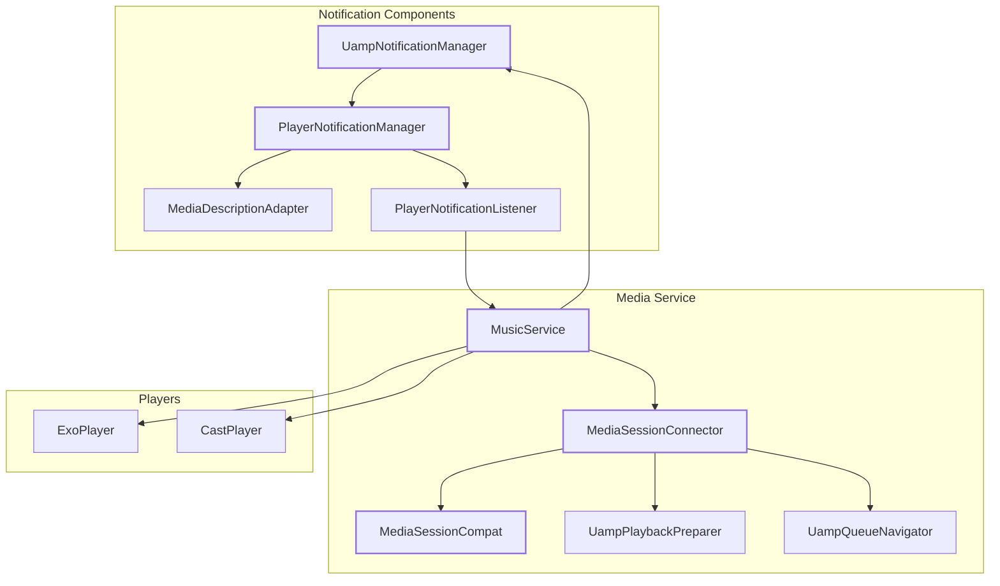

Sources: [common/src/main/java/com/example/android/uamp/media/MusicService.kt](), [common/src/main/java/com/example/android/uamp/media/UampNotificationManager.kt]()

## Notification Architecture

### UampNotificationManager

`UampNotificationManager` is a wrapper class for ExoPlayer's `PlayerNotificationManager`. It's responsible for creating and managing the media playback notification.

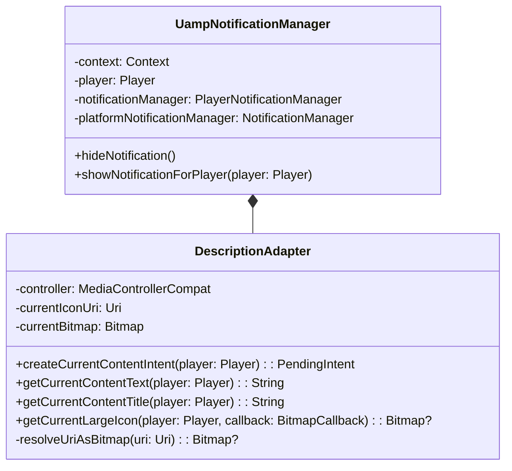

Sources: [common/src/main/java/com/example/android/uamp/media/UampNotificationManager.kt:44-130]()

The notification manager is created in `MusicService.onCreate()` and is initialized with:
1. The application context
2. The media session token
3. A notification listener (which handles foreground service state)

```
notificationManager = UampNotificationManager(
    this,
    mediaSession.sessionToken,
    PlayerNotificationListener()
)
```

Sources: [common/src/main/java/com/example/android/uamp/media/MusicService.kt:200-204]()

### MediaDescriptionAdapter

Inside `UampNotificationManager`, a `MediaDescriptionAdapter` handles extracting metadata for the notification:

- **Title**: Retrieved from the media session metadata's title
- **Content text**: Retrieved from the media session metadata's subtitle
- **Intent**: Uses the media session's activity to create a PendingIntent
- **Artwork**: Loads bitmap images using Glide, with caching to prevent repeated loads

The adapter implements bitmap caching by:
1. Checking if the current icon URI matches the requested URI
2. Using a cached bitmap if available
3. Asynchronously loading the bitmap with Glide if needed
4. Providing the bitmap to the notification when loaded

Sources: [common/src/main/java/com/example/android/uamp/media/UampNotificationManager.kt:82-128]()

## Notification Lifecycle

Notifications are closely tied to the playback state of the media player. The `PlayerEventListener` in `MusicService` responds to player state changes and updates notifications accordingly.

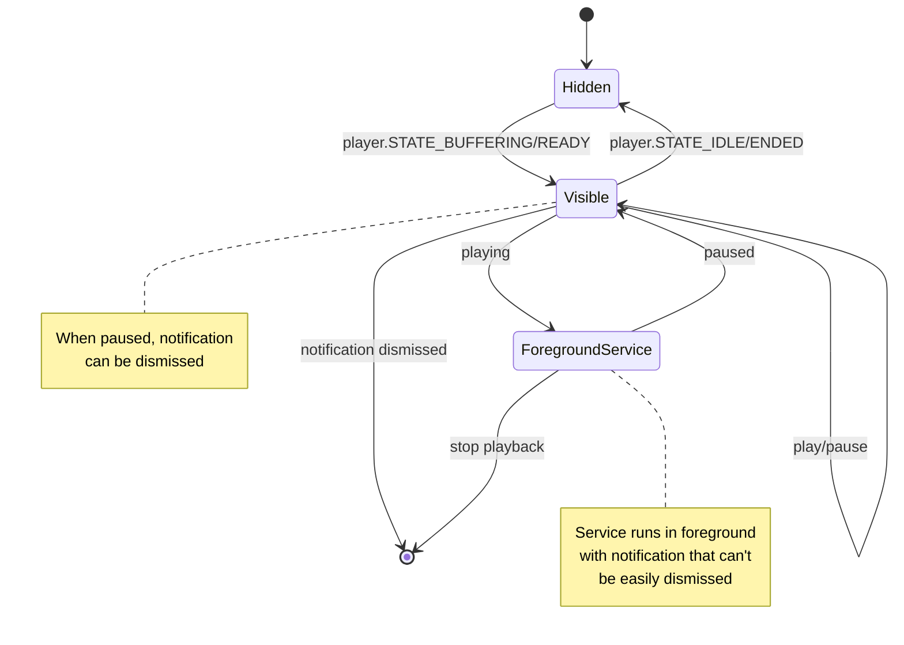

Sources: [common/src/main/java/com/example/android/uamp/media/MusicService.kt:595-623]()

### Notification Listener

The `PlayerNotificationListener` inner class in `MusicService` handles important events related to the notification:

1. **Notification posted**: When a notification is posted with `ongoing=true`, it starts the service as a foreground service
2. **Notification cancelled**: When the notification is dismissed, it stops the foreground service and eventually stops the service

```
private inner class PlayerNotificationListener :
    PlayerNotificationManager.NotificationListener {
    override fun onNotificationPosted(
        notificationId: Int,
        notification: Notification,
        ongoing: Boolean
    ) {
        if (ongoing && !isForegroundService) {
            ContextCompat.startForegroundService(
                applicationContext,
                Intent(applicationContext, this@MusicService.javaClass)
            )

            startForeground(notificationId, notification)
            isForegroundService = true
        }
    }

    override fun onNotificationCancelled(notificationId: Int, dismissedByUser: Boolean) {
        stopForeground(true)
        isForegroundService = false
        stopSelf()
    }
}
```

Sources: [common/src/main/java/com/example/android/uamp/media/MusicService.kt:567-590]()

## Media Session Integration

The media session is the central component that coordinates media playback information and controls. It connects the notification controls with the actual playback functionality.

```mermaid
flowchart TD
    subgraph "Media Controls Flow"
        direction TB
        A["Media Button/Notification Action"] --> B["MediaSession Transport Controls"]
        B --> C["MediaSessionConnector"]
        C --> D["Player Command (play/pause/etc)"]
        D --> E["ExoPlayer/CastPlayer"]
        E --> F["State Change"]
        F --> G["MediaSession State Update"]
        G --> H["Notification Update"]
        H --> I["UI Update"]
    end
```

Sources: [common/src/main/java/com/example/android/uamp/media/MusicService.kt:177-183](), [common/src/main/java/com/example/android/uamp/media/MusicService.kt:214-216]()

### MediaSessionConnector

UAMP uses ExoPlayer's `MediaSessionConnector` to connect the media session with the player. This connector:

1. Handles transport controls (play, pause, skip, etc.)
2. Updates playback state based on player state
3. Provides player and queue information to the media session

The connector is configured with:
- `UampPlaybackPreparer`: Prepares media for playback
- `UampQueueNavigator`: Provides queue navigation functionality

Sources: [common/src/main/java/com/example/android/uamp/media/MusicService.kt:214-216]()

### Player Event Handling

The `PlayerEventListener` class monitors player events and updates the notification accordingly:

- When buffering/playing: Show notification
- When playing: Keep service in foreground
- When paused: Allow service to run in background
- When idle/ended: Hide notification

It also tracks the current media item to maintain the correct playback position during transitions.

Sources: [common/src/main/java/com/example/android/uamp/media/MusicService.kt:595-635]()

## Album Art in Notifications

UAMP implements custom handling for album art in notifications through several components:

```mermaid
flowchart LR
    subgraph "Album Art Flow"
        direction TB
        JSON["Album Art URL from JSON"] --> AlbumArt["AlbumArtContentProvider"]
        AlbumArt --> Glide["Glide Image Loading"]
        Glide --> Cache["Disk Cache"]
        Cache --> NotifAdapter["DescriptionAdapter"]
        NotifAdapter --> Notification["Media Notification"]
    end
```

Sources: [common/src/main/java/com/example/android/uamp/media/library/AlbumArtContentProvider.kt](), [common/src/main/java/com/example/android/uamp/media/UampNotificationManager.kt:97-116]()

### AlbumArtContentProvider

UAMP uses a custom `ContentProvider` called `AlbumArtContentProvider` to:

1. Convert remote image URLs to content:// URIs
2. Download and cache album artwork using Glide
3. Provide local access to album art even when offline

This approach ensures that:
- Album art is available for media notifications
- Images are properly cached to avoid repeated downloads
- System components can access the images via content:// URIs

The content provider maps remote URIs to local files and handles image caching. When a request for album art comes in, it:

1. Checks if the file exists in the cache
2. If not, downloads it using Glide
3. Returns a ParcelFileDescriptor for the file

Sources: [common/src/main/java/com/example/android/uamp/media/library/AlbumArtContentProvider.kt:33-72](), [common/src/main/java/com/example/android/uamp/media/library/JsonSource.kt:101-107]()

## Background Playback Behavior

UAMP is designed to continue playback when the app is in the background but stop when the app is swiped away from recents. This behavior is implemented in `MusicService.onTaskRemoved()`:

```
override fun onTaskRemoved(rootIntent: Intent) {
    saveRecentSongToStorage()
    super.onTaskRemoved(rootIntent)

    currentPlayer.stop(/* reset= */true)
}
```

When the player stops, it triggers a chain of events:
1. Player state changes to IDLE
2. The notification is hidden
3. Foreground service is stopped
4. Service stops itself

Before stopping, the service saves the most recently played song to allow for later resumption.

Sources: [common/src/main/java/com/example/android/uamp/media/MusicService.kt:234-247](), [common/src/main/java/com/example/android/uamp/media/PersistentStorage.kt:52-74]()

## Notification Channel Configuration

The media notification uses a dedicated notification channel with the ID `"com.example.android.uamp.media.NOW_PLAYING"`. The channel name and description are set from resources:

```
setChannelNameResourceId(R.string.notification_channel)
setChannelDescriptionResourceId(R.string.notification_channel_description)
```

The notification is configured with:
- A small icon (R.drawable.ic_notification)
- No rewind or fast-forward actions (only previous/next)
- Standard play/pause actions

Sources: [common/src/main/java/com/example/android/uamp/media/UampNotificationManager.kt:37-71]()

## Platform Integration

### Cast Integration

When casting to external devices, UAMP switches between the local ExoPlayer and a CastPlayer. The notification follows this transition, continuing to show playback controls that now affect the cast session.

The `switchToPlayer` method handles the transition between players, maintaining the current playlist and playback position:

```
private fun switchToPlayer(previousPlayer: Player?, newPlayer: Player) {
    if (previousPlayer == newPlayer) {
        return
    }
    currentPlayer = newPlayer
    // ... setup the new player with the current state ...
    mediaSessionConnector.setPlayer(newPlayer)
    previousPlayer?.stop(/* reset= */true)
}
```

Sources: [common/src/main/java/com/example/android/uamp/media/MusicService.kt:398-421]()

### Android Auto

UAMP supports Android Auto through the MediaBrowserService pattern. The same notification and media session are used to provide controls in the Auto interface.

The Android Auto integration is declared in the app manifest with an automotive app descriptor:

```xml
<automotiveApp>
    <uses name="media" />
</automotiveApp>
```

Sources: [app/src/main/res/xml/automotive_app_desc.xml:17-23]()

## Summary

UAMP's notification and media controls system provides a seamless playback experience through:

1. `UampNotificationManager`: Manages media notifications with album art and playback controls
2. Media Session integration: Connects transport controls to the underlying player
3. Content Provider for album art: Provides cached access to artwork
4. Foreground service management: Handles service lifecycle based on playback state
5. Platform integration: Supports Android Auto and Cast seamlessly

This system allows users to control media playback from notifications, the lock screen, Android Auto, and other system interfaces, creating a consistent experience across the platform.

---

# Page: User Interface

# User Interface

<details>
<summary>Relevant source files</summary>

The following files were used as context for generating this wiki page:

- [app/build.gradle](app/build.gradle)
- [app/src/main/java/com/example/android/uamp/MainActivity.kt](app/src/main/java/com/example/android/uamp/MainActivity.kt)
- [app/src/main/java/com/example/android/uamp/MediaItemAdapter.kt](app/src/main/java/com/example/android/uamp/MediaItemAdapter.kt)
- [app/src/main/java/com/example/android/uamp/MediaItemData.kt](app/src/main/java/com/example/android/uamp/MediaItemData.kt)
- [app/src/main/java/com/example/android/uamp/fragments/MediaItemFragment.kt](app/src/main/java/com/example/android/uamp/fragments/MediaItemFragment.kt)
- [app/src/main/java/com/example/android/uamp/fragments/NowPlayingFragment.kt](app/src/main/java/com/example/android/uamp/fragments/NowPlayingFragment.kt)
- [app/src/main/java/com/example/android/uamp/viewmodels/MainActivityViewModel.kt](app/src/main/java/com/example/android/uamp/viewmodels/MainActivityViewModel.kt)
- [app/src/main/java/com/example/android/uamp/viewmodels/MediaItemFragmentViewModel.kt](app/src/main/java/com/example/android/uamp/viewmodels/MediaItemFragmentViewModel.kt)
- [app/src/main/res/layout/fragment_mediaitem.xml](app/src/main/res/layout/fragment_mediaitem.xml)
- [app/src/main/res/layout/fragment_mediaitem_list.xml](app/src/main/res/layout/fragment_mediaitem_list.xml)
- [automotive/src/main/java/com/example/android/uamp/automotive/SettingsFragment.kt](automotive/src/main/java/com/example/android/uamp/automotive/SettingsFragment.kt)

</details>


This page documents the user interface architecture of the Universal Android Music Player (UAMP). It covers the main UI components, their relationships, the UI data flow, and how the user interface connects to the underlying media service. For information about the core media functionality, see [Media Service](#2.1) and [Media Content Organization](#2.2).

## UI Architecture Overview

UAMP follows the Model-View-ViewModel (MVVM) architecture pattern, using AndroidX lifecycle components. The UI is built using Fragments hosted by a single Activity, with ViewModels managing the UI state and communication with the media service.

```mermaid
flowchart TB
    subgraph "Activity Layer"
        MainActivity["MainActivity"]
    end
    
    subgraph "Fragment Layer"
        MediaItemFragment["MediaItemFragment"]
        NowPlayingFragment["NowPlayingFragment"]
    end
    
    subgraph "Adapter Layer"
        MediaItemAdapter["MediaItemAdapter"]
    end
    
    subgraph "ViewModel Layer"
        MainActivityViewModel["MainActivityViewModel"]
        MediaItemFragmentViewModel["MediaItemFragmentViewModel"]
        NowPlayingFragmentViewModel["NowPlayingFragmentViewModel"]
    end
    
    subgraph "Service Connection Layer"
        MusicServiceConnection["MusicServiceConnection"]
    end
    
    MainActivity --- MediaItemFragment
    MainActivity --- NowPlayingFragment
    MainActivity --- MainActivityViewModel
    
    MediaItemFragment --- MediaItemAdapter
    MediaItemFragment --- MediaItemFragmentViewModel
    
    NowPlayingFragment --- NowPlayingFragmentViewModel
    
    MainActivityViewModel --- MusicServiceConnection
    MediaItemFragmentViewModel --- MusicServiceConnection
    NowPlayingFragmentViewModel --- MusicServiceConnection
```

Sources: [app/src/main/java/com/example/android/uamp/MainActivity.kt](), [app/src/main/java/com/example/android/uamp/fragments/MediaItemFragment.kt](), [app/src/main/java/com/example/android/uamp/fragments/NowPlayingFragment.kt](), [app/src/main/java/com/example/android/uamp/viewmodels/MainActivityViewModel.kt](), [app/src/main/java/com/example/android/uamp/viewmodels/MediaItemFragmentViewModel.kt]()

## Main UI Components

### MainActivity

`MainActivity` serves as the host for all UI fragments. It handles the fragment transactions and provides a shared ViewModel (`MainActivityViewModel`) to its fragments. It also:

- Initializes the Cast context for Google Cast integration
- Sets up the media route button for casting
- Observes navigation events from its ViewModel to switch fragments
- Sets the audio stream to `STREAM_MUSIC` for proper volume control

Sources: [app/src/main/java/com/example/android/uamp/MainActivity.kt:34-117]()

### MediaItemFragment

`MediaItemFragment` displays a browsable list of media items (e.g., albums, playlists, tracks). It:

- Displays media items in a RecyclerView using `MediaItemAdapter`
- Shows a progress spinner while loading content
- Shows a network error icon when connectivity issues occur
- Handles user clicks on media items by delegating to the MainActivityViewModel

Sources: [app/src/main/java/com/example/android/uamp/fragments/MediaItemFragment.kt:36-97]()

### NowPlayingFragment

`NowPlayingFragment` displays the currently playing media item with playback controls. It:

- Shows album art, title, and subtitle of the current track
- Displays a play/pause button with current state
- Shows playback position and duration
- Updates UI in response to playback state changes

Sources: [app/src/main/java/com/example/android/uamp/fragments/NowPlayingFragment.kt:39-104]()

### MediaItemAdapter

`MediaItemAdapter` is a `ListAdapter` implementation for displaying media items in a `RecyclerView`. It:

- Efficiently updates the UI using DiffUtil
- Handles partial updates for playback state changes
- Loads album art using Glide image library
- Passes click events to a listener function

Sources: [app/src/main/java/com/example/android/uamp/MediaItemAdapter.kt:33-102]()

## Data Flow and User Interaction

The following diagram illustrates how data flows through the UI components and how user interactions are handled:

```mermaid
sequenceDiagram
    participant User
    participant MainActivity
    participant MediaItemFragment
    participant MainActivityViewModel
    participant MediaItemFragmentViewModel
    participant MusicServiceConnection
    participant MusicService
    
    User->>MainActivity: Launch app
    MainActivity->>MusicServiceConnection: Connect to service
    MusicServiceConnection->>MusicService: Establish connection
    MusicService-->>MusicServiceConnection: Connection established
    MusicServiceConnection-->>MainActivityViewModel: Update rootMediaId
    MainActivityViewModel-->>MainActivity: Observe rootMediaId
    MainActivity->>MediaItemFragment: Create fragment with rootMediaId
    
    MediaItemFragment->>MediaItemFragmentViewModel: Subscribe to mediaId
    MediaItemFragmentViewModel->>MusicServiceConnection: subscribe(mediaId)
    MusicServiceConnection->>MusicService: onLoadChildren(mediaId)
    MusicService-->>MusicServiceConnection: Return media items
    MusicServiceConnection-->>MediaItemFragmentViewModel: Update mediaItems
    MediaItemFragmentViewModel-->>MediaItemFragment: Observe mediaItems
    MediaItemFragment->>MediaItemAdapter: submitList(mediaItems)
    
    User->>MediaItemFragment: Click media item
    MediaItemFragment->>MainActivityViewModel: mediaItemClicked(item)
    
    alt browsable media item
        MainActivityViewModel->>MainActivity: Navigate to mediaId
        MainActivity->>MediaItemFragment: Create new fragment with mediaId
    else playable media item
        MainActivityViewModel->>MusicServiceConnection: Play media
        MainActivityViewModel->>MainActivity: Show NowPlayingFragment
        MainActivity->>NowPlayingFragment: Create fragment
    end
```

Sources: [app/src/main/java/com/example/android/uamp/MainActivity.kt:58-87](), [app/src/main/java/com/example/android/uamp/viewmodels/MainActivityViewModel.kt:79-98](), [app/src/main/java/com/example/android/uamp/viewmodels/MediaItemFragmentViewModel.kt:59-74]()

## Data Models

### MediaItemData

The `MediaItemData` class encapsulates the UI representation of a media item. It contains:

- `mediaId`: Unique identifier for the media item
- `title`: The title of the media item
- `subtitle`: Secondary text (artist, album, etc.)
- `albumArtUri`: URI for the album artwork
- `browsable`: Flag indicating if the item has children
- `playbackRes`: Resource ID for the playback state icon

It also includes a DiffUtil.ItemCallback for efficient RecyclerView updates, particularly for playback state changes.

Sources: [app/src/main/java/com/example/android/uamp/MediaItemData.kt:34-85]()

## ViewModels

The ViewModels in UAMP act as intermediaries between UI components and the underlying media service. They:

1. Manage UI state
2. Handle user interactions
3. Connect to the MusicServiceConnection to control playback
4. Expose LiveData for UI components to observe

### MainActivityViewModel

`MainActivityViewModel` manages the overall UI state for the MainActivity. Key responsibilities:

- Tracks the root media ID from the MusicServiceConnection
- Manages fragment navigation
- Handles media item clicks and determines whether to browse or play
- Controls media playback through the MusicServiceConnection

Sources: [app/src/main/java/com/example/android/uamp/viewmodels/MainActivityViewModel.kt:42-171]()

### MediaItemFragmentViewModel

`MediaItemFragmentViewModel` manages the data for a specific MediaItemFragment. Key responsibilities:

- Subscribes to a specific media ID to get child items
- Observes playback state and metadata changes
- Updates the UI state of media items based on playback state
- Provides network error information

Sources: [app/src/main/java/com/example/android/uamp/viewmodels/MediaItemFragmentViewModel.kt:42-181]()

## UI Layouts

The UI is built with XML layouts and uses both ViewBinding and DataBinding for view interactions.

### Key Layout Files

| Layout File | Purpose |
|-------------|---------|
| `activity_main.xml` | Main container with a fragmentContainer view |
| `fragment_mediaitem_list.xml` | RecyclerView list for media items with loading and error states |
| `fragment_mediaitem.xml` | Individual media item card with album art and text |
| `fragment_nowplaying.xml` | Now playing screen with media controls |

Sources: [app/src/main/res/layout/fragment_mediaitem_list.xml:17-50](), [app/src/main/res/layout/fragment_mediaitem.xml:17-91](), [app/build.gradle:47-50]()

## Component Relationships

This diagram shows the code-level relationship between UI components and how they connect to the media service:

```mermaid
classDiagram
    class MainActivity {
        -MainActivityViewModel viewModel
        -CastContext castContext
        +onCreate()
        +onCreateOptionsMenu()
        -navigateToMediaItem(mediaId)
    }
    
    class MediaItemFragment {
        -MainActivityViewModel mainActivityViewModel
        -MediaItemFragmentViewModel mediaItemFragmentViewModel
        -MediaItemAdapter listAdapter
        -String mediaId
        +onCreateView()
        +onActivityCreated()
    }
    
    class NowPlayingFragment {
        -MainActivityViewModel mainActivityViewModel
        -NowPlayingFragmentViewModel nowPlayingViewModel
        +onCreateView()
        +onViewCreated()
        -updateUI(metadata)
    }
    
    class MediaItemAdapter {
        -ItemClickedListener itemClickedListener
        +onCreateViewHolder()
        +onBindViewHolder()
    }
    
    class MediaViewHolder {
        +TextView titleView
        +TextView subtitleView
        +ImageView albumArt
        +ImageView playbackState
        +MediaItemData item
    }
    
    class MediaItemData {
        +String mediaId
        +String title
        +String subtitle
        +Uri albumArtUri
        +boolean browsable
        +int playbackRes
        +DiffUtil.ItemCallback diffCallback
    }
    
    class MainActivityViewModel {
        -MusicServiceConnection musicServiceConnection
        +LiveData rootMediaId
        +LiveData navigateToMediaItem
        +LiveData navigateToFragment
        +mediaItemClicked(MediaItemData)
        +showFragment(Fragment)
        -browseToItem(MediaItemData)
        +playMedia(MediaItemData)
    }
    
    class MediaItemFragmentViewModel {
        -String mediaId
        -MusicServiceConnection musicServiceConnection
        +LiveData mediaItems
        +LiveData networkError
        -SubscriptionCallback subscriptionCallback
    }
    
    MainActivity --> MediaItemFragment : creates
    MainActivity --> NowPlayingFragment : creates
    MainActivity --> MainActivityViewModel : observes
    
    MediaItemFragment --> MediaItemAdapter : uses
    MediaItemFragment --> MediaItemFragmentViewModel : observes
    MediaItemFragment --> MainActivityViewModel : uses
    
    NowPlayingFragment --> MainActivityViewModel : uses
    
    MediaItemAdapter --> MediaViewHolder : creates
    MediaItemAdapter --> MediaItemData : displays
    
    MediaViewHolder --> MediaItemData : holds
    
    MainActivityViewModel --> "MusicServiceConnection" : controls
    MediaItemFragmentViewModel --> "MusicServiceConnection" : subscribes
```

Sources: [app/src/main/java/com/example/android/uamp/MainActivity.kt](), [app/src/main/java/com/example/android/uamp/fragments/MediaItemFragment.kt](), [app/src/main/java/com/example/android/uamp/fragments/NowPlayingFragment.kt](), [app/src/main/java/com/example/android/uamp/MediaItemAdapter.kt](), [app/src/main/java/com/example/android/uamp/MediaItemData.kt](), [app/src/main/java/com/example/android/uamp/viewmodels/MainActivityViewModel.kt](), [app/src/main/java/com/example/android/uamp/viewmodels/MediaItemFragmentViewModel.kt]()

## Google Cast Integration

The UI integrates with Google Cast, allowing users to cast media to supported devices:

- MainActivity initializes CastContext in onCreate()
- MediaRouteButton is added to the app bar menu
- CastButtonFactory configures the button

Sources: [app/src/main/java/com/example/android/uamp/MainActivity.kt:46-46](), [app/src/main/java/com/example/android/uamp/MainActivity.kt:98-98]()

## Styling and Resources

The app uses custom styles for consistent UI appearance across all screens. Some notable styling aspects:

- Custom TextAppearance styles for titles and subtitles
- Media item background with selectable item backgrounds
- Default album art placeholder for items without artwork
- Custom playback control button styling

Through the combination of these UI components and the MVVM architecture, UAMP provides a responsive and maintainable user interface that works across various Android form factors.

---

# Page: MainActivity and Fragments

# MainActivity and Fragments

<details>
<summary>Relevant source files</summary>

The following files were used as context for generating this wiki page:

- [app/build.gradle](app/build.gradle)
- [app/src/main/java/com/example/android/uamp/MainActivity.kt](app/src/main/java/com/example/android/uamp/MainActivity.kt)
- [app/src/main/java/com/example/android/uamp/MediaItemAdapter.kt](app/src/main/java/com/example/android/uamp/MediaItemAdapter.kt)
- [app/src/main/java/com/example/android/uamp/MediaItemData.kt](app/src/main/java/com/example/android/uamp/MediaItemData.kt)
- [app/src/main/java/com/example/android/uamp/fragments/MediaItemFragment.kt](app/src/main/java/com/example/android/uamp/fragments/MediaItemFragment.kt)
- [app/src/main/java/com/example/android/uamp/fragments/NowPlayingFragment.kt](app/src/main/java/com/example/android/uamp/fragments/NowPlayingFragment.kt)
- [app/src/main/java/com/example/android/uamp/viewmodels/MainActivityViewModel.kt](app/src/main/java/com/example/android/uamp/viewmodels/MainActivityViewModel.kt)
- [app/src/main/java/com/example/android/uamp/viewmodels/MediaItemFragmentViewModel.kt](app/src/main/java/com/example/android/uamp/viewmodels/MediaItemFragmentViewModel.kt)
- [app/src/main/res/layout/fragment_mediaitem.xml](app/src/main/res/layout/fragment_mediaitem.xml)
- [app/src/main/res/layout/fragment_mediaitem_list.xml](app/src/main/res/layout/fragment_mediaitem_list.xml)
- [automotive/src/main/java/com/example/android/uamp/automotive/SettingsFragment.kt](automotive/src/main/java/com/example/android/uamp/automotive/SettingsFragment.kt)

</details>


This document describes the primary UI components of the UAMP (Universal Android Music Player) application, focusing on the MainActivity and its associated fragments. These components form the visual interface that users interact with to browse and play media content.

For information about the ViewModels that power these UI components, see [ViewModels](#3.2).

## Overview

UAMP uses a single-activity architecture with multiple fragments. The MainActivity serves as the container for all UI fragments, while handling navigation, playback control, and Google Cast integration. The main fragments include:

1. **MediaItemFragment** - Displays browsable lists of media items (albums, playlists, songs)
2. **NowPlayingFragment** - Shows the currently playing media with playback controls

## Architecture

### Class Relationships

```mermaid
classDiagram
    direction LR
    
    class "MainActivity" {
        -viewModel: MainActivityViewModel
        -castContext: CastContext
        +onCreate()
        +onCreateOptionsMenu()
        -navigateToMediaItem()
    }
    
    class "MediaItemFragment" {
        -mainActivityViewModel: MainActivityViewModel
        -mediaItemFragmentViewModel: MediaItemFragmentViewModel
        -listAdapter: MediaItemAdapter
        +newInstance(mediaId: String)
    }
    
    class "MediaItemAdapter" {
        -itemClickedListener: (MediaItemData) -> Unit
    }
    
    class "NowPlayingFragment" {
        -mainActivityViewModel: MainActivityViewModel
        -nowPlayingViewModel: NowPlayingFragmentViewModel
        +newInstance()
    }
    
    "MainActivity" --> "MediaItemFragment" : hosts
    "MainActivity" --> "NowPlayingFragment" : hosts
    "MediaItemFragment" --> "MediaItemAdapter" : uses
    "MediaItemAdapter" --> "MediaItemData" : displays
```

Sources: [app/src/main/java/com/example/android/uamp/MainActivity.kt](), [app/src/main/java/com/example/android/uamp/fragments/MediaItemFragment.kt](), [app/src/main/java/com/example/android/uamp/fragments/NowPlayingFragment.kt](), [app/src/main/java/com/example/android/uamp/MediaItemAdapter.kt]()

### Navigation Flow

```mermaid
sequenceDiagram
    participant "User" as User
    participant "MainActivity" as Main
    participant "MainActivityViewModel" as MainVM
    participant "MediaItemFragment" as MediaFrag
    participant "NowPlayingFragment" as NowPlaying
    participant "MusicServiceConnection" as MusicConn
    
    User->>Main: Launch app
    Main->>MainVM: Initialize ViewModel
    MainVM->>MusicConn: Connect to MusicService
    MusicConn-->>MainVM: Return rootMediaId
    MainVM-->>Main: Update rootMediaId LiveData
    Main->>MediaFrag: Create and show root fragment
    
    User->>MediaFrag: Click browsable item (album/playlist)
    MediaFrag->>MainVM: mediaItemClicked(browsableItem)
    MainVM->>Main: navigateToMediaItem.postValue(mediaId)
    Main->>MediaFrag: Create new fragment with mediaId
    
    User->>MediaFrag: Click playable item (song)
    MediaFrag->>MainVM: mediaItemClicked(playableItem)
    MainVM->>MusicConn: playMedia(item)
    MainVM->>Main: showFragment(NowPlayingFragment)
    Main->>NowPlaying: Create and show fragment
```

Sources: [app/src/main/java/com/example/android/uamp/MainActivity.kt:58-87](), [app/src/main/java/com/example/android/uamp/viewmodels/MainActivityViewModel.kt:79-98]()

## MainActivity

The MainActivity serves as the container for all UI fragments and coordinates the navigation flow of the application.

### Key Responsibilities

1. Initializing the Cast context for Google Cast integration
2. Managing fragment transactions
3. Responding to navigation events from MainActivityViewModel
4. Setting up the media route button in the action bar
5. Configuring volume controls for music playback

### Code Structure

MainActivity uses LiveData observation to handle three main types of events:

1. Fragment navigation requests
2. Root media ID updates when connected to MusicService
3. Navigation to specific media items

```
MainActivity
├── onCreate() - Sets up UI and LiveData observers
├── onCreateOptionsMenu() - Creates Cast button
├── navigateToMediaItem() - Handles navigation to media content
├── isRootId() - Checks if mediaId is the root
└── getBrowseFragment() - Retrieves existing fragment instances
```

Sources: [app/src/main/java/com/example/android/uamp/MainActivity.kt]()

## MediaItemFragment

MediaItemFragment displays a list of media items that can be either browsable (such as albums) or playable (such as songs).

### Key Components

| Component | Description |
|-----------|-------------|
| RecyclerView | Displays the list of media items |
| MediaItemAdapter | Adapter for the RecyclerView |
| ProgressBar | Shows loading state |
| NetworkError view | Displays connection error state |

### Implementation Details

The fragment uses two ViewModels:
- **MainActivityViewModel** (shared with activity) - Handles item click events
- **MediaItemFragmentViewModel** (fragment-specific) - Provides media item data and network state

Each instance of MediaItemFragment is associated with a specific `mediaId` which determines what content it displays. When an item is clicked, the event is forwarded to the MainActivityViewModel.

Sources: [app/src/main/java/com/example/android/uamp/fragments/MediaItemFragment.kt](), [app/src/main/java/com/example/android/uamp/MediaItemAdapter.kt](), [app/src/main/res/layout/fragment_mediaitem_list.xml]()

## MediaItemAdapter

The MediaItemAdapter is responsible for displaying media items in a RecyclerView and handling click events.

### Features

1. Uses DiffUtil for efficient updates to the RecyclerView
2. Supports partial updates for playback state changes
3. Displays album art using Glide library
4. Shows playback state indicators (play/pause icons)

### Media Item Visualization

Each media item in the list displays:
- Album art
- Title
- Subtitle (artist/album)
- Playback state indicator (for the currently playing item)

Sources: [app/src/main/java/com/example/android/uamp/MediaItemAdapter.kt](), [app/src/main/res/layout/fragment_mediaitem.xml]()

## NowPlayingFragment

The NowPlayingFragment displays detailed information about the currently playing media item and provides playback controls.

### UI Components

- Large album art
- Title and subtitle
- Playback control button
- Progress position and duration indicators

### Implementation

Like MediaItemFragment, NowPlayingFragment uses two ViewModels:
- **MainActivityViewModel** - For playback control
- **NowPlayingFragmentViewModel** - For current media metadata and playback state

The fragment observes LiveData from the NowPlayingFragmentViewModel to update the UI when the playback state changes or when a new item starts playing.

Sources: [app/src/main/java/com/example/android/uamp/fragments/NowPlayingFragment.kt]()

## Data Model

### MediaItemData

The `MediaItemData` class represents a media item in the UI layer. It encapsulates properties needed to display an item in the list.

```
MediaItemData
├── mediaId: String - Unique identifier for the media item
├── title: String - Title of the media item
├── subtitle: String - Subtitle (artist, album, etc.)
├── albumArtUri: Uri - URI for album art
├── browsable: Boolean - Whether the item is browsable
└── playbackRes: Int - Resource ID for playback state icon
```

The class also provides a `DiffUtil.ItemCallback` to efficiently update the RecyclerView when the data changes.

Sources: [app/src/main/java/com/example/android/uamp/MediaItemData.kt]()

## Fragment-ViewModel Communication

```mermaid
flowchart TB
    subgraph "ViewModels"
        MainVM["MainActivityViewModel"]
        MediaItemVM["MediaItemFragmentViewModel"]
        NowPlayingVM["NowPlayingFragmentViewModel"]
    end
    
    subgraph "UI Components"
        MainActivity["MainActivity"]
        MediaItemFrag["MediaItemFragment"]
        NowPlayingFrag["NowPlayingFragment"]
    end
    
    subgraph "Service Layer"
        MusicConn["MusicServiceConnection"]
        MusicService["MusicService"]
    end
    
    MainActivity -->|"observes"| MainVM
    MediaItemFrag -->|"observes"| MediaItemVM
    MediaItemFrag -->|"item clicks"| MainVM
    NowPlayingFrag -->|"observes"| NowPlayingVM
    NowPlayingFrag -->|"playback control"| MainVM
    
    MainVM -->|"connects to"| MusicConn
    MediaItemVM -->|"subscribes to mediaId"| MusicConn
    NowPlayingVM -->|"observes playback"| MusicConn
    
    MusicConn -->|"communicates with"| MusicService
```

Sources: [app/src/main/java/com/example/android/uamp/viewmodels/MainActivityViewModel.kt](), [app/src/main/java/com/example/android/uamp/viewmodels/MediaItemFragmentViewModel.kt]()

## Integration Points

### Google Cast

MainActivity integrates with Google Cast by initializing the CastContext and setting up a media route button in the app bar. This allows users to cast media to compatible devices.

```
// In MainActivity.onCreate()
castContext = CastContext.getSharedInstance(this)

// In MainActivity.onCreateOptionsMenu()
CastButtonFactory.setUpMediaRouteButton(this, menu, R.id.media_route_menu_item)
```

Sources: [app/src/main/java/com/example/android/uamp/MainActivity.kt:41-46](), [app/src/main/java/com/example/android/uamp/MainActivity.kt:91-99]()

### Android ViewModel Components

The fragments use the AndroidX ViewModel components:
- `activityViewModels()` - For shared ViewModels (MainActivityViewModel)
- `viewModels()` - For fragment-specific ViewModels

This separation allows for proper lifecycle management and data sharing between fragments.

Sources: [app/src/main/java/com/example/android/uamp/fragments/MediaItemFragment.kt:37-42](), [app/src/main/java/com/example/android/uamp/fragments/NowPlayingFragment.kt:40-45]()

## Summary

The MainActivity and Fragments in UAMP implement a single-activity architecture with multiple fragments for different screens. The MainActivity serves as the primary container and navigation controller, while the fragments display media content and playback controls. Communication between components follows the MVVM pattern using ViewModels and LiveData, ensuring a clean separation of concerns and proper lifecycle management.

---

# Page: ViewModels

# ViewModels

<details>
<summary>Relevant source files</summary>

The following files were used as context for generating this wiki page:

- [app/src/main/java/com/example/android/uamp/MainActivity.kt](app/src/main/java/com/example/android/uamp/MainActivity.kt)
- [app/src/main/java/com/example/android/uamp/MediaItemAdapter.kt](app/src/main/java/com/example/android/uamp/MediaItemAdapter.kt)
- [app/src/main/java/com/example/android/uamp/MediaItemData.kt](app/src/main/java/com/example/android/uamp/MediaItemData.kt)
- [app/src/main/java/com/example/android/uamp/viewmodels/MainActivityViewModel.kt](app/src/main/java/com/example/android/uamp/viewmodels/MainActivityViewModel.kt)
- [app/src/main/java/com/example/android/uamp/viewmodels/MediaItemFragmentViewModel.kt](app/src/main/java/com/example/android/uamp/viewmodels/MediaItemFragmentViewModel.kt)
- [app/src/main/res/layout/fragment_mediaitem.xml](app/src/main/res/layout/fragment_mediaitem.xml)
- [app/src/main/res/layout/fragment_mediaitem_list.xml](app/src/main/res/layout/fragment_mediaitem_list.xml)

</details>


This document provides a comprehensive explanation of the ViewModel architecture used in the Universal Android Music Player (UAMP) application. ViewModels serve as the crucial layer connecting the user interface with the media service and handling UI state management. For information about the specific UI components that use these ViewModels, see [MainActivity and Fragments](#3.1).

## Overview of ViewModel Architecture

ViewModels in UAMP follow the Model-View-ViewModel (MVVM) pattern, leveraging Android Architecture Components. They provide a clean separation of concerns by isolating UI logic from the underlying media service connection and data handling.

```mermaid
flowchart TD
    subgraph "UI Layer"
        MainActivity["MainActivity"]
        MediaItemFragment["MediaItemFragment"]
        NowPlayingFragment["NowPlayingFragment"]
    end

    subgraph "ViewModel Layer"
        MainActivityVM["MainActivityViewModel"]
        MediaItemFragmentVM["MediaItemFragmentViewModel"]
    end

    subgraph "Data/Service Layer"
        MusicServiceConnection["MusicServiceConnection"]
        MediaMetadata["MediaMetadataCompat"]
        PlaybackState["PlaybackStateCompat"]
    end

    MainActivity -- "uses" --> MainActivityVM
    MediaItemFragment -- "uses" --> MediaItemFragmentVM
    NowPlayingFragment -- "uses" --> MainActivityVM
    
    MainActivityVM -- "connects to" --> MusicServiceConnection
    MediaItemFragmentVM -- "subscribes to" --> MusicServiceConnection
    
    MusicServiceConnection -- "provides" --> MediaMetadata
    MusicServiceConnection -- "provides" --> PlaybackState
```

Sources: [app/src/main/java/com/example/android/uamp/viewmodels/MainActivityViewModel.kt](), [app/src/main/java/com/example/android/uamp/viewmodels/MediaItemFragmentViewModel.kt](), [app/src/main/java/com/example/android/uamp/MainActivity.kt]()

## ViewModel Implementation Details

### MainActivityViewModel

The `MainActivityViewModel` serves as the primary connection point between the UI and the music service. It handles media navigation, playback control, and fragment navigation requests.

Key responsibilities:
- Establishing and maintaining connection to the `MusicServiceConnection`
- Exposing the root media ID from the connected service 
- Handling media item clicks (browsing or playing)
- Managing fragment navigation through `LiveData` events

Notable properties and methods:

| Property/Method | Description |
|-----------------|-------------|
| `rootMediaId` | LiveData that provides the root media ID when connected |
| `navigateToMediaItem` | LiveData event for media ID navigation |
| `navigateToFragment` | LiveData event for fragment navigation |
| `mediaItemClicked()` | Entry point for handling media item selection |
| `playMedia()` | Controls media playback based on item state |
| `showFragment()` | Triggers fragment navigation |

The `mediaItemClicked()` method is a crucial dispatch point that determines whether to browse to a media item's children (if browsable) or play the item (if playable).

Sources: [app/src/main/java/com/example/android/uamp/viewmodels/MainActivityViewModel.kt:42-170]()

### MediaItemFragmentViewModel

The `MediaItemFragmentViewModel` focuses on loading and managing media items for a specific media ID. It's responsible for:
- Subscribing to a media ID to retrieve its children
- Converting media items to a displayable format
- Updating the playback state of media items based on service updates

```mermaid
sequenceDiagram
    participant Fragment as "MediaItemFragment"
    participant ViewModel as "MediaItemFragmentViewModel"
    participant Connection as "MusicServiceConnection"
    participant Service as "MusicService"
    
    Fragment->>ViewModel: Create with mediaId
    ViewModel->>Connection: subscribe(mediaId)
    Connection->>Service: onLoadChildren(mediaId)
    Service-->>Connection: List of MediaItems
    Connection-->>ViewModel: MediaItems via callback
    ViewModel->>ViewModel: Convert to MediaItemData
    ViewModel-->>Fragment: Update UI with mediaItems LiveData
    
    Note over ViewModel,Connection: Continuous observation
    Connection-->>ViewModel: PlaybackState changes
    Connection-->>ViewModel: NowPlaying changes
    ViewModel->>ViewModel: Update media items with new playback state
    ViewModel-->>Fragment: Updated mediaItems LiveData
```

Sources: [app/src/main/java/com/example/android/uamp/viewmodels/MediaItemFragmentViewModel.kt]()

The `MediaItemFragmentViewModel` uses a more complex pattern for LiveData updates. Rather than using simple Transformations, it:

1. Subscribes to a media ID to get media items
2. Observes playback state changes from the service connection
3. Observes now playing metadata changes from the service connection
4. Updates the displayed media items when any of these sources change

This allows the UI to reflect the current playback state with play/pause buttons on the correct items.

Sources: [app/src/main/java/com/example/android/uamp/viewmodels/MediaItemFragmentViewModel.kt:42-143]()

## Data Model for UI

### MediaItemData

`MediaItemData` is a key data class that serves as the bridge between media service data and UI display. It encapsulates the properties of a `MediaItem` in a format suitable for UI rendering.

```mermaid
classDiagram
    class MediaItemData {
        +String mediaId
        +String title
        +String subtitle
        +Uri albumArtUri
        +boolean browsable
        +int playbackRes
        +diffCallback: DiffUtil.ItemCallback
    }
    
    class MediaItem {
        +MediaDescriptionCompat description
        +boolean isBrowsable
        +boolean isPlayable
    }
    
    MediaItemData --|> MediaItem : converted from
```

Sources: [app/src/main/java/com/example/android/uamp/MediaItemData.kt]()

The `MediaItemData` class includes:
- Basic media metadata (title, subtitle, artwork URI)
- Navigation information (whether it's browsable)
- Current playback state visualization (which icon to display)
- DiffUtil implementation for efficient RecyclerView updates

The `diffCallback` implementation is particularly notable as it provides efficient updates to the UI when only the playback state changes, avoiding full item redraws.

Sources: [app/src/main/java/com/example/android/uamp/MediaItemData.kt:34-84]()

## ViewModel Factory Pattern

Both ViewModels in UAMP use the Factory pattern to create instances with the necessary dependencies. This approach:

1. Enables dependency injection of the `MusicServiceConnection`
2. Allows passing media IDs or other initialization parameters
3. Integrates with the Android ViewModel system

```mermaid
flowchart TD
    subgraph "ViewModel Creation"
        Activity["Activity/Fragment"]
        ViewModelProvider["ViewModelProvider"]
        Factory["ViewModel.Factory"]
        ViewModel["ViewModel Instance"]
    end
    
    Activity -- "1. requests" --> ViewModelProvider
    ViewModelProvider -- "2. uses" --> Factory
    Factory -- "3. creates" --> ViewModel
    ViewModel -- "4. returned to" --> Activity
```

Examples of Factory implementations:

```kotlin
// MainActivityViewModel.Factory
class Factory(
    private val musicServiceConnection: MusicServiceConnection
) : ViewModelProvider.NewInstanceFactory() {
    @Suppress("unchecked_cast")
    override fun <T : ViewModel?> create(modelClass: Class<T>): T {
        return MainActivityViewModel(musicServiceConnection) as T
    }
}

// MediaItemFragmentViewModel.Factory
class Factory(
    private val mediaId: String,
    private val musicServiceConnection: MusicServiceConnection
) : ViewModelProvider.NewInstanceFactory() {
    @Suppress("unchecked_cast")
    override fun <T : ViewModel?> create(modelClass: Class<T>): T {
        return MediaItemFragmentViewModel(mediaId, musicServiceConnection) as T
    }
}
```

Sources: [app/src/main/java/com/example/android/uamp/viewmodels/MainActivityViewModel.kt:162-170](), [app/src/main/java/com/example/android/uamp/viewmodels/MediaItemFragmentViewModel.kt:171-180]()

## Resource Management and Lifecycle

The ViewModels properly manage resources by unsubscribing from LiveData observers and media service subscriptions in their `onCleared()` methods. This is particularly important for `MediaItemFragmentViewModel` which adds permanent observers to LiveData objects from the `MusicServiceConnection`.

```kotlin
override fun onCleared() {
    super.onCleared()
    // Remove the permanent observers from the MusicServiceConnection.
    musicServiceConnection.playbackState.removeObserver(playbackStateObserver)
    musicServiceConnection.nowPlaying.removeObserver(mediaMetadataObserver)
    // And then, finally, unsubscribe the media ID that was being watched.
    musicServiceConnection.unsubscribe(mediaId, subscriptionCallback)
}
```

This cleanup ensures that resources are properly released when the ViewModel is no longer in use, preventing memory leaks and unnecessary processing.

Sources: [app/src/main/java/com/example/android/uamp/viewmodels/MediaItemFragmentViewModel.kt:134-143]()

## ViewModel Integration with UI

In the MainActivity, the ViewModel is initialized using the `viewModels` delegate:

```kotlin
private val viewModel by viewModels<MainActivityViewModel> {
    InjectorUtils.provideMainActivityViewModel(this)
}
```

The MainActivity then observes LiveData from the ViewModel to respond to navigation events and root media ID changes.

For fragment navigation:
```kotlin
viewModel.navigateToFragment.observe(this, Observer {
    it?.getContentIfNotHandled()?.let { fragmentRequest ->
        val transaction = supportFragmentManager.beginTransaction()
        transaction.replace(
            R.id.fragmentContainer, fragmentRequest.fragment, fragmentRequest.tag
        )
        if (fragmentRequest.backStack) transaction.addToBackStack(null)
        transaction.commit()
    }
})
```

Sources: [app/src/main/java/com/example/android/uamp/MainActivity.kt:36-77]()

The use of LiveData with Event wrappers provides a clean way to handle one-time events like navigation, preventing them from being re-consumed after configuration changes.

---

# Page: UI Styling and Resources

# UI Styling and Resources

<details>
<summary>Relevant source files</summary>

The following files were used as context for generating this wiki page:

- [app/src/main/java/com/example/android/uamp/utils/InjectorUtils.kt](app/src/main/java/com/example/android/uamp/utils/InjectorUtils.kt)
- [app/src/main/res/drawable/ic_pause_black_24dp.xml](app/src/main/res/drawable/ic_pause_black_24dp.xml)
- [app/src/main/res/drawable/ic_play_arrow_black_24dp.xml](app/src/main/res/drawable/ic_play_arrow_black_24dp.xml)
- [app/src/main/res/drawable/media_item_background.xml](app/src/main/res/drawable/media_item_background.xml)
- [app/src/main/res/drawable/media_item_mask.xml](app/src/main/res/drawable/media_item_mask.xml)
- [app/src/main/res/drawable/media_overlay_background.xml](app/src/main/res/drawable/media_overlay_background.xml)
- [app/src/main/res/layout/activity_main.xml](app/src/main/res/layout/activity_main.xml)
- [app/src/main/res/layout/fragment_nowplaying.xml](app/src/main/res/layout/fragment_nowplaying.xml)
- [app/src/main/res/values/colors.xml](app/src/main/res/values/colors.xml)
- [app/src/main/res/values/dimens.xml](app/src/main/res/values/dimens.xml)
- [app/src/main/res/values/strings.xml](app/src/main/res/values/strings.xml)

</details>


## Purpose and Scope

This document describes the UI styling approach and resource organization in the UAMP (Universal Android Music Player) application. It covers the layout resources, drawable resources, value resources (colors, dimensions, strings), and how these elements work together to create a consistent user interface across the application. For information about the UI components and their functionality, see [MainActivity and Fragments](#3.1) and [ViewModels](#3.2).

## Resource Organization

UAMP follows Android's standard resource organization pattern, with resources separated into different directories based on type. The app uses a flat resource structure without extensive resource qualifiers for different screen sizes or configurations.

```mermaid
graph TD
    subgraph "Resource Organization"
        res["res/"]
        layout["layout/"]
        drawable["drawable/"]
        values["values/"]
        
        res --> layout
        res --> drawable
        res --> values
        
        layout --> activity_main["activity_main.xml"]
        layout --> fragment_nowplaying["fragment_nowplaying.xml"]
        
        drawable --> media_item_background["media_item_background.xml"]
        drawable --> media_item_mask["media_item_mask.xml"]
        drawable --> media_overlay_background["media_overlay_background.xml"]
        drawable --> icons["Media Control Icons (play, pause)"]
        
        values --> colors["colors.xml"]
        values --> dimens["dimens.xml"]
        values --> strings["strings.xml"]
        values --> styles["styles.xml (implied)"]
    end
```

Sources:
- [app/src/main/res/layout/activity_main.xml]()
- [app/src/main/res/layout/fragment_nowplaying.xml]()
- [app/src/main/res/drawable/media_item_background.xml]()
- [app/src/main/res/drawable/media_item_mask.xml]()
- [app/src/main/res/drawable/media_overlay_background.xml]()
- [app/src/main/res/values/colors.xml]()
- [app/src/main/res/values/dimens.xml]()
- [app/src/main/res/values/strings.xml]()

## Color Scheme

UAMP uses a primary burgundy color scheme with teal accents. The defined colors support both the main UI as well as specific elements like media controls and backgrounds.

| Color Name | Hex Value | Usage |
|------------|-----------|-------|
| colorPrimary | #840255 | Primary app color |
| colorPrimaryDark | #710144 | Status bar and app bar color |
| colorAccent | #14A5A1 | Accent color for controls |
| mediaListBackground | #F1F1F1 | Background for media item lists |
| nowPlayingBackground | #eff0f0 | Background for now playing screen |
| nowPlayingWhiteBackground | #fdfdfd | Alternative now playing background |

Sources:
- [app/src/main/res/values/colors.xml:18-31]()

## Dimensions and Spacing

The app maintains consistent spacing through defined dimension resources. These dimensions are used throughout the layouts to ensure UI consistency.

| Dimension Name | Value | Usage |
|----------------|-------|-------|
| text_margin | 16dp | Standard text margin |
| media_item_height | 72dp | Height of media items in lists |
| media_item_radius | 4dp | Corner radius for media items |
| media_item_art | 72dp | Size of album art thumbnails |
| now_playing_title_size | 32sp | Size of now playing title text |
| now_playing_artist_size | 18sp | Size of now playing artist text |

Sources:
- [app/src/main/res/values/dimens.xml:17-44]()

## UI Component Styling Relationship

The following diagram illustrates how UI components in UAMP utilize the various resources for styling and appearance:

```mermaid
graph TD
    subgraph "UI Components"
        MainActivity["MainActivity"]
        MediaItemFragment["MediaItemFragment"]
        NowPlayingFragment["NowPlayingFragment"]
    end
    
    subgraph "Layouts"
        activity_main["activity_main.xml"]
        fragment_mediaitem["fragment_mediaitem.xml (implied)"]
        fragment_nowplaying["fragment_nowplaying.xml"]
    end
    
    subgraph "Styling Resources"
        drawable_resources["Drawable Resources"]
        value_resources["Value Resources"]
    end
    
    MainActivity --> activity_main
    MediaItemFragment --> fragment_mediaitem
    NowPlayingFragment --> fragment_nowplaying
    
    fragment_nowplaying --> drawable_resources
    fragment_nowplaying --> value_resources
    fragment_mediaitem --> drawable_resources
    fragment_mediaitem --> value_resources
    
    drawable_resources --> media_item_background["media_item_background.xml"]
    drawable_resources --> media_overlay_background["media_overlay_background.xml"]
    drawable_resources --> media_controls["Media Control Icons"]
    
    value_resources --> colors["colors.xml"]
    value_resources --> dimens["dimens.xml"]
    value_resources --> strings["strings.xml"]
    value_resources --> text_appearances["TextAppearance Styles"]
    
    media_controls --> ic_play["ic_play_arrow_black_24dp.xml"]
    media_controls --> ic_pause["ic_pause_black_24dp.xml"]
```

Sources:
- [app/src/main/res/layout/activity_main.xml]()
- [app/src/main/res/layout/fragment_nowplaying.xml]()
- [app/src/main/res/drawable/media_item_background.xml]()
- [app/src/main/res/drawable/media_overlay_background.xml]()
- [app/src/main/res/drawable/ic_play_arrow_black_24dp.xml]()
- [app/src/main/res/drawable/ic_pause_black_24dp.xml]()

## Media Item Styling

Media items in UAMP have a consistent visual styling with rounded corners and specific spacing. This styling is implemented through drawable resources and dimension values.

```mermaid
graph TD
    subgraph "Media Item Styling Components"
        media_item["Media Item"]
        
        background["Background"]
        corners["Rounded Corners"]
        spacing["Consistent Spacing"]
        text_styling["Text Styling"]
        
        media_item --> background
        media_item --> corners
        media_item --> spacing
        media_item --> text_styling
        
        background --> media_item_background["media_item_background.xml"]
        corners --> media_item_radius["media_item_radius (4dp)"]
        spacing --> dimens["Various dimension resources"]
        text_styling --> text_appearance["TextAppearance.Uamp styles"]
        
        media_item_background --> stroke["White background with stroke"]
        stroke --> media_list_background["mediaListBackground color"]
    end
```

Sources:
- [app/src/main/res/drawable/media_item_background.xml:17-31]()
- [app/src/main/res/values/dimens.xml:20-29]()
- [app/src/main/res/layout/fragment_nowplaying.xml:68-82]()

### Media Item Background

The media item background is defined in `media_item_background.xml` as a layer-list with a rectangle shape that has:
- A white background
- A thin stroke with the `mediaListBackground` color
- Rounded corners with a radius defined by `media_item_radius` (4dp)

This creates a consistent card-like appearance for media items throughout the app.

Sources:
- [app/src/main/res/drawable/media_item_background.xml:17-31]()

### Media Overlay

For better text visibility on album art or other background images, UAMP uses a gradient overlay defined in `media_overlay_background.xml`. This overlay provides a semi-transparent white gradient that ensures text remains readable regardless of the underlying image.

Sources:
- [app/src/main/res/drawable/media_overlay_background.xml:17-24]()

## Now Playing Fragment UI

The Now Playing Fragment features a more elaborate UI with album art, playback controls, and text information. It uses:

1. A full-screen album art display with a gradient overlay for text visibility
2. Playback control button (play/pause)
3. Title and artist information with specific text styling
4. Position and duration information

The layout uses ConstraintLayout with guidelines to position elements consistently.

```mermaid
graph TD
    subgraph "Now Playing Fragment UI Structure"
        fragment["NowPlayingFragment"]
        
        layout["fragment_nowplaying.xml"]
        fragment --> layout
        
        layout --> album_art["albumArt (ImageView)"]
        layout --> divider["Guideline Divider"]
        layout --> overlay["Gradient Overlay"]
        layout --> media_button["Play/Pause Button"]
        layout --> text_elements["Text Elements"]
        
        text_elements --> title["Title (TextView)"]
        text_elements --> subtitle["Subtitle (TextView)"]
        text_elements --> position["Position (TextView)"]
        text_elements --> duration["Duration (TextView)"]
        
        title --> title_style["TextAppearance.Uamp.Title"]
        subtitle --> subtitle_style["TextAppearance.Uamp.Subtitle"]
        
        album_art --> scaleType["scaleType=centerCrop"]
        media_button --> play_icon["ic_play_arrow_black_24dp.xml"]
        media_button --> pause_icon["ic_pause_black_24dp.xml"]
        overlay --> overlay_background["media_overlay_background.xml"]
    end
```

Sources:
- [app/src/main/res/layout/fragment_nowplaying.xml:17-115]()

### Text Styling

The Now Playing Fragment uses two main text appearance styles:
- `TextAppearance.Uamp.Title`: Used for song titles and position information
- `TextAppearance.Uamp.Subtitle`: Used for artist names and duration information

These text appearance styles help maintain consistency across the UI.

Sources:
- [app/src/main/res/layout/fragment_nowplaying.xml:68]()
- [app/src/main/res/layout/fragment_nowplaying.xml:82]()
- [app/src/main/res/layout/fragment_nowplaying.xml:97]()
- [app/src/main/res/layout/fragment_nowplaying.xml:110]()

## Media Control Icons

UAMP uses vector drawables for media control icons, which ensures they look crisp at any screen density:
- `ic_play_arrow_black_24dp.xml`: Play icon
- `ic_pause_black_24dp.xml`: Pause icon

These icons follow the Material Design guidelines and are colored black, allowing them to be tinted as needed in the UI.

Sources:
- [app/src/main/res/drawable/ic_play_arrow_black_24dp.xml:17-25]()
- [app/src/main/res/drawable/ic_pause_black_24dp.xml:17-25]()

## String Resources

Text content in the UAMP UI is defined in `strings.xml`, providing a centralized location for all user-facing text. This makes localization easier and ensures consistent terminology throughout the app.

Key string resources include:
- App name
- Media control descriptions (play, pause, skip)
- Duration formatting pattern

Sources:
- [app/src/main/res/values/strings.xml:17-31]()

## Resource Application Flow

The following diagram illustrates how resources flow from definition to appearance in the UAMP UI:

```mermaid
flowchart TD
    subgraph "Resource Definition"
        colors["colors.xml"]
        dimens["dimens.xml"]
        strings["strings.xml"]
        drawables["Drawable XMLs"]
    end
    
    subgraph "Layout Definition"
        fragment_layout["fragment_nowplaying.xml"]
    end
    
    subgraph "Fragment Implementation"
        NowPlayingFragment["NowPlayingFragment"]
    end
    
    subgraph "ViewModel"
        NowPlayingFragmentViewModel["NowPlayingFragmentViewModel"]
    end
    
    subgraph "Activity"
        MainActivity["MainActivity"]
    end
    
    colors --> fragment_layout
    dimens --> fragment_layout
    strings --> fragment_layout
    drawables --> fragment_layout
    
    fragment_layout --> NowPlayingFragment
    NowPlayingFragment --> NowPlayingFragmentViewModel
    NowPlayingFragmentViewModel --> MainActivity
    
    NowPlayingFragmentViewModel --> MusicServiceConnection["MusicServiceConnection"]
```

Sources:
- [app/src/main/java/com/example/android/uamp/utils/InjectorUtils.kt:52-59]()
- [app/src/main/res/layout/fragment_nowplaying.xml]()

## Summary

UAMP implements a clean and consistent UI styling approach through organized resources:

1. **Layout Resources**: Define the structure of UI components
2. **Drawable Resources**: Provide backgrounds, masks, and icons
3. **Value Resources**: Define colors, dimensions, and strings
4. **Text Appearances**: Ensure consistent typography

The UI is built with ConstraintLayout for responsive design, with careful attention to consistent spacing, rounded corners for media items, and clear text hierarchy. The styling approach focuses on readability and usability while maintaining a cohesive visual identity throughout the app.

Sources:
- All files reviewed in this document

---

# Page: Platform Integration

# Platform Integration

<details>
<summary>Relevant source files</summary>

The following files were used as context for generating this wiki page:

- [CONTRIBUTING.md](CONTRIBUTING.md)
- [README.md](README.md)
- [app/src/main/AndroidManifest.xml](app/src/main/AndroidManifest.xml)
- [app/src/main/java/com/example/android/uamp/cast/UampCastOptionsProvider.kt](app/src/main/java/com/example/android/uamp/cast/UampCastOptionsProvider.kt)
- [common/src/main/java/com/example/android/uamp/media/extensions/PlaybackStateCompatExt.kt](common/src/main/java/com/example/android/uamp/media/extensions/PlaybackStateCompatExt.kt)
- [common/src/main/java/com/example/android/uamp/media/library/MusicSource.kt](common/src/main/java/com/example/android/uamp/media/library/MusicSource.kt)
- [common/src/main/res/menu/main_activity_menu.xml](common/src/main/res/menu/main_activity_menu.xml)
- [common/src/main/res/values/strings.xml](common/src/main/res/values/strings.xml)

</details>


## Purpose and Scope

This document provides an overview of how UAMP (Universal Android Music Player) integrates with various Android platforms and technologies. UAMP is designed to provide a consistent media playback experience across multiple platforms including mobile devices, Android Auto, Android Automotive OS, Google Cast devices, and voice assistants. This page covers the high-level integration architecture and patterns common to all platforms.

For detailed information about specific platform integrations, see:
- [Android Automotive Integration](#4.1)
- [Google Cast Integration](#4.2)
- [Android Auto Integration](#4.3)

Sources: [README.md:3-6]()

## Integration Architecture Overview

UAMP achieves cross-platform support by implementing the MediaBrowserService pattern, which enables multiple client UIs to connect to a common media service. This architecture facilitates a consistent user experience across different platforms while allowing platform-specific UI implementations.

### Media Service Integration Pattern

```mermaid
graph TD
    subgraph "Platform UIs"
        A["Mobile App UI"]
        B["Android Auto UI"]
        C["Android Automotive UI"]
        D["Cast UI"]
        E["Voice Assistant UI"]
    end
    
    subgraph "Connection Layer"
        F["MusicServiceConnection"]
    end
    
    subgraph "Core Service"
        G["MusicService<br>(MediaBrowserServiceCompat)"]
        H["MediaSession"]
        I["BrowseTree"]
        J["MediaPlayback<br>(ExoPlayer/CastPlayer)"]
    end
    
    A --> F
    B --> F
    C --> F
    D --> G
    E --> G
    F --> G
    G --> H
    G --> I
    G --> J
```

The MusicService exposes a standardized interface through MediaBrowserServiceCompat that allows different platform UIs to browse and play media content. Platform-specific code is isolated to UI layers, while core playback functionality remains consistent.

Sources: [app/src/main/AndroidManifest.xml:81-93]()

### Platform Connection Flow

```mermaid
sequenceDiagram
    participant Platform as "Platform UI (Auto/Automotive/Assistant)"
    participant MusicService as "MusicService"
    participant MediaSession as "MediaSession"
    participant Player as "Media Player"
    
    Platform->>MusicService: Connect (via MediaBrowser)
    MusicService-->>Platform: Connection successful
    Platform->>MusicService: Get root media ID
    MusicService-->>Platform: Return root ID
    Platform->>MusicService: Load children for root ID
    MusicService->>MusicService: Query BrowseTree
    MusicService-->>Platform: Return media items
    Platform->>MusicService: Play media item
    MusicService->>MediaSession: Update playback state
    MusicService->>Player: Prepare and play media
    Player-->>MediaSession: Report playback progress
    MediaSession-->>Platform: Update UI with playback state
```

Sources: [common/src/main/java/com/example/android/uamp/media/library/MusicSource.kt:33-53]()

## Android Auto Integration

Android Auto integration allows UAMP to be used safely while driving. The integration is declared in the AndroidManifest.xml with a metadata entry pointing to the automotive app description resource.

```xml
<meta-data
    android:name="com.google.android.gms.car.application"
    android:resource="@xml/automotive_app_desc" />
```

The MusicService is exposed to Android Auto through the standard MediaBrowserService interface, allowing the Auto UI to browse and play media content using a car-optimized interface.

Sources: [app/src/main/AndroidManifest.xml:34-37](), [app/src/main/AndroidManifest.xml:81-93]()

## Google Cast Integration

UAMP integrates with Google Cast devices (like Chromecast) through the CastOptionsProvider, which configures how the app interacts with Cast devices.

### Cast Architecture

```mermaid
graph TD
    subgraph "App Components"
        A["MainActivity"]
        B["MediaRouteButton<br>(Cast Button)"]
        C["UampCastOptionsProvider"]
        D["MusicService"]
    end
    
    subgraph "Cast Framework"
        E["CastContext"]
        F["CastSession"]
        G["CastMediaOptions"]
        H["CastPlayer"]
    end
    
    subgraph "External"
        I["Cast Receiver Device"]
    end
    
    A --> B
    A --> E
    E --> C
    C --> G
    E --> F
    F --> H
    D --> H
    H --> I
```

The `UampCastOptionsProvider` class configures Cast options for the app, including specifying the receiver application ID and media options. When a user selects a Cast device, the `MusicService` transitions playback from the local ExoPlayer to the CastPlayer, which handles streaming to the Cast device.

Sources: [app/src/main/AndroidManifest.xml:39-41](), [app/src/main/java/com/example/android/uamp/cast/UampCastOptionsProvider.kt:27-46](), [common/src/main/res/menu/main_activity_menu.xml:19-23]()

## Voice Assistant Integration

UAMP supports voice commands through integration with the Google Assistant, allowing users to search and play media using voice commands.

### Voice Search Flow

```mermaid
sequenceDiagram
    participant User as "User"
    participant Assistant as "Google Assistant"
    participant App as "UAMP App"
    participant MusicService as "MusicService"
    participant MusicSource as "MusicSource"
    
    User->>Assistant: "Play rock music on UAMP"
    Assistant->>App: MEDIA_PLAY_FROM_SEARCH intent
    App->>MusicService: playFromSearch(query, extras)
    MusicService->>MusicSource: search(query, extras)
    Note right of MusicSource: Focused search by genre/artist/album/title
    MusicSource-->>MusicService: Matching media items
    MusicService->>MusicService: Play first matching item
    MusicService-->>User: Media begins playing
```

The `MusicSource` interface provides a `search` method that handles voice queries from the Google Assistant. It supports focused searches by genre, artist, album, or title, making it easy for users to request specific content by voice.

Sources: [app/src/main/AndroidManifest.xml:75-77](), [common/src/main/java/com/example/android/uamp/media/library/MusicSource.kt:126-197]()

## Deep Linking and App Links

UAMP supports deep linking through HTTP and HTTPS intent filters, which allow users to open the app and navigate to specific content directly from web links.

```xml
<!-- App links for http -->
<intent-filter>
    <action android:name="android.intent.action.VIEW" />
    <category android:name="android.intent.category.DEFAULT" />
    <category android:name="android.intent.category.BROWSABLE" />
    <data
        android:host="example.android.com"
        android:pathPattern="/uamp"
        android:scheme="http" />
</intent-filter>

<!-- App links for https -->
<intent-filter>
    <action android:name="android.intent.action.VIEW" />
    <category android:name="android.intent.category.DEFAULT" />
    <category android:name="android.intent.category.BROWSABLE" />
    <data
        android:host="example.android.com"
        android:pathPattern="/uamp"
        android:scheme="https" />
</intent-filter>
```

This allows linking to the app from websites or other apps, providing a seamless user experience across platforms.

Sources: [app/src/main/AndroidManifest.xml:49-73]()

## Platform Support Components

The following table summarizes the key components involved in each platform integration:

| Platform | Key Components | Manifest Declarations | Support Classes |
|----------|----------------|----------------------|-----------------|
| Android Mobile | MainActivity, MusicService | Main activity intent filter | MusicServiceConnection |
| Android Auto | MediaBrowserServiceCompat | `com.google.android.gms.car.application` metadata | - |
| Google Cast | CastContext | `com.google.android.gms.cast.framework.OPTIONS_PROVIDER_CLASS_NAME` metadata | UampCastOptionsProvider |
| Voice Assistant | MusicSource search | `android.media.action.MEDIA_PLAY_FROM_SEARCH` intent filter | AbstractMusicSource |
| Deep Links | - | HTTP/HTTPS intent filters | - |

Sources: [app/src/main/AndroidManifest.xml:22-95]()

## Integration Testing Considerations

When implementing platform integrations, consider these testing approaches:

1. **Auto/Automotive**: Test with the respective emulators or dedicated hardware
2. **Cast**: Test with physical Cast devices or the Cast emulator
3. **Voice Assistant**: Test voice commands through the Assistant test tool
4. **Deep Links**: Test intent filters using adb commands:
   ```
   adb shell am start -a android.intent.action.VIEW -d "http://example.android.com/uamp"
   ```

Proper testing ensures a consistent user experience across all supported platforms.

Sources: [README.md:19-22]()

---

# Page: Android Automotive Integration

# Android Automotive Integration

<details>
<summary>Relevant source files</summary>

The following files were used as context for generating this wiki page:

- [automotive/build.gradle](automotive/build.gradle)
- [automotive/src/main/AndroidManifest.xml](automotive/src/main/AndroidManifest.xml)
- [automotive/src/main/java/com/example/android/uamp/automotive/PhoneSignInFragment.kt](automotive/src/main/java/com/example/android/uamp/automotive/PhoneSignInFragment.kt)
- [automotive/src/main/java/com/example/android/uamp/automotive/PinCodeSignInFragment.kt](automotive/src/main/java/com/example/android/uamp/automotive/PinCodeSignInFragment.kt)
- [automotive/src/main/java/com/example/android/uamp/automotive/QrCodeSignInFragment.kt](automotive/src/main/java/com/example/android/uamp/automotive/QrCodeSignInFragment.kt)
- [automotive/src/main/java/com/example/android/uamp/automotive/SettingsActivity.kt](automotive/src/main/java/com/example/android/uamp/automotive/SettingsActivity.kt)
- [automotive/src/main/java/com/example/android/uamp/automotive/SignInActivity.kt](automotive/src/main/java/com/example/android/uamp/automotive/SignInActivity.kt)
- [automotive/src/main/java/com/example/android/uamp/automotive/SignInLandingPageFragment.kt](automotive/src/main/java/com/example/android/uamp/automotive/SignInLandingPageFragment.kt)
- [automotive/src/main/java/com/example/android/uamp/automotive/UsernameAndPasswordSignInFragment.kt](automotive/src/main/java/com/example/android/uamp/automotive/UsernameAndPasswordSignInFragment.kt)
- [automotive/src/main/res/drawable-v24/ic_launcher_foreground.xml](automotive/src/main/res/drawable-v24/ic_launcher_foreground.xml)
- [automotive/src/main/res/drawable/ic_launcher_background.xml](automotive/src/main/res/drawable/ic_launcher_background.xml)
- [automotive/src/main/res/layout/activity_settings.xml](automotive/src/main/res/layout/activity_settings.xml)
- [automotive/src/main/res/mipmap-anydpi-v26/ic_launcher.xml](automotive/src/main/res/mipmap-anydpi-v26/ic_launcher.xml)
- [automotive/src/main/res/mipmap-anydpi-v26/ic_launcher_round.xml](automotive/src/main/res/mipmap-anydpi-v26/ic_launcher_round.xml)
- [automotive/src/main/res/values/colors.xml](automotive/src/main/res/values/colors.xml)
- [automotive/src/main/res/values/strings.xml](automotive/src/main/res/values/strings.xml)
- [automotive/src/main/res/values/styles.xml](automotive/src/main/res/values/styles.xml)

</details>


## Purpose and Scope

This document details how the Universal Android Music Player (UAMP) integrates with Android Automotive OS. It covers the specific components, configurations, and authentication mechanisms implemented in the automotive module to enable UAMP to function optimally in automotive environments. For information about Android Auto integration (which is different from Android Automotive), see [Android Auto Integration](#4.3).

## Architecture Overview

The UAMP Automotive module is designed as a dedicated application module that extends the core UAMP functionality to work specifically within the Android Automotive OS environment.

### Automotive Module Structure

```mermaid
graph TD
    subgraph "Automotive Module"
        AM["AutomotiveMusicService"] --> CM["Core Music Service<br>(from common module)"]
        SA["SignInActivity"] --> SL["SignInLandingPageFragment"]
        SL --> US["UsernameAndPasswordSignInFragment"]
        SL --> PS["PhoneSignInFragment"]
        SL --> GS["Google Sign-In"]
        PS --> PIN["PinCodeSignInFragment"]
        PS --> QR["QrCodeSignInFragment"]
        ST["SettingsActivity"] --> SF["SettingsFragment"]
    end
    
    subgraph "Core UAMP Components"
        CM --> MS["MusicSource"]
        CM --> BT["BrowseTree"]
    end
    
    subgraph "Android Automotive OS"
        AAOS["Media Center"] --> AM
        AAOS --> ST
    end
```

Sources: [automotive/src/main/AndroidManifest.xml:79-88](), [automotive/src/main/java/com/example/android/uamp/automotive/SignInActivity.kt:25-47](), [automotive/src/main/java/com/example/android/uamp/automotive/SettingsActivity.kt:27-53]()

### Key Components

The Automotive integration consists of several specialized components:

| Component | Purpose | Source File |
|-----------|---------|-------------|
| AutomotiveMusicService | MediaBrowserService implementation specifically for Android Automotive | [automotive/src/main/AndroidManifest.xml:79-88]() |
| SignInActivity | Entry point for automotive authentication | [automotive/src/main/java/com/example/android/uamp/automotive/SignInActivity.kt:25-47]() |
| SettingsActivity | Settings implementation for automotive | [automotive/src/main/java/com/example/android/uamp/automotive/SettingsActivity.kt:27-53]() |

Sources: [automotive/src/main/AndroidManifest.xml:53-89]()

## Integration Configuration

For the app to be recognized as an Android Automotive app, specific configurations are required in the manifest file.

### Manifest Configurations

```mermaid
graph TD
    subgraph "AndroidManifest.xml"
        F["uses-feature<br>android.hardware.type.automotive"]
        MD["meta-data<br>com.android.automotive"]
        MBS["Service<br>AutomotiveMusicService"]
        SA["Activity<br>SignInActivity"]
        SETT["Activity<br>SettingsActivity"]
    end
    
    F -->|"required=true"| AP["Automotive Platform Detection"]
    MD -->|"automotive_app_desc"| IC["Integration Configuration"]
    MBS -->|"MediaBrowserService"| MM["Media Manager Integration"]
    SA -->|"ACTION_SIGN_IN"| AUTH["Authentication Handling"]
    SETT -->|"APPLICATION_PREFERENCES"| PREF["Settings Integration"]
```

Key manifest elements include:

1. Required `android.hardware.type.automotive` feature
2. Media service declaration with proper intent filter
3. Automotive metadata reference
4. Sign-in activity with `ACTION_SIGN_IN` intent filter
5. Settings activity with `APPLICATION_PREFERENCES` intent filter

Sources: [automotive/src/main/AndroidManifest.xml:27-29](), [automotive/src/main/AndroidManifest.xml:53-55](), [automotive/src/main/AndroidManifest.xml:79-88](), [automotive/src/main/AndroidManifest.xml:57-63](), [automotive/src/main/AndroidManifest.xml:66-73]()

### Build Configuration

The automotive module depends on the common module for core functionality and includes automotive-specific libraries:

```
dependencies {
    implementation project(':common')
    implementation "androidx.car:car:$androidx_car_version"
    // Other dependencies...
}
```

Sources: [automotive/build.gradle:58-60](), [automotive/build.gradle:65]()

## Authentication System

The Android Automotive implementation includes a comprehensive authentication system with multiple sign-in methods designed specifically for the automotive environment.

### Authentication Methods

```mermaid
flowchart TD
    subgraph "SignInLandingPageFragment"
        Entry["Entry Point"] --> Methods["Sign-In Methods"]
        Methods --> UP["Username/Password"]
        Methods --> Phone["Phone Sign-In"]
        Methods --> Google["Google Sign-In"]
        Phone --> PIN["PIN Code"]
        Phone --> QR["QR Code"]
    end
    
    UP --> UPSI["UsernameAndPasswordSignInFragment"]
    PIN --> PINSI["PinCodeSignInFragment"]
    QR --> QRSI["QrCodeSignInFragment"]
    Google --> GSI["Google Sign-In API"]
    
    UPSI --> Auth["Authentication"]
    PINSI --> Auth
    QRSI --> Auth
    GSI --> Auth
    
    Auth --> Success["Authentication Success"]
    Auth --> Failure["Authentication Failure"]
```

Sources: [automotive/src/main/java/com/example/android/uamp/automotive/SignInLandingPageFragment.kt:59-245](), [automotive/src/main/java/com/example/android/uamp/automotive/PhoneSignInFragment.kt:31-70]()

### Authentication Flow Detail

The authentication system uses a multi-step approach:

1. **Entry point**: `SignInActivity` which hosts the sign-in fragments
2. **Landing page**: `SignInLandingPageFragment` displays available sign-in options
3. **Method selection**: User selects preferred sign-in method
4. **Method-specific flow**: Each method has its own fragment and UI flow
5. **Completion**: Upon success or failure, the UI notifies the user and returns to the app

#### Sign-In Methods

| Method | Fragment | Description |
|--------|----------|-------------|
| Username/Password | UsernameAndPasswordSignInFragment | Traditional username and password authentication |
| PIN Code | PinCodeSignInFragment | Generates a PIN for users to enter on another device |
| QR Code | QrCodeSignInFragment | Displays a QR code that can be scanned with a mobile device |
| Google Sign-In | Via Google Sign-In API | Authenticates using Google credentials |

Sources: [automotive/src/main/java/com/example/android/uamp/automotive/SignInLandingPageFragment.kt:124-149](), [automotive/src/main/java/com/example/android/uamp/automotive/PinCodeSignInFragment.kt:37-78](), [automotive/src/main/java/com/example/android/uamp/automotive/QrCodeSignInFragment.kt:35-57](), [automotive/src/main/java/com/example/android/uamp/automotive/SignInLandingPageFragment.kt:185-203]()

## UI Adaptation for Automotive

The UAMP Automotive module includes specialized UI components and styling adapted for automotive displays.

### UI Components Structure

```mermaid
graph TD
    subgraph "Automotive UI"
        AT["AppTheme"] --> TN["Toolbar Navigation"]
        AT --> BS["Button Styles"]
        AT --> TS["Text Styles"]
        AT --> BD["Background & Colors"]
        
        TN --> TNB["NavigationButtonStyle"]
        BS --> CB["CarButton"]
        BS --> SIB["SignIn Button"]
        TS --> PT["PrimaryText"]
        TS --> ST["SecondaryText"]
        BD --> DB["Dark Background"]
    end
```

Sources: [automotive/src/main/res/values/styles.xml:20-31](), [automotive/src/main/res/values/styles.xml:40-44](), [automotive/src/main/res/values/styles.xml:50-61](), [automotive/src/main/res/values/styles.xml:71-85]()

### Settings Integration

The `SettingsActivity` and its associated `SettingsFragment` provide automotive-specific settings and integrate with the Android Automotive Media Center.

Key features of the settings implementation:
- Uses car-specific styling defined in `AppTheme.Drawer`
- Provides a standardized toolbar for navigation
- Integrates with the Android Automotive system preferences

Sources: [automotive/src/main/java/com/example/android/uamp/automotive/SettingsActivity.kt:27-53](), [automotive/src/main/res/values/styles.xml:46-48](), [automotive/src/main/res/layout/activity_settings.xml:23-33]()

## Authentication UI Examples

The authentication UI is specifically designed for the automotive environment, with large touch targets and readable text suitable for in-car use.

### Sign-In Screen Components

| Component | Purpose | Styling |
|-----------|---------|---------|
| Toolbar | Navigation | Transparent background, standardized back button |
| App Icon | Branding | Displayed prominently at the top |
| Primary Message | Main instruction | Large display text |
| Input Fields | User data entry | Outlined boxes with adequate touch targets |
| Buttons | Actions | Car-specific styling with proper sizing |
| Footer | Legal information | Clickable links for terms and privacy policy |

Sources: [automotive/src/main/java/com/example/android/uamp/automotive/QrCodeSignInFragment.kt:37-57](), [automotive/src/main/java/com/example/android/uamp/automotive/PinCodeSignInFragment.kt:39-77](), [automotive/src/main/res/values/styles.xml:50-69]()

## Integration Testing

When testing Android Automotive integration, consider:

1. Using the Android Automotive emulator in Android Studio
2. Testing with real automotive hardware when available
3. Verifying that all sign-in methods function correctly
4. Ensuring that the UI scales appropriately for different automotive displays
5. Validating that media browsing and playback work within the automotive environment

Sources: [automotive/build.gradle:72-75]()

---

# Page: Google Cast Integration

# Google Cast Integration

<details>
<summary>Relevant source files</summary>

The following files were used as context for generating this wiki page:

- [app/src/main/AndroidManifest.xml](app/src/main/AndroidManifest.xml)
- [app/src/main/java/com/example/android/uamp/cast/UampCastOptionsProvider.kt](app/src/main/java/com/example/android/uamp/cast/UampCastOptionsProvider.kt)
- [automotive/src/main/java/com/example/android/uamp/automotive/AutomotiveMusicService.kt](automotive/src/main/java/com/example/android/uamp/automotive/AutomotiveMusicService.kt)
- [common/src/main/java/com/example/android/uamp/media/CastMediaItemConverter.kt](common/src/main/java/com/example/android/uamp/media/CastMediaItemConverter.kt)
- [common/src/main/java/com/example/android/uamp/media/MusicService.kt](common/src/main/java/com/example/android/uamp/media/MusicService.kt)
- [common/src/main/java/com/example/android/uamp/media/PackageValidator.kt](common/src/main/java/com/example/android/uamp/media/PackageValidator.kt)
- [common/src/main/java/com/example/android/uamp/media/PersistentStorage.kt](common/src/main/java/com/example/android/uamp/media/PersistentStorage.kt)
- [common/src/main/java/com/example/android/uamp/media/UampNotificationManager.kt](common/src/main/java/com/example/android/uamp/media/UampNotificationManager.kt)
- [common/src/main/java/com/example/android/uamp/media/extensions/MediaMetadataCompatExt.kt](common/src/main/java/com/example/android/uamp/media/extensions/MediaMetadataCompatExt.kt)
- [common/src/main/java/com/example/android/uamp/media/extensions/PlaybackStateCompatExt.kt](common/src/main/java/com/example/android/uamp/media/extensions/PlaybackStateCompatExt.kt)
- [common/src/main/java/com/example/android/uamp/media/library/AlbumArtContentProvider.kt](common/src/main/java/com/example/android/uamp/media/library/AlbumArtContentProvider.kt)
- [common/src/main/java/com/example/android/uamp/media/library/JsonSource.kt](common/src/main/java/com/example/android/uamp/media/library/JsonSource.kt)
- [common/src/main/java/com/example/android/uamp/media/library/MusicSource.kt](common/src/main/java/com/example/android/uamp/media/library/MusicSource.kt)
- [common/src/main/res/menu/main_activity_menu.xml](common/src/main/res/menu/main_activity_menu.xml)
- [common/src/main/res/values/strings.xml](common/src/main/res/values/strings.xml)

</details>


This page documents how UAMP integrates with Google Cast, allowing users to stream music from the app to Cast-enabled devices such as Chromecast, Google Home speakers, and other Cast-compatible devices. For information about other platform integrations, see [Android Automotive Integration](#4.1) and [Android Auto Integration](#4.3).

## Overview

Google Cast integration enables UAMP users to:
- Discover and connect to available Cast devices
- Stream music to Cast devices
- Control playback remotely
- Maintain proper metadata for media being cast

UAMP handles Cast support by implementing a player switching mechanism that seamlessly transitions between local playback (via ExoPlayer) and remote playback (via CastPlayer) when users connect to or disconnect from Cast devices.

```mermaid
graph TD
    subgraph "User Interaction"
        User["User"]
        CastButton["Cast Button"]
        CastDevice["Cast Device"]
    end
    
    subgraph "UAMP Application"
        MusicService["MusicService"]
        ExoPlayer["ExoPlayer (Local)"]
        CastPlayer["CastPlayer (Remote)"]
        CastSessionListener["UampCastSessionAvailabilityListener"]
        Converter["CastMediaItemConverter"]
    end
    
    User -->|"1. Taps"| CastButton
    CastButton -->|"2. Selects device"| MusicService
    MusicService -->|"3. Receives cast availability"| CastSessionListener
    CastSessionListener -->|"4. Switches player"| MusicService
    MusicService -->|"5. Changes to"| CastPlayer
    CastPlayer -->|"6. Converts media using"| Converter
    CastPlayer -->|"7. Streams to"| CastDevice
    CastDevice -->|"8. Plays media"| User
```

Sources: [common/src/main/java/com/example/android/uamp/media/MusicService.kt:149-165](), [app/src/main/java/com/example/android/uamp/cast/UampCastOptionsProvider.kt]()

## Cast Configuration

### Manifest Declaration

UAMP declares Cast support in the Android manifest by specifying a metadata element that points to the Cast options provider:

```xml
<meta-data 
    android:name="com.google.android.gms.cast.framework.OPTIONS_PROVIDER_CLASS_NAME"
    android:value="com.example.android.uamp.cast.UampCastOptionsProvider"/>
```

Sources: [app/src/main/AndroidManifest.xml:40-41]()

### Cast Options Provider

The `UampCastOptionsProvider` class configures how Cast should function within the app:

```mermaid
classDiagram
    class UampCastOptionsProvider {
        +getCastOptions(context) : CastOptions
        +getAdditionalSessionProviders(context) : List~SessionProvider~
    }
    
    class CastOptions {
        -receiverApplicationId
        -castMediaOptions
    }
    
    class CastMediaOptions {
        -mediaSessionEnabled
        -notificationOptions
    }
    
    UampCastOptionsProvider --> CastOptions : creates
    CastOptions --> CastMediaOptions : contains
```

Key aspects of UAMP's Cast configuration:
- Uses the default media receiver with DRM support
- Disables the built-in media session and notification handling since UAMP manages these itself
- Sets the flag to stop the receiver application when ending a session

Sources: [app/src/main/java/com/example/android/uamp/cast/UampCastOptionsProvider.kt:29-42]()

## Player Management

### Player Initialization

The `MusicService` class conditionally creates a `CastPlayer` if the Cast framework is available on the device:

```mermaid
flowchart TD
    Init["Initialize MusicService"]
    CastCheck{"Is CastContext\navailable?"}
    Create["Create CastPlayer with\nCastMediaItemConverter"]
    SetListener["Set UampCastSessionAvailabilityListener"]
    Skip["Skip CastPlayer creation"]
    
    Init --> CastCheck
    CastCheck -->|"Yes"| Create
    Create --> SetListener
    CastCheck -->|"No"| Skip
```

If the Cast framework is not available (e.g., on devices without Google Play Services), UAMP gracefully handles this by catching the exception and continuing with only local playback.

Sources: [common/src/main/java/com/example/android/uamp/media/MusicService.kt:149-165]()

### Player Switching Mechanism

UAMP implements a smart switching mechanism between the local ExoPlayer and remote CastPlayer:

```mermaid
sequenceDiagram
    participant Service as MusicService
    participant Current as currentPlayer
    participant Previous as previousPlayer
    participant CastSession
    participant Metadata as MediaSessionConnector
    
    Note over Service: When Cast session changes
    CastSession->>Service: onCastSessionAvailable/Unavailable()
    Service->>Service: switchToPlayer(currentPlayer, newPlayer)
    
    Service->>Service: Check if players are different
    Service->>Current: Save current playback state and position
    Service->>Previous: Prepare playlist with saved state
    Service->>Metadata: setPlayer(newPlayer)
    Service->>Previous: stop()
```

When switching between players, UAMP ensures:
- The current playback state is preserved
- The current playlist is transferred to the new player
- The current position is maintained when possible
- The media session is updated to use the new player

Sources: [common/src/main/java/com/example/android/uamp/media/MusicService.kt:398-421](), [common/src/main/java/com/example/android/uamp/media/MusicService.kt:441-457]()

## Media Metadata Conversion

UAMP implements `CastMediaItemConverter` to convert between ExoPlayer's `MediaItem` format and the Cast SDK's `MediaQueueItem` format:

```mermaid
classDiagram
    class CastMediaItemConverter {
        -defaultMediaItemConverter : DefaultMediaItemConverter
        +toMediaQueueItem(mediaItem: MediaItem) : MediaQueueItem
        +toMediaItem(mediaQueueItem: MediaQueueItem) : MediaItem
    }
    
    class MediaItem {
        +mediaMetadata : MediaMetadata
        +localConfiguration : LocalConfiguration
    }
    
    class MediaQueueItem {
        +mediaInfo : MediaInfo
    }
    
    class MediaInfo {
        +contentId : String
        +contentType : String
        +metadata : MediaMetadata
        +streamType : int
    }
    
    CastMediaItemConverter ..> MediaItem : converts from
    CastMediaItemConverter ..> MediaQueueItem : converts to
    MediaQueueItem --> MediaInfo : contains
```

The converter handles several special cases:
1. Converting standard metadata (title, artist, album, etc.)
2. Handling artwork URIs correctly for Cast devices
3. Setting the proper MIME type and stream type for audio content

A critical aspect of this conversion is the handling of artwork URIs. UAMP locally uses `content://` URIs (through `AlbumArtContentProvider`) for artwork, but these URIs won't work on Cast devices. The converter uses the original HTTP URI stored in the metadata extras with the key `JsonSource.ORIGINAL_ARTWORK_URI_KEY`.

Sources: [common/src/main/java/com/example/android/uamp/media/CastMediaItemConverter.kt:26-77](), [common/src/main/java/com/example/android/uamp/media/library/JsonSource.kt:114]()

## Cast Session Management

UAMP uses the `UampCastSessionAvailabilityListener` inner class to respond to Cast session changes:

```mermaid
classDiagram
    class SessionAvailabilityListener {
        <<interface>>
        +onCastSessionAvailable()
        +onCastSessionUnavailable()
    }
    
    class UampCastSessionAvailabilityListener {
        +onCastSessionAvailable()
        +onCastSessionUnavailable()
    }
    
    class MusicService {
        -castPlayer : CastPlayer
        -exoPlayer : ExoPlayer
        -currentPlayer : Player
        +switchToPlayer(previousPlayer, newPlayer)
    }
    
    SessionAvailabilityListener <|.. UampCastSessionAvailabilityListener : implements
    MusicService --> UampCastSessionAvailabilityListener : contains
```

When a Cast session becomes available:
1. The listener calls `switchToPlayer(currentPlayer, castPlayer)`
2. The `MusicService` transfers playback to the `CastPlayer`
3. Media metadata is converted and sent to the Cast device

When a Cast session becomes unavailable:
1. The listener calls `switchToPlayer(currentPlayer, exoPlayer)`
2. The `MusicService` transfers playback back to the local `ExoPlayer`
3. Playback continues locally from the same position

Sources: [common/src/main/java/com/example/android/uamp/media/MusicService.kt:441-457]()

## User Interface Integration

UAMP integrates the Cast button into the app's UI using the `MediaRouteActionProvider` from the AndroidX MediaRouter library:

```mermaid
graph TD
    Menu["menu/main_activity_menu.xml"]
    MediaRouteItem["media_route_menu_item"]
    MediaRouteActionProvider["MediaRouteActionProvider"]
    CastButton["Cast Button in UI"]
    
    Menu -->|"contains"| MediaRouteItem
    MediaRouteItem -->|"uses"| MediaRouteActionProvider
    MediaRouteActionProvider -->|"displays"| CastButton
```

The Cast button:
- Appears in the app's toolbar
- Shows the Cast icon when Cast devices are available
- Provides a device selection dialog when tapped
- Changes appearance to indicate when casting is active

Sources: [common/src/main/res/menu/main_activity_menu.xml:19-23](), [common/src/main/res/values/strings.xml:41]()

## Technical Implementation Details

### Cast Device Detection

UAMP initializes the Cast context when the app starts, which begins scanning for available Cast devices on the network. When devices are found, the Cast button becomes active.

### Media Loading and Control

When a user initiates casting:

1. The `CastPlayer` becomes the active player
2. The current playlist is transferred to the `CastPlayer`
3. `CastMediaItemConverter` converts media metadata
4. Media is streamed to the Cast device
5. Media controls (play/pause, skip, etc.) are sent through the `MediaSessionConnector`

UAMP's architecture ensures that all the existing media controls work seamlessly with both local and Cast playback, without requiring separate implementation paths.

Sources: [common/src/main/java/com/example/android/uamp/media/MusicService.kt:215-222](), [common/src/main/java/com/example/android/uamp/media/MusicService.kt:398-421]()

## Troubleshooting

Cast integration may not work if:

1. The device doesn't have Google Play Services installed
2. The app doesn't have the necessary permissions
3. The Cast device and mobile device aren't on the same network
4. The Cast SDK is not properly initialized

UAMP handles these cases by:
- Catching exceptions when initializing the Cast context
- Gracefully falling back to local playback when Cast is unavailable
- Logging appropriate error messages

Sources: [common/src/main/java/com/example/android/uamp/media/MusicService.kt:156-163]()

---

# Page: Android Auto Integration

# Android Auto Integration

<details>
<summary>Relevant source files</summary>

The following files were used as context for generating this wiki page:

- [.idea/codeStyles/Project.xml](.idea/codeStyles/Project.xml)
- [app/src/main/AndroidManifest.xml](app/src/main/AndroidManifest.xml)
- [app/src/main/java/com/example/android/uamp/cast/UampCastOptionsProvider.kt](app/src/main/java/com/example/android/uamp/cast/UampCastOptionsProvider.kt)
- [app/src/main/res/xml/automotive_app_desc.xml](app/src/main/res/xml/automotive_app_desc.xml)
- [common/src/main/AndroidManifest.xml](common/src/main/AndroidManifest.xml)
- [common/src/main/assets/default_art.png](common/src/main/assets/default_art.png)
- [common/src/main/java/com/example/android/uamp/media/extensions/FileExt.kt](common/src/main/java/com/example/android/uamp/media/extensions/FileExt.kt)
- [common/src/main/java/com/example/android/uamp/media/extensions/PlaybackStateCompatExt.kt](common/src/main/java/com/example/android/uamp/media/extensions/PlaybackStateCompatExt.kt)
- [common/src/main/java/com/example/android/uamp/media/library/MusicSource.kt](common/src/main/java/com/example/android/uamp/media/library/MusicSource.kt)
- [common/src/main/res/menu/main_activity_menu.xml](common/src/main/res/menu/main_activity_menu.xml)
- [common/src/main/res/values/strings.xml](common/src/main/res/values/strings.xml)

</details>


## Purpose and Scope

This document describes how UAMP (Universal Android Music Player) integrates with Android Auto to provide a seamless media playback experience in vehicles. It covers the configuration requirements, architectural components, and implementation details needed for Android Auto integration. For information about Android Automotive OS integration (which is different from Android Auto), see [Android Automotive Integration](#4.1).

## Overview

Android Auto is Google's platform that allows mobile apps to be displayed and controlled through a vehicle's head unit. For media apps like UAMP, integration with Android Auto enables users to browse and play music from their vehicle's display while driving.

UAMP's Android Auto integration leverages the standard Android MediaBrowserService architecture, allowing the app to expose its media content and playback controls to the Android Auto system.

```mermaid
graph TD
    subgraph "Vehicle"
        AADisplay["Android Auto Display"]
        AAMediaUI["Android Auto Media UI"]
    end
    
    subgraph "Phone"
        AAApp["Android Auto App"]
        UAMP["UAMP App"]
        MusicService["MusicService"]
        BrowseTree["BrowseTree"]
        MusicSource["MusicSource"]
    end
    
    AADisplay <--> AAApp
    AAApp <--> AAMediaUI
    AAMediaUI <--> MusicService
    MusicService --> BrowseTree
    BrowseTree --> MusicSource
```

Sources: [app/src/main/AndroidManifest.xml:34-37](), [app/src/main/res/xml/automotive_app_desc.xml:17-23]()

## Configuration Requirements

### Manifest Declaration

To integrate with Android Auto, UAMP declares its capability in the app's manifest with a metadata tag. This tells the Android Auto system that UAMP can provide media content.

```mermaid
graph TD
    subgraph "AndroidManifest.xml"
        MetaData["Metadata Tag"] --> AutoResource["automotive_app_desc.xml"]
    end
    
    subgraph "automotive_app_desc.xml"
        UsesTag["<uses name='media' />"]
    end
    
    MetaData --> UsesTag
```

Sources: [app/src/main/AndroidManifest.xml:34-37](), [app/src/main/res/xml/automotive_app_desc.xml:17-23]()

The manifest declaration includes:

1. A metadata tag with name `com.google.android.gms.car.application`
2. A reference to the `automotive_app_desc.xml` resource
3. The XML resource declaring that UAMP uses Android Auto for media playback

Here's the relevant code from the AndroidManifest.xml:

```xml
<meta-data
    android:name="com.google.android.gms.car.application"
    android:resource="@xml/automotive_app_desc" />
```

And the content of automotive_app_desc.xml:

```xml
<automotiveApp>
    <uses name="media" />
</automotiveApp>
```

Sources: [app/src/main/AndroidManifest.xml:34-37](), [app/src/main/res/xml/automotive_app_desc.xml:17-23]()

## Architecture

### Component Interaction

Android Auto integration in UAMP leverages the existing `MusicService` component, which extends `MediaBrowserServiceCompat`. This service is the core component that handles media browsing and playback requests from both the main app UI and external clients like Android Auto.

```mermaid
sequenceDiagram
    participant "Android Auto" as AA
    participant "MediaBrowserServiceCompat" as MBSC
    participant "MusicService" as MS
    participant "BrowseTree" as BT
    participant "MusicSource" as MSrc
    
    AA->>MBSC: Connect()
    MBSC->>MS: onGetRoot()
    MS->>BT: getMediaItem(rootId)
    BT->>MSrc: fetchMedia()
    MSrc-->>BT: mediaItems
    BT-->>MS: browseableMediaItem
    MS-->>MBSC: BrowserRoot
    MBSC-->>AA: Connection successful
    
    AA->>MBSC: onLoadChildren(rootId)
    MBSC->>MS: onLoadChildren(rootId)
    MS->>BT: getMediaItem(rootId)
    BT-->>MS: mediaItems
    MS-->>MBSC: mediaItems
    MBSC-->>AA: Display media items
    
    AA->>MBSC: playFromMediaId(mediaId)
    MBSC->>MS: onPlayFromMediaId(mediaId)
    MS->>MSrc: findMediaItem(mediaId)
    MSrc-->>MS: mediaItem
    MS->>MS: prepareAndPlay(mediaItem)
```

Sources: [app/src/main/AndroidManifest.xml:84-93](), [common/src/main/java/com/example/android/uamp/media/library/MusicSource.kt:39-56]()

### MediaBrowserService Lifecycle

When an Android Auto client connects to UAMP, the following sequence occurs:

1. Android Auto calls `connect()` on the MediaBrowserServiceCompat
2. The service's `onGetRoot()` method is called, returning a root ID for browsing
3. Android Auto calls `onLoadChildren()` with the root ID
4. MusicService provides a list of media items from the BrowseTree
5. The user can then browse the media hierarchy and control playback

The exported `MusicService` in AndroidManifest.xml is specifically commented as serving both the mobile app and Android Auto:

```xml
<!--
Declare the common MediaBrowserService for use in the mobile app, including
with the Android Auto app.
-->
<service
    android:name=".media.MusicService"
    android:enabled="true"
    android:exported="true"
    tools:ignore="ExportedService">
    <intent-filter>
        <action android:name="android.media.browse.MediaBrowserService" />
    </intent-filter>
</service>
```

Sources: [app/src/main/AndroidManifest.xml:80-93]()

## Media Browsing Structure for Android Auto

Android Auto uses the same browsing structure provided by UAMP's `BrowseTree` class. However, there are specific considerations for automotive contexts:

```mermaid
graph TD
    Root["Root Browse Node"] --> Recommended["Recommended"]
    Root --> Albums["Albums"]
    
    Recommended --> Track1["Track 1"]
    Recommended --> Track2["Track 2"]
    
    Albums --> Album1["Album 1"]
    Albums --> Album2["Album 2"]
    
    Album1 --> A1Track1["Album 1 - Track 1"]
    Album1 --> A1Track2["Album 1 - Track 2"]
    
    Album2 --> A2Track1["Album 2 - Track 1"]
    Album2 --> A2Track2["Album 2 - Track 2"]
```

Sources: [common/src/main/res/values/strings.xml:44-45](), [common/src/main/java/com/example/android/uamp/media/library/MusicSource.kt:39-56]()

The browse tree is organized with:
- A root node with browsable categories
- "Recommended" and "Albums" sections as shown in the strings.xml file
- Playable media items as leaf nodes

## Voice Search Support

Android Auto heavily relies on voice commands for safe driving. UAMP supports voice search through the `MusicSource` interface's `search()` method, which handles focused searches from the Google Assistant.

The `search()` method in `MusicSource` handles different types of voice searches:
- Genre-focused searches
- Artist-focused searches
- Album-focused searches
- Song-focused searches
- Generic unfocused searches

Here's how the search functionality works:

```mermaid
flowchart TD
    VoiceCommand["Voice Command"] --> AAAssistant["Android Auto Assistant"]
    AAAssistant --> SearchIntent["MEDIA_PLAY_FROM_SEARCH Intent"]
    SearchIntent --> MainActivity["MainActivity"]
    MainActivity --> MusicService["MusicService"]
    MusicService --> MusicSource["MusicSource.search()"]
    
    MusicSource --> |"Has focus"| FocusSearch["Focused Search\n(by genre, artist, album, etc.)"]
    MusicSource --> |"No focus"| UnfocusedSearch["Unfocused Search\n(by keywords or play all)"]
    
    FocusSearch --> Results["Search Results"]
    UnfocusedSearch --> Results
    Results --> Playback["Begin Playback"]
```

Sources: [common/src/main/java/com/example/android/uamp/media/library/MusicSource.kt:126-197](), [app/src/main/AndroidManifest.xml:75-77]()

This search functionality is critical for Android Auto integration, as it enables users to request music hands-free while driving.

## Playback Controls and Notifications

When using Android Auto, playback controls are displayed on the vehicle's screen. These controls communicate with UAMP's `MusicService` using the standard MediaSession interface.

The notification system in UAMP is also used by Android Auto to display current track information and transport controls. This integration ensures a consistent user experience across devices.

Sources: [common/src/main/res/values/strings.xml:18-26](), [common/src/main/java/com/example/android/uamp/media/extensions/PlaybackStateCompatExt.kt:25-74]()

## Best Practices for Android Auto Integration

When extending UAMP's Android Auto integration, consider the following best practices:

1. **Focus on glanceability**: Keep UI elements large and simple to minimize driver distraction
2. **Optimize for voice interaction**: Ensure media items have clear, pronounceable titles
3. **Handle configuration changes**: The connection to Android Auto should survive device rotation and other configuration changes
4. **Test on actual Android Auto**: Either with a vehicle head unit or the Android Auto desktop head unit emulator
5. **Provide album artwork**: Use high-quality album art for better visual identification in the vehicle

## Troubleshooting Android Auto Integration

Common issues with Android Auto integration include:

1. **Media content not appearing in Android Auto**: Verify that the `MusicService` is properly exported and has the correct intent filter
2. **Playback controls not working**: Check that the MediaSession is properly configured and transport controls are set up correctly
3. **Search not functioning**: Ensure the MainActivity handles the `MEDIA_PLAY_FROM_SEARCH` intent and that the `MusicSource.search()` method is implemented correctly

## Summary

UAMP integrates with Android Auto by:

1. Declaring support in the manifest via metadata pointing to automotive_app_desc.xml
2. Exposing a MediaBrowserServiceCompat (MusicService) for Android Auto to connect to
3. Organizing media content in a browsable tree structure
4. Supporting voice search for hands-free media selection
5. Providing playback controls and notifications

This integration allows UAMP to deliver a seamless and safe media browsing and playback experience in vehicles equipped with Android Auto.

---

# Page: Authentication Flow

# Authentication Flow

<details>
<summary>Relevant source files</summary>

The following files were used as context for generating this wiki page:

- [automotive/build.gradle](automotive/build.gradle)
- [automotive/src/main/java/com/example/android/uamp/automotive/PhoneSignInFragment.kt](automotive/src/main/java/com/example/android/uamp/automotive/PhoneSignInFragment.kt)
- [automotive/src/main/java/com/example/android/uamp/automotive/PinCodeSignInFragment.kt](automotive/src/main/java/com/example/android/uamp/automotive/PinCodeSignInFragment.kt)
- [automotive/src/main/java/com/example/android/uamp/automotive/QrCodeSignInFragment.kt](automotive/src/main/java/com/example/android/uamp/automotive/QrCodeSignInFragment.kt)
- [automotive/src/main/java/com/example/android/uamp/automotive/SettingsActivity.kt](automotive/src/main/java/com/example/android/uamp/automotive/SettingsActivity.kt)
- [automotive/src/main/java/com/example/android/uamp/automotive/SignInActivity.kt](automotive/src/main/java/com/example/android/uamp/automotive/SignInActivity.kt)
- [automotive/src/main/java/com/example/android/uamp/automotive/SignInLandingPageFragment.kt](automotive/src/main/java/com/example/android/uamp/automotive/SignInLandingPageFragment.kt)
- [automotive/src/main/java/com/example/android/uamp/automotive/UsernameAndPasswordSignInFragment.kt](automotive/src/main/java/com/example/android/uamp/automotive/UsernameAndPasswordSignInFragment.kt)
- [automotive/src/main/res/values/strings.xml](automotive/src/main/res/values/strings.xml)

</details>


## Purpose and Scope

This document describes the authentication flow in the UAMP (Universal Android Music Player) application, with a focus on the Android Automotive implementation. The authentication system enables users to sign in using various methods, including username/password, PIN code, QR code, and Google Sign-In. This document covers the user interface components, interactions between these components, and the overall authentication process.

Sources: [automotive/src/main/java/com/example/android/uamp/automotive/SignInActivity.kt]()

## Authentication Overview

The UAMP Android Automotive application implements multiple authentication methods to provide users with flexible sign-in options. The authentication flow is designed with automotive use cases in mind, offering options that are suitable for in-car usage while maintaining security and user privacy.

```mermaid
graph TD
    subgraph "Authentication Components"
        SignInActivity["SignInActivity"]
        SignInViewModel["SignInActivityViewModel"]
        LandingPage["SignInLandingPageFragment"]
        
        subgraph "Authentication Methods"
            UsernamePassword["UsernameAndPasswordSignInFragment"]
            Phone["PhoneSignInFragment"]
            PinCode["PinCodeSignInFragment"]
            QrCode["QrCodeSignInFragment"]
            Google["Google Sign-In"]
        end
    end
    
    SignInActivity --> SignInViewModel
    SignInActivity --> LandingPage
    
    LandingPage --> UsernamePassword
    LandingPage --> Phone
    LandingPage --> Google
    
    Phone --> PinCode
    Phone --> QrCode
    
    SignInViewModel -.-> "Authentication Result"
```

Sources: 
- [automotive/src/main/java/com/example/android/uamp/automotive/SignInActivity.kt]()
- [automotive/src/main/java/com/example/android/uamp/automotive/SignInLandingPageFragment.kt]()

## Authentication Flow Components

### SignInActivity

The `SignInActivity` serves as the entry point for the authentication flow. It hosts the various fragments used for authentication and observes the authentication state through a ViewModel.

### SignInActivityViewModel

The `SignInActivityViewModel` manages the authentication state and provides methods for login operations. It exposes a `loggedIn` LiveData object that the `SignInActivity` observes to determine when authentication is complete.

### SignInLandingPageFragment

This fragment provides the initial UI for the authentication flow, displaying the available sign-in methods. The available methods can be configured through constants:

- `ENABLE_PIN_SIGN_IN`
- `ENABLE_QR_CODE_SIGN_IN`
- `ENABLE_GOOGLE_SIGN_IN`
- `ENABLE_USERNAME_PASSWORD_SIGN_IN`

Sources:
- [automotive/src/main/java/com/example/android/uamp/automotive/SignInActivity.kt:26-46]()
- [automotive/src/main/java/com/example/android/uamp/automotive/SignInLandingPageFragment.kt:50-54]()

## Authentication Methods

### Username and Password Authentication

The username and password authentication method consists of two steps:
1. Enter username (in `SignInLandingPageFragment`)
2. Enter password (in `UsernameAndPasswordSignInFragment`)

```mermaid
sequenceDiagram
    participant User
    participant LandingPage as "SignInLandingPageFragment"
    participant UsernamePassword as "UsernameAndPasswordSignInFragment"
    participant ViewModel as "SignInActivityViewModel"
    
    User->>LandingPage: Enter username
    LandingPage->>LandingPage: Validate username
    LandingPage->>UsernamePassword: Navigate with username
    User->>UsernamePassword: Enter password
    UsernamePassword->>ViewModel: login(username, password)
    ViewModel-->>User: Authentication result
```

Sources:
- [automotive/src/main/java/com/example/android/uamp/automotive/SignInLandingPageFragment.kt:124-149]()
- [automotive/src/main/java/com/example/android/uamp/automotive/UsernameAndPasswordSignInFragment.kt:36-99]()

### Phone-based Authentication

Phone-based authentication offers two methods: PIN code and QR code. If both methods are enabled, the `PhoneSignInFragment` is displayed first to allow the user to choose between them.

#### PIN Code Authentication

PIN code authentication generates a PIN that the user enters on their phone to authenticate. The PIN is generated by the `SignInActivityViewModel.generatePin()` method.

```mermaid
sequenceDiagram
    participant User
    participant LandingPage as "SignInLandingPageFragment"
    participant PhoneOptions as "PhoneSignInFragment"
    participant PinFragment as "PinCodeSignInFragment"
    participant ViewModel as "SignInActivityViewModel"
    
    User->>LandingPage: Select phone sign-in
    alt Both PIN and QR enabled
        LandingPage->>PhoneOptions: Navigate
        User->>PhoneOptions: Select PIN
        PhoneOptions->>PinFragment: Navigate
    else PIN only enabled
        LandingPage->>PinFragment: Navigate directly
    end
    PinFragment->>ViewModel: generatePin()
    ViewModel-->>PinFragment: PIN code
    PinFragment-->>User: Display PIN
    User->>User: Enter PIN on phone
    Note over User: Authentication happens on phone
```

Sources:
- [automotive/src/main/java/com/example/android/uamp/automotive/PinCodeSignInFragment.kt:37-78]()
- [automotive/src/main/java/com/example/android/uamp/automotive/PhoneSignInFragment.kt:31-69]()

#### QR Code Authentication

QR code authentication displays a QR code that the user scans with their phone to authenticate. The QR code URL is defined in the `strings.xml` file.

```mermaid
sequenceDiagram
    participant User
    participant LandingPage as "SignInLandingPageFragment"
    participant PhoneOptions as "PhoneSignInFragment"
    participant QrFragment as "QrCodeSignInFragment"
    
    User->>LandingPage: Select phone sign-in
    alt Both PIN and QR enabled
        LandingPage->>PhoneOptions: Navigate
        User->>PhoneOptions: Select QR
        PhoneOptions->>QrFragment: Navigate
    else QR only enabled
        LandingPage->>QrFragment: Navigate directly
    end
    QrFragment-->>User: Display QR code
    User->>User: Scan QR with phone
    Note over User: Authentication happens on phone
```

Sources:
- [automotive/src/main/java/com/example/android/uamp/automotive/QrCodeSignInFragment.kt:35-57]()
- [automotive/src/main/java/com/example/android/uamp/automotive/PhoneSignInFragment.kt:31-69]()
- [automotive/src/main/res/values/strings.xml:46]()

### Google Sign-In

Google Sign-In integration is provided using the Google Sign-In API. The implementation includes checking for Google Play Services availability and handling the sign-in result.

```mermaid
sequenceDiagram
    participant User
    participant LandingPage as "SignInLandingPageFragment"
    participant GoogleAPI as "Google Sign-In API"
    
    User->>LandingPage: Select Google sign-in
    LandingPage->>LandingPage: Check Play Services
    LandingPage->>GoogleAPI: Request sign-in
    GoogleAPI-->>LandingPage: Sign-in result
    LandingPage->>LandingPage: Handle sign-in result
    LandingPage-->>User: Authentication result
```

Sources:
- [automotive/src/main/java/com/example/android/uamp/automotive/SignInLandingPageFragment.kt:185-244]()
- [automotive/build.gradle:70]()

## Complete Authentication Flow

The following diagram illustrates the complete authentication flow from the user initiating sign-in to completion:

```mermaid
graph TD
    subgraph "Authentication Flow"
        Start["User initiates sign-in"]
        Landing["SignInLandingPageFragment"]
        Method["User selects authentication method"]
        
        subgraph "Authentication Methods"
            UsernamePassword["Username + Password"]
            Phone["Phone-based"]
            Google["Google Sign-In"]
            
            subgraph "Phone Authentication"
                PIN["PIN Code"]
                QR["QR Code"]
            end
        end
        
        Authenticate["Authentication process"]
        Result["Authentication result"]
        End["End of authentication flow"]
    end
    
    Start --> Landing
    Landing --> Method
    Method --> UsernamePassword
    Method --> Phone
    Method --> Google
    
    Phone --> PIN
    Phone --> QR
    
    UsernamePassword --> Authenticate
    PIN --> Authenticate
    QR --> Authenticate
    Google --> Authenticate
    
    Authenticate --> Result
    Result --> End
```

Sources:
- [automotive/src/main/java/com/example/android/uamp/automotive/SignInActivity.kt]()
- [automotive/src/main/java/com/example/android/uamp/automotive/SignInLandingPageFragment.kt]()

## Configuration Options

The authentication flow can be configured with the following constants in `SignInLandingPageFragment.kt`:

| Constant | Description | Default Value |
|----------|-------------|--------------|
| `ENABLE_PIN_SIGN_IN` | Enables PIN code sign-in | `true` |
| `ENABLE_QR_CODE_SIGN_IN` | Enables QR code sign-in | `true` |
| `ENABLE_GOOGLE_SIGN_IN` | Enables Google Sign-In | `true` |
| `ENABLE_USERNAME_PASSWORD_SIGN_IN` | Enables username and password sign-in | `true` |

These constants control which authentication methods are available to the user.

Sources:
- [automotive/src/main/java/com/example/android/uamp/automotive/SignInLandingPageFragment.kt:50-53]()

## Resource Files

The authentication flow relies on various resource files:

| Resource Type | Description |
|---------------|-------------|
| Layouts | UI layouts for different authentication screens |
| Strings | Text resources for UI elements |
| Drawables | Images and icons used in the authentication flow |

Key string resources include:
- Sign-in button labels
- Error messages
- Instructional text
- URLs for QR codes

Sources:
- [automotive/src/main/res/values/strings.xml:21-50]()

## Integration with Settings

The authentication flow is integrated with the application settings through the `SettingsActivity` and `SettingsFragment`. This allows users to manage their authentication status and preferences from the application settings.

Sources:
- [automotive/src/main/java/com/example/android/uamp/automotive/SettingsActivity.kt:27-52]()

## Conclusion

The authentication flow in UAMP's Android Automotive implementation provides a flexible and user-friendly way for users to authenticate, with multiple methods suitable for in-car usage. The modular design allows for easy configuration of available authentication methods, and the implementation demonstrates best practices for automotive applications.

---

# Page: Build System

# Build System

<details>
<summary>Relevant source files</summary>

The following files were used as context for generating this wiki page:

- [app/build.gradle](app/build.gradle)
- [app/src/main/java/com/example/android/uamp/fragments/MediaItemFragment.kt](app/src/main/java/com/example/android/uamp/fragments/MediaItemFragment.kt)
- [app/src/main/java/com/example/android/uamp/fragments/NowPlayingFragment.kt](app/src/main/java/com/example/android/uamp/fragments/NowPlayingFragment.kt)
- [automotive/src/main/java/com/example/android/uamp/automotive/SettingsFragment.kt](automotive/src/main/java/com/example/android/uamp/automotive/SettingsFragment.kt)
- [build.gradle](build.gradle)
- [common/build.gradle](common/build.gradle)
- [common/proguard-rules.pro](common/proguard-rules.pro)
- [common/src/test/java/com/example/android/uamp/media/library/MusicSourceTest.kt](common/src/test/java/com/example/android/uamp/media/library/MusicSourceTest.kt)
- [gradle.properties](gradle.properties)
- [gradle/wrapper/gradle-wrapper.properties](gradle/wrapper/gradle-wrapper.properties)

</details>


This document provides a comprehensive overview of the UAMP (Universal Android Music Player) build system, covering the project structure, Gradle configuration, module organization, and dependency management. For information about the overall architecture of the application, see [Architecture](#2).

## 1. Project Structure Overview

UAMP is organized as a multi-module Android project built with Gradle. The modular architecture enables code reuse and separation of concerns, with shared functionality in a common module and platform-specific implementations in separate modules.

```mermaid
graph TD
    subgraph "Project Structure"
        rootProject["Root Project"]
        app["app Module"]
        common["common Module"]
        automotive["automotive Module"]
        media["media Module (if present)"]
        
        rootProject --> app
        rootProject --> common
        rootProject --> automotive
        rootProject --> media
        
        app --> common
        automotive --> common
        media --> common
    end
    
    subgraph "Build Files"
        rootBuildGradle["build.gradle (root)"]
        appBuildGradle["app/build.gradle"]
        commonBuildGradle["common/build.gradle"]
        automotiveBuildGradle["automotive/build.gradle"]
        gradleProperties["gradle.properties"]
        gradleWrapper["gradle-wrapper.properties"]
    end
    
    rootProject --> rootBuildGradle
    app --> appBuildGradle
    common --> commonBuildGradle
    automotive --> automotiveBuildGradle
    rootProject --> gradleProperties
    rootProject --> gradleWrapper
```

Sources: [build.gradle](), [app/build.gradle](), [common/build.gradle](), [gradle.properties](), [gradle/wrapper/gradle-wrapper.properties]()

## 2. Gradle Configuration

UAMP uses Gradle as its build system with a specific version defined in the Gradle wrapper properties.

### 2.1 Gradle Wrapper

The project uses Gradle 6.1.1 as specified in the gradle-wrapper.properties file:

Sources: [gradle/wrapper/gradle-wrapper.properties:1-6]()

### 2.2 Root Build Configuration

The root build.gradle file defines project-wide configurations:

- SDK versions (compile, minimum, target)
- Dependency versions for the entire project
- Repository configurations (Google and Maven Central)
- Gradle and plugin versions

```mermaid
graph TD
    subgraph "Root build.gradle"
        sdkVersions["SDK Versions:<br>- compileSdkVersion: 30<br>- minSdkVersion: 19<br>- targetSdkVersion: 30"]
        dependencyVersions["Dependency Versions:<br>- androidx<br>- exoplayer<br>- kotlin<br>- etc."]
        buildscript["buildscript:<br>- repositories<br>- dependencies"]
        allprojects["allprojects:<br>- repositories"]
    end
    
    buildscript --> dependencyVersions
    buildscript --> repositories["repositories:<br>- google()<br>- mavenCentral()"]
    buildscript --> pluginDependencies["Plugin Dependencies:<br>- android gradle plugin<br>- kotlin gradle plugin<br>- strict-version-matcher"]
    
    allprojects --> repositories
```

Sources: [build.gradle:17-75]()

## 3. Module Structure and Configurations

### 3.1 Module Dependencies

The project is organized into multiple modules with specific dependencies:

```mermaid
graph TB
    subgraph "Module Dependencies"
        app["app<br>(Mobile UI)"]
        common["common<br>(Core Library)"]
        automotive["automotive<br>(Automotive UI)"]
        
        app -->|"implementation project(':common')"| common
        automotive -->|"implementation project(':common')"| common
        
        app -->|"implementation"| androidxDeps["AndroidX Dependencies:<br>- appcompat<br>- fragment-ktx<br>- recyclerview<br>- etc."]
        app -->|"implementation"| kotlinDeps["Kotlin Dependencies:<br>- kotlin-stdlib-jdk8"]
        app -->|"implementation"| glideDeps["Glide Dependencies:<br>- glide<br>- compiler (kapt)"]
        
        common -->|"api"| kotlinDeps2["Kotlin Dependencies:<br>- kotlin-stdlib-jdk8<br>- kotlinx-coroutines"]
        common -->|"api"| mediaLibs["Media Libraries:<br>- androidx.media<br>- exoplayer<br>- exoplayer extensions"]
        common -->|"api"| glideDeps
        common -->|"api"| gsonDep["Gson"]
    end
```

Sources: [app/build.gradle:60-77](), [common/build.gradle:48-82]()

### 3.2 App Module Configuration

The app module is configured as an Android application:

- Applies Android application plugin and Kotlin plugins
- Configures Android SDK versions from root project
- Enables view binding and data binding
- Defines build types with ProGuard settings
- Specifies dependencies on common module and external libraries

Sources: [app/build.gradle:17-77]()

### 3.3 Common Module Configuration

The common module is configured as an Android library:

- Applies Android library plugin and Kotlin plugins
- Configures SDK versions
- Sets up ExoPlayer dependencies with conditional logic
- Defines test configurations

```
common (library)
├── Core functionality
├── Media playback features
└── Shared resources
```

Sources: [common/build.gradle:17-82]()

## 4. Dependency Management

### 4.1 Centralized Version Management

UAMP employs a centralized approach to dependency version management using the `ext` block in the root build.gradle file:

```mermaid
graph TD
    subgraph "Dependency Version Management"
        rootBuildGradle["Root build.gradle"]
        extBlock["ext Block<br>Contains all version numbers"]
        
        moduleGradle["Module build.gradle files<br>(app, common, automotive)"]
        
        rootBuildGradle --> extBlock
        extBlock -->|"Reference with $variableName"| moduleGradle
        
        extBlock --> androidxVersions["AndroidX Versions:<br>- app_compat<br>- core_ktx<br>- media<br>- etc."]
        extBlock --> libraryVersions["Library Versions:<br>- exoplayer<br>- glide<br>- gson<br>- etc."]
        extBlock --> toolingVersions["Tooling Versions:<br>- kotlin<br>- gradle<br>- etc."]
    end
```

Sources: [build.gradle:20-50]()

### 4.2 ExoPlayer Dependency Logic

The common module has special logic for ExoPlayer dependencies:

- Checks if a local ExoPlayer project is available
- Uses local ExoPlayer modules if available, otherwise uses published artifacts

Sources: [common/build.gradle:58-73]()

## 5. Gradle Properties and Settings

The project contains several important Gradle settings in gradle.properties:

- `android.useAndroidX=true`: Enables AndroidX libraries
- `android.enableJetifier=true`: Enables translation of support libraries to AndroidX
- `org.gradle.jvmargs=-Xmx1536m`: Sets memory allocation for Gradle daemon

Sources: [gradle.properties:16-32]()

## 6. Build Features and Customizations

### 6.1 View Binding and Data Binding

The app module enables both view binding and data binding for easier UI implementation:

```mermaid
graph TD
    subgraph "Data and View Binding"
        buildFeatures["buildFeatures Block<br>in app/build.gradle"]
        viewBinding["viewBinding = true"]
        dataBinding["dataBinding = true"]
        
        buildFeatures --> viewBinding
        buildFeatures --> dataBinding
        
        viewBinding --> bindingUsage["Used in Fragments:<br>- MediaItemFragment<br>- NowPlayingFragment"]
    end
```

Sources: [app/build.gradle:47-50](), [app/src/main/java/com/example/android/uamp/fragments/MediaItemFragment.kt:36-68](), [app/src/main/java/com/example/android/uamp/fragments/NowPlayingFragment.kt:39-59]()

### 6.2 ProGuard Configuration

The project has basic ProGuard settings for release builds. The common module includes a proguard-rules.pro file with default rules.

Sources: [app/build.gradle:52-57](), [common/proguard-rules.pro:1-22]()

## 7. Build Process Overview

The following diagram illustrates the high-level build process flow:

```mermaid
sequenceDiagram
    participant Dev as "Developer"
    participant Gradle as "Gradle Build System"
    participant Modules as "Project Modules"
    participant Artifacts as "Build Artifacts"
    
    Dev->>Gradle: ./gradlew assembleDebug
    
    Gradle->>Gradle: Process root build.gradle
    Gradle->>Gradle: Apply Gradle properties
    
    Gradle->>Modules: Determine build order
    
    Gradle->>Modules: Build common module
    Note over Modules: Compile common module<br>Generate R.java<br>Process resources
    
    Gradle->>Modules: Build app module
    Note over Modules: Compile app module<br>Generate R.java<br>Process resources<br>Link with common module
    
    Gradle->>Modules: Build automotive module
    Note over Modules: Compile automotive module<br>Generate R.java<br>Process resources<br>Link with common module
    
    Modules->>Artifacts: Generate APKs
    
    Artifacts->>Dev: Return build results
```

Sources: [build.gradle](), [app/build.gradle](), [common/build.gradle]()

## 8. Testing Configuration

The common module includes testing configurations:

- Robolectric for unit testing with Android dependencies
- JUnit for standard unit tests
- AndroidJUnitRunner for instrumentation tests

There's also a test example that demonstrates testing with Robolectric:

Sources: [common/build.gradle:80-82](), [common/src/test/java/com/example/android/uamp/media/library/MusicSourceTest.kt:1-163]()

---

# Page: Future Development

# Future Development

<details>
<summary>Relevant source files</summary>

The following files were used as context for generating this wiki page:

- [CONTRIBUTING.md](CONTRIBUTING.md)
- [README.md](README.md)
- [TODO.md](TODO.md)

</details>


## Purpose and Scope

This document outlines planned improvements, potential features, and areas of ongoing development for the Universal Android Music Player (UAMP). It serves as a roadmap for both project maintainers and potential contributors, detailing specific tasks that have been identified for implementation. For information about the current architecture, see [Architecture](#2).

## Current Development Priorities

Based on the project's TODO list, several specific improvements have been targeted for future development.

### Service-Side Tasks

#### Rating Implementation

A priority for future development is implementing a rating system for media content, with a focus on "favorite" functionality rather than traditional "thumbs up/down" ratings.

```mermaid
graph TD
    subgraph "Existing Components"
        MS["MusicService"]
        MSC["MediaSessionCompat"]
        MSCONN["MediaSessionConnector"]
    end
    
    subgraph "Planned Rating Implementation"
        RH["RatingHandler"]
        PS["PersistentStorage"]
        RS["RatingCallback"]
    end
    
    MS --> MSC
    MSC --> MSCONN
    MSCONN --> RH
    RH --> PS
    RH --> RS
    
    subgraph "UI Components"
        NP["NowPlayingFragment"]
        MI["MediaItemFragment"]
    end
    
    NP --> RH
    MI --> RH
```

This rating system would allow users to mark favorite songs and potentially create favorite playlists, enhancing the personalization of the app experience.

Sources: [TODO.md:13-14]()

#### Google Assistant Integration

Improving integration with the Google Assistant is another planned enhancement. This would provide more robust voice control and media search capabilities.

```mermaid
graph TD
    subgraph "Google Assistant Integration"
        GA["Google Assistant"]
        MSB["MediaBrowserServiceCompat"]
        MS["MusicService"]
        MSC["MediaSessionCompat"]
        AF["Assistant Features"]
    end
    
    GA --> MSB
    MSB --> MS
    MS --> MSC
    MS --> AF
    
    subgraph "Planned Enhancements"
        VSC["Voice Search Commands"]
        MR["Media Recommendations"]
        CPI["Contextual Playback Intents"]
    end
    
    AF --> VSC
    AF --> MR
    AF --> CPI
```

Sources: [TODO.md:14-15]()

### UI Tasks

#### Now Playing UI with BottomSheet

A significant UI enhancement planned is implementing a more comprehensive "now playing" interface using a persistent BottomSheet component following Material Design guidelines. This would include:

- Current position indicator
- Skip forward/backward 30 seconds controls
- Enhanced playback controls
- Seamless transition between minimized and expanded views

```mermaid
graph TD
    subgraph "Main UI Components"
        MA["MainActivity"]
        NPF["NowPlayingFragment"]
        NPVM["NowPlayingFragmentViewModel"]
        MSC["MusicServiceConnection"]
    end
    
    subgraph "Planned BottomSheet UI"
        BS["BottomSheet"]
        TP["TimelineProgress"]
        SK30["Skip30SecButtons"]
        PC["PlaybackControls"]
    end
    
    MA --> NPF
    NPF --> NPVM
    NPVM --> MSC
    
    NPF --> BS
    BS --> TP
    BS --> SK30
    BS --> PC
    TP --> NPVM
    SK30 --> MSC
```

Sources: [TODO.md:19-20]()

## Potential Architecture Enhancements

Beyond the explicitly listed TODO items, several architectural improvements could enhance UAMP's functionality and extensibility:

### Media Content Organization

The current `BrowseTree` and `MusicSource` implementation could be extended to support:

1. User-created playlists
2. Enhanced metadata support
3. Advanced search and filtering capabilities
4. Multiple content sources beyond JSON

```mermaid
graph TD
    subgraph "Current Content System"
        BT["BrowseTree"]
        MS["MusicSource"]
        JS["JsonSource"]
    end
    
    subgraph "Potential Enhancements"
        PL["PlaylistManager"]
        MM["MetadataManager"]
        SR["SearchRepository"]
        DP["DataProviders"]
    end
    
    BT --> MS
    MS --> JS
    
    BT --> PL
    MS --> MM
    BT --> SR
    MS --> DP
    
    subgraph "Data Sources"
        RE["RESTfulAPI"]
        SQ["SQLite"]
        RM["RoomDatabase"]
    end
    
    DP --> RE
    DP --> SQ
    DP --> RM
```

### Cross-Platform Consistency

As UAMP supports multiple platforms (phones, tablets, Android Auto, Automotive OS, Wear, TV, and Cast devices), ensuring consistent user experience across all platforms remains an ongoing focus area.

| Platform | Current Support | Enhancement Opportunities |
|----------|----------------|---------------------------|
| Mobile | Full implementation | UI refinements, performance optimizations |
| Android Auto | Basic implementation | Enhanced browsing, voice interaction |
| Android Automotive | Basic implementation | Vehicle-specific optimizations, deeper integration |
| Wear OS | Limited implementation | Optimized controls for small screens |
| Android TV | Basic implementation | Remote-friendly UI, visual enhancements |
| Google Cast | Integration via CastPlayer | Richer cast controls, visual feedback |

## Implementation Roadmap Table

The following table outlines a potential implementation roadmap with estimated complexity:

| Feature | Complexity | Affected Components | Dependencies |
|---------|------------|---------------------|-------------|
| Rating System | Medium | MusicService, MediaSession, UI | PersistentStorage improvements |
| Google Assistant Integration | High | MusicService, Platform extensions | None |
| Now Playing BottomSheet | Medium | UI, ViewModels | None |
| User Playlists | High | BrowseTree, MusicSource, Storage | Rating system |
| Multi-source Media Content | High | MusicSource, JsonSource | None |
| Search Improvements | Medium | BrowseTree, MusicService | None |

## How to Contribute

UAMP welcomes community contributions to these future development initiatives. The process for contributing involves:

1. Identifying a task from the TODO list or roadmap
2. Creating an issue on GitHub to discuss implementation approach
3. Forking the repository and developing the feature
4. Submitting a pull request for review

```mermaid
graph LR
    subgraph "Contribution Workflow"
        ID["Identify Feature"]
        IS["Create Issue"]
        DS["Discuss Solution"]
        IM["Implement Changes"]
        PR["Submit Pull Request"]
        RV["Code Review"]
        MG["Merge"]
    end
    
    ID --> IS
    IS --> DS
    DS --> IM
    IM --> PR
    PR --> RV
    RV --> MG
```

Contributors should ensure their code adheres to the project's coding standards and includes appropriate tests. For more details, see the [CONTRIBUTING.md]() file.

Sources: [CONTRIBUTING.md](), [README.md:32-35]()

## Conclusion

The future development of UAMP focuses on enhancing user experience, extending platform integration capabilities, and providing a more robust reference implementation for media apps on Android. By addressing the planned improvements and exploring potential enhancements, UAMP will continue to demonstrate best practices for media app development across the Android ecosystem.