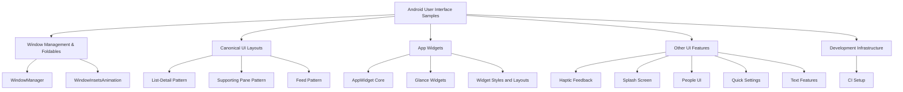
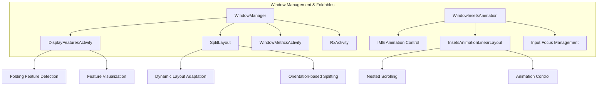
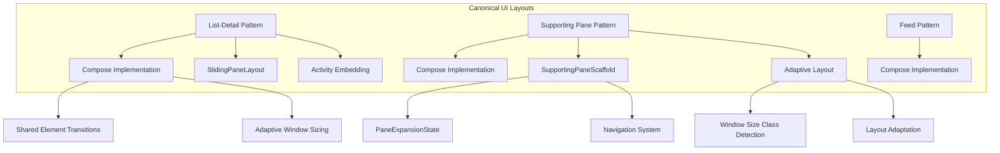
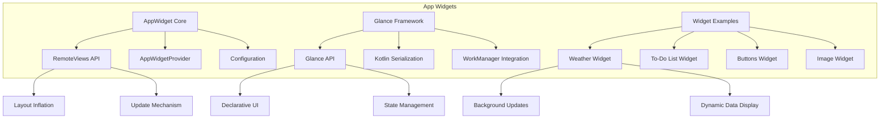
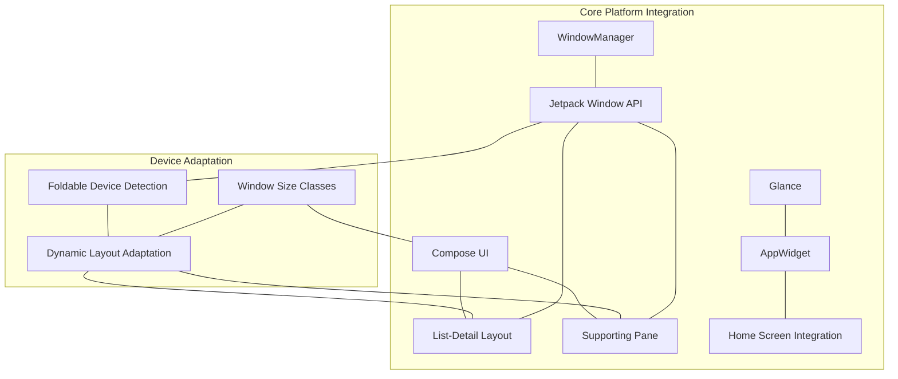

<!-- source: DeepWiki mcp.deepwiki.com · repo android/user-interface-samples · page 1 Overview · fetched 2026-10-23 -->

# Overview

Relevant source files

The following files were used as context for generating this wiki page:

- [.gitignore](.gitignore)
- [CONTRIBUTING.md](CONTRIBUTING.md)
- [LICENSE](LICENSE)
- [README.md](README.md)

## Purpose and Scope

The Android User Interface Samples repository serves as a comprehensive collection of sample implementations demonstrating various Android UI features, patterns, and best practices. The repository is designed to help developers understand and implement modern UI solutions across the diverse Android device ecosystem, with particular emphasis on responsive layouts for different screen sizes and form factors including foldable devices.

This document provides a high-level introduction to the repository's structure, primary components, and their relationships. It serves as a starting point for navigating the more detailed documentation available for each specific system.

Sources: [README.md:6-8]()

## Repository Organization

The Android User Interface Samples repository is organized into several major system categories, each containing multiple sample implementations that showcase specific UI features and patterns.

Sources: Based on the table of contents JSON structure provided

## Major System Categories

### Window Management & Foldables

This category focuses on providing samples for adapting UI layout to different screen configurations, with special attention to foldable devices and handling window insets.

The Window Management samples demonstrate how to:
- Detect and adapt to fold features in foldable devices
- Measure window metrics for responsive layouts
- Implement proper window insets animation for keyboard appearance

For more detailed information about window management, see [Window Management](#2).

Sources: Based on the Window Management Systems diagram provided

### Canonical UI Layouts

This category provides implementations of standard UI layout patterns that adapt to different screen sizes and orientations, crucial for building responsive applications.

The Canonical UI Layouts samples showcase:
- List-Detail pattern for master-detail views
- Supporting Pane pattern for showing supplementary content
- Feed pattern for displaying streaming content
- Both traditional View-based and modern Jetpack Compose implementations

For more detailed information about canonical UI layouts, see [Canonical UI Layouts](#3).

Sources: Based on the Canonical Layouts Systems diagram provided

### App Widgets

This category demonstrates how to implement home screen widgets, including both traditional RemoteViews approach and the newer Glance framework.

The App Widgets samples demonstrate:
- Traditional RemoteViews-based widget implementation
- Modern Glance framework for declarative widget creation
- Integration with WorkManager for background updates
- Various widget types and use cases

For more detailed information about app widgets, see [App Widgets](#4).

Sources: Based on the App Widget Systems diagram provided

### Other UI Features

This category includes samples for various other UI features that don't fit into the major categories above.

These samples include:
- Haptic Feedback implementation for tactile interactions
- Splash Screen API usage for app launch screens
- People UI for contact lists and notification features
- Quick Settings implementation for system tray tiles
- Text handling features like spans, linkify, and hyphenation

For more detailed information about these other UI features, see [Other UI Features](#5).

Sources: Based on the table of contents JSON structure provided

## System Integration and Relationships

The samples in this repository demonstrate not just individual UI components but also how these components work together to create cohesive, adaptive user experiences.

Key integration points include:
- WindowManager and layout patterns both utilize the Jetpack Window API for detecting device features
- Canonical layouts implement both traditional View-based and Jetpack Compose approaches
- App Widgets provide integration with the home screen through both RemoteViews and Glance
- All systems handle adaptive layouts based on screen size and device features

Sources: Based on the System Integration Overview diagram provided

## Code Organization and Architecture

The repository follows a consistent architectural approach across most samples:

| Layer | Responsibility | Key Components |
|-------|----------------|----------------|
| UI Components | User interface rendering | Activities, Fragments, Composables |
| Logic/State Management | Business logic and state | ViewModels, Controllers |
| Platform Integration | Interfacing with Android | WindowInfoTracker, WorkManager |

Most samples are organized with:
- A main activity as the entry point
- Multiple implementation approaches (View-based, Compose)
- Utility classes for specific functionality
- Comprehensive documentation in README files

Sources: Based on analysis of the repository structure

## Migration Notice

> **Note**: This repository is in the process of being migrated to the new [platform-samples repository](https://github.com/android/platform-samples). The migrated samples can be found in the [user-interface](https://github.com/android/platform-samples/tree/main/samples/user-interface) directory of the platform-samples repository.

Sources: [README.md:1-4]()

## Getting Started

To begin working with these samples:

1. Clone the repository
2. Open the samples as projects in Android Studio
3. Build and run the samples on your device or emulator

Each sample contains its own README with specific setup instructions and technical details.

Sources: [README.md:10-12]()

## Support and Contribution

For questions about the samples, you can use:
- Stack Overflow with the Android tag
- GitHub issues for reporting errors in the samples

The project welcomes contributions through pull requests. To contribute:
1. Fork the repository
2. Make your changes
3. Submit a pull request
4. Sign the Contributor License Agreement if you haven't already

All submissions require review through GitHub pull requests, and the project follows Google's Open Source Community Guidelines.

Sources: [README.md:14-22](), [CONTRIBUTING.md:1-28]()

---

