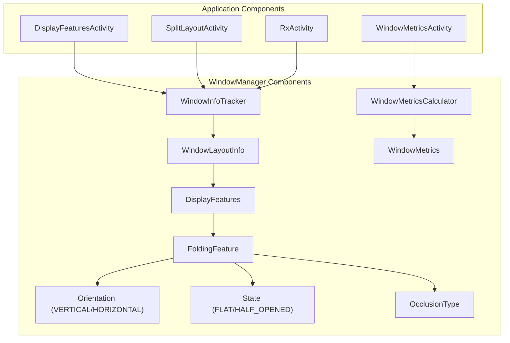
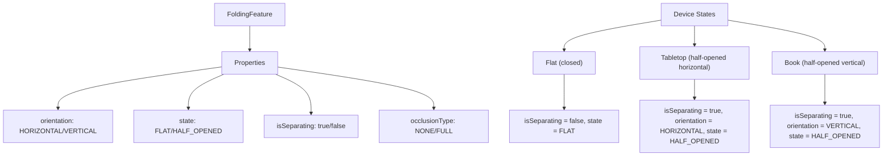
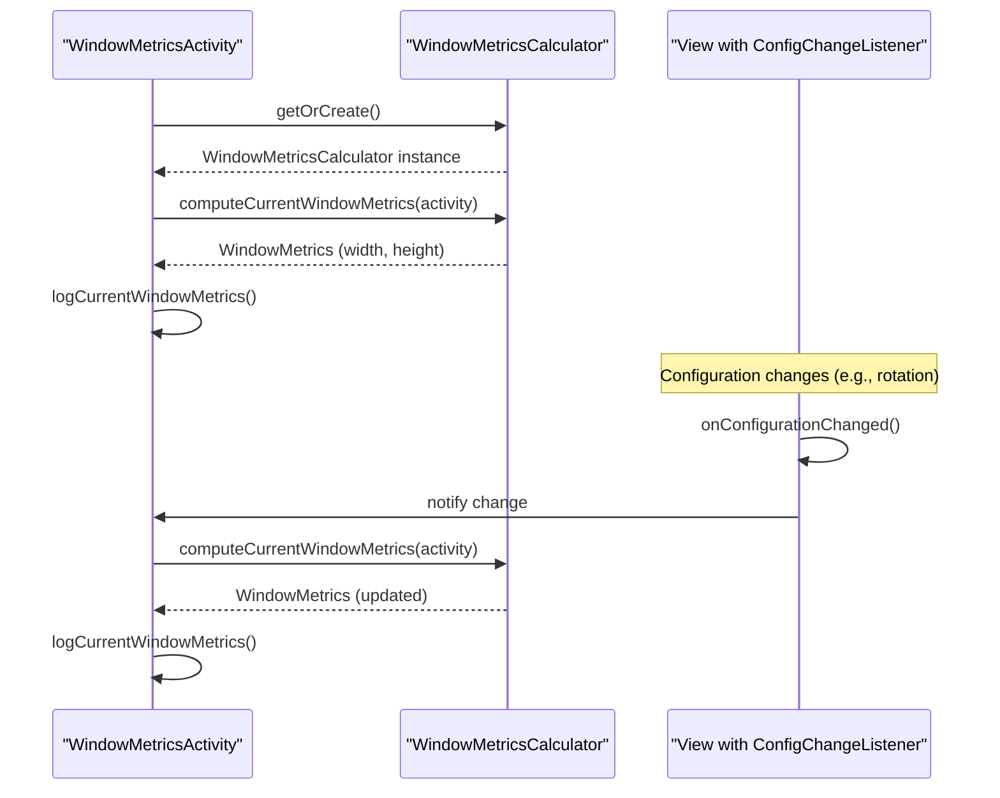
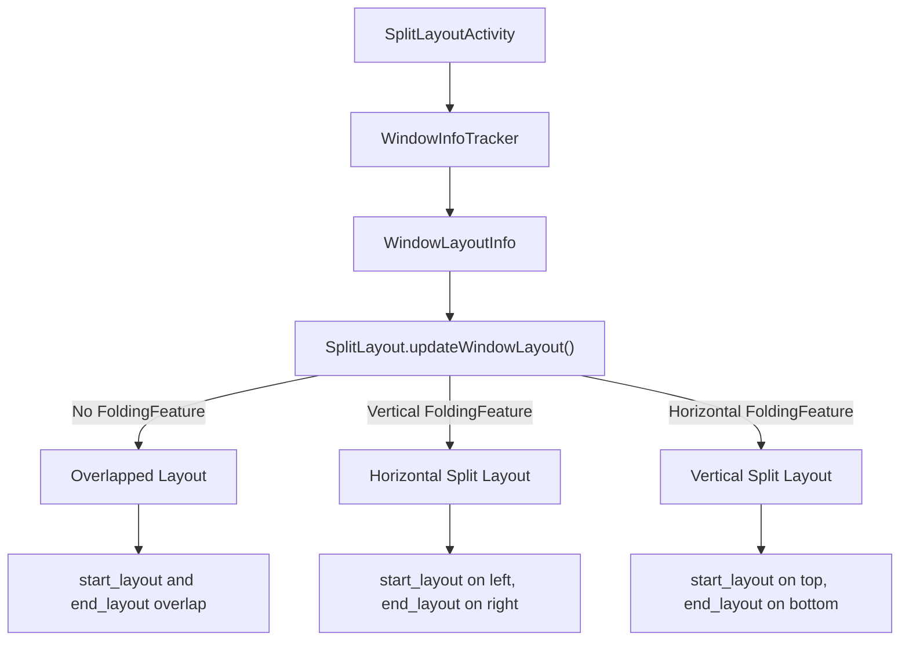
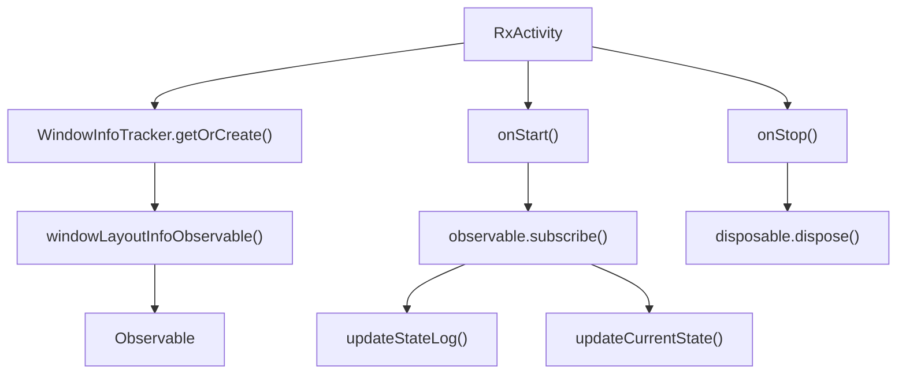

<!-- source: DeepWiki mcp.deepwiki.com · repo android/user-interface-samples · page 2 Window Management · fetched 2026-10-23 -->

# Window Management

<details>
<summary>Relevant source files</summary>

The following files were used as context for generating this wiki page:

- [WindowInsetsAnimation/README.md](WindowInsetsAnimation/README.md)
- [WindowInsetsAnimation/app/src/main/java/com/google/android/samples/insetsanimation/ControlFocusInsetsAnimationCallback.kt](WindowInsetsAnimation/app/src/main/java/com/google/android/samples/insetsanimation/ControlFocusInsetsAnimationCallback.kt)
- [WindowInsetsAnimation/app/src/main/java/com/google/android/samples/insetsanimation/ConversationFragment.kt](WindowInsetsAnimation/app/src/main/java/com/google/android/samples/insetsanimation/ConversationFragment.kt)
- [WindowInsetsAnimation/app/src/main/java/com/google/android/samples/insetsanimation/InsetsAnimationLinearLayout.kt](WindowInsetsAnimation/app/src/main/java/com/google/android/samples/insetsanimation/InsetsAnimationLinearLayout.kt)
- [WindowInsetsAnimation/app/src/main/java/com/google/android/samples/insetsanimation/InsetsAnimationTouchListener.kt](WindowInsetsAnimation/app/src/main/java/com/google/android/samples/insetsanimation/InsetsAnimationTouchListener.kt)
- [WindowInsetsAnimation/app/src/main/java/com/google/android/samples/insetsanimation/MainActivity.kt](WindowInsetsAnimation/app/src/main/java/com/google/android/samples/insetsanimation/MainActivity.kt)
- [WindowInsetsAnimation/app/src/main/java/com/google/android/samples/insetsanimation/RootViewDeferringInsetsCallback.kt](WindowInsetsAnimation/app/src/main/java/com/google/android/samples/insetsanimation/RootViewDeferringInsetsCallback.kt)
- [WindowInsetsAnimation/app/src/main/java/com/google/android/samples/insetsanimation/SimpleImeAnimationController.kt](WindowInsetsAnimation/app/src/main/java/com/google/android/samples/insetsanimation/SimpleImeAnimationController.kt)
- [WindowInsetsAnimation/app/src/main/java/com/google/android/samples/insetsanimation/TranslateDeferringInsetsAnimationCallback.kt](WindowInsetsAnimation/app/src/main/java/com/google/android/samples/insetsanimation/TranslateDeferringInsetsAnimationCallback.kt)
- [WindowInsetsAnimation/app/src/main/java/com/google/android/samples/insetsanimation/utils.kt](WindowInsetsAnimation/app/src/main/java/com/google/android/samples/insetsanimation/utils.kt)
- [WindowInsetsAnimation/app/src/main/res/layout/fragment_conversation.xml](WindowInsetsAnimation/app/src/main/res/layout/fragment_conversation.xml)
- [WindowInsetsAnimation/images/demos.gif](WindowInsetsAnimation/images/demos.gif)
- [WindowManager/README.md](WindowManager/README.md)
- [WindowManager/app/src/androidTest/java/com/example/windowmanagersample/DisplayFeaturesActivityJavaTest.java](WindowManager/app/src/androidTest/java/com/example/windowmanagersample/DisplayFeaturesActivityJavaTest.java)
- [WindowManager/app/src/androidTest/java/com/example/windowmanagersample/DisplayFeaturesActivityTest.kt](WindowManager/app/src/androidTest/java/com/example/windowmanagersample/DisplayFeaturesActivityTest.kt)
- [WindowManager/app/src/androidTest/java/com/example/windowmanagersample/SplitLayoutActivityTest.kt](WindowManager/app/src/androidTest/java/com/example/windowmanagersample/SplitLayoutActivityTest.kt)
- [WindowManager/app/src/main/java/com/example/windowmanagersample/RxActivity.kt](WindowManager/app/src/main/java/com/example/windowmanagersample/RxActivity.kt)
- [WindowManager/app/src/main/java/com/example/windowmanagersample/SplitLayoutActivity.java](WindowManager/app/src/main/java/com/example/windowmanagersample/SplitLayoutActivity.java)
- [WindowManager/app/src/main/java/com/example/windowmanagersample/WindowMetricsActivity.kt](WindowManager/app/src/main/java/com/example/windowmanagersample/WindowMetricsActivity.kt)
- [WindowManager/app/src/main/res/layout/activity_rx.xml](WindowManager/app/src/main/res/layout/activity_rx.xml)
- [WindowManager/app/src/main/res/layout/activity_window_metrics.xml](WindowManager/app/src/main/res/layout/activity_window_metrics.xml)
- [WindowManager/app/src/main/res/layout/view_holder_info_log.xml](WindowManager/app/src/main/res/layout/view_holder_info_log.xml)

</details>


## Purpose and Scope

This document provides an overview of the Window Management components in the Android User Interface Samples repository. It focuses primarily on the Jetpack WindowManager library which enables applications to adapt to different device form factors, particularly foldable devices. The document covers how to obtain window metrics, track window layout changes, and adapt layouts to different device states. For information about window insets animation and keyboard handling, see [Window Insets Animation](#2.2).

## Jetpack WindowManager Overview

The Jetpack WindowManager library provides a consistent API surface for window management features across different Android platform versions. It allows applications to support new device form factors like foldable phones and tablets while maintaining backward compatibility.

### Architecture



*Diagram 1: WindowManager Architecture*

Sources:
- [WindowManager/README.md]()
- [WindowManager/app/src/main/java/com/example/windowmanagersample/WindowMetricsActivity.kt]()
- [WindowManager/app/src/androidTest/java/com/example/windowmanagersample/DisplayFeaturesActivityTest.kt]()

### Core Components

1. **WindowInfoTracker**: Provides information about the current window layout, including any display features like folds or hinges.
2. **WindowMetricsCalculator**: Computes the dimensions of the current window.
3. **WindowLayoutInfo**: Contains information about the current window layout, including any display features.
4. **FoldingFeature**: Represents a folding feature of a device, such as a hinge.

## Foldable Device Support

The WindowManager library enables applications to detect and adapt to foldable device states through the `FoldingFeature` class.



*Diagram 2: FoldingFeature Properties and Device States*

Sources:
- [WindowManager/app/src/androidTest/java/com/example/windowmanagersample/DisplayFeaturesActivityTest.kt]()
- [WindowManager/app/src/androidTest/java/com/example/windowmanagersample/SplitLayoutActivityTest.kt]()
- [WindowManager/app/src/main/java/com/example/windowmanagersample/RxActivity.kt]()

### DisplayFeaturesActivity

The `DisplayFeaturesActivity` demonstrates how to detect and visualize display features (like hinges or folds) on foldable devices. It shows the current device state and the position of any folds or hinges.

Key implementation details:
- Uses `WindowInfoTracker` to receive updates about `WindowLayoutInfo`
- Extracts `FoldingFeature` information from the `WindowLayoutInfo`
- Visualizes the fold location and displays device state (e.g., "screens are separated", "hinge is horizontal")

Sources:
- [WindowManager/app/src/androidTest/java/com/example/windowmanagersample/DisplayFeaturesActivityTest.kt]()
- [WindowManager/app/src/androidTest/java/com/example/windowmanagersample/DisplayFeaturesActivityJavaTest.java]()

## Window Metrics Calculation

Window metrics provide information about the current size of the window, which is essential for responsive UI design.

### WindowMetricsActivity

The `WindowMetricsActivity` demonstrates how to retrieve and track window metrics changes:



*Diagram 3: Window Metrics Calculation Process*

Key implementation details:
- Uses `WindowMetricsCalculator.getOrCreate().computeCurrentWindowMetrics(activity)` to get current window dimensions
- Tracks configuration changes to update metrics when the window size changes
- Logs both pixel dimensions and dp values

Source:
- [WindowManager/app/src/main/java/com/example/windowmanagersample/WindowMetricsActivity.kt]()

## Layout Adaptation with SplitLayout

The `SplitLayout` component demonstrates how to adapt layouts based on the device's fold state.

### SplitLayoutActivity



*Diagram 4: SplitLayout Adaptation*

Key implementation details:
- `SplitLayoutActivity` uses `WindowInfoTrackerCallbackAdapter` to receive window layout updates
- When layout info changes, it calls `splitLayout.updateWindowLayout(windowLayoutInfo)`
- The layout adapts based on the presence and orientation of folding features:
  - No folding feature: Views overlap
  - Vertical folding feature: Views split horizontally (side by side)
  - Horizontal folding feature: Views split vertically (top and bottom)

Sources:
- [WindowManager/app/src/main/java/com/example/windowmanagersample/SplitLayoutActivity.java]()
- [WindowManager/app/src/androidTest/java/com/example/windowmanagersample/SplitLayoutActivityTest.kt]()

## Reactive Window Info Tracking

The library supports reactive programming patterns for window layout changes using RxJava.

### RxActivity Implementation



*Diagram 5: RxActivity Flow*

Key implementation details:
- Uses `WindowInfoTracker.getOrCreate(this).windowLayoutInfoObservable(this)` to create an RxJava Observable
- Subscribes to the Observable in `onStart()` and disposes it in `onStop()`
- Updates UI when window layout changes, displaying information about display features

Source:
- [WindowManager/app/src/main/java/com/example/windowmanagersample/RxActivity.kt]()

## Window Insets Animation

The Window Insets Animation sample demonstrates how to react to and control the on-screen keyboard (IME) visibility. It shows techniques for animating views in response to IME changes and programmatically controlling the IME's visibility.

This topic is covered in detail in the dedicated [Window Insets Animation](#2.2) wiki page.

Key components:
- `InsetsAnimationLinearLayout`: Handles nested scrolling to control IME visibility
- `SimpleImeAnimationController`: Manages animations for IME visibility changes
- `TranslateDeferringInsetsAnimationCallback`: Moves views in sync with IME animations

Sources:
- [WindowInsetsAnimation/README.md]()
- [WindowInsetsAnimation/app/src/main/java/com/google/android/samples/insetsanimation/InsetsAnimationLinearLayout.kt]()
- [WindowInsetsAnimation/app/src/main/java/com/google/android/samples/insetsanimation/SimpleImeAnimationController.kt]()

## Implementation Examples

### Tracking Window Metrics

The following example shows how to obtain and log window metrics:

```kotlin
// From WindowMetricsActivity.kt
private fun logCurrentWindowMetrics(tag: String) {
    val windowMetrics = WindowMetricsCalculator.getOrCreate()
        .computeCurrentWindowMetrics(this@WindowMetricsActivity)
    val width = windowMetrics.bounds.width()
    val height = windowMetrics.bounds.height()
    adapter.append(
        tag,
        "width: $width, " +
            "height: $height, " +
            "widthDp: ${width / resources.displayMetrics.density}, " +
            "heightDp: ${height / resources.displayMetrics.density}"
    )
}
```

Source:
- [WindowManager/app/src/main/java/com/example/windowmanagersample/WindowMetricsActivity.kt:64-80]()

### Detecting Foldable State

```kotlin
// Setting up WindowInfoTracker with RxJava
observable = WindowInfoTracker.getOrCreate(this@RxActivity)
    .windowLayoutInfoObservable(this@RxActivity)

// In onStart()
disposable = observable
    .observeOn(AndroidSchedulers.mainThread())
    .subscribe { newLayoutInfo ->
        updateStateLog(newLayoutInfo)
        updateCurrentState(newLayoutInfo)
    }
```

Source:
- [WindowManager/app/src/main/java/com/example/windowmanagersample/RxActivity.kt:52-69]()

### Adapting Layout for Folds

The following test example demonstrates how layouts adapt to different fold states:

```kotlin
@Test
fun testDeviceOpen_Vertical() {
    activityRule.scenario.onActivity { activity ->
        val feature = FoldingFeature(
            activity = activity,
            orientation = VERTICAL,
            state = HALF_OPENED
        )
        val expected = TestWindowLayoutInfo(listOf(feature))
        publisherRule.overrideWindowLayoutInfo(expected)
    }

    // Checks that start_layout is on the left of end_layout with a vertical folding feature
    onView(withId(R.id.start_layout)).check(isCompletelyLeftOf(withId(R.id.end_layout)))
}
```

Source:
- [WindowManager/app/src/androidTest/java/com/example/windowmanagersample/SplitLayoutActivityTest.kt:68-82]()

## Best Practices

1. **Lifecycle Management**: Always dispose of WindowInfoTracker subscriptions in `onStop()` to prevent memory leaks.

2. **Configuration Changes**: Use a utility view to listen for configuration changes, as shown in WindowMetricsActivity, to ensure metrics are updated on all changes.

3. **Layout Adaptation**: Design layouts that can adapt to different fold states (flat, book mode, tabletop mode) to provide the best user experience.

4. **Testing**: Use the testing utilities like `WindowLayoutInfoPublisherRule` to test how your UI responds to different fold configurations.

5. **Backward Compatibility**: The Jetpack WindowManager library is designed to work on older Android versions, but certain features may only function on newer platforms.

## Compatibility

The Jetpack WindowManager library is designed to work across different Android versions:

| Feature | Minimum API Level |
|---------|------------------|
| Basic Window Metrics | API 14+ |
| Display Features Detection | API 14+ |
| Folding Feature Support | API 14+ (full functionality on API 30+) |

Actual foldable device support depends on both the Android version and the specific device hardware.

## Related Resources

This wiki page covers the core concepts of window management in the Android User Interface Samples. For more specific information on window insets animation, see the [Window Insets Animation](#2.2) wiki page.

---

