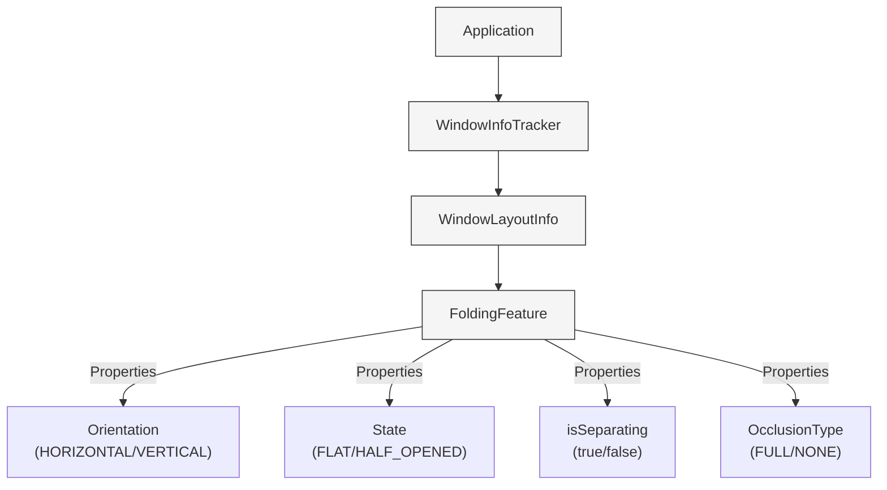
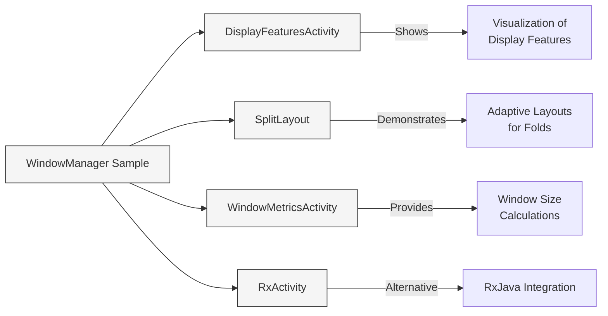
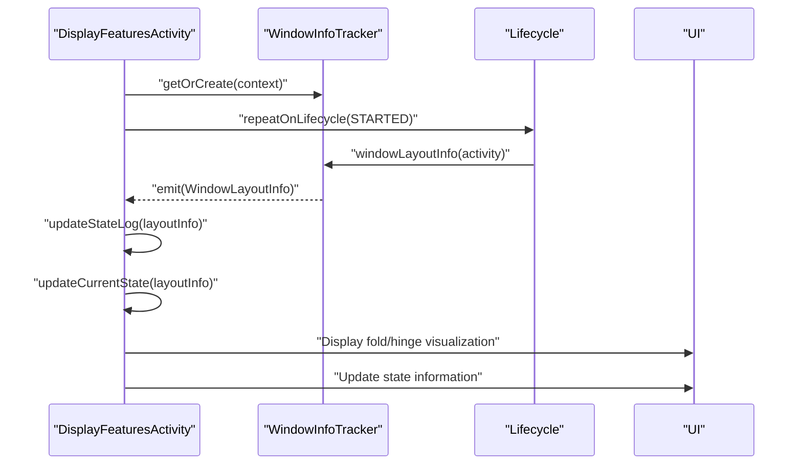
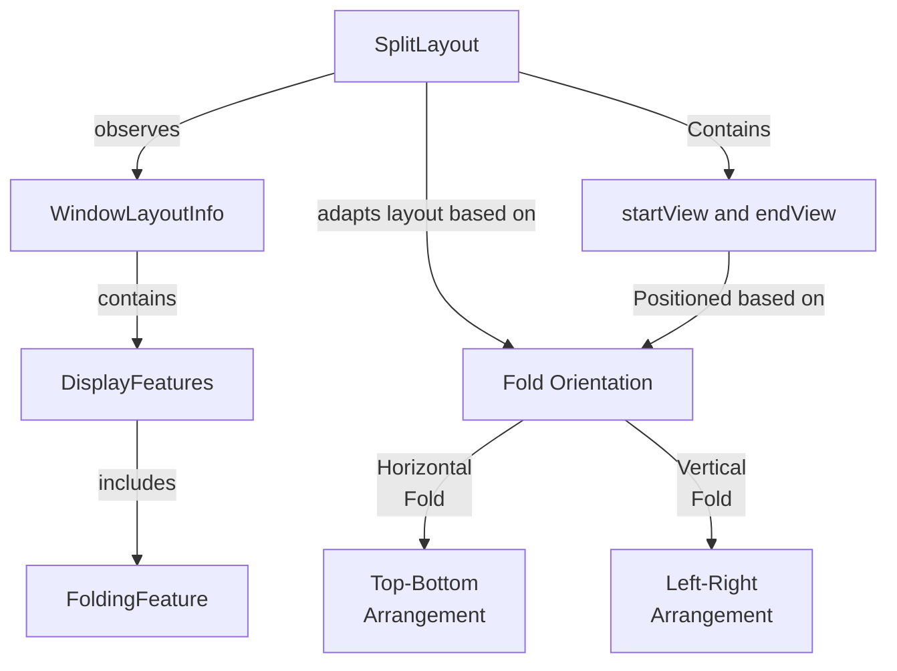
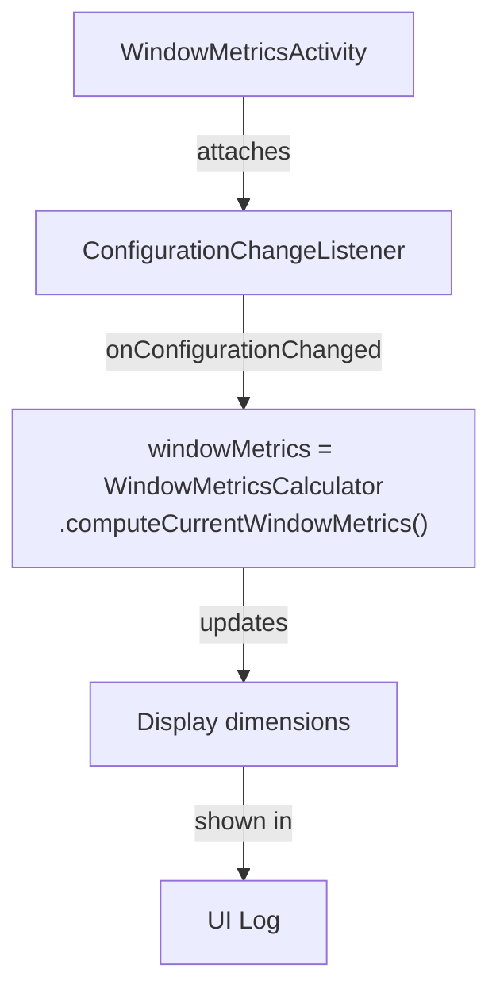

<!-- source: DeepWiki mcp.deepwiki.com · repo android/user-interface-samples · page 2.1 Foldables with WindowManager · fetched 2026-10-23 -->

# Foldables with WindowManager

<details>
<summary>Relevant source files</summary>

The following files were used as context for generating this wiki page:

- [WindowManager/README.md](WindowManager/README.md)
- [WindowManager/app/build.gradle](WindowManager/app/build.gradle)
- [WindowManager/app/src/androidTest/java/com/example/windowmanagersample/DisplayFeaturesActivityJavaTest.java](WindowManager/app/src/androidTest/java/com/example/windowmanagersample/DisplayFeaturesActivityJavaTest.java)
- [WindowManager/app/src/androidTest/java/com/example/windowmanagersample/DisplayFeaturesActivityTest.kt](WindowManager/app/src/androidTest/java/com/example/windowmanagersample/DisplayFeaturesActivityTest.kt)
- [WindowManager/app/src/androidTest/java/com/example/windowmanagersample/SplitLayoutActivityTest.kt](WindowManager/app/src/androidTest/java/com/example/windowmanagersample/SplitLayoutActivityTest.kt)
- [WindowManager/app/src/main/AndroidManifest.xml](WindowManager/app/src/main/AndroidManifest.xml)
- [WindowManager/app/src/main/java/com/example/windowmanagersample/DisplayFeaturesActivity.kt](WindowManager/app/src/main/java/com/example/windowmanagersample/DisplayFeaturesActivity.kt)
- [WindowManager/app/src/main/java/com/example/windowmanagersample/RxActivity.kt](WindowManager/app/src/main/java/com/example/windowmanagersample/RxActivity.kt)
- [WindowManager/app/src/main/java/com/example/windowmanagersample/SampleTools.kt](WindowManager/app/src/main/java/com/example/windowmanagersample/SampleTools.kt)
- [WindowManager/app/src/main/java/com/example/windowmanagersample/SplitLayout.kt](WindowManager/app/src/main/java/com/example/windowmanagersample/SplitLayout.kt)
- [WindowManager/app/src/main/java/com/example/windowmanagersample/SplitLayoutActivity.java](WindowManager/app/src/main/java/com/example/windowmanagersample/SplitLayoutActivity.java)
- [WindowManager/app/src/main/java/com/example/windowmanagersample/WindowMetricsActivity.kt](WindowManager/app/src/main/java/com/example/windowmanagersample/WindowMetricsActivity.kt)
- [WindowManager/app/src/main/res/layout/activity_display_features.xml](WindowManager/app/src/main/res/layout/activity_display_features.xml)
- [WindowManager/app/src/main/res/layout/activity_rx.xml](WindowManager/app/src/main/res/layout/activity_rx.xml)
- [WindowManager/app/src/main/res/layout/activity_split_layout.xml](WindowManager/app/src/main/res/layout/activity_split_layout.xml)
- [WindowManager/app/src/main/res/layout/activity_window_demos.xml](WindowManager/app/src/main/res/layout/activity_window_demos.xml)
- [WindowManager/app/src/main/res/layout/activity_window_metrics.xml](WindowManager/app/src/main/res/layout/activity_window_metrics.xml)
- [WindowManager/app/src/main/res/layout/split_layout_content.xml](WindowManager/app/src/main/res/layout/split_layout_content.xml)
- [WindowManager/app/src/main/res/layout/split_layout_control.xml](WindowManager/app/src/main/res/layout/split_layout_control.xml)
- [WindowManager/app/src/main/res/layout/view_holder_info_log.xml](WindowManager/app/src/main/res/layout/view_holder_info_log.xml)
- [WindowManager/app/src/main/res/values/colors.xml](WindowManager/app/src/main/res/values/colors.xml)
- [WindowManager/app/src/main/res/values/strings.xml](WindowManager/app/src/main/res/values/strings.xml)
- [WindowManager/build.gradle](WindowManager/build.gradle)
- [WindowManager/gradle.properties](WindowManager/gradle.properties)
- [WindowManager/gradle/wrapper/gradle-wrapper.properties](WindowManager/gradle/wrapper/gradle-wrapper.properties)

</details>


## Purpose and Scope

This document covers the WindowManager sample implementation which demonstrates how to use the Jetpack WindowManager library to develop applications that adapt to foldable device form factors. The sample shows how to detect foldable device features (such as hinges and folds), react to their state changes, and adapt UI layouts accordingly.

For information about window insets animation, see [Window Insets Animation](#2.2).

Sources: [WindowManager/README.md:9-17]()

## Overview of Jetpack WindowManager

The Jetpack WindowManager library provides a consistent API for detecting and adapting to various device form factors across different Android versions. For foldable devices, it detects display features such as folds and hinges and provides real-time updates when device state changes occur.



The library enables developers to:
- Detect folds and hinges on devices
- Determine their orientation (horizontal or vertical)
- Check if they separate the screen into two distinct areas
- Adjust layouts based on device state changes

Sources: [WindowManager/README.md:9-17](), [WindowManager/app/build.gradle:54-61]()

## Main Components

The WindowManager sample demonstrates several approaches to working with foldable devices:



Sources: [WindowManager/app/src/main/AndroidManifest.xml:24-34]()

## Display Feature Detection

### WindowInfoTracker

The central component for detecting device features is the `WindowInfoTracker`, which provides information about the window's layout through `WindowLayoutInfo`. This includes details about display features like folds and hinges.

```kotlin
// Create a WindowInfoTracker
val windowInfoTracker = WindowInfoTracker.getOrCreate(this)

// Observe window layout changes
lifecycleScope.launch(Dispatchers.Main) {
    lifecycle.repeatOnLifecycle(Lifecycle.State.STARTED) {
        windowInfoTracker
            .windowLayoutInfo(this@YourActivity)
            .collect { newLayoutInfo ->
                // Handle new layout info
            }
    }
}
```

Sources: [WindowManager/app/src/main/java/com/example/windowmanagersample/DisplayFeaturesActivity.kt:51-66]()

### DisplayFeaturesActivity

The `DisplayFeaturesActivity` demonstrates how to detect and visualize display features. It:

1. Creates a `WindowInfoTracker` to receive window layout updates
2. Observes changes to window layout using Kotlin Flow
3. Visualizes the display features (folds/hinges) on the screen
4. Displays the current state of the device



When the device state changes (e.g., folding or unfolding), the `WindowInfoTracker` emits a new `WindowLayoutInfo` with updated information about the display features, which the activity then uses to update its UI.

Sources: [WindowManager/app/src/main/java/com/example/windowmanagersample/DisplayFeaturesActivity.kt:38-154]()

## Working with Display Features

### FoldingFeature Properties

A `FoldingFeature` provides several important properties:

| Property | Description | Example Use |
|----------|-------------|-------------|
| `bounds` | The position of the fold/hinge | Positioning UI elements around it |
| `isSeparating` | Whether it separates the display into two logical areas | Splitting content into two views |
| `orientation` | Whether it's horizontal or vertical | Determining layout direction |
| `occlusionType` | Whether it fully occupies space (FULL) or not (NONE) | Handling content position |
| `state` | Current state (FLAT or HALF_OPENED) | Adapting UI based on fold state |

Sources: [WindowManager/app/src/main/java/com/example/windowmanagersample/DisplayFeaturesActivity.kt:84-129]()

### Detecting Fold State and Orientation

The sample demonstrates how to check fold states:

```kotlin
// Checking fold properties
val foldFeature = displayFeature as? FoldingFeature
if (foldFeature != null) {
    if (foldFeature.isSeparating) {
        // Screens are separated by fold
    } else {
        // Fold doesn't separate the screen
    }
    
    if (foldFeature.orientation == FoldingFeature.Orientation.HORIZONTAL) {
        // Fold is horizontal
    } else {
        // Fold is vertical
    }
}
```

Sources: [WindowManager/app/src/main/java/com/example/windowmanagersample/DisplayFeaturesActivity.kt:100-129]()

## Adaptive UI for Foldable Devices

### SplitLayout Component

The sample includes a custom `SplitLayout` that adapts its content based on detected folding features:



The `SplitLayout`:
1. Receives `WindowLayoutInfo` updates from its parent activity
2. Finds valid folding features that cross the layout
3. Positions two views (start and end) on opposite sides of the fold
4. Falls back to a regular layout if no suitable fold is found

Sources: [WindowManager/app/src/main/java/com/example/windowmanagersample/SplitLayout.kt:30-198]()

### Layout Adaptation Examples

The `SplitLayout` provides two main adaptations:

1. **Vertical Fold**: Places content side-by-side (left-right arrangement)
   ```
   ┌─────┬─────┐
   │     │     │
   │  S  │  E  │
   │     │     │
   └─────┴─────┘
   ```

2. **Horizontal Fold**: Places content in a top-bottom arrangement
   ```
   ┌─────────┐
   │    S    │
   ├─────────┤
   │    E    │
   └─────────┘
   ```

The layout measures both views to ensure they meet minimum size requirements before splitting them. If either view would be too small, it reverts to a stacked layout.

Sources: [WindowManager/app/src/main/java/com/example/windowmanagersample/SplitLayout.kt:121-172](), [WindowManager/app/src/main/res/layout/split_layout_content.xml:25-27](), [WindowManager/app/src/main/res/layout/split_layout_control.xml:25-27]()

### Integration in SplitLayoutActivity

The `SplitLayoutActivity` demonstrates how to use the `SplitLayout`:

```kotlin
// Java implementation shown in the sample
class LayoutStateChangeCallback implements Consumer<WindowLayoutInfo> {
    @Override
    public void accept(WindowLayoutInfo windowLayoutInfo) {
        binding.splitLayout.updateWindowLayout(windowLayoutInfo);
    }
}
```

This callback passes window layout information to the `SplitLayout`, which then adapts its layout accordingly.

Sources: [WindowManager/app/src/main/java/com/example/windowmanagersample/SplitLayoutActivity.java:28-65]()

## Window Metrics

### WindowMetricsActivity

The `WindowMetricsActivity` demonstrates how to get accurate window metrics for layout purposes:

```kotlin
val windowMetrics = WindowMetricsCalculator.getOrCreate()
    .computeCurrentWindowMetrics(this)
val width = windowMetrics.bounds.width()
val height = windowMetrics.bounds.height()
```

This provides the actual pixel dimensions of the window, which is particularly important for foldable devices where window sizes may change when folding or unfolding.

Sources: [WindowManager/app/src/main/java/com/example/windowmanagersample/WindowMetricsActivity.kt:29-81]()

### Configuration Changes and Window Metrics

The sample also demonstrates how to handle configuration changes:



Configuration changes like rotations or folding/unfolding trigger updates to window metrics, which the sample logs to demonstrate the transitions.

Sources: [WindowManager/app/src/main/java/com/example/windowmanagersample/WindowMetricsActivity.kt:47-61]()

## RxJava Integration

For developers who prefer a reactive programming approach, the sample includes `RxActivity` which demonstrates how to use the RxJava integration:

```kotlin
// Create observable
val observable = WindowInfoTracker.getOrCreate(this)
    .windowLayoutInfoObservable(this)

// Subscribe to changes
disposable = observable
    .observeOn(AndroidSchedulers.mainThread())
    .subscribe { newLayoutInfo ->
        // Handle layout updates
    }
```

This provides an alternative to Kotlin's Flow API for handling window layout changes.

Sources: [WindowManager/app/src/main/java/com/example/windowmanagersample/RxActivity.kt:37-161]()

## Helper Utilities

The sample provides several helper utilities for working with display features:

### Getting Feature Position in View Coordinates

```kotlin
fun getFeaturePositionInViewRect(
    displayFeature: DisplayFeature,
    view: View,
    includePadding: Boolean = true
): Rect?
```

This utility translates display feature coordinates from window space to a view's local coordinate space, making it easier to position UI elements relative to folds and hinges.

Sources: [WindowManager/app/src/main/java/com/example/windowmanagersample/SampleTools.kt:28-63]()

### Creating Layout Parameters for Features

```kotlin
fun getLayoutParamsForFeatureInFrameLayout(
    displayFeature: DisplayFeature,
    view: FrameLayout
): FrameLayout.LayoutParams?
```

This utility creates layout parameters for visualizing display features within a `FrameLayout`.

Sources: [WindowManager/app/src/main/java/com/example/windowmanagersample/SampleTools.kt:69-80]()

## Testing with the WindowManager Library

The sample includes tests that demonstrate how to test applications that use the WindowManager library:

```kotlin
@Test
fun testDeviceOpen_TableTop() {
    activityRule.scenario.onActivity { activity ->
        val feature = FoldingFeature(
            activity = activity, 
            state = HALF_OPENED, 
            orientation = HORIZONTAL
        )
        val expected = TestWindowLayoutInfo(listOf(feature))
        publisherRule.overrideWindowLayoutInfo(expected)
    }
    
    // Assert UI reflects the table-top state
    onView(withSubstring("state = HALF_OPENED")).check(matches(isDisplayed()))
    onView(withSubstring("are separated")).check(matches(isDisplayed()))
    onView(withSubstring("Hinge is horizontal")).check(matches(isDisplayed()))
}
```

The `WindowLayoutInfoPublisherRule` allows tests to simulate different folding states without needing actual foldable hardware.

Sources: [WindowManager/app/src/androidTest/java/com/example/windowmanagersample/DisplayFeaturesActivityTest.kt:39-91](), [WindowManager/app/src/androidTest/java/com/example/windowmanagersample/SplitLayoutActivityTest.kt:41-100]()

## Conclusion

The WindowManager sample demonstrates how to use the Jetpack WindowManager library to detect and adapt to foldable device features. By using the APIs demonstrated in this sample, developers can create responsive UIs that take advantage of foldable form factors while maintaining backward compatibility with traditional devices.

Key takeaways:
- Use `WindowInfoTracker` to receive updates about display features
- Check `FoldingFeature` properties to determine fold state and orientation
- Create adaptive layouts that respond to different fold configurations
- Use `WindowMetricsCalculator` to get accurate window dimensions
- Test different folding configurations using the testing utilities

---

