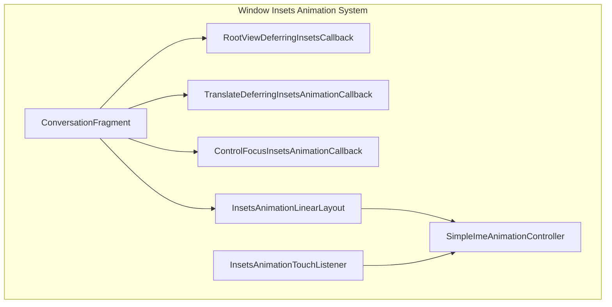
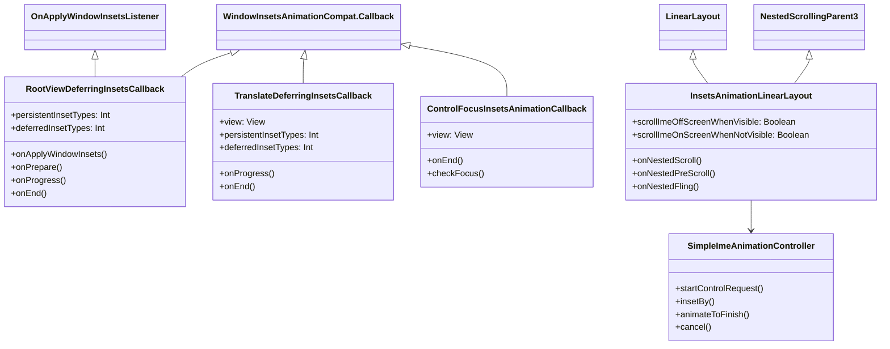
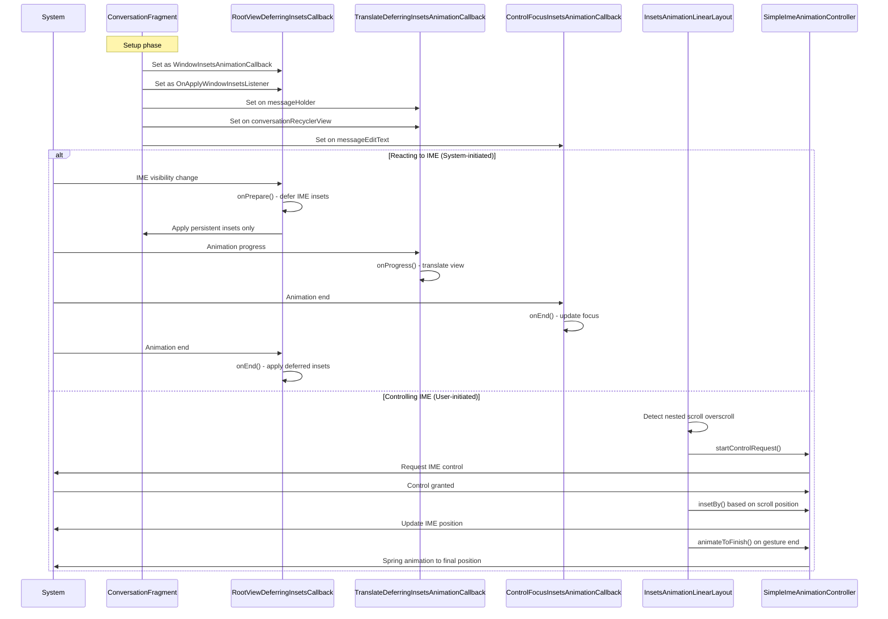

<!-- source: DeepWiki mcp.deepwiki.com · repo android/user-interface-samples · page 2.2 Window Insets Animation · fetched 2026-10-23 -->

# Window Insets Animation

<details>
<summary>Relevant source files</summary>

The following files were used as context for generating this wiki page:

- [WindowInsetsAnimation/README.md](WindowInsetsAnimation/README.md)
- [WindowInsetsAnimation/app/build.gradle](WindowInsetsAnimation/app/build.gradle)
- [WindowInsetsAnimation/app/src/main/java/com/google/android/samples/insetsanimation/ControlFocusInsetsAnimationCallback.kt](WindowInsetsAnimation/app/src/main/java/com/google/android/samples/insetsanimation/ControlFocusInsetsAnimationCallback.kt)
- [WindowInsetsAnimation/app/src/main/java/com/google/android/samples/insetsanimation/ConversationFragment.kt](WindowInsetsAnimation/app/src/main/java/com/google/android/samples/insetsanimation/ConversationFragment.kt)
- [WindowInsetsAnimation/app/src/main/java/com/google/android/samples/insetsanimation/InsetsAnimationLinearLayout.kt](WindowInsetsAnimation/app/src/main/java/com/google/android/samples/insetsanimation/InsetsAnimationLinearLayout.kt)
- [WindowInsetsAnimation/app/src/main/java/com/google/android/samples/insetsanimation/InsetsAnimationTouchListener.kt](WindowInsetsAnimation/app/src/main/java/com/google/android/samples/insetsanimation/InsetsAnimationTouchListener.kt)
- [WindowInsetsAnimation/app/src/main/java/com/google/android/samples/insetsanimation/MainActivity.kt](WindowInsetsAnimation/app/src/main/java/com/google/android/samples/insetsanimation/MainActivity.kt)
- [WindowInsetsAnimation/app/src/main/java/com/google/android/samples/insetsanimation/RootViewDeferringInsetsCallback.kt](WindowInsetsAnimation/app/src/main/java/com/google/android/samples/insetsanimation/RootViewDeferringInsetsCallback.kt)
- [WindowInsetsAnimation/app/src/main/java/com/google/android/samples/insetsanimation/SimpleImeAnimationController.kt](WindowInsetsAnimation/app/src/main/java/com/google/android/samples/insetsanimation/SimpleImeAnimationController.kt)
- [WindowInsetsAnimation/app/src/main/java/com/google/android/samples/insetsanimation/TranslateDeferringInsetsAnimationCallback.kt](WindowInsetsAnimation/app/src/main/java/com/google/android/samples/insetsanimation/TranslateDeferringInsetsAnimationCallback.kt)
- [WindowInsetsAnimation/app/src/main/java/com/google/android/samples/insetsanimation/utils.kt](WindowInsetsAnimation/app/src/main/java/com/google/android/samples/insetsanimation/utils.kt)
- [WindowInsetsAnimation/app/src/main/res/layout/fragment_conversation.xml](WindowInsetsAnimation/app/src/main/res/layout/fragment_conversation.xml)
- [WindowInsetsAnimation/build.gradle](WindowInsetsAnimation/build.gradle)
- [WindowInsetsAnimation/gradle/wrapper/gradle-wrapper.properties](WindowInsetsAnimation/gradle/wrapper/gradle-wrapper.properties)
- [WindowInsetsAnimation/images/demos.gif](WindowInsetsAnimation/images/demos.gif)

</details>


This document provides detailed information about the Window Insets Animation sample in the Android User Interface Samples repository. The sample demonstrates how to implement smooth animations for UI elements when the on-screen keyboard (IME - Input Method Editor) changes visibility, and how to programmatically control the IME's visibility through user gestures.

For information about general window management and foldable device support, see [Foldables with WindowManager](#2.1).

## Overview

The WindowInsetsAnimation sample showcases a mock instant-message style conversation app that implements two key features:

1. **Reacting to IME visibility changes**: UI elements animate smoothly in response to the keyboard appearing/disappearing
2. **Controlling IME visibility**: The app can programmatically control the keyboard's visibility based on user gestures



Sources: [WindowInsetsAnimation/app/src/main/java/com/google/android/samples/insetsanimation/ConversationFragment.kt:33-145](), [WindowInsetsAnimation/README.md:11-44]()

## Core Components

The sample is built with several key components that work together to create a cohesive user experience:



Sources: [WindowInsetsAnimation/app/src/main/java/com/google/android/samples/insetsanimation/RootViewDeferringInsetsCallback.kt:58-132](), [WindowInsetsAnimation/app/src/main/java/com/google/android/samples/insetsanimation/TranslateDeferringInsetsAnimationCallback.kt:41-84](), [WindowInsetsAnimation/app/src/main/java/com/google/android/samples/insetsanimation/SimpleImeAnimationController.kt:42-378](), [WindowInsetsAnimation/app/src/main/java/com/google/android/samples/insetsanimation/InsetsAnimationLinearLayout.kt:49-304](), [WindowInsetsAnimation/app/src/main/java/com/google/android/samples/insetsanimation/ControlFocusInsetsAnimationCallback.kt:37-73]()

### SimpleImeAnimationController

The `SimpleImeAnimationController` class serves as a wrapper around the `WindowInsetsAnimationControllerCompat` APIs from AndroidX Core. It simplifies the implementation of common use-cases for animating the IME.

Key functions:
- `startControlRequest()`: Initiates a request to control the IME insets
- `insetBy()`: Updates the IME inset position by a specified value
- `animateToFinish()`: Finishes the animation with a spring-based transition
- `isInsetAnimationInProgress()`: Indicates if an animation is currently running

Sources: [WindowInsetsAnimation/app/src/main/java/com/google/android/samples/insetsanimation/SimpleImeAnimationController.kt:42-378]()

### InsetsAnimationLinearLayout

A custom `LinearLayout` that implements the `NestedScrollingParent3` interface to automatically control the IME inset animations during scrolling gestures. It detects when users scroll in a list past its boundaries and uses this overscrolling to show or hide the keyboard.

Key properties:
- `scrollImeOffScreenWhenVisible`: Controls whether downward scrolling hides the keyboard
- `scrollImeOnScreenWhenNotVisible`: Controls whether upward scrolling shows the keyboard

Key methods:
- `onNestedPreScroll()`: Handles scroll events before they reach child views
- `onNestedScroll()`: Handles scroll events after child views have consumed part of the scroll
- `onNestedFling()`: Responds to fling gestures to animate the IME to completion

Sources: [WindowInsetsAnimation/app/src/main/java/com/google/android/samples/insetsanimation/InsetsAnimationLinearLayout.kt:49-304]()

### RootViewDeferringInsetsCallback

A combined `WindowInsetsAnimationCompat.Callback` and `OnApplyWindowInsetsListener` that handles insets at the root view level. It selectively defers handling certain inset types during animations to enable smoother transitions.

For example, during an IME animation, it can defer applying the IME insets as padding until the animation completes, which prevents the view from being immediately resized and causing visual artifacts.

Sources: [WindowInsetsAnimation/app/src/main/java/com/google/android/samples/insetsanimation/RootViewDeferringInsetsCallback.kt:58-132]()

### TranslateDeferringInsetsAnimationCallback

A `WindowInsetsAnimationCompat.Callback` that translates a view during inset animations. It works with `RootViewDeferringInsetsCallback` to support deferring certain inset types during animations.

This callback translates views such as message input fields and scrolling content in sync with the keyboard animation, creating a more cohesive visual effect.

Sources: [WindowInsetsAnimation/app/src/main/java/com/google/android/samples/insetsanimation/TranslateDeferringInsetsAnimationCallback.kt:41-84]()

### ControlFocusInsetsAnimationCallback

A `WindowInsetsAnimationCompat.Callback` that manages focus for a view based on IME visibility. It automatically requests focus when the IME appears and clears focus when the IME disappears.

Sources: [WindowInsetsAnimation/app/src/main/java/com/google/android/samples/insetsanimation/ControlFocusInsetsAnimationCallback.kt:37-73]()

### InsetsAnimationTouchListener

A `View.OnTouchListener` implementation that enables non-scrolling views to control IME visibility through touch gestures. It's an alternative to `InsetsAnimationLinearLayout` for cases where nested scrolling isn't appropriate.

Although not directly used in the main sample, it provides an example of how to implement a touch-based approach to IME control.

Sources: [WindowInsetsAnimation/app/src/main/java/com/google/android/samples/insetsanimation/InsetsAnimationTouchListener.kt:55-192]()

## Implementation Flow

The following diagram illustrates how the system handles keyboard animations, both when reacting to system-initiated changes and when controlling the IME directly:



Sources: [WindowInsetsAnimation/app/src/main/java/com/google/android/samples/insetsanimation/ConversationFragment.kt:46-138](), [WindowInsetsAnimation/app/src/main/java/com/google/android/samples/insetsanimation/InsetsAnimationLinearLayout.kt:75-208](), [WindowInsetsAnimation/app/src/main/java/com/google/android/samples/insetsanimation/SimpleImeAnimationController.kt:87-377]()

## Implementation Steps

To implement WindowInsetsAnimation in your application, follow these three key steps:

### 1. Configure the Window

First, configure your activity's window to handle system insets:

```kotlin
// In your Activity's onCreate()
WindowCompat.setDecorFitsSystemWindows(window, false)
```

This tells the system that your app will handle insets manually rather than having them automatically applied.

Sources: [WindowInsetsAnimation/app/src/main/java/com/google/android/samples/insetsanimation/MainActivity.kt:31-40]()

### 2. Set Up Inset Callbacks

Next, set up the necessary callbacks to handle inset changes and animations:

```kotlin
// Create a callback to manage insets at the root level
val deferringInsetsCallback = RootViewDeferringInsetsCallback(
    persistentInsetTypes = WindowInsetsCompat.Type.systemBars(),
    deferredInsetTypes = WindowInsetsCompat.Type.ime()
)

// Set it on your root view
ViewCompat.setWindowInsetsAnimationCallback(rootView, deferringInsetsCallback)
ViewCompat.setOnApplyWindowInsetsListener(rootView, deferringInsetsCallback)

// Set up translation callbacks for views that should move with the IME
ViewCompat.setWindowInsetsAnimationCallback(
    viewToAnimate,
    TranslateDeferringInsetsAnimationCallback(
        view = viewToAnimate,
        persistentInsetTypes = WindowInsetsCompat.Type.systemBars(),
        deferredInsetTypes = WindowInsetsCompat.Type.ime()
    )
)

// Optional: Add focus management for input fields
ViewCompat.setWindowInsetsAnimationCallback(
    editText,
    ControlFocusInsetsAnimationCallback(editText)
)
```

Sources: [WindowInsetsAnimation/app/src/main/java/com/google/android/samples/insetsanimation/ConversationFragment.kt:61-121]()

### 3. Implement Control of IME (Optional)

To enable user-driven control of the IME, use either:

- `InsetsAnimationLinearLayout` for scrolling views:
  ```xml
  <com.google.android.samples.insetsanimation.InsetsAnimationLinearLayout
      android:layout_width="match_parent"
      android:layout_height="match_parent"
      android:orientation="vertical">
      <!-- Your scrolling content here -->
  </com.google.android.samples.insetsanimation.InsetsAnimationLinearLayout>
  ```

- Or `InsetsAnimationTouchListener` for non-scrolling views:
  ```kotlin
  view.setOnTouchListener(InsetsAnimationTouchListener())
  ```

Sources: [WindowInsetsAnimation/app/src/main/res/layout/fragment_conversation.xml:18-99](), [WindowInsetsAnimation/app/src/main/java/com/google/android/samples/insetsanimation/InsetsAnimationTouchListener.kt:55-192]()

## Cross-Version Compatibility

The WindowInsetsAnimation sample provides graceful degradation across different API levels:

| API Level | Behavior |
|-----------|----------|
| 30+ | Perfect tracking of the IME as it enters/exits the screen |
| 21-29 | Animation mimics the system IME animation but cannot perfectly track it |
| < 21 | No animation, just instant transitions |

This is achieved through the use of `WindowInsetsAnimationCompat` from AndroidX Core, which provides compatibility back to older Android versions.

Sources: [WindowInsetsAnimation/README.md:28-33]()

## Use Cases and Best Practices

### When to Use WindowInsetsAnimation

- Chat/messaging applications
- Form input screens
- Any UI that needs to respond gracefully to keyboard visibility changes
- Interfaces where users might want to manually control keyboard visibility

### Animation Performance Tips

1. **Minimize layout changes** during animation to maintain smooth performance
2. **Use translation** rather than layout changes when possible
3. **Properly defer insets** to avoid visual artifacts during animation
4. **Consider view hierarchy depth** as complex hierarchies may impact animation smoothness

### Common Pitfalls

1. Not properly handling focus during IME transitions
2. Applying insets twice (both through padding and translation)
3. Not accounting for system bars and other insets
4. Forgetting to test on different API levels for compatibility

Sources: [WindowInsetsAnimation/app/src/main/java/com/google/android/samples/insetsanimation/ConversationFragment.kt:46-138](), [WindowInsetsAnimation/README.md:14-43]()

## Conclusion

The WindowInsetsAnimation sample demonstrates a robust approach to handling keyboard animations in Android applications. By properly responding to and controlling IME visibility changes, applications can provide a more polished and cohesive user experience across different devices and Android versions.

For more details on the implementation, refer to the sample code in the Android User Interface Samples repository.

---

