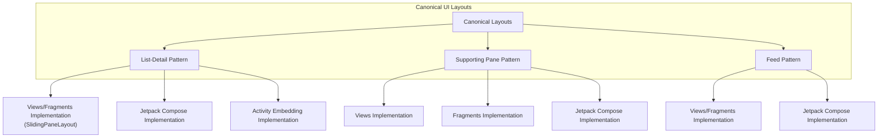
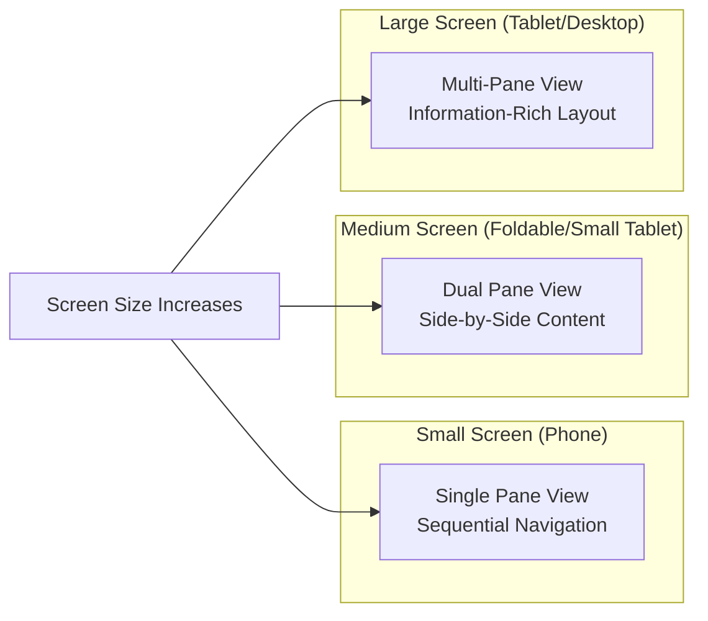
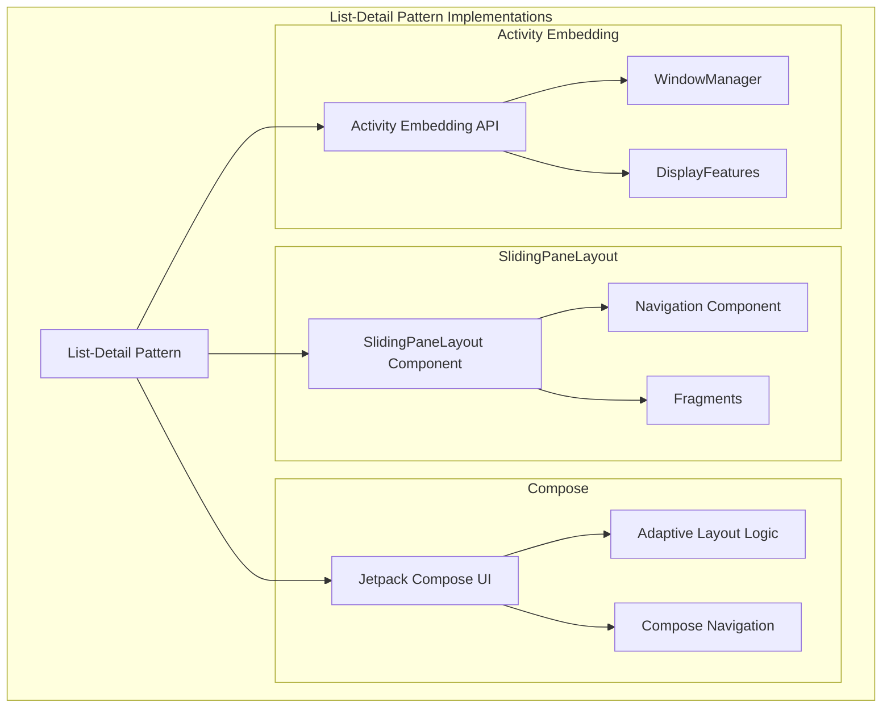
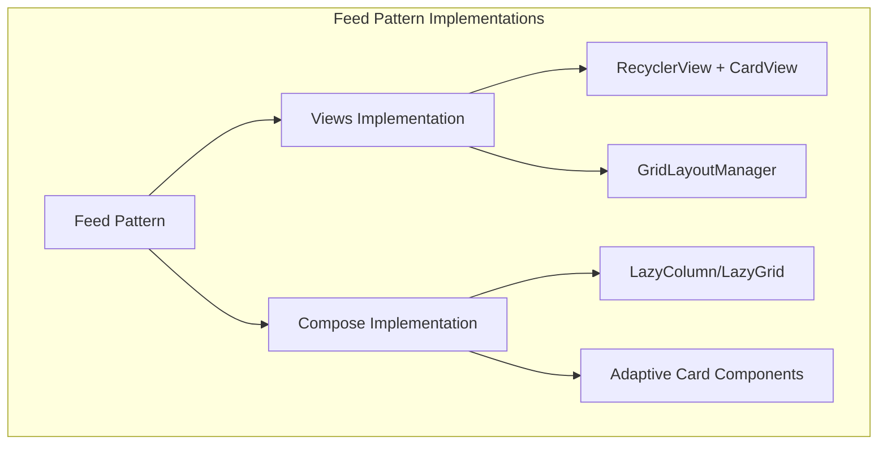
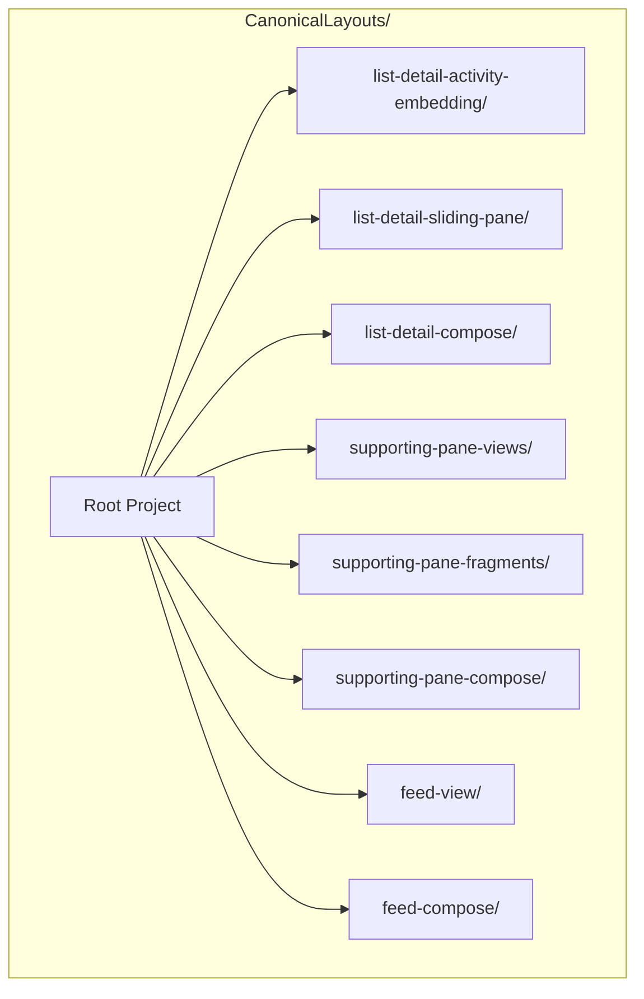

<!-- source: DeepWiki mcp.deepwiki.com · repo android/user-interface-samples · page 3 Canonical UI Layouts · fetched 2026-10-23 -->

# Canonical UI Layouts

Relevant source files

The following files were used as context for generating this wiki page:

- [CanonicalLayouts/README.md](CanonicalLayouts/README.md)
- [CanonicalLayouts/list-detail-sliding-pane/app/build.gradle](CanonicalLayouts/list-detail-sliding-pane/app/build.gradle)
- [CanonicalLayouts/list-detail-sliding-pane/app/src/main/AndroidManifest.xml](CanonicalLayouts/list-detail-sliding-pane/app/src/main/AndroidManifest.xml)
- [CanonicalLayouts/list-detail-sliding-pane/build.gradle](CanonicalLayouts/list-detail-sliding-pane/build.gradle)
- [CanonicalLayouts/list-detail-sliding-pane/gradle.properties](CanonicalLayouts/list-detail-sliding-pane/gradle.properties)
- [CanonicalLayouts/list-detail-sliding-pane/gradle/wrapper/gradle-wrapper.properties](CanonicalLayouts/list-detail-sliding-pane/gradle/wrapper/gradle-wrapper.properties)

## Purpose and Scope

This page provides an overview of the canonical layout patterns available in the Android User Interface Samples repository for building responsive and adaptive UIs across different screen sizes. These layouts are design patterns that optimize the user experience on various devices, from phones to tablets, foldables, and ChromeOS devices. 

For detailed information about specific implementation approaches, see:
- [List-Detail Pattern](#3.1)
- [Supporting Pane Pattern](#3.2)

Sources: [CanonicalLayouts/README.md:1-23]()

## Introduction to Canonical Layouts

Canonical layouts are proven UI design patterns that provide consistent and optimized user experiences across the diverse Android device ecosystem. These layouts automatically adapt to different screen sizes and configurations, ensuring efficient use of available screen real estate and improving user productivity.

The repository implements several canonical layouts with multiple implementation approaches, allowing developers to choose the most appropriate solution for their codebase (traditional Views, Fragments, or Jetpack Compose).

### Key Canonical Layout Patterns

Sources: [CanonicalLayouts/README.md:11-22]()

## Responsive Design Principles

Canonical layouts follow core responsive design principles that ensure UIs work well across all form factors:

1. **Layout Adaptation**: Different form factors receive appropriately sized and positioned UI elements
2. **Content Priority**: Critical content remains visible and accessible regardless of screen size
3. **Consistent Navigation**: Navigation patterns remain consistent while adapting to available space
4. **Optimal Information Density**: Content density adjusts based on screen size and input method

### Adaptation Across Screen Sizes

Sources: [CanonicalLayouts/README.md:1-5]()

## Implementation Approaches

The repository provides multiple implementation approaches for each canonical layout pattern, allowing developers to choose the most appropriate solution based on their codebase and requirements.

| Pattern | Views/Fragments | Jetpack Compose | Special Implementations |
|---------|----------------|-----------------|-------------------------|
| List-Detail | SlidingPaneLayout | Compose UI | Activity Embedding |
| Supporting Pane | Views & Fragments | Compose UI | - |
| Feed | Views & Fragments | Compose UI | - |

Sources: [CanonicalLayouts/README.md:11-22](), [CanonicalLayouts/list-detail-sliding-pane/app/build.gradle:54-67]()

## List-Detail Pattern

The List-Detail pattern presents a list of items on one side and details for the selected item on the other. This pattern is perfect for email clients, settings screens, and content management applications.

Key features:
- On smaller screens, the list and detail views are shown sequentially
- On larger screens, the list and detail views appear side-by-side
- Smooth transitions between list and detail views

### Technical Implementation

The List-Detail pattern is implemented in three different ways:

1. **SlidingPaneLayout**: Uses the AndroidX SlidingPaneLayout component for View-based UIs
2. **Jetpack Compose**: Pure Compose implementation with adaptive layouts
3. **Activity Embedding**: Multi-activity approach for large screen devices

Sources: [CanonicalLayouts/list-detail-sliding-pane/app/build.gradle:54-67](), [CanonicalLayouts/README.md:12-15]()

## Supporting Pane Pattern

The Supporting Pane pattern displays main content alongside supporting content (like filters, settings, or auxiliary information). This pattern helps users access supporting features without leaving the main content view.

Key features:
- Main content remains the primary focus
- Supporting pane can be collapsed or expanded as needed
- Supporting content adapts in visibility based on screen size

### Technical Implementation

The Supporting Pane is implemented in three different ways:

1. **Views**: Using traditional Android Views and ViewGroups
2. **Fragments**: Fragment-based implementation with navigation
3. **Jetpack Compose**: Pure Compose implementation with state management

Sources: [CanonicalLayouts/README.md:19-22]()

## Feed Pattern

The Feed pattern displays a list of cards or items in a scrollable layout, optimized for content consumption. This pattern is commonly used in social media apps, news readers, and content aggregators.

Key features:
- Vertical scrolling interface on smaller screens
- Grid-based layouts on larger screens
- Adaptive card sizes based on content and screen width

Sources: [CanonicalLayouts/README.md:16-18]()

## Project Structure

The Canonical Layouts sample code is organized into separate Android projects for each implementation approach:

Each individual project contains a complete Android application that demonstrates the particular implementation approach for that canonical layout pattern.

Sources: [CanonicalLayouts/README.md:11-22](), [CanonicalLayouts/list-detail-sliding-pane/app/build.gradle:1-67]()

## Dependencies and Requirements

The Canonical Layouts samples utilize several key AndroidX libraries:

| Library | Purpose | Example |
|---------|---------|---------|
| SlidingPaneLayout | Implements swipe-based list-detail pattern | `androidx.slidingpanelayout:slidingpanelayout:1.2.0` |
| Navigation Component | Manages fragment navigation | `androidx.navigation:navigation-fragment-ktx:2.7.7` |
| ConstraintLayout | Creates adaptive layouts | `androidx.constraintlayout:constraintlayout:2.1.4` |
| Jetpack Compose | Declarative UI for modern implementations | Varies by sample |

All samples are compatible with:
- Minimum SDK: 21 (Android 5.0, Lollipop)
- Targeted for modern Android versions (SDK 35+)

Sources: [CanonicalLayouts/list-detail-sliding-pane/app/build.gradle:22-51](), [CanonicalLayouts/list-detail-sliding-pane/app/build.gradle:54-67]()

## Related Systems

The Canonical Layout patterns are designed to work seamlessly with other Android UI systems, particularly:

- [Window Management](#2) - For detecting and responding to display features on foldable devices
- [Window Insets Animation](#2.2) - For smooth transitions when the keyboard appears/disappears

For implementing these patterns with widgets, see the [App Widgets](#4) documentation.

Sources: [CanonicalLayouts/README.md:1-5]()

---

