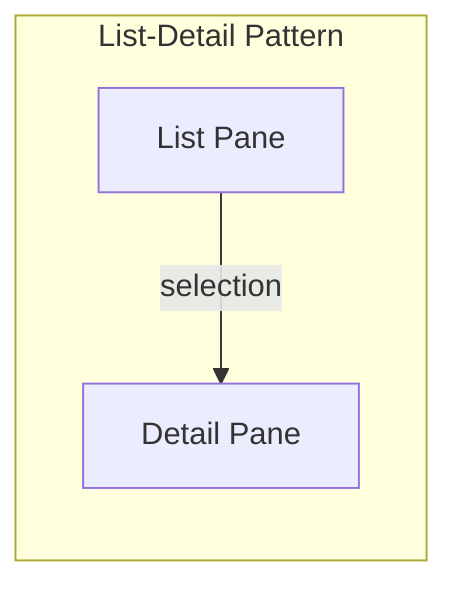
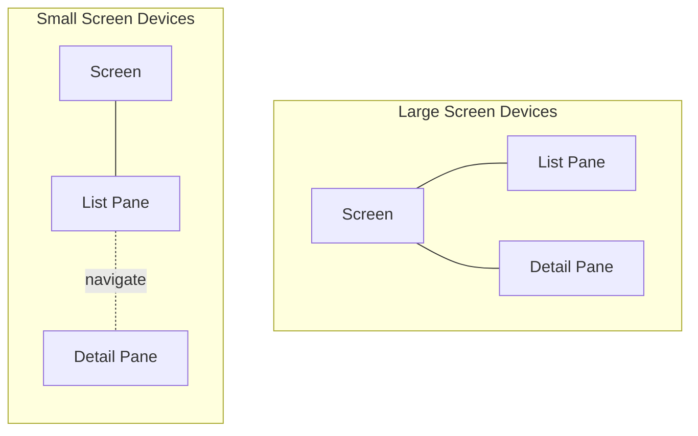
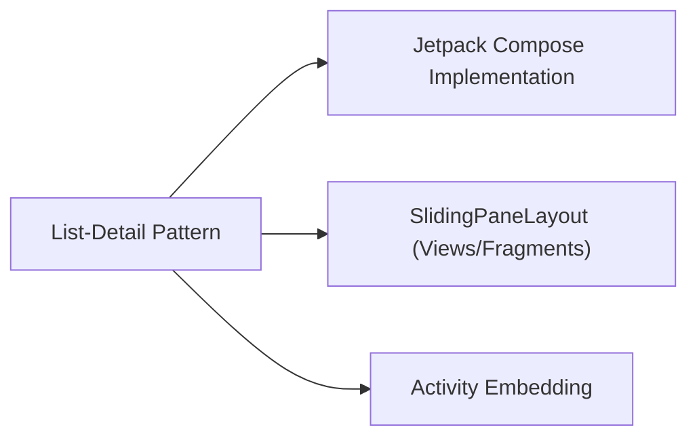
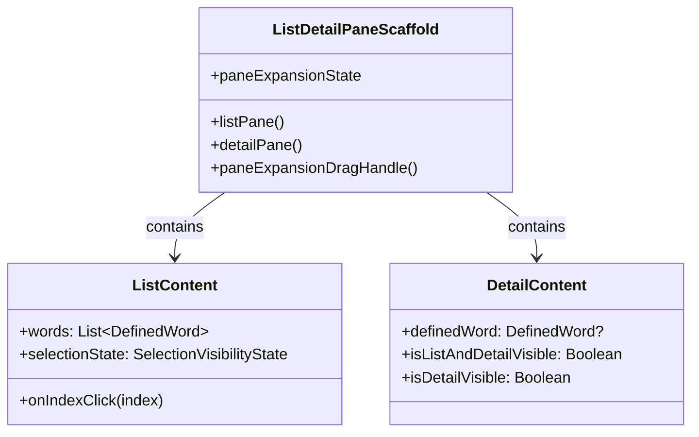
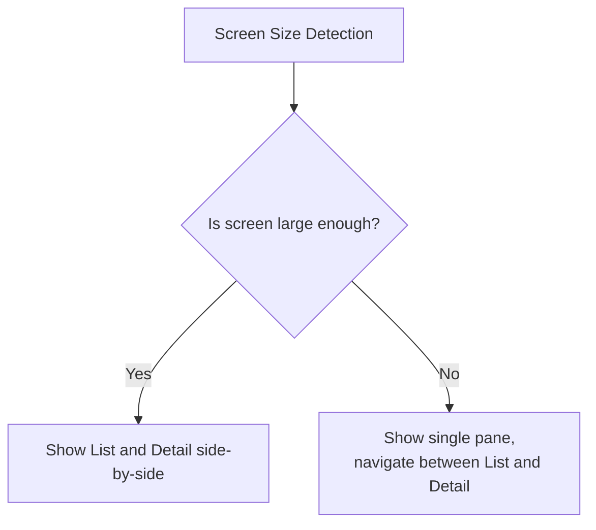
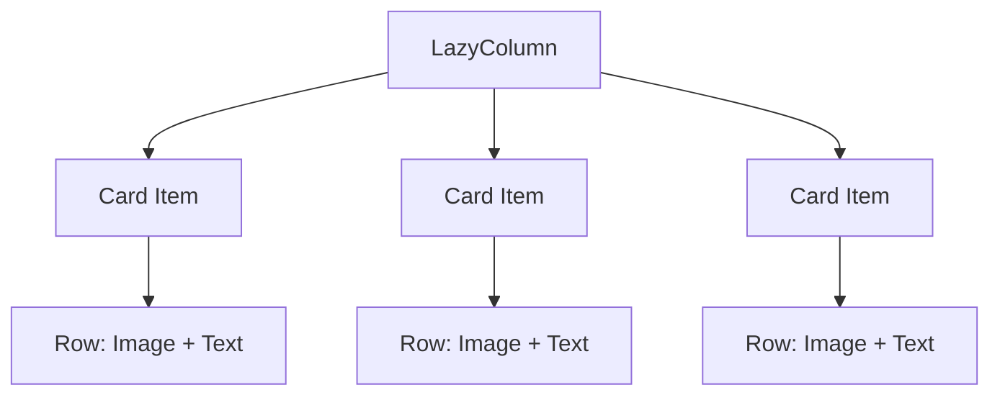
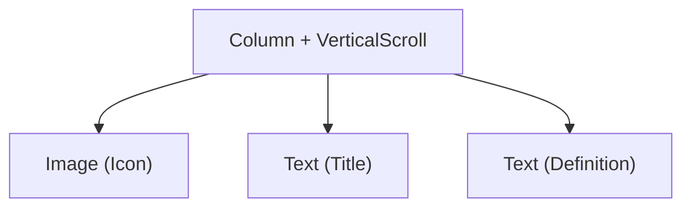
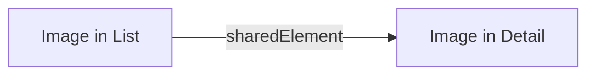

<!-- source: DeepWiki mcp.deepwiki.com · repo android/user-interface-samples · page 3.1 List-Detail Pattern · fetched 2026-10-23 -->

# List-Detail Pattern

<details>
<summary>Relevant source files</summary>

The following files were used as context for generating this wiki page:

- [CanonicalLayouts/README.md](CanonicalLayouts/README.md)
- [CanonicalLayouts/list-detail-compose/app/build.gradle](CanonicalLayouts/list-detail-compose/app/build.gradle)
- [CanonicalLayouts/list-detail-compose/app/src/main/java/com/example/listdetailcompose/MainActivity.kt](CanonicalLayouts/list-detail-compose/app/src/main/java/com/example/listdetailcompose/MainActivity.kt)
- [CanonicalLayouts/list-detail-compose/app/src/main/java/com/example/listdetailcompose/ui/ListDetailSample.kt](CanonicalLayouts/list-detail-compose/app/src/main/java/com/example/listdetailcompose/ui/ListDetailSample.kt)
- [CanonicalLayouts/list-detail-compose/app/src/main/res/drawable/ic_food.xml](CanonicalLayouts/list-detail-compose/app/src/main/res/drawable/ic_food.xml)
- [CanonicalLayouts/list-detail-compose/app/src/main/res/drawable/ic_no_food.xml](CanonicalLayouts/list-detail-compose/app/src/main/res/drawable/ic_no_food.xml)
- [CanonicalLayouts/list-detail-compose/app/src/main/res/values/strings.xml](CanonicalLayouts/list-detail-compose/app/src/main/res/values/strings.xml)
- [CanonicalLayouts/list-detail-compose/build.gradle](CanonicalLayouts/list-detail-compose/build.gradle)
- [CanonicalLayouts/list-detail-compose/gradle/wrapper/gradle-wrapper.properties](CanonicalLayouts/list-detail-compose/gradle/wrapper/gradle-wrapper.properties)
- [CanonicalLayouts/list-detail-sliding-pane/app/build.gradle](CanonicalLayouts/list-detail-sliding-pane/app/build.gradle)
- [CanonicalLayouts/list-detail-sliding-pane/app/src/main/AndroidManifest.xml](CanonicalLayouts/list-detail-sliding-pane/app/src/main/AndroidManifest.xml)
- [CanonicalLayouts/list-detail-sliding-pane/build.gradle](CanonicalLayouts/list-detail-sliding-pane/build.gradle)
- [CanonicalLayouts/list-detail-sliding-pane/gradle.properties](CanonicalLayouts/list-detail-sliding-pane/gradle.properties)
- [CanonicalLayouts/list-detail-sliding-pane/gradle/wrapper/gradle-wrapper.properties](CanonicalLayouts/list-detail-sliding-pane/gradle/wrapper/gradle-wrapper.properties)

</details>


## Purpose and Scope

This document describes the List-Detail pattern, a canonical UI layout pattern for creating responsive and adaptive interfaces across various Android device form factors. The List-Detail pattern displays a list of items on one side and the details of a selected item on the other side, with the layout adapting based on available screen space. This pattern is particularly useful for applications that need to display collections of data and their associated details.

For information about other canonical UI layouts, see [Canonical UI Layouts](#3).

## Pattern Overview

The List-Detail pattern consists of two primary components:

1. **List Pane**: Displays a scrollable list of items that users can select
2. **Detail Pane**: Shows detailed information about the currently selected item



Sources: [CanonicalLayouts/list-detail-compose/app/src/main/java/com/example/listdetailcompose/ui/ListDetailSample.kt:113-169]()

The pattern adapts to different screen sizes:
- On larger screens (tablets, foldables): Both panes appear side-by-side
- On smaller screens (phones): Only one pane is visible at a time, with navigation between them



Sources: [CanonicalLayouts/README.md:1-23](), [CanonicalLayouts/list-detail-compose/app/src/main/java/com/example/listdetailcompose/ui/ListDetailSample.kt:98-169]()

## Implementation Options

The Android UI Samples repository provides three different implementations of the List-Detail pattern:



Sources: [CanonicalLayouts/README.md:11-15]()

### Jetpack Compose Implementation

The Compose implementation uses Material 3 Adaptive components to create a responsive List-Detail UI.



Sources: [CanonicalLayouts/list-detail-compose/app/src/main/java/com/example/listdetailcompose/ui/ListDetailSample.kt:98-169](), [CanonicalLayouts/list-detail-compose/app/src/main/java/com/example/listdetailcompose/ui/ListDetailSample.kt:197-355]()

Key components:
- `ListDetailPaneScaffold`: Container that manages both panes
- `rememberListDetailPaneScaffoldNavigator`: Manages navigation between panes
- `AnimatedPane`: Provides animations for transitions between panes
- `SharedTransitionLayout`: Enables shared element transitions

The implementation leverages Jetpack Compose's adaptive layout capabilities and Material 3 components to automatically handle different screen sizes.

Dependencies:
```
androidx.compose.material3.adaptive:adaptive:1.1.0-alpha07
androidx.compose.material3.adaptive:adaptive-layout:1.1.0-alpha07
androidx.compose.material3.adaptive:adaptive-navigation:1.1.0-alpha07
```

Sources: [CanonicalLayouts/list-detail-compose/app/build.gradle:80-83]()

## Adaptation Logic

The List-Detail pattern determines the appropriate layout based on available screen width:



The `PaneAdaptedValue` indicates the state of each pane:
- `PaneAdaptedValue.Expanded`: Pane is visible
- Navigation between panes is managed by `ListDetailPaneScaffoldNavigator`

The implementation handles back navigation using the `BackHandler` composable:

```kotlin
BackHandler(enabled = navigator.canNavigateBack()) {
    scope.launch {
        navigator.navigateBack()
    }
}
```

Sources: [CanonicalLayouts/list-detail-compose/app/src/main/java/com/example/listdetailcompose/ui/ListDetailSample.kt:102-109]()

## Implementation Details

### List Pane

The list pane is implemented using a `LazyColumn` that displays a collection of items:



Selection state is managed through the `SelectionVisibilityState` interface, which can be either:
- `NoSelection`: No item is selected (items are clickable)
- `ShowSelection`: An item is selected (items are selectable)

Sources: [CanonicalLayouts/list-detail-compose/app/src/main/java/com/example/listdetailcompose/ui/ListDetailSample.kt:176-192](), [CanonicalLayouts/list-detail-compose/app/src/main/java/com/example/listdetailcompose/ui/ListDetailSample.kt:197-300]()

### Detail Pane

The detail pane displays information about the selected item using a scrollable `Column`:



If no item is selected, a placeholder message is displayed.

Sources: [CanonicalLayouts/list-detail-compose/app/src/main/java/com/example/listdetailcompose/ui/ListDetailSample.kt:305-355]()

### Shared Element Transitions

The implementation uses Compose's shared element transition API to create smooth visual transitions between the list and detail panes:



This is implemented using:
- `SharedTransitionLayout`: Container for transitions
- `sharedElement` modifier: Tags elements for transition
- `rememberSharedContentState`: Creates a state for the transition

Sources: [CanonicalLayouts/list-detail-compose/app/src/main/java/com/example/listdetailcompose/ui/ListDetailSample.kt:111-112](), [CanonicalLayouts/list-detail-compose/app/src/main/java/com/example/listdetailcompose/ui/ListDetailSample.kt:273-281](), [CanonicalLayouts/list-detail-compose/app/src/main/java/com/example/listdetailcompose/ui/ListDetailSample.kt:321-335]()

## Usage Example

To use the List-Detail pattern in an application:

1. Add the required dependencies
2. Implement the list and detail content components
3. Use the appropriate container based on your implementation choice
4. Handle selection state and navigation

In the example from the repository, a simple list of food items is displayed with their definitions:

```
MainActivity → ListDetailSample → ListDetailPaneScaffold
```

Sources: [CanonicalLayouts/list-detail-compose/app/src/main/java/com/example/listdetailcompose/MainActivity.kt:27-38]()

## Additional Implementation Options

While this document focuses on the Compose implementation, the repository also includes:

1. **SlidingPaneLayout Implementation**: Uses the traditional View system with `SlidingPaneLayout` and Fragments

2. **Activity Embedding Implementation**: Leverages the Activity Embedding API for multi-window experiences

For details on these implementations, see [List-Detail with Sliding Pane](#3.1.2) and [List-Detail with Activity Embedding](#3.1.3).

Sources: [CanonicalLayouts/README.md:11-15]()

## Summary

The List-Detail pattern provides a versatile solution for displaying collections of data and their details in a responsive manner. The implementation options available in the Android UI Samples repository demonstrate different approaches to achieve this pattern, with the Compose implementation offering the most modern and declarative approach.

By adapting to different screen sizes automatically, this pattern helps create consistent user experiences across the diverse Android device ecosystem, from phones to tablets and foldable devices.

---

