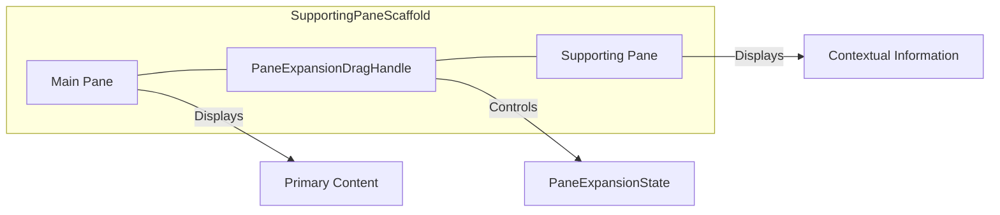
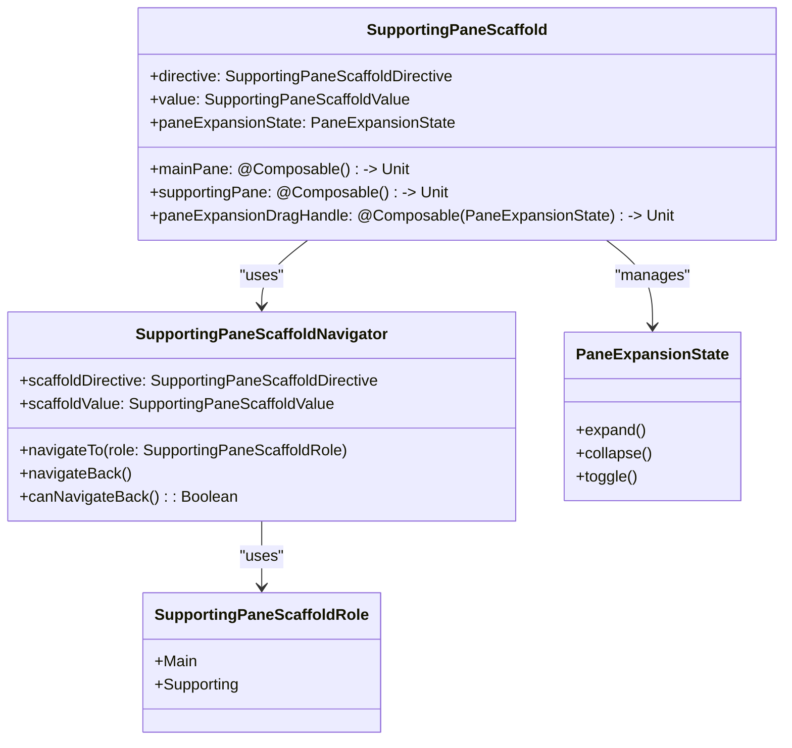
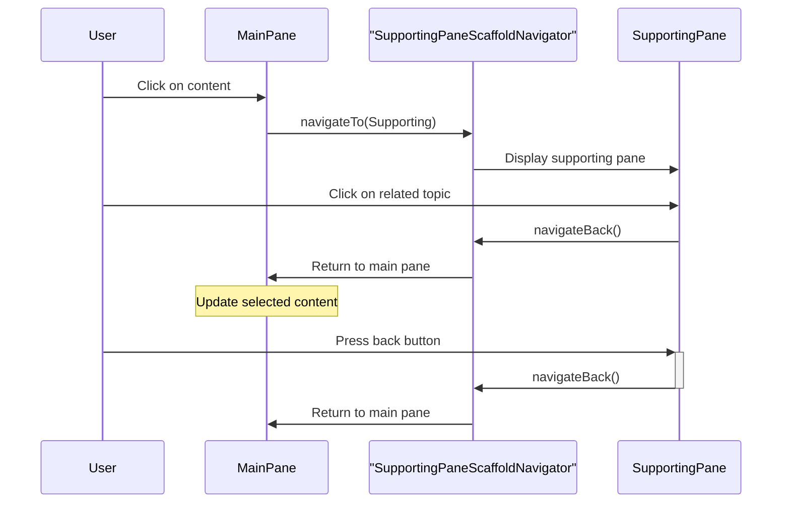
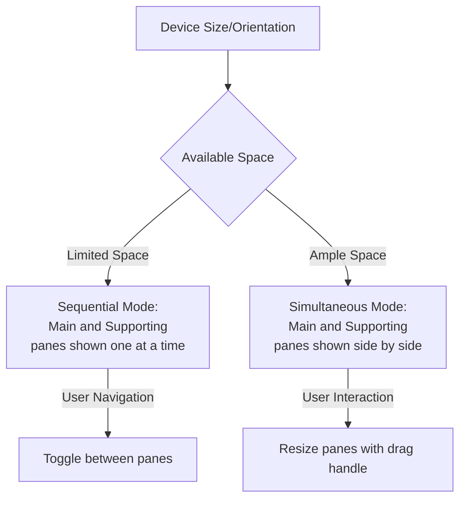
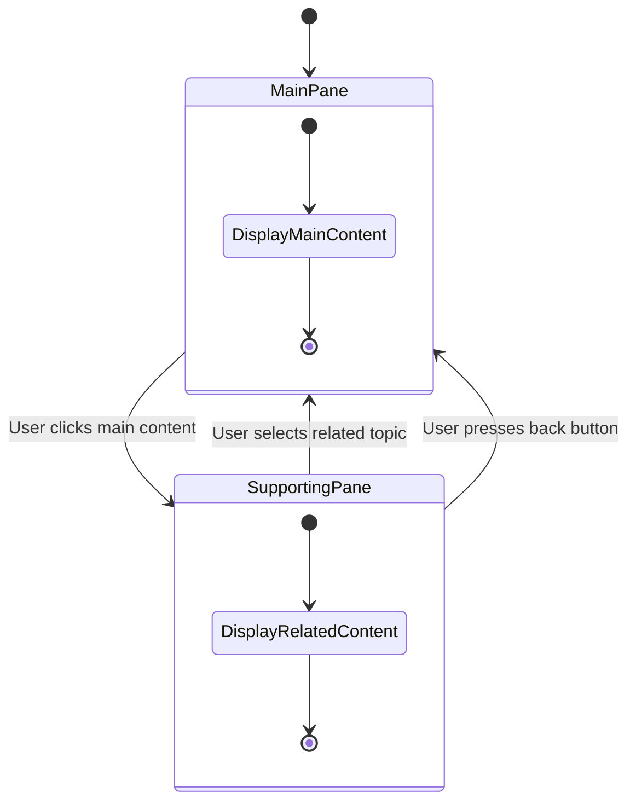

<!-- source: DeepWiki mcp.deepwiki.com · repo android/user-interface-samples · page 3.2 Supporting Pane Pattern · fetched 2026-10-23 -->

# Supporting Pane Pattern

Relevant source files

The following files were used as context for generating this wiki page:

- [CanonicalLayouts/feed-compose/app/build.gradle](CanonicalLayouts/feed-compose/app/build.gradle)
- [CanonicalLayouts/feed-compose/app/src/main/AndroidManifest.xml](CanonicalLayouts/feed-compose/app/src/main/AndroidManifest.xml)
- [CanonicalLayouts/feed-compose/app/src/main/java/com/example/feedcompose/ui/components/TopAppBar.kt](CanonicalLayouts/feed-compose/app/src/main/java/com/example/feedcompose/ui/components/TopAppBar.kt)
- [CanonicalLayouts/feed-compose/app/src/main/java/com/example/feedcompose/ui/screen/SweetsDetails.kt](CanonicalLayouts/feed-compose/app/src/main/java/com/example/feedcompose/ui/screen/SweetsDetails.kt)
- [CanonicalLayouts/feed-compose/build.gradle](CanonicalLayouts/feed-compose/build.gradle)
- [CanonicalLayouts/feed-compose/gradle.properties](CanonicalLayouts/feed-compose/gradle.properties)
- [CanonicalLayouts/feed-compose/gradle/wrapper/gradle-wrapper.properties](CanonicalLayouts/feed-compose/gradle/wrapper/gradle-wrapper.properties)
- [CanonicalLayouts/supporting-pane-compose/app/build.gradle](CanonicalLayouts/supporting-pane-compose/app/build.gradle)
- [CanonicalLayouts/supporting-pane-compose/app/src/main/java/com/example/supportingpanecompose/MainActivity.kt](CanonicalLayouts/supporting-pane-compose/app/src/main/java/com/example/supportingpanecompose/MainActivity.kt)
- [CanonicalLayouts/supporting-pane-compose/app/src/main/java/com/example/supportingpanecompose/ui/SupportingPaneSample.kt](CanonicalLayouts/supporting-pane-compose/app/src/main/java/com/example/supportingpanecompose/ui/SupportingPaneSample.kt)
- [CanonicalLayouts/supporting-pane-compose/app/src/main/res/values/strings.xml](CanonicalLayouts/supporting-pane-compose/app/src/main/res/values/strings.xml)
- [CanonicalLayouts/supporting-pane-compose/build.gradle](CanonicalLayouts/supporting-pane-compose/build.gradle)
- [CanonicalLayouts/supporting-pane-compose/gradle.properties](CanonicalLayouts/supporting-pane-compose/gradle.properties)
- [CanonicalLayouts/supporting-pane-compose/gradle/wrapper/gradle-wrapper.properties](CanonicalLayouts/supporting-pane-compose/gradle/wrapper/gradle-wrapper.properties)

## Purpose and Scope

The Supporting Pane Pattern is a canonical UI layout pattern designed for creating adaptive user interfaces that display primary content alongside supplementary content. This pattern is particularly effective for large-screen devices like tablets and foldables, where the additional screen real estate can be utilized to show contextual information without requiring the user to navigate away from the main content.

This document covers the implementation of the Supporting Pane Pattern using Jetpack Compose with Material 3's adaptive components. For information about the related List-Detail Pattern, see [List-Detail Pattern](#3.1).

Sources: [CanonicalLayouts/supporting-pane-compose/app/src/main/java/com/example/supportingpanecompose/ui/SupportingPaneSample.kt:1-159]()

## Core Concepts

The Supporting Pane Pattern consists of two main components:

1. **Main Pane**: Contains the primary content that is the focus of the user's attention.
2. **Supporting Pane**: Displays contextual, supplementary information related to the main content.

Unlike the List-Detail pattern which focuses on navigation between a list and its selected item details, the Supporting Pane pattern emphasizes providing contextual information that complements the main content without replacing it.

### Supporting Pane Pattern Diagram

Sources: [CanonicalLayouts/supporting-pane-compose/app/src/main/java/com/example/supportingpanecompose/ui/SupportingPaneSample.kt:64-159]()

## Implementation Architecture

The Supporting Pane Pattern in this sample is implemented using Jetpack Compose with Material 3 Adaptive components. The core of the implementation is the `SupportingPaneScaffold` component which manages the layout and interactions between the main and supporting panes.

### Key Components Diagram

Sources: [CanonicalLayouts/supporting-pane-compose/app/src/main/java/com/example/supportingpanecompose/ui/SupportingPaneSample.kt:64-159]()

## Implementation Details

The sample implementation in the repository demonstrates the Supporting Pane Pattern in action. Let's examine the key elements:

### Core Components

1. **SupportingPaneScaffold**: The main layout component that manages the arrangement of the main and supporting panes.
2. **SupportingPaneScaffoldNavigator**: Handles navigation between the main and supporting panes.
3. **PaneExpansionState**: Controls the expansion state of the supporting pane.
4. **AnimatedPane**: Provides animation effects when displaying the supporting pane content.
5. **VerticalDragHandle**: Allows users to manually adjust the pane expansion.

### Sample Implementation Flow

Sources: [CanonicalLayouts/supporting-pane-compose/app/src/main/java/com/example/supportingpanecompose/ui/SupportingPaneSample.kt:64-105]()

## Code Structure

The sample is implemented in a single composable function called `SupportingPaneSample`. Here's a breakdown of its structure:

1. **State Management**:
   - Tracks the selected topic using a saveable state
   - Uses `rememberSupportingPaneScaffoldNavigator` for navigation between panes
   - Handles back navigation with `BackHandler`

2. **SupportingPaneScaffold**:
   - Defines the layout structure with main and supporting panes
   - Configures the pane expansion state and drag handle
   - Associates the navigator with the scaffold

3. **Supporting Pane Content**:
   - Displays related content in a lazy column
   - Handles click events to navigate back to the main pane with updated content

4. **Main Pane Content**:
   - Shows the selected topic
   - Provides interaction to navigate to the supporting pane

Sources: [CanonicalLayouts/supporting-pane-compose/app/src/main/java/com/example/supportingpanecompose/ui/SupportingPaneSample.kt:64-159](), [CanonicalLayouts/supporting-pane-compose/app/src/main/java/com/example/supportingpanecompose/MainActivity.kt:16-36]()

## Dependencies and Setup

The implementation relies on several key dependencies:

| Dependency | Purpose |
|------------|---------|
| `androidx.compose.material3.adaptive:adaptive` | Core adaptive components |
| `androidx.compose.material3.adaptive:adaptive-layout` | Provides `SupportingPaneScaffold` |
| `androidx.compose.material3.adaptive:adaptive-navigation` | Navigation between panes |
| `androidx.window:window` | Window size detection |
| `androidx.compose.material3:material3-window-size-class` | Window size classification |

Note that the Material 3 Adaptive components are still experimental, as indicated by the `@ExperimentalMaterial3AdaptiveApi` annotation used in the sample.

Sources: [CanonicalLayouts/supporting-pane-compose/app/build.gradle:70-84]()

## Adaptive Behavior

The Supporting Pane Pattern is designed to adapt to different screen sizes and orientations. The implementation provided uses Material 3 Adaptive components which automatically handle layout adjustments based on available screen space.

### Adaptation Modes

Sources: [CanonicalLayouts/supporting-pane-compose/app/src/main/java/com/example/supportingpanecompose/ui/SupportingPaneSample.kt:76-158]()

## Navigation Model

The sample implements a navigation model that allows users to move between the main and supporting panes:

1. **From Main to Supporting**: User clicks on the main content to view related information
2. **From Supporting to Main**: User selects a related topic or presses the back button

The navigation is managed by the `SupportingPaneScaffoldNavigator` which provides methods for navigating between panes and handling back navigation.

### Navigation Flow Diagram

Sources: [CanonicalLayouts/supporting-pane-compose/app/src/main/java/com/example/supportingpanecompose/ui/SupportingPaneSample.kt:66-74](), [CanonicalLayouts/supporting-pane-compose/app/src/main/java/com/example/supportingpanecompose/ui/SupportingPaneSample.kt:100-106](), [CanonicalLayouts/supporting-pane-compose/app/src/main/java/com/example/supportingpanecompose/ui/SupportingPaneSample.kt:130-135]()

## User Interaction Elements

The implementation includes several user interaction elements:

1. **Clickable Main Content**: Allows users to navigate to the supporting pane
2. **Clickable Related Topics**: Enables selection of a new topic from the supporting pane
3. **Drag Handle**: Provides manual control over the supporting pane's expansion state
4. **Back Navigation**: Allows returning to the main pane from the supporting pane

These elements together create a fluid, intuitive navigation experience between content areas.

Sources: [CanonicalLayouts/supporting-pane-compose/app/src/main/java/com/example/supportingpanecompose/ui/SupportingPaneSample.kt:95-106](), [CanonicalLayouts/supporting-pane-compose/app/src/main/java/com/example/supportingpanecompose/ui/SupportingPaneSample.kt:127-143](), [CanonicalLayouts/supporting-pane-compose/app/src/main/java/com/example/supportingpanecompose/ui/SupportingPaneSample.kt:147-157]()

## Best Practices and Considerations

When implementing the Supporting Pane Pattern, consider the following best practices:

1. **Content Relationship**: The supporting pane should display content that is contextually related to the main content.
2. **Content Independence**: The main content should be fully functional without requiring access to the supporting pane.
3. **Adaptive Layout**: Ensure the UI adapts appropriately to different screen sizes and orientations.
4. **Navigation Clarity**: Provide clear affordances for navigating between panes.
5. **Performance**: Be mindful of the performance implications when loading content for both panes.

## When to Use

The Supporting Pane Pattern is ideal for scenarios where:

- You need to display contextual information alongside the main content
- The user would benefit from seeing related content without navigating away
- The application targets large-screen devices like tablets and foldables
- The supporting content enhances but isn't essential to the main experience

Sources: [CanonicalLayouts/supporting-pane-compose/app/src/main/java/com/example/supportingpanecompose/ui/SupportingPaneSample.kt:1-159]()

## Summary

The Supporting Pane Pattern provides an effective way to leverage larger screen real estate by displaying contextual information alongside the main content. The implementation in this sample demonstrates how to create this pattern using Jetpack Compose with Material 3 Adaptive components, handling navigation, state management, and adaptive layout behavior.

This pattern enhances the user experience on larger screens by providing additional context without requiring the user to navigate away from the main content, making it particularly valuable for tablet and foldable device experiences.

---

