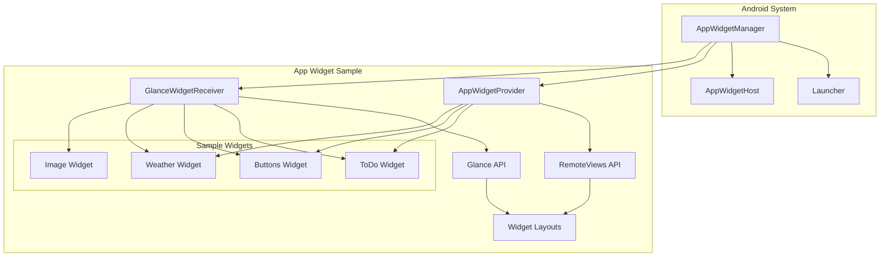
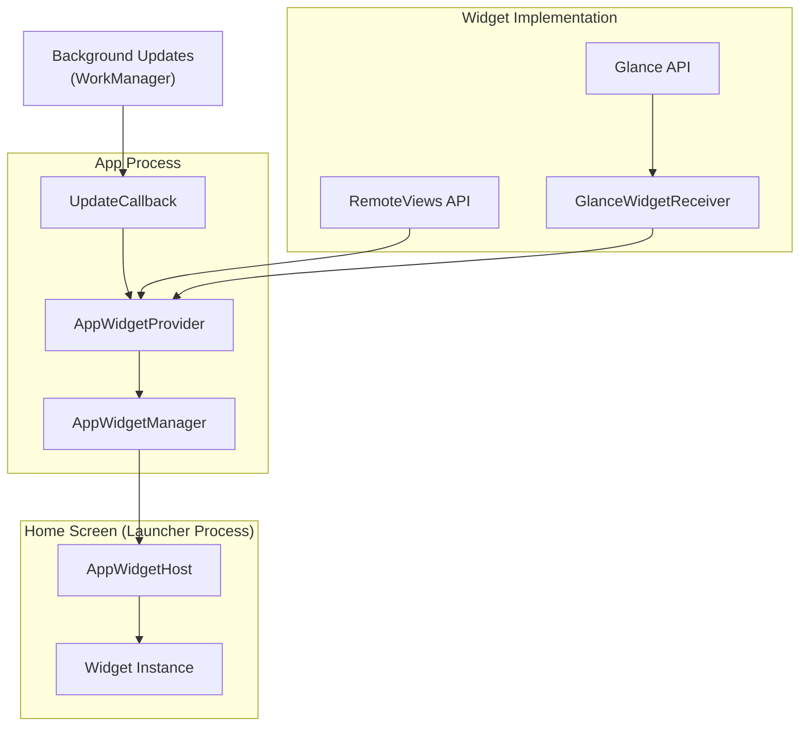
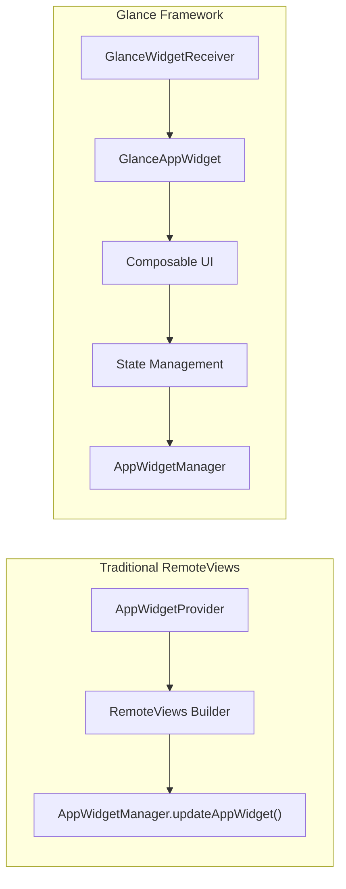
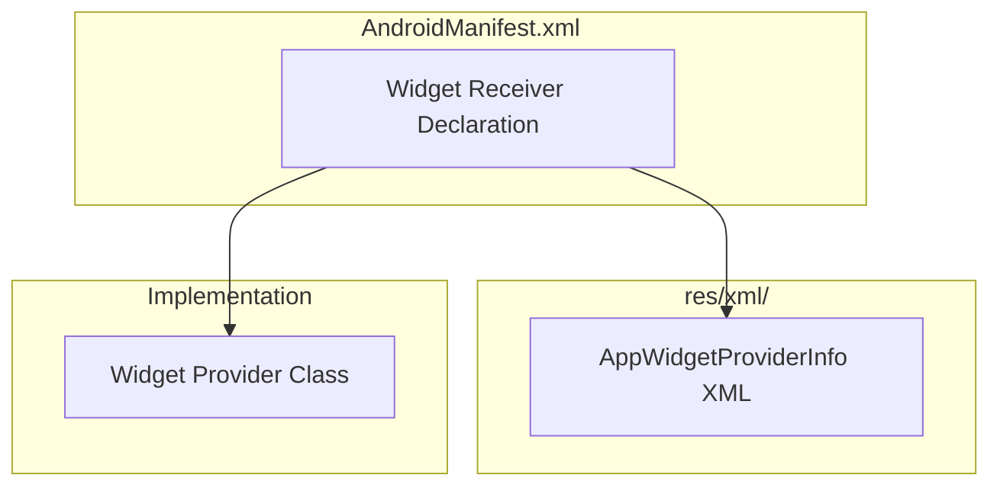
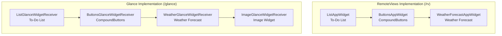
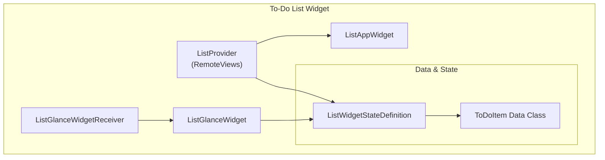
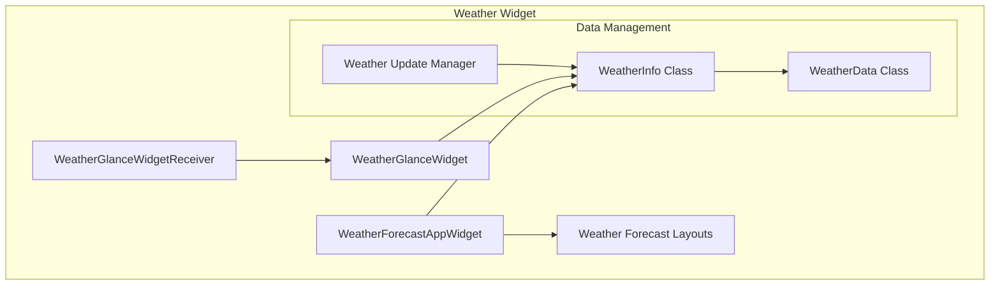
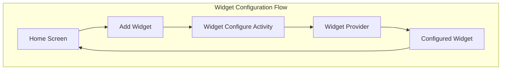
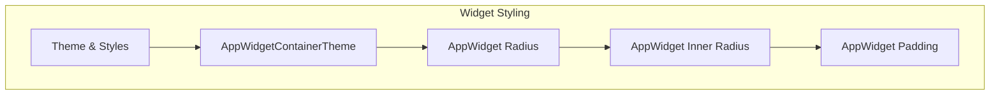
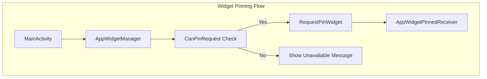

<!-- source: DeepWiki mcp.deepwiki.com · repo android/user-interface-samples · page 4 App Widgets · fetched 2026-10-23 -->

# App Widgets

<details>
<summary>Relevant source files</summary>

The following files were used as context for generating this wiki page:

- [AppWidget/README.md](AppWidget/README.md)
- [AppWidget/app/build.gradle](AppWidget/app/build.gradle)
- [AppWidget/app/src/main/AndroidManifest.xml](AppWidget/app/src/main/AndroidManifest.xml)
- [AppWidget/app/src/main/java/com/example/android/appwidget/glance/weather/WeatherInfo.kt](AppWidget/app/src/main/java/com/example/android/appwidget/glance/weather/WeatherInfo.kt)
- [AppWidget/app/src/main/res/drawable-nodpi/ic_partly_cloudy.xml](AppWidget/app/src/main/res/drawable-nodpi/ic_partly_cloudy.xml)
- [AppWidget/app/src/main/res/values-v31/styles.xml](AppWidget/app/src/main/res/values-v31/styles.xml)
- [AppWidget/app/src/main/res/values-v31/themes.xml](AppWidget/app/src/main/res/values-v31/themes.xml)
- [AppWidget/app/src/main/res/values/strings.xml](AppWidget/app/src/main/res/values/strings.xml)
- [AppWidget/app/src/main/res/values/themes.xml](AppWidget/app/src/main/res/values/themes.xml)
- [AppWidget/app/src/main/res/xml/app_widget_weather_forecast_glance.xml](AppWidget/app/src/main/res/xml/app_widget_weather_forecast_glance.xml)
- [AppWidget/build.gradle](AppWidget/build.gradle)
- [AppWidget/gradle.properties](AppWidget/gradle.properties)
- [AppWidget/gradle/wrapper/gradle-wrapper.properties](AppWidget/gradle/wrapper/gradle-wrapper.properties)

</details>


This document provides an overview of the App Widget samples in the Android User Interface Samples repository. It explains the architecture, implementation approaches, and examples for creating home screen widgets in Android applications.

For information about other UI components, see [Canonical UI Layouts](#3) or [Window Management](#2).

## Overview

App Widgets allow users to place interactive UI components from your app directly on their home screen. This repository demonstrates two primary approaches to building widgets:

1. **Traditional RemoteViews API** - The original approach using `AppWidgetProvider` and `RemoteViews`
2. **Glance Framework** - A newer, declarative API for building widgets with Kotlin

The samples showcase different widget types including to-do lists, weather forecasts, buttons, and image widgets, all implementing responsive layouts and proper integration with the Android home screen.



Sources:
- [AppWidget/README.md:9-47]()
- [AppWidget/app/src/main/AndroidManifest.xml:44-138]()
- [AppWidget/app/build.gradle:76-84]()

## Widget Architecture

The App Widget architecture follows a system where widgets are provided by the app but hosted in a separate process (typically the home screen launcher). Communication between the app and widget happens through `RemoteViews`, which allows cross-process view updates.



Sources:
- [AppWidget/README.md:11-19]()
- [AppWidget/app/build.gradle:76-84]()
- [AppWidget/app/src/main/AndroidManifest.xml:44-138]()

### RemoteViews vs Glance Approaches

The repository demonstrates two distinct approaches to building widgets:

| Feature | RemoteViews API | Glance API |
|---------|----------------|------------|
| API Style | Imperative | Declarative |
| Language | Java/Kotlin | Kotlin only |
| Layout Definition | XML-based | Code-based |
| State Management | Manual | Integrated |
| Introduced | Android 1.5 | Android 12+ |
| Package | `androidx.core:core-remoteviews` | `androidx.glance:glance-appwidget` |



Sources:
- [AppWidget/README.md:11-19]()
- [AppWidget/app/build.gradle:76-84]()
- [AppWidget/app/src/main/AndroidManifest.xml:57-138]()

## Widget Registration

Widgets must be registered in the Android manifest file. Each widget requires a `<receiver>` element with an intent filter for `android.appwidget.action.APPWIDGET_UPDATE` and a metadata entry pointing to an XML provider definition.



The manifest includes declarations for both RemoteViews and Glance implementations:

```
<receiver
    android:name=".rv.list.ListAppWidget"
    android:exported="false">
    <intent-filter>
        <action android:name="android.appwidget.action.APPWIDGET_UPDATE" />
    </intent-filter>
    <meta-data
        android:name="android.appwidget.provider"
        android:resource="@xml/app_widget_list_rv" />
</receiver>
```

For Glance widgets, the pattern is similar but uses different receiver classes:

```
<receiver
    android:name=".glance.weather.WeatherGlanceWidgetReceiver"
    android:label="@string/glance_weather"
    android:enabled="@bool/glance_appwidget_available"
    android:exported="false">
    <intent-filter>
        <action android:name="android.appwidget.action.APPWIDGET_UPDATE" />
    </intent-filter>
    <meta-data
        android:name="android.appwidget.provider"
        android:resource="@xml/app_widget_weather_forecast_glance" />
</receiver>
```

Sources:
- [AppWidget/app/src/main/AndroidManifest.xml:56-138]()
- [AppWidget/app/src/main/res/xml/app_widget_weather_forecast_glance.xml:16-29]()

## Widget Provider Definition

The AppWidgetProviderInfo XML files define the widget's properties including:

- Minimum dimensions (width and height)
- Minimum resize dimensions
- Update period
- Initial layout
- Preview image
- Description
- Resize modes
- Target cell size

Example from `app_widget_weather_forecast_glance.xml`:

```
<appwidget-provider xmlns:android="http://schemas.android.com/apk/res/android"
    android:description="@string/app_widget_weather_description"
    android:initialLayout="@layout/widget_loading"
    android:minWidth="184dp"
    android:minHeight="184dp"
    android:minResizeWidth="120dp"
    android:minResizeHeight="120dp"
    android:previewImage="@drawable/weather_forecast_widget_preview"
    android:previewLayout="@layout/widget_weather_forecast_small"
    android:resizeMode="horizontal|vertical"
    android:targetCellWidth="3"
    android:targetCellHeight="2"
    android:updatePeriodMillis="86400000"
    android:widgetCategory="home_screen" />
```

Sources:
- [AppWidget/app/src/main/res/xml/app_widget_weather_forecast_glance.xml:16-29]()

## Sample Widget Implementations

The repository contains four main widget examples implemented using both RemoteViews and Glance approaches:



Sources:
- [AppWidget/README.md:35-44]()
- [AppWidget/app/src/main/AndroidManifest.xml:56-138]()

### To-Do List Widget

The To-Do list widget demonstrates:

1. Creating a list of interactive items with checkboxes
2. Handling click events on individual items
3. Persisting the state of checked items



Sources:
- [AppWidget/README.md:37]()
- [AppWidget/app/src/main/AndroidManifest.xml:56-66]()
- [AppWidget/app/src/main/AndroidManifest.xml:89-99]()

### Weather Widget

The Weather widget shows a more complex "real-life" example with:

1. Current weather data display
2. Hourly and daily forecasts
3. Dynamic layout adaptation based on widget size
4. Background updates using WorkManager



The data model for the weather widget is defined in `WeatherInfo.kt`:

```kotlin
@Serializable
sealed interface WeatherInfo {
    @Serializable
    object Loading : WeatherInfo

    @Serializable
    data class Available(
        val placeName: String,
        val currentData: WeatherData,
        val hourlyForecast: List<WeatherData>,
        val dailyForecast: List<WeatherData>
    ) : WeatherInfo

    @Serializable
    data class Unavailable(val message: String) : WeatherInfo
}
```

Sources:
- [AppWidget/README.md:39]()
- [AppWidget/app/src/main/AndroidManifest.xml:78-88]()
- [AppWidget/app/src/main/AndroidManifest.xml:101-113]()
- [AppWidget/app/src/main/java/com/example/android/appwidget/glance/weather/WeatherInfo.kt:23-49]()

### Buttons Widget

The Buttons widget showcases:

1. CompoundButton handling (checkboxes, radio buttons, switches)
2. Click event processing
3. State preservation between updates

Sources:
- [AppWidget/README.md:38]()
- [AppWidget/app/src/main/AndroidManifest.xml:67-77]()
- [AppWidget/app/src/main/AndroidManifest.xml:114-125]()

### Image Widget

The Image widget (only implemented with Glance) demonstrates:

1. Loading and displaying images in widgets
2. Handling different widget sizes
3. Integration with filesystem for image loading

Sources:
- [AppWidget/README.md:39-57]()
- [AppWidget/app/src/main/AndroidManifest.xml:126-138]()
- [AppWidget/app/src/main/AndroidManifest.xml:140-148]() (FileProvider for image loading)

## Widget Configuration

Some widgets may require configuration before they're added to the home screen. The sample demonstrates this with the `ListWidgetConfigureActivity`:



Configuration activities must be declared in the manifest with the `android.appwidget.action.APPWIDGET_CONFIGURE` intent filter:

```
<activity
    android:name=".rv.list.ListWidgetConfigureActivity"
    android:exported="false">
    <intent-filter>
        <action android:name="android.appwidget.action.APPWIDGET_CONFIGURE" />
    </intent-filter>
</activity>
```

Sources:
- [AppWidget/app/src/main/AndroidManifest.xml:48-54]()

## Widget Styling

The sample demonstrates proper widget styling for a modern, integrated look on the home screen:



The styles are defined in themes.xml with variants for different API levels:

```
<style name="Theme.AppWidget.AppWidgetContainerParent" parent="Theme.Material3.DynamicColors.DayNight">
    <!-- Radius of the outer bound of widgets to make the rounded corners -->
    <item name="appWidgetRadius">16dp</item>
    <!--
    Radius of the inner view's bound of widgets to make the rounded corners.
    It needs to be 8dp or less than the value of appWidgetRadius
    -->
    <item name="appWidgetInnerRadius">8dp</item>
</style>

<style name="Theme.AppWidget.AppWidgetContainer" parent="Theme.AppWidget.AppWidgetContainerParent">
    <!-- Apply padding to avoid the content of the widget colliding with the rounded corners -->
    <item name="appWidgetPadding">16dp</item>
</style>
```

For Android 12 (API 31) and above, the system provides standard dimensions:

```
<style name="Theme.AppWidget.AppWidgetContainerParent" parent="Theme.Material3.DynamicColors.DayNight">
    <item name="appWidgetRadius">@android:dimen/system_app_widget_background_radius</item>
    <item name="appWidgetInnerRadius">@android:dimen/system_app_widget_inner_radius</item>
</style>
```

Sources:
- [AppWidget/app/src/main/res/values/themes.xml:32-45]()
- [AppWidget/app/src/main/res/values-v31/themes.xml:22-25]()
- [AppWidget/app/src/main/res/values-v31/styles.xml:23-38]()

## Widget Pinning

The sample also demonstrates how to request the launcher to "pin" a widget programmatically:



This functionality is demonstrated in the `MainActivity` and requires the `AppWidgetPinnedReceiver` to be declared in the manifest:

```
<receiver
    android:name=".AppWidgetPinnedReceiver"
    android:exported="false" />
```

Sources:
- [AppWidget/README.md:46-47]()
- [AppWidget/app/src/main/AndroidManifest.xml:44-46]()

## Technology Stack

The App Widget samples use a variety of technologies and libraries:

| Component | Purpose |
|-----------|---------|
| `androidx.core:core-remoteviews` | Enhanced RemoteViews support |
| `androidx.glance:glance-appwidget` | Declarative widget building |
| `kotlinx.serialization` | State serialization for Glance widgets |
| `androidx.work:work-runtime-ktx` | Background updates for widgets |
| `io.coil-kt:coil` | Image loading for Image widget |
| `Theme.Material3.DynamicColors` | Material 3 theming with dynamic color support |

Sources:
- [AppWidget/app/build.gradle:76-86]()
- [AppWidget/app/src/main/res/values/themes.xml:32]()

## Technical Requirements

- **Minimum SDK Version**: Android 8.0 (API level 26)
- **Target SDK Version**: Android 13 (API level 33)
- **Android Studio**: Chipmunk or newer

For Glance widgets, the app uses conditional enabling to ensure compatibility:

```
android:enabled="@bool/glance_appwidget_available"
```

Sources:
- [AppWidget/app/build.gradle:26-30]()
- [AppWidget/README.md:25-28]()
- [AppWidget/app/src/main/AndroidManifest.xml:91]()

---

