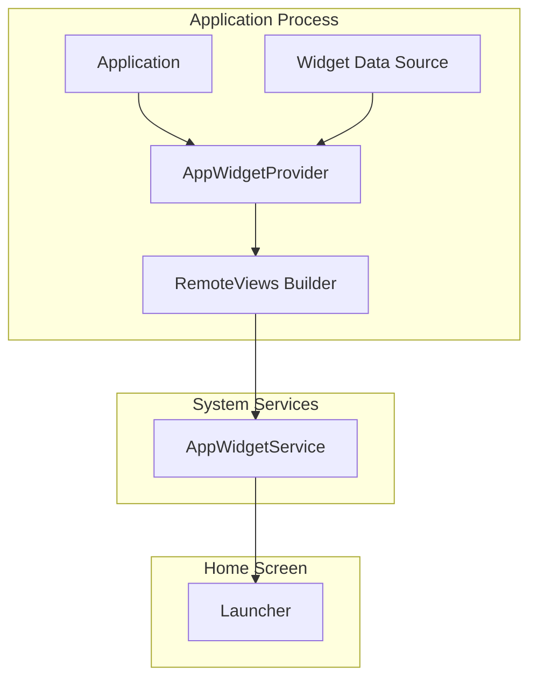
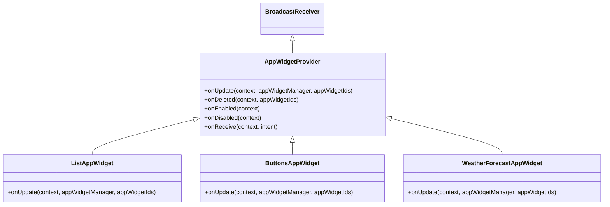
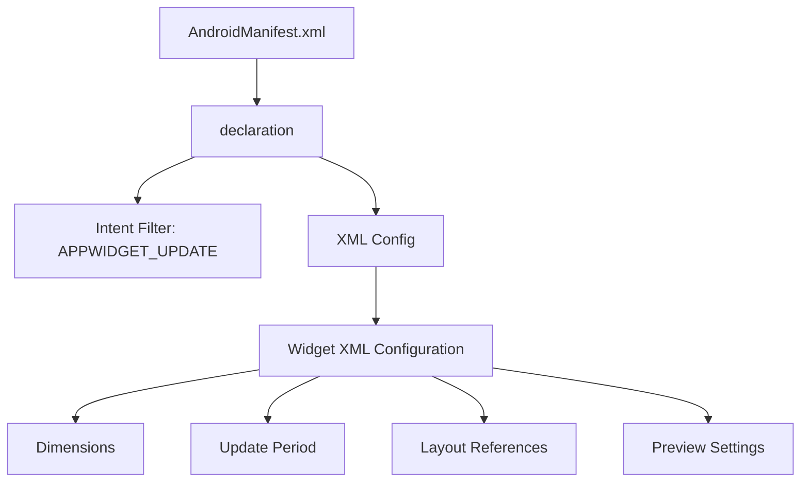
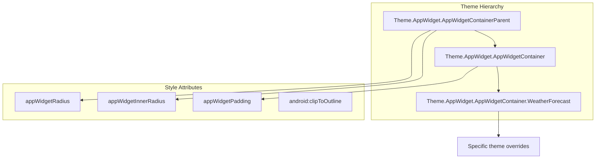
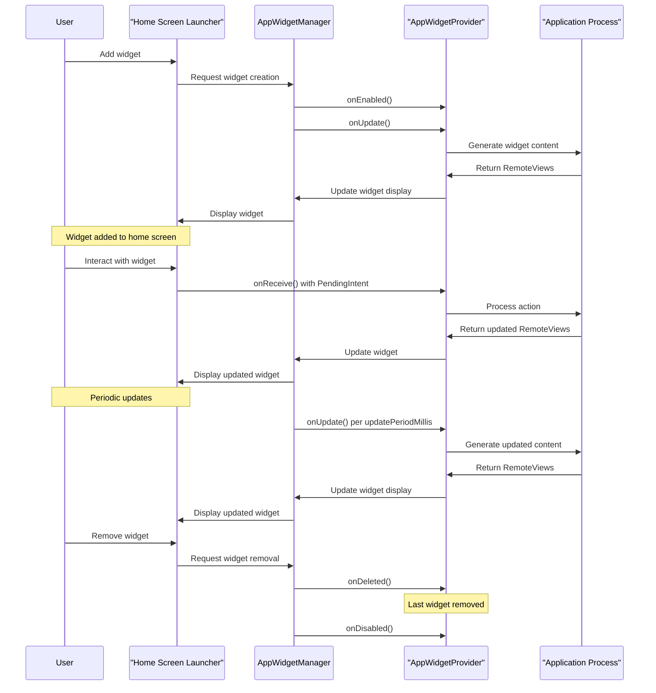
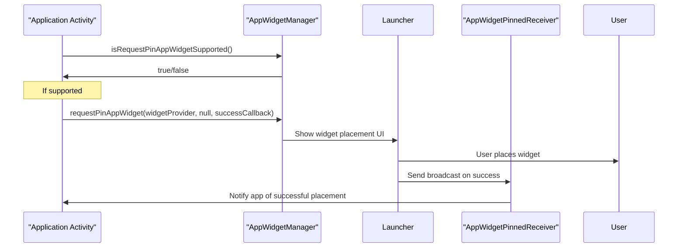

<!-- source: DeepWiki mcp.deepwiki.com · repo android/user-interface-samples · page 4.1 AppWidget Core · fetched 2026-10-23 -->

# AppWidget Core

<details>
<summary>Relevant source files</summary>

The following files were used as context for generating this wiki page:

- [AppWidget/README.md](AppWidget/README.md)
- [AppWidget/app/build.gradle](AppWidget/app/build.gradle)
- [AppWidget/app/src/main/AndroidManifest.xml](AppWidget/app/src/main/AndroidManifest.xml)
- [AppWidget/app/src/main/java/com/example/android/appwidget/glance/weather/WeatherInfo.kt](AppWidget/app/src/main/java/com/example/android/appwidget/glance/weather/WeatherInfo.kt)
- [AppWidget/app/src/main/res/drawable-nodpi/ic_partly_cloudy.xml](AppWidget/app/src/main/res/drawable-nodpi/ic_partly_cloudy.xml)
- [AppWidget/app/src/main/res/values-v31/styles.xml](AppWidget/app/src/main/res/values-v31/styles.xml)
- [AppWidget/app/src/main/res/values-v31/themes.xml](AppWidget/app/src/main/res/values-v31/themes.xml)
- [AppWidget/app/src/main/res/values/strings.xml](AppWidget/app/src/main/res/values/strings.xml)
- [AppWidget/app/src/main/res/values/themes.xml](AppWidget/app/src/main/res/values/themes.xml)
- [AppWidget/app/src/main/res/xml/app_widget_weather_forecast_glance.xml](AppWidget/app/src/main/res/xml/app_widget_weather_forecast_glance.xml)
- [AppWidget/build.gradle](AppWidget/build.gradle)
- [AppWidget/gradle.properties](AppWidget/gradle.properties)
- [AppWidget/gradle/wrapper/gradle-wrapper.properties](AppWidget/gradle/wrapper/gradle-wrapper.properties)

</details>


This document details the fundamentals of building Android home screen widgets using the traditional RemoteViews approach. For information about the newer declarative Glance framework for AppWidgets, see [Glance Widgets](#4.2).

## 1. Introduction to AppWidget Core

Android AppWidgets allow applications to display and update content on the device's home screen. The AppWidget Core provides the foundation for creating these interactive mini-views that users can add to their home screens, offering quick access to app functionality without opening the full application.

The traditional AppWidget implementation relies on the RemoteViews API, which enables an application to define and manipulate views that are displayed in another application's process (the home screen launcher).

Sources: [AppWidget/README.md:9-19](), [AppWidget/app/build.gradle:77-78]()

## 2. Architecture Overview



AppWidget Core architecture follows a clear separation between the widget provider (in the app's process) and the widget host (typically the launcher). Communication happens through the system's AppWidgetService.

Sources: [AppWidget/app/src/main/AndroidManifest.xml:44-88](), [AppWidget/app/build.gradle:77-78]()

## 3. Core Components

### 3.1 AppWidgetProvider

The `AppWidgetProvider` is a specialized `BroadcastReceiver` that serves as the entry point for widget-related events. It receives callbacks for widget creation, updates, and other lifecycle events.



In the repository, three primary implementations of `AppWidgetProvider` are provided:
- `ListAppWidget`: Demonstrates a ToDo list widget
- `ButtonsAppWidget`: Showcases interactive buttons and controls
- `WeatherForecastAppWidget`: Presents a weather forecast interface

Sources: [AppWidget/app/src/main/AndroidManifest.xml:56-88]()

### 3.2 RemoteViews API

The `RemoteViews` class provides a way to create and manipulate views that will be displayed in another process. Since the widget runs in the launcher's process, not in your app's process, direct manipulation of View objects is not possible. Instead, `RemoteViews` allows you to specify a layout and operations to perform on that layout.

Key characteristics of RemoteViews:
- Limited to specific layouts and widgets (FrameLayout, LinearLayout, RelativeLayout, GridLayout)
- Supports a subset of standard widgets (TextView, ImageView, Button, etc.)
- Operations are serialized and sent to the remote process for execution

The repository uses the `androidx.core:core-remoteviews` library to access enhanced RemoteViews functionality introduced in Android 12.

Sources: [AppWidget/app/build.gradle:77-78](), [AppWidget/README.md:11-18]()

### 3.3 Widget Configuration

AppWidgets are defined and configured through XML files that specify properties like:
- Dimensions (minimum width/height)
- Update frequency
- Initial layout
- Preview information
- Resize capabilities

Example of a widget provider configuration:

```xml
<appwidget-provider 
    android:description="@string/app_widget_weather_description"
    android:initialLayout="@layout/widget_loading"
    android:minWidth="184dp"
    android:minHeight="184dp"
    android:minResizeWidth="120dp"
    android:minResizeHeight="120dp"
    android:previewImage="@drawable/weather_forecast_widget_preview"
    android:previewLayout="@layout/widget_weather_forecast_small"
    android:resizeMode="horizontal|vertical"
    android:targetCellWidth="3"
    android:targetCellHeight="2"
    android:updatePeriodMillis="86400000"
    android:widgetCategory="home_screen" />
```

Sources: [AppWidget/app/src/main/res/xml/app_widget_weather_forecast_glance.xml:16-29]()

## 4. Widget Implementation

### 4.1 Widget Registration in Manifest

Each widget provider must be declared in the application's AndroidManifest.xml as a `<receiver>` component with an intent filter for the `android.appwidget.action.APPWIDGET_UPDATE` action. The `<meta-data>` element points to the widget's configuration XML file.



Widget receivers in the sample:
- `ListAppWidget`: Provides a configurable ToDo list widget
- `ButtonsAppWidget`: Demonstrates interactive UI controls
- `WeatherForecastAppWidget`: Displays weather information

Sources: [AppWidget/app/src/main/AndroidManifest.xml:56-88]()

### 4.2 Configuration Activity

Some widgets benefit from user configuration before placement. The sample includes a configuration activity for the list widget:

```
<activity
    android:name=".rv.list.ListWidgetConfigureActivity"
    android:exported="false">
    <intent-filter>
        <action android:name="android.appwidget.action.APPWIDGET_CONFIGURE" />
    </intent-filter>
</activity>
```

This activity allows users to select which list to display in the widget before it's placed on the home screen.

Sources: [AppWidget/app/src/main/AndroidManifest.xml:48-54]()

### 4.3 Widget Styling

The sample demonstrates modern widget styling using:
- Material Design themes
- Dynamic colors (Android 12+)
- Rounded corners
- Appropriate padding

Styles are defined in both standard and v31-specific resources to provide backward compatibility while taking advantage of newer platform features.



For Android 12 (API 31), the system provides standard dimensions for widget corners through `@android:dimen/system_app_widget_background_radius` and `@android:dimen/system_app_widget_inner_radius`.

Sources: [AppWidget/app/src/main/res/values/themes.xml:32-49](), [AppWidget/app/src/main/res/values-v31/themes.xml:17-25](), [AppWidget/app/src/main/res/values-v31/styles.xml:17-38]()

## 5. Widget Lifecycle



The AppWidget lifecycle involves several callbacks to the AppWidgetProvider class:
1. **onEnabled()**: Called when the first instance of the widget is created
2. **onUpdate()**: Called when the widget is added or needs updating
3. **onReceive()**: Called when a user interacts with the widget
4. **onDeleted()**: Called when a specific widget instance is removed
5. **onDisabled()**: Called when the last instance of the widget is removed

Sources: [AppWidget/app/src/main/AndroidManifest.xml:44-88]()

## 6. Widget Pinning

The sample demonstrates how to programmatically request the launcher to "pin" a widget to the home screen. This feature is accessible through the `AppWidgetManager.requestPinAppWidget()` method (Android 8.0+).



The MainActivity demonstrates this feature, allowing users to directly add widgets without navigating to the standard launcher widget selection UI.

Sources: [AppWidget/README.md:46-47](), [AppWidget/app/src/main/AndroidManifest.xml:44-46]()

## 7. Example Widget Types

The repository implements three main widget types using the traditional RemoteViews approach:

### 7.1 ToDo List Widget

Demonstrates:
- List rendering in a widget
- Interactive checkboxes
- Widget configuration
- Update mechanism for checked items

### 7.2 Buttons Widget

Demonstrates:
- Interactive UI controls (buttons, checkboxes, radio buttons, switches)
- Handling click events
- State persistence between updates

### 7.3 Weather Widget

Demonstrates:
- Complex layouts with multiple visual elements
- Icon and text display
- Multi-day forecasts
- Layout adaptation based on widget size

Sources: [AppWidget/README.md:35-40](), [AppWidget/app/src/main/AndroidManifest.xml:56-88](), [AppWidget/app/src/main/res/values/strings.xml:38-53]()

## 8. Comparison with Glance Widgets

The traditional RemoteViews approach described in this document has some limitations compared to the newer Glance framework:

| Feature | RemoteViews | Glance |
|---------|-------------|--------|
| API Style | Imperative | Declarative |
| Layout Definition | XML layouts | Kotlin DSL |
| State Management | Manual | Structured with state objects |
| Composition | Limited | Rich component composition |
| Coroutines Support | No | Yes |
| Material Design Integration | Limited | Comprehensive |

For information about implementing widgets using the Glance framework, see [Glance Widgets](#4.2).

Sources: [AppWidget/README.md:19](), [AppWidget/app/build.gradle:77-80]()

## 9. Requirements and Dependencies

To work with the traditional RemoteViews AppWidget implementation:

- Minimum Android version: API 26 (Android 8.0)
- For enhanced features: API 31 (Android 12) or higher
- Dependencies:
  - androidx.core:core-remoteviews
  - (Optional) WorkManager for background updates

The RemoteViews implementation is stable and works on all Android versions that support widgets, while newer features require Android 12 or above.

Sources: [AppWidget/app/build.gradle:26-34](), [AppWidget/app/build.gradle:77-84]()

---

