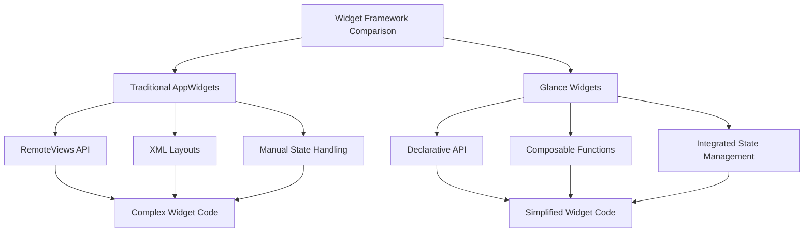
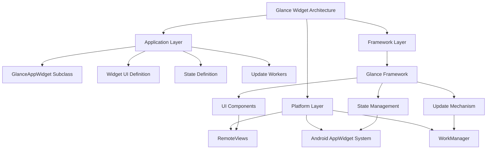
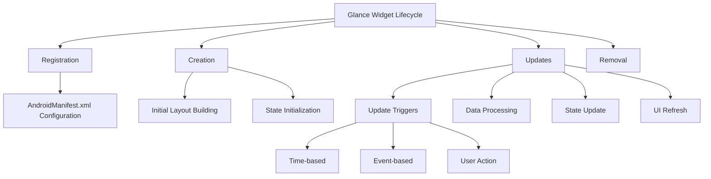

<!-- source: DeepWiki mcp.deepwiki.com · repo android/user-interface-samples · page 4.2 Glance Widgets · fetched 2026-10-23 -->

# Glance Widgets

Relevant source files

The following files were used as context for generating this wiki page:

- [AppWidget/settings.gradle](AppWidget/settings.gradle)

## Purpose and Scope

This document provides an overview of the Glance framework for building Android app widgets with a declarative API. Glance represents a modern approach to building home screen widgets using Kotlin and a composable-like API. For information about traditional widget implementation using RemoteViews, see [AppWidget Core](#4.1).

For specific implementations of Glance widgets, refer to:
- [Weather Widget Example](#4.2.1)
- [Image Widget Example](#4.2.2)

## What are Glance Widgets?

Glance is a Jetpack library that simplifies the process of creating and maintaining Android app widgets. It introduces a declarative API similar to Jetpack Compose, allowing developers to build widgets with modern Kotlin programming patterns rather than using the traditional RemoteViews approach.

### Key Features

- **Declarative UI**: Define widget layouts using composable-like functions
- **Type Safety**: Leverage Kotlin's type system for safer widget development
- **State Management**: Built-in mechanisms for managing widget state
- **WorkManager Integration**: Simplified background updates for widgets
- **Compose-like API**: Familiar programming model for developers using Jetpack Compose

### Architectural Overview

## Architecture and Components

Glance provides an abstraction layer over Android's traditional AppWidget system, translating modern declarative UI code into the RemoteViews that Android uses to render widgets on the home screen.

### Core Components

#### 1. GlanceAppWidget

The primary class that developers extend to create a Glance widget. It serves as the entry point for defining the widget's appearance and behavior.

#### 2. UI Components

Glance provides a set of composable-like functions specifically designed for widget UIs:

- Text components for displaying text
- Button components for user interactions
- Image components for displaying images
- Layout containers (Row, Column, Box) for organizing elements

#### 3. State Management

Mechanisms for managing widget state:

- Preferences-based storage
- Integration with Kotlin serialization
- State updates that trigger UI refreshes

#### 4. Update Mechanism

Integration with WorkManager for scheduling widget updates:

- Periodic updates based on time intervals
- Conditional updates based on system events or data changes
- One-time updates triggered by user actions

## Advantages Over Traditional AppWidgets

| Feature | Traditional AppWidgets | Glance Widgets |
|---------|----------------------|---------------|
| UI Definition | XML layouts with programmatic updates | Declarative Kotlin code |
| Type Safety | Limited, string-based lookups | Strong typing with compile-time checks |
| State Management | Manual serialization to preferences | Integrated with Kotlin serialization |
| Update Mechanism | Complex AppWidgetProvider callbacks | Simplified WorkManager integration |
| Layout Composition | Inflated XML layouts | Composable-like functions |
| Error Handling | Runtime errors common | More compile-time checking |
| Development Experience | Verbose, imperative code | Concise, declarative code |

## Development Workflow

Creating a Glance widget typically involves these steps:

1. **Setup**: Add Glance dependencies to the project
2. **Widget Definition**: Create a class extending GlanceAppWidget
3. **UI Definition**: Define the widget UI using Glance composable functions
4. **State Management**: Implement mechanisms for storing and retrieving widget state
5. **Update Logic**: Set up update mechanisms with WorkManager
6. **Registration**: Register the widget provider in AndroidManifest.xml
7. **Configuration**: Create a widget configuration activity if needed

For practical implementations of these concepts, see the [Weather Widget Example](#4.2.1) and [Image Widget Example](#4.2.2).

---

