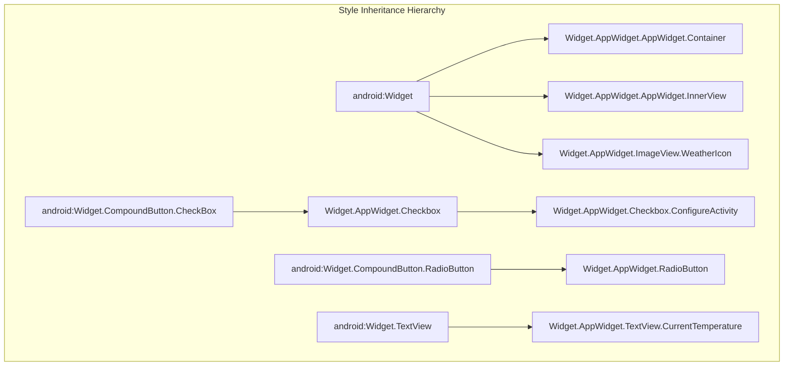
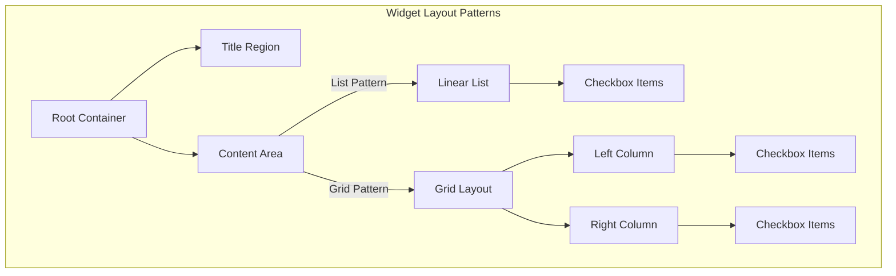
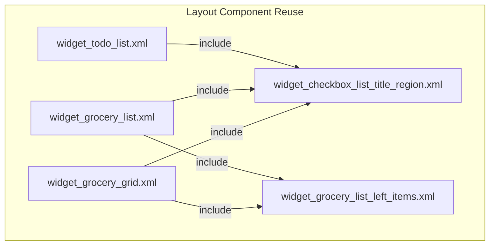
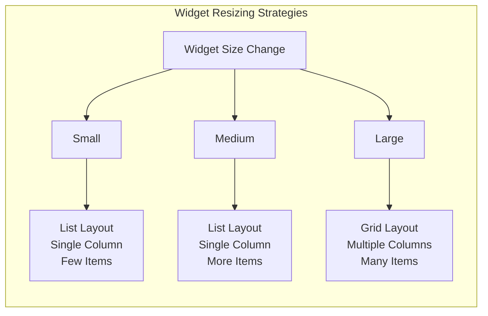

<!-- source: DeepWiki mcp.deepwiki.com · repo android/user-interface-samples · page 4.3 Widget Styles and Layouts · fetched 2026-10-23 -->

# Widget Styles and Layouts

<details>
<summary>Relevant source files</summary>

The following files were used as context for generating this wiki page:

- [AppWidget/app/src/main/res/layout/widget_grocery_grid.xml](AppWidget/app/src/main/res/layout/widget_grocery_grid.xml)
- [AppWidget/app/src/main/res/layout/widget_grocery_list.xml](AppWidget/app/src/main/res/layout/widget_grocery_list.xml)
- [AppWidget/app/src/main/res/layout/widget_grocery_list_left_items.xml](AppWidget/app/src/main/res/layout/widget_grocery_list_left_items.xml)
- [AppWidget/app/src/main/res/layout/widget_todo_list.xml](AppWidget/app/src/main/res/layout/widget_todo_list.xml)
- [AppWidget/app/src/main/res/values/styles.xml](AppWidget/app/src/main/res/values/styles.xml)
- [AppWidget/screenshots/widget_resizing.png](AppWidget/screenshots/widget_resizing.png)
- [AppWidget/screenshots/widget_smooth_transition.gif](AppWidget/screenshots/widget_smooth_transition.gif)

</details>


## Introduction

This document details the styling and layout options available for app widgets in the Android User Interface Samples repository. It covers the style definitions, layout patterns, and design practices that help create visually consistent and adaptable home screen widgets. For information about implementing widget functionality using the traditional RemoteViews approach, see [AppWidget Core](#4.1). For information about the Glance declarative framework, see [Glance Widgets](#4.2).

## Widget Style Architecture

App widgets require careful styling to blend well with the home screen environment while maintaining brand identity. The Android User Interface Samples demonstrate a comprehensive approach to widget styling through a well-defined style hierarchy.

### Style Inheritance Hierarchy

Widget styles in the sample repository follow Android's standard style inheritance pattern, with specialized widget styles inheriting from platform defaults.



### Core Widget Styles

The repository defines several foundational styles that serve as building blocks for widget UI:

1. **Container Style**: Provides the outer background and padding for widgets
   - `Widget.AppWidget.AppWidget.Container` defines the widget's background and outer padding
   - Sets `android:id` to `@android:id/background` for system recognition

2. **Inner View Style**: Defines styling for content areas within the widget
   - `Widget.AppWidget.AppWidget.InnerView` provides inner padding and background for content sections

3. **Interactive Element Styles**: Specialized styles for input controls
   - `Widget.AppWidget.Checkbox` provides consistent styling for checkbox items
   - `Widget.AppWidget.RadioButton` configures radio buttons with accent color tinting

4. **Content Display Styles**: Styles for textual and visual content
   - `Widget.AppWidget.TextView.CurrentTemperature` for large temperature display
   - `Widget.AppWidget.ImageView.WeatherIcon` for weather icons with appropriate tinting

Sources: [AppWidget/app/src/main/res/values/styles.xml:18-54]()

## Widget Layout Patterns

The sample repository demonstrates several layout patterns for app widgets, each optimized for different use cases and content types.

### Common Layout Structures



### List Layout

The simplest widget layout pattern is a vertical list. In the samples, this is demonstrated by both the to-do list and grocery list widgets.

Key characteristics:
- Uses a vertical `LinearLayout` as the container
- Applies `Widget.AppWidget.AppWidget.Container` style to the root layout
- Applies theme `Theme.AppWidget.AppWidgetContainer` for consistent theming
- Includes a title section at the top
- Contains a vertical list of items (typically checkboxes)

Sources: [AppWidget/app/src/main/res/layout/widget_todo_list.xml:16-42](), [AppWidget/app/src/main/res/layout/widget_grocery_list.xml:16-26]()

### Grid Layout

For more complex content organization, the samples demonstrate a grid layout pattern that arranges items in columns:

Key characteristics:
- Uses nested `LinearLayout` containers
- Outer container with vertical orientation
- Inner container with horizontal orientation dividing into columns
- Each column defined as a vertical `LinearLayout` with equal weight
- Allows more content to be displayed in a compact space

Sources: [AppWidget/app/src/main/res/layout/widget_grocery_grid.xml:16-79]()

### Component Reuse

The samples demonstrate effective layout component reuse through the `include` directive:



This approach:
- Promotes consistency across widgets
- Reduces duplication and maintenance effort
- Allows for specialized components that can be reused in multiple widgets

Sources: [AppWidget/app/src/main/res/layout/widget_grocery_grid.xml:23-23](), [AppWidget/app/src/main/res/layout/widget_grocery_list.xml:23-25](), [AppWidget/app/src/main/res/layout/widget_grocery_list_left_items.xml:16-47]()

## Widget Resizing and Adaptation

App widgets need to adapt to different sizes as users can resize them on their home screens. The samples demonstrate techniques for creating widgets that look good at different sizes.

### Resizing Strategies

The repository demonstrates two main approaches to widget resizing:

1. **Layout-Based Adaptation**: Different layouts for different size classes
   - List layout for narrow widgets
   - Grid layout for wide widgets

2. **Content-Based Adaptation**: Showing more content in larger widgets
   - Additional list items in taller widgets
   - Multiple columns in wider widgets



Sources: [AppWidget/screenshots/widget_resizing.png]()

### Style Consistency During Resizing

To maintain visual consistency across different widget sizes, the samples use:

1. Consistent style application regardless of layout type
2. Shared components using the `include` directive
3. Style attributes that adjust to the container size

Sources: [AppWidget/app/src/main/res/values/styles.xml:18-54]()

## Implementation Best Practices

Based on the widget examples in the repository, several best practices emerge for styling and layout:

### Style Recommendations

1. **Extend platform styles**: Start with Android's native widget styles and extend them for consistency with the platform
   ```xml
   <style name="Widget.AppWidget.Checkbox" parent="android:Widget.CompoundButton.CheckBox">
   ```

2. **Define minimum touch sizes**: Ensure interactive elements are large enough to tap
   ```xml
   <item name="android:minHeight">@dimen/widget_element_min_length</item>
   ```

3. **Use system theme attributes**: Reference system attributes like `?android:attr/textColorPrimary` for automatic light/dark theme adaptation
   ```xml
   <item name="android:textColor">?android:attr/textColorPrimary</item>
   ```

4. **Apply consistent padding**: Use dimension resources for consistent spacing

### Layout Recommendations

1. **Use weight for proportional layouts**: When creating grid or multi-column layouts, use weights for flexibility
   ```xml
   android:layout_width="0dp"
   android:layout_height="wrap_content"
   android:layout_weight="1"
   ```

2. **Create reusable layout components**: Extract common elements into separate files for reuse
   ```xml
   <include layout="@layout/widget_checkbox_list_title_region" />
   ```

3. **Apply container style to root elements**: Always apply the container style to the root element of widget layouts
   ```xml
   style="@style/Widget.AppWidget.AppWidget.Container"
   ```

4. **Use LinearLayout for simple widgets**: Most widget layouts can be effectively implemented with LinearLayouts, which perform well for widgets

Sources: [AppWidget/app/src/main/res/values/styles.xml:18-54](), [AppWidget/app/src/main/res/layout/widget_grocery_grid.xml:16-79](), [AppWidget/app/src/main/res/layout/widget_todo_list.xml:16-42]()

## Widget Examples in the Repository

The repository contains several widget examples demonstrating different layout approaches:

### To-Do List Widget

A simple vertical list of checkboxes for task management:
- Vertical LinearLayout with Container style
- Title section at the top
- List of checkboxes with consistent styling

Sources: [AppWidget/app/src/main/res/layout/widget_todo_list.xml:16-42]()

### Grocery List Widget

Similar to the to-do widget but designed specifically for grocery items:
- Reuses common components with the `include` directive
- Demonstrates component modularity

Sources: [AppWidget/app/src/main/res/layout/widget_grocery_list.xml:16-26]()

### Grocery Grid Widget

An expanded version of the grocery list that uses a grid layout:
- Two-column layout for displaying more items
- Uses layout weights for column sizing
- Demonstrates layout adaptation for larger widget sizes

Sources: [AppWidget/app/src/main/res/layout/widget_grocery_grid.xml:16-79]()

## Summary

The widget samples demonstrate a systematic approach to app widget styling and layout that promotes:

1. **Visual consistency** through well-defined style inheritance
2. **Adaptability** to different sizes and configurations
3. **Code reuse** through modular layout components
4. **Platform integration** by extending system styles

These patterns help create widgets that look and feel like native parts of the Android home screen while maintaining app-specific branding and functionality.

---

