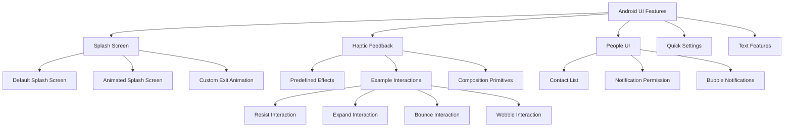
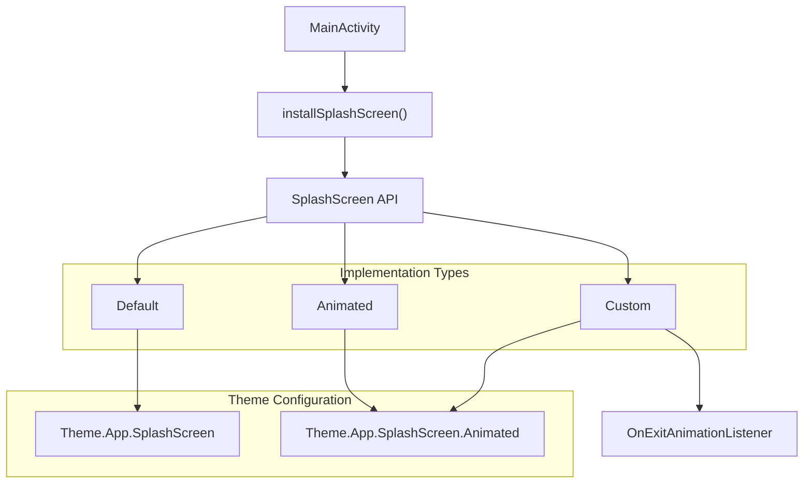
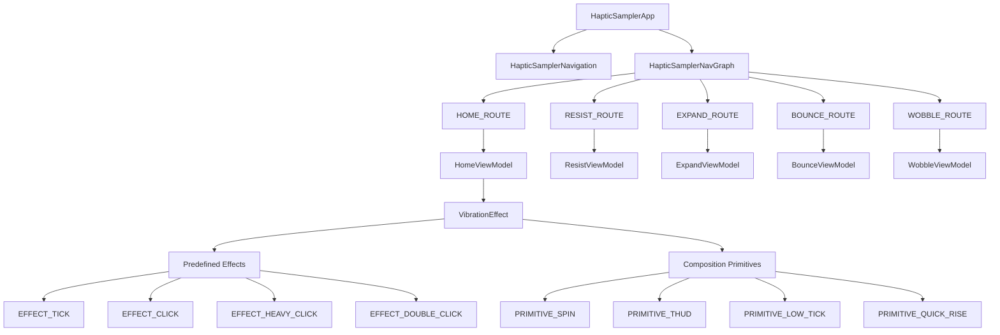
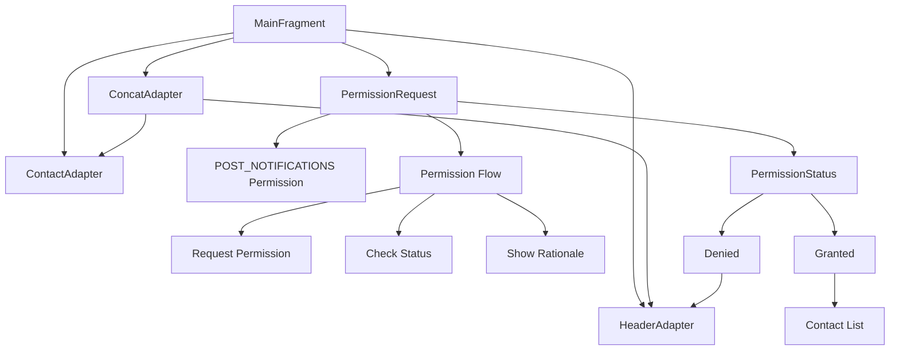

<!-- source: DeepWiki mcp.deepwiki.com · repo android/user-interface-samples · page 5 Other UI Features · fetched 2026-10-23 -->

# Other UI Features

<details>
<summary>Relevant source files</summary>

The following files were used as context for generating this wiki page:

- [Haptics/app/build.gradle](Haptics/app/build.gradle)
- [Haptics/app/src/main/java/com/example/android/haptics/samples/ui/AppDrawer.kt](Haptics/app/src/main/java/com/example/android/haptics/samples/ui/AppDrawer.kt)
- [Haptics/app/src/main/java/com/example/android/haptics/samples/ui/HapticSamplerApp.kt](Haptics/app/src/main/java/com/example/android/haptics/samples/ui/HapticSamplerApp.kt)
- [Haptics/app/src/main/java/com/example/android/haptics/samples/ui/HapticSamplerNavigation.kt](Haptics/app/src/main/java/com/example/android/haptics/samples/ui/HapticSamplerNavigation.kt)
- [Haptics/app/src/main/java/com/example/android/haptics/samples/ui/home/HomeRoute.kt](Haptics/app/src/main/java/com/example/android/haptics/samples/ui/home/HomeRoute.kt)
- [Haptics/app/src/main/java/com/example/android/haptics/samples/ui/shapes/ElasticTopShape.kt](Haptics/app/src/main/java/com/example/android/haptics/samples/ui/shapes/ElasticTopShape.kt)
- [Haptics/app/src/main/java/com/example/android/haptics/samples/ui/wobble/WobbleViewModel.kt](Haptics/app/src/main/java/com/example/android/haptics/samples/ui/wobble/WobbleViewModel.kt)
- [Haptics/app/src/main/res/values/strings.xml](Haptics/app/src/main/res/values/strings.xml)
- [Haptics/build.gradle](Haptics/build.gradle)
- [Haptics/gradle/wrapper/gradle-wrapper.properties](Haptics/gradle/wrapper/gradle-wrapper.properties)
- [Haptics/settings.gradle](Haptics/settings.gradle)
- [People/app/build.gradle](People/app/build.gradle)
- [People/app/src/main/AndroidManifest.xml](People/app/src/main/AndroidManifest.xml)
- [People/app/src/main/java/com/example/android/people/ui/chat/PermissionRequest.kt](People/app/src/main/java/com/example/android/people/ui/chat/PermissionRequest.kt)
- [People/app/src/main/java/com/example/android/people/ui/main/HeaderAdapter.kt](People/app/src/main/java/com/example/android/people/ui/main/HeaderAdapter.kt)
- [People/app/src/main/java/com/example/android/people/ui/main/MainFragment.kt](People/app/src/main/java/com/example/android/people/ui/main/MainFragment.kt)
- [People/app/src/main/res/layout/contact_header.xml](People/app/src/main/res/layout/contact_header.xml)
- [People/app/src/main/res/values/strings.xml](People/app/src/main/res/values/strings.xml)
- [People/app/src/main/res/values/styles.xml](People/app/src/main/res/values/styles.xml)
- [People/build.gradle](People/build.gradle)
- [People/gradle/wrapper/gradle-wrapper.properties](People/gradle/wrapper/gradle-wrapper.properties)
- [SplashScreen/README.md](SplashScreen/README.md)
- [SplashScreen/app/build.gradle](SplashScreen/app/build.gradle)
- [SplashScreen/app/src/androidTest/AndroidManifest.xml](SplashScreen/app/src/androidTest/AndroidManifest.xml)
- [SplashScreen/app/src/main/AndroidManifest.xml](SplashScreen/app/src/main/AndroidManifest.xml)
- [SplashScreen/app/src/main/java/com/example/android/splashscreen/AnimatedActivity.kt](SplashScreen/app/src/main/java/com/example/android/splashscreen/AnimatedActivity.kt)
- [SplashScreen/app/src/main/java/com/example/android/splashscreen/CustomActivity.kt](SplashScreen/app/src/main/java/com/example/android/splashscreen/CustomActivity.kt)
- [SplashScreen/app/src/main/java/com/example/android/splashscreen/MainActivity.kt](SplashScreen/app/src/main/java/com/example/android/splashscreen/MainActivity.kt)
- [SplashScreen/app/src/main/java/com/example/android/splashscreen/MainViewModel.kt](SplashScreen/app/src/main/java/com/example/android/splashscreen/MainViewModel.kt)
- [SplashScreen/app/src/main/res/values-night/colors.xml](SplashScreen/app/src/main/res/values-night/colors.xml)
- [SplashScreen/app/src/main/res/values-night/themes.xml](SplashScreen/app/src/main/res/values-night/themes.xml)
- [SplashScreen/app/src/main/res/values/colors.xml](SplashScreen/app/src/main/res/values/colors.xml)
- [SplashScreen/app/src/main/res/values/themes.xml](SplashScreen/app/src/main/res/values/themes.xml)
- [SplashScreen/build.gradle](SplashScreen/build.gradle)
- [SplashScreen/gradle/wrapper/gradle-wrapper.properties](SplashScreen/gradle/wrapper/gradle-wrapper.properties)

</details>


This page covers the additional UI samples in the Android User Interface Samples repository that showcase specific UI features beyond the main Window Management, Canonical Layouts, and App Widget patterns. These samples demonstrate how to implement modern UI capabilities like splash screens, haptic feedback patterns, notification-based people UI, and more.

The samples in this section are focused on complementary UI features that enhance the user experience rather than defining the overall layout structure of an application.

## Overview

The Other UI Features section includes several independent samples that each demonstrate a specific UI capability:



Sources: [SplashScreen/app/src/main/AndroidManifest.xml](), [Haptics/app/src/main/java/com/example/android/haptics/samples/ui/HapticSamplerNavigation.kt](), [People/app/src/main/AndroidManifest.xml](), [People/app/src/main/java/com/example/android/people/ui/main/MainFragment.kt]()

## Splash Screen

The Splash Screen sample demonstrates how to implement the SplashScreen API introduced in Android 12 (API level 31) and how to make it backward compatible using the `core-splashscreen` library.



Sources: [SplashScreen/app/src/main/java/com/example/android/splashscreen/MainActivity.kt](), [SplashScreen/app/src/main/java/com/example/android/splashscreen/CustomActivity.kt](), [SplashScreen/app/src/main/res/values/themes.xml]()

The Splash Screen sample offers three different implementations:

1. **Default Splash Screen**: Shows the basic implementation without customization
2. **Animated Splash Screen**: Shows an animated icon on the splash screen
3. **Custom Splash Screen**: Shows a custom exit animation when transitioning to the app content

### Implementation Details

The Splash Screen implementation uses the `core-splashscreen` library which provides backward compatibility back to API level 21:

```
implementation 'androidx.core:core-splashscreen:1.0.0'
```

Sources: [SplashScreen/app/build.gradle:55]()

The main components of the splash screen implementation are:

#### 1. Theme Configuration

The splash screen appearance is configured through themes:

```xml
<!-- Basic splash screen theme -->
<style name="Theme.App.SplashScreen" parent="Theme.SplashScreen">
    <item name="postSplashScreenTheme">@style/Theme.App</item>
</style>

<!-- Animated splash screen theme -->
<style name="Theme.App.SplashScreen.Animated" parent="Theme.SplashScreen.IconBackground">
    <item name="windowSplashScreenAnimatedIcon">@drawable/ic_hourglass_animated</item>
    <item name="windowSplashScreenIconBackgroundColor">@color/lime_700</item>
    <item name="windowSplashScreenBackground">@color/splash_screen_background</item>
    <item name="windowSplashScreenAnimationDuration">1000</item>
    <item name="postSplashScreenTheme">@style/Theme.App</item>
</style>
```

Sources: [SplashScreen/app/src/main/res/values/themes.xml:45-69]()

#### 2. Splash Screen Installation

The splash screen is installed in the `onCreate` method of the activity before `super.onCreate()`:

```kotlin
override fun onCreate(savedInstanceState: Bundle?) {
    // Set up 'core-splashscreen' to handle the splash screen in a backward compatible manner.
    splashScreen = installSplashScreen()

    // The splash screen remains on the screen as long as this condition is true.
    splashScreen.setKeepOnScreenCondition { !viewModel.isReady }
    
    super.onCreate(savedInstanceState)
    // ...
}
```

Sources: [SplashScreen/app/src/main/java/com/example/android/splashscreen/MainActivity.kt:29-36]()

#### 3. Custom Exit Animation

For the Custom Splash Screen, an exit animation listener is set to control the transition:

```kotlin
splashScreen.setOnExitAnimationListener { splashScreenViewProvider ->
    val remainingDuration = splashScreenViewProvider.iconAnimationRemainingDurationMillis
    val splashScreenView = splashScreenViewProvider.view
    val slideUp = ObjectAnimator.ofFloat(
        splashScreenView,
        View.TRANSLATION_Y,
        0f,
        -splashScreenView.height.toFloat()
    )
    slideUp.interpolator = AnticipateInterpolator()
    slideUp.duration = 200L
    slideUp.doOnEnd { splashScreenViewProvider.remove() }
    slideUp.startDelay = remainingDuration
    slideUp.start()
}
```

Sources: [SplashScreen/app/src/main/java/com/example/android/splashscreen/CustomActivity.kt:37-65]()

### Handling Dark Mode

The sample also demonstrates proper handling of dark mode for the splash screen by defining separate colors:

```xml
<!-- Light theme -->
<color name="splash_screen_background">@color/lime_500</color>

<!-- Dark theme -->
<color name="splash_screen_background">@color/blue_gray_900</color>
```

Sources: [SplashScreen/app/src/main/res/values/colors.xml:24](), [SplashScreen/app/src/main/res/values-night/colors.xml:18]()

## Haptic Feedback

The Haptic Feedback sample demonstrates various haptic feedback patterns to enhance user interactions through tactile feedback.



Sources: [Haptics/app/src/main/java/com/example/android/haptics/samples/ui/HapticSamplerApp.kt](), [Haptics/app/src/main/java/com/example/android/haptics/samples/ui/HapticSamplerNavigation.kt](), [Haptics/app/src/main/java/com/example/android/haptics/samples/ui/home/HomeRoute.kt]()

### Implementation Details

The Haptic Feedback sample is built using Jetpack Compose and is organized into several screens that demonstrate different haptic patterns:

#### 1. Navigation Structure

The app uses Jetpack Navigation Compose to organize different haptic feedback examples:

```kotlin
object HapticSamplerDestinations {
    const val HOME_ROUTE = "home"
    const val RESIST_ROUTE = "resist"
    const val EXPAND_ROUTE = "expand"
    const val BOUNCE_ROUTE = "bounce"
    const val WOBBLE_ROUTE = "wobble"
}
```

Sources: [Haptics/app/src/main/java/com/example/android/haptics/samples/ui/HapticSamplerNavigation.kt:43-49]()

#### 2. Haptic Categories

The Home screen organizes haptic feedback examples into categories:

1. **Predefined Effects**: Standard vibration patterns like tick, click, heavy click, and double click
2. **Haptic Feedback Constants**: System-defined feedback types like confirm and reject
3. **Composition Primitives**: Building blocks for custom patterns like low tick, quick rise, and spin

Each effect is implemented as a button that triggers the appropriate haptic feedback:

```kotlin
@Composable
private fun HomeHapticButton(
    label: String,
    onClick: (view: View) -> Unit,
    modifier: Modifier = Modifier,
    isEnabled: Boolean = true,
) {
    // Button implementation that calls onClick with the current view
    // onClick handler will trigger the appropriate haptic feedback
}
```

Sources: [Haptics/app/src/main/java/com/example/android/haptics/samples/ui/home/HomeRoute.kt:144-170]()

#### 3. Example Interactions

The sample includes several example interactions that demonstrate more complex haptic patterns:

1. **Resist**: Haptic feedback that simulates resistance when dragging down
2. **Expand**: Feedback pattern for expanding/collapsing UI elements
3. **Bounce**: Interactive bouncing animation with matching haptic feedback
4. **Wobble**: Haptic feedback simulating an elastic wobbling effect

Each interaction has its own ViewModel that handles the haptic feedback logic:

```kotlin
class WobbleViewModel(
    val messageToUser: String,
) : ViewModel() {
    // Checks device compatibility with required haptic primitives
    companion object {
        fun provideFactory(application: Application): ViewModelProvider.Factory = 
            object : ViewModelProvider.Factory {
                override fun <T : ViewModel> create(modelClass: Class<T>): T {
                    val vibrator = ContextCompat.getSystemService(application, Vibrator::class.java)!!
                    
                    var messageToUser = ""
                    if (Build.VERSION.SDK_INT <= Build.VERSION_CODES.R || 
                        !vibrator.areAllPrimitivesSupported(VibrationEffect.Composition.PRIMITIVE_SPIN)) {
                        messageToUser = application.getString(R.string.message_not_supported)
                    }
                    
                    return WobbleViewModel(messageToUser = messageToUser) as T
                }
            }
    }
}
```

Sources: [Haptics/app/src/main/java/com/example/android/haptics/samples/ui/wobble/WobbleViewModel.kt:30-60]()

#### 4. Device Compatibility

The sample handles device compatibility by checking if the required haptic primitives are supported and showing appropriate messages when features aren't available:

```kotlin
if (Build.VERSION.SDK_INT <= Build.VERSION_CODES.R || 
    !vibrator.areAllPrimitivesSupported(VibrationEffect.Composition.PRIMITIVE_SPIN)) {
    messageToUser = application.getString(R.string.message_not_supported)
}
```

Sources: [Haptics/app/src/main/java/com/example/android/haptics/samples/ui/wobble/WobbleViewModel.kt:47-51]()

## People UI

The People UI sample demonstrates contact lists, notification features, and modern permission handling for the notification permission introduced in Android 13.



Sources: [People/app/src/main/java/com/example/android/people/ui/main/MainFragment.kt](), [People/app/src/main/java/com/example/android/people/ui/main/HeaderAdapter.kt](), [People/app/src/main/java/com/example/android/people/ui/chat/PermissionRequest.kt]()

### Implementation Details

The People UI sample focuses on building a contact list with proper notification permission handling:

#### 1. Permission Handling

The sample demonstrates the recommended way to request the `POST_NOTIFICATIONS` permission introduced in Android 13:

```kotlin
@SuppressLint("InlinedApi") // POST_NOTIFICATIONS is automatically granted on API<33.
private val permissionRequest = PermissionRequest(this, Manifest.permission.POST_NOTIFICATIONS)
```

Sources: [People/app/src/main/java/com/example/android/people/ui/main/MainFragment.kt:42-43]()

The `PermissionRequest` class encapsulates permission handling logic:

```kotlin
class PermissionRequest(
    private val fragment: Fragment,
    private val permission: String
) {
    private val _status = MutableLiveData<PermissionStatus>()
    val status: LiveData<PermissionStatus> = _status
    
    private val launcher = fragment.registerForActivityResult(
        ActivityResultContracts.RequestPermission()
    ) { granted ->
        _status.value = if (granted) {
            PermissionStatus.Granted
        } else {
            PermissionStatus.Denied(
                ActivityCompat.shouldShowRequestPermissionRationale(
                    fragment.requireActivity(),
                    permission
                )
            )
        }
    }
    
    fun launch() {
        launcher.launch(permission)
    }
}
```

Sources: [People/app/src/main/java/com/example/android/people/ui/chat/PermissionRequest.kt:33-65]()

#### 2. Permission UI

The UI adapts based on the permission status by showing a permission request header when needed:

```kotlin
permissionRequest.status.observe(viewLifecycleOwner) { status ->
    when (status) {
        // We have the permission now. Hide the permission header.
        is PermissionStatus.Granted -> binding.contacts.adapter = contactAdapter
        // We don't have the permission. Show the permission header.
        is PermissionStatus.Denied -> {
            val config = ConcatAdapter.Config.Builder()
                .setStableIdMode(ConcatAdapter.Config.StableIdMode.SHARED_STABLE_IDS)
                .build()
            binding.contacts.adapter = ConcatAdapter(config, headerAdapter, contactAdapter)
            headerAdapter.shouldShowRationale = status.shouldShowRationale
        }
    }
}
```

Sources: [People/app/src/main/java/com/example/android/people/ui/main/MainFragment.kt:72-83]()

The permission header UI includes:

1. A standard message explaining why the permission is needed
2. An optional rationale message shown when the user has previously denied the permission
3. A grant button to trigger the permission request

```xml
<androidx.cardview.widget.CardView>
    <androidx.appcompat.widget.LinearLayoutCompat>
        <TextView android:text="@string/permission_message" />
        <TextView android:id="@+id/rationale" android:text="@string/permission_rationale" />
        <Button android:id="@+id/grant" android:text="@string/permission_grant" />
    </androidx.appcompat.widget.LinearLayoutCompat>
</androidx.cardview.widget.CardView>
```

Sources: [People/app/src/main/res/layout/contact_header.xml:17-55]()

#### 3. Bubble Notifications

The sample demonstrates the Bubble API for chat applications:

```xml
<activity
    android:name="com.example.android.people.BubbleActivity"
    android:allowEmbedded="true"
    android:documentLaunchMode="always"
    android:exported="true"
    android:resizeableActivity="true">
    <intent-filter>
        <action android:name="android.intent.action.VIEW" />
        <category android:name="android.intent.category.BROWSABLE" />
        <data
            android:host="android.example.com"
            android:pathPattern="/chat/*"
            android:scheme="https" />
    </intent-filter>
</activity>
```

Sources: [People/app/src/main/AndroidManifest.xml:92-106]()

## Other Features

While there are other UI features mentioned in the repository structure such as Quick Settings and Text Features, detailed information about their implementation was not provided in the file excerpts.

## Feature Comparison

| Feature | Min API Level | Key APIs | Use Case |
|---------|--------------|----------|----------|
| Splash Screen | 21 (with compat library) | `androidx.core.splashscreen.SplashScreen` | App launch experience |
| Haptic Feedback | 21 (basic), 31 (advanced) | `VibrationEffect`, `Vibrator` | Tactile feedback for UI interactions |
| People UI | 30 | `POST_NOTIFICATIONS` permission, Bubble API | Contact interactions and notifications |
| Quick Settings | N/A | N/A | System Quick Settings tiles |
| Text Features | N/A | N/A | Advanced text handling features |

Sources: [SplashScreen/app/build.gradle:32](), [Haptics/app/build.gradle:27](), [People/app/build.gradle:24]()

## Integration Points

These UI features are designed to be integrated with other Android UI patterns:

1. **Splash Screen** integrates with the app launch process and can be combined with any app architecture.
2. **Haptic Feedback** can enhance any touch interaction throughout the app.
3. **People UI** demonstrates how to integrate with system notification features.

When implementing these features in your app, consider how they complement your overall UI strategy and ensure they follow the platform guidelines for each feature.

---

