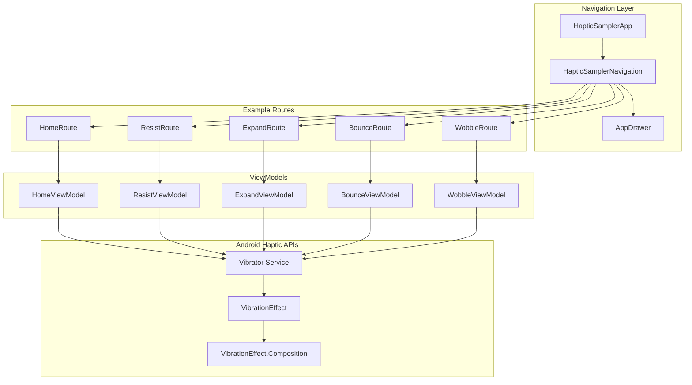
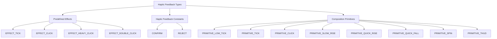
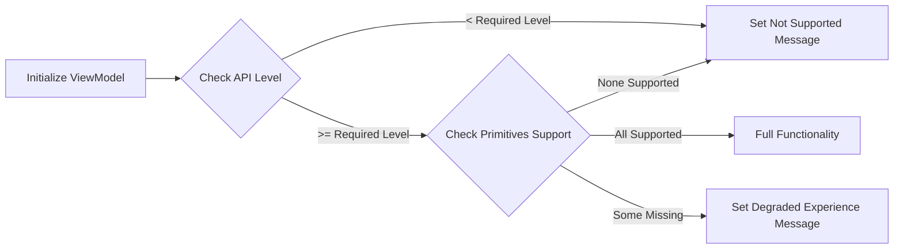
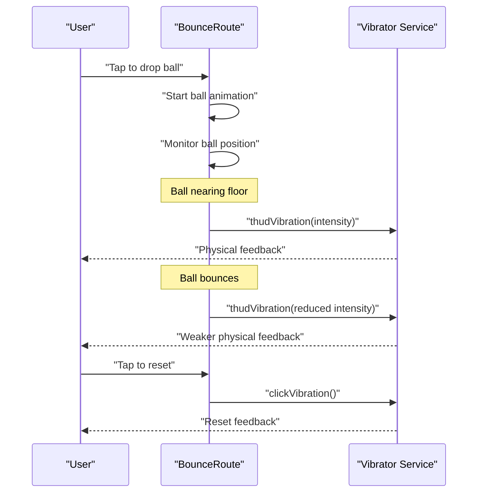
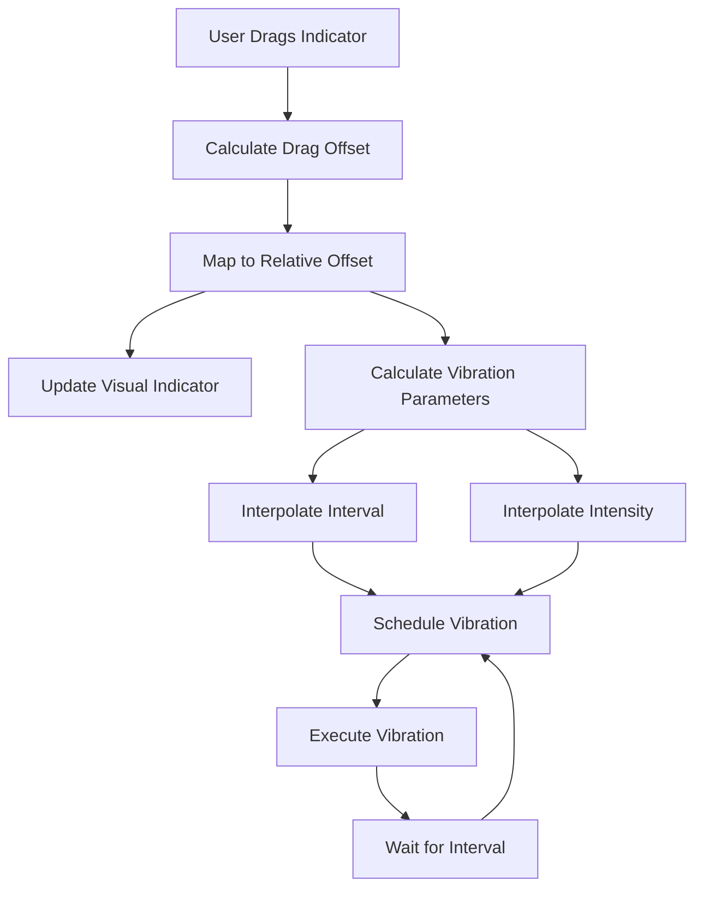
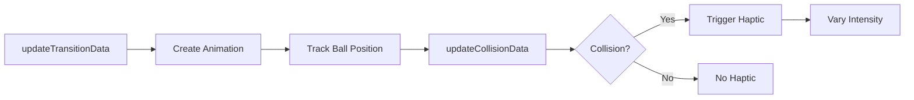

<!-- source: DeepWiki mcp.deepwiki.com · repo android/user-interface-samples · page 5.1 Haptic Feedback · fetched 2026-10-23 -->

# Haptic Feedback

<details>
<summary>Relevant source files</summary>

The following files were used as context for generating this wiki page:

- [Haptics/app/build.gradle](Haptics/app/build.gradle)
- [Haptics/app/src/main/java/com/example/android/haptics/samples/ui/AppDrawer.kt](Haptics/app/src/main/java/com/example/android/haptics/samples/ui/AppDrawer.kt)
- [Haptics/app/src/main/java/com/example/android/haptics/samples/ui/HapticSamplerApp.kt](Haptics/app/src/main/java/com/example/android/haptics/samples/ui/HapticSamplerApp.kt)
- [Haptics/app/src/main/java/com/example/android/haptics/samples/ui/HapticSamplerNavigation.kt](Haptics/app/src/main/java/com/example/android/haptics/samples/ui/HapticSamplerNavigation.kt)
- [Haptics/app/src/main/java/com/example/android/haptics/samples/ui/bounce/BounceRoute.kt](Haptics/app/src/main/java/com/example/android/haptics/samples/ui/bounce/BounceRoute.kt)
- [Haptics/app/src/main/java/com/example/android/haptics/samples/ui/bounce/BounceViewModel.kt](Haptics/app/src/main/java/com/example/android/haptics/samples/ui/bounce/BounceViewModel.kt)
- [Haptics/app/src/main/java/com/example/android/haptics/samples/ui/components/Screen.kt](Haptics/app/src/main/java/com/example/android/haptics/samples/ui/components/Screen.kt)
- [Haptics/app/src/main/java/com/example/android/haptics/samples/ui/home/HomeRoute.kt](Haptics/app/src/main/java/com/example/android/haptics/samples/ui/home/HomeRoute.kt)
- [Haptics/app/src/main/java/com/example/android/haptics/samples/ui/home/HomeViewModel.kt](Haptics/app/src/main/java/com/example/android/haptics/samples/ui/home/HomeViewModel.kt)
- [Haptics/app/src/main/java/com/example/android/haptics/samples/ui/resist/ResistRoute.kt](Haptics/app/src/main/java/com/example/android/haptics/samples/ui/resist/ResistRoute.kt)
- [Haptics/app/src/main/java/com/example/android/haptics/samples/ui/resist/ResistViewModel.kt](Haptics/app/src/main/java/com/example/android/haptics/samples/ui/resist/ResistViewModel.kt)
- [Haptics/app/src/main/java/com/example/android/haptics/samples/ui/shapes/ElasticTopShape.kt](Haptics/app/src/main/java/com/example/android/haptics/samples/ui/shapes/ElasticTopShape.kt)
- [Haptics/app/src/main/java/com/example/android/haptics/samples/ui/utils/MathUtils.kt](Haptics/app/src/main/java/com/example/android/haptics/samples/ui/utils/MathUtils.kt)
- [Haptics/app/src/main/java/com/example/android/haptics/samples/ui/wobble/WobbleRoute.kt](Haptics/app/src/main/java/com/example/android/haptics/samples/ui/wobble/WobbleRoute.kt)
- [Haptics/app/src/main/java/com/example/android/haptics/samples/ui/wobble/WobbleViewModel.kt](Haptics/app/src/main/java/com/example/android/haptics/samples/ui/wobble/WobbleViewModel.kt)
- [Haptics/app/src/main/res/values/strings.xml](Haptics/app/src/main/res/values/strings.xml)
- [Haptics/build.gradle](Haptics/build.gradle)
- [Haptics/gradle/wrapper/gradle-wrapper.properties](Haptics/gradle/wrapper/gradle-wrapper.properties)
- [Haptics/settings.gradle](Haptics/settings.gradle)

</details>


This document describes the haptic feedback implementation in the Android User Interface Samples. The Haptic Sampler application demonstrates various techniques for implementing tactile feedback using the Android Vibration API and haptic composition primitives. It showcases how to create engaging user experiences through carefully designed haptic interactions.

## System Overview

The Haptics sample application is a showcase of different haptic feedback patterns and techniques organized as a collection of interactive examples. Each example demonstrates a specific haptic interaction pattern that can be incorporated into Android applications.

### Architecture Diagram



Sources: 
- [Haptics/app/src/main/java/com/example/android/haptics/samples/ui/HapticSamplerApp.kt:1-129]()
- [Haptics/app/src/main/java/com/example/android/haptics/samples/ui/HapticSamplerNavigation.kt:1-154]()
- [Haptics/app/src/main/java/com/example/android/haptics/samples/ui/AppDrawer.kt:1-187]()

### Haptic Feedback Types

The sample demonstrates three main categories of haptic feedback available in Android:



Sources:
- [Haptics/app/src/main/java/com/example/android/haptics/samples/ui/home/HomeViewModel.kt:30-246]()
- [Haptics/app/src/main/java/com/example/android/haptics/samples/ui/home/HomeRoute.kt:1-215]()

## API Levels and Device Compatibility

One of the challenges with haptic feedback is handling different Android versions and device capabilities. The sample demonstrates best practices for handling this.

### Version Compatibility Table

| Feature | Minimum API Level | Introduced In |
|---------|------------------|---------------|
| Basic Vibrator | 21 (All supported) | Earlier Versions |
| Predefined Effects | 29 | Android Q |
| Haptic Feedback Constants | 30 | Android R |
| Composition API | 30 | Android R |
| Advanced Primitives (SPIN, THUD, LOW_TICK) | 31 | Android S |

### Device Capability Detection

The app implements a pattern for checking device compatibility across all examples:



Sources:
- [Haptics/app/src/main/java/com/example/android/haptics/samples/ui/bounce/BounceViewModel.kt:1-62]()
- [Haptics/app/src/main/java/com/example/android/haptics/samples/ui/resist/ResistViewModel.kt:1-70]()
- [Haptics/app/src/main/java/com/example/android/haptics/samples/ui/wobble/WobbleViewModel.kt:1-61]()

## Sample Effects Implementation

The app demonstrates several haptic interaction patterns. Let's look at how some key examples are implemented.

### Bounce Effect

The Bounce example demonstrates using haptic feedback to simulate the physical feedback of a bouncing ball.



The Bounce effect uses:
- Position-based feedback: vibrations are triggered based on the position of the animated ball
- Intensity scaling: bounce vibrations decrease in intensity with each bounce
- Multiple primitives: uses `PRIMITIVE_THUD` for bounces and `PRIMITIVE_CLICK` for reset

Sources:
- [Haptics/app/src/main/java/com/example/android/haptics/samples/ui/bounce/BounceRoute.kt:89-342]()

### Resist Effect

The Resist example demonstrates haptic feedback to create a sensation of increasing resistance as the user drags an object.



Key implementation aspects:
- Uses interpolation to map drag distance to vibration properties
- Adjusts both interval (frequency) and intensity of vibrations
- Prefers `PRIMITIVE_LOW_TICK` but falls back to `PRIMITIVE_TICK` on older devices
- Continuous effect using coroutines to schedule repeated vibrations

Sources:
- [Haptics/app/src/main/java/com/example/android/haptics/samples/ui/resist/ResistRoute.kt:93-325]()

## Using Haptic Feedback in Your App

To use similar haptic feedback patterns in your own application, follow these patterns:

### 1. Check Device Support

Always check both API level and specific device support for primitives:

```kotlin
// Example pattern based on BounceViewModel's implementation
val vibrator = ContextCompat.getSystemService(context, Vibrator::class.java)!!
val isFeatureSupported = Build.VERSION.SDK_INT >= Build.VERSION_CODES.S && 
    vibrator.areAllPrimitivesSupported(VibrationEffect.Composition.PRIMITIVE_THUD)
```

### 2. Provide Graceful Degradation

Detect device capabilities and adjust the experience accordingly:

| Capability Level | Approach |
|-----------------|----------|
| Full Support | Use ideal haptic effects |
| Partial Support | Use fallback effects or adjust parameters |
| No Support | Provide visual-only feedback |

### 3. Trigger Haptics at Appropriate Moments

The examples demonstrate various triggering approaches:

- **Event-Based**: Triggered on direct user actions (taps, clicks)
- **Animation-Based**: Triggered at specific points in animations
- **State-Change**: Triggered when crossing thresholds or changing states
- **Continuous**: Varied effects based on ongoing user interaction

### 4. Using Composition API

For complex effects, use the Composition API (API 30+):

```kotlin
// Example based on BounceRoute's thudVibration method
vibrator.vibrate(
    VibrationEffect.startComposition()
        .addPrimitive(
            VibrationEffect.Composition.PRIMITIVE_THUD,
            intensity
        )
        .compose()
)
```

Sources:
- [Haptics/app/src/main/java/com/example/android/haptics/samples/ui/bounce/BounceRoute.kt:286-296]()
- [Haptics/app/src/main/java/com/example/android/haptics/samples/ui/resist/ResistRoute.kt:305-314]()
- [Haptics/app/src/main/java/com/example/android/haptics/samples/ui/wobble/WobbleRoute.kt:245-255]()

## Advanced Examples

### Animation-Synchronized Haptics

The Bounce example demonstrates synchronizing haptic feedback with animations:

1. An animated state transition tracks the ball position
2. Collision detection logic determines when the ball hits surfaces
3. Haptic feedback is triggered at precise moments in the animation
4. Intensity is varied based on physics (bounce count decreases intensity)



Sources:
- [Haptics/app/src/main/java/com/example/android/haptics/samples/ui/bounce/BounceRoute.kt:93-126]()

### User Interaction with Continuous Feedback

The Resist example shows continuous feedback during ongoing user interaction:

1. User drags an indicator with increasing resistance
2. Haptic tick frequency and intensity change with drag distance
3. A coroutine continuously schedules haptic feedback during the interaction
4. The feedback creates a sense of increasing resistance

This pattern is useful for sliders, scrolling with resistance, or any interaction with variable force.

Sources:
- [Haptics/app/src/main/java/com/example/android/haptics/samples/ui/resist/ResistRoute.kt:125-138]()

## Best Practices

1. **Target API-Appropriate Effects**: Always check the API level before using newer haptic APIs
2. **Check Hardware Support**: Use `areAllPrimitivesSupported()` to verify device capabilities
3. **Provide Fallbacks**: Implement alternatives for devices with limited haptic capabilities
4. **Synchronize with Animation**: Trigger haptics at precise moments in animations for realism
5. **Vary Intensity**: Adjust intensity based on the interaction context
6. **Be Consistent**: Use similar patterns for similar actions across your app
7. **Test on Real Devices**: Haptic feedback varies significantly between device models

## Conclusion

The Haptic Sampler demonstrates a variety of approaches to implementing tactile feedback in Android applications. By following these patterns and examples, you can create more engaging and intuitive user interfaces that provide physical feedback to supplement visual interfaces.

Remember that haptic feedback should enhance the user experience, not distract from it. Use haptics to reinforce important actions, provide status information, or create a sense of physicality in your interfaces.

---

