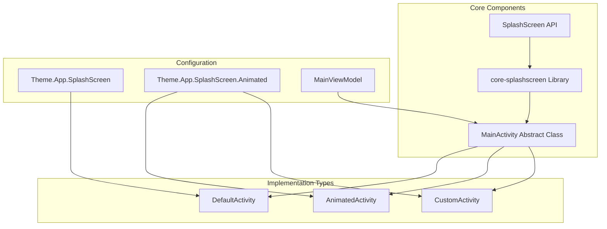
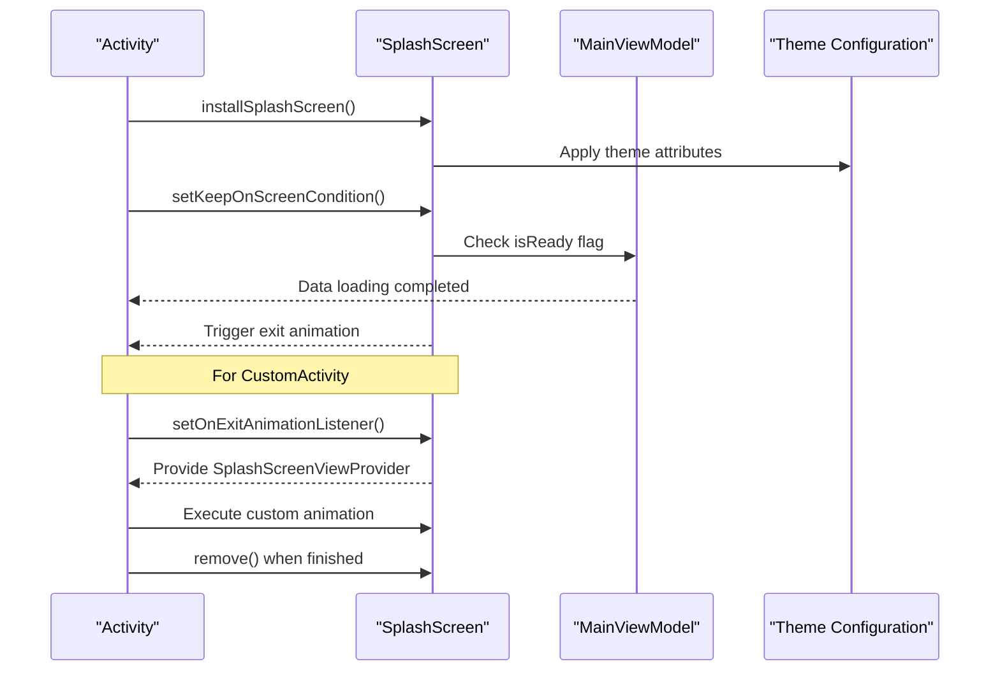

<!-- source: DeepWiki mcp.deepwiki.com · repo android/user-interface-samples · page 5.2 Splash Screen · fetched 2026-10-23 -->

# Splash Screen

<details>
<summary>Relevant source files</summary>

The following files were used as context for generating this wiki page:

- [SplashScreen/README.md](SplashScreen/README.md)
- [SplashScreen/app/build.gradle](SplashScreen/app/build.gradle)
- [SplashScreen/app/src/androidTest/AndroidManifest.xml](SplashScreen/app/src/androidTest/AndroidManifest.xml)
- [SplashScreen/app/src/main/AndroidManifest.xml](SplashScreen/app/src/main/AndroidManifest.xml)
- [SplashScreen/app/src/main/java/com/example/android/splashscreen/AnimatedActivity.kt](SplashScreen/app/src/main/java/com/example/android/splashscreen/AnimatedActivity.kt)
- [SplashScreen/app/src/main/java/com/example/android/splashscreen/CustomActivity.kt](SplashScreen/app/src/main/java/com/example/android/splashscreen/CustomActivity.kt)
- [SplashScreen/app/src/main/java/com/example/android/splashscreen/MainActivity.kt](SplashScreen/app/src/main/java/com/example/android/splashscreen/MainActivity.kt)
- [SplashScreen/app/src/main/java/com/example/android/splashscreen/MainViewModel.kt](SplashScreen/app/src/main/java/com/example/android/splashscreen/MainViewModel.kt)
- [SplashScreen/app/src/main/res/values-night/colors.xml](SplashScreen/app/src/main/res/values-night/colors.xml)
- [SplashScreen/app/src/main/res/values-night/themes.xml](SplashScreen/app/src/main/res/values-night/themes.xml)
- [SplashScreen/app/src/main/res/values/colors.xml](SplashScreen/app/src/main/res/values/colors.xml)
- [SplashScreen/app/src/main/res/values/themes.xml](SplashScreen/app/src/main/res/values/themes.xml)
- [SplashScreen/build.gradle](SplashScreen/build.gradle)
- [SplashScreen/gradle/wrapper/gradle-wrapper.properties](SplashScreen/gradle/wrapper/gradle-wrapper.properties)

</details>


This document covers the Splash Screen API implementation in the Android User Interface Samples repository. It explains how to properly implement splash screens in Android applications using both the native API (introduced in Android 12) and the backward-compatible core-splashscreen library.

## Purpose and Overview

The Splash Screen system demonstrates how to implement launch screens that:
- Improve perceived performance during app startup
- Support animated icons on the splash screen
- Allow customized exit animations
- Adapt to system theme settings (light/dark mode)

The implementation showcases three distinct approaches to splash screens:
1. Default splash screen with minimal configuration
2. Animated splash screen with an animated icon
3. Custom splash screen with both animated icon and custom exit animation

Sources: [SplashScreen/README.md:1-25](), [SplashScreen/app/src/main/AndroidManifest.xml:26-69]()

## System Architecture



The Splash Screen system consists of three main components:

1. **Core Components**: The foundational elements that provide splash screen functionality:
   - `SplashScreen API`: Android 12's native API for splash screens
   - `core-splashscreen Library`: Backward compatibility library for pre-Android 12 devices
   - `MainActivity`: Abstract base class that handles common splash screen setup

2. **Implementation Types**: Three concrete implementations demonstrating different splash screen techniques:
   - `DefaultActivity`: Basic splash screen without customization
   - `AnimatedActivity`: Splash screen with animated icon
   - `CustomActivity`: Fully customized splash screen with animated icon and exit animation

3. **Configuration**: Theme and data components that control splash screen appearance and behavior:
   - Theme styles that define splash screen visual properties
   - `MainViewModel` that controls data loading and splash screen duration

Sources: [SplashScreen/app/src/main/java/com/example/android/splashscreen/MainActivity.kt:19-89](), [SplashScreen/app/src/main/AndroidManifest.xml:26-69](), [SplashScreen/app/build.gradle:30-55]()

## Implementation Flow



This diagram illustrates the sequence of operations in the Splash Screen implementation:

1. The Activity calls `installSplashScreen()` to set up the splash screen
2. The splash screen applies theme attributes from the configured theme
3. The Activity sets a keep-on-screen condition based on data loading state
4. The ViewModel completes data loading and updates the `isReady` flag
5. The splash screen triggers the exit animation
6. For the custom implementation, an exit animation listener executes additional animations

Sources: [SplashScreen/app/src/main/java/com/example/android/splashscreen/MainActivity.kt:29-35](), [SplashScreen/app/src/main/java/com/example/android/splashscreen/CustomActivity.kt:32-66](), [SplashScreen/app/src/main/java/com/example/android/splashscreen/MainViewModel.kt:56-73]()

## Key Components

### 1. Core-SplashScreen Library

The sample uses the androidx.core.splashscreen library to provide backward compatibility for the Splash Screen API. This library enables splash screen functionality on devices running Android 5.0 (API level 21) and higher.

```
dependencies {
    // Use the SplashScreen compat library.
    implementation 'androidx.core:core-splashscreen:1.0.0'
}
```

The library's minimum SDK requirement is aligned with the application's minimum SDK:

```
// The SplashScreen API was introduced in API level 31.
// The 'core-splashscreen' library ports it back to API level 21.
minSdkVersion 21
```

Sources: [SplashScreen/app/build.gradle:30-55]()

### 2. MainActivity Abstract Class

`MainActivity` serves as the base class for all splash screen implementations, providing common functionality:

| Method/Property | Purpose |
|-----------------|---------|
| `splashScreen` | Property that holds the SplashScreen instance |
| `installSplashScreen()` | Sets up the splash screen |
| `setKeepOnScreenCondition()` | Controls how long splash screen remains visible |

The most critical part of the implementation is:

```kotlin
// Set up 'core-splashscreen' to handle the splash screen in a backward compatible manner.
splashScreen = installSplashScreen()

// The splash screen remains on the screen as long as this condition is true.
splashScreen.setKeepOnScreenCondition { !viewModel.isReady }
```

This code ensures the splash screen stays visible until the app's data is fully loaded.

Sources: [SplashScreen/app/src/main/java/com/example/android/splashscreen/MainActivity.kt:25-35]()

### 3. Implementation Variants

#### Default Splash Screen

The default implementation (`DefaultActivity`) shows a simple splash screen with no customization beyond the theme configuration.

```xml
<activity
    android:name=".DefaultActivity"
    android:exported="true"
    android:label="@string/default_splash_screen"
    android:theme="@style/Theme.App.SplashScreen">
    <intent-filter>
        <action android:name="android.intent.action.MAIN" />
        <category android:name="android.intent.category.LAUNCHER" />
    </intent-filter>
</activity>
```

Sources: [SplashScreen/app/src/main/AndroidManifest.xml:32-41]()

#### Animated Splash Screen

The animated implementation (`AnimatedActivity`) shows an animated icon in the splash screen.

```xml
<activity
    android:name=".AnimatedActivity"
    android:exported="true"
    android:label="@string/animated_splash_screen"
    android:theme="@style/Theme.App.SplashScreen.Animated">
    <intent-filter>
        <action android:name="android.intent.action.MAIN" />
        <category android:name="android.intent.category.LAUNCHER" />
    </intent-filter>
</activity>
```

Sources: [SplashScreen/app/src/main/AndroidManifest.xml:46-55](), [SplashScreen/app/src/main/java/com/example/android/splashscreen/AnimatedActivity.kt:19-24]()

#### Custom Splash Screen

The custom implementation (`CustomActivity`) shows an animated icon and provides a custom exit animation.

```kotlin
// This callback is called when the app is ready to draw its content and replace the splash
// screen. We can customize the exit animation of the splash screen here.
splashScreen.setOnExitAnimationListener { splashScreenViewProvider ->
    // Get the remaining duration of the icon animation
    val remainingDuration = splashScreenViewProvider.iconAnimationRemainingDurationMillis
    
    // Set up a slide up animation for the splash screen view
    val splashScreenView = splashScreenViewProvider.view
    val slideUp = ObjectAnimator.ofFloat(
        splashScreenView,
        View.TRANSLATION_Y,
        0f,
        -splashScreenView.height.toFloat()
    )
    slideUp.interpolator = AnticipateInterpolator()
    slideUp.duration = 200L
    
    // Remove the splash screen when animation completes
    slideUp.doOnEnd { splashScreenViewProvider.remove() }
    
    // Start the animation after the icon animation completes
    slideUp.startDelay = remainingDuration
    slideUp.start()
}
```

Sources: [SplashScreen/app/src/main/AndroidManifest.xml:60-69](), [SplashScreen/app/src/main/java/com/example/android/splashscreen/CustomActivity.kt:32-66]()

### 4. Theme Configuration

The theme configuration is crucial for defining the splash screen appearance:

```mermaid
classDiagram
    class "Theme.SplashScreen" {
        Basic splash screen theme
    }

    class "Theme.SplashScreen.IconBackground" {
        Shows background color behind icon
    }

    class "Theme.App.SplashScreen" {
        +postSplashScreenTheme: Theme.App
        Basic implementation
    }

    class "Theme.App.SplashScreen.Animated" {
        +windowSplashScreenAnimatedIcon: drawable
        +windowSplashScreenIconBackgroundColor: color
        +windowSplashScreenBackground: color
        +windowSplashScreenAnimationDuration: 1000ms
        +postSplashScreenTheme: Theme.App
        Animated implementation
    }

    "Theme.SplashScreen" <|-- "Theme.App.SplashScreen"
    "Theme.SplashScreen.IconBackground" <|-- "Theme.App.SplashScreen.Animated"
```

Key theme attributes include:

| Attribute | Purpose |
|-----------|---------|
| `windowSplashScreenAnimatedIcon` | The drawable to display as the animated icon |
| `windowSplashScreenIconBackgroundColor` | Background color behind the icon |
| `windowSplashScreenBackground` | Background color for the entire splash screen |
| `windowSplashScreenAnimationDuration` | Duration of the icon animation in milliseconds |
| `postSplashScreenTheme` | Theme to apply after the splash screen is dismissed |

Sources: [SplashScreen/app/src/main/res/values/themes.xml:45-69]()

### 5. Data Loading Control

The `MainViewModel` controls how long the splash screen is displayed by managing the `isReady` flag:

```kotlin
/**
 * True when the initial data in ViewModel is ready, and the app is ready to draw its main
 * content.
 */
var isReady = false
    private set

init {
    viewModelScope.launch {
        val nightMode = withContext(Dispatchers.IO) {
            // Load saved night mode setting
        }
        _nightMode.value = nightMode

        // We have finished loading the initial essential data for showing the app content.
        delay(1000)
        isReady = true
    }
}
```

When `isReady` becomes `true`, the splash screen is dismissed automatically due to the `setKeepOnScreenCondition` configured in the `MainActivity`.

Sources: [SplashScreen/app/src/main/java/com/example/android/splashscreen/MainViewModel.kt:56-73]()

## Dark Mode Support

The splash screen implementation includes support for dark mode through:

1. **Theme resources in values-night directory**: These provide alternative colors for dark mode
   ```xml
   <color name="splash_screen_background">@color/blue_gray_900</color>
   ```

2. **Runtime theme switching**: The sample demonstrates how to persist the user's theme preference and apply it at startup, which affects the splash screen appearance

```kotlin
// Sets and persists the night mode setting for this app. This allows the system to know
// if the app wants to be displayed in dark mode before it launches so that the splash
// screen can be displayed accordingly.
if (Build.VERSION.SDK_INT >= 31) {
    uiModeManager?.setApplicationNightMode(nightMode)
}
```

Sources: [SplashScreen/app/src/main/res/values-night/colors.xml:1-20](), [SplashScreen/app/src/main/java/com/example/android/splashscreen/MainViewModel.kt:76-89]()

## Implementation Steps

To implement a splash screen similar to this sample in your own application:

1. **Add the dependency**:
   ```gradle
   implementation 'androidx.core:core-splashscreen:1.0.0'
   ```

2. **Configure themes**:
   - Create a splash screen theme extending `Theme.SplashScreen`
   - Set visual properties like icon, colors, and animation duration
   - Configure `postSplashScreenTheme` to specify the theme to use after the splash screen

3. **Apply the theme to your launcher activity** in the AndroidManifest.xml

4. **Install the splash screen** in your Activity:
   ```kotlin
   override fun onCreate(savedInstanceState: Bundle?) {
       val splashScreen = installSplashScreen()
       
       // Optional: Keep splash screen visible until data is loaded
       splashScreen.setKeepOnScreenCondition { !dataIsReady }
       
       // Optional: Customize exit animation
       splashScreen.setOnExitAnimationListener { ... }
       
       super.onCreate(savedInstanceState)
       // Rest of onCreate...
   }
   ```

5. **Handle dark mode** by providing appropriate resource values in the values-night directory

Sources: [SplashScreen/app/src/main/java/com/example/android/splashscreen/MainActivity.kt:29-35](), [SplashScreen/app/src/main/res/values/themes.xml:45-69](), [SplashScreen/app/build.gradle:54-55]()

## Conclusion

The Splash Screen API provides a standardized way to implement app launch screens on Android. The sample demonstrates:

- Simple splash screen implementation with minimal configuration
- Adding animated icons to splash screens
- Creating custom exit animations for splash screens
- Supporting dark mode in splash screens
- Controlling splash screen duration based on data loading state

This system is particularly useful for providing a smooth, branded experience during app startup while data is being loaded, improving perceived performance.

Sources: [SplashScreen/README.md:1-44]()

---

