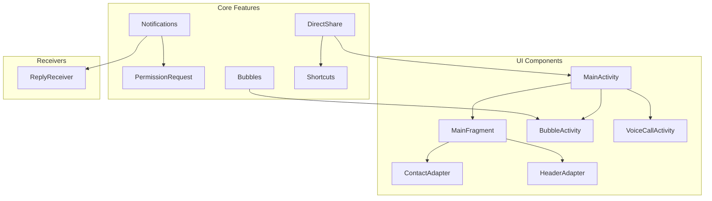
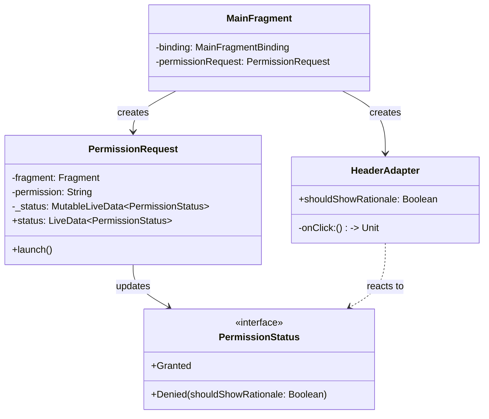
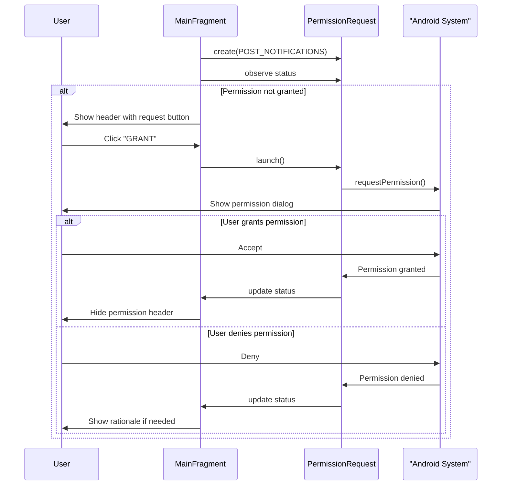
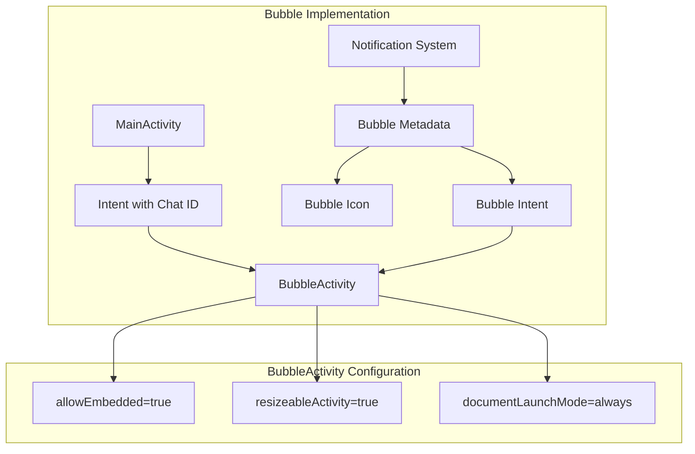
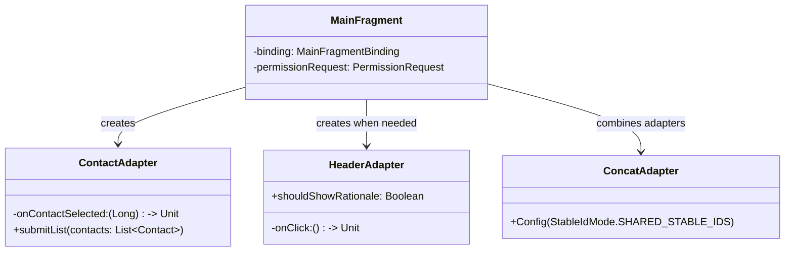
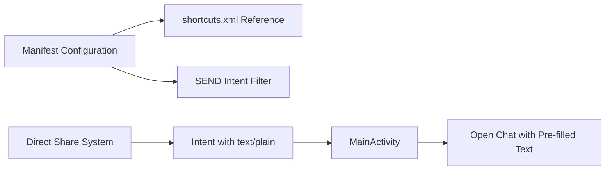

<!-- source: DeepWiki mcp.deepwiki.com · repo android/user-interface-samples · page 5.3 People UI · fetched 2026-10-23 -->

# People UI

<details>
<summary>Relevant source files</summary>

The following files were used as context for generating this wiki page:

- [People/app/build.gradle](People/app/build.gradle)
- [People/app/src/main/AndroidManifest.xml](People/app/src/main/AndroidManifest.xml)
- [People/app/src/main/java/com/example/android/people/ui/chat/PermissionRequest.kt](People/app/src/main/java/com/example/android/people/ui/chat/PermissionRequest.kt)
- [People/app/src/main/java/com/example/android/people/ui/main/HeaderAdapter.kt](People/app/src/main/java/com/example/android/people/ui/main/HeaderAdapter.kt)
- [People/app/src/main/java/com/example/android/people/ui/main/MainFragment.kt](People/app/src/main/java/com/example/android/people/ui/main/MainFragment.kt)
- [People/app/src/main/res/layout/contact_header.xml](People/app/src/main/res/layout/contact_header.xml)
- [People/app/src/main/res/values/strings.xml](People/app/src/main/res/values/strings.xml)
- [People/app/src/main/res/values/styles.xml](People/app/src/main/res/values/styles.xml)
- [People/build.gradle](People/build.gradle)
- [People/gradle/wrapper/gradle-wrapper.properties](People/gradle/wrapper/gradle-wrapper.properties)

</details>


## Purpose and Scope

The People UI sample demonstrates modern Android notification features, bubbles, and direct share functionality within a messaging app context. This sample showcases how to implement chat-style notifications, conversation bubbles, permission handling, and integration with Android's sharing system. The sample is designed for developers looking to implement these UI features in their own applications.

Sources: [People/app/src/main/AndroidManifest.xml](), [People/app/src/main/java/com/example/android/people/ui/main/MainFragment.kt]()

## System Architecture

The People UI sample is structured around a messaging application paradigm with the following key components:



The application is built with several key activities:
- `MainActivity`: Entry point that hosts fragments and handles intents
- `BubbleActivity`: Specialized activity for displaying chat bubbles
- `VoiceCallActivity`: Simulates a voice call function

The main UI flow starts with a contact list in `MainFragment`, which leads to individual chat conversations that can be displayed as bubbles.

Sources: [People/app/src/main/AndroidManifest.xml](), [People/app/src/main/java/com/example/android/people/ui/main/MainFragment.kt]()

## Permission Handling System

Android 13 (API 33) introduced runtime permission requirements for posting notifications. The People UI sample implements a comprehensive permission handling system to request and manage the `POST_NOTIFICATIONS` permission.



The permission system flow:
1. `MainFragment` initializes a `PermissionRequest` for the `POST_NOTIFICATIONS` permission
2. If permission is not granted, a header is displayed in the contact list with a button to request permission
3. Permission status is observed via LiveData and UI is updated accordingly
4. If the user denies permission, a rationale can be shown to explain why permission is needed

Sources: [People/app/src/main/java/com/example/android/people/ui/chat/PermissionRequest.kt](), [People/app/src/main/java/com/example/android/people/ui/main/MainFragment.kt:42-44](), [People/app/src/main/java/com/example/android/people/ui/main/HeaderAdapter.kt]()

## Notification System

The app demonstrates advanced notification features for messaging apps, including:

1. **Notification Channels**: Dedicated channel for new messages
2. **Reply Actions**: Direct reply from notifications using `ReplyReceiver`
3. **Person-based Notifications**: Associating notifications with contacts

The notification permission request flow:



Sources: [People/app/src/main/java/com/example/android/people/ui/chat/PermissionRequest.kt](), [People/app/src/main/java/com/example/android/people/ui/main/MainFragment.kt:72-83](), [People/app/src/main/res/values/strings.xml:27-28]()

## Bubble Implementation

The People UI sample demonstrates Android's Bubble feature, which allows chat conversations to float over other apps in a bubble UI.



Key aspects of the bubble implementation:

1. **BubbleActivity configuration**:
   - `allowEmbedded="true"`: Allows the activity to be embedded in System UI
   - `resizeableActivity="true"`: Enables resizing by System UI
   - `documentLaunchMode="always"`: Supports multiple instances for different chats

2. **Activity Navigation**:
   - The bubble expands to show a chat interface
   - From the expanded bubble, users can launch a full `VoiceCallActivity`

Sources: [People/app/src/main/AndroidManifest.xml:92-106]()

## UI Components

### Main Contact List

The main screen displays a list of contacts using RecyclerView with a `ContactAdapter`. When notification permission is needed, a `HeaderAdapter` is prepended to the list.



The contact list UI dynamically adapts based on permission status:
- If permission is granted, only the `ContactAdapter` is used
- If permission is needed, a `ConcatAdapter` combines the `HeaderAdapter` and `ContactAdapter`

The `HeaderAdapter` displays a card with:
- A message explaining the need for notification permission
- A rationale message (when appropriate)
- A "GRANT" button to trigger the permission request

Sources: [People/app/src/main/java/com/example/android/people/ui/main/MainFragment.kt:56-66](), [People/app/src/main/java/com/example/android/people/ui/main/HeaderAdapter.kt](), [People/app/src/main/res/layout/contact_header.xml]()

## Integration with Android Platform Features

The People UI sample demonstrates integration with several Android platform features:

### 1. Content Capture with Locus ID

The app uses `LocusId` to differentiate between main view and chat views for Android's content capture system.

```kotlin
requireActivity().setLocusContext(LocusId("mainFragment"), null)
```

### 2. App Shortcuts & Direct Share

The app defines shortcuts in the manifest and implements the `SEND` intent filter with `text/plain` MIME type to enable Direct Share integration.



Sources: [People/app/src/main/AndroidManifest.xml:62-66](), [People/app/src/main/AndroidManifest.xml:67-69](), [People/app/src/main/java/com/example/android/people/ui/main/MainFragment.kt:87]()

## Theming and Styling

The People UI sample implements two distinct themes:

1. **Main Theme (Theme.People)**:
   - Light theme with no action bar
   - Used for the main application UI

2. **Voice Call Theme (Theme.People.Voice)**:
   - Dark theme with no action bar
   - Used specifically for the voice call screen

Sources: [People/app/src/main/res/values/styles.xml]()

## Technical Requirements

The People UI sample requires:

- Minimum SDK version: 30 (Android 11)
- Target SDK version: 33 (Android 13)
- Dependencies:
  - AndroidX libraries (AppCompat, Fragment, Core, ConstraintLayout, RecyclerView)
  - Lifecycle components
  - Material Design components
  - Glide for image loading

Sources: [People/app/build.gradle:22-28](), [People/app/build.gradle:48-65]()

## Summary

The People UI sample demonstrates the implementation of modern Android UI features centered around people and conversations:

1. **Notification Permission Handling**: Comprehensive system for requesting and managing notification permissions
2. **Bubble UI**: Proper implementation of Android's bubble feature for chat conversations
3. **Direct Share Integration**: Integration with Android's sharing system
4. **UI Components**: Contact list with dynamic adapter configuration based on permissions

This sample serves as a reference implementation for developers looking to implement similar features in their own applications.

---

