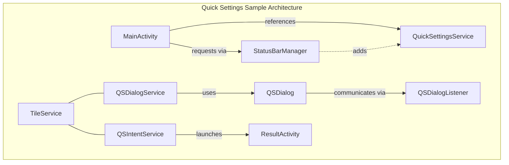
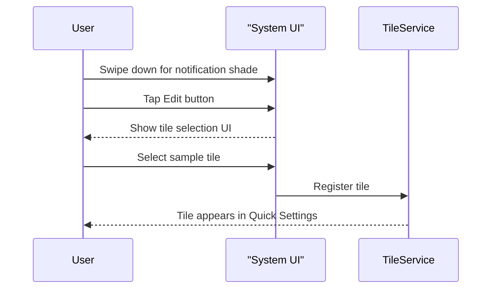
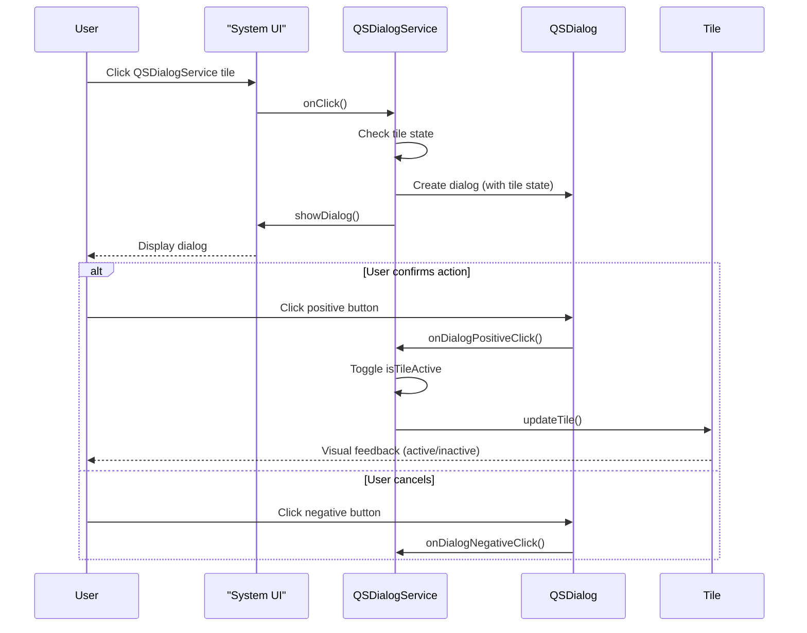
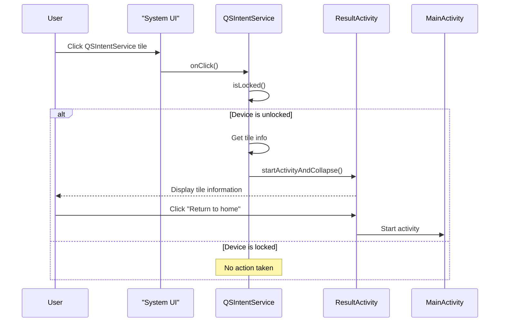
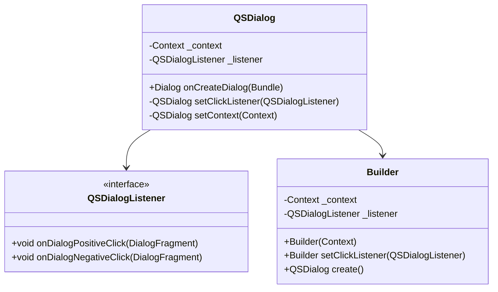

<!-- source: DeepWiki mcp.deepwiki.com · repo android/user-interface-samples · page 5.4 Quick Settings · fetched 2026-10-23 -->

# Quick Settings

<details>
<summary>Relevant source files</summary>

The following files were used as context for generating this wiki page:

- [Quick-Settings/app/build.gradle](Quick-Settings/app/build.gradle)
- [Quick-Settings/app/src/completed/java/com/google/android_quick_settings/QSDialogService.java](Quick-Settings/app/src/completed/java/com/google/android_quick_settings/QSDialogService.java)
- [Quick-Settings/app/src/completed/java/com/google/android_quick_settings/QSIntentService.java](Quick-Settings/app/src/completed/java/com/google/android_quick_settings/QSIntentService.java)
- [Quick-Settings/app/src/main/java/com/google/android_quick_settings/MainActivity.java](Quick-Settings/app/src/main/java/com/google/android_quick_settings/MainActivity.java)
- [Quick-Settings/app/src/main/java/com/google/android_quick_settings/QSDialog.java](Quick-Settings/app/src/main/java/com/google/android_quick_settings/QSDialog.java)
- [Quick-Settings/app/src/main/java/com/google/android_quick_settings/ResultActivity.java](Quick-Settings/app/src/main/java/com/google/android_quick_settings/ResultActivity.java)
- [Quick-Settings/app/src/main/res/layout/activity_main.xml](Quick-Settings/app/src/main/res/layout/activity_main.xml)
- [Quick-Settings/app/src/main/res/values/strings.xml](Quick-Settings/app/src/main/res/values/strings.xml)
- [Quick-Settings/build.gradle](Quick-Settings/build.gradle)

</details>


This document provides a technical reference for the Quick Settings sample in the Android User Interface Samples repository. The sample demonstrates how to implement and manage custom Quick Settings tiles - the controls users access by swiping down from the top of their device's screen.

## Purpose and Scope

This documentation covers:
- Creating and registering custom Quick Settings tiles
- Implementing TileService classes to handle user interactions
- Supporting both dialog-based and intent-based interaction patterns
- Programmatically requesting system to add tiles (Android 13/API 33+)

## System Architecture



The Quick Settings sample consists of:
1. **MainActivity** - Entry point that demonstrates how to add a tile programmatically
2. **QSDialogService** - Service that shows a dialog when its tile is clicked
3. **QSIntentService** - Service that launches an activity when its tile is clicked
4. **QSDialog** - Custom dialog fragment used by QSDialogService
5. **ResultActivity** - Activity launched by QSIntentService showing tile information

Sources: [Quick-Settings/app/src/main/java/com/google/android_quick_settings/MainActivity.java:15-61](), [Quick-Settings/app/src/completed/java/com/google/android_quick_settings/QSDialogService.java:15-77](), [Quick-Settings/app/src/completed/java/com/google/android_quick_settings/QSIntentService.java:15-54](), [Quick-Settings/app/src/main/java/com/google/android_quick_settings/QSDialog.java:15-119](), [Quick-Settings/app/src/main/java/com/google/android_quick_settings/ResultActivity.java:15-51]()

## Adding Quick Settings Tiles

### Manual Addition

The app includes instructions for users to manually add a Quick Settings tile:



Sources: [Quick-Settings/app/src/main/res/values/strings.xml:19-26]()

### Programmatic Addition (Android 13/API 33+)

On Android 13 and above, the app can programmatically request adding a tile with user consent:

```java
StatusBarManager statusBarService = this.getSystemService(StatusBarManager.class);
ComponentName componentName = new ComponentName(
    this.getApplicationContext(),
    QuickSettingsService.class.getName());

statusBarService.requestAddTileService(
    componentName, "Quick Settings", icon.toIcon(MainActivity.this),
    MoreExecutors.directExecutor(), integer -> {
       setResult(integer);
       finish();
    });
```

Sources: [Quick-Settings/app/src/main/java/com/google/android_quick_settings/MainActivity.java:38-58]()

## Tile Interaction Patterns

The sample demonstrates two interaction patterns for Quick Settings tiles:

### Dialog-Based Interaction



QSDialogService maintains a boolean `isTileActive` to track the tile state, and updates it when the user interacts with the dialog.

Sources: [Quick-Settings/app/src/completed/java/com/google/android_quick_settings/QSDialogService.java:25-77](), [Quick-Settings/app/src/main/java/com/google/android_quick_settings/QSDialog.java:25-119]()

### Intent-Based Interaction



QSIntentService launches ResultActivity only if the device is unlocked, passing the tile's information via intent extras.

Sources: [Quick-Settings/app/src/completed/java/com/google/android_quick_settings/QSIntentService.java:25-54](), [Quick-Settings/app/src/main/java/com/google/android_quick_settings/ResultActivity.java:25-51]()

## Tile State Management

Tiles can be in one of two states:
- `Tile.STATE_ACTIVE` - Tile is active/enabled
- `Tile.STATE_INACTIVE` - Tile is inactive/disabled

```mermaid
stateDiagram-v2
    [*] --> "STATE_INACTIVE"
    "STATE_INACTIVE" --> "STATE_ACTIVE": User confirms in dialog
    "STATE_ACTIVE" --> "STATE_INACTIVE": User confirms in dialog
```

The QSDialogService implements state toggling:

```java
private void updateTile() {
    Tile tile = super.getQsTile();
    int activeState = isTileActive ?
            Tile.STATE_ACTIVE : Tile.STATE_INACTIVE;

    tile.setState(activeState);
    tile.updateTile();
}
```

Sources: [Quick-Settings/app/src/completed/java/com/google/android_quick_settings/QSDialogService.java:69-76]()

## Implementation Details

### QSDialog

The QSDialog class uses the Builder pattern and implements a custom DialogFragment:



The dialog shows different button text based on the current tile state:

```java
int actionButtonText = isTileActive ?
        R.string.qs_dialog_active : R.string.qs_dialog_inactive;
```

Sources: [Quick-Settings/app/src/main/java/com/google/android_quick_settings/QSDialog.java:25-119]()

### ResultActivity

ResultActivity receives tile information via intent extras and displays it:

```java
if (getIntent() != null) {
    Bundle extras = getIntent().getExtras();

    String tileState = extras.getString(RESULT_ACTIVITY_INFO_KEY);
    String tileName = extras.getString(RESULT_ACTIVITY_NAME_KEY);

    TextView outputText = findViewById(R.id.result_info);
    outputText.setText(getString(R.string.result_output, tileName, tileState));
}
```

Sources: [Quick-Settings/app/src/main/java/com/google/android_quick_settings/ResultActivity.java:30-48]()

## Project Structure

The sample includes two product flavors:
- `start` - Initial state for users to begin implementation
- `completed` - Full implementation with working services

```
Quick-Settings/
├── app/
│   ├── src/
│   │   ├── main/
│   │   │   ├── java/
│   │   │   │   └── com/google/android_quick_settings/
│   │   │   │       ├── MainActivity.java
│   │   │   │       ├── QSDialog.java
│   │   │   │       └── ResultActivity.java
│   │   │   ├── res/
│   │   │   └── AndroidManifest.xml
│   │   ├── start/
│   │   │   └── java/
│   │   └── completed/
│   │       └── java/
│   │           └── com/google/android_quick_settings/
│   │               ├── QSDialogService.java
│   │               └── QSIntentService.java
│   └── build.gradle
└── build.gradle
```

Sources: [Quick-Settings/app/build.gradle:17-74]()

## System Requirements

- Minimum SDK: Android 10 (API 29)
- Target SDK: Android 13 (API 33)
- Programmatic tile addition requires Android 13 (API 33)

Sources: [Quick-Settings/app/build.gradle:22-29]()

## Usage Summary

1. Install the app
2. Add the sample tile either:
   - Manually through the notification shade
   - Programmatically by tapping the button (API 33+)
3. Test the different interaction patterns:
   - Dialog-based: Shows a dialog and toggles tile state
   - Intent-based: Opens an activity showing tile information

---

