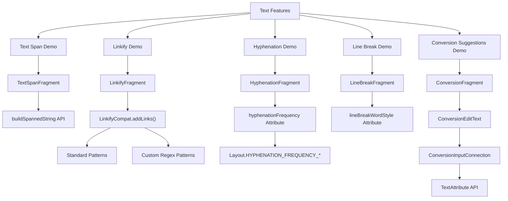
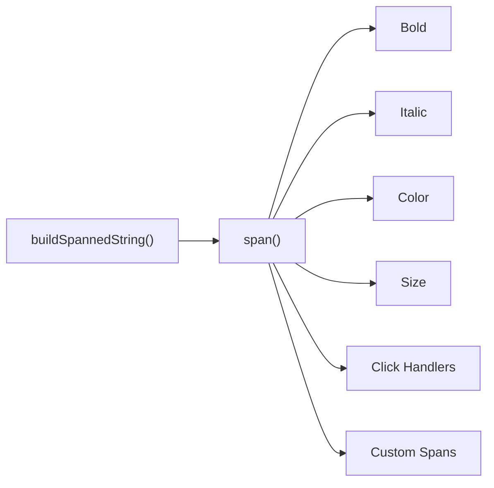
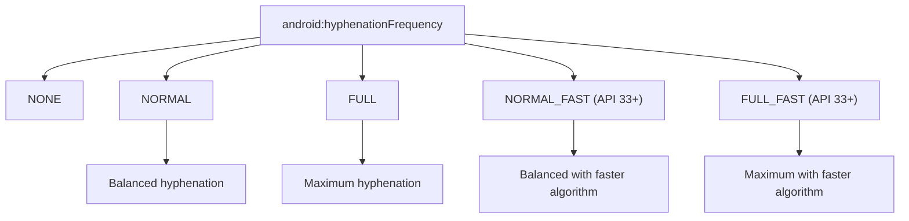
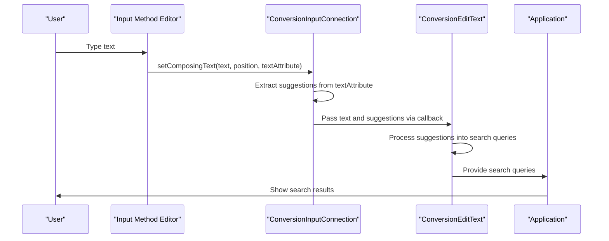

<!-- source: DeepWiki mcp.deepwiki.com · repo android/user-interface-samples · page 5.5 Text Features · fetched 2026-10-23 -->

# Text Features

<details>
<summary>Relevant source files</summary>

The following files were used as context for generating this wiki page:

- [Text/README.md](Text/README.md)
- [Text/app/src/main/java/com/example/android/text/demo/Demo.kt](Text/app/src/main/java/com/example/android/text/demo/Demo.kt)
- [Text/app/src/main/java/com/example/android/text/demo/conversion/ConversionEditText.kt](Text/app/src/main/java/com/example/android/text/demo/conversion/ConversionEditText.kt)
- [Text/app/src/main/java/com/example/android/text/demo/conversion/ConversionFragment.kt](Text/app/src/main/java/com/example/android/text/demo/conversion/ConversionFragment.kt)
- [Text/app/src/main/java/com/example/android/text/demo/conversion/ConversionInputConnection.kt](Text/app/src/main/java/com/example/android/text/demo/conversion/ConversionInputConnection.kt)
- [Text/app/src/main/java/com/example/android/text/demo/hyphenation/HyphenationFragment.kt](Text/app/src/main/java/com/example/android/text/demo/hyphenation/HyphenationFragment.kt)
- [Text/app/src/main/java/com/example/android/text/demo/linkify/LinkifyFragment.kt](Text/app/src/main/java/com/example/android/text/demo/linkify/LinkifyFragment.kt)
- [Text/app/src/main/res/layout/conversion_fragment.xml](Text/app/src/main/res/layout/conversion_fragment.xml)
- [Text/app/src/main/res/layout/hyphenation_fragment.xml](Text/app/src/main/res/layout/hyphenation_fragment.xml)
- [Text/app/src/main/res/layout/linkify_fragment.xml](Text/app/src/main/res/layout/linkify_fragment.xml)
- [Text/app/src/main/res/values/dimens.xml](Text/app/src/main/res/values/dimens.xml)
- [Text/app/src/main/res/values/strings.xml](Text/app/src/main/res/values/strings.xml)

</details>


## Purpose and Scope

This document covers the text-related features demonstrated in the Android User Interface Samples repository. It explains several advanced text handling capabilities in Android applications, including creating rich text with spans, adding clickable links, controlling hyphenation, managing line breaks in specific languages, and implementing text conversion suggestions. These features help create more interactive, readable, and language-appropriate text displays.

## Features Overview

The Text Features sample demonstrates five key text handling capabilities:

| Feature | Description | API Level |
|---------|-------------|-----------|
| Text Span | Building rich text with different styles | Any |
| Linkify | Creating clickable links in TextViews | Any |
| Hyphenation | Controlling word hyphenation for better text layout | 23+ |
| Line Break | Managing line breaks in languages written without spaces | 33+ |
| Conversion Suggestions | Accessing text suggestions before they're committed | 33+ |

### System Architecture



Sources: [Text/README.md:9-63](), [Text/app/src/main/java/com/example/android/text/demo/Demo.kt:32-67]()

## Text Span

The Text Span feature demonstrates how to create rich text with different styles using the `buildSpannedString` API from the core-ktx library. This allows developers to apply different formatting (like bold, italic, colors, and custom styles) to specific portions of text.



Sources: [Text/README.md:16-20]()

## Linkify

The Linkify feature demonstrates how to create clickable links in TextViews using the `LinkifyCompat` class. It automatically detects patterns in text and converts them to clickable links with appropriate intents.

### Standard and Custom Link Types

The LinkifyFragment implements two approaches:

1. **Standard Web URLs**:
```kotlin
LinkifyCompat.addLinks(binding.webUrls, Linkify.WEB_URLS)
```

2. **Custom Twitter Handle Pattern**:
```kotlin
val pattern = Pattern.compile("@[a-zA-Z0-9_]{1,15}")
LinkifyCompat.addLinks(
    binding.custom,
    pattern,
    "https://twitter.com/",
    null
) { _, url ->
    // Remove "@" at the beginning of the match
    url.toString().substring(startIndex = 1)
}
```

This implementation matches Twitter handles (like @AndroidDev) and converts them to clickable links opening the corresponding Twitter profile.

Sources: [Text/README.md:22-26](), [Text/app/src/main/java/com/example/android/text/demo/linkify/LinkifyFragment.kt:34-49](), [Text/app/src/main/res/layout/linkify_fragment.xml:24-36]()

## Hyphenation

Hyphenation improves the visual appearance of justified text by automatically breaking words at appropriate points. Android supports automatic hyphenation for many languages including English.

### Hyphenation Options

This feature was introduced in Android 6.0 Marshmallow (API level 23) with the `android:hyphenationFrequency` attribute. Android 13 (API level 33) added two new options (`fullFast` and `normalFast`) that use faster algorithms while providing the same quality.



### Implementation Example

In XML layouts, hyphenation is applied using:

```xml
android:hyphenationFrequency="fullFast"
android:justificationMode="inter_word"
```

The HyphenationFragment allows users to dynamically change hyphenation settings:

```kotlin
binding.hyphenationFrequency.doOnItemSelected { _, position, _ ->
    binding.paragraphs.hyphenationFrequency = 
        HyphenationFrequencyOption.values()[position].value
}
```

Sources: [Text/README.md:28-37](), [Text/app/src/main/java/com/example/android/text/demo/hyphenation/HyphenationFragment.kt:23-65](), [Text/app/src/main/res/layout/hyphenation_fragment.xml:30-40]()

## Line Break

The Line Break feature is particularly relevant to languages written without spaces between words, such as Japanese and Chinese. It demonstrates how to control line breaks to prevent phrases from being awkwardly separated across lines.

Android 13 (API level 33) introduced the `android:lineBreakWordStyle` attribute for TextView. When set to `"phrase"`, it ensures that phrases (bunsetsu in Japanese) will not be separated by line breaks, creating a more natural reading experience.

Example text demonstrating the effect:
```
常に最新、最高のモバイル。Android を開発した同じチームから。
```

Without proper line break control, a phrase might break in an unnatural place. With `lineBreakWordStyle="phrase"`, line breaks only occur between complete phrases.

Sources: [Text/README.md:39-47](), [Text/app/src/main/res/values/strings.xml:28]()

## Conversion Suggestions

The Conversion Suggestions feature demonstrates an API introduced in Android 13 (API level 33) that allows apps to access text before it's committed during text conversion. This is particularly valuable for implementing search-as-you-type functionality in languages that use IMEs with conversion steps, such as Japanese and Chinese.

### Architecture and Data Flow



Sources: [Text/app/src/main/java/com/example/android/text/demo/conversion/ConversionInputConnection.kt:28-66](), [Text/app/src/main/java/com/example/android/text/demo/conversion/ConversionEditText.kt:32-128]()

### Implementation Components

The Conversion Suggestions feature uses three main components:

1. **ConversionFragment**: Sets up the UI and observes search queries
2. **ConversionEditText**: Custom EditText that processes conversion suggestions into search queries
3. **ConversionInputConnection**: Custom InputConnectionWrapper that intercepts text conversion suggestions

#### Key Implementation Details

1. **XML Setup**:
```xml
<com.example.android.text.demo.conversion.ConversionEditText
    android:id="@+id/edit"
    android:layout_width="match_parent"
    android:layout_height="wrap_content"
    android:inputType="text|textEnableTextConversionSuggestions" />
```

The critical attribute is `textEnableTextConversionSuggestions`, which enables the feature.

2. **Capturing Suggestions in ConversionInputConnection**:
```kotlin
override fun setComposingText(
    text: CharSequence,
    newCursorPosition: Int,
    textAttribute: TextAttribute?
): Boolean {
    if (textAttribute == null || text.isEmpty()) {
        onSuggestions.invoke(text, emptyList())
    } else {
        onSuggestions.invoke(text, textAttribute.textConversionSuggestions)
    }
    return super.setComposingText(text, newCursorPosition, textAttribute)
}
```

3. **Processing Suggestions in ConversionEditText**:
```kotlin
private fun postSearchQueries() {
    val text = currentText ?: return
    val suggestions = currentSuggestions
    if (suggestions.isEmpty()) {
        // No conversion suggestions, use text as is
        onSearchQueries?.invoke(listOf(text))
    } else {
        // Process suggestions into search queries
        // ...
        onSearchQueries?.invoke(processedQueries)
    }
}
```

This feature enables applications to provide a responsive search experience even in languages where text input involves a conversion step.

Sources: [Text/README.md:49-63](), [Text/app/src/main/java/com/example/android/text/demo/conversion/ConversionFragment.kt:36-48](), [Text/app/src/main/res/layout/conversion_fragment.xml:30-34](), [Text/app/src/main/java/com/example/android/text/demo/conversion/ConversionInputConnection.kt:34-47](), [Text/app/src/main/java/com/example/android/text/demo/conversion/ConversionEditText.kt:70-97]()

## Demo Registration and Structure

The demo system registers each text feature sample as a demo class with appropriate API level conditions. This ensures that features requiring higher API levels are only shown on compatible devices.

```kotlin
val Demos = buildList {
    add(Demo(title = "Text span", fragment = { TextSpanFragment() }))
    add(Demo(title = "Linkify", fragment = { LinkifyFragment() }))
    if (Build.VERSION.SDK_INT >= 23) {
        add(Demo(title = "Hyphenation", fragment = { HyphenationFragment() }))
    }
    add(Demo(title = "Line break", fragment = { LineBreakFragment() }))
    if (Build.VERSION.SDK_INT >= 33) {
        add(Demo(title = "Conversion suggestions", fragment = { ConversionFragment() }))
    }
}
```

Sources: [Text/app/src/main/java/com/example/android/text/demo/Demo.kt:32-67]()

---

