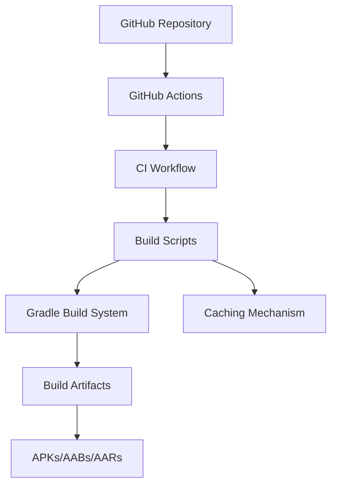
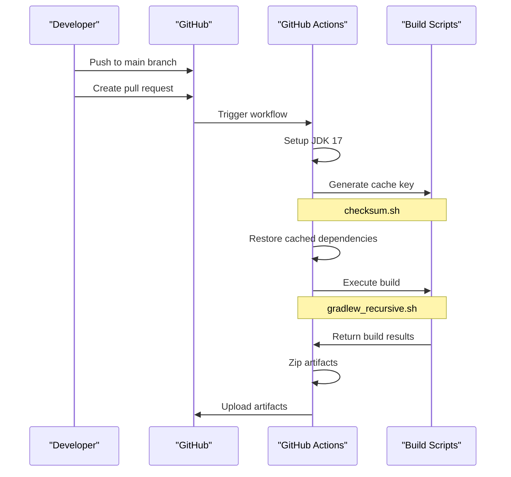
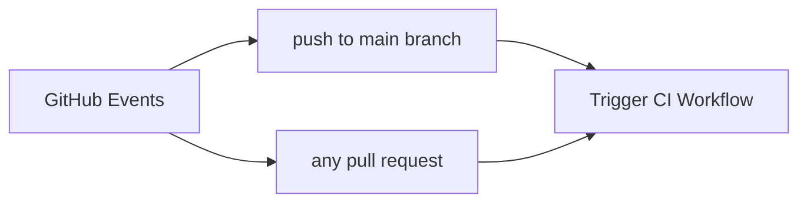
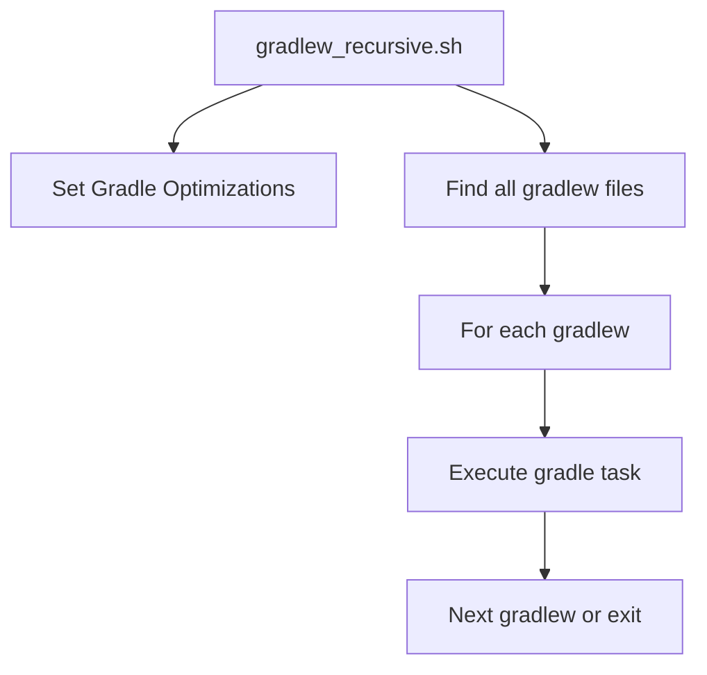
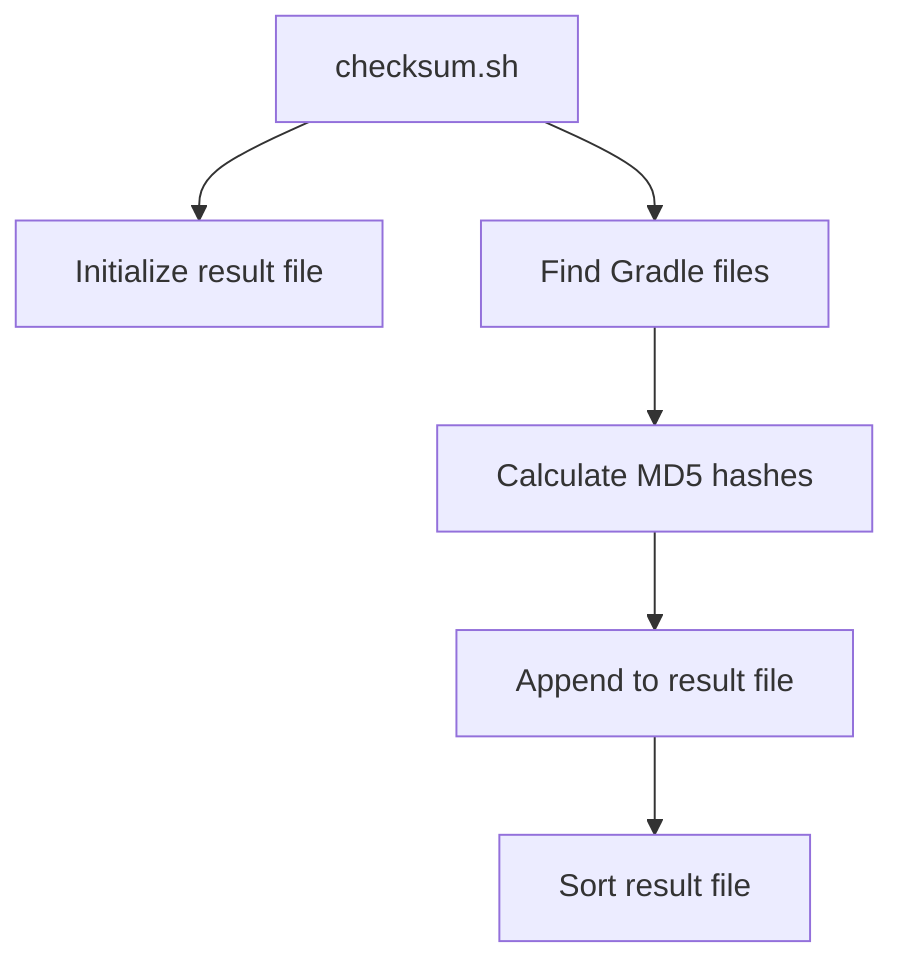
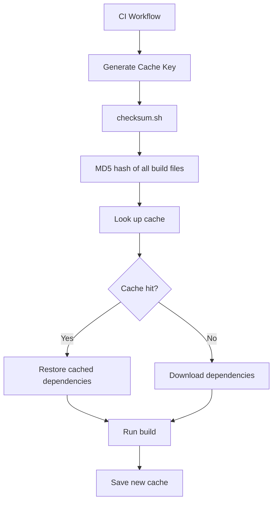
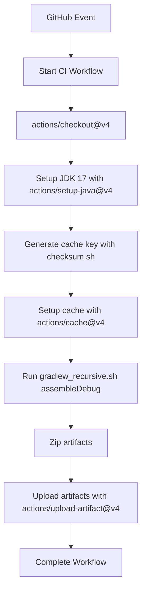
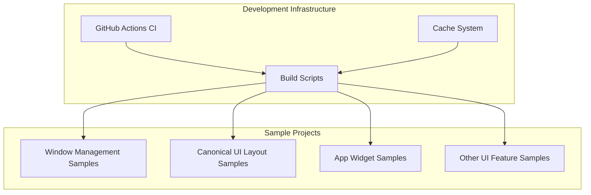

<!-- source: DeepWiki mcp.deepwiki.com · repo android/user-interface-samples · page 6 Development Infrastructure · fetched 2026-10-23 -->

# Development Infrastructure

Relevant source files

The following files were used as context for generating this wiki page:

- [.github/scripts/checksum.sh](.github/scripts/checksum.sh)
- [.github/scripts/gradlew_recursive.sh](.github/scripts/gradlew_recursive.sh)
- [.github/workflows/android.yml](.github/workflows/android.yml)

This page documents the development infrastructure used across the Android User Interface Samples repository. It covers the continuous integration (CI) setup, build scripts, and other development tools that support the various UI samples. 

## Overview

The Android User Interface Samples repository uses GitHub Actions for continuous integration to ensure code quality and build reliability. The infrastructure consists of:

1. GitHub Actions workflows for automated builds
2. Custom build scripts for optimized building across multiple sample modules
3. Caching mechanisms to improve build performance

Sources: [.github/workflows/android.yml]()

## CI Setup with GitHub Actions

The continuous integration system is implemented using GitHub Actions, which automatically builds the project when code is pushed to the main branch or when pull requests are created.

### Workflow Configuration

The CI workflow is defined in the `android.yml` file and consists of several steps:

1. Checkout code from the repository
2. Set up JDK 17 with Zulu distribution
3. Generate a cache key for Gradle dependencies
4. Cache Gradle modules for faster builds
5. Build all projects recursively
6. Package and upload build artifacts

Sources: [.github/workflows/android.yml:15-59]()

### Workflow Trigger Configuration

The CI workflow is configured to run automatically on specific repository events:

Sources: [.github/workflows/android.yml:17-22]()

## Build Scripts

The repository uses custom bash scripts to optimize the build process across multiple sample modules.

### Recursive Gradle Build Script

The `gradlew_recursive.sh` script finds all Gradle wrapper instances within the repository and executes the specified Gradle task on each one. This is particularly useful in a monorepo structure with multiple independent sample projects.

The script configures Gradle with optimized settings for CI environments:

| Setting | Value | Purpose |
|---------|-------|---------|
| Max Memory | 5120m | Increases memory allocation for builds |
| Heap Dump | Enabled | Helps diagnose out-of-memory errors |
| Gradle Daemon | Disabled | Prevents daemon overhead in CI |
| Parallel Execution | Enabled | Speeds up build by using multiple cores |
| Kotlin Compiler Strategy | in-process | Optimizes Kotlin compilation |

Sources: [.github/scripts/gradlew_recursive.sh:19-26](), [.github/scripts/gradlew_recursive.sh:30-35]()

### Checksum Generation for Caching

The `checksum.sh` script generates a deterministic checksum based on all Gradle build files in the repository. This checksum is used as a cache key for GitHub Actions to efficiently cache dependencies between workflow runs.

The script targets these file types for checksum generation:
- `*.gradle` files (Gradle build scripts)
- `*.gradle.kts` files (Kotlin DSL build scripts)
- `gradle-wrapper.properties` files (Gradle Wrapper configuration)

Sources: [.github/scripts/checksum.sh:24-38]()

## Cache Management System

The CI workflow implements an intelligent cache management system to speed up builds by reusing previously downloaded dependencies.

The cache system is configured to store:
- Gradle module cache (`~/.gradle/caches/modules-*`)
- Gradle JAR cache (`~/.gradle/caches/jars-*`)
- Gradle build cache (`~/.gradle/caches/build-cache-*`)

Sources: [.github/workflows/android.yml:37-48]()

## CI Workflow Detail

The complete CI workflow can be visualized as follows:

Sources: [.github/workflows/android.yml:28-59]()

## Relationship to Sample Projects

The development infrastructure is designed to work with the various UI sample projects in the repository. Each sample project has its own Gradle build system, but they all share the common CI infrastructure.

Sources: [.github/scripts/gradlew_recursive.sh:30-35]()

## Conclusion

The development infrastructure in the Android User Interface Samples repository provides a robust foundation for building and testing UI samples. The GitHub Actions workflow, combined with custom build scripts and caching mechanisms, ensures that all sample projects can be built efficiently in an automated fashion.

For details about the continuous integration setup specifically, see [CI Setup](#6.1).

---

