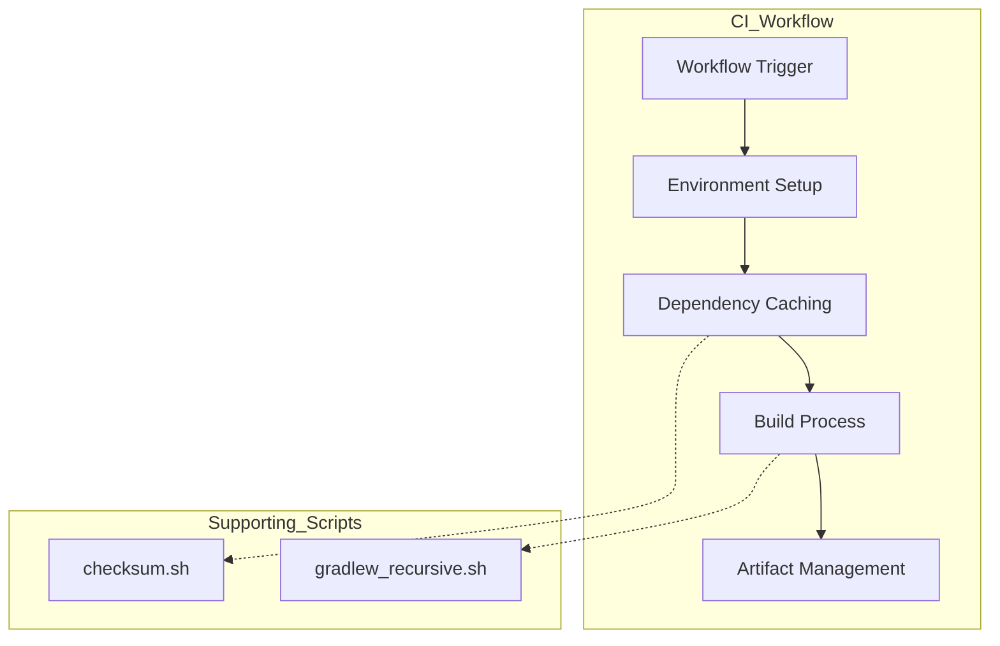
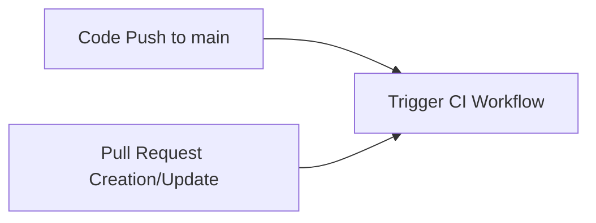
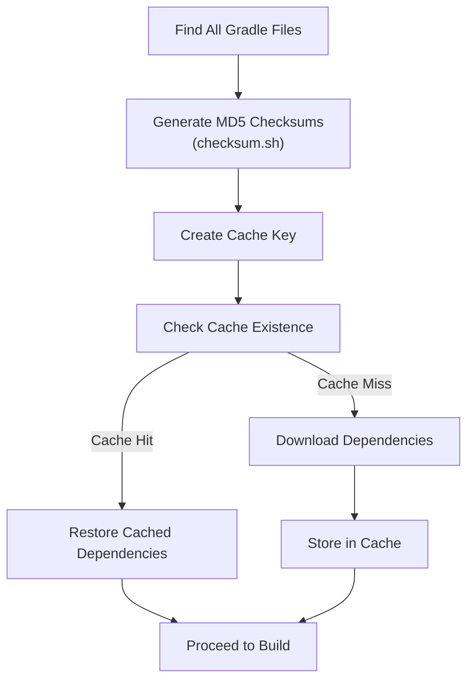
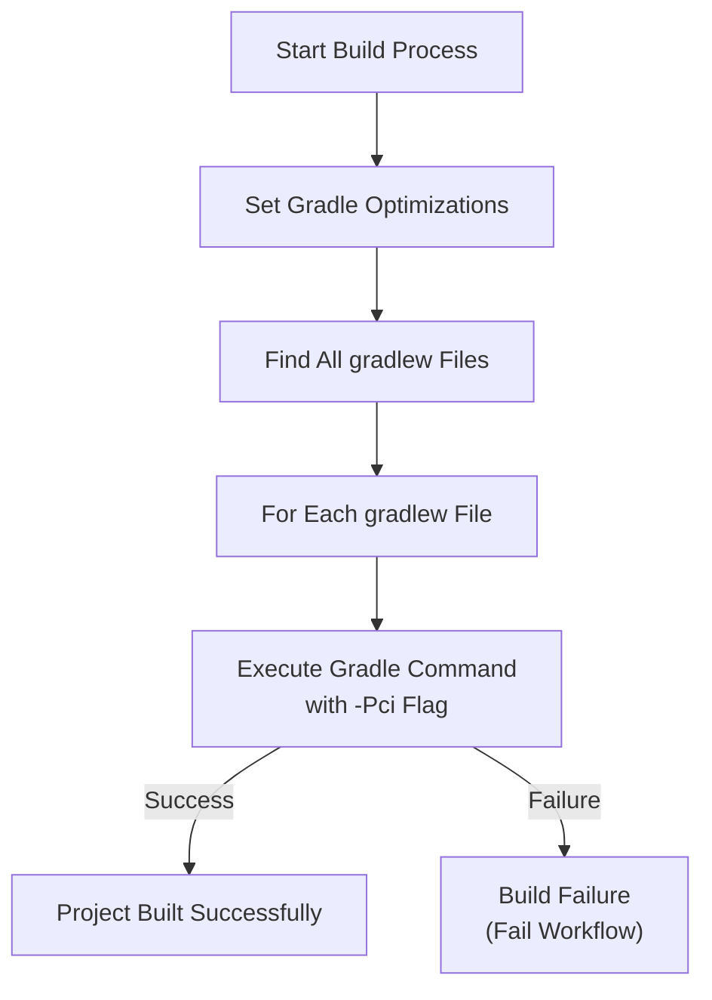
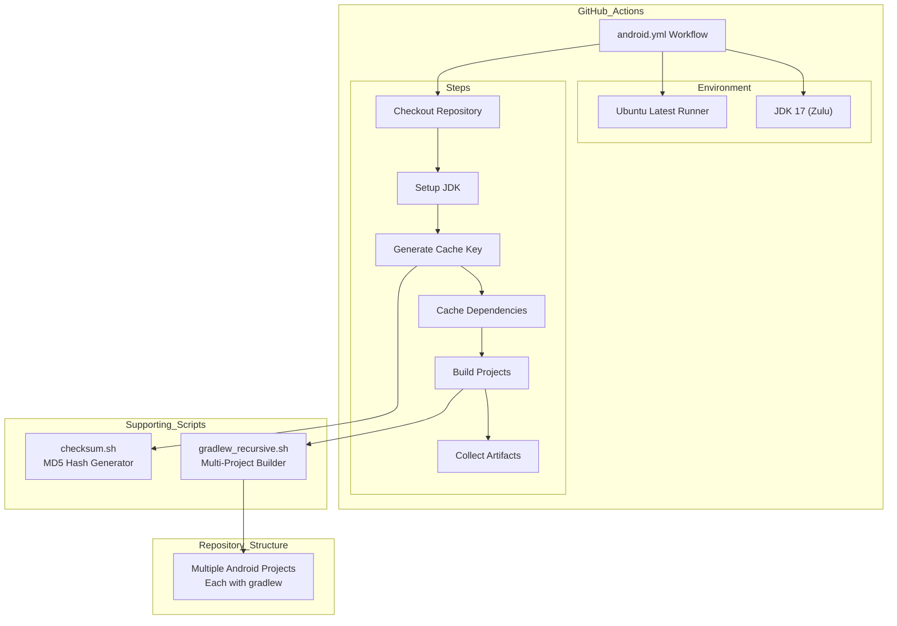

<!-- source: DeepWiki mcp.deepwiki.com · repo android/user-interface-samples · page 6.1 CI Setup · fetched 2026-10-23 -->

# CI Setup

Relevant source files

The following files were used as context for generating this wiki page:

- [.github/scripts/checksum.sh](.github/scripts/checksum.sh)
- [.github/scripts/gradlew_recursive.sh](.github/scripts/gradlew_recursive.sh)
- [.github/workflows/android.yml](.github/workflows/android.yml)

## Purpose and Scope

This document outlines the Continuous Integration (CI) configuration used in the Android User Interface Samples repository. It covers the GitHub Actions workflow, scripts for recursive Gradle execution, and dependency caching mechanisms that automate the build and testing processes. The CI system ensures that all code changes are automatically validated across the repository's multiple sample projects.

Sources: [.github/workflows/android.yml:1-60]()

## CI Workflow Overview

The repository implements a CI pipeline using GitHub Actions that automatically builds all sample projects. The workflow is triggered on every pull request and push to the main branch, providing immediate feedback on code quality and build status.

### Workflow Components Diagram

Sources: [.github/workflows/android.yml:15-59]()

## Workflow Components in Detail

### Workflow Triggers

The CI workflow is automatically triggered in the following cases:
- Pushes to the main branch
- Any pull request

This ensures that both direct contributions to main and proposed changes are validated.

Sources: [.github/workflows/android.yml:17-22]()

### Environment Setup

The workflow runs on Ubuntu latest runners with the following configuration:
- JDK 17 (Zulu distribution)
- Checkout of repository code
- Gradle configured for CI environment

Sources: [.github/workflows/android.yml:25-35]()

### Dependency Caching

To speed up builds, the workflow implements an efficient caching mechanism for Gradle dependencies:

1. Generates a cache key based on checksums of all Gradle files
2. Uses GitHub Actions cache with versioned keys
3. Stores and retrieves Gradle modules, jars, and build cache

Sources: [.github/workflows/android.yml:37-48](), [.github/scripts/checksum.sh:1-38]()

### Build Process

The build process uses a recursive approach to handle all sample projects in the repository:

1. The workflow runs the `gradlew_recursive.sh` script
2. The script finds all gradlew files in the repository
3. Each found gradlew is executed with the specified build command (assembleDebug)
4. Gradle is configured with optimized settings for CI environments

Sources: [.github/workflows/android.yml:50-51](), [.github/scripts/gradlew_recursive.sh:1-35]()

### Artifact Management

After building all projects, the workflow:
1. Zips the build outputs (APKs, AABs, AARs, SOs)
2. Uploads the zip file as a workflow artifact using GitHub Actions

Sources: [.github/workflows/android.yml:53-59]()

## Supporting Scripts

The CI workflow relies on two key scripts:

### checksum.sh

This script generates a consistent checksum for Gradle configuration files to use as a cache key:

1. Finds all `.gradle` files and `gradle-wrapper.properties` in the repository
2. Generates MD5 hash for each file
3. Concatenates and sorts the hashes to create a deterministic checksum
4. Outputs the result to a specified file

Sources: [.github/scripts/checksum.sh:1-38]()

### gradlew_recursive.sh

This script enables building multiple Gradle projects within a single repository:

1. Sets optimized Gradle options for CI environments:
   - 5GB max heap size
   - Heap dumps on OOM errors
   - Disables Gradle daemon
   - Enables parallel builds
   - Uses in-process Kotlin compiler
2. Finds all gradlew files recursively
3. Executes the specified Gradle task on each project with CI-specific settings

Sources: [.github/scripts/gradlew_recursive.sh:1-35]()

## CI System Architecture

Sources: [.github/workflows/android.yml:1-60](), [.github/scripts/checksum.sh:1-38](), [.github/scripts/gradlew_recursive.sh:1-35]()

## Optimizations and Performance Considerations

The CI setup includes several optimizations to improve performance:

| Optimization | Implementation | Benefit |
|--------------|----------------|---------|
| Dependency Caching | MD5-based cache key with GitHub Actions cache | Faster builds by avoiding repeated downloads |
| Parallel Builds | Gradle parallel mode enabled | Better utilization of CI resources |
| Memory Settings | 5GB max heap size | Prevents OOM errors on large projects |
| Kotlin Compiler | In-process execution strategy | Reduces compiler overhead |
| No Gradle Daemon | `org.gradle.daemon=false` | Optimized for single-run CI environments |

Sources: [.github/scripts/gradlew_recursive.sh:19-26]()

## When CI Runs

The following table summarizes when the CI workflow runs:

| Trigger | Events | Branches |
|---------|--------|----------|
| Push | Direct commits, merges | main only |
| Pull Request | PR creation, PR updates | any branch → any branch |

Sources: [.github/workflows/android.yml:17-22]()

## Build Artifact Structure

The workflow collects and uploads build artifacts that include:

- APK files (`.apk`)
- Android App Bundles (`.aab`)
- Android Archive files (`.aar`)
- Native libraries (`.so`)

These are zipped into a single artifact for easy download from the GitHub Actions run page.

Sources: [.github/workflows/android.yml:53-59]()