# Page: Overview

# Overview

<details>
<summary>Relevant source files</summary>

The following files were used as context for generating this wiki page:

- [.gitignore](.gitignore)
- [CONTRIBUTING.md](CONTRIBUTING.md)
- [LICENSE](LICENSE)
- [README.md](README.md)

</details>


## Purpose and Scope

The Android User Interface Samples repository serves as a comprehensive collection of sample implementations demonstrating various Android UI features, patterns, and best practices. The repository is designed to help developers understand and implement modern UI solutions across the diverse Android device ecosystem, with particular emphasis on responsive layouts for different screen sizes and form factors including foldable devices.

This document provides a high-level introduction to the repository's structure, primary components, and their relationships. It serves as a starting point for navigating the more detailed documentation available for each specific system.

Sources: [README.md:6-8]()

## Repository Organization

The Android User Interface Samples repository is organized into several major system categories, each containing multiple sample implementations that showcase specific UI features and patterns.

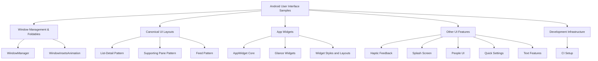

Sources: Based on the table of contents JSON structure provided

## Major System Categories

### Window Management & Foldables

This category focuses on providing samples for adapting UI layout to different screen configurations, with special attention to foldable devices and handling window insets.

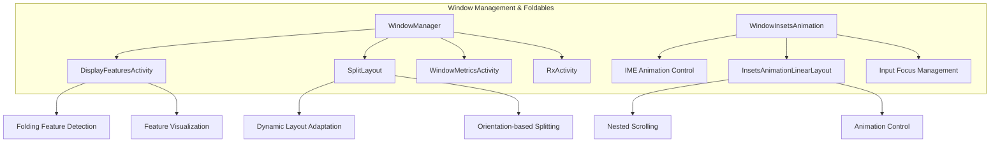

The Window Management samples demonstrate how to:
- Detect and adapt to fold features in foldable devices
- Measure window metrics for responsive layouts
- Implement proper window insets animation for keyboard appearance

For more detailed information about window management, see [Window Management](#2).

Sources: Based on the Window Management Systems diagram provided

### Canonical UI Layouts

This category provides implementations of standard UI layout patterns that adapt to different screen sizes and orientations, crucial for building responsive applications.

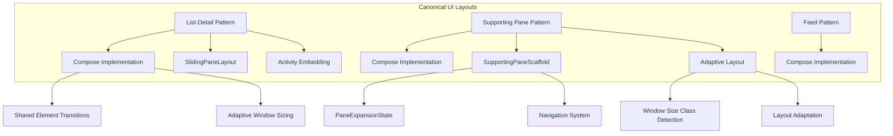

The Canonical UI Layouts samples showcase:
- List-Detail pattern for master-detail views
- Supporting Pane pattern for showing supplementary content
- Feed pattern for displaying streaming content
- Both traditional View-based and modern Jetpack Compose implementations

For more detailed information about canonical UI layouts, see [Canonical UI Layouts](#3).

Sources: Based on the Canonical Layouts Systems diagram provided

### App Widgets

This category demonstrates how to implement home screen widgets, including both traditional RemoteViews approach and the newer Glance framework.

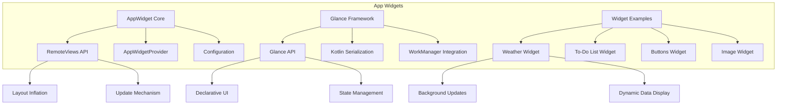

The App Widgets samples demonstrate:
- Traditional RemoteViews-based widget implementation
- Modern Glance framework for declarative widget creation
- Integration with WorkManager for background updates
- Various widget types and use cases

For more detailed information about app widgets, see [App Widgets](#4).

Sources: Based on the App Widget Systems diagram provided

### Other UI Features

This category includes samples for various other UI features that don't fit into the major categories above.

These samples include:
- Haptic Feedback implementation for tactile interactions
- Splash Screen API usage for app launch screens
- People UI for contact lists and notification features
- Quick Settings implementation for system tray tiles
- Text handling features like spans, linkify, and hyphenation

For more detailed information about these other UI features, see [Other UI Features](#5).

Sources: Based on the table of contents JSON structure provided

## System Integration and Relationships

The samples in this repository demonstrate not just individual UI components but also how these components work together to create cohesive, adaptive user experiences.

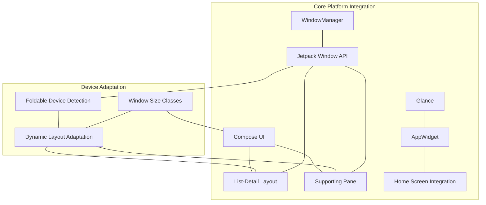

Key integration points include:
- WindowManager and layout patterns both utilize the Jetpack Window API for detecting device features
- Canonical layouts implement both traditional View-based and Jetpack Compose approaches
- App Widgets provide integration with the home screen through both RemoteViews and Glance
- All systems handle adaptive layouts based on screen size and device features

Sources: Based on the System Integration Overview diagram provided

## Code Organization and Architecture

The repository follows a consistent architectural approach across most samples:

| Layer | Responsibility | Key Components |
|-------|----------------|----------------|
| UI Components | User interface rendering | Activities, Fragments, Composables |
| Logic/State Management | Business logic and state | ViewModels, Controllers |
| Platform Integration | Interfacing with Android | WindowInfoTracker, WorkManager |

Most samples are organized with:
- A main activity as the entry point
- Multiple implementation approaches (View-based, Compose)
- Utility classes for specific functionality
- Comprehensive documentation in README files

Sources: Based on analysis of the repository structure

## Migration Notice

> **Note**: This repository is in the process of being migrated to the new [platform-samples repository](https://github.com/android/platform-samples). The migrated samples can be found in the [user-interface](https://github.com/android/platform-samples/tree/main/samples/user-interface) directory of the platform-samples repository.

Sources: [README.md:1-4]()

## Getting Started

To begin working with these samples:

1. Clone the repository
2. Open the samples as projects in Android Studio
3. Build and run the samples on your device or emulator

Each sample contains its own README with specific setup instructions and technical details.

Sources: [README.md:10-12]()

## Support and Contribution

For questions about the samples, you can use:
- Stack Overflow with the Android tag
- GitHub issues for reporting errors in the samples

The project welcomes contributions through pull requests. To contribute:
1. Fork the repository
2. Make your changes
3. Submit a pull request
4. Sign the Contributor License Agreement if you haven't already

All submissions require review through GitHub pull requests, and the project follows Google's Open Source Community Guidelines.

Sources: [README.md:14-22](), [CONTRIBUTING.md:1-28]()

---

# Page: Window Management

# Window Management

<details>
<summary>Relevant source files</summary>

The following files were used as context for generating this wiki page:

- [WindowInsetsAnimation/README.md](WindowInsetsAnimation/README.md)
- [WindowInsetsAnimation/app/src/main/java/com/google/android/samples/insetsanimation/ControlFocusInsetsAnimationCallback.kt](WindowInsetsAnimation/app/src/main/java/com/google/android/samples/insetsanimation/ControlFocusInsetsAnimationCallback.kt)
- [WindowInsetsAnimation/app/src/main/java/com/google/android/samples/insetsanimation/ConversationFragment.kt](WindowInsetsAnimation/app/src/main/java/com/google/android/samples/insetsanimation/ConversationFragment.kt)
- [WindowInsetsAnimation/app/src/main/java/com/google/android/samples/insetsanimation/InsetsAnimationLinearLayout.kt](WindowInsetsAnimation/app/src/main/java/com/google/android/samples/insetsanimation/InsetsAnimationLinearLayout.kt)
- [WindowInsetsAnimation/app/src/main/java/com/google/android/samples/insetsanimation/InsetsAnimationTouchListener.kt](WindowInsetsAnimation/app/src/main/java/com/google/android/samples/insetsanimation/InsetsAnimationTouchListener.kt)
- [WindowInsetsAnimation/app/src/main/java/com/google/android/samples/insetsanimation/MainActivity.kt](WindowInsetsAnimation/app/src/main/java/com/google/android/samples/insetsanimation/MainActivity.kt)
- [WindowInsetsAnimation/app/src/main/java/com/google/android/samples/insetsanimation/RootViewDeferringInsetsCallback.kt](WindowInsetsAnimation/app/src/main/java/com/google/android/samples/insetsanimation/RootViewDeferringInsetsCallback.kt)
- [WindowInsetsAnimation/app/src/main/java/com/google/android/samples/insetsanimation/SimpleImeAnimationController.kt](WindowInsetsAnimation/app/src/main/java/com/google/android/samples/insetsanimation/SimpleImeAnimationController.kt)
- [WindowInsetsAnimation/app/src/main/java/com/google/android/samples/insetsanimation/TranslateDeferringInsetsAnimationCallback.kt](WindowInsetsAnimation/app/src/main/java/com/google/android/samples/insetsanimation/TranslateDeferringInsetsAnimationCallback.kt)
- [WindowInsetsAnimation/app/src/main/java/com/google/android/samples/insetsanimation/utils.kt](WindowInsetsAnimation/app/src/main/java/com/google/android/samples/insetsanimation/utils.kt)
- [WindowInsetsAnimation/app/src/main/res/layout/fragment_conversation.xml](WindowInsetsAnimation/app/src/main/res/layout/fragment_conversation.xml)
- [WindowInsetsAnimation/images/demos.gif](WindowInsetsAnimation/images/demos.gif)
- [WindowManager/README.md](WindowManager/README.md)
- [WindowManager/app/src/androidTest/java/com/example/windowmanagersample/DisplayFeaturesActivityJavaTest.java](WindowManager/app/src/androidTest/java/com/example/windowmanagersample/DisplayFeaturesActivityJavaTest.java)
- [WindowManager/app/src/androidTest/java/com/example/windowmanagersample/DisplayFeaturesActivityTest.kt](WindowManager/app/src/androidTest/java/com/example/windowmanagersample/DisplayFeaturesActivityTest.kt)
- [WindowManager/app/src/androidTest/java/com/example/windowmanagersample/SplitLayoutActivityTest.kt](WindowManager/app/src/androidTest/java/com/example/windowmanagersample/SplitLayoutActivityTest.kt)
- [WindowManager/app/src/main/java/com/example/windowmanagersample/RxActivity.kt](WindowManager/app/src/main/java/com/example/windowmanagersample/RxActivity.kt)
- [WindowManager/app/src/main/java/com/example/windowmanagersample/SplitLayoutActivity.java](WindowManager/app/src/main/java/com/example/windowmanagersample/SplitLayoutActivity.java)
- [WindowManager/app/src/main/java/com/example/windowmanagersample/WindowMetricsActivity.kt](WindowManager/app/src/main/java/com/example/windowmanagersample/WindowMetricsActivity.kt)
- [WindowManager/app/src/main/res/layout/activity_rx.xml](WindowManager/app/src/main/res/layout/activity_rx.xml)
- [WindowManager/app/src/main/res/layout/activity_window_metrics.xml](WindowManager/app/src/main/res/layout/activity_window_metrics.xml)
- [WindowManager/app/src/main/res/layout/view_holder_info_log.xml](WindowManager/app/src/main/res/layout/view_holder_info_log.xml)

</details>


## Purpose and Scope

This document provides an overview of the Window Management components in the Android User Interface Samples repository. It focuses primarily on the Jetpack WindowManager library which enables applications to adapt to different device form factors, particularly foldable devices. The document covers how to obtain window metrics, track window layout changes, and adapt layouts to different device states. For information about window insets animation and keyboard handling, see [Window Insets Animation](#2.2).

## Jetpack WindowManager Overview

The Jetpack WindowManager library provides a consistent API surface for window management features across different Android platform versions. It allows applications to support new device form factors like foldable phones and tablets while maintaining backward compatibility.

### Architecture

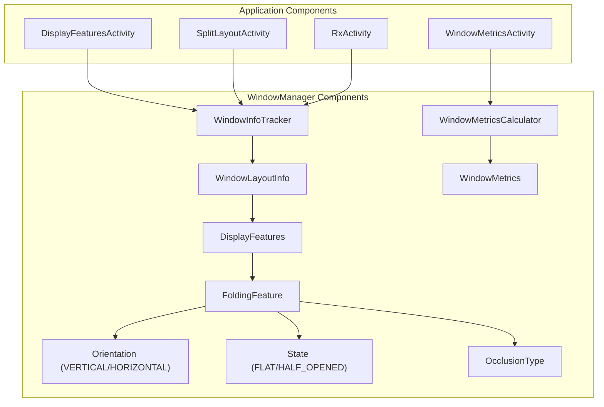

*Diagram 1: WindowManager Architecture*

Sources:
- [WindowManager/README.md]()
- [WindowManager/app/src/main/java/com/example/windowmanagersample/WindowMetricsActivity.kt]()
- [WindowManager/app/src/androidTest/java/com/example/windowmanagersample/DisplayFeaturesActivityTest.kt]()

### Core Components

1. **WindowInfoTracker**: Provides information about the current window layout, including any display features like folds or hinges.
2. **WindowMetricsCalculator**: Computes the dimensions of the current window.
3. **WindowLayoutInfo**: Contains information about the current window layout, including any display features.
4. **FoldingFeature**: Represents a folding feature of a device, such as a hinge.

## Foldable Device Support

The WindowManager library enables applications to detect and adapt to foldable device states through the `FoldingFeature` class.

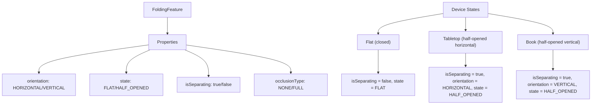

*Diagram 2: FoldingFeature Properties and Device States*

Sources:
- [WindowManager/app/src/androidTest/java/com/example/windowmanagersample/DisplayFeaturesActivityTest.kt]()
- [WindowManager/app/src/androidTest/java/com/example/windowmanagersample/SplitLayoutActivityTest.kt]()
- [WindowManager/app/src/main/java/com/example/windowmanagersample/RxActivity.kt]()

### DisplayFeaturesActivity

The `DisplayFeaturesActivity` demonstrates how to detect and visualize display features (like hinges or folds) on foldable devices. It shows the current device state and the position of any folds or hinges.

Key implementation details:
- Uses `WindowInfoTracker` to receive updates about `WindowLayoutInfo`
- Extracts `FoldingFeature` information from the `WindowLayoutInfo`
- Visualizes the fold location and displays device state (e.g., "screens are separated", "hinge is horizontal")

Sources:
- [WindowManager/app/src/androidTest/java/com/example/windowmanagersample/DisplayFeaturesActivityTest.kt]()
- [WindowManager/app/src/androidTest/java/com/example/windowmanagersample/DisplayFeaturesActivityJavaTest.java]()

## Window Metrics Calculation

Window metrics provide information about the current size of the window, which is essential for responsive UI design.

### WindowMetricsActivity

The `WindowMetricsActivity` demonstrates how to retrieve and track window metrics changes:

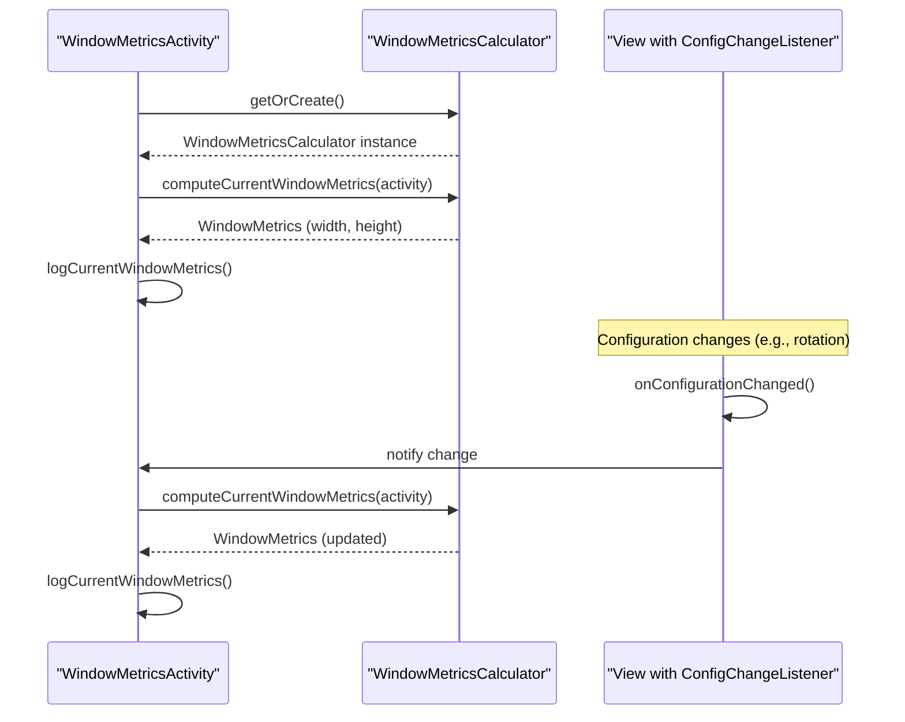

*Diagram 3: Window Metrics Calculation Process*

Key implementation details:
- Uses `WindowMetricsCalculator.getOrCreate().computeCurrentWindowMetrics(activity)` to get current window dimensions
- Tracks configuration changes to update metrics when the window size changes
- Logs both pixel dimensions and dp values

Source:
- [WindowManager/app/src/main/java/com/example/windowmanagersample/WindowMetricsActivity.kt]()

## Layout Adaptation with SplitLayout

The `SplitLayout` component demonstrates how to adapt layouts based on the device's fold state.

### SplitLayoutActivity

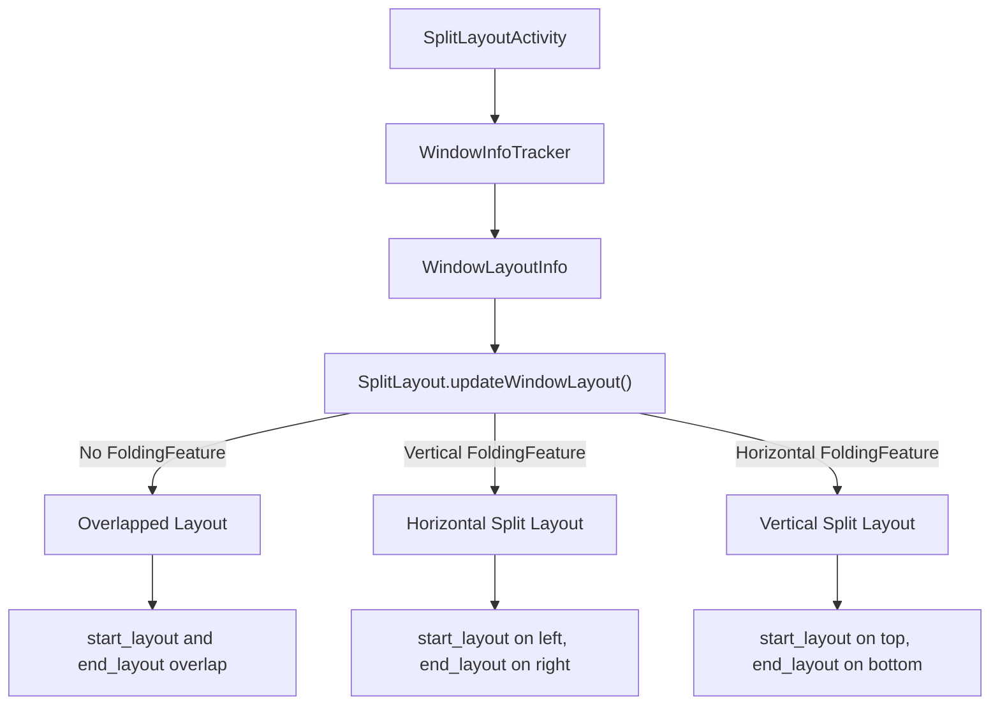

*Diagram 4: SplitLayout Adaptation*

Key implementation details:
- `SplitLayoutActivity` uses `WindowInfoTrackerCallbackAdapter` to receive window layout updates
- When layout info changes, it calls `splitLayout.updateWindowLayout(windowLayoutInfo)`
- The layout adapts based on the presence and orientation of folding features:
  - No folding feature: Views overlap
  - Vertical folding feature: Views split horizontally (side by side)
  - Horizontal folding feature: Views split vertically (top and bottom)

Sources:
- [WindowManager/app/src/main/java/com/example/windowmanagersample/SplitLayoutActivity.java]()
- [WindowManager/app/src/androidTest/java/com/example/windowmanagersample/SplitLayoutActivityTest.kt]()

## Reactive Window Info Tracking

The library supports reactive programming patterns for window layout changes using RxJava.

### RxActivity Implementation

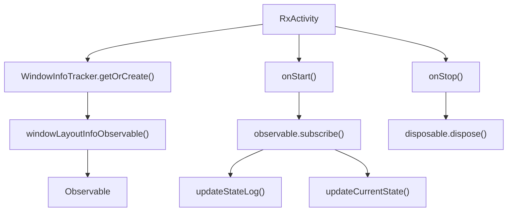

*Diagram 5: RxActivity Flow*

Key implementation details:
- Uses `WindowInfoTracker.getOrCreate(this).windowLayoutInfoObservable(this)` to create an RxJava Observable
- Subscribes to the Observable in `onStart()` and disposes it in `onStop()`
- Updates UI when window layout changes, displaying information about display features

Source:
- [WindowManager/app/src/main/java/com/example/windowmanagersample/RxActivity.kt]()

## Window Insets Animation

The Window Insets Animation sample demonstrates how to react to and control the on-screen keyboard (IME) visibility. It shows techniques for animating views in response to IME changes and programmatically controlling the IME's visibility.

This topic is covered in detail in the dedicated [Window Insets Animation](#2.2) wiki page.

Key components:
- `InsetsAnimationLinearLayout`: Handles nested scrolling to control IME visibility
- `SimpleImeAnimationController`: Manages animations for IME visibility changes
- `TranslateDeferringInsetsAnimationCallback`: Moves views in sync with IME animations

Sources:
- [WindowInsetsAnimation/README.md]()
- [WindowInsetsAnimation/app/src/main/java/com/google/android/samples/insetsanimation/InsetsAnimationLinearLayout.kt]()
- [WindowInsetsAnimation/app/src/main/java/com/google/android/samples/insetsanimation/SimpleImeAnimationController.kt]()

## Implementation Examples

### Tracking Window Metrics

The following example shows how to obtain and log window metrics:

```kotlin
// From WindowMetricsActivity.kt
private fun logCurrentWindowMetrics(tag: String) {
    val windowMetrics = WindowMetricsCalculator.getOrCreate()
        .computeCurrentWindowMetrics(this@WindowMetricsActivity)
    val width = windowMetrics.bounds.width()
    val height = windowMetrics.bounds.height()
    adapter.append(
        tag,
        "width: $width, " +
            "height: $height, " +
            "widthDp: ${width / resources.displayMetrics.density}, " +
            "heightDp: ${height / resources.displayMetrics.density}"
    )
}
```

Source:
- [WindowManager/app/src/main/java/com/example/windowmanagersample/WindowMetricsActivity.kt:64-80]()

### Detecting Foldable State

```kotlin
// Setting up WindowInfoTracker with RxJava
observable = WindowInfoTracker.getOrCreate(this@RxActivity)
    .windowLayoutInfoObservable(this@RxActivity)

// In onStart()
disposable = observable
    .observeOn(AndroidSchedulers.mainThread())
    .subscribe { newLayoutInfo ->
        updateStateLog(newLayoutInfo)
        updateCurrentState(newLayoutInfo)
    }
```

Source:
- [WindowManager/app/src/main/java/com/example/windowmanagersample/RxActivity.kt:52-69]()

### Adapting Layout for Folds

The following test example demonstrates how layouts adapt to different fold states:

```kotlin
@Test
fun testDeviceOpen_Vertical() {
    activityRule.scenario.onActivity { activity ->
        val feature = FoldingFeature(
            activity = activity,
            orientation = VERTICAL,
            state = HALF_OPENED
        )
        val expected = TestWindowLayoutInfo(listOf(feature))
        publisherRule.overrideWindowLayoutInfo(expected)
    }

    // Checks that start_layout is on the left of end_layout with a vertical folding feature
    onView(withId(R.id.start_layout)).check(isCompletelyLeftOf(withId(R.id.end_layout)))
}
```

Source:
- [WindowManager/app/src/androidTest/java/com/example/windowmanagersample/SplitLayoutActivityTest.kt:68-82]()

## Best Practices

1. **Lifecycle Management**: Always dispose of WindowInfoTracker subscriptions in `onStop()` to prevent memory leaks.

2. **Configuration Changes**: Use a utility view to listen for configuration changes, as shown in WindowMetricsActivity, to ensure metrics are updated on all changes.

3. **Layout Adaptation**: Design layouts that can adapt to different fold states (flat, book mode, tabletop mode) to provide the best user experience.

4. **Testing**: Use the testing utilities like `WindowLayoutInfoPublisherRule` to test how your UI responds to different fold configurations.

5. **Backward Compatibility**: The Jetpack WindowManager library is designed to work on older Android versions, but certain features may only function on newer platforms.

## Compatibility

The Jetpack WindowManager library is designed to work across different Android versions:

| Feature | Minimum API Level |
|---------|------------------|
| Basic Window Metrics | API 14+ |
| Display Features Detection | API 14+ |
| Folding Feature Support | API 14+ (full functionality on API 30+) |

Actual foldable device support depends on both the Android version and the specific device hardware.

## Related Resources

This wiki page covers the core concepts of window management in the Android User Interface Samples. For more specific information on window insets animation, see the [Window Insets Animation](#2.2) wiki page.

---

# Page: Foldables with WindowManager

# Foldables with WindowManager

<details>
<summary>Relevant source files</summary>

The following files were used as context for generating this wiki page:

- [WindowManager/README.md](WindowManager/README.md)
- [WindowManager/app/build.gradle](WindowManager/app/build.gradle)
- [WindowManager/app/src/androidTest/java/com/example/windowmanagersample/DisplayFeaturesActivityJavaTest.java](WindowManager/app/src/androidTest/java/com/example/windowmanagersample/DisplayFeaturesActivityJavaTest.java)
- [WindowManager/app/src/androidTest/java/com/example/windowmanagersample/DisplayFeaturesActivityTest.kt](WindowManager/app/src/androidTest/java/com/example/windowmanagersample/DisplayFeaturesActivityTest.kt)
- [WindowManager/app/src/androidTest/java/com/example/windowmanagersample/SplitLayoutActivityTest.kt](WindowManager/app/src/androidTest/java/com/example/windowmanagersample/SplitLayoutActivityTest.kt)
- [WindowManager/app/src/main/AndroidManifest.xml](WindowManager/app/src/main/AndroidManifest.xml)
- [WindowManager/app/src/main/java/com/example/windowmanagersample/DisplayFeaturesActivity.kt](WindowManager/app/src/main/java/com/example/windowmanagersample/DisplayFeaturesActivity.kt)
- [WindowManager/app/src/main/java/com/example/windowmanagersample/RxActivity.kt](WindowManager/app/src/main/java/com/example/windowmanagersample/RxActivity.kt)
- [WindowManager/app/src/main/java/com/example/windowmanagersample/SampleTools.kt](WindowManager/app/src/main/java/com/example/windowmanagersample/SampleTools.kt)
- [WindowManager/app/src/main/java/com/example/windowmanagersample/SplitLayout.kt](WindowManager/app/src/main/java/com/example/windowmanagersample/SplitLayout.kt)
- [WindowManager/app/src/main/java/com/example/windowmanagersample/SplitLayoutActivity.java](WindowManager/app/src/main/java/com/example/windowmanagersample/SplitLayoutActivity.java)
- [WindowManager/app/src/main/java/com/example/windowmanagersample/WindowMetricsActivity.kt](WindowManager/app/src/main/java/com/example/windowmanagersample/WindowMetricsActivity.kt)
- [WindowManager/app/src/main/res/layout/activity_display_features.xml](WindowManager/app/src/main/res/layout/activity_display_features.xml)
- [WindowManager/app/src/main/res/layout/activity_rx.xml](WindowManager/app/src/main/res/layout/activity_rx.xml)
- [WindowManager/app/src/main/res/layout/activity_split_layout.xml](WindowManager/app/src/main/res/layout/activity_split_layout.xml)
- [WindowManager/app/src/main/res/layout/activity_window_demos.xml](WindowManager/app/src/main/res/layout/activity_window_demos.xml)
- [WindowManager/app/src/main/res/layout/activity_window_metrics.xml](WindowManager/app/src/main/res/layout/activity_window_metrics.xml)
- [WindowManager/app/src/main/res/layout/split_layout_content.xml](WindowManager/app/src/main/res/layout/split_layout_content.xml)
- [WindowManager/app/src/main/res/layout/split_layout_control.xml](WindowManager/app/src/main/res/layout/split_layout_control.xml)
- [WindowManager/app/src/main/res/layout/view_holder_info_log.xml](WindowManager/app/src/main/res/layout/view_holder_info_log.xml)
- [WindowManager/app/src/main/res/values/colors.xml](WindowManager/app/src/main/res/values/colors.xml)
- [WindowManager/app/src/main/res/values/strings.xml](WindowManager/app/src/main/res/values/strings.xml)
- [WindowManager/build.gradle](WindowManager/build.gradle)
- [WindowManager/gradle.properties](WindowManager/gradle.properties)
- [WindowManager/gradle/wrapper/gradle-wrapper.properties](WindowManager/gradle/wrapper/gradle-wrapper.properties)

</details>


## Purpose and Scope

This document covers the WindowManager sample implementation which demonstrates how to use the Jetpack WindowManager library to develop applications that adapt to foldable device form factors. The sample shows how to detect foldable device features (such as hinges and folds), react to their state changes, and adapt UI layouts accordingly.

For information about window insets animation, see [Window Insets Animation](#2.2).

Sources: [WindowManager/README.md:9-17]()

## Overview of Jetpack WindowManager

The Jetpack WindowManager library provides a consistent API for detecting and adapting to various device form factors across different Android versions. For foldable devices, it detects display features such as folds and hinges and provides real-time updates when device state changes occur.

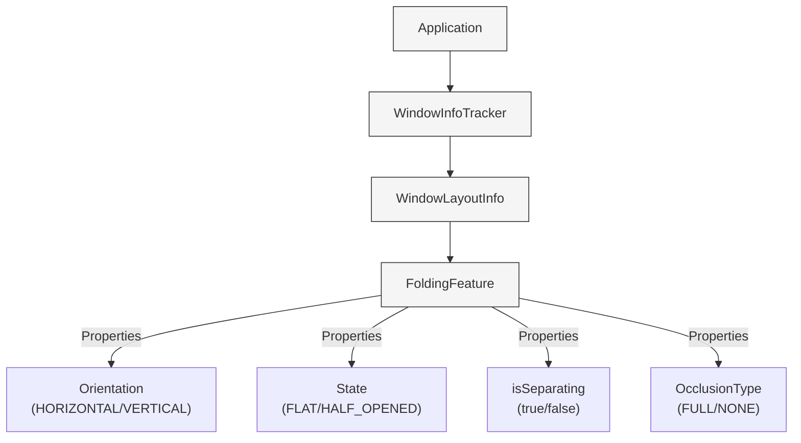

The library enables developers to:
- Detect folds and hinges on devices
- Determine their orientation (horizontal or vertical)
- Check if they separate the screen into two distinct areas
- Adjust layouts based on device state changes

Sources: [WindowManager/README.md:9-17](), [WindowManager/app/build.gradle:54-61]()

## Main Components

The WindowManager sample demonstrates several approaches to working with foldable devices:

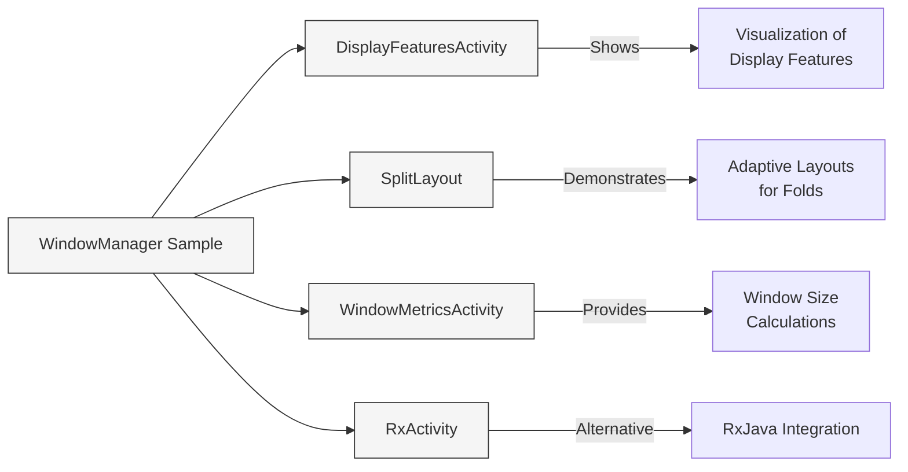

Sources: [WindowManager/app/src/main/AndroidManifest.xml:24-34]()

## Display Feature Detection

### WindowInfoTracker

The central component for detecting device features is the `WindowInfoTracker`, which provides information about the window's layout through `WindowLayoutInfo`. This includes details about display features like folds and hinges.

```kotlin
// Create a WindowInfoTracker
val windowInfoTracker = WindowInfoTracker.getOrCreate(this)

// Observe window layout changes
lifecycleScope.launch(Dispatchers.Main) {
    lifecycle.repeatOnLifecycle(Lifecycle.State.STARTED) {
        windowInfoTracker
            .windowLayoutInfo(this@YourActivity)
            .collect { newLayoutInfo ->
                // Handle new layout info
            }
    }
}
```

Sources: [WindowManager/app/src/main/java/com/example/windowmanagersample/DisplayFeaturesActivity.kt:51-66]()

### DisplayFeaturesActivity

The `DisplayFeaturesActivity` demonstrates how to detect and visualize display features. It:

1. Creates a `WindowInfoTracker` to receive window layout updates
2. Observes changes to window layout using Kotlin Flow
3. Visualizes the display features (folds/hinges) on the screen
4. Displays the current state of the device

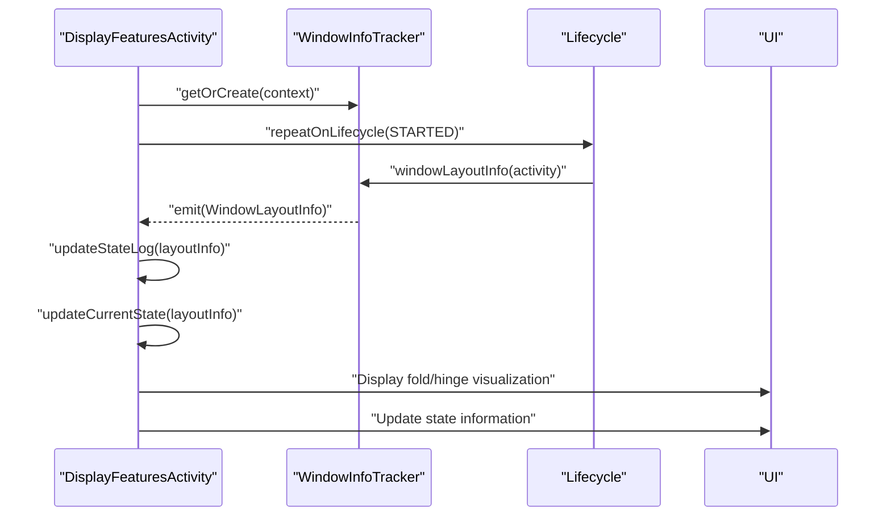

When the device state changes (e.g., folding or unfolding), the `WindowInfoTracker` emits a new `WindowLayoutInfo` with updated information about the display features, which the activity then uses to update its UI.

Sources: [WindowManager/app/src/main/java/com/example/windowmanagersample/DisplayFeaturesActivity.kt:38-154]()

## Working with Display Features

### FoldingFeature Properties

A `FoldingFeature` provides several important properties:

| Property | Description | Example Use |
|----------|-------------|-------------|
| `bounds` | The position of the fold/hinge | Positioning UI elements around it |
| `isSeparating` | Whether it separates the display into two logical areas | Splitting content into two views |
| `orientation` | Whether it's horizontal or vertical | Determining layout direction |
| `occlusionType` | Whether it fully occupies space (FULL) or not (NONE) | Handling content position |
| `state` | Current state (FLAT or HALF_OPENED) | Adapting UI based on fold state |

Sources: [WindowManager/app/src/main/java/com/example/windowmanagersample/DisplayFeaturesActivity.kt:84-129]()

### Detecting Fold State and Orientation

The sample demonstrates how to check fold states:

```kotlin
// Checking fold properties
val foldFeature = displayFeature as? FoldingFeature
if (foldFeature != null) {
    if (foldFeature.isSeparating) {
        // Screens are separated by fold
    } else {
        // Fold doesn't separate the screen
    }
    
    if (foldFeature.orientation == FoldingFeature.Orientation.HORIZONTAL) {
        // Fold is horizontal
    } else {
        // Fold is vertical
    }
}
```

Sources: [WindowManager/app/src/main/java/com/example/windowmanagersample/DisplayFeaturesActivity.kt:100-129]()

## Adaptive UI for Foldable Devices

### SplitLayout Component

The sample includes a custom `SplitLayout` that adapts its content based on detected folding features:

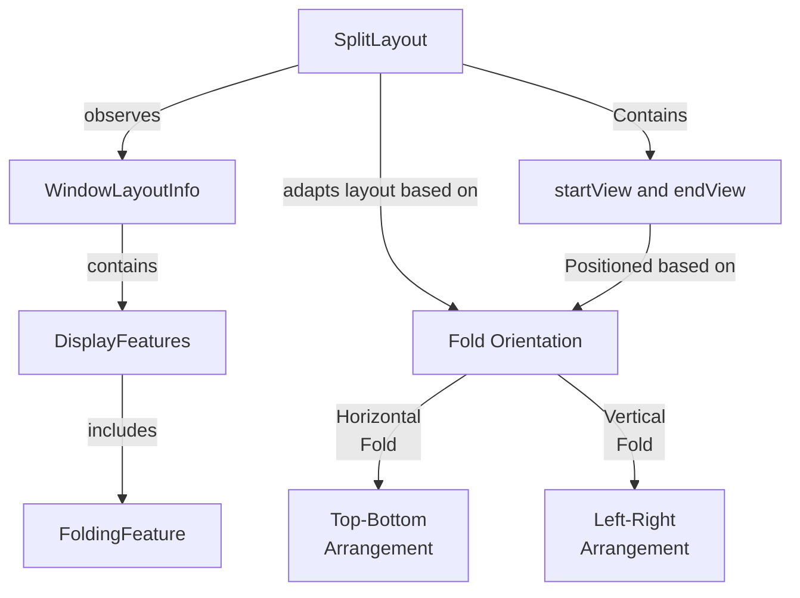

The `SplitLayout`:
1. Receives `WindowLayoutInfo` updates from its parent activity
2. Finds valid folding features that cross the layout
3. Positions two views (start and end) on opposite sides of the fold
4. Falls back to a regular layout if no suitable fold is found

Sources: [WindowManager/app/src/main/java/com/example/windowmanagersample/SplitLayout.kt:30-198]()

### Layout Adaptation Examples

The `SplitLayout` provides two main adaptations:

1. **Vertical Fold**: Places content side-by-side (left-right arrangement)
   ```
   ┌─────┬─────┐
   │     │     │
   │  S  │  E  │
   │     │     │
   └─────┴─────┘
   ```

2. **Horizontal Fold**: Places content in a top-bottom arrangement
   ```
   ┌─────────┐
   │    S    │
   ├─────────┤
   │    E    │
   └─────────┘
   ```

The layout measures both views to ensure they meet minimum size requirements before splitting them. If either view would be too small, it reverts to a stacked layout.

Sources: [WindowManager/app/src/main/java/com/example/windowmanagersample/SplitLayout.kt:121-172](), [WindowManager/app/src/main/res/layout/split_layout_content.xml:25-27](), [WindowManager/app/src/main/res/layout/split_layout_control.xml:25-27]()

### Integration in SplitLayoutActivity

The `SplitLayoutActivity` demonstrates how to use the `SplitLayout`:

```kotlin
// Java implementation shown in the sample
class LayoutStateChangeCallback implements Consumer<WindowLayoutInfo> {
    @Override
    public void accept(WindowLayoutInfo windowLayoutInfo) {
        binding.splitLayout.updateWindowLayout(windowLayoutInfo);
    }
}
```

This callback passes window layout information to the `SplitLayout`, which then adapts its layout accordingly.

Sources: [WindowManager/app/src/main/java/com/example/windowmanagersample/SplitLayoutActivity.java:28-65]()

## Window Metrics

### WindowMetricsActivity

The `WindowMetricsActivity` demonstrates how to get accurate window metrics for layout purposes:

```kotlin
val windowMetrics = WindowMetricsCalculator.getOrCreate()
    .computeCurrentWindowMetrics(this)
val width = windowMetrics.bounds.width()
val height = windowMetrics.bounds.height()
```

This provides the actual pixel dimensions of the window, which is particularly important for foldable devices where window sizes may change when folding or unfolding.

Sources: [WindowManager/app/src/main/java/com/example/windowmanagersample/WindowMetricsActivity.kt:29-81]()

### Configuration Changes and Window Metrics

The sample also demonstrates how to handle configuration changes:

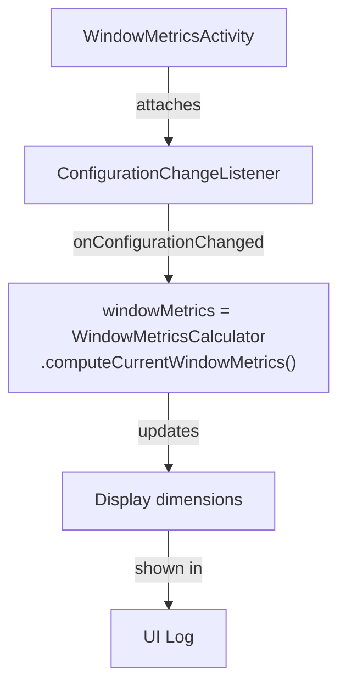

Configuration changes like rotations or folding/unfolding trigger updates to window metrics, which the sample logs to demonstrate the transitions.

Sources: [WindowManager/app/src/main/java/com/example/windowmanagersample/WindowMetricsActivity.kt:47-61]()

## RxJava Integration

For developers who prefer a reactive programming approach, the sample includes `RxActivity` which demonstrates how to use the RxJava integration:

```kotlin
// Create observable
val observable = WindowInfoTracker.getOrCreate(this)
    .windowLayoutInfoObservable(this)

// Subscribe to changes
disposable = observable
    .observeOn(AndroidSchedulers.mainThread())
    .subscribe { newLayoutInfo ->
        // Handle layout updates
    }
```

This provides an alternative to Kotlin's Flow API for handling window layout changes.

Sources: [WindowManager/app/src/main/java/com/example/windowmanagersample/RxActivity.kt:37-161]()

## Helper Utilities

The sample provides several helper utilities for working with display features:

### Getting Feature Position in View Coordinates

```kotlin
fun getFeaturePositionInViewRect(
    displayFeature: DisplayFeature,
    view: View,
    includePadding: Boolean = true
): Rect?
```

This utility translates display feature coordinates from window space to a view's local coordinate space, making it easier to position UI elements relative to folds and hinges.

Sources: [WindowManager/app/src/main/java/com/example/windowmanagersample/SampleTools.kt:28-63]()

### Creating Layout Parameters for Features

```kotlin
fun getLayoutParamsForFeatureInFrameLayout(
    displayFeature: DisplayFeature,
    view: FrameLayout
): FrameLayout.LayoutParams?
```

This utility creates layout parameters for visualizing display features within a `FrameLayout`.

Sources: [WindowManager/app/src/main/java/com/example/windowmanagersample/SampleTools.kt:69-80]()

## Testing with the WindowManager Library

The sample includes tests that demonstrate how to test applications that use the WindowManager library:

```kotlin
@Test
fun testDeviceOpen_TableTop() {
    activityRule.scenario.onActivity { activity ->
        val feature = FoldingFeature(
            activity = activity, 
            state = HALF_OPENED, 
            orientation = HORIZONTAL
        )
        val expected = TestWindowLayoutInfo(listOf(feature))
        publisherRule.overrideWindowLayoutInfo(expected)
    }
    
    // Assert UI reflects the table-top state
    onView(withSubstring("state = HALF_OPENED")).check(matches(isDisplayed()))
    onView(withSubstring("are separated")).check(matches(isDisplayed()))
    onView(withSubstring("Hinge is horizontal")).check(matches(isDisplayed()))
}
```

The `WindowLayoutInfoPublisherRule` allows tests to simulate different folding states without needing actual foldable hardware.

Sources: [WindowManager/app/src/androidTest/java/com/example/windowmanagersample/DisplayFeaturesActivityTest.kt:39-91](), [WindowManager/app/src/androidTest/java/com/example/windowmanagersample/SplitLayoutActivityTest.kt:41-100]()

## Conclusion

The WindowManager sample demonstrates how to use the Jetpack WindowManager library to detect and adapt to foldable device features. By using the APIs demonstrated in this sample, developers can create responsive UIs that take advantage of foldable form factors while maintaining backward compatibility with traditional devices.

Key takeaways:
- Use `WindowInfoTracker` to receive updates about display features
- Check `FoldingFeature` properties to determine fold state and orientation
- Create adaptive layouts that respond to different fold configurations
- Use `WindowMetricsCalculator` to get accurate window dimensions
- Test different folding configurations using the testing utilities

---

# Page: Window Insets Animation

# Window Insets Animation

<details>
<summary>Relevant source files</summary>

The following files were used as context for generating this wiki page:

- [WindowInsetsAnimation/README.md](WindowInsetsAnimation/README.md)
- [WindowInsetsAnimation/app/build.gradle](WindowInsetsAnimation/app/build.gradle)
- [WindowInsetsAnimation/app/src/main/java/com/google/android/samples/insetsanimation/ControlFocusInsetsAnimationCallback.kt](WindowInsetsAnimation/app/src/main/java/com/google/android/samples/insetsanimation/ControlFocusInsetsAnimationCallback.kt)
- [WindowInsetsAnimation/app/src/main/java/com/google/android/samples/insetsanimation/ConversationFragment.kt](WindowInsetsAnimation/app/src/main/java/com/google/android/samples/insetsanimation/ConversationFragment.kt)
- [WindowInsetsAnimation/app/src/main/java/com/google/android/samples/insetsanimation/InsetsAnimationLinearLayout.kt](WindowInsetsAnimation/app/src/main/java/com/google/android/samples/insetsanimation/InsetsAnimationLinearLayout.kt)
- [WindowInsetsAnimation/app/src/main/java/com/google/android/samples/insetsanimation/InsetsAnimationTouchListener.kt](WindowInsetsAnimation/app/src/main/java/com/google/android/samples/insetsanimation/InsetsAnimationTouchListener.kt)
- [WindowInsetsAnimation/app/src/main/java/com/google/android/samples/insetsanimation/MainActivity.kt](WindowInsetsAnimation/app/src/main/java/com/google/android/samples/insetsanimation/MainActivity.kt)
- [WindowInsetsAnimation/app/src/main/java/com/google/android/samples/insetsanimation/RootViewDeferringInsetsCallback.kt](WindowInsetsAnimation/app/src/main/java/com/google/android/samples/insetsanimation/RootViewDeferringInsetsCallback.kt)
- [WindowInsetsAnimation/app/src/main/java/com/google/android/samples/insetsanimation/SimpleImeAnimationController.kt](WindowInsetsAnimation/app/src/main/java/com/google/android/samples/insetsanimation/SimpleImeAnimationController.kt)
- [WindowInsetsAnimation/app/src/main/java/com/google/android/samples/insetsanimation/TranslateDeferringInsetsAnimationCallback.kt](WindowInsetsAnimation/app/src/main/java/com/google/android/samples/insetsanimation/TranslateDeferringInsetsAnimationCallback.kt)
- [WindowInsetsAnimation/app/src/main/java/com/google/android/samples/insetsanimation/utils.kt](WindowInsetsAnimation/app/src/main/java/com/google/android/samples/insetsanimation/utils.kt)
- [WindowInsetsAnimation/app/src/main/res/layout/fragment_conversation.xml](WindowInsetsAnimation/app/src/main/res/layout/fragment_conversation.xml)
- [WindowInsetsAnimation/build.gradle](WindowInsetsAnimation/build.gradle)
- [WindowInsetsAnimation/gradle/wrapper/gradle-wrapper.properties](WindowInsetsAnimation/gradle/wrapper/gradle-wrapper.properties)
- [WindowInsetsAnimation/images/demos.gif](WindowInsetsAnimation/images/demos.gif)

</details>


This document provides detailed information about the Window Insets Animation sample in the Android User Interface Samples repository. The sample demonstrates how to implement smooth animations for UI elements when the on-screen keyboard (IME - Input Method Editor) changes visibility, and how to programmatically control the IME's visibility through user gestures.

For information about general window management and foldable device support, see [Foldables with WindowManager](#2.1).

## Overview

The WindowInsetsAnimation sample showcases a mock instant-message style conversation app that implements two key features:

1. **Reacting to IME visibility changes**: UI elements animate smoothly in response to the keyboard appearing/disappearing
2. **Controlling IME visibility**: The app can programmatically control the keyboard's visibility based on user gestures

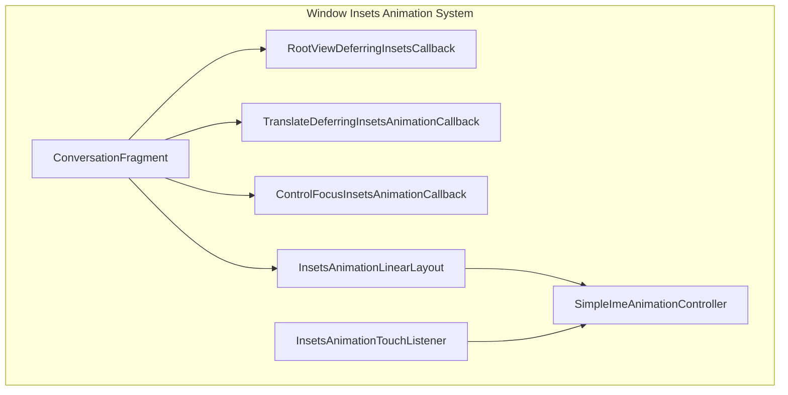

Sources: [WindowInsetsAnimation/app/src/main/java/com/google/android/samples/insetsanimation/ConversationFragment.kt:33-145](), [WindowInsetsAnimation/README.md:11-44]()

## Core Components

The sample is built with several key components that work together to create a cohesive user experience:

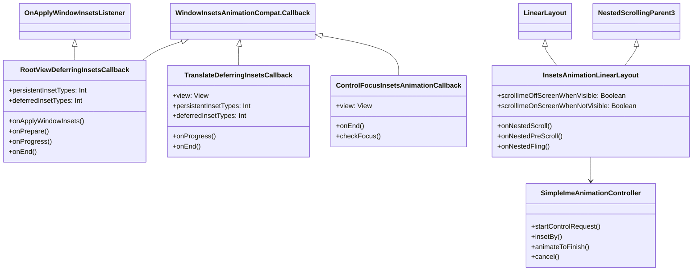

Sources: [WindowInsetsAnimation/app/src/main/java/com/google/android/samples/insetsanimation/RootViewDeferringInsetsCallback.kt:58-132](), [WindowInsetsAnimation/app/src/main/java/com/google/android/samples/insetsanimation/TranslateDeferringInsetsAnimationCallback.kt:41-84](), [WindowInsetsAnimation/app/src/main/java/com/google/android/samples/insetsanimation/SimpleImeAnimationController.kt:42-378](), [WindowInsetsAnimation/app/src/main/java/com/google/android/samples/insetsanimation/InsetsAnimationLinearLayout.kt:49-304](), [WindowInsetsAnimation/app/src/main/java/com/google/android/samples/insetsanimation/ControlFocusInsetsAnimationCallback.kt:37-73]()

### SimpleImeAnimationController

The `SimpleImeAnimationController` class serves as a wrapper around the `WindowInsetsAnimationControllerCompat` APIs from AndroidX Core. It simplifies the implementation of common use-cases for animating the IME.

Key functions:
- `startControlRequest()`: Initiates a request to control the IME insets
- `insetBy()`: Updates the IME inset position by a specified value
- `animateToFinish()`: Finishes the animation with a spring-based transition
- `isInsetAnimationInProgress()`: Indicates if an animation is currently running

Sources: [WindowInsetsAnimation/app/src/main/java/com/google/android/samples/insetsanimation/SimpleImeAnimationController.kt:42-378]()

### InsetsAnimationLinearLayout

A custom `LinearLayout` that implements the `NestedScrollingParent3` interface to automatically control the IME inset animations during scrolling gestures. It detects when users scroll in a list past its boundaries and uses this overscrolling to show or hide the keyboard.

Key properties:
- `scrollImeOffScreenWhenVisible`: Controls whether downward scrolling hides the keyboard
- `scrollImeOnScreenWhenNotVisible`: Controls whether upward scrolling shows the keyboard

Key methods:
- `onNestedPreScroll()`: Handles scroll events before they reach child views
- `onNestedScroll()`: Handles scroll events after child views have consumed part of the scroll
- `onNestedFling()`: Responds to fling gestures to animate the IME to completion

Sources: [WindowInsetsAnimation/app/src/main/java/com/google/android/samples/insetsanimation/InsetsAnimationLinearLayout.kt:49-304]()

### RootViewDeferringInsetsCallback

A combined `WindowInsetsAnimationCompat.Callback` and `OnApplyWindowInsetsListener` that handles insets at the root view level. It selectively defers handling certain inset types during animations to enable smoother transitions.

For example, during an IME animation, it can defer applying the IME insets as padding until the animation completes, which prevents the view from being immediately resized and causing visual artifacts.

Sources: [WindowInsetsAnimation/app/src/main/java/com/google/android/samples/insetsanimation/RootViewDeferringInsetsCallback.kt:58-132]()

### TranslateDeferringInsetsAnimationCallback

A `WindowInsetsAnimationCompat.Callback` that translates a view during inset animations. It works with `RootViewDeferringInsetsCallback` to support deferring certain inset types during animations.

This callback translates views such as message input fields and scrolling content in sync with the keyboard animation, creating a more cohesive visual effect.

Sources: [WindowInsetsAnimation/app/src/main/java/com/google/android/samples/insetsanimation/TranslateDeferringInsetsAnimationCallback.kt:41-84]()

### ControlFocusInsetsAnimationCallback

A `WindowInsetsAnimationCompat.Callback` that manages focus for a view based on IME visibility. It automatically requests focus when the IME appears and clears focus when the IME disappears.

Sources: [WindowInsetsAnimation/app/src/main/java/com/google/android/samples/insetsanimation/ControlFocusInsetsAnimationCallback.kt:37-73]()

### InsetsAnimationTouchListener

A `View.OnTouchListener` implementation that enables non-scrolling views to control IME visibility through touch gestures. It's an alternative to `InsetsAnimationLinearLayout` for cases where nested scrolling isn't appropriate.

Although not directly used in the main sample, it provides an example of how to implement a touch-based approach to IME control.

Sources: [WindowInsetsAnimation/app/src/main/java/com/google/android/samples/insetsanimation/InsetsAnimationTouchListener.kt:55-192]()

## Implementation Flow

The following diagram illustrates how the system handles keyboard animations, both when reacting to system-initiated changes and when controlling the IME directly:

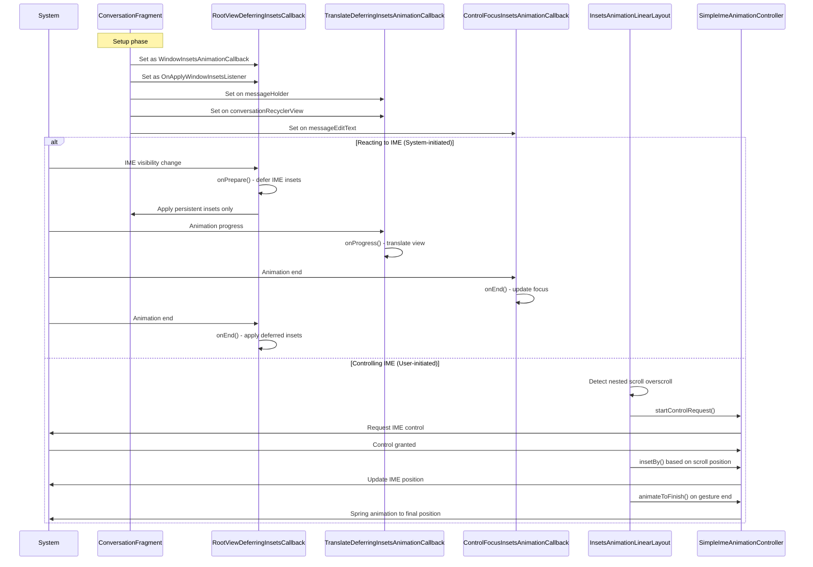

Sources: [WindowInsetsAnimation/app/src/main/java/com/google/android/samples/insetsanimation/ConversationFragment.kt:46-138](), [WindowInsetsAnimation/app/src/main/java/com/google/android/samples/insetsanimation/InsetsAnimationLinearLayout.kt:75-208](), [WindowInsetsAnimation/app/src/main/java/com/google/android/samples/insetsanimation/SimpleImeAnimationController.kt:87-377]()

## Implementation Steps

To implement WindowInsetsAnimation in your application, follow these three key steps:

### 1. Configure the Window

First, configure your activity's window to handle system insets:

```kotlin
// In your Activity's onCreate()
WindowCompat.setDecorFitsSystemWindows(window, false)
```

This tells the system that your app will handle insets manually rather than having them automatically applied.

Sources: [WindowInsetsAnimation/app/src/main/java/com/google/android/samples/insetsanimation/MainActivity.kt:31-40]()

### 2. Set Up Inset Callbacks

Next, set up the necessary callbacks to handle inset changes and animations:

```kotlin
// Create a callback to manage insets at the root level
val deferringInsetsCallback = RootViewDeferringInsetsCallback(
    persistentInsetTypes = WindowInsetsCompat.Type.systemBars(),
    deferredInsetTypes = WindowInsetsCompat.Type.ime()
)

// Set it on your root view
ViewCompat.setWindowInsetsAnimationCallback(rootView, deferringInsetsCallback)
ViewCompat.setOnApplyWindowInsetsListener(rootView, deferringInsetsCallback)

// Set up translation callbacks for views that should move with the IME
ViewCompat.setWindowInsetsAnimationCallback(
    viewToAnimate,
    TranslateDeferringInsetsAnimationCallback(
        view = viewToAnimate,
        persistentInsetTypes = WindowInsetsCompat.Type.systemBars(),
        deferredInsetTypes = WindowInsetsCompat.Type.ime()
    )
)

// Optional: Add focus management for input fields
ViewCompat.setWindowInsetsAnimationCallback(
    editText,
    ControlFocusInsetsAnimationCallback(editText)
)
```

Sources: [WindowInsetsAnimation/app/src/main/java/com/google/android/samples/insetsanimation/ConversationFragment.kt:61-121]()

### 3. Implement Control of IME (Optional)

To enable user-driven control of the IME, use either:

- `InsetsAnimationLinearLayout` for scrolling views:
  ```xml
  <com.google.android.samples.insetsanimation.InsetsAnimationLinearLayout
      android:layout_width="match_parent"
      android:layout_height="match_parent"
      android:orientation="vertical">
      <!-- Your scrolling content here -->
  </com.google.android.samples.insetsanimation.InsetsAnimationLinearLayout>
  ```

- Or `InsetsAnimationTouchListener` for non-scrolling views:
  ```kotlin
  view.setOnTouchListener(InsetsAnimationTouchListener())
  ```

Sources: [WindowInsetsAnimation/app/src/main/res/layout/fragment_conversation.xml:18-99](), [WindowInsetsAnimation/app/src/main/java/com/google/android/samples/insetsanimation/InsetsAnimationTouchListener.kt:55-192]()

## Cross-Version Compatibility

The WindowInsetsAnimation sample provides graceful degradation across different API levels:

| API Level | Behavior |
|-----------|----------|
| 30+ | Perfect tracking of the IME as it enters/exits the screen |
| 21-29 | Animation mimics the system IME animation but cannot perfectly track it |
| < 21 | No animation, just instant transitions |

This is achieved through the use of `WindowInsetsAnimationCompat` from AndroidX Core, which provides compatibility back to older Android versions.

Sources: [WindowInsetsAnimation/README.md:28-33]()

## Use Cases and Best Practices

### When to Use WindowInsetsAnimation

- Chat/messaging applications
- Form input screens
- Any UI that needs to respond gracefully to keyboard visibility changes
- Interfaces where users might want to manually control keyboard visibility

### Animation Performance Tips

1. **Minimize layout changes** during animation to maintain smooth performance
2. **Use translation** rather than layout changes when possible
3. **Properly defer insets** to avoid visual artifacts during animation
4. **Consider view hierarchy depth** as complex hierarchies may impact animation smoothness

### Common Pitfalls

1. Not properly handling focus during IME transitions
2. Applying insets twice (both through padding and translation)
3. Not accounting for system bars and other insets
4. Forgetting to test on different API levels for compatibility

Sources: [WindowInsetsAnimation/app/src/main/java/com/google/android/samples/insetsanimation/ConversationFragment.kt:46-138](), [WindowInsetsAnimation/README.md:14-43]()

## Conclusion

The WindowInsetsAnimation sample demonstrates a robust approach to handling keyboard animations in Android applications. By properly responding to and controlling IME visibility changes, applications can provide a more polished and cohesive user experience across different devices and Android versions.

For more details on the implementation, refer to the sample code in the Android User Interface Samples repository.

---

# Page: Canonical UI Layouts

# Canonical UI Layouts

<details>
<summary>Relevant source files</summary>

The following files were used as context for generating this wiki page:

- [CanonicalLayouts/README.md](CanonicalLayouts/README.md)
- [CanonicalLayouts/list-detail-sliding-pane/app/build.gradle](CanonicalLayouts/list-detail-sliding-pane/app/build.gradle)
- [CanonicalLayouts/list-detail-sliding-pane/app/src/main/AndroidManifest.xml](CanonicalLayouts/list-detail-sliding-pane/app/src/main/AndroidManifest.xml)
- [CanonicalLayouts/list-detail-sliding-pane/build.gradle](CanonicalLayouts/list-detail-sliding-pane/build.gradle)
- [CanonicalLayouts/list-detail-sliding-pane/gradle.properties](CanonicalLayouts/list-detail-sliding-pane/gradle.properties)
- [CanonicalLayouts/list-detail-sliding-pane/gradle/wrapper/gradle-wrapper.properties](CanonicalLayouts/list-detail-sliding-pane/gradle/wrapper/gradle-wrapper.properties)

</details>


## Purpose and Scope

This page provides an overview of the canonical layout patterns available in the Android User Interface Samples repository for building responsive and adaptive UIs across different screen sizes. These layouts are design patterns that optimize the user experience on various devices, from phones to tablets, foldables, and ChromeOS devices. 

For detailed information about specific implementation approaches, see:
- [List-Detail Pattern](#3.1)
- [Supporting Pane Pattern](#3.2)

Sources: [CanonicalLayouts/README.md:1-23]()

## Introduction to Canonical Layouts

Canonical layouts are proven UI design patterns that provide consistent and optimized user experiences across the diverse Android device ecosystem. These layouts automatically adapt to different screen sizes and configurations, ensuring efficient use of available screen real estate and improving user productivity.

The repository implements several canonical layouts with multiple implementation approaches, allowing developers to choose the most appropriate solution for their codebase (traditional Views, Fragments, or Jetpack Compose).

### Key Canonical Layout Patterns

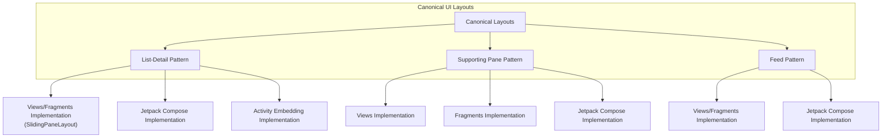

Sources: [CanonicalLayouts/README.md:11-22]()

## Responsive Design Principles

Canonical layouts follow core responsive design principles that ensure UIs work well across all form factors:

1. **Layout Adaptation**: Different form factors receive appropriately sized and positioned UI elements
2. **Content Priority**: Critical content remains visible and accessible regardless of screen size
3. **Consistent Navigation**: Navigation patterns remain consistent while adapting to available space
4. **Optimal Information Density**: Content density adjusts based on screen size and input method

### Adaptation Across Screen Sizes

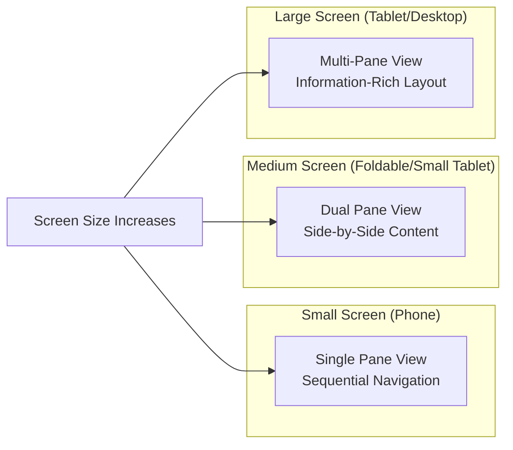

Sources: [CanonicalLayouts/README.md:1-5]()

## Implementation Approaches

The repository provides multiple implementation approaches for each canonical layout pattern, allowing developers to choose the most appropriate solution based on their codebase and requirements.

| Pattern | Views/Fragments | Jetpack Compose | Special Implementations |
|---------|----------------|-----------------|-------------------------|
| List-Detail | SlidingPaneLayout | Compose UI | Activity Embedding |
| Supporting Pane | Views & Fragments | Compose UI | - |
| Feed | Views & Fragments | Compose UI | - |

Sources: [CanonicalLayouts/README.md:11-22](), [CanonicalLayouts/list-detail-sliding-pane/app/build.gradle:54-67]()

## List-Detail Pattern

The List-Detail pattern presents a list of items on one side and details for the selected item on the other. This pattern is perfect for email clients, settings screens, and content management applications.

Key features:
- On smaller screens, the list and detail views are shown sequentially
- On larger screens, the list and detail views appear side-by-side
- Smooth transitions between list and detail views

### Technical Implementation

The List-Detail pattern is implemented in three different ways:

1. **SlidingPaneLayout**: Uses the AndroidX SlidingPaneLayout component for View-based UIs
2. **Jetpack Compose**: Pure Compose implementation with adaptive layouts
3. **Activity Embedding**: Multi-activity approach for large screen devices

```mermaid
flowchart TD
    subgraph "List-Detail Pattern Implementations"
        LD["List-Detail Pattern"]
        
        subgraph "SlidingPaneLayout"
            SPL["SlidingPaneLayout Component"]
            NAV["Navigation Component"]
            FRAG["Fragments"]
        end
        
        subgraph "Compose"
            CMP["Jetpack Compose UI"]
            ADPT["Adaptive Layout Logic"]
            NAV_C["Compose Navigation"]
        end
        
        subgraph "Activity Embedding"
            AE["Activity Embedding API"]
            WIND["WindowManager"]
            DISP["DisplayFeatures"]
        end
    end
    
    LD --> SPL
    LD --> CMP
    LD --> AE
    
    SPL --> NAV
    SPL --> FRAG
    
    CMP --> ADPT
    CMP --> NAV_C
    
    AE --> WIND
    AE --> DISP
```

Sources: [CanonicalLayouts/list-detail-sliding-pane/app/build.gradle:54-67](), [CanonicalLayouts/README.md:12-15]()

## Supporting Pane Pattern

The Supporting Pane pattern displays main content alongside supporting content (like filters, settings, or auxiliary information). This pattern helps users access supporting features without leaving the main content view.

Key features:
- Main content remains the primary focus
- Supporting pane can be collapsed or expanded as needed
- Supporting content adapts in visibility based on screen size

### Technical Implementation

The Supporting Pane is implemented in three different ways:

1. **Views**: Using traditional Android Views and ViewGroups
2. **Fragments**: Fragment-based implementation with navigation
3. **Jetpack Compose**: Pure Compose implementation with state management

Sources: [CanonicalLayouts/README.md:19-22]()

## Feed Pattern

The Feed pattern displays a list of cards or items in a scrollable layout, optimized for content consumption. This pattern is commonly used in social media apps, news readers, and content aggregators.

Key features:
- Vertical scrolling interface on smaller screens
- Grid-based layouts on larger screens
- Adaptive card sizes based on content and screen width

```mermaid
graph TD
    subgraph "Feed Pattern Implementations"
        FD["Feed Pattern"]
        
        V["Views Implementation"]
        C["Compose Implementation"]
        
        FD --> V
        FD --> C
        
        V --> V1["RecyclerView + CardView"]
        V --> V2["GridLayoutManager"]
        
        C --> C1["LazyColumn/LazyGrid"]
        C --> C2["Adaptive Card Components"]
    end
```

Sources: [CanonicalLayouts/README.md:16-18]()

## Project Structure

The Canonical Layouts sample code is organized into separate Android projects for each implementation approach:

```mermaid
graph TD
    subgraph "CanonicalLayouts/"
        ROOT["Root Project"]
        
        LD1["list-detail-activity-embedding/"]
        LD2["list-detail-sliding-pane/"]
        LD3["list-detail-compose/"]
        
        SP1["supporting-pane-views/"]
        SP2["supporting-pane-fragments/"]
        SP3["supporting-pane-compose/"]
        
        FD1["feed-view/"]
        FD2["feed-compose/"]
        
        ROOT --> LD1
        ROOT --> LD2
        ROOT --> LD3
        ROOT --> SP1
        ROOT --> SP2
        ROOT --> SP3
        ROOT --> FD1
        ROOT --> FD2
    end
```

Each individual project contains a complete Android application that demonstrates the particular implementation approach for that canonical layout pattern.

Sources: [CanonicalLayouts/README.md:11-22](), [CanonicalLayouts/list-detail-sliding-pane/app/build.gradle:1-67]()

## Dependencies and Requirements

The Canonical Layouts samples utilize several key AndroidX libraries:

| Library | Purpose | Example |
|---------|---------|---------|
| SlidingPaneLayout | Implements swipe-based list-detail pattern | `androidx.slidingpanelayout:slidingpanelayout:1.2.0` |
| Navigation Component | Manages fragment navigation | `androidx.navigation:navigation-fragment-ktx:2.7.7` |
| ConstraintLayout | Creates adaptive layouts | `androidx.constraintlayout:constraintlayout:2.1.4` |
| Jetpack Compose | Declarative UI for modern implementations | Varies by sample |

All samples are compatible with:
- Minimum SDK: 21 (Android 5.0, Lollipop)
- Targeted for modern Android versions (SDK 35+)

Sources: [CanonicalLayouts/list-detail-sliding-pane/app/build.gradle:22-51](), [CanonicalLayouts/list-detail-sliding-pane/app/build.gradle:54-67]()

## Related Systems

The Canonical Layout patterns are designed to work seamlessly with other Android UI systems, particularly:

- [Window Management](#2) - For detecting and responding to display features on foldable devices
- [Window Insets Animation](#2.2) - For smooth transitions when the keyboard appears/disappears

For implementing these patterns with widgets, see the [App Widgets](#4) documentation.

Sources: [CanonicalLayouts/README.md:1-5]()

---

# Page: List-Detail Pattern

# List-Detail Pattern

<details>
<summary>Relevant source files</summary>

The following files were used as context for generating this wiki page:

- [CanonicalLayouts/README.md](CanonicalLayouts/README.md)
- [CanonicalLayouts/list-detail-compose/app/build.gradle](CanonicalLayouts/list-detail-compose/app/build.gradle)
- [CanonicalLayouts/list-detail-compose/app/src/main/java/com/example/listdetailcompose/MainActivity.kt](CanonicalLayouts/list-detail-compose/app/src/main/java/com/example/listdetailcompose/MainActivity.kt)
- [CanonicalLayouts/list-detail-compose/app/src/main/java/com/example/listdetailcompose/ui/ListDetailSample.kt](CanonicalLayouts/list-detail-compose/app/src/main/java/com/example/listdetailcompose/ui/ListDetailSample.kt)
- [CanonicalLayouts/list-detail-compose/app/src/main/res/drawable/ic_food.xml](CanonicalLayouts/list-detail-compose/app/src/main/res/drawable/ic_food.xml)
- [CanonicalLayouts/list-detail-compose/app/src/main/res/drawable/ic_no_food.xml](CanonicalLayouts/list-detail-compose/app/src/main/res/drawable/ic_no_food.xml)
- [CanonicalLayouts/list-detail-compose/app/src/main/res/values/strings.xml](CanonicalLayouts/list-detail-compose/app/src/main/res/values/strings.xml)
- [CanonicalLayouts/list-detail-compose/build.gradle](CanonicalLayouts/list-detail-compose/build.gradle)
- [CanonicalLayouts/list-detail-compose/gradle/wrapper/gradle-wrapper.properties](CanonicalLayouts/list-detail-compose/gradle/wrapper/gradle-wrapper.properties)
- [CanonicalLayouts/list-detail-sliding-pane/app/build.gradle](CanonicalLayouts/list-detail-sliding-pane/app/build.gradle)
- [CanonicalLayouts/list-detail-sliding-pane/app/src/main/AndroidManifest.xml](CanonicalLayouts/list-detail-sliding-pane/app/src/main/AndroidManifest.xml)
- [CanonicalLayouts/list-detail-sliding-pane/build.gradle](CanonicalLayouts/list-detail-sliding-pane/build.gradle)
- [CanonicalLayouts/list-detail-sliding-pane/gradle.properties](CanonicalLayouts/list-detail-sliding-pane/gradle.properties)
- [CanonicalLayouts/list-detail-sliding-pane/gradle/wrapper/gradle-wrapper.properties](CanonicalLayouts/list-detail-sliding-pane/gradle/wrapper/gradle-wrapper.properties)

</details>


## Purpose and Scope

This document describes the List-Detail pattern, a canonical UI layout pattern for creating responsive and adaptive interfaces across various Android device form factors. The List-Detail pattern displays a list of items on one side and the details of a selected item on the other side, with the layout adapting based on available screen space. This pattern is particularly useful for applications that need to display collections of data and their associated details.

For information about other canonical UI layouts, see [Canonical UI Layouts](#3).

## Pattern Overview

The List-Detail pattern consists of two primary components:

1. **List Pane**: Displays a scrollable list of items that users can select
2. **Detail Pane**: Shows detailed information about the currently selected item

```mermaid
flowchart LR
    subgraph "List-Detail Pattern"
        ListPane["List Pane"] --> |"selection"| DetailPane["Detail Pane"]
    end
```

Sources: [CanonicalLayouts/list-detail-compose/app/src/main/java/com/example/listdetailcompose/ui/ListDetailSample.kt:113-169]()

The pattern adapts to different screen sizes:
- On larger screens (tablets, foldables): Both panes appear side-by-side
- On smaller screens (phones): Only one pane is visible at a time, with navigation between them

```mermaid
flowchart TD
    subgraph "Large Screen Devices"
        direction LR
        LargeScreen["Screen"] --- LargeList["List Pane"]
        LargeScreen --- LargeDetail["Detail Pane"]
    end
    
    subgraph "Small Screen Devices"
        direction TB
        SmallScreen["Screen"] --- SmallList["List Pane"]
        SmallList -.- |"navigate"| SmallDetail["Detail Pane"]
    end
```

Sources: [CanonicalLayouts/README.md:1-23](), [CanonicalLayouts/list-detail-compose/app/src/main/java/com/example/listdetailcompose/ui/ListDetailSample.kt:98-169]()

## Implementation Options

The Android UI Samples repository provides three different implementations of the List-Detail pattern:

```mermaid
flowchart LR
    ListDetail["List-Detail Pattern"]
    ListDetail --> Compose["Jetpack Compose Implementation"]
    ListDetail --> SlidingPane["SlidingPaneLayout (Views/Fragments)"]
    ListDetail --> ActivityEmbedding["Activity Embedding"]
```

Sources: [CanonicalLayouts/README.md:11-15]()

### Jetpack Compose Implementation

The Compose implementation uses Material 3 Adaptive components to create a responsive List-Detail UI.

```mermaid
classDiagram
    class ListDetailPaneScaffold {
        +listPane()
        +detailPane()
        +paneExpansionState
        +paneExpansionDragHandle()
    }
    
    class ListContent {
        +words: List~DefinedWord~
        +selectionState: SelectionVisibilityState
        +onIndexClick(index)
    }
    
    class DetailContent {
        +definedWord: DefinedWord?
        +isListAndDetailVisible: Boolean
        +isDetailVisible: Boolean
    }
    
    ListDetailPaneScaffold --> ListContent: contains
    ListDetailPaneScaffold --> DetailContent: contains
```

Sources: [CanonicalLayouts/list-detail-compose/app/src/main/java/com/example/listdetailcompose/ui/ListDetailSample.kt:98-169](), [CanonicalLayouts/list-detail-compose/app/src/main/java/com/example/listdetailcompose/ui/ListDetailSample.kt:197-355]()

Key components:
- `ListDetailPaneScaffold`: Container that manages both panes
- `rememberListDetailPaneScaffoldNavigator`: Manages navigation between panes
- `AnimatedPane`: Provides animations for transitions between panes
- `SharedTransitionLayout`: Enables shared element transitions

The implementation leverages Jetpack Compose's adaptive layout capabilities and Material 3 components to automatically handle different screen sizes.

Dependencies:
```
androidx.compose.material3.adaptive:adaptive:1.1.0-alpha07
androidx.compose.material3.adaptive:adaptive-layout:1.1.0-alpha07
androidx.compose.material3.adaptive:adaptive-navigation:1.1.0-alpha07
```

Sources: [CanonicalLayouts/list-detail-compose/app/build.gradle:80-83]()

## Adaptation Logic

The List-Detail pattern determines the appropriate layout based on available screen width:

```mermaid
flowchart TD
    Start["Screen Size Detection"] --> ScreenCheck{"Is screen large enough?"}
    ScreenCheck -- "Yes" --> BothVisible["Show List and Detail side-by-side"]
    ScreenCheck -- "No" --> SingleVisible["Show single pane,\nnavigate between List and Detail"]
```

The `PaneAdaptedValue` indicates the state of each pane:
- `PaneAdaptedValue.Expanded`: Pane is visible
- Navigation between panes is managed by `ListDetailPaneScaffoldNavigator`

The implementation handles back navigation using the `BackHandler` composable:

```kotlin
BackHandler(enabled = navigator.canNavigateBack()) {
    scope.launch {
        navigator.navigateBack()
    }
}
```

Sources: [CanonicalLayouts/list-detail-compose/app/src/main/java/com/example/listdetailcompose/ui/ListDetailSample.kt:102-109]()

## Implementation Details

### List Pane

The list pane is implemented using a `LazyColumn` that displays a collection of items:

```mermaid
flowchart TD
    LazyColumn["LazyColumn"] --> Item1["Card Item"]
    LazyColumn --> Item2["Card Item"]
    LazyColumn --> Item3["Card Item"]
    Item1 --> Row1["Row: Image + Text"]
    Item2 --> Row2["Row: Image + Text"]
    Item3 --> Row3["Row: Image + Text"]
```

Selection state is managed through the `SelectionVisibilityState` interface, which can be either:
- `NoSelection`: No item is selected (items are clickable)
- `ShowSelection`: An item is selected (items are selectable)

Sources: [CanonicalLayouts/list-detail-compose/app/src/main/java/com/example/listdetailcompose/ui/ListDetailSample.kt:176-192](), [CanonicalLayouts/list-detail-compose/app/src/main/java/com/example/listdetailcompose/ui/ListDetailSample.kt:197-300]()

### Detail Pane

The detail pane displays information about the selected item using a scrollable `Column`:

```mermaid
flowchart TD
    Column["Column + VerticalScroll"] --> Image["Image (Icon)"]
    Column --> Title["Text (Title)"]
    Column --> Definition["Text (Definition)"]
```

If no item is selected, a placeholder message is displayed.

Sources: [CanonicalLayouts/list-detail-compose/app/src/main/java/com/example/listdetailcompose/ui/ListDetailSample.kt:305-355]()

### Shared Element Transitions

The implementation uses Compose's shared element transition API to create smooth visual transitions between the list and detail panes:

```mermaid
flowchart LR
    ListImage["Image in List"] ---> |"sharedElement"| DetailImage["Image in Detail"]
```

This is implemented using:
- `SharedTransitionLayout`: Container for transitions
- `sharedElement` modifier: Tags elements for transition
- `rememberSharedContentState`: Creates a state for the transition

Sources: [CanonicalLayouts/list-detail-compose/app/src/main/java/com/example/listdetailcompose/ui/ListDetailSample.kt:111-112](), [CanonicalLayouts/list-detail-compose/app/src/main/java/com/example/listdetailcompose/ui/ListDetailSample.kt:273-281](), [CanonicalLayouts/list-detail-compose/app/src/main/java/com/example/listdetailcompose/ui/ListDetailSample.kt:321-335]()

## Usage Example

To use the List-Detail pattern in an application:

1. Add the required dependencies
2. Implement the list and detail content components
3. Use the appropriate container based on your implementation choice
4. Handle selection state and navigation

In the example from the repository, a simple list of food items is displayed with their definitions:

```
MainActivity → ListDetailSample → ListDetailPaneScaffold
```

Sources: [CanonicalLayouts/list-detail-compose/app/src/main/java/com/example/listdetailcompose/MainActivity.kt:27-38]()

## Additional Implementation Options

While this document focuses on the Compose implementation, the repository also includes:

1. **SlidingPaneLayout Implementation**: Uses the traditional View system with `SlidingPaneLayout` and Fragments

2. **Activity Embedding Implementation**: Leverages the Activity Embedding API for multi-window experiences

For details on these implementations, see [List-Detail with Sliding Pane](#3.1.2) and [List-Detail with Activity Embedding](#3.1.3).

Sources: [CanonicalLayouts/README.md:11-15]()

## Summary

The List-Detail pattern provides a versatile solution for displaying collections of data and their details in a responsive manner. The implementation options available in the Android UI Samples repository demonstrate different approaches to achieve this pattern, with the Compose implementation offering the most modern and declarative approach.

By adapting to different screen sizes automatically, this pattern helps create consistent user experiences across the diverse Android device ecosystem, from phones to tablets and foldable devices.

---

# Page: List-Detail with Compose

# List-Detail with Compose

<details>
<summary>Relevant source files</summary>

The following files were used as context for generating this wiki page:

- [CanonicalLayouts/list-detail-compose/app/build.gradle](CanonicalLayouts/list-detail-compose/app/build.gradle)
- [CanonicalLayouts/list-detail-compose/app/src/main/java/com/example/listdetailcompose/MainActivity.kt](CanonicalLayouts/list-detail-compose/app/src/main/java/com/example/listdetailcompose/MainActivity.kt)
- [CanonicalLayouts/list-detail-compose/app/src/main/java/com/example/listdetailcompose/ui/ListDetailSample.kt](CanonicalLayouts/list-detail-compose/app/src/main/java/com/example/listdetailcompose/ui/ListDetailSample.kt)
- [CanonicalLayouts/list-detail-compose/app/src/main/res/drawable/ic_food.xml](CanonicalLayouts/list-detail-compose/app/src/main/res/drawable/ic_food.xml)
- [CanonicalLayouts/list-detail-compose/app/src/main/res/drawable/ic_no_food.xml](CanonicalLayouts/list-detail-compose/app/src/main/res/drawable/ic_no_food.xml)
- [CanonicalLayouts/list-detail-compose/app/src/main/res/values/strings.xml](CanonicalLayouts/list-detail-compose/app/src/main/res/values/strings.xml)
- [CanonicalLayouts/list-detail-compose/build.gradle](CanonicalLayouts/list-detail-compose/build.gradle)
- [CanonicalLayouts/list-detail-compose/gradle/wrapper/gradle-wrapper.properties](CanonicalLayouts/list-detail-compose/gradle/wrapper/gradle-wrapper.properties)

</details>


This document explains the implementation of the List-Detail UI pattern using Jetpack Compose. The List-Detail pattern is a canonical UI layout where a list of items is displayed on one pane, and selecting an item shows its details in another pane. This pattern adapts responsively to different screen sizes and device configurations, making it particularly valuable for large screen devices like tablets and foldables.

For information about implementing the List-Detail pattern with SlidingPaneLayout, see [List-Detail with Sliding Pane](#3.1.2). For information about implementing the pattern with Activity Embedding, see [List-Detail with Activity Embedding](#3.1.3).

## Overview

The List-Detail with Compose sample demonstrates how to implement an adaptive UI that:

1. On smaller screens: Shows either the list or the detail pane (one at a time)
2. On larger screens: Shows both the list and detail panes simultaneously
3. Provides smooth transitions between these states
4. Incorporates shared element transitions for visual continuity

```mermaid
graph TB
    subgraph "List-Detail Pattern Components"
        ListDetailPaneScaffold["ListDetailPaneScaffold"] --> ListPane["ListPane"]
        ListDetailPaneScaffold --> DetailPane["DetailPane"]
        ListDetailPaneScaffold --> PaneExpansionState["PaneExpansionState"]
        ListDetailPaneScaffold --> DragHandle["Drag Handle"]
        
        ListPane --> LazyColumn["LazyColumn w/items"]
        DetailPane --> ScrollableContent["Scrollable Detail Content"]
        
        PaneExpansionState --> Navigation["Navigation Handling"]
    end
```

Sources: [CanonicalLayouts/list-detail-compose/app/src/main/java/com/example/listdetailcompose/ui/ListDetailSample.kt:98-171]()

## Architecture

The implementation is built on top of Jetpack Compose's Material 3 Adaptive components, specifically using `ListDetailPaneScaffold` which provides the foundation for implementing the list-detail pattern.

```mermaid
flowchart TD
    subgraph "List-Detail Implementation"
        A["MainActivity"] --> B["ListDetailSample"]
        B --> C["SharedTransitionLayout"]
        C --> D["ListDetailPaneScaffold"]
        
        D --> E["ListPane (AnimatedPane)"]
        D --> F["DetailPane (AnimatedPane)"]
        D --> G["PaneExpansionDragHandle"]
        
        E --> H["ListContent"]
        F --> I["DetailContent"]
        
        J["Navigator"] --- B
        K["PaneExpansionState"] --- D
        
        H --> L["LazyColumn\nwith Card items"]
        I --> M["Column with\nScrollable Content"]
    end
```

Sources: 
- [CanonicalLayouts/list-detail-compose/app/src/main/java/com/example/listdetailcompose/ui/ListDetailSample.kt:98-171]()
- [CanonicalLayouts/list-detail-compose/app/src/main/java/com/example/listdetailcompose/MainActivity.kt:27-38]()

## Key Components

### ListDetailPaneScaffold

The `ListDetailPaneScaffold` is the fundamental component that manages the overall layout structure. It handles how the list and detail panes are displayed based on the window size and device configuration.

Key properties:
- `directive`: Controls how the scaffold should lay out its panes
- `value`: The current state of each pane (expanded or not)
- `listPane`: Composable content for the list pane
- `detailPane`: Composable content for the detail pane
- `paneExpansionState`: Manages the expansion state of panes
- `paneExpansionDragHandle`: Optional drag handle for manual pane resizing

Sources: [CanonicalLayouts/list-detail-compose/app/src/main/java/com/example/listdetailcompose/ui/ListDetailSample.kt:113-167]()

### ListDetailPaneScaffoldNavigator

The navigator manages transitions between list and detail panes and handles back navigation. It's responsible for:

1. Tracking the current scaffold state
2. Providing navigation between panes
3. Handling back button presses
4. Storing and restoring navigation state

Sources: [CanonicalLayouts/list-detail-compose/app/src/main/java/com/example/listdetailcompose/ui/ListDetailSample.kt:100-109]()

### SharedTransitionLayout

The sample implements smooth visual transitions using `SharedTransitionLayout`, which enables shared element transitions between the list and detail panes. This creates a fluid user experience when an item is selected from the list.

Sources: [CanonicalLayouts/list-detail-compose/app/src/main/java/com/example/listdetailcompose/ui/ListDetailSample.kt:111-170]()

## Implementation Details

### Main Components Structure

```mermaid
classDiagram
    class ListDetailSample {
        +selectedWordIndex: Int?
        +navigator: ListDetailPaneScaffoldNavigator
        +isListAndDetailVisible: Boolean
    }
    
    class ListContent {
        +words: List~DefinedWord~
        +selectionState: SelectionVisibilityState
        +onIndexClick: (Int) -> Unit
        +isListAndDetailVisible: Boolean
        +isListVisible: Boolean
    }
    
    class DetailContent {
        +definedWord: DefinedWord?
        +isListAndDetailVisible: Boolean
        +isDetailVisible: Boolean
    }
    
    class SelectionVisibilityState {
        <<interface>>
    }
    
    class NoSelection {
        <<object>>
    }
    
    class ShowSelection {
        +selectedWordIndex: Int
    }
    
    class DefinedWord {
        +word: String
        +icon: Int
        +definition: String
    }
    
    ListDetailSample --> ListContent: uses
    ListDetailSample --> DetailContent: uses
    ListContent --> SelectionVisibilityState: uses
    DetailContent --> DefinedWord: displays
    SelectionVisibilityState <|-- NoSelection
    SelectionVisibilityState <|-- ShowSelection
```

Sources:
- [CanonicalLayouts/list-detail-compose/app/src/main/java/com/example/listdetailcompose/ui/ListDetailSample.kt:98-171]()
- [CanonicalLayouts/list-detail-compose/app/src/main/java/com/example/listdetailcompose/ui/ListDetailSample.kt:176-192]()
- [CanonicalLayouts/list-detail-compose/app/src/main/java/com/example/listdetailcompose/ui/ListDetailSample.kt:89-93]()

### Data Model

The sample uses a simple data model for demonstration purposes:

```
DefinedWord
- word: String
- icon: Int
- definition: String
```

A list of sample words is predefined for the demonstration, with each word having a name, an icon, and a Lorem Ipsum definition.

Sources: [CanonicalLayouts/list-detail-compose/app/src/main/java/com/example/listdetailcompose/ui/ListDetailSample.kt:73-93]()

## Responsive Behavior

The List-Detail implementation adapts to different screen sizes through the `ListDetailPaneScaffold`:

1. **Single-pane mode**: On smaller screens, either the list pane or the detail pane is shown at a time
2. **Two-pane mode**: On larger screens, both list and detail panes are shown simultaneously

The component automatically determines the appropriate layout based on the available screen space.

```mermaid
graph LR
    subgraph "Screen Size Adaptation"
        A["Window Size"] --> B{"Is Large Screen?"}
        B -->|Yes| C["Show List + Detail\n(Two-pane mode)"]
        B -->|No| D["Show List OR Detail\n(Single-pane mode)"]
        
        D --> E["Navigation between\npanes required"]
        C --> F["Both panes visible\nsimultaneously"]
    end
```

Sources: [CanonicalLayouts/list-detail-compose/app/src/main/java/com/example/listdetailcompose/ui/ListDetailSample.kt:98-104]()

## State Management

### Selection State

The implementation manages selection state using a sealed interface:

- `NoSelection`: When no item is selected or when in list-only view
- `ShowSelection`: When an item is selected, containing the index of the selected item

This state determines:
1. The visual appearance of list items (selected vs. unselected)
2. The item whose details are displayed in the detail pane
3. The interaction behavior (clickable vs. selectable)

Sources: [CanonicalLayouts/list-detail-compose/app/src/main/java/com/example/listdetailcompose/ui/ListDetailSample.kt:176-192]()

### Navigation State

Navigation state is managed by the `ListDetailPaneScaffoldNavigator`, which tracks:

1. Whether the list pane is expanded or collapsed
2. Whether the detail pane is expanded or collapsed
3. Navigation history for back button handling

Sources: [CanonicalLayouts/list-detail-compose/app/src/main/java/com/example/listdetailcompose/ui/ListDetailSample.kt:100-109]()

## Animations and Transitions

### Shared Element Transitions

The implementation uses shared element transitions to create smooth visual continuity when navigating between the list and detail panes. When an item is selected from the list, its icon smoothly animates to its new position in the detail view.

This is implemented using:
- `SharedTransitionLayout`: Wraps the entire UI to enable shared transitions
- `sharedElement` modifier: Applied to elements that should animate between states
- `rememberSharedContentState`: Tracks the state of shared elements

Sources: 
- [CanonicalLayouts/list-detail-compose/app/src/main/java/com/example/listdetailcompose/ui/ListDetailSample.kt:111-112]()
- [CanonicalLayouts/list-detail-compose/app/src/main/java/com/example/listdetailcompose/ui/ListDetailSample.kt:272-282]()
- [CanonicalLayouts/list-detail-compose/app/src/main/java/com/example/listdetailcompose/ui/ListDetailSample.kt:324-334]()

### AnimatedPane

The `AnimatedPane` component is used to animate the entry and exit of panes:

```kotlin
AnimatedPane {
    ListContent(...)
}
```

This creates smooth transitions when switching between the list and detail views.

Sources: [CanonicalLayouts/list-detail-compose/app/src/main/java/com/example/listdetailcompose/ui/ListDetailSample.kt:120-139]()

## Implementation Details

### List Pane

The list pane is implemented as a `LazyColumn` containing cards for each item. Key features:

1. Items can be clickable or selectable based on the current selection state
2. Visual styling changes based on selection state (border, background color)
3. Shared elements are configured for transition animations

Sources: [CanonicalLayouts/list-detail-compose/app/src/main/java/com/example/listdetailcompose/ui/ListDetailSample.kt:198-300]()

### Detail Pane

The detail pane is implemented as a scrollable column showing:

1. The icon of the selected item (shared element with the list)
2. The name of the selected item
3. The detailed description of the item

If no item is selected, a placeholder message is displayed.

Sources: [CanonicalLayouts/list-detail-compose/app/src/main/java/com/example/listdetailcompose/ui/ListDetailSample.kt:306-355]()

## Dependencies

The implementation relies on several key dependencies:

| Dependency | Purpose |
|------------|---------|
| `androidx.compose.material3.adaptive:adaptive-layout` | Provides the `ListDetailPaneScaffold` component |
| `androidx.compose.material3.adaptive:adaptive-navigation` | Provides navigation utilities for the pane scaffold |
| `androidx.compose.animation:animation` | Enables animations and shared transitions |
| `androidx.window:window` | Underlying window size detection |

Sources: [CanonicalLayouts/list-detail-compose/app/build.gradle:69-86]()

## Usage

To use the List-Detail pattern in your own application:

1. Add the required dependencies to your `build.gradle` file
2. Create your data model for list items
3. Implement the list content and detail content
4. Set up the `ListDetailPaneScaffold` with appropriate navigation handling
5. Implement shared transitions if desired

The pattern is particularly useful for applications like:
- Email clients (list of emails, email content)
- File managers (list of files, file preview/details)
- Settings screens (categories list, specific settings)
- E-commerce (product list, product details)

Sources: 
- [CanonicalLayouts/list-detail-compose/app/build.gradle:69-86]()
- [CanonicalLayouts/list-detail-compose/app/src/main/java/com/example/listdetailcompose/ui/ListDetailSample.kt:98-171]()
- [CanonicalLayouts/list-detail-compose/app/src/main/java/com/example/listdetailcompose/MainActivity.kt:27-38]()

---

# Page: List-Detail with Sliding Pane

# List-Detail with Sliding Pane

<details>
<summary>Relevant source files</summary>

The following files were used as context for generating this wiki page:

- [CanonicalLayouts/README.md](CanonicalLayouts/README.md)
- [CanonicalLayouts/list-detail-sliding-pane/app/build.gradle](CanonicalLayouts/list-detail-sliding-pane/app/build.gradle)
- [CanonicalLayouts/list-detail-sliding-pane/app/src/main/AndroidManifest.xml](CanonicalLayouts/list-detail-sliding-pane/app/src/main/AndroidManifest.xml)
- [CanonicalLayouts/list-detail-sliding-pane/build.gradle](CanonicalLayouts/list-detail-sliding-pane/build.gradle)
- [CanonicalLayouts/list-detail-sliding-pane/gradle.properties](CanonicalLayouts/list-detail-sliding-pane/gradle.properties)
- [CanonicalLayouts/list-detail-sliding-pane/gradle/wrapper/gradle-wrapper.properties](CanonicalLayouts/list-detail-sliding-pane/gradle/wrapper/gradle-wrapper.properties)

</details>


## Purpose and Scope

This page documents the List-Detail pattern implementation using `SlidingPaneLayout`, a component in the AndroidX library that enables a responsive two-pane UI layout. This implementation uses standard Android Views and Fragments to create a UI that seamlessly adapts between single-pane (for phones) and two-pane (for tablets, foldables, and large screens) layouts.

For alternative implementations of the List-Detail pattern, see [List-Detail with Compose](#3.1.1) or [List-Detail with Activity Embedding](#3.1.3).

## Overview

The List-Detail pattern is a canonical layout that shows a master list of items on one side and the details of a selected item on the other. It's particularly effective for large screens where both the list and detail can be shown simultaneously.

```mermaid
graph LR
    subgraph "List-Detail SlidingPane Pattern"
        A["MainActivity"] --> B["SlidingPaneLayout"]
        B --> C["List Fragment"]
        B --> D["Detail Fragment"]
        C -- "Item selection" --> D
    end
```

Sources: [CanonicalLayouts/README.md:1-30]()

## Architecture

The implementation uses a single activity with a `SlidingPaneLayout` as its root layout, hosting two fragments - one for the list and one for the details.

```mermaid
flowchart TD
    subgraph "Component Structure"
        A["MainActivity"] --> B["SlidingPaneLayout"]
        B --> C["List Fragment Container"]
        B --> D["Detail Fragment Container"]
        
        E["Navigation Component"] --> C
        E --> D
        
        F["PanelSlideListener"] --> B
    end
```

Sources: [CanonicalLayouts/list-detail-sliding-pane/app/build.gradle:54-67]()

### Key Components

- **MainActivity**: The host activity containing the `SlidingPaneLayout`
- **SlidingPaneLayout**: AndroidX component that manages the sliding interaction between list and detail panes
- **Navigation Component**: Used to handle fragment transactions and back stack behavior
- **PanelSlideListener**: Interface to monitor and react to sliding panel state changes

## Technical Implementation

The implementation uses the AndroidX `SlidingPaneLayout` library (version 1.2.0) to provide the sliding behavior between panels. It's combined with the Navigation component for fragment management.

### Dependencies

```
implementation "androidx.slidingpanelayout:slidingpanelayout:1.2.0"
implementation "androidx.navigation:navigation-fragment-ktx:2.7.7"
implementation "androidx.navigation:navigation-ui-ktx:2.7.7"
```

Sources: [CanonicalLayouts/list-detail-sliding-pane/app/build.gradle:54-67]()

### Responsive Behavior

The `SlidingPaneLayout` automatically adapts to different screen sizes:

```mermaid
flowchart LR
    subgraph "Adaptive Behavior"
        A["Device Configuration"]
        
        subgraph "Small Screen (Phone)"
            B["Collapsed Mode<br/>Only one pane visible at a time"]
        end
        
        subgraph "Large Screen (Tablet/Foldable)"
            C["Expanded Mode<br/>Both panes visible side by side"]
        end
        
        A -- "Screen width < threshold" --> B
        A -- "Screen width >= threshold" --> C
    end
```

Sources: [CanonicalLayouts/README.md:1-30]()

## Screen States

### Phone Mode (Collapsed)
In phone mode, the `SlidingPaneLayout` shows only one pane at a time, either:
- List view (with the detail pane hidden off-screen)
- Detail view (sliding in to replace the list view)

The user can swipe to navigate back from detail to list, or use the system back button/gesture.

### Tablet/Foldable Mode (Expanded)
On larger screens, the `SlidingPaneLayout` displays both the list and detail panes side by side. Selecting an item in the list updates the content in the detail pane without needing to slide between views.

## User Flow

```mermaid
stateDiagram-v2
    direction LR
    
    state "Small Screen" as Small {
        [*] --> ListPane
        ListPane --> DetailPane: Select item
        DetailPane --> ListPane: Back gesture/button
    }
    
    state "Large Screen" as Large {
        [*] --> BothPanes
        state BothPanes {
            ListSection --> DetailSection: Select item
        }
    }
```

Sources: [CanonicalLayouts/README.md:1-30]()

## Implementation Details

The implementation uses ViewBinding for efficient view access and Navigation component for managing fragments. The `SlidingPaneLayout` handles the physical sliding animation between panes.

```mermaid
classDiagram
    class MainActivity {
        +SlidingPaneLayout slidingPaneLayout
        +onCreate()
        +onBackPressed()
    }
    
    class SlidingPaneLayout {
        +boolean isOpen
        +openPane()
        +closePane()
        +setPanelSlideListener()
    }
    
    class ListFragment {
        +onCreateView()
        +onItemClick()
    }
    
    class DetailFragment {
        +onCreateView()
        +displayItemDetails()
    }
    
    MainActivity --> SlidingPaneLayout: contains
    MainActivity --> ListFragment: hosts
    MainActivity --> DetailFragment: hosts
    ListFragment ..> DetailFragment: updates
```

Sources: [CanonicalLayouts/list-detail-sliding-pane/app/build.gradle:35-37](), [CanonicalLayouts/list-detail-sliding-pane/app/build.gradle:61-63]()

## Integration with System Back Button

The implementation properly integrates with the Android system back button, using `enableOnBackInvokedCallback` for newer Android versions:

```
android:enableOnBackInvokedCallback="true"
```

When the detail pane is open on a phone, pressing back will slide it away to reveal the list pane. Only when the list pane is showing will back exit the app.

Sources: [CanonicalLayouts/list-detail-sliding-pane/app/src/main/AndroidManifest.xml:29]()

## Advantages of SlidingPaneLayout Approach

1. **Native Android Views**: Uses standard Android Views and Fragments, making it compatible with existing codebases
2. **Built-in Animations**: The sliding animation between panes is handled automatically
3. **Responsive Design**: Automatically adapts to different screen sizes without additional code
4. **System Integration**: Properly handles back button behavior and system configuration changes
5. **Low Dependencies**: Only requires the standard AndroidX libraries

## Comparison with Other List-Detail Implementations

| Feature | SlidingPane (This Page) | Compose ([#3.1.1](#3.1.1)) | Activity Embedding ([#3.1.3](#3.1.3)) |
|---------|------------------------|----------------------------|--------------------------------------|
| UI Framework | Views & Fragments | Jetpack Compose | Activities |
| Min SDK | 21 | 21 | 24 |
| Animation | Built-in slide animation | Custom animations | Window-based transitions |
| State Management | Fragment arguments | Compose state | Activity intent extras |
| Complexity | Medium | Medium | High |
| Best For | Existing View-based apps | New Compose-based apps | Multi-window scenarios |

Sources: [CanonicalLayouts/list-detail-sliding-pane/app/build.gradle:25-33](), [CanonicalLayouts/README.md:12-15]()

## Best Practices

1. **Handle Configuration Changes**: Ensure proper state preservation during rotation and fold/unfold events
2. **Responsive Content**: Optimize detail content to work well in both narrow and wide layouts
3. **PanelSlideListener**: Implement this listener to react to panel state changes
4. **Accessibility**: Ensure proper focus handling when transitioning between panes
5. **Fragment Communication**: Use shared ViewModel or interface callbacks for communication between list and detail fragments

## Conclusion

The List-Detail pattern with `SlidingPaneLayout` provides a responsive solution for displaying master-detail content across different screen sizes. It's particularly well-suited for existing Android applications using Views and Fragments that need to adapt to large screens like tablets and foldables.

To learn about other canonical layouts for large screens, return to the [Canonical UI Layouts](#3) overview.

---

# Page: List-Detail with Activity Embedding

# List-Detail with Activity Embedding

<details>
<summary>Relevant source files</summary>

The following files were used as context for generating this wiki page:

- [CanonicalLayouts/list-detail-activity-embedding/app/build.gradle](CanonicalLayouts/list-detail-activity-embedding/app/build.gradle)
- [CanonicalLayouts/list-detail-activity-embedding/app/src/androidTest/java/com/example/activityembedding/MainActivityTest.kt](CanonicalLayouts/list-detail-activity-embedding/app/src/androidTest/java/com/example/activityembedding/MainActivityTest.kt)
- [CanonicalLayouts/list-detail-activity-embedding/app/src/main/AndroidManifest.xml](CanonicalLayouts/list-detail-activity-embedding/app/src/main/AndroidManifest.xml)
- [CanonicalLayouts/list-detail-activity-embedding/app/src/main/java/com/example/activityembedding/WindowInitializer.kt](CanonicalLayouts/list-detail-activity-embedding/app/src/main/java/com/example/activityembedding/WindowInitializer.kt)
- [CanonicalLayouts/list-detail-activity-embedding/app/src/main/res/layout/list_item.xml](CanonicalLayouts/list-detail-activity-embedding/app/src/main/res/layout/list_item.xml)
- [CanonicalLayouts/list-detail-activity-embedding/app/src/main/res/xml/split_configuration.xml](CanonicalLayouts/list-detail-activity-embedding/app/src/main/res/xml/split_configuration.xml)
- [CanonicalLayouts/list-detail-activity-embedding/build.gradle](CanonicalLayouts/list-detail-activity-embedding/build.gradle)
- [CanonicalLayouts/list-detail-activity-embedding/gradle.properties](CanonicalLayouts/list-detail-activity-embedding/gradle.properties)
- [CanonicalLayouts/list-detail-activity-embedding/gradle/wrapper/gradle-wrapper.properties](CanonicalLayouts/list-detail-activity-embedding/gradle/wrapper/gradle-wrapper.properties)
- [CanonicalLayouts/list-detail-sliding-pane/app/src/main/res/layout/fragment_list.xml](CanonicalLayouts/list-detail-sliding-pane/app/src/main/res/layout/fragment_list.xml)

</details>


## Purpose and Scope

This document describes the implementation of the List-Detail pattern using Activity Embedding, a feature introduced in Android 12L that allows multiple activities to be displayed side-by-side on large screens. Unlike other List-Detail pattern implementations that use fragments or Jetpack Compose (see [List-Detail with Compose](#3.1.1) and [List-Detail with Sliding Pane](#3.1.2)), this approach leverages separate activities to create a responsive UI that adapts to different screen sizes.

## Overview

Activity Embedding enables a multi-activity experience where two activities can be displayed simultaneously when the device has sufficient screen real estate. This sample demonstrates how to implement a List-Detail pattern where:

- On smaller screens: A list activity and a detail activity are shown sequentially
- On larger screens (>= 600dp width): Both activities are displayed side-by-side automatically

```mermaid
flowchart TD
    subgraph "Single Screen Mode"
        A["MainActivity (List View)"] -->|"User selects item"| B["DetailActivity (Detail View)"]
        B -->|"User navigates back"| A
    end
    
    subgraph "Split Screen Mode (>= 600dp width)"
        C["MainActivity\n(List View)"] <-->|"Selection updates detail"| D["DetailActivity\n(Detail View)"]
    end
```

Sources: [app/src/main/AndroidManifest.xml](), [app/src/main/res/xml/split_configuration.xml]()

## Implementation Architecture

The Activity Embedding implementation relies on three key components:

1. **Split configuration rules**: XML-defined rules that determine when and how activities should be displayed together
2. **Window Manager API integration**: Initializes and applies the embedding rules
3. **Activity structure**: Separate activities for list and detail views

```mermaid
classDiagram
    class "WindowInitializer" {
        +create(context: Context): RuleController
        +dependencies(): List
    }
    
    class "RuleController" {
        +setRules(rules)
        +parseRules(context, resourceId)
    }
    
    class "split_configuration.xml" {
        +SplitPairRule
        +SplitPlaceholderRule
    }
    
    class "MainActivity" {
        +RecyclerView list
        +CustomAdapter adapter
    }
    
    class "DetailActivity" {
        +showDetails(itemId)
    }
    
    class "PlaceholderActivity" {
        +placeholder for MainActivity
    }
    
    "WindowInitializer" --> "RuleController" : initializes
    "RuleController" --> "split_configuration.xml" : parses rules from
    "MainActivity" --> "DetailActivity" : launches
    "PlaceholderActivity" --> "MainActivity" : complements in split mode
```

Sources: [app/src/main/java/com/example/activityembedding/WindowInitializer.kt](), [app/src/main/res/xml/split_configuration.xml](), [app/src/main/AndroidManifest.xml]()

### Split Configuration Rules

The split configuration is defined in an XML file and specifies:

1. **SplitPairRule**: Determines when two specific activities should be displayed side-by-side
2. **SplitPlaceholderRule**: Defines a placeholder activity to be shown alongside an activity when no secondary activity is present

```xml
<SplitPairRule
    window:splitRatio="0.3"
    window:splitMinWidthDp="600"
    window:finishPrimaryWithSecondary="adjacent"
    window:finishSecondaryWithPrimary="always">
    <SplitPairFilter
        window:primaryActivityName=".MainActivity"
        window:secondaryActivityName=".DetailActivity"/>
</SplitPairRule>

<SplitPlaceholderRule
    window:placeholderActivityName=".PlaceholderActivity"
    window:splitRatio="0.3"
    window:splitMinWidthDp="600">
    <ActivityFilter
        window:activityName=".MainActivity"/>
</SplitPlaceholderRule>
```

The key attributes in the split configuration:

| Attribute | Description |
|-----------|-------------|
| `splitRatio` | The ratio of screen width allocated to the primary activity (0.3 = 30%) |
| `splitMinWidthDp` | Minimum screen width required for splitting (600dp) |
| `finishPrimaryWithSecondary` | When to finish the primary activity when secondary is finished |
| `finishSecondaryWithPrimary` | When to finish the secondary activity when primary is finished |
| `primaryActivityName` | The activity to be displayed on the left/top |
| `secondaryActivityName` | The activity to be displayed on the right/bottom |
| `placeholderActivityName` | Activity to display when no secondary activity is visible |

Sources: [app/src/main/res/xml/split_configuration.xml]()

### Window Manager Integration

The embedding functionality is initialized through the `WindowInitializer` class, which implements the `Initializer` interface from the Android Startup library:

```mermaid
sequenceDiagram
    participant App as "Application Startup"
    participant WI as "WindowInitializer"
    participant RC as "RuleController"
    participant XML as "split_configuration.xml"
    
    App->>WI: initialize
    WI->>RC: getInstance(context)
    RC-->>WI: ruleController instance
    WI->>RC: parseRules(context, R.xml.split_configuration)
    RC->>XML: read configuration
    XML-->>RC: parsed rules
    WI->>RC: setRules(parsedRules)
```

The Android Manifest registers the `WindowInitializer` and enables activity embedding through:

```xml
<property
    android:name="android.window.PROPERTY_ACTIVITY_EMBEDDING_SPLITS_ENABLED"
    android:value="true" />

<provider
    android:name="androidx.startup.InitializationProvider"
    android:authorities="${applicationId}.androidx-startup"
    android:exported="false"
    tools:node="merge">
    <meta-data
        android:name="com.example.activityembedding.WindowInitializer"
        android:value="androidx.startup" />
</provider>
```

Sources: [app/src/main/java/com/example/activityembedding/WindowInitializer.kt](), [app/src/main/AndroidManifest.xml]()

### Activity Structure

The sample consists of three activities:

1. **MainActivity**: Contains a RecyclerView listing items that can be selected
2. **DetailActivity**: Displays detailed information about the selected item
3. **PlaceholderActivity**: Serves as a placeholder in split screen mode when no item is selected

A key attribute for the `DetailActivity` is `android:launchMode="singleTop"`, which ensures that selecting different items in the list won't create multiple instances of the detail activity.

Sources: [app/src/main/AndroidManifest.xml]()

## User Experience Flow

The user experience adapts based on the screen size:

```mermaid
graph TD
    subgraph "User Flow"
        A["App Launch"] --> B["MainActivity loads with list of items"]
        
        B --> C{">= 600dp width?"}
        
        C -->|"Yes"| D["MainActivity and PlaceholderActivity\nshown side-by-side"]
        C -->|"No"| E["Only MainActivity shown"]
        
        D -->|"User selects item"| F["MainActivity and DetailActivity\nshown side-by-side"]
        E -->|"User selects item"| G["DetailActivity replaces MainActivity"]
        
        G -->|"User navigates back"| E
    end
```

Sources: [app/src/main/res/xml/split_configuration.xml](), [app/src/androidTest/java/com/example/activityembedding/MainActivityTest.kt]()

## Technical Requirements and Considerations

### System Requirements

- Minimum API level: 31 (Android 12)
- Target features: Large screens, foldables, tablets
- Dependencies:
  - `androidx.window:window:1.3.0`: For Window Manager API
  - `androidx.startup:startup-runtime:1.1.1`: For initialization

```mermaid
graph TD
    subgraph "Technical Requirements"
        A["Android 12+ (API 31+)"] --> B["Activity Embedding Features"]
        C["Screen Width >= 600dp"] --> D["Split Screen Mode"]
        E["androidx.window library"] --> F["RuleController / SplitController"]
        G["androidx.startup library"] --> H["WindowInitializer"]
    end
```

Sources: [app/build.gradle]()

### Best Practices

1. **Configure activity lifecycle behavior**: Use attributes like `finishPrimaryWithSecondary` and `finishSecondaryWithPrimary` to control how activities depend on each other

2. **Consider launch modes**: Using `singleTop` for the DetailActivity prevents unnecessary instances

3. **Test on various screen sizes**: Behavior differs between small and large screens

4. **Handle back navigation properly**: In split mode, back navigation works differently as both activities are visible

Sources: [app/src/main/res/xml/split_configuration.xml](), [app/src/main/AndroidManifest.xml]()

## Comparison with Other List-Detail Implementations

| Feature | Activity Embedding | SlidingPaneLayout | Jetpack Compose |
|---------|-------------------|-------------------|-----------------|
| API Level | Requires Android 12+ | Works on older Android versions | Works on older Android versions |
| Architecture | Separate activities | Single activity, multiple fragments | Single composable with multiple states |
| Integration with existing code | Good for activity-based apps | Good for fragment-based apps | Requires Compose adoption |
| Back stack behavior | Managed by system | Requires custom handling | Requires custom handling |
| Configuration changes | Handled by Activity system | Requires custom state saving | Handled by Compose state |

Sources: [app/build.gradle](), [app/src/main/AndroidManifest.xml]()

## Conclusion

Activity Embedding provides a system-level approach to implementing the List-Detail pattern that takes advantage of large screens while maintaining compatibility with smaller screens. It's particularly useful for applications that already use an activity-based architecture and target devices running Android 12 or later.

For other implementations of the List-Detail pattern, see [List-Detail with Compose](#3.1.1) and [List-Detail with Sliding Pane](#3.1.2).

---

# Page: Supporting Pane Pattern

# Supporting Pane Pattern

<details>
<summary>Relevant source files</summary>

The following files were used as context for generating this wiki page:

- [CanonicalLayouts/feed-compose/app/build.gradle](CanonicalLayouts/feed-compose/app/build.gradle)
- [CanonicalLayouts/feed-compose/app/src/main/AndroidManifest.xml](CanonicalLayouts/feed-compose/app/src/main/AndroidManifest.xml)
- [CanonicalLayouts/feed-compose/app/src/main/java/com/example/feedcompose/ui/components/TopAppBar.kt](CanonicalLayouts/feed-compose/app/src/main/java/com/example/feedcompose/ui/components/TopAppBar.kt)
- [CanonicalLayouts/feed-compose/app/src/main/java/com/example/feedcompose/ui/screen/SweetsDetails.kt](CanonicalLayouts/feed-compose/app/src/main/java/com/example/feedcompose/ui/screen/SweetsDetails.kt)
- [CanonicalLayouts/feed-compose/build.gradle](CanonicalLayouts/feed-compose/build.gradle)
- [CanonicalLayouts/feed-compose/gradle.properties](CanonicalLayouts/feed-compose/gradle.properties)
- [CanonicalLayouts/feed-compose/gradle/wrapper/gradle-wrapper.properties](CanonicalLayouts/feed-compose/gradle/wrapper/gradle-wrapper.properties)
- [CanonicalLayouts/supporting-pane-compose/app/build.gradle](CanonicalLayouts/supporting-pane-compose/app/build.gradle)
- [CanonicalLayouts/supporting-pane-compose/app/src/main/java/com/example/supportingpanecompose/MainActivity.kt](CanonicalLayouts/supporting-pane-compose/app/src/main/java/com/example/supportingpanecompose/MainActivity.kt)
- [CanonicalLayouts/supporting-pane-compose/app/src/main/java/com/example/supportingpanecompose/ui/SupportingPaneSample.kt](CanonicalLayouts/supporting-pane-compose/app/src/main/java/com/example/supportingpanecompose/ui/SupportingPaneSample.kt)
- [CanonicalLayouts/supporting-pane-compose/app/src/main/res/values/strings.xml](CanonicalLayouts/supporting-pane-compose/app/src/main/res/values/strings.xml)
- [CanonicalLayouts/supporting-pane-compose/build.gradle](CanonicalLayouts/supporting-pane-compose/build.gradle)
- [CanonicalLayouts/supporting-pane-compose/gradle.properties](CanonicalLayouts/supporting-pane-compose/gradle.properties)
- [CanonicalLayouts/supporting-pane-compose/gradle/wrapper/gradle-wrapper.properties](CanonicalLayouts/supporting-pane-compose/gradle/wrapper/gradle-wrapper.properties)

</details>


## Purpose and Scope

The Supporting Pane Pattern is a canonical UI layout pattern designed for creating adaptive user interfaces that display primary content alongside supplementary content. This pattern is particularly effective for large-screen devices like tablets and foldables, where the additional screen real estate can be utilized to show contextual information without requiring the user to navigate away from the main content.

This document covers the implementation of the Supporting Pane Pattern using Jetpack Compose with Material 3's adaptive components. For information about the related List-Detail Pattern, see [List-Detail Pattern](#3.1).

Sources: [CanonicalLayouts/supporting-pane-compose/app/src/main/java/com/example/supportingpanecompose/ui/SupportingPaneSample.kt:1-159]()

## Core Concepts

The Supporting Pane Pattern consists of two main components:

1. **Main Pane**: Contains the primary content that is the focus of the user's attention.
2. **Supporting Pane**: Displays contextual, supplementary information related to the main content.

Unlike the List-Detail pattern which focuses on navigation between a list and its selected item details, the Supporting Pane pattern emphasizes providing contextual information that complements the main content without replacing it.

### Supporting Pane Pattern Diagram

```mermaid
graph LR
    subgraph "SupportingPaneScaffold"
        A["Main Pane"] --- B["PaneExpansionDragHandle"]
        B --- C["Supporting Pane"]
    end
    
    A -->|"Displays"| D["Primary Content"]
    C -->|"Displays"| E["Contextual Information"]
    B -->|"Controls"| F["PaneExpansionState"]
```

Sources: [CanonicalLayouts/supporting-pane-compose/app/src/main/java/com/example/supportingpanecompose/ui/SupportingPaneSample.kt:64-159]()

## Implementation Architecture

The Supporting Pane Pattern in this sample is implemented using Jetpack Compose with Material 3 Adaptive components. The core of the implementation is the `SupportingPaneScaffold` component which manages the layout and interactions between the main and supporting panes.

### Key Components Diagram

```mermaid
classDiagram
    class SupportingPaneScaffold {
        +mainPane: @Composable () -> Unit
        +supportingPane: @Composable () -> Unit
        +directive: SupportingPaneScaffoldDirective
        +value: SupportingPaneScaffoldValue
        +paneExpansionState: PaneExpansionState
        +paneExpansionDragHandle: @Composable (PaneExpansionState) -> Unit
    }
    
    class SupportingPaneScaffoldNavigator {
        +scaffoldDirective: SupportingPaneScaffoldDirective
        +scaffoldValue: SupportingPaneScaffoldValue
        +navigateTo(role: SupportingPaneScaffoldRole)
        +navigateBack()
        +canNavigateBack(): Boolean
    }
    
    class PaneExpansionState {
        +expand()
        +collapse()
        +toggle()
    }
    
    class SupportingPaneScaffoldRole {
        +Main
        +Supporting
    }
    
    SupportingPaneScaffold --> SupportingPaneScaffoldNavigator: "uses"
    SupportingPaneScaffold --> PaneExpansionState: "manages"
    SupportingPaneScaffoldNavigator --> SupportingPaneScaffoldRole: "uses"
```

Sources: [CanonicalLayouts/supporting-pane-compose/app/src/main/java/com/example/supportingpanecompose/ui/SupportingPaneSample.kt:64-159]()

## Implementation Details

The sample implementation in the repository demonstrates the Supporting Pane Pattern in action. Let's examine the key elements:

### Core Components

1. **SupportingPaneScaffold**: The main layout component that manages the arrangement of the main and supporting panes.
2. **SupportingPaneScaffoldNavigator**: Handles navigation between the main and supporting panes.
3. **PaneExpansionState**: Controls the expansion state of the supporting pane.
4. **AnimatedPane**: Provides animation effects when displaying the supporting pane content.
5. **VerticalDragHandle**: Allows users to manually adjust the pane expansion.

### Sample Implementation Flow

```mermaid
sequenceDiagram
    participant User
    participant MainPane
    participant Navigator as "SupportingPaneScaffoldNavigator"
    participant SupportingPane
    
    User->>MainPane: Click on content
    MainPane->>Navigator: navigateTo(Supporting)
    Navigator->>SupportingPane: Display supporting pane
    
    User->>SupportingPane: Click on related topic
    SupportingPane->>Navigator: navigateBack()
    Navigator->>MainPane: Return to main pane
    Note over MainPane: Update selected content

    User->>+SupportingPane: Press back button
    SupportingPane->>-Navigator: navigateBack()
    Navigator->>MainPane: Return to main pane
```

Sources: [CanonicalLayouts/supporting-pane-compose/app/src/main/java/com/example/supportingpanecompose/ui/SupportingPaneSample.kt:64-105]()

## Code Structure

The sample is implemented in a single composable function called `SupportingPaneSample`. Here's a breakdown of its structure:

1. **State Management**:
   - Tracks the selected topic using a saveable state
   - Uses `rememberSupportingPaneScaffoldNavigator` for navigation between panes
   - Handles back navigation with `BackHandler`

2. **SupportingPaneScaffold**:
   - Defines the layout structure with main and supporting panes
   - Configures the pane expansion state and drag handle
   - Associates the navigator with the scaffold

3. **Supporting Pane Content**:
   - Displays related content in a lazy column
   - Handles click events to navigate back to the main pane with updated content

4. **Main Pane Content**:
   - Shows the selected topic
   - Provides interaction to navigate to the supporting pane

Sources: [CanonicalLayouts/supporting-pane-compose/app/src/main/java/com/example/supportingpanecompose/ui/SupportingPaneSample.kt:64-159](), [CanonicalLayouts/supporting-pane-compose/app/src/main/java/com/example/supportingpanecompose/MainActivity.kt:16-36]()

## Dependencies and Setup

The implementation relies on several key dependencies:

| Dependency | Purpose |
|------------|---------|
| `androidx.compose.material3.adaptive:adaptive` | Core adaptive components |
| `androidx.compose.material3.adaptive:adaptive-layout` | Provides `SupportingPaneScaffold` |
| `androidx.compose.material3.adaptive:adaptive-navigation` | Navigation between panes |
| `androidx.window:window` | Window size detection |
| `androidx.compose.material3:material3-window-size-class` | Window size classification |

Note that the Material 3 Adaptive components are still experimental, as indicated by the `@ExperimentalMaterial3AdaptiveApi` annotation used in the sample.

Sources: [CanonicalLayouts/supporting-pane-compose/app/build.gradle:70-84]()

## Adaptive Behavior

The Supporting Pane Pattern is designed to adapt to different screen sizes and orientations. The implementation provided uses Material 3 Adaptive components which automatically handle layout adjustments based on available screen space.

### Adaptation Modes

```mermaid
flowchart TD
    A["Device Size/Orientation"] --> B{"Available Space"}
    B -->|"Limited Space"| C["Sequential Mode:<br>Main and Supporting<br>panes shown one at a time"]
    B -->|"Ample Space"| D["Simultaneous Mode:<br>Main and Supporting<br>panes shown side by side"]
    
    C -->|"User Navigation"| E["Toggle between panes"]
    D -->|"User Interaction"| F["Resize panes with drag handle"]
```

Sources: [CanonicalLayouts/supporting-pane-compose/app/src/main/java/com/example/supportingpanecompose/ui/SupportingPaneSample.kt:76-158]()

## Navigation Model

The sample implements a navigation model that allows users to move between the main and supporting panes:

1. **From Main to Supporting**: User clicks on the main content to view related information
2. **From Supporting to Main**: User selects a related topic or presses the back button

The navigation is managed by the `SupportingPaneScaffoldNavigator` which provides methods for navigating between panes and handling back navigation.

### Navigation Flow Diagram

```mermaid
stateDiagram-v2
    [*] --> MainPane
    
    MainPane --> SupportingPane: User clicks main content
    SupportingPane --> MainPane: User selects related topic
    SupportingPane --> MainPane: User presses back button
    
    state MainPane {
        [*] --> DisplayMainContent
        DisplayMainContent --> [*]
    }
    
    state SupportingPane {
        [*] --> DisplayRelatedContent
        DisplayRelatedContent --> [*]
    }
```

Sources: [CanonicalLayouts/supporting-pane-compose/app/src/main/java/com/example/supportingpanecompose/ui/SupportingPaneSample.kt:66-74](), [CanonicalLayouts/supporting-pane-compose/app/src/main/java/com/example/supportingpanecompose/ui/SupportingPaneSample.kt:100-106](), [CanonicalLayouts/supporting-pane-compose/app/src/main/java/com/example/supportingpanecompose/ui/SupportingPaneSample.kt:130-135]()

## User Interaction Elements

The implementation includes several user interaction elements:

1. **Clickable Main Content**: Allows users to navigate to the supporting pane
2. **Clickable Related Topics**: Enables selection of a new topic from the supporting pane
3. **Drag Handle**: Provides manual control over the supporting pane's expansion state
4. **Back Navigation**: Allows returning to the main pane from the supporting pane

These elements together create a fluid, intuitive navigation experience between content areas.

Sources: [CanonicalLayouts/supporting-pane-compose/app/src/main/java/com/example/supportingpanecompose/ui/SupportingPaneSample.kt:95-106](), [CanonicalLayouts/supporting-pane-compose/app/src/main/java/com/example/supportingpanecompose/ui/SupportingPaneSample.kt:127-143](), [CanonicalLayouts/supporting-pane-compose/app/src/main/java/com/example/supportingpanecompose/ui/SupportingPaneSample.kt:147-157]()

## Best Practices and Considerations

When implementing the Supporting Pane Pattern, consider the following best practices:

1. **Content Relationship**: The supporting pane should display content that is contextually related to the main content.
2. **Content Independence**: The main content should be fully functional without requiring access to the supporting pane.
3. **Adaptive Layout**: Ensure the UI adapts appropriately to different screen sizes and orientations.
4. **Navigation Clarity**: Provide clear affordances for navigating between panes.
5. **Performance**: Be mindful of the performance implications when loading content for both panes.

## When to Use

The Supporting Pane Pattern is ideal for scenarios where:

- You need to display contextual information alongside the main content
- The user would benefit from seeing related content without navigating away
- The application targets large-screen devices like tablets and foldables
- The supporting content enhances but isn't essential to the main experience

Sources: [CanonicalLayouts/supporting-pane-compose/app/src/main/java/com/example/supportingpanecompose/ui/SupportingPaneSample.kt:1-159]()

## Summary

The Supporting Pane Pattern provides an effective way to leverage larger screen real estate by displaying contextual information alongside the main content. The implementation in this sample demonstrates how to create this pattern using Jetpack Compose with Material 3 Adaptive components, handling navigation, state management, and adaptive layout behavior.

This pattern enhances the user experience on larger screens by providing additional context without requiring the user to navigate away from the main content, making it particularly valuable for tablet and foldable device experiences.

---

# Page: App Widgets

# App Widgets

<details>
<summary>Relevant source files</summary>

The following files were used as context for generating this wiki page:

- [AppWidget/README.md](AppWidget/README.md)
- [AppWidget/app/build.gradle](AppWidget/app/build.gradle)
- [AppWidget/app/src/main/AndroidManifest.xml](AppWidget/app/src/main/AndroidManifest.xml)
- [AppWidget/app/src/main/java/com/example/android/appwidget/glance/weather/WeatherInfo.kt](AppWidget/app/src/main/java/com/example/android/appwidget/glance/weather/WeatherInfo.kt)
- [AppWidget/app/src/main/res/drawable-nodpi/ic_partly_cloudy.xml](AppWidget/app/src/main/res/drawable-nodpi/ic_partly_cloudy.xml)
- [AppWidget/app/src/main/res/values-v31/styles.xml](AppWidget/app/src/main/res/values-v31/styles.xml)
- [AppWidget/app/src/main/res/values-v31/themes.xml](AppWidget/app/src/main/res/values-v31/themes.xml)
- [AppWidget/app/src/main/res/values/strings.xml](AppWidget/app/src/main/res/values/strings.xml)
- [AppWidget/app/src/main/res/values/themes.xml](AppWidget/app/src/main/res/values/themes.xml)
- [AppWidget/app/src/main/res/xml/app_widget_weather_forecast_glance.xml](AppWidget/app/src/main/res/xml/app_widget_weather_forecast_glance.xml)
- [AppWidget/build.gradle](AppWidget/build.gradle)
- [AppWidget/gradle.properties](AppWidget/gradle.properties)
- [AppWidget/gradle/wrapper/gradle-wrapper.properties](AppWidget/gradle/wrapper/gradle-wrapper.properties)

</details>


This document provides an overview of the App Widget samples in the Android User Interface Samples repository. It explains the architecture, implementation approaches, and examples for creating home screen widgets in Android applications.

For information about other UI components, see [Canonical UI Layouts](#3) or [Window Management](#2).

## Overview

App Widgets allow users to place interactive UI components from your app directly on their home screen. This repository demonstrates two primary approaches to building widgets:

1. **Traditional RemoteViews API** - The original approach using `AppWidgetProvider` and `RemoteViews`
2. **Glance Framework** - A newer, declarative API for building widgets with Kotlin

The samples showcase different widget types including to-do lists, weather forecasts, buttons, and image widgets, all implementing responsive layouts and proper integration with the Android home screen.

```mermaid
graph TD
    subgraph "Android System"
        AS["AppWidgetManager"] --> L["Launcher"]
        AS --> AWH["AppWidgetHost"]
    end
    
    subgraph "App Widget Sample"
        AWP["AppWidgetProvider"] --> RV["RemoteViews API"]
        GWR["GlanceWidgetReceiver"] --> G["Glance API"]
        
        RV --> WL["Widget Layouts"]
        G --> WL
        
        subgraph "Sample Widgets"
            TW["ToDo Widget"]
            BW["Buttons Widget"]
            WW["Weather Widget"]
            IW["Image Widget"]
        end
    end
    
    AS --> AWP
    AS --> GWR
    AWP --> TW
    AWP --> BW
    AWP --> WW
    GWR --> TW
    GWR --> BW
    GWR --> WW
    GWR --> IW
```

Sources:
- [AppWidget/README.md:9-47]()
- [AppWidget/app/src/main/AndroidManifest.xml:44-138]()
- [AppWidget/app/build.gradle:76-84]()

## Widget Architecture

The App Widget architecture follows a system where widgets are provided by the app but hosted in a separate process (typically the home screen launcher). Communication between the app and widget happens through `RemoteViews`, which allows cross-process view updates.

```mermaid
graph TD
    subgraph "App Process"
        AWP["AppWidgetProvider"] --> AWM["AppWidgetManager"]
        UC["UpdateCallback"] --> AWP
    end
    
    subgraph "Home Screen (Launcher Process)"
        AWM --> AWH["AppWidgetHost"]
        AWH --> WI["Widget Instance"]
    end
    
    subgraph "Widget Implementation"
        direction LR
        RVA["RemoteViews API"] --> AWP
        GA["Glance API"] --> GWR["GlanceWidgetReceiver"] --> AWP
    end
    
    BG["Background Updates<br>(WorkManager)"] --> UC
```

Sources:
- [AppWidget/README.md:11-19]()
- [AppWidget/app/build.gradle:76-84]()
- [AppWidget/app/src/main/AndroidManifest.xml:44-138]()

### RemoteViews vs Glance Approaches

The repository demonstrates two distinct approaches to building widgets:

| Feature | RemoteViews API | Glance API |
|---------|----------------|------------|
| API Style | Imperative | Declarative |
| Language | Java/Kotlin | Kotlin only |
| Layout Definition | XML-based | Code-based |
| State Management | Manual | Integrated |
| Introduced | Android 1.5 | Android 12+ |
| Package | `androidx.core:core-remoteviews` | `androidx.glance:glance-appwidget` |

```mermaid
graph LR
    subgraph "Traditional RemoteViews"
        AWP["AppWidgetProvider"] --> RVB["RemoteViews Builder"]
        RVB --> AWM1["AppWidgetManager.updateAppWidget()"]
    end
    
    subgraph "Glance Framework"
        GWR["GlanceWidgetReceiver"] --> GW["GlanceAppWidget"]
        GW --> GC["Composable UI"]
        GC --> GS["State Management"]
        GS --> AWM2["AppWidgetManager"]
    end
```

Sources:
- [AppWidget/README.md:11-19]()
- [AppWidget/app/build.gradle:76-84]()
- [AppWidget/app/src/main/AndroidManifest.xml:57-138]()

## Widget Registration

Widgets must be registered in the Android manifest file. Each widget requires a `<receiver>` element with an intent filter for `android.appwidget.action.APPWIDGET_UPDATE` and a metadata entry pointing to an XML provider definition.

```mermaid
graph TD
    subgraph "AndroidManifest.xml"
        R["Widget Receiver Declaration"]
    end
    
    subgraph "res/xml/"
        APD["AppWidgetProviderInfo XML"]
    end
    
    subgraph "Implementation"
        WP["Widget Provider Class"]
    end
    
    R --> APD
    R --> WP
```

The manifest includes declarations for both RemoteViews and Glance implementations:

```
<receiver
    android:name=".rv.list.ListAppWidget"
    android:exported="false">
    <intent-filter>
        <action android:name="android.appwidget.action.APPWIDGET_UPDATE" />
    </intent-filter>
    <meta-data
        android:name="android.appwidget.provider"
        android:resource="@xml/app_widget_list_rv" />
</receiver>
```

For Glance widgets, the pattern is similar but uses different receiver classes:

```
<receiver
    android:name=".glance.weather.WeatherGlanceWidgetReceiver"
    android:label="@string/glance_weather"
    android:enabled="@bool/glance_appwidget_available"
    android:exported="false">
    <intent-filter>
        <action android:name="android.appwidget.action.APPWIDGET_UPDATE" />
    </intent-filter>
    <meta-data
        android:name="android.appwidget.provider"
        android:resource="@xml/app_widget_weather_forecast_glance" />
</receiver>
```

Sources:
- [AppWidget/app/src/main/AndroidManifest.xml:56-138]()
- [AppWidget/app/src/main/res/xml/app_widget_weather_forecast_glance.xml:16-29]()

## Widget Provider Definition

The AppWidgetProviderInfo XML files define the widget's properties including:

- Minimum dimensions (width and height)
- Minimum resize dimensions
- Update period
- Initial layout
- Preview image
- Description
- Resize modes
- Target cell size

Example from `app_widget_weather_forecast_glance.xml`:

```
<appwidget-provider xmlns:android="http://schemas.android.com/apk/res/android"
    android:description="@string/app_widget_weather_description"
    android:initialLayout="@layout/widget_loading"
    android:minWidth="184dp"
    android:minHeight="184dp"
    android:minResizeWidth="120dp"
    android:minResizeHeight="120dp"
    android:previewImage="@drawable/weather_forecast_widget_preview"
    android:previewLayout="@layout/widget_weather_forecast_small"
    android:resizeMode="horizontal|vertical"
    android:targetCellWidth="3"
    android:targetCellHeight="2"
    android:updatePeriodMillis="86400000"
    android:widgetCategory="home_screen" />
```

Sources:
- [AppWidget/app/src/main/res/xml/app_widget_weather_forecast_glance.xml:16-29]()

## Sample Widget Implementations

The repository contains four main widget examples implemented using both RemoteViews and Glance approaches:

```mermaid
graph TD
    subgraph "RemoteViews Implementation (/rv)"
        RVL["ListAppWidget<br>To-Do List"] --> RVB["ButtonsAppWidget<br>CompoundButtons"]
        RVB --> RVW["WeatherForecastAppWidget<br>Weather Forecast"]
    end
    
    subgraph "Glance Implementation (/glance)"
        GL["ListGlanceWidgetReceiver<br>To-Do List"] --> GB["ButtonsGlanceWidgetReceiver<br>CompoundButtons"]
        GB --> GW["WeatherGlanceWidgetReceiver<br>Weather Forecast"]
        GW --> GI["ImageGlanceWidgetReceiver<br>Image Widget"]
    end
```

Sources:
- [AppWidget/README.md:35-44]()
- [AppWidget/app/src/main/AndroidManifest.xml:56-138]()

### To-Do List Widget

The To-Do list widget demonstrates:

1. Creating a list of interactive items with checkboxes
2. Handling click events on individual items
3. Persisting the state of checked items

```mermaid
graph TD
    subgraph "To-Do List Widget"
        direction LR
        LP["ListProvider<br>(RemoteViews)"] --> LAW["ListAppWidget"]
        LGWR["ListGlanceWidgetReceiver"] --> LGW["ListGlanceWidget"]
        
        subgraph "Data & State"
            DS["ListWidgetStateDefinition"] --> LD["ToDoItem Data Class"]
        end
        
        LP --> DS
        LGW --> DS
    end
```

Sources:
- [AppWidget/README.md:37]()
- [AppWidget/app/src/main/AndroidManifest.xml:56-66]()
- [AppWidget/app/src/main/AndroidManifest.xml:89-99]()

### Weather Widget

The Weather widget shows a more complex "real-life" example with:

1. Current weather data display
2. Hourly and daily forecasts
3. Dynamic layout adaptation based on widget size
4. Background updates using WorkManager

```mermaid
graph TD
    subgraph "Weather Widget"
        WFW["WeatherForecastAppWidget"] --> WFL["Weather Forecast Layouts"]
        WGR["WeatherGlanceWidgetReceiver"] --> WG["WeatherGlanceWidget"]
        
        subgraph "Data Management"
            WI["WeatherInfo Class"] --> WD["WeatherData Class"]
            WUM["Weather Update Manager"]
        end
        
        WFW --> WI
        WG --> WI
        WUM --> WI
    end
```

The data model for the weather widget is defined in `WeatherInfo.kt`:

```kotlin
@Serializable
sealed interface WeatherInfo {
    @Serializable
    object Loading : WeatherInfo

    @Serializable
    data class Available(
        val placeName: String,
        val currentData: WeatherData,
        val hourlyForecast: List<WeatherData>,
        val dailyForecast: List<WeatherData>
    ) : WeatherInfo

    @Serializable
    data class Unavailable(val message: String) : WeatherInfo
}
```

Sources:
- [AppWidget/README.md:39]()
- [AppWidget/app/src/main/AndroidManifest.xml:78-88]()
- [AppWidget/app/src/main/AndroidManifest.xml:101-113]()
- [AppWidget/app/src/main/java/com/example/android/appwidget/glance/weather/WeatherInfo.kt:23-49]()

### Buttons Widget

The Buttons widget showcases:

1. CompoundButton handling (checkboxes, radio buttons, switches)
2. Click event processing
3. State preservation between updates

Sources:
- [AppWidget/README.md:38]()
- [AppWidget/app/src/main/AndroidManifest.xml:67-77]()
- [AppWidget/app/src/main/AndroidManifest.xml:114-125]()

### Image Widget

The Image widget (only implemented with Glance) demonstrates:

1. Loading and displaying images in widgets
2. Handling different widget sizes
3. Integration with filesystem for image loading

Sources:
- [AppWidget/README.md:39-57]()
- [AppWidget/app/src/main/AndroidManifest.xml:126-138]()
- [AppWidget/app/src/main/AndroidManifest.xml:140-148]() (FileProvider for image loading)

## Widget Configuration

Some widgets may require configuration before they're added to the home screen. The sample demonstrates this with the `ListWidgetConfigureActivity`:

```mermaid
graph TD
    subgraph "Widget Configuration Flow"
        HC["Home Screen"] --> ACP["Add Widget"]
        ACP --> WCA["Widget Configure Activity"]
        WCA --> WP["Widget Provider"]
        WP --> CW["Configured Widget"]
        CW --> HC
    end
```

Configuration activities must be declared in the manifest with the `android.appwidget.action.APPWIDGET_CONFIGURE` intent filter:

```
<activity
    android:name=".rv.list.ListWidgetConfigureActivity"
    android:exported="false">
    <intent-filter>
        <action android:name="android.appwidget.action.APPWIDGET_CONFIGURE" />
    </intent-filter>
</activity>
```

Sources:
- [AppWidget/app/src/main/AndroidManifest.xml:48-54]()

## Widget Styling

The sample demonstrates proper widget styling for a modern, integrated look on the home screen:

```mermaid
graph TD
    subgraph "Widget Styling"
        TS["Theme & Styles"] --> AWT["AppWidgetContainerTheme"]
        AWT --> AWR["AppWidget Radius"]
        AWR --> AWIR["AppWidget Inner Radius"]
        AWIR --> AWP["AppWidget Padding"]
    end
```

The styles are defined in themes.xml with variants for different API levels:

```
<style name="Theme.AppWidget.AppWidgetContainerParent" parent="Theme.Material3.DynamicColors.DayNight">
    <!-- Radius of the outer bound of widgets to make the rounded corners -->
    <item name="appWidgetRadius">16dp</item>
    <!--
    Radius of the inner view's bound of widgets to make the rounded corners.
    It needs to be 8dp or less than the value of appWidgetRadius
    -->
    <item name="appWidgetInnerRadius">8dp</item>
</style>

<style name="Theme.AppWidget.AppWidgetContainer" parent="Theme.AppWidget.AppWidgetContainerParent">
    <!-- Apply padding to avoid the content of the widget colliding with the rounded corners -->
    <item name="appWidgetPadding">16dp</item>
</style>
```

For Android 12 (API 31) and above, the system provides standard dimensions:

```
<style name="Theme.AppWidget.AppWidgetContainerParent" parent="Theme.Material3.DynamicColors.DayNight">
    <item name="appWidgetRadius">@android:dimen/system_app_widget_background_radius</item>
    <item name="appWidgetInnerRadius">@android:dimen/system_app_widget_inner_radius</item>
</style>
```

Sources:
- [AppWidget/app/src/main/res/values/themes.xml:32-45]()
- [AppWidget/app/src/main/res/values-v31/themes.xml:22-25]()
- [AppWidget/app/src/main/res/values-v31/styles.xml:23-38]()

## Widget Pinning

The sample also demonstrates how to request the launcher to "pin" a widget programmatically:

```mermaid
graph TD
    subgraph "Widget Pinning Flow"
        MA["MainActivity"] --> APM["AppWidgetManager"]
        APM --> CPR["CanPinRequest Check"]
        CPR -->|Yes| RPW["RequestPinWidget"]
        CPR -->|No| SU["Show Unavailable Message"]
        RPW --> WPR["AppWidgetPinnedReceiver"]
    end
```

This functionality is demonstrated in the `MainActivity` and requires the `AppWidgetPinnedReceiver` to be declared in the manifest:

```
<receiver
    android:name=".AppWidgetPinnedReceiver"
    android:exported="false" />
```

Sources:
- [AppWidget/README.md:46-47]()
- [AppWidget/app/src/main/AndroidManifest.xml:44-46]()

## Technology Stack

The App Widget samples use a variety of technologies and libraries:

| Component | Purpose |
|-----------|---------|
| `androidx.core:core-remoteviews` | Enhanced RemoteViews support |
| `androidx.glance:glance-appwidget` | Declarative widget building |
| `kotlinx.serialization` | State serialization for Glance widgets |
| `androidx.work:work-runtime-ktx` | Background updates for widgets |
| `io.coil-kt:coil` | Image loading for Image widget |
| `Theme.Material3.DynamicColors` | Material 3 theming with dynamic color support |

Sources:
- [AppWidget/app/build.gradle:76-86]()
- [AppWidget/app/src/main/res/values/themes.xml:32]()

## Technical Requirements

- **Minimum SDK Version**: Android 8.0 (API level 26)
- **Target SDK Version**: Android 13 (API level 33)
- **Android Studio**: Chipmunk or newer

For Glance widgets, the app uses conditional enabling to ensure compatibility:

```
android:enabled="@bool/glance_appwidget_available"
```

Sources:
- [AppWidget/app/build.gradle:26-30]()
- [AppWidget/README.md:25-28]()
- [AppWidget/app/src/main/AndroidManifest.xml:91]()

---

# Page: AppWidget Core

# AppWidget Core

<details>
<summary>Relevant source files</summary>

The following files were used as context for generating this wiki page:

- [AppWidget/README.md](AppWidget/README.md)
- [AppWidget/app/build.gradle](AppWidget/app/build.gradle)
- [AppWidget/app/src/main/AndroidManifest.xml](AppWidget/app/src/main/AndroidManifest.xml)
- [AppWidget/app/src/main/java/com/example/android/appwidget/glance/weather/WeatherInfo.kt](AppWidget/app/src/main/java/com/example/android/appwidget/glance/weather/WeatherInfo.kt)
- [AppWidget/app/src/main/res/drawable-nodpi/ic_partly_cloudy.xml](AppWidget/app/src/main/res/drawable-nodpi/ic_partly_cloudy.xml)
- [AppWidget/app/src/main/res/values-v31/styles.xml](AppWidget/app/src/main/res/values-v31/styles.xml)
- [AppWidget/app/src/main/res/values-v31/themes.xml](AppWidget/app/src/main/res/values-v31/themes.xml)
- [AppWidget/app/src/main/res/values/strings.xml](AppWidget/app/src/main/res/values/strings.xml)
- [AppWidget/app/src/main/res/values/themes.xml](AppWidget/app/src/main/res/values/themes.xml)
- [AppWidget/app/src/main/res/xml/app_widget_weather_forecast_glance.xml](AppWidget/app/src/main/res/xml/app_widget_weather_forecast_glance.xml)
- [AppWidget/build.gradle](AppWidget/build.gradle)
- [AppWidget/gradle.properties](AppWidget/gradle.properties)
- [AppWidget/gradle/wrapper/gradle-wrapper.properties](AppWidget/gradle/wrapper/gradle-wrapper.properties)

</details>


This document details the fundamentals of building Android home screen widgets using the traditional RemoteViews approach. For information about the newer declarative Glance framework for AppWidgets, see [Glance Widgets](#4.2).

## 1. Introduction to AppWidget Core

Android AppWidgets allow applications to display and update content on the device's home screen. The AppWidget Core provides the foundation for creating these interactive mini-views that users can add to their home screens, offering quick access to app functionality without opening the full application.

The traditional AppWidget implementation relies on the RemoteViews API, which enables an application to define and manipulate views that are displayed in another application's process (the home screen launcher).

Sources: [AppWidget/README.md:9-19](), [AppWidget/app/build.gradle:77-78]()

## 2. Architecture Overview

```mermaid
graph TD
    subgraph "Home Screen"
        L["Launcher"]
    end
    
    subgraph "Application Process"
        APP["Application"]
        AWP["AppWidgetProvider"]
        RVB["RemoteViews Builder"]
        DATA["Widget Data Source"]
    end
    
    subgraph "System Services"
        AWS["AppWidgetService"]
    end
    
    APP --> AWP
    AWP --> RVB
    RVB --> AWS
    AWS --> L
    DATA --> AWP
```

AppWidget Core architecture follows a clear separation between the widget provider (in the app's process) and the widget host (typically the launcher). Communication happens through the system's AppWidgetService.

Sources: [AppWidget/app/src/main/AndroidManifest.xml:44-88](), [AppWidget/app/build.gradle:77-78]()

## 3. Core Components

### 3.1 AppWidgetProvider

The `AppWidgetProvider` is a specialized `BroadcastReceiver` that serves as the entry point for widget-related events. It receives callbacks for widget creation, updates, and other lifecycle events.

```mermaid
classDiagram
    BroadcastReceiver <|-- AppWidgetProvider
    AppWidgetProvider <|-- ListAppWidget
    AppWidgetProvider <|-- ButtonsAppWidget
    AppWidgetProvider <|-- WeatherForecastAppWidget
    
    class AppWidgetProvider {
        +onUpdate(context, appWidgetManager, appWidgetIds)
        +onDeleted(context, appWidgetIds)
        +onEnabled(context)
        +onDisabled(context)
        +onReceive(context, intent)
    }
    
    class ListAppWidget {
        +onUpdate(context, appWidgetManager, appWidgetIds)
    }
    
    class ButtonsAppWidget {
        +onUpdate(context, appWidgetManager, appWidgetIds)
    }
    
    class WeatherForecastAppWidget {
        +onUpdate(context, appWidgetManager, appWidgetIds)
    }
```

In the repository, three primary implementations of `AppWidgetProvider` are provided:
- `ListAppWidget`: Demonstrates a ToDo list widget
- `ButtonsAppWidget`: Showcases interactive buttons and controls
- `WeatherForecastAppWidget`: Presents a weather forecast interface

Sources: [AppWidget/app/src/main/AndroidManifest.xml:56-88]()

### 3.2 RemoteViews API

The `RemoteViews` class provides a way to create and manipulate views that will be displayed in another process. Since the widget runs in the launcher's process, not in your app's process, direct manipulation of View objects is not possible. Instead, `RemoteViews` allows you to specify a layout and operations to perform on that layout.

Key characteristics of RemoteViews:
- Limited to specific layouts and widgets (FrameLayout, LinearLayout, RelativeLayout, GridLayout)
- Supports a subset of standard widgets (TextView, ImageView, Button, etc.)
- Operations are serialized and sent to the remote process for execution

The repository uses the `androidx.core:core-remoteviews` library to access enhanced RemoteViews functionality introduced in Android 12.

Sources: [AppWidget/app/build.gradle:77-78](), [AppWidget/README.md:11-18]()

### 3.3 Widget Configuration

AppWidgets are defined and configured through XML files that specify properties like:
- Dimensions (minimum width/height)
- Update frequency
- Initial layout
- Preview information
- Resize capabilities

Example of a widget provider configuration:

```xml
<appwidget-provider 
    android:description="@string/app_widget_weather_description"
    android:initialLayout="@layout/widget_loading"
    android:minWidth="184dp"
    android:minHeight="184dp"
    android:minResizeWidth="120dp"
    android:minResizeHeight="120dp"
    android:previewImage="@drawable/weather_forecast_widget_preview"
    android:previewLayout="@layout/widget_weather_forecast_small"
    android:resizeMode="horizontal|vertical"
    android:targetCellWidth="3"
    android:targetCellHeight="2"
    android:updatePeriodMillis="86400000"
    android:widgetCategory="home_screen" />
```

Sources: [AppWidget/app/src/main/res/xml/app_widget_weather_forecast_glance.xml:16-29]()

## 4. Widget Implementation

### 4.1 Widget Registration in Manifest

Each widget provider must be declared in the application's AndroidManifest.xml as a `<receiver>` component with an intent filter for the `android.appwidget.action.APPWIDGET_UPDATE` action. The `<meta-data>` element points to the widget's configuration XML file.

```mermaid
graph TD
    M["AndroidManifest.xml"] --> R["<receiver> declaration"]
    R --> IF["Intent Filter: APPWIDGET_UPDATE"]
    R --> MD["<meta-data> XML Config"]
    MD --> XC["Widget XML Configuration"]
    
    XC --> D["Dimensions"]
    XC --> U["Update Period"]
    XC --> L["Layout References"]
    XC --> P["Preview Settings"]
```

Widget receivers in the sample:
- `ListAppWidget`: Provides a configurable ToDo list widget
- `ButtonsAppWidget`: Demonstrates interactive UI controls
- `WeatherForecastAppWidget`: Displays weather information

Sources: [AppWidget/app/src/main/AndroidManifest.xml:56-88]()

### 4.2 Configuration Activity

Some widgets benefit from user configuration before placement. The sample includes a configuration activity for the list widget:

```
<activity
    android:name=".rv.list.ListWidgetConfigureActivity"
    android:exported="false">
    <intent-filter>
        <action android:name="android.appwidget.action.APPWIDGET_CONFIGURE" />
    </intent-filter>
</activity>
```

This activity allows users to select which list to display in the widget before it's placed on the home screen.

Sources: [AppWidget/app/src/main/AndroidManifest.xml:48-54]()

### 4.3 Widget Styling

The sample demonstrates modern widget styling using:
- Material Design themes
- Dynamic colors (Android 12+)
- Rounded corners
- Appropriate padding

Styles are defined in both standard and v31-specific resources to provide backward compatibility while taking advantage of newer platform features.

```mermaid
graph TD
    subgraph "Theme Hierarchy"
        T1["Theme.AppWidget.AppWidgetContainerParent"]
        T2["Theme.AppWidget.AppWidgetContainer"]
        T3["Theme.AppWidget.AppWidgetContainer.WeatherForecast"]
        
        T1 --> T2
        T2 --> T3
    end
    
    subgraph "Style Attributes"
        A1["appWidgetRadius"]
        A2["appWidgetInnerRadius"]
        A3["appWidgetPadding"]
        A4["android:clipToOutline"]
    end
    
    T1 --> A1
    T1 --> A2
    T2 --> A3
    T3 --> S1["Specific theme overrides"]
```

For Android 12 (API 31), the system provides standard dimensions for widget corners through `@android:dimen/system_app_widget_background_radius` and `@android:dimen/system_app_widget_inner_radius`.

Sources: [AppWidget/app/src/main/res/values/themes.xml:32-49](), [AppWidget/app/src/main/res/values-v31/themes.xml:17-25](), [AppWidget/app/src/main/res/values-v31/styles.xml:17-38]()

## 5. Widget Lifecycle

```mermaid
sequenceDiagram
    participant User
    participant Launcher as "Home Screen Launcher"
    participant AppWidgetManager
    participant Provider as "AppWidgetProvider"
    participant App as "Application Process"
    
    User->>Launcher: Add widget
    Launcher->>AppWidgetManager: Request widget creation
    AppWidgetManager->>Provider: onEnabled()
    AppWidgetManager->>Provider: onUpdate()
    Provider->>App: Generate widget content
    App->>Provider: Return RemoteViews
    Provider->>AppWidgetManager: Update widget display
    AppWidgetManager->>Launcher: Display widget
    
    Note over User,Launcher: Widget added to home screen
    
    User->>Launcher: Interact with widget
    Launcher->>Provider: onReceive() with PendingIntent
    Provider->>App: Process action
    App->>Provider: Return updated RemoteViews
    Provider->>AppWidgetManager: Update widget
    AppWidgetManager->>Launcher: Display updated widget
    
    Note over User,Launcher: Periodic updates
    
    AppWidgetManager->>Provider: onUpdate() per updatePeriodMillis
    Provider->>App: Generate updated content
    App->>Provider: Return RemoteViews
    Provider->>AppWidgetManager: Update widget display
    AppWidgetManager->>Launcher: Display updated widget
    
    User->>Launcher: Remove widget
    Launcher->>AppWidgetManager: Request widget removal
    AppWidgetManager->>Provider: onDeleted()
    
    Note over Provider: Last widget removed
    
    AppWidgetManager->>Provider: onDisabled()
```

The AppWidget lifecycle involves several callbacks to the AppWidgetProvider class:
1. **onEnabled()**: Called when the first instance of the widget is created
2. **onUpdate()**: Called when the widget is added or needs updating
3. **onReceive()**: Called when a user interacts with the widget
4. **onDeleted()**: Called when a specific widget instance is removed
5. **onDisabled()**: Called when the last instance of the widget is removed

Sources: [AppWidget/app/src/main/AndroidManifest.xml:44-88]()

## 6. Widget Pinning

The sample demonstrates how to programmatically request the launcher to "pin" a widget to the home screen. This feature is accessible through the `AppWidgetManager.requestPinAppWidget()` method (Android 8.0+).

```mermaid
sequenceDiagram
    participant App as "Application Activity"
    participant AWM as "AppWidgetManager"
    participant Launcher
    participant Receiver as "AppWidgetPinnedReceiver"
    
    App->>AWM: isRequestPinAppWidgetSupported()
    AWM->>App: true/false
    
    Note over App: If supported
    
    App->>AWM: requestPinAppWidget(widgetProvider, null, successCallback)
    AWM->>Launcher: Show widget placement UI
    Launcher->>User: User places widget
    Launcher->>Receiver: Send broadcast on success
    Receiver->>App: Notify app of successful placement
```

The MainActivity demonstrates this feature, allowing users to directly add widgets without navigating to the standard launcher widget selection UI.

Sources: [AppWidget/README.md:46-47](), [AppWidget/app/src/main/AndroidManifest.xml:44-46]()

## 7. Example Widget Types

The repository implements three main widget types using the traditional RemoteViews approach:

### 7.1 ToDo List Widget

Demonstrates:
- List rendering in a widget
- Interactive checkboxes
- Widget configuration
- Update mechanism for checked items

### 7.2 Buttons Widget

Demonstrates:
- Interactive UI controls (buttons, checkboxes, radio buttons, switches)
- Handling click events
- State persistence between updates

### 7.3 Weather Widget

Demonstrates:
- Complex layouts with multiple visual elements
- Icon and text display
- Multi-day forecasts
- Layout adaptation based on widget size

Sources: [AppWidget/README.md:35-40](), [AppWidget/app/src/main/AndroidManifest.xml:56-88](), [AppWidget/app/src/main/res/values/strings.xml:38-53]()

## 8. Comparison with Glance Widgets

The traditional RemoteViews approach described in this document has some limitations compared to the newer Glance framework:

| Feature | RemoteViews | Glance |
|---------|-------------|--------|
| API Style | Imperative | Declarative |
| Layout Definition | XML layouts | Kotlin DSL |
| State Management | Manual | Structured with state objects |
| Composition | Limited | Rich component composition |
| Coroutines Support | No | Yes |
| Material Design Integration | Limited | Comprehensive |

For information about implementing widgets using the Glance framework, see [Glance Widgets](#4.2).

Sources: [AppWidget/README.md:19](), [AppWidget/app/build.gradle:77-80]()

## 9. Requirements and Dependencies

To work with the traditional RemoteViews AppWidget implementation:

- Minimum Android version: API 26 (Android 8.0)
- For enhanced features: API 31 (Android 12) or higher
- Dependencies:
  - androidx.core:core-remoteviews
  - (Optional) WorkManager for background updates

The RemoteViews implementation is stable and works on all Android versions that support widgets, while newer features require Android 12 or above.

Sources: [AppWidget/app/build.gradle:26-34](), [AppWidget/app/build.gradle:77-84]()

---

# Page: Glance Widgets

# Glance Widgets

<details>
<summary>Relevant source files</summary>

The following files were used as context for generating this wiki page:

- [AppWidget/settings.gradle](AppWidget/settings.gradle)

</details>


## Purpose and Scope

This document provides an overview of the Glance framework for building Android app widgets with a declarative API. Glance represents a modern approach to building home screen widgets using Kotlin and a composable-like API. For information about traditional widget implementation using RemoteViews, see [AppWidget Core](#4.1).

For specific implementations of Glance widgets, refer to:
- [Weather Widget Example](#4.2.1)
- [Image Widget Example](#4.2.2)

## What are Glance Widgets?

Glance is a Jetpack library that simplifies the process of creating and maintaining Android app widgets. It introduces a declarative API similar to Jetpack Compose, allowing developers to build widgets with modern Kotlin programming patterns rather than using the traditional RemoteViews approach.

### Key Features

- **Declarative UI**: Define widget layouts using composable-like functions
- **Type Safety**: Leverage Kotlin's type system for safer widget development
- **State Management**: Built-in mechanisms for managing widget state
- **WorkManager Integration**: Simplified background updates for widgets
- **Compose-like API**: Familiar programming model for developers using Jetpack Compose

### Architectural Overview

```mermaid
graph TD
    A["Widget Framework Comparison"] --> B["Traditional AppWidgets"]
    A --> C["Glance Widgets"]
    
    B --> D["RemoteViews API"]
    B --> E["XML Layouts"]
    B --> F["Manual State Handling"]
    
    C --> G["Declarative API"]
    C --> H["Composable Functions"]
    C --> I["Integrated State Management"]
    
    D --> J["Complex Widget Code"]
    E --> J
    F --> J
    
    G --> K["Simplified Widget Code"]
    H --> K
    I --> K
```

## Architecture and Components

Glance provides an abstraction layer over Android's traditional AppWidget system, translating modern declarative UI code into the RemoteViews that Android uses to render widgets on the home screen.

```mermaid
graph TD
    A["Glance Widget Architecture"] --> B["Application Layer"]
    A --> C["Framework Layer"]
    A --> D["Platform Layer"]
    
    B --> B1["GlanceAppWidget Subclass"]
    B --> B2["Widget UI Definition"]
    B --> B3["State Definition"]
    B --> B4["Update Workers"]
    
    C --> C1["Glance Framework"]
    C1 --> C2["UI Components"]
    C1 --> C3["State Management"]
    C1 --> C4["Update Mechanism"]
    
    D --> D1["Android AppWidget System"]
    D --> D2["RemoteViews"]
    D --> D3["WorkManager"]
    
    C2 --> D2
    C3 --> D1
    C4 --> D3
```

### Core Components

#### 1. GlanceAppWidget

The primary class that developers extend to create a Glance widget. It serves as the entry point for defining the widget's appearance and behavior.

#### 2. UI Components

Glance provides a set of composable-like functions specifically designed for widget UIs:

- Text components for displaying text
- Button components for user interactions
- Image components for displaying images
- Layout containers (Row, Column, Box) for organizing elements

#### 3. State Management

Mechanisms for managing widget state:

- Preferences-based storage
- Integration with Kotlin serialization
- State updates that trigger UI refreshes

#### 4. Update Mechanism

Integration with WorkManager for scheduling widget updates:

- Periodic updates based on time intervals
- Conditional updates based on system events or data changes
- One-time updates triggered by user actions

```mermaid
graph TD
    A["Glance Widget Lifecycle"] --> B["Registration"]
    A --> C["Creation"]
    A --> D["Updates"]
    A --> E["Removal"]
    
    B --> B1["AndroidManifest.xml Configuration"]
    
    C --> C1["Initial Layout Building"]
    C --> C2["State Initialization"]
    
    D --> D1["Update Triggers"]
    D1 --> D1a["Time-based"]
    D1 --> D1b["Event-based"]
    D1 --> D1c["User Action"]
    
    D --> D2["Data Processing"]
    D --> D3["State Update"]
    D --> D4["UI Refresh"]
```

## Advantages Over Traditional AppWidgets

| Feature | Traditional AppWidgets | Glance Widgets |
|---------|----------------------|---------------|
| UI Definition | XML layouts with programmatic updates | Declarative Kotlin code |
| Type Safety | Limited, string-based lookups | Strong typing with compile-time checks |
| State Management | Manual serialization to preferences | Integrated with Kotlin serialization |
| Update Mechanism | Complex AppWidgetProvider callbacks | Simplified WorkManager integration |
| Layout Composition | Inflated XML layouts | Composable-like functions |
| Error Handling | Runtime errors common | More compile-time checking |
| Development Experience | Verbose, imperative code | Concise, declarative code |

## Development Workflow

Creating a Glance widget typically involves these steps:

1. **Setup**: Add Glance dependencies to the project
2. **Widget Definition**: Create a class extending GlanceAppWidget
3. **UI Definition**: Define the widget UI using Glance composable functions
4. **State Management**: Implement mechanisms for storing and retrieving widget state
5. **Update Logic**: Set up update mechanisms with WorkManager
6. **Registration**: Register the widget provider in AndroidManifest.xml
7. **Configuration**: Create a widget configuration activity if needed

For practical implementations of these concepts, see the [Weather Widget Example](#4.2.1) and [Image Widget Example](#4.2.2).

---

# Page: Weather Widget Example

# Weather Widget Example

<details>
<summary>Relevant source files</summary>

The following files were used as context for generating this wiki page:

- [AppWidget/app/src/main/java/com/example/android/appwidget/glance/GlanceTheme.kt](AppWidget/app/src/main/java/com/example/android/appwidget/glance/GlanceTheme.kt)
- [AppWidget/app/src/main/java/com/example/android/appwidget/glance/weather/WeatherGlanceWidget.kt](AppWidget/app/src/main/java/com/example/android/appwidget/glance/weather/WeatherGlanceWidget.kt)
- [AppWidget/app/src/main/java/com/example/android/appwidget/glance/weather/WeatherGlanceWidgetReceiver.kt](AppWidget/app/src/main/java/com/example/android/appwidget/glance/weather/WeatherGlanceWidgetReceiver.kt)
- [AppWidget/app/src/main/java/com/example/android/appwidget/glance/weather/WeatherInfoStateDefinition.kt](AppWidget/app/src/main/java/com/example/android/appwidget/glance/weather/WeatherInfoStateDefinition.kt)
- [AppWidget/app/src/main/java/com/example/android/appwidget/glance/weather/WeatherRepo.kt](AppWidget/app/src/main/java/com/example/android/appwidget/glance/weather/WeatherRepo.kt)
- [AppWidget/app/src/main/java/com/example/android/appwidget/glance/weather/WeatherWorker.kt](AppWidget/app/src/main/java/com/example/android/appwidget/glance/weather/WeatherWorker.kt)
- [AppWidget/screenshots/image-gif.gif](AppWidget/screenshots/image-gif.gif)
- [AppWidget/screenshots/run-widget-config.png](AppWidget/screenshots/run-widget-config.png)
- [AppWidget/screenshots/todo-gif.gif](AppWidget/screenshots/todo-gif.gif)
- [AppWidget/screenshots/weather-gif.gif](AppWidget/screenshots/weather-gif.gif)

</details>


This document provides a technical overview of the Weather Widget Example implemented using Glance for Android. The example demonstrates how to create a responsive, data-driven home screen widget with multiple layouts based on size, persistent state management, and background updates.

For information about other widget examples, see [Glance Widgets](#4.2) and [Image Widget Example](#4.2.2).

## Overview

The Weather Widget Example illustrates how to build a home screen widget that displays weather data with varying levels of detail based on the available space. It showcases several important capabilities of the Glance framework, including:

- Responsive layouts that adapt to different widget sizes
- Background data refreshing with WorkManager
- Custom state management using DataStore
- Handling widget lifecycle events
- Material design theming

The sample provides a simulated weather data source to avoid external dependencies, focusing on implementation patterns rather than actual weather forecasting.

Sources: [AppWidget/app/src/main/java/com/example/android/appwidget/glance/weather/WeatherGlanceWidget.kt:17-42]()

## Architecture

The Weather Widget is built using a layered architecture with clear separation of concerns:

```mermaid
flowchart TD
    subgraph "UI Layer"
        A["WeatherGlanceWidget"] --> B1["WeatherThin"]
        A --> B2["WeatherSmall"] 
        A --> B3["WeatherMedium"]
        A --> B4["WeatherLarge"]
        B1 & B2 & B3 & B4 --> C1["UI Components"]
        C1 --> C11["WeatherIcon"]
        C1 --> C12["CurrentTemperature"]
        C1 --> C13["PlaceWeather"]
        C1 --> C14["HourlyForecast"]
        C1 --> C15["DailyForecast"]
    end
    
    subgraph "State Management"
        D["WeatherInfoStateDefinition"] --> D1["DataStore"]
        D --> D2["Kotlin Serialization"]
    end
    
    subgraph "Background Processing"
        E["WeatherWorker"] --> E1["WorkManager"]
        E --> E2["updateAppWidgetState()"]
    end
    
    subgraph "System Integration"
        F["WeatherGlanceWidgetReceiver"] --> F1["GlanceAppWidgetReceiver"]
        F --> E
    end
    
    subgraph "Data Layer"
        G["WeatherRepo"] --> G1["Simulated Weather Data"]
    end
    
    F -- "Widget Lifecycle" --> A
    E -- "Updates State" --> D
    A -- "Reads State" --> D
    A -- "Triggers Update" --> E
    E -- "Fetches Data" --> G
```

Sources: [AppWidget/app/src/main/java/com/example/android/appwidget/glance/weather/WeatherGlanceWidget.kt:42-94](), [AppWidget/app/src/main/java/com/example/android/appwidget/glance/weather/WeatherWorker.kt:27-69](), [AppWidget/app/src/main/java/com/example/android/appwidget/glance/weather/WeatherInfoStateDefinition.kt:36-78](), [AppWidget/app/src/main/java/com/example/android/appwidget/glance/weather/WeatherGlanceWidgetReceiver.kt:27-49]()

## Data Flow

The following diagram illustrates the data flow within the Weather Widget system:

```mermaid
sequenceDiagram
    participant System as Android System
    participant Receiver as WeatherGlanceWidgetReceiver
    participant Worker as WeatherWorker
    participant Repo as WeatherRepo
    participant State as WeatherInfoStateDefinition
    participant Widget as WeatherGlanceWidget
    participant User
    
    System->>Receiver: onEnabled()
    Receiver->>Worker: enqueue(context)
    
    loop Every 30 minutes
        Worker->>State: setWidgetState(Loading)
        Worker->>Repo: getWeatherInfo()
        Repo-->>Worker: WeatherInfo.Available
        Worker->>State: setWidgetState(Available)
        Worker->>Widget: updateAll(context)
        Widget->>State: currentState<WeatherInfo>()
        State-->>Widget: WeatherInfo
        Widget-->>User: Render UI
    end
    
    User->>Widget: Click Refresh
    Widget->>Worker: UpdateWeatherAction.onAction()
    Worker->>Worker: enqueue(force=true)
    
    System->>Receiver: onDisabled()
    Receiver->>Worker: cancel(context)
```

Sources: [AppWidget/app/src/main/java/com/example/android/appwidget/glance/weather/WeatherWorker.kt:71-106](), [AppWidget/app/src/main/java/com/example/android/appwidget/glance/weather/WeatherGlanceWidget.kt:361-370](), [AppWidget/app/src/main/java/com/example/android/appwidget/glance/weather/WeatherGlanceWidgetReceiver.kt:37-49]()

## Key Components

### WeatherGlanceWidget

The `WeatherGlanceWidget` class is the main UI component that extends `GlanceAppWidget`. It defines the widget's appearance and handles user interactions.

```mermaid
classDiagram
    class GlanceAppWidget {
        <<abstract>>
        +Content() Composable
        +stateDefinition: GlanceStateDefinition
        +sizeMode: SizeMode
    }
    
    class WeatherGlanceWidget {
        -thinMode: DpSize
        -smallMode: DpSize
        -mediumMode: DpSize
        -largeMode: DpSize
        +stateDefinition: WeatherInfoStateDefinition
        +sizeMode: SizeMode
        +Content() Composable
    }
    
    class UpdateWeatherAction {
        +onAction(context, glanceId, parameters)
    }
    
    GlanceAppWidget <|-- WeatherGlanceWidget
    WeatherGlanceWidget -- UpdateWeatherAction
```

Key features:
- Defines four different size modes for responsive layout
- Uses a custom state definition (`WeatherInfoStateDefinition`)
- Provides different UI compositions based on widget size
- Handles the refresh action through `UpdateWeatherAction`

Sources: [AppWidget/app/src/main/java/com/example/android/appwidget/glance/weather/WeatherGlanceWidget.kt:42-94](), [AppWidget/app/src/main/java/com/example/android/appwidget/glance/weather/WeatherGlanceWidget.kt:361-370]()

### Widget State

The widget's state is managed using a sealed class with three possible states:

```mermaid
classDiagram
    class WeatherInfo {
        <<sealed>>
    }
    
    class Loading {
        <<object>>
    }
    
    class Available {
        +placeName: String
        +currentData: WeatherData
        +hourlyForecast: List~WeatherData~
        +dailyForecast: List~WeatherData~
    }
    
    class Unavailable {
        +message: String
    }
    
    class WeatherData {
        +icon: Int
        +status: Int
        +temp: Int
        +maxTemp: Int
        +minTemp: Int
        +day: String
        +hour: String
    }
    
    WeatherInfo <|-- Loading
    WeatherInfo <|-- Available
    WeatherInfo <|-- Unavailable
    Available -- WeatherData
```

The state is persisted using `WeatherInfoStateDefinition`, which implements `GlanceStateDefinition` with Kotlin serialization.

Sources: [AppWidget/app/src/main/java/com/example/android/appwidget/glance/weather/WeatherInfoStateDefinition.kt:36-78]()

### WeatherWorker

`WeatherWorker` is responsible for background updates of the weather information. It's implemented as a `CoroutineWorker` and uses WorkManager for scheduling.

Key features:
- Enqueues periodic work requests (every 30 minutes)
- Supports force refreshing when requested by the user
- Handles data loading, success, and error states
- Updates the widget state and triggers UI updates

Sources: [AppWidget/app/src/main/java/com/example/android/appwidget/glance/weather/WeatherWorker.kt:27-107]()

### WeatherRepo

`WeatherRepo` is a simulated data source that provides weather information. In a real application, this would connect to a weather API.

Key features:
- Simulates network loading with delays
- Generates random weather data
- Provides the current weather, hourly forecast, and daily forecast

Sources: [AppWidget/app/src/main/java/com/example/android/appwidget/glance/weather/WeatherRepo.kt:25-62]()

### WeatherGlanceWidgetReceiver

`WeatherGlanceWidgetReceiver` handles the widget lifecycle events by extending `GlanceAppWidgetReceiver`.

Key features:
- Starts the worker when the first widget instance is added
- Cancels the worker when the last widget instance is removed
- Associates the widget implementation with system events

Sources: [AppWidget/app/src/main/java/com/example/android/appwidget/glance/weather/WeatherGlanceWidgetReceiver.kt:27-49]()

## Responsive Layout System

The Weather Widget supports four different size modes, each with a specific layout:

| Size Mode | Dimensions | Layout Components |
|-----------|------------|-------------------|
| Thin      | 120dp × 120dp | Current temperature only |
| Small     | 184dp × 184dp | Weather icon, place info, current temperature |
| Medium    | 260dp × 200dp | All of small + hourly forecast |
| Large     | 260dp × 280dp | All of medium + daily forecast |

```mermaid
flowchart TD
    subgraph "Responsive Layout System"
        A["WeatherGlanceWidget"]
        A -- "size == thinMode" --> B["WeatherThin"]
        A -- "size == smallMode" --> C["WeatherSmall"]
        A -- "size == mediumMode" --> D["WeatherMedium"]
        A -- "size == largeMode" --> E["WeatherLarge"]
        
        B --> B1["CurrentTemperature"]
        
        C --> C1["Row"]
        C1 --> C11["WeatherIcon"]
        C1 --> C12["PlaceWeather"]
        C --> C2["CurrentTemperature"]
        
        D --> D1["Row"]
        D1 --> D11["WeatherIcon"]
        D1 --> D12["PlaceWeather"]
        D --> D2["Row"]
        D2 --> D21["CurrentTemperature"]
        D2 --> D22["HourlyForecast"]
        
        E --> E1["Row"]
        E1 --> E11["WeatherIcon"]
        E1 --> E12["PlaceWeather"]
        E --> E2["Row"]
        E2 --> E21["CurrentTemperature"]
        E2 --> E22["HourlyForecast"]
        E --> E3["DailyForecast"]
    end
```

Each layout reuses common UI components but arranges them differently based on the available space.

Sources: [AppWidget/app/src/main/java/com/example/android/appwidget/glance/weather/WeatherGlanceWidget.kt:54-58](), [AppWidget/app/src/main/java/com/example/android/appwidget/glance/weather/WeatherGlanceWidget.kt:74-80](), [AppWidget/app/src/main/java/com/example/android/appwidget/glance/weather/WeatherGlanceWidget.kt:96-146]()

## UI Components

The Weather Widget is built from several reusable UI components:

1. **WeatherIcon**: Displays the weather condition icon
2. **CurrentTemperature**: Shows current temperature with min/max values
3. **PlaceWeather**: Displays location name and weather condition
4. **HourlyForecast**: Shows hourly weather predictions
5. **DailyForecast**: Shows daily weather predictions with a scrollable list

Each component is implemented as a Composable function that accepts a `WeatherInfo.Available` object and optional modifiers.

Sources: [AppWidget/app/src/main/java/com/example/android/appwidget/glance/weather/WeatherGlanceWidget.kt:172-356]()

## Background Updates and WorkManager Integration

The Weather Widget uses WorkManager to perform background updates:

```mermaid
flowchart TD
    subgraph "Background Update System"
        A["WeatherGlanceWidgetReceiver"]
        B["WorkManager"]
        C["PeriodicWorkRequest"]
        D["WeatherWorker"]
        E["WeatherRepo"]
        F["WeatherInfoStateDefinition"]
        G["WeatherGlanceWidget"]
        
        A -- "onEnabled()" --> B
        B -- "enqueueUniquePeriodicWork()" --> C
        C -- "builds" --> D
        D -- "doWork()" --> E
        E -- "getWeatherInfo()" --> D
        D -- "updateAppWidgetState()" --> F
        D -- "updateAll()" --> G
        
        A -- "onDisabled()" --> B
        B -- "cancelUniqueWork()" --> C
    end
```

Key aspects:
- Uses `PeriodicWorkRequest` for regular updates (every 30 minutes)
- Can be triggered on-demand via `UpdateWeatherAction`
- Handles retry logic with exponential backoff
- Manages the loading state by updating the widget before and after data fetching

Sources: [AppWidget/app/src/main/java/com/example/android/appwidget/glance/weather/WeatherWorker.kt:27-107](), [AppWidget/app/src/main/java/com/example/android/appwidget/glance/weather/WeatherGlanceWidgetReceiver.kt:37-49]()

## State Management and Persistence

The widget state is managed using a custom implementation of `GlanceStateDefinition`:

```mermaid
flowchart TD
    subgraph "State Management System"
        A["WeatherInfoStateDefinition"]
        B["GlanceStateDefinition"]
        C["DataStore"]
        D["WeatherInfoSerializer"]
        E["Serializer"]
        F["Kotlin JSON"]
        
        A -- "implements" --> B
        A -- "uses" --> C
        A -- "uses" --> D
        D -- "implements" --> E
        D -- "uses" --> F
        
        G["WeatherGlanceWidget"]
        H["WeatherWorker"]
        
        G -- "reads state" --> A
        H -- "updates state" --> A
    end
```

Key aspects:
- Uses DataStore for persistent storage
- Custom serializer with Kotlin JSON serialization
- Shared state between all widget instances
- Supports three state types: Loading, Available, Unavailable

Sources: [AppWidget/app/src/main/java/com/example/android/appwidget/glance/weather/WeatherInfoStateDefinition.kt:36-78]()

## User Interaction Handling

The Weather Widget handles user interactions through action callbacks:

1. **Widget Refresh**: When the user taps the widget, the `UpdateWeatherAction` is triggered, which forces the worker to update data immediately.

```mermaid
sequenceDiagram
    participant User
    participant Widget as WeatherGlanceWidget
    participant Action as UpdateWeatherAction
    participant Worker as WeatherWorker
    
    User->>Widget: Tap Widget
    Widget->>Action: actionRunCallback<UpdateWeatherAction>()
    Action->>Worker: enqueue(context, force=true)
    Worker->>Worker: doWork()
    Worker-->>User: Updated Widget UI
```

Sources: [AppWidget/app/src/main/java/com/example/android/appwidget/glance/weather/WeatherGlanceWidget.kt:361-370](), [AppWidget/app/src/main/java/com/example/android/appwidget/glance/weather/WeatherGlanceWidget.kt:98-104]()

## Theming Integration

The Weather Widget uses a custom theming implementation called `GlanceTheme`:

Key aspects:
- Provides a consistent color system across widget components
- Supports Material Design color roles (primary, secondary, surface, etc.)
- Allows theming to be applied at the composition level

Sources: [AppWidget/app/src/main/java/com/example/android/appwidget/glance/GlanceTheme.kt:31-126]()

## Summary

The Weather Widget Example demonstrates a comprehensive implementation of a data-driven, responsive home screen widget using the Glance framework. It showcases:

1. **Responsive UI**: Adapting layouts to different widget sizes
2. **Background Processing**: Using WorkManager for timely updates
3. **State Management**: Persisting widget state with DataStore
4. **Widget Lifecycle**: Handling system events appropriately
5. **User Interaction**: Responding to user actions
6. **Theming**: Applying consistent visual styling

This example provides a solid foundation for building other types of widgets with similar requirements.

---

# Page: Image Widget Example

# Image Widget Example

<details>
<summary>Relevant source files</summary>

The following files were used as context for generating this wiki page:

- [AppWidget/app/src/main/java/com/example/android/appwidget/glance/GlanceKtx.kt](AppWidget/app/src/main/java/com/example/android/appwidget/glance/GlanceKtx.kt)
- [AppWidget/app/src/main/java/com/example/android/appwidget/glance/buttons/ButtonsGlanceWidget.kt](AppWidget/app/src/main/java/com/example/android/appwidget/glance/buttons/ButtonsGlanceWidget.kt)
- [AppWidget/app/src/main/java/com/example/android/appwidget/glance/image/ImageGlanceWidget.kt](AppWidget/app/src/main/java/com/example/android/appwidget/glance/image/ImageGlanceWidget.kt)
- [AppWidget/app/src/main/java/com/example/android/appwidget/glance/image/ImageWorker.kt](AppWidget/app/src/main/java/com/example/android/appwidget/glance/image/ImageWorker.kt)
- [AppWidget/app/src/main/java/com/example/android/appwidget/glance/list/ListGlanceWidget.kt](AppWidget/app/src/main/java/com/example/android/appwidget/glance/list/ListGlanceWidget.kt)
- [AppWidget/app/src/main/res/drawable-nodpi/image_widget_preview.png](AppWidget/app/src/main/res/drawable-nodpi/image_widget_preview.png)
- [AppWidget/app/src/main/res/layout/widget_image_preview.xml](AppWidget/app/src/main/res/layout/widget_image_preview.xml)
- [AppWidget/app/src/main/res/xml/app_widget_buttons_glance.xml](AppWidget/app/src/main/res/xml/app_widget_buttons_glance.xml)
- [AppWidget/app/src/main/res/xml/app_widget_buttons_rv.xml](AppWidget/app/src/main/res/xml/app_widget_buttons_rv.xml)
- [AppWidget/app/src/main/res/xml/app_widget_image_glance.xml](AppWidget/app/src/main/res/xml/app_widget_image_glance.xml)
- [AppWidget/app/src/main/res/xml/app_widget_list_rv.xml](AppWidget/app/src/main/res/xml/app_widget_list_rv.xml)
- [AppWidget/app/src/main/res/xml/image_paths.xml](AppWidget/app/src/main/res/xml/image_paths.xml)

</details>


## Purpose and Scope

This document details the Image Widget Example in the Android User Interface Samples repository. This example demonstrates how to implement an app widget that displays random images from a web service using the Glance framework, WorkManager, and Coil image loading library. It showcases efficient background loading, state management, and user interaction patterns for home screen widgets.

For information on other widget examples, see [Glance Widgets](#4.2) and [Weather Widget Example](#4.2.1).

## Architecture Overview

The Image Widget Example implements a home screen widget that loads and displays random images from Picsum Photos. It handles loading states, user interactions, and proper image attribution.

### Component Diagram

```mermaid
graph TD
    A["ImageGlanceWidgetReceiver"] --> B["ImageGlanceWidget"]
    B --> C["ImageWorker"]
    B --> D["RefreshAction"]
    D --> C
    C --> E["Coil ImageLoader"]
    E --> F["Picsum Photos API"]
    C --> G["AppWidgetState"]
    B --> G
```

Sources:
- [AppWidget/app/src/main/java/com/example/android/appwidget/glance/image/ImageGlanceWidget.kt:193-195]()
- [AppWidget/app/src/main/java/com/example/android/appwidget/glance/image/ImageGlanceWidget.kt:71-175]()
- [AppWidget/app/src/main/java/com/example/android/appwidget/glance/image/ImageGlanceWidget.kt:177-191]()
- [AppWidget/app/src/main/java/com/example/android/appwidget/glance/image/ImageWorker.kt:48-189]()

## Widget Implementation

### ImageGlanceWidget Class

The core of the example is the `ImageGlanceWidget` class which extends `GlanceAppWidget`. This class:

1. Defines the widget UI using Glance composables
2. Manages widget state to store image paths and source information
3. Handles user interactions like refresh actions
4. Triggers background image loading jobs

```mermaid
classDiagram
    class GlanceAppWidget {
        +Content() Composable
        +onDelete(context, glanceId)
        +update(context, glanceId)
    }
    
    class ImageGlanceWidget {
        +sizeMode: SizeMode.Exact
        +Content() Composable
        +onDelete(context, glanceId)
        -getImageProvider(path) ImageProvider
        +sourceKey
        +sourceUrlKey
        +getImageKey(size)
    }
    
    GlanceAppWidget <|-- ImageGlanceWidget
```

The `ImageGlanceWidget` uses `SizeMode.Exact` which ensures the widget renders at the exact size provided by the launcher, important for correctly sizing images.

Sources:
- [AppWidget/app/src/main/java/com/example/android/appwidget/glance/image/ImageGlanceWidget.kt:71-84]()
- [AppWidget/app/src/main/java/com/example/android/appwidget/glance/image/ImageGlanceWidget.kt:86-147]()
- [AppWidget/app/src/main/java/com/example/android/appwidget/glance/image/ImageGlanceWidget.kt:152-155]()

### Widget UI Structure

The widget UI is defined in the `Content()` composable function and handles two main states:

1. **Loading State**: Displays a circular progress indicator while the image loads
2. **Image Display State**: Shows the loaded image with a source attribution overlay

The UI layout is structured as follows:

```
Box (fills entire widget area)
├── When image is loaded:
│   ├── Image (fills box, clickable for refresh)
│   └── Text (attribution at bottom, clickable to open source URL)
└── When no image is loaded:
    ├── CircularProgressIndicator
    └── SideEffect to trigger image loading
```

The widget UI adapts to different sizes using the `LocalSize` composable environment variable, which is crucial for loading appropriately sized images.

Sources:
- [AppWidget/app/src/main/java/com/example/android/appwidget/glance/image/ImageGlanceWidget.kt:86-146]()
- [AppWidget/app/src/main/java/com/example/android/appwidget/glance/GlanceKtx.kt:73-80]()

### State Management

The widget uses `AppWidgetState` to persist three key pieces of information:

| State Key | Purpose |
|-----------|---------|
| `getImageKey(size)` | Stores the path to the image file for the current widget size |
| `sourceKey` | Stores the attribution text (e.g., "Picsum Photos") |
| `sourceUrlKey` | Stores the URL to the source website |

These preference keys are defined as string preferences keys in the companion object:

```kotlin
companion object {
    val sourceKey = stringPreferencesKey("image_source")
    val sourceUrlKey = stringPreferencesKey("image_source_url")
    
    fun getImageKey(size: DpSize) = getImageKey(size.width.value.toPx, size.height.value.toPx)
    
    fun getImageKey(width: Float, height: Float) = stringPreferencesKey(
        "uri-$width-$height"
    )
}
```

The widget retrieves these values using `currentState()` in the Composable function to render the UI.

Sources:
- [AppWidget/app/src/main/java/com/example/android/appwidget/glance/image/ImageGlanceWidget.kt:73-81]()
- [AppWidget/app/src/main/java/com/example/android/appwidget/glance/image/ImageGlanceWidget.kt:90]()
- [AppWidget/app/src/main/java/com/example/android/appwidget/glance/image/ImageGlanceWidget.kt:114]()
- [AppWidget/app/src/main/java/com/example/android/appwidget/glance/image/ImageGlanceWidget.kt:130]()

## Image Loading Process

### Workflow Diagram

```mermaid
sequenceDiagram
    participant W as ImageGlanceWidget
    participant S as AppWidgetState
    participant IW as ImageWorker
    participant C as Coil
    participant L as Launcher
    
    Note over W: Widget initialized
    W->>S: Check for existing image
    S-->>W: No image found
    W->>W: Show loading indicator
    W->>IW: Enqueue work
    
    IW->>C: Request random image
    C-->>IW: Return cached image path
    
    IW->>L: Grant URI permission
    IW->>S: Store image path
    IW->>W: Update widget
    
    W->>S: Get image path
    S-->>W: Return image path
    W->>W: Display image and source
    
    Note over W: User clicks on widget
    W->>D: Trigger RefreshAction
    D->>S: Clear widget state
    D->>W: Update widget
    D->>IW: Enqueue work (force=true)
```

Sources:
- [AppWidget/app/src/main/java/com/example/android/appwidget/glance/image/ImageGlanceWidget.kt:86-146]()
- [AppWidget/app/src/main/java/com/example/android/appwidget/glance/image/ImageWorker.kt:57-92]()
- [AppWidget/app/src/main/java/com/example/android/appwidget/glance/image/ImageWorker.kt:101-118]()
- [AppWidget/app/src/main/java/com/example/android/appwidget/glance/image/ImageGlanceWidget.kt:177-191]()

### ImageWorker Class

The `ImageWorker` class extends `CoroutineWorker` and is responsible for loading images in the background using WorkManager. Key aspects include:

1. **Work Enqueuing**: Static methods to schedule one-time work for image loading
2. **Image Fetching**: Uses Coil to load random images from Picsum Photos
3. **URI Permissions**: Grants read permissions to the launcher
4. **State Updates**: Updates the widget state with the loaded image path

The worker is scheduled using this pattern:

```kotlin
fun enqueue(context: Context, size: DpSize, glanceId: GlanceId, force: Boolean = false) {
    val manager = WorkManager.getInstance(context)
    val requestBuilder = OneTimeWorkRequestBuilder<ImageWorker>().apply {
        addTag(glanceId.toString())
        setExpedited(OutOfQuotaPolicy.RUN_AS_NON_EXPEDITED_WORK_REQUEST)
        setInputData(
            Data.Builder()
                .putFloat("width", size.width.value.toPx)
                .putFloat("height", size.height.value.toPx)
                .putBoolean("force", force)
                .build()
        )
    }
    val workPolicy = if (force) {
        ExistingWorkPolicy.REPLACE
    } else {
        ExistingWorkPolicy.KEEP
    }

    manager.enqueueUniqueWork(
        uniqueWorkName + size.width + size.height,
        workPolicy,
        requestBuilder.build()
    )
}
```

The worker uses unique work names based on size to ensure correct image dimensions for each widget size.

Sources:
- [AppWidget/app/src/main/java/com/example/android/appwidget/glance/image/ImageWorker.kt:48-99]()
- [AppWidget/app/src/main/java/com/example/android/appwidget/glance/image/ImageWorker.kt:57-91]()
- [AppWidget/app/src/main/java/com/example/android/appwidget/glance/image/ImageWorker.kt:101-119]()

### Image Loading and Caching

The `getRandomImage` method in `ImageWorker` handles:

1. Fetching a random image from Picsum Photos with the correct dimensions
2. Caching the image using Coil
3. Creating a content URI for the image
4. Granting read permissions to the launcher

```kotlin
private suspend fun getRandomImage(width: Float, height: Float, force: Boolean): String {
    val url = "https://picsum.photos/${width.roundToInt()}/${height.roundToInt()}"
    // Request the image to be loaded
    with(context.imageLoader) {
        if (force) {
            diskCache?.remove(url)
            memoryCache?.remove(MemoryCache.Key(url))
        }
        val result = execute(request)
        if (result is ErrorResult) {
            throw result.throwable
        }
    }
    
    // Get path from disk cache and create a content URI
    val path = context.imageLoader.diskCache?.get(url)?.use { snapshot ->
        val imageFile = snapshot.data.toFile()
        val contentUri = getUriForFile(
            context,
            "com.example.android.appwidget.fileprovider",
            imageFile
        )
        
        // Grant permissions to launcher
        val launcherName = resolveInfo?.activityInfo?.packageName
        if (launcherName != null) {
            context.grantUriPermission(
                launcherName,
                contentUri,
                FLAG_GRANT_READ_URI_PERMISSION or FLAG_GRANT_PERSISTABLE_URI_PERMISSION
            )
        }
        contentUri.toString()
    }
    
    return requireNotNull(path)
}
```

This method ensures images are appropriately sized, cached, and accessible to the launcher.

Sources:
- [AppWidget/app/src/main/java/com/example/android/appwidget/glance/image/ImageWorker.kt:138-188]()
- [AppWidget/app/src/main/res/xml/image_paths.xml:17-19]()

## User Interaction

### RefreshAction

The `RefreshAction` class handles user requests to refresh the displayed image:

```kotlin
class RefreshAction : ActionCallback {
    override suspend fun onAction(context: Context, glanceId: GlanceId, parameters: ActionParameters) {
        // Clear the state to show loading screen
        updateAppWidgetState(context, glanceId) { prefs ->
            prefs.clear()
        }
        ImageGlanceWidget().update(context, glanceId)

        // Enqueue a job for each size the widget can be shown
        GlanceAppWidgetManager(context).getAppWidgetSizes(glanceId).forEach { size ->
            ImageWorker.enqueue(context, size, glanceId, force = true)
        }
    }
}
```

When a user clicks the image, this action:

1. Clears the current widget state to show the loading indicator
2. Updates the widget to reflect the cleared state
3. Forces a reload of new images for all potential widget sizes by setting `force=true` in the worker request

Sources:
- [AppWidget/app/src/main/java/com/example/android/appwidget/glance/image/ImageGlanceWidget.kt:177-191]()
- [AppWidget/app/src/main/java/com/example/android/appwidget/glance/image/ImageGlanceWidget.kt:111]()

### Source Attribution

The widget displays source attribution at the bottom of the image with a clickable text element:

```kotlin
Text(
    text = "Source: ${currentState(sourceKey)}",
    style = TextStyle(
        color = GlanceTheme.colors.onPrimary,
        fontSize = 12.sp,
        fontStyle = FontStyle.Italic,
        textAlign = TextAlign.End,
        textDecoration = TextDecoration.Underline
    ),
    modifier = GlanceModifier
        .fillMaxWidth()
        .padding(8.dp)
        .background(GlanceTheme.colors.primary)
        .clickable(
            actionStartActivity(
                Intent(
                    Intent.ACTION_VIEW,
                    Uri.parse(currentState(sourceUrlKey))
                )
            )
        )
)
```

Clicking on this attribution text launches a browser with the source website.

Sources:
- [AppWidget/app/src/main/java/com/example/android/appwidget/glance/image/ImageGlanceWidget.kt:113-134]()
- [AppWidget/app/src/main/java/com/example/android/appwidget/glance/image/ImageWorker.kt:127-128]()

## Widget Configuration

### XML Definition

The widget is configured in `app_widget_image_glance.xml`:

```xml
<appwidget-provider xmlns:android="http://schemas.android.com/apk/res/android"
    android:description="@string/app_widget_image_description"
    android:initialLayout="@layout/widget_loading"
    android:minWidth="110dp"
    android:minHeight="96dp"
    android:minResizeWidth="96dp"
    android:minResizeHeight="64dp"
    android:previewImage="@drawable/image_widget_preview"
    android:previewLayout="@layout/widget_image_preview"
    android:resizeMode="horizontal|vertical"
    android:targetCellWidth="3"
    android:targetCellHeight="2"
    android:updatePeriodMillis="86400000"
    android:widgetCategory="home_screen" />
```

Key configuration aspects include:

| Configuration | Value | Purpose |
|---------------|-------|---------|
| `minWidth`, `minHeight` | 110dp, 96dp | Default minimum widget dimensions |
| `minResizeWidth`, `minResizeHeight` | 96dp, 64dp | Minimum dimensions when resizing |
| `resizeMode` | "horizontal\|vertical" | Allows resizing in both directions |
| `targetCellWidth`, `targetCellHeight` | 3, 2 | Default grid size in launcher |
| `updatePeriodMillis` | 86400000 (24 hours) | Update interval |

Sources:
- [AppWidget/app/src/main/res/xml/app_widget_image_glance.xml:16-30]()
- [AppWidget/app/src/main/res/layout/widget_image_preview.xml:17-36]()

### Preview Implementation

The widget provides both a static preview image and a preview layout for the widget picker:

```xml
<FrameLayout xmlns:android="http://schemas.android.com/apk/res/android"
    android:layout_width="210dp"
    android:layout_height="186dp"
    android:background="@drawable/image_widget_preview"
    android:theme="@style/Theme.AppWidget.AppWidgetContainer">

    <TextView
        android:layout_width="match_parent"
        android:layout_height="wrap_content"
        android:layout_gravity="bottom"
        android:background="@color/colorPrimary"
        android:gravity="end"
        android:padding="8dp"
        android:text="Source: Unknown"
        android:textAlignment="viewEnd"
        android:textColor="@color/colorOnPrimary"
        android:textSize="12sp"
        android:textStyle="italic" />
</FrameLayout>
```

This preview matches the actual widget appearance with a static image and attribution text.

Sources:
- [AppWidget/app/src/main/res/layout/widget_image_preview.xml:17-36]()
- [AppWidget/app/src/main/res/drawable-nodpi/image_widget_preview.png:1-300]()

## Image Provider Implementation

The `ImageGlanceWidget` class includes a helper method to create appropriate `ImageProvider` instances for different image sources:

```kotlin
private fun getImageProvider(path: String): ImageProvider {
    if (path.startsWith("content://")) {
        return ImageProvider(path.toUri())
    }
    val bitmap = BitmapFactory.decodeFile(path)
    return ImageProvider(bitmap)
}
```

This method handles both content URIs (for images in content providers) and direct file paths.

Sources:
- [AppWidget/app/src/main/java/com/example/android/appwidget/glance/image/ImageGlanceWidget.kt:168-174]()

## Cleanup on Widget Removal

When the widget is removed, it's important to clean up ongoing tasks. The `ImageGlanceWidget` class overrides the `onDelete` method to cancel any background work:

```kotlin
override suspend fun onDelete(context: Context, glanceId: GlanceId) {
    super.onDelete(context, glanceId)
    ImageWorker.cancel(context, glanceId)
}
```

This ensures no background operations continue when the widget is no longer in use.

Sources:
- [AppWidget/app/src/main/java/com/example/android/appwidget/glance/image/ImageGlanceWidget.kt:152-155]()
- [AppWidget/app/src/main/java/com/example/android/appwidget/glance/image/ImageWorker.kt:96-98]()

## Summary

The Image Widget Example demonstrates a complete implementation of a Glance-based home screen widget that loads and displays images from a web service. Key features include:

1. Declarative UI with Glance composables
2. Background image loading using WorkManager and Coil
3. State management with AppWidgetState
4. User interactions for refreshing content
5. Proper image attribution and source linking
6. Efficient handling of different widget sizes
7. Cleanup of resources when the widget is removed

This example serves as a foundation for building rich, interactive app widgets that integrate with web services and display dynamic content.

---

# Page: Widget Styles and Layouts

# Widget Styles and Layouts

<details>
<summary>Relevant source files</summary>

The following files were used as context for generating this wiki page:

- [AppWidget/app/src/main/res/layout/widget_grocery_grid.xml](AppWidget/app/src/main/res/layout/widget_grocery_grid.xml)
- [AppWidget/app/src/main/res/layout/widget_grocery_list.xml](AppWidget/app/src/main/res/layout/widget_grocery_list.xml)
- [AppWidget/app/src/main/res/layout/widget_grocery_list_left_items.xml](AppWidget/app/src/main/res/layout/widget_grocery_list_left_items.xml)
- [AppWidget/app/src/main/res/layout/widget_todo_list.xml](AppWidget/app/src/main/res/layout/widget_todo_list.xml)
- [AppWidget/app/src/main/res/values/styles.xml](AppWidget/app/src/main/res/values/styles.xml)
- [AppWidget/screenshots/widget_resizing.png](AppWidget/screenshots/widget_resizing.png)
- [AppWidget/screenshots/widget_smooth_transition.gif](AppWidget/screenshots/widget_smooth_transition.gif)

</details>


## Introduction

This document details the styling and layout options available for app widgets in the Android User Interface Samples repository. It covers the style definitions, layout patterns, and design practices that help create visually consistent and adaptable home screen widgets. For information about implementing widget functionality using the traditional RemoteViews approach, see [AppWidget Core](#4.1). For information about the Glance declarative framework, see [Glance Widgets](#4.2).

## Widget Style Architecture

App widgets require careful styling to blend well with the home screen environment while maintaining brand identity. The Android User Interface Samples demonstrate a comprehensive approach to widget styling through a well-defined style hierarchy.

### Style Inheritance Hierarchy

Widget styles in the sample repository follow Android's standard style inheritance pattern, with specialized widget styles inheriting from platform defaults.

```mermaid
graph TD
    subgraph "Style Inheritance Hierarchy"
        A["android:Widget"] --> B["Widget.AppWidget.AppWidget.Container"]
        A --> C["Widget.AppWidget.AppWidget.InnerView"]
        D["android:Widget.CompoundButton.CheckBox"] --> E["Widget.AppWidget.Checkbox"]
        E --> F["Widget.AppWidget.Checkbox.ConfigureActivity"]
        G["android:Widget.CompoundButton.RadioButton"] --> H["Widget.AppWidget.RadioButton"]
        I["android:Widget.TextView"] --> J["Widget.AppWidget.TextView.CurrentTemperature"]
        A --> K["Widget.AppWidget.ImageView.WeatherIcon"]
    end
```

### Core Widget Styles

The repository defines several foundational styles that serve as building blocks for widget UI:

1. **Container Style**: Provides the outer background and padding for widgets
   - `Widget.AppWidget.AppWidget.Container` defines the widget's background and outer padding
   - Sets `android:id` to `@android:id/background` for system recognition

2. **Inner View Style**: Defines styling for content areas within the widget
   - `Widget.AppWidget.AppWidget.InnerView` provides inner padding and background for content sections

3. **Interactive Element Styles**: Specialized styles for input controls
   - `Widget.AppWidget.Checkbox` provides consistent styling for checkbox items
   - `Widget.AppWidget.RadioButton` configures radio buttons with accent color tinting

4. **Content Display Styles**: Styles for textual and visual content
   - `Widget.AppWidget.TextView.CurrentTemperature` for large temperature display
   - `Widget.AppWidget.ImageView.WeatherIcon` for weather icons with appropriate tinting

Sources: [AppWidget/app/src/main/res/values/styles.xml:18-54]()

## Widget Layout Patterns

The sample repository demonstrates several layout patterns for app widgets, each optimized for different use cases and content types.

### Common Layout Structures

```mermaid
graph TD
    subgraph "Widget Layout Patterns"
        A["Root Container"] --> B["Title Region"]
        A --> C["Content Area"]
        
        C -->|"List Pattern"| D["Linear List"]
        C -->|"Grid Pattern"| E["Grid Layout"]
        
        D --> F["Checkbox Items"]
        E --> G["Left Column"]
        E --> H["Right Column"]
        
        G --> I["Checkbox Items"]
        H --> J["Checkbox Items"]
    end
```

### List Layout

The simplest widget layout pattern is a vertical list. In the samples, this is demonstrated by both the to-do list and grocery list widgets.

Key characteristics:
- Uses a vertical `LinearLayout` as the container
- Applies `Widget.AppWidget.AppWidget.Container` style to the root layout
- Applies theme `Theme.AppWidget.AppWidgetContainer` for consistent theming
- Includes a title section at the top
- Contains a vertical list of items (typically checkboxes)

Sources: [AppWidget/app/src/main/res/layout/widget_todo_list.xml:16-42](), [AppWidget/app/src/main/res/layout/widget_grocery_list.xml:16-26]()

### Grid Layout

For more complex content organization, the samples demonstrate a grid layout pattern that arranges items in columns:

Key characteristics:
- Uses nested `LinearLayout` containers
- Outer container with vertical orientation
- Inner container with horizontal orientation dividing into columns
- Each column defined as a vertical `LinearLayout` with equal weight
- Allows more content to be displayed in a compact space

Sources: [AppWidget/app/src/main/res/layout/widget_grocery_grid.xml:16-79]()

### Component Reuse

The samples demonstrate effective layout component reuse through the `include` directive:

```mermaid
graph TD
    subgraph "Layout Component Reuse"
        A["widget_grocery_grid.xml"] -->|"include"| B["widget_checkbox_list_title_region.xml"]
        A -->|"include"| C["widget_grocery_list_left_items.xml"]
        
        D["widget_grocery_list.xml"] -->|"include"| B
        D -->|"include"| C
        
        E["widget_todo_list.xml"] -->|"include"| B
    end
```

This approach:
- Promotes consistency across widgets
- Reduces duplication and maintenance effort
- Allows for specialized components that can be reused in multiple widgets

Sources: [AppWidget/app/src/main/res/layout/widget_grocery_grid.xml:23-23](), [AppWidget/app/src/main/res/layout/widget_grocery_list.xml:23-25](), [AppWidget/app/src/main/res/layout/widget_grocery_list_left_items.xml:16-47]()

## Widget Resizing and Adaptation

App widgets need to adapt to different sizes as users can resize them on their home screens. The samples demonstrate techniques for creating widgets that look good at different sizes.

### Resizing Strategies

The repository demonstrates two main approaches to widget resizing:

1. **Layout-Based Adaptation**: Different layouts for different size classes
   - List layout for narrow widgets
   - Grid layout for wide widgets

2. **Content-Based Adaptation**: Showing more content in larger widgets
   - Additional list items in taller widgets
   - Multiple columns in wider widgets

```mermaid
graph LR
    subgraph "Widget Resizing Strategies"
        A["Widget Size Change"] --> B["Small"]
        A --> C["Medium"] 
        A --> D["Large"]
        
        B --> E["List Layout<br>Single Column<br>Few Items"]
        C --> F["List Layout<br>Single Column<br>More Items"]
        D --> G["Grid Layout<br>Multiple Columns<br>Many Items"]
    end
```

Sources: [AppWidget/screenshots/widget_resizing.png]()

### Style Consistency During Resizing

To maintain visual consistency across different widget sizes, the samples use:

1. Consistent style application regardless of layout type
2. Shared components using the `include` directive
3. Style attributes that adjust to the container size

Sources: [AppWidget/app/src/main/res/values/styles.xml:18-54]()

## Implementation Best Practices

Based on the widget examples in the repository, several best practices emerge for styling and layout:

### Style Recommendations

1. **Extend platform styles**: Start with Android's native widget styles and extend them for consistency with the platform
   ```xml
   <style name="Widget.AppWidget.Checkbox" parent="android:Widget.CompoundButton.CheckBox">
   ```

2. **Define minimum touch sizes**: Ensure interactive elements are large enough to tap
   ```xml
   <item name="android:minHeight">@dimen/widget_element_min_length</item>
   ```

3. **Use system theme attributes**: Reference system attributes like `?android:attr/textColorPrimary` for automatic light/dark theme adaptation
   ```xml
   <item name="android:textColor">?android:attr/textColorPrimary</item>
   ```

4. **Apply consistent padding**: Use dimension resources for consistent spacing

### Layout Recommendations

1. **Use weight for proportional layouts**: When creating grid or multi-column layouts, use weights for flexibility
   ```xml
   android:layout_width="0dp"
   android:layout_height="wrap_content"
   android:layout_weight="1"
   ```

2. **Create reusable layout components**: Extract common elements into separate files for reuse
   ```xml
   <include layout="@layout/widget_checkbox_list_title_region" />
   ```

3. **Apply container style to root elements**: Always apply the container style to the root element of widget layouts
   ```xml
   style="@style/Widget.AppWidget.AppWidget.Container"
   ```

4. **Use LinearLayout for simple widgets**: Most widget layouts can be effectively implemented with LinearLayouts, which perform well for widgets

Sources: [AppWidget/app/src/main/res/values/styles.xml:18-54](), [AppWidget/app/src/main/res/layout/widget_grocery_grid.xml:16-79](), [AppWidget/app/src/main/res/layout/widget_todo_list.xml:16-42]()

## Widget Examples in the Repository

The repository contains several widget examples demonstrating different layout approaches:

### To-Do List Widget

A simple vertical list of checkboxes for task management:
- Vertical LinearLayout with Container style
- Title section at the top
- List of checkboxes with consistent styling

Sources: [AppWidget/app/src/main/res/layout/widget_todo_list.xml:16-42]()

### Grocery List Widget

Similar to the to-do widget but designed specifically for grocery items:
- Reuses common components with the `include` directive
- Demonstrates component modularity

Sources: [AppWidget/app/src/main/res/layout/widget_grocery_list.xml:16-26]()

### Grocery Grid Widget

An expanded version of the grocery list that uses a grid layout:
- Two-column layout for displaying more items
- Uses layout weights for column sizing
- Demonstrates layout adaptation for larger widget sizes

Sources: [AppWidget/app/src/main/res/layout/widget_grocery_grid.xml:16-79]()

## Summary

The widget samples demonstrate a systematic approach to app widget styling and layout that promotes:

1. **Visual consistency** through well-defined style inheritance
2. **Adaptability** to different sizes and configurations
3. **Code reuse** through modular layout components
4. **Platform integration** by extending system styles

These patterns help create widgets that look and feel like native parts of the Android home screen while maintaining app-specific branding and functionality.

---

# Page: Other UI Features

# Other UI Features

<details>
<summary>Relevant source files</summary>

The following files were used as context for generating this wiki page:

- [Haptics/app/build.gradle](Haptics/app/build.gradle)
- [Haptics/app/src/main/java/com/example/android/haptics/samples/ui/AppDrawer.kt](Haptics/app/src/main/java/com/example/android/haptics/samples/ui/AppDrawer.kt)
- [Haptics/app/src/main/java/com/example/android/haptics/samples/ui/HapticSamplerApp.kt](Haptics/app/src/main/java/com/example/android/haptics/samples/ui/HapticSamplerApp.kt)
- [Haptics/app/src/main/java/com/example/android/haptics/samples/ui/HapticSamplerNavigation.kt](Haptics/app/src/main/java/com/example/android/haptics/samples/ui/HapticSamplerNavigation.kt)
- [Haptics/app/src/main/java/com/example/android/haptics/samples/ui/home/HomeRoute.kt](Haptics/app/src/main/java/com/example/android/haptics/samples/ui/home/HomeRoute.kt)
- [Haptics/app/src/main/java/com/example/android/haptics/samples/ui/shapes/ElasticTopShape.kt](Haptics/app/src/main/java/com/example/android/haptics/samples/ui/shapes/ElasticTopShape.kt)
- [Haptics/app/src/main/java/com/example/android/haptics/samples/ui/wobble/WobbleViewModel.kt](Haptics/app/src/main/java/com/example/android/haptics/samples/ui/wobble/WobbleViewModel.kt)
- [Haptics/app/src/main/res/values/strings.xml](Haptics/app/src/main/res/values/strings.xml)
- [Haptics/build.gradle](Haptics/build.gradle)
- [Haptics/gradle/wrapper/gradle-wrapper.properties](Haptics/gradle/wrapper/gradle-wrapper.properties)
- [Haptics/settings.gradle](Haptics/settings.gradle)
- [People/app/build.gradle](People/app/build.gradle)
- [People/app/src/main/AndroidManifest.xml](People/app/src/main/AndroidManifest.xml)
- [People/app/src/main/java/com/example/android/people/ui/chat/PermissionRequest.kt](People/app/src/main/java/com/example/android/people/ui/chat/PermissionRequest.kt)
- [People/app/src/main/java/com/example/android/people/ui/main/HeaderAdapter.kt](People/app/src/main/java/com/example/android/people/ui/main/HeaderAdapter.kt)
- [People/app/src/main/java/com/example/android/people/ui/main/MainFragment.kt](People/app/src/main/java/com/example/android/people/ui/main/MainFragment.kt)
- [People/app/src/main/res/layout/contact_header.xml](People/app/src/main/res/layout/contact_header.xml)
- [People/app/src/main/res/values/strings.xml](People/app/src/main/res/values/strings.xml)
- [People/app/src/main/res/values/styles.xml](People/app/src/main/res/values/styles.xml)
- [People/build.gradle](People/build.gradle)
- [People/gradle/wrapper/gradle-wrapper.properties](People/gradle/wrapper/gradle-wrapper.properties)
- [SplashScreen/README.md](SplashScreen/README.md)
- [SplashScreen/app/build.gradle](SplashScreen/app/build.gradle)
- [SplashScreen/app/src/androidTest/AndroidManifest.xml](SplashScreen/app/src/androidTest/AndroidManifest.xml)
- [SplashScreen/app/src/main/AndroidManifest.xml](SplashScreen/app/src/main/AndroidManifest.xml)
- [SplashScreen/app/src/main/java/com/example/android/splashscreen/AnimatedActivity.kt](SplashScreen/app/src/main/java/com/example/android/splashscreen/AnimatedActivity.kt)
- [SplashScreen/app/src/main/java/com/example/android/splashscreen/CustomActivity.kt](SplashScreen/app/src/main/java/com/example/android/splashscreen/CustomActivity.kt)
- [SplashScreen/app/src/main/java/com/example/android/splashscreen/MainActivity.kt](SplashScreen/app/src/main/java/com/example/android/splashscreen/MainActivity.kt)
- [SplashScreen/app/src/main/java/com/example/android/splashscreen/MainViewModel.kt](SplashScreen/app/src/main/java/com/example/android/splashscreen/MainViewModel.kt)
- [SplashScreen/app/src/main/res/values-night/colors.xml](SplashScreen/app/src/main/res/values-night/colors.xml)
- [SplashScreen/app/src/main/res/values-night/themes.xml](SplashScreen/app/src/main/res/values-night/themes.xml)
- [SplashScreen/app/src/main/res/values/colors.xml](SplashScreen/app/src/main/res/values/colors.xml)
- [SplashScreen/app/src/main/res/values/themes.xml](SplashScreen/app/src/main/res/values/themes.xml)
- [SplashScreen/build.gradle](SplashScreen/build.gradle)
- [SplashScreen/gradle/wrapper/gradle-wrapper.properties](SplashScreen/gradle/wrapper/gradle-wrapper.properties)

</details>


This page covers the additional UI samples in the Android User Interface Samples repository that showcase specific UI features beyond the main Window Management, Canonical Layouts, and App Widget patterns. These samples demonstrate how to implement modern UI capabilities like splash screens, haptic feedback patterns, notification-based people UI, and more.

The samples in this section are focused on complementary UI features that enhance the user experience rather than defining the overall layout structure of an application.

## Overview

The Other UI Features section includes several independent samples that each demonstrate a specific UI capability:

```mermaid
graph TD
    classDef default stroke-width:1px
    A["Android UI Features"]
    B["Splash Screen"]
    C["Haptic Feedback"]
    D["People UI"]
    E["Quick Settings"]
    F["Text Features"]
    
    A --> B
    A --> C
    A --> D
    A --> E
    A --> F
    
    B --> B1["Default Splash Screen"]
    B --> B2["Animated Splash Screen"]
    B --> B3["Custom Exit Animation"]
    
    C --> C1["Predefined Effects"]
    C --> C2["Example Interactions"]
    C --> C3["Composition Primitives"]
    
    C2 --> C2A["Resist Interaction"]
    C2 --> C2B["Expand Interaction"]
    C2 --> C2C["Bounce Interaction"]
    C2 --> C2D["Wobble Interaction"]
    
    D --> D1["Contact List"]
    D --> D2["Notification Permission"]
    D --> D3["Bubble Notifications"]
```

Sources: [SplashScreen/app/src/main/AndroidManifest.xml](), [Haptics/app/src/main/java/com/example/android/haptics/samples/ui/HapticSamplerNavigation.kt](), [People/app/src/main/AndroidManifest.xml](), [People/app/src/main/java/com/example/android/people/ui/main/MainFragment.kt]()

## Splash Screen

The Splash Screen sample demonstrates how to implement the SplashScreen API introduced in Android 12 (API level 31) and how to make it backward compatible using the `core-splashscreen` library.

```mermaid
graph TD
    classDef default stroke-width:1px
    
    A["MainActivity"]
    B["installSplashScreen()"]
    C["SplashScreen API"]
    D["Default"]
    E["Animated"]
    F["Custom"]
    G["Theme.App.SplashScreen"]
    H["Theme.App.SplashScreen.Animated"]
    I["OnExitAnimationListener"]
    
    A --> B
    B --> C
    C --> D
    C --> E
    C --> F
    
    D --> G
    E --> H
    F --> H
    F --> I
    
    subgraph "Implementation Types"
        D
        E
        F
    end
    
    subgraph "Theme Configuration"
        G
        H
    end
```

Sources: [SplashScreen/app/src/main/java/com/example/android/splashscreen/MainActivity.kt](), [SplashScreen/app/src/main/java/com/example/android/splashscreen/CustomActivity.kt](), [SplashScreen/app/src/main/res/values/themes.xml]()

The Splash Screen sample offers three different implementations:

1. **Default Splash Screen**: Shows the basic implementation without customization
2. **Animated Splash Screen**: Shows an animated icon on the splash screen
3. **Custom Splash Screen**: Shows a custom exit animation when transitioning to the app content

### Implementation Details

The Splash Screen implementation uses the `core-splashscreen` library which provides backward compatibility back to API level 21:

```
implementation 'androidx.core:core-splashscreen:1.0.0'
```

Sources: [SplashScreen/app/build.gradle:55]()

The main components of the splash screen implementation are:

#### 1. Theme Configuration

The splash screen appearance is configured through themes:

```xml
<!-- Basic splash screen theme -->
<style name="Theme.App.SplashScreen" parent="Theme.SplashScreen">
    <item name="postSplashScreenTheme">@style/Theme.App</item>
</style>

<!-- Animated splash screen theme -->
<style name="Theme.App.SplashScreen.Animated" parent="Theme.SplashScreen.IconBackground">
    <item name="windowSplashScreenAnimatedIcon">@drawable/ic_hourglass_animated</item>
    <item name="windowSplashScreenIconBackgroundColor">@color/lime_700</item>
    <item name="windowSplashScreenBackground">@color/splash_screen_background</item>
    <item name="windowSplashScreenAnimationDuration">1000</item>
    <item name="postSplashScreenTheme">@style/Theme.App</item>
</style>
```

Sources: [SplashScreen/app/src/main/res/values/themes.xml:45-69]()

#### 2. Splash Screen Installation

The splash screen is installed in the `onCreate` method of the activity before `super.onCreate()`:

```kotlin
override fun onCreate(savedInstanceState: Bundle?) {
    // Set up 'core-splashscreen' to handle the splash screen in a backward compatible manner.
    splashScreen = installSplashScreen()

    // The splash screen remains on the screen as long as this condition is true.
    splashScreen.setKeepOnScreenCondition { !viewModel.isReady }
    
    super.onCreate(savedInstanceState)
    // ...
}
```

Sources: [SplashScreen/app/src/main/java/com/example/android/splashscreen/MainActivity.kt:29-36]()

#### 3. Custom Exit Animation

For the Custom Splash Screen, an exit animation listener is set to control the transition:

```kotlin
splashScreen.setOnExitAnimationListener { splashScreenViewProvider ->
    val remainingDuration = splashScreenViewProvider.iconAnimationRemainingDurationMillis
    val splashScreenView = splashScreenViewProvider.view
    val slideUp = ObjectAnimator.ofFloat(
        splashScreenView,
        View.TRANSLATION_Y,
        0f,
        -splashScreenView.height.toFloat()
    )
    slideUp.interpolator = AnticipateInterpolator()
    slideUp.duration = 200L
    slideUp.doOnEnd { splashScreenViewProvider.remove() }
    slideUp.startDelay = remainingDuration
    slideUp.start()
}
```

Sources: [SplashScreen/app/src/main/java/com/example/android/splashscreen/CustomActivity.kt:37-65]()

### Handling Dark Mode

The sample also demonstrates proper handling of dark mode for the splash screen by defining separate colors:

```xml
<!-- Light theme -->
<color name="splash_screen_background">@color/lime_500</color>

<!-- Dark theme -->
<color name="splash_screen_background">@color/blue_gray_900</color>
```

Sources: [SplashScreen/app/src/main/res/values/colors.xml:24](), [SplashScreen/app/src/main/res/values-night/colors.xml:18]()

## Haptic Feedback

The Haptic Feedback sample demonstrates various haptic feedback patterns to enhance user interactions through tactile feedback.

```mermaid
graph TD
    classDef default stroke-width:1px
    
    A["HapticSamplerApp"]
    B["HapticSamplerNavigation"]
    C["HapticSamplerNavGraph"]
    
    D["HOME_ROUTE"]
    E["RESIST_ROUTE"]
    F["EXPAND_ROUTE"]
    G["BOUNCE_ROUTE"]
    H["WOBBLE_ROUTE"]
    
    I["HomeViewModel"]
    J["ResistViewModel"]
    K["ExpandViewModel"]
    L["BounceViewModel"]
    M["WobbleViewModel"]
    
    N["VibrationEffect"]
    O["Predefined Effects"]
    P["Composition Primitives"]
    
    A --> B
    A --> C
    
    C --> D
    C --> E
    C --> F
    C --> G
    C --> H
    
    D --> I
    E --> J
    F --> K
    G --> L
    H --> M
    
    I --> N
    N --> O
    N --> P
    
    O --> O1["EFFECT_TICK"]
    O --> O2["EFFECT_CLICK"]
    O --> O3["EFFECT_HEAVY_CLICK"]
    O --> O4["EFFECT_DOUBLE_CLICK"]
    
    P --> P1["PRIMITIVE_SPIN"]
    P --> P2["PRIMITIVE_THUD"]
    P --> P3["PRIMITIVE_LOW_TICK"]
    P --> P4["PRIMITIVE_QUICK_RISE"]
```

Sources: [Haptics/app/src/main/java/com/example/android/haptics/samples/ui/HapticSamplerApp.kt](), [Haptics/app/src/main/java/com/example/android/haptics/samples/ui/HapticSamplerNavigation.kt](), [Haptics/app/src/main/java/com/example/android/haptics/samples/ui/home/HomeRoute.kt]()

### Implementation Details

The Haptic Feedback sample is built using Jetpack Compose and is organized into several screens that demonstrate different haptic patterns:

#### 1. Navigation Structure

The app uses Jetpack Navigation Compose to organize different haptic feedback examples:

```kotlin
object HapticSamplerDestinations {
    const val HOME_ROUTE = "home"
    const val RESIST_ROUTE = "resist"
    const val EXPAND_ROUTE = "expand"
    const val BOUNCE_ROUTE = "bounce"
    const val WOBBLE_ROUTE = "wobble"
}
```

Sources: [Haptics/app/src/main/java/com/example/android/haptics/samples/ui/HapticSamplerNavigation.kt:43-49]()

#### 2. Haptic Categories

The Home screen organizes haptic feedback examples into categories:

1. **Predefined Effects**: Standard vibration patterns like tick, click, heavy click, and double click
2. **Haptic Feedback Constants**: System-defined feedback types like confirm and reject
3. **Composition Primitives**: Building blocks for custom patterns like low tick, quick rise, and spin

Each effect is implemented as a button that triggers the appropriate haptic feedback:

```kotlin
@Composable
private fun HomeHapticButton(
    label: String,
    onClick: (view: View) -> Unit,
    modifier: Modifier = Modifier,
    isEnabled: Boolean = true,
) {
    // Button implementation that calls onClick with the current view
    // onClick handler will trigger the appropriate haptic feedback
}
```

Sources: [Haptics/app/src/main/java/com/example/android/haptics/samples/ui/home/HomeRoute.kt:144-170]()

#### 3. Example Interactions

The sample includes several example interactions that demonstrate more complex haptic patterns:

1. **Resist**: Haptic feedback that simulates resistance when dragging down
2. **Expand**: Feedback pattern for expanding/collapsing UI elements
3. **Bounce**: Interactive bouncing animation with matching haptic feedback
4. **Wobble**: Haptic feedback simulating an elastic wobbling effect

Each interaction has its own ViewModel that handles the haptic feedback logic:

```kotlin
class WobbleViewModel(
    val messageToUser: String,
) : ViewModel() {
    // Checks device compatibility with required haptic primitives
    companion object {
        fun provideFactory(application: Application): ViewModelProvider.Factory = 
            object : ViewModelProvider.Factory {
                override fun <T : ViewModel> create(modelClass: Class<T>): T {
                    val vibrator = ContextCompat.getSystemService(application, Vibrator::class.java)!!
                    
                    var messageToUser = ""
                    if (Build.VERSION.SDK_INT <= Build.VERSION_CODES.R || 
                        !vibrator.areAllPrimitivesSupported(VibrationEffect.Composition.PRIMITIVE_SPIN)) {
                        messageToUser = application.getString(R.string.message_not_supported)
                    }
                    
                    return WobbleViewModel(messageToUser = messageToUser) as T
                }
            }
    }
}
```

Sources: [Haptics/app/src/main/java/com/example/android/haptics/samples/ui/wobble/WobbleViewModel.kt:30-60]()

#### 4. Device Compatibility

The sample handles device compatibility by checking if the required haptic primitives are supported and showing appropriate messages when features aren't available:

```kotlin
if (Build.VERSION.SDK_INT <= Build.VERSION_CODES.R || 
    !vibrator.areAllPrimitivesSupported(VibrationEffect.Composition.PRIMITIVE_SPIN)) {
    messageToUser = application.getString(R.string.message_not_supported)
}
```

Sources: [Haptics/app/src/main/java/com/example/android/haptics/samples/ui/wobble/WobbleViewModel.kt:47-51]()

## People UI

The People UI sample demonstrates contact lists, notification features, and modern permission handling for the notification permission introduced in Android 13.

```mermaid
graph TD
    classDef default stroke-width:1px
    
    A["MainFragment"]
    B["ContactAdapter"]
    C["HeaderAdapter"]
    D["PermissionRequest"]
    E["ConcatAdapter"]
    
    F["POST_NOTIFICATIONS Permission"]
    G["Permission Flow"]
    H["PermissionStatus"]
    I["Contact List"]
    
    A --> B
    A --> C
    A --> D
    A --> E
    
    D --> F
    D --> G
    D --> H
    
    E --> B
    E --> C
    
    G --> G1["Request Permission"]
    G --> G2["Check Status"]
    G --> G3["Show Rationale"]
    
    H --> H1["Granted"]
    H --> H2["Denied"]
    
    H1 --> I
    H2 --> C
```

Sources: [People/app/src/main/java/com/example/android/people/ui/main/MainFragment.kt](), [People/app/src/main/java/com/example/android/people/ui/main/HeaderAdapter.kt](), [People/app/src/main/java/com/example/android/people/ui/chat/PermissionRequest.kt]()

### Implementation Details

The People UI sample focuses on building a contact list with proper notification permission handling:

#### 1. Permission Handling

The sample demonstrates the recommended way to request the `POST_NOTIFICATIONS` permission introduced in Android 13:

```kotlin
@SuppressLint("InlinedApi") // POST_NOTIFICATIONS is automatically granted on API<33.
private val permissionRequest = PermissionRequest(this, Manifest.permission.POST_NOTIFICATIONS)
```

Sources: [People/app/src/main/java/com/example/android/people/ui/main/MainFragment.kt:42-43]()

The `PermissionRequest` class encapsulates permission handling logic:

```kotlin
class PermissionRequest(
    private val fragment: Fragment,
    private val permission: String
) {
    private val _status = MutableLiveData<PermissionStatus>()
    val status: LiveData<PermissionStatus> = _status
    
    private val launcher = fragment.registerForActivityResult(
        ActivityResultContracts.RequestPermission()
    ) { granted ->
        _status.value = if (granted) {
            PermissionStatus.Granted
        } else {
            PermissionStatus.Denied(
                ActivityCompat.shouldShowRequestPermissionRationale(
                    fragment.requireActivity(),
                    permission
                )
            )
        }
    }
    
    fun launch() {
        launcher.launch(permission)
    }
}
```

Sources: [People/app/src/main/java/com/example/android/people/ui/chat/PermissionRequest.kt:33-65]()

#### 2. Permission UI

The UI adapts based on the permission status by showing a permission request header when needed:

```kotlin
permissionRequest.status.observe(viewLifecycleOwner) { status ->
    when (status) {
        // We have the permission now. Hide the permission header.
        is PermissionStatus.Granted -> binding.contacts.adapter = contactAdapter
        // We don't have the permission. Show the permission header.
        is PermissionStatus.Denied -> {
            val config = ConcatAdapter.Config.Builder()
                .setStableIdMode(ConcatAdapter.Config.StableIdMode.SHARED_STABLE_IDS)
                .build()
            binding.contacts.adapter = ConcatAdapter(config, headerAdapter, contactAdapter)
            headerAdapter.shouldShowRationale = status.shouldShowRationale
        }
    }
}
```

Sources: [People/app/src/main/java/com/example/android/people/ui/main/MainFragment.kt:72-83]()

The permission header UI includes:

1. A standard message explaining why the permission is needed
2. An optional rationale message shown when the user has previously denied the permission
3. A grant button to trigger the permission request

```xml
<androidx.cardview.widget.CardView>
    <androidx.appcompat.widget.LinearLayoutCompat>
        <TextView android:text="@string/permission_message" />
        <TextView android:id="@+id/rationale" android:text="@string/permission_rationale" />
        <Button android:id="@+id/grant" android:text="@string/permission_grant" />
    </androidx.appcompat.widget.LinearLayoutCompat>
</androidx.cardview.widget.CardView>
```

Sources: [People/app/src/main/res/layout/contact_header.xml:17-55]()

#### 3. Bubble Notifications

The sample demonstrates the Bubble API for chat applications:

```xml
<activity
    android:name="com.example.android.people.BubbleActivity"
    android:allowEmbedded="true"
    android:documentLaunchMode="always"
    android:exported="true"
    android:resizeableActivity="true">
    <intent-filter>
        <action android:name="android.intent.action.VIEW" />
        <category android:name="android.intent.category.BROWSABLE" />
        <data
            android:host="android.example.com"
            android:pathPattern="/chat/*"
            android:scheme="https" />
    </intent-filter>
</activity>
```

Sources: [People/app/src/main/AndroidManifest.xml:92-106]()

## Other Features

While there are other UI features mentioned in the repository structure such as Quick Settings and Text Features, detailed information about their implementation was not provided in the file excerpts.

## Feature Comparison

| Feature | Min API Level | Key APIs | Use Case |
|---------|--------------|----------|----------|
| Splash Screen | 21 (with compat library) | `androidx.core.splashscreen.SplashScreen` | App launch experience |
| Haptic Feedback | 21 (basic), 31 (advanced) | `VibrationEffect`, `Vibrator` | Tactile feedback for UI interactions |
| People UI | 30 | `POST_NOTIFICATIONS` permission, Bubble API | Contact interactions and notifications |
| Quick Settings | N/A | N/A | System Quick Settings tiles |
| Text Features | N/A | N/A | Advanced text handling features |

Sources: [SplashScreen/app/build.gradle:32](), [Haptics/app/build.gradle:27](), [People/app/build.gradle:24]()

## Integration Points

These UI features are designed to be integrated with other Android UI patterns:

1. **Splash Screen** integrates with the app launch process and can be combined with any app architecture.
2. **Haptic Feedback** can enhance any touch interaction throughout the app.
3. **People UI** demonstrates how to integrate with system notification features.

When implementing these features in your app, consider how they complement your overall UI strategy and ensure they follow the platform guidelines for each feature.

---

# Page: Haptic Feedback

# Haptic Feedback

<details>
<summary>Relevant source files</summary>

The following files were used as context for generating this wiki page:

- [Haptics/app/build.gradle](Haptics/app/build.gradle)
- [Haptics/app/src/main/java/com/example/android/haptics/samples/ui/AppDrawer.kt](Haptics/app/src/main/java/com/example/android/haptics/samples/ui/AppDrawer.kt)
- [Haptics/app/src/main/java/com/example/android/haptics/samples/ui/HapticSamplerApp.kt](Haptics/app/src/main/java/com/example/android/haptics/samples/ui/HapticSamplerApp.kt)
- [Haptics/app/src/main/java/com/example/android/haptics/samples/ui/HapticSamplerNavigation.kt](Haptics/app/src/main/java/com/example/android/haptics/samples/ui/HapticSamplerNavigation.kt)
- [Haptics/app/src/main/java/com/example/android/haptics/samples/ui/bounce/BounceRoute.kt](Haptics/app/src/main/java/com/example/android/haptics/samples/ui/bounce/BounceRoute.kt)
- [Haptics/app/src/main/java/com/example/android/haptics/samples/ui/bounce/BounceViewModel.kt](Haptics/app/src/main/java/com/example/android/haptics/samples/ui/bounce/BounceViewModel.kt)
- [Haptics/app/src/main/java/com/example/android/haptics/samples/ui/components/Screen.kt](Haptics/app/src/main/java/com/example/android/haptics/samples/ui/components/Screen.kt)
- [Haptics/app/src/main/java/com/example/android/haptics/samples/ui/home/HomeRoute.kt](Haptics/app/src/main/java/com/example/android/haptics/samples/ui/home/HomeRoute.kt)
- [Haptics/app/src/main/java/com/example/android/haptics/samples/ui/home/HomeViewModel.kt](Haptics/app/src/main/java/com/example/android/haptics/samples/ui/home/HomeViewModel.kt)
- [Haptics/app/src/main/java/com/example/android/haptics/samples/ui/resist/ResistRoute.kt](Haptics/app/src/main/java/com/example/android/haptics/samples/ui/resist/ResistRoute.kt)
- [Haptics/app/src/main/java/com/example/android/haptics/samples/ui/resist/ResistViewModel.kt](Haptics/app/src/main/java/com/example/android/haptics/samples/ui/resist/ResistViewModel.kt)
- [Haptics/app/src/main/java/com/example/android/haptics/samples/ui/shapes/ElasticTopShape.kt](Haptics/app/src/main/java/com/example/android/haptics/samples/ui/shapes/ElasticTopShape.kt)
- [Haptics/app/src/main/java/com/example/android/haptics/samples/ui/utils/MathUtils.kt](Haptics/app/src/main/java/com/example/android/haptics/samples/ui/utils/MathUtils.kt)
- [Haptics/app/src/main/java/com/example/android/haptics/samples/ui/wobble/WobbleRoute.kt](Haptics/app/src/main/java/com/example/android/haptics/samples/ui/wobble/WobbleRoute.kt)
- [Haptics/app/src/main/java/com/example/android/haptics/samples/ui/wobble/WobbleViewModel.kt](Haptics/app/src/main/java/com/example/android/haptics/samples/ui/wobble/WobbleViewModel.kt)
- [Haptics/app/src/main/res/values/strings.xml](Haptics/app/src/main/res/values/strings.xml)
- [Haptics/build.gradle](Haptics/build.gradle)
- [Haptics/gradle/wrapper/gradle-wrapper.properties](Haptics/gradle/wrapper/gradle-wrapper.properties)
- [Haptics/settings.gradle](Haptics/settings.gradle)

</details>


This document describes the haptic feedback implementation in the Android User Interface Samples. The Haptic Sampler application demonstrates various techniques for implementing tactile feedback using the Android Vibration API and haptic composition primitives. It showcases how to create engaging user experiences through carefully designed haptic interactions.

## System Overview

The Haptics sample application is a showcase of different haptic feedback patterns and techniques organized as a collection of interactive examples. Each example demonstrates a specific haptic interaction pattern that can be incorporated into Android applications.

### Architecture Diagram

```mermaid
flowchart TD
    subgraph "Navigation Layer"
        A["HapticSamplerApp"] --> B["HapticSamplerNavigation"]
        B --> C["AppDrawer"]
    end
    
    subgraph "Example Routes"
        D["HomeRoute"] 
        E["ResistRoute"]
        F["ExpandRoute"]
        G["BounceRoute"]
        H["WobbleRoute"]
    end
    
    subgraph "ViewModels"
        I["HomeViewModel"]
        J["ResistViewModel"]
        K["ExpandViewModel"]
        L["BounceViewModel"]
        M["WobbleViewModel"]
    end
    
    subgraph "Android Haptic APIs"
        N["Vibrator Service"]
        O["VibrationEffect"]
        P["VibrationEffect.Composition"]
    end
    
    B --> D
    B --> E
    B --> F
    B --> G
    B --> H
    
    D --> I
    E --> J
    F --> K
    G --> L
    H --> M
    
    I --> N
    J --> N
    K --> N
    L --> N
    M --> N
    
    N --> O
    O --> P
```

Sources: 
- [Haptics/app/src/main/java/com/example/android/haptics/samples/ui/HapticSamplerApp.kt:1-129]()
- [Haptics/app/src/main/java/com/example/android/haptics/samples/ui/HapticSamplerNavigation.kt:1-154]()
- [Haptics/app/src/main/java/com/example/android/haptics/samples/ui/AppDrawer.kt:1-187]()

### Haptic Feedback Types

The sample demonstrates three main categories of haptic feedback available in Android:

```mermaid
flowchart TD
    A["Haptic Feedback Types"]
    A --> B["Predefined Effects"]
    A --> C["Haptic Feedback Constants"]
    A --> D["Composition Primitives"]
    
    B --> B1["EFFECT_TICK"]
    B --> B2["EFFECT_CLICK"]
    B --> B3["EFFECT_HEAVY_CLICK"]
    B --> B4["EFFECT_DOUBLE_CLICK"]
    
    C --> C1["CONFIRM"]
    C --> C2["REJECT"]
    
    D --> D1["PRIMITIVE_LOW_TICK"]
    D --> D2["PRIMITIVE_TICK"]
    D --> D3["PRIMITIVE_CLICK"]
    D --> D4["PRIMITIVE_SLOW_RISE"]
    D --> D5["PRIMITIVE_QUICK_RISE"]
    D --> D6["PRIMITIVE_QUICK_FALL"]
    D --> D7["PRIMITIVE_SPIN"]
    D --> D8["PRIMITIVE_THUD"]
```

Sources:
- [Haptics/app/src/main/java/com/example/android/haptics/samples/ui/home/HomeViewModel.kt:30-246]()
- [Haptics/app/src/main/java/com/example/android/haptics/samples/ui/home/HomeRoute.kt:1-215]()

## API Levels and Device Compatibility

One of the challenges with haptic feedback is handling different Android versions and device capabilities. The sample demonstrates best practices for handling this.

### Version Compatibility Table

| Feature | Minimum API Level | Introduced In |
|---------|------------------|---------------|
| Basic Vibrator | 21 (All supported) | Earlier Versions |
| Predefined Effects | 29 | Android Q |
| Haptic Feedback Constants | 30 | Android R |
| Composition API | 30 | Android R |
| Advanced Primitives (SPIN, THUD, LOW_TICK) | 31 | Android S |

### Device Capability Detection

The app implements a pattern for checking device compatibility across all examples:

```mermaid
flowchart LR
    A["Initialize ViewModel"] --> B{"Check API Level"}
    B -->|"< Required Level"| C["Set Not Supported Message"]
    B -->|">= Required Level"| D{"Check Primitives Support"}
    D -->|"All Supported"| E["Full Functionality"]
    D -->|"Some Missing"| F["Set Degraded Experience Message"]
    D -->|"None Supported"| C
```

Sources:
- [Haptics/app/src/main/java/com/example/android/haptics/samples/ui/bounce/BounceViewModel.kt:1-62]()
- [Haptics/app/src/main/java/com/example/android/haptics/samples/ui/resist/ResistViewModel.kt:1-70]()
- [Haptics/app/src/main/java/com/example/android/haptics/samples/ui/wobble/WobbleViewModel.kt:1-61]()

## Sample Effects Implementation

The app demonstrates several haptic interaction patterns. Let's look at how some key examples are implemented.

### Bounce Effect

The Bounce example demonstrates using haptic feedback to simulate the physical feedback of a bouncing ball.

```mermaid
sequenceDiagram
    participant U as "User"
    participant B as "BounceRoute"
    participant V as "Vibrator Service"
    
    U->>B: "Tap to drop ball"
    B->>B: "Start ball animation"
    B->>B: "Monitor ball position"
    
    Note over B: Ball nearing floor
    B->>V: "thudVibration(intensity)"
    V-->>U: "Physical feedback"
    
    Note over B: Ball bounces
    B->>V: "thudVibration(reduced intensity)"
    V-->>U: "Weaker physical feedback"
    
    U->>B: "Tap to reset"
    B->>V: "clickVibration()"
    V-->>U: "Reset feedback"
```

The Bounce effect uses:
- Position-based feedback: vibrations are triggered based on the position of the animated ball
- Intensity scaling: bounce vibrations decrease in intensity with each bounce
- Multiple primitives: uses `PRIMITIVE_THUD` for bounces and `PRIMITIVE_CLICK` for reset

Sources:
- [Haptics/app/src/main/java/com/example/android/haptics/samples/ui/bounce/BounceRoute.kt:89-342]()

### Resist Effect

The Resist example demonstrates haptic feedback to create a sensation of increasing resistance as the user drags an object.

```mermaid
flowchart TD
    A["User Drags Indicator"] --> B["Calculate Drag Offset"]
    B --> C["Map to Relative Offset"]
    C --> D["Update Visual Indicator"]
    C --> E["Calculate Vibration Parameters"]
    E --> F["Interpolate Interval"]
    E --> G["Interpolate Intensity"]
    F --> H["Schedule Vibration"]
    G --> H
    H --> I["Execute Vibration"]
    I --> J["Wait for Interval"]
    J --> H
```

Key implementation aspects:
- Uses interpolation to map drag distance to vibration properties
- Adjusts both interval (frequency) and intensity of vibrations
- Prefers `PRIMITIVE_LOW_TICK` but falls back to `PRIMITIVE_TICK` on older devices
- Continuous effect using coroutines to schedule repeated vibrations

Sources:
- [Haptics/app/src/main/java/com/example/android/haptics/samples/ui/resist/ResistRoute.kt:93-325]()

## Using Haptic Feedback in Your App

To use similar haptic feedback patterns in your own application, follow these patterns:

### 1. Check Device Support

Always check both API level and specific device support for primitives:

```kotlin
// Example pattern based on BounceViewModel's implementation
val vibrator = ContextCompat.getSystemService(context, Vibrator::class.java)!!
val isFeatureSupported = Build.VERSION.SDK_INT >= Build.VERSION_CODES.S && 
    vibrator.areAllPrimitivesSupported(VibrationEffect.Composition.PRIMITIVE_THUD)
```

### 2. Provide Graceful Degradation

Detect device capabilities and adjust the experience accordingly:

| Capability Level | Approach |
|-----------------|----------|
| Full Support | Use ideal haptic effects |
| Partial Support | Use fallback effects or adjust parameters |
| No Support | Provide visual-only feedback |

### 3. Trigger Haptics at Appropriate Moments

The examples demonstrate various triggering approaches:

- **Event-Based**: Triggered on direct user actions (taps, clicks)
- **Animation-Based**: Triggered at specific points in animations
- **State-Change**: Triggered when crossing thresholds or changing states
- **Continuous**: Varied effects based on ongoing user interaction

### 4. Using Composition API

For complex effects, use the Composition API (API 30+):

```kotlin
// Example based on BounceRoute's thudVibration method
vibrator.vibrate(
    VibrationEffect.startComposition()
        .addPrimitive(
            VibrationEffect.Composition.PRIMITIVE_THUD,
            intensity
        )
        .compose()
)
```

Sources:
- [Haptics/app/src/main/java/com/example/android/haptics/samples/ui/bounce/BounceRoute.kt:286-296]()
- [Haptics/app/src/main/java/com/example/android/haptics/samples/ui/resist/ResistRoute.kt:305-314]()
- [Haptics/app/src/main/java/com/example/android/haptics/samples/ui/wobble/WobbleRoute.kt:245-255]()

## Advanced Examples

### Animation-Synchronized Haptics

The Bounce example demonstrates synchronizing haptic feedback with animations:

1. An animated state transition tracks the ball position
2. Collision detection logic determines when the ball hits surfaces
3. Haptic feedback is triggered at precise moments in the animation
4. Intensity is varied based on physics (bounce count decreases intensity)

```mermaid
flowchart LR
    A["updateTransitionData"] --> B["Create Animation"]
    B --> C["Track Ball Position"]
    C --> D["updateCollisionData"]
    D --> E{"Collision?"}
    E -->|"Yes"| F["Trigger Haptic"]
    E -->|"No"| G["No Haptic"]
    F --> H["Vary Intensity"]
```

Sources:
- [Haptics/app/src/main/java/com/example/android/haptics/samples/ui/bounce/BounceRoute.kt:93-126]()

### User Interaction with Continuous Feedback

The Resist example shows continuous feedback during ongoing user interaction:

1. User drags an indicator with increasing resistance
2. Haptic tick frequency and intensity change with drag distance
3. A coroutine continuously schedules haptic feedback during the interaction
4. The feedback creates a sense of increasing resistance

This pattern is useful for sliders, scrolling with resistance, or any interaction with variable force.

Sources:
- [Haptics/app/src/main/java/com/example/android/haptics/samples/ui/resist/ResistRoute.kt:125-138]()

## Best Practices

1. **Target API-Appropriate Effects**: Always check the API level before using newer haptic APIs
2. **Check Hardware Support**: Use `areAllPrimitivesSupported()` to verify device capabilities
3. **Provide Fallbacks**: Implement alternatives for devices with limited haptic capabilities
4. **Synchronize with Animation**: Trigger haptics at precise moments in animations for realism
5. **Vary Intensity**: Adjust intensity based on the interaction context
6. **Be Consistent**: Use similar patterns for similar actions across your app
7. **Test on Real Devices**: Haptic feedback varies significantly between device models

## Conclusion

The Haptic Sampler demonstrates a variety of approaches to implementing tactile feedback in Android applications. By following these patterns and examples, you can create more engaging and intuitive user interfaces that provide physical feedback to supplement visual interfaces.

Remember that haptic feedback should enhance the user experience, not distract from it. Use haptics to reinforce important actions, provide status information, or create a sense of physicality in your interfaces.

---

# Page: Splash Screen

# Splash Screen

<details>
<summary>Relevant source files</summary>

The following files were used as context for generating this wiki page:

- [SplashScreen/README.md](SplashScreen/README.md)
- [SplashScreen/app/build.gradle](SplashScreen/app/build.gradle)
- [SplashScreen/app/src/androidTest/AndroidManifest.xml](SplashScreen/app/src/androidTest/AndroidManifest.xml)
- [SplashScreen/app/src/main/AndroidManifest.xml](SplashScreen/app/src/main/AndroidManifest.xml)
- [SplashScreen/app/src/main/java/com/example/android/splashscreen/AnimatedActivity.kt](SplashScreen/app/src/main/java/com/example/android/splashscreen/AnimatedActivity.kt)
- [SplashScreen/app/src/main/java/com/example/android/splashscreen/CustomActivity.kt](SplashScreen/app/src/main/java/com/example/android/splashscreen/CustomActivity.kt)
- [SplashScreen/app/src/main/java/com/example/android/splashscreen/MainActivity.kt](SplashScreen/app/src/main/java/com/example/android/splashscreen/MainActivity.kt)
- [SplashScreen/app/src/main/java/com/example/android/splashscreen/MainViewModel.kt](SplashScreen/app/src/main/java/com/example/android/splashscreen/MainViewModel.kt)
- [SplashScreen/app/src/main/res/values-night/colors.xml](SplashScreen/app/src/main/res/values-night/colors.xml)
- [SplashScreen/app/src/main/res/values-night/themes.xml](SplashScreen/app/src/main/res/values-night/themes.xml)
- [SplashScreen/app/src/main/res/values/colors.xml](SplashScreen/app/src/main/res/values/colors.xml)
- [SplashScreen/app/src/main/res/values/themes.xml](SplashScreen/app/src/main/res/values/themes.xml)
- [SplashScreen/build.gradle](SplashScreen/build.gradle)
- [SplashScreen/gradle/wrapper/gradle-wrapper.properties](SplashScreen/gradle/wrapper/gradle-wrapper.properties)

</details>


This document covers the Splash Screen API implementation in the Android User Interface Samples repository. It explains how to properly implement splash screens in Android applications using both the native API (introduced in Android 12) and the backward-compatible core-splashscreen library.

## Purpose and Overview

The Splash Screen system demonstrates how to implement launch screens that:
- Improve perceived performance during app startup
- Support animated icons on the splash screen
- Allow customized exit animations
- Adapt to system theme settings (light/dark mode)

The implementation showcases three distinct approaches to splash screens:
1. Default splash screen with minimal configuration
2. Animated splash screen with an animated icon
3. Custom splash screen with both animated icon and custom exit animation

Sources: [SplashScreen/README.md:1-25](), [SplashScreen/app/src/main/AndroidManifest.xml:26-69]()

## System Architecture

```mermaid
flowchart TD
    subgraph "Core Components"
        A["SplashScreen API"]
        B["core-splashscreen Library"]
        C["MainActivity Abstract Class"]
    end

    subgraph "Implementation Types"
        D["DefaultActivity"]
        E["AnimatedActivity"]
        F["CustomActivity"]
    end

    subgraph "Configuration"
        G["Theme.App.SplashScreen"]
        H["Theme.App.SplashScreen.Animated"]
        I["MainViewModel"]
    end

    A --> B
    B --> C
    C --> D
    C --> E
    C --> F
    G --> D
    H --> E
    H --> F
    I --> C
```

The Splash Screen system consists of three main components:

1. **Core Components**: The foundational elements that provide splash screen functionality:
   - `SplashScreen API`: Android 12's native API for splash screens
   - `core-splashscreen Library`: Backward compatibility library for pre-Android 12 devices
   - `MainActivity`: Abstract base class that handles common splash screen setup

2. **Implementation Types**: Three concrete implementations demonstrating different splash screen techniques:
   - `DefaultActivity`: Basic splash screen without customization
   - `AnimatedActivity`: Splash screen with animated icon
   - `CustomActivity`: Fully customized splash screen with animated icon and exit animation

3. **Configuration**: Theme and data components that control splash screen appearance and behavior:
   - Theme styles that define splash screen visual properties
   - `MainViewModel` that controls data loading and splash screen duration

Sources: [SplashScreen/app/src/main/java/com/example/android/splashscreen/MainActivity.kt:19-89](), [SplashScreen/app/src/main/AndroidManifest.xml:26-69](), [SplashScreen/app/build.gradle:30-55]()

## Implementation Flow

```mermaid
sequenceDiagram
    participant Activity as "Activity"
    participant SplashScreen as "SplashScreen"
    participant ViewModel as "MainViewModel"
    participant Theme as "Theme Configuration"
    
    Activity->>SplashScreen: installSplashScreen()
    SplashScreen->>Theme: Apply theme attributes
    Activity->>SplashScreen: setKeepOnScreenCondition()
    SplashScreen->>ViewModel: Check isReady flag
    ViewModel-->>Activity: Data loading completed
    SplashScreen-->>Activity: Trigger exit animation
    Note over Activity,SplashScreen: For CustomActivity
    Activity->>SplashScreen: setOnExitAnimationListener()
    SplashScreen-->>Activity: Provide SplashScreenViewProvider
    Activity->>SplashScreen: Execute custom animation
    Activity->>SplashScreen: remove() when finished
```

This diagram illustrates the sequence of operations in the Splash Screen implementation:

1. The Activity calls `installSplashScreen()` to set up the splash screen
2. The splash screen applies theme attributes from the configured theme
3. The Activity sets a keep-on-screen condition based on data loading state
4. The ViewModel completes data loading and updates the `isReady` flag
5. The splash screen triggers the exit animation
6. For the custom implementation, an exit animation listener executes additional animations

Sources: [SplashScreen/app/src/main/java/com/example/android/splashscreen/MainActivity.kt:29-35](), [SplashScreen/app/src/main/java/com/example/android/splashscreen/CustomActivity.kt:32-66](), [SplashScreen/app/src/main/java/com/example/android/splashscreen/MainViewModel.kt:56-73]()

## Key Components

### 1. Core-SplashScreen Library

The sample uses the androidx.core.splashscreen library to provide backward compatibility for the Splash Screen API. This library enables splash screen functionality on devices running Android 5.0 (API level 21) and higher.

```
dependencies {
    // Use the SplashScreen compat library.
    implementation 'androidx.core:core-splashscreen:1.0.0'
}
```

The library's minimum SDK requirement is aligned with the application's minimum SDK:

```
// The SplashScreen API was introduced in API level 31.
// The 'core-splashscreen' library ports it back to API level 21.
minSdkVersion 21
```

Sources: [SplashScreen/app/build.gradle:30-55]()

### 2. MainActivity Abstract Class

`MainActivity` serves as the base class for all splash screen implementations, providing common functionality:

| Method/Property | Purpose |
|-----------------|---------|
| `splashScreen` | Property that holds the SplashScreen instance |
| `installSplashScreen()` | Sets up the splash screen |
| `setKeepOnScreenCondition()` | Controls how long splash screen remains visible |

The most critical part of the implementation is:

```kotlin
// Set up 'core-splashscreen' to handle the splash screen in a backward compatible manner.
splashScreen = installSplashScreen()

// The splash screen remains on the screen as long as this condition is true.
splashScreen.setKeepOnScreenCondition { !viewModel.isReady }
```

This code ensures the splash screen stays visible until the app's data is fully loaded.

Sources: [SplashScreen/app/src/main/java/com/example/android/splashscreen/MainActivity.kt:25-35]()

### 3. Implementation Variants

#### Default Splash Screen

The default implementation (`DefaultActivity`) shows a simple splash screen with no customization beyond the theme configuration.

```xml
<activity
    android:name=".DefaultActivity"
    android:exported="true"
    android:label="@string/default_splash_screen"
    android:theme="@style/Theme.App.SplashScreen">
    <intent-filter>
        <action android:name="android.intent.action.MAIN" />
        <category android:name="android.intent.category.LAUNCHER" />
    </intent-filter>
</activity>
```

Sources: [SplashScreen/app/src/main/AndroidManifest.xml:32-41]()

#### Animated Splash Screen

The animated implementation (`AnimatedActivity`) shows an animated icon in the splash screen.

```xml
<activity
    android:name=".AnimatedActivity"
    android:exported="true"
    android:label="@string/animated_splash_screen"
    android:theme="@style/Theme.App.SplashScreen.Animated">
    <intent-filter>
        <action android:name="android.intent.action.MAIN" />
        <category android:name="android.intent.category.LAUNCHER" />
    </intent-filter>
</activity>
```

Sources: [SplashScreen/app/src/main/AndroidManifest.xml:46-55](), [SplashScreen/app/src/main/java/com/example/android/splashscreen/AnimatedActivity.kt:19-24]()

#### Custom Splash Screen

The custom implementation (`CustomActivity`) shows an animated icon and provides a custom exit animation.

```kotlin
// This callback is called when the app is ready to draw its content and replace the splash
// screen. We can customize the exit animation of the splash screen here.
splashScreen.setOnExitAnimationListener { splashScreenViewProvider ->
    // Get the remaining duration of the icon animation
    val remainingDuration = splashScreenViewProvider.iconAnimationRemainingDurationMillis
    
    // Set up a slide up animation for the splash screen view
    val splashScreenView = splashScreenViewProvider.view
    val slideUp = ObjectAnimator.ofFloat(
        splashScreenView,
        View.TRANSLATION_Y,
        0f,
        -splashScreenView.height.toFloat()
    )
    slideUp.interpolator = AnticipateInterpolator()
    slideUp.duration = 200L
    
    // Remove the splash screen when animation completes
    slideUp.doOnEnd { splashScreenViewProvider.remove() }
    
    // Start the animation after the icon animation completes
    slideUp.startDelay = remainingDuration
    slideUp.start()
}
```

Sources: [SplashScreen/app/src/main/AndroidManifest.xml:60-69](), [SplashScreen/app/src/main/java/com/example/android/splashscreen/CustomActivity.kt:32-66]()

### 4. Theme Configuration

The theme configuration is crucial for defining the splash screen appearance:

```mermaid
classDiagram
    class "Theme.SplashScreen" {
        Basic splash screen theme
    }

    class "Theme.SplashScreen.IconBackground" {
        Shows background color behind icon
    }

    class "Theme.App.SplashScreen" {
        +postSplashScreenTheme: Theme.App
        Basic implementation
    }

    class "Theme.App.SplashScreen.Animated" {
        +windowSplashScreenAnimatedIcon: drawable
        +windowSplashScreenIconBackgroundColor: color
        +windowSplashScreenBackground: color
        +windowSplashScreenAnimationDuration: 1000ms
        +postSplashScreenTheme: Theme.App
        Animated implementation
    }

    "Theme.SplashScreen" <|-- "Theme.App.SplashScreen"
    "Theme.SplashScreen.IconBackground" <|-- "Theme.App.SplashScreen.Animated"
```

Key theme attributes include:

| Attribute | Purpose |
|-----------|---------|
| `windowSplashScreenAnimatedIcon` | The drawable to display as the animated icon |
| `windowSplashScreenIconBackgroundColor` | Background color behind the icon |
| `windowSplashScreenBackground` | Background color for the entire splash screen |
| `windowSplashScreenAnimationDuration` | Duration of the icon animation in milliseconds |
| `postSplashScreenTheme` | Theme to apply after the splash screen is dismissed |

Sources: [SplashScreen/app/src/main/res/values/themes.xml:45-69]()

### 5. Data Loading Control

The `MainViewModel` controls how long the splash screen is displayed by managing the `isReady` flag:

```kotlin
/**
 * True when the initial data in ViewModel is ready, and the app is ready to draw its main
 * content.
 */
var isReady = false
    private set

init {
    viewModelScope.launch {
        val nightMode = withContext(Dispatchers.IO) {
            // Load saved night mode setting
        }
        _nightMode.value = nightMode

        // We have finished loading the initial essential data for showing the app content.
        delay(1000)
        isReady = true
    }
}
```

When `isReady` becomes `true`, the splash screen is dismissed automatically due to the `setKeepOnScreenCondition` configured in the `MainActivity`.

Sources: [SplashScreen/app/src/main/java/com/example/android/splashscreen/MainViewModel.kt:56-73]()

## Dark Mode Support

The splash screen implementation includes support for dark mode through:

1. **Theme resources in values-night directory**: These provide alternative colors for dark mode
   ```xml
   <color name="splash_screen_background">@color/blue_gray_900</color>
   ```

2. **Runtime theme switching**: The sample demonstrates how to persist the user's theme preference and apply it at startup, which affects the splash screen appearance

```kotlin
// Sets and persists the night mode setting for this app. This allows the system to know
// if the app wants to be displayed in dark mode before it launches so that the splash
// screen can be displayed accordingly.
if (Build.VERSION.SDK_INT >= 31) {
    uiModeManager?.setApplicationNightMode(nightMode)
}
```

Sources: [SplashScreen/app/src/main/res/values-night/colors.xml:1-20](), [SplashScreen/app/src/main/java/com/example/android/splashscreen/MainViewModel.kt:76-89]()

## Implementation Steps

To implement a splash screen similar to this sample in your own application:

1. **Add the dependency**:
   ```gradle
   implementation 'androidx.core:core-splashscreen:1.0.0'
   ```

2. **Configure themes**:
   - Create a splash screen theme extending `Theme.SplashScreen`
   - Set visual properties like icon, colors, and animation duration
   - Configure `postSplashScreenTheme` to specify the theme to use after the splash screen

3. **Apply the theme to your launcher activity** in the AndroidManifest.xml

4. **Install the splash screen** in your Activity:
   ```kotlin
   override fun onCreate(savedInstanceState: Bundle?) {
       val splashScreen = installSplashScreen()
       
       // Optional: Keep splash screen visible until data is loaded
       splashScreen.setKeepOnScreenCondition { !dataIsReady }
       
       // Optional: Customize exit animation
       splashScreen.setOnExitAnimationListener { ... }
       
       super.onCreate(savedInstanceState)
       // Rest of onCreate...
   }
   ```

5. **Handle dark mode** by providing appropriate resource values in the values-night directory

Sources: [SplashScreen/app/src/main/java/com/example/android/splashscreen/MainActivity.kt:29-35](), [SplashScreen/app/src/main/res/values/themes.xml:45-69](), [SplashScreen/app/build.gradle:54-55]()

## Conclusion

The Splash Screen API provides a standardized way to implement app launch screens on Android. The sample demonstrates:

- Simple splash screen implementation with minimal configuration
- Adding animated icons to splash screens
- Creating custom exit animations for splash screens
- Supporting dark mode in splash screens
- Controlling splash screen duration based on data loading state

This system is particularly useful for providing a smooth, branded experience during app startup while data is being loaded, improving perceived performance.

Sources: [SplashScreen/README.md:1-44]()

---

# Page: People UI

# People UI

<details>
<summary>Relevant source files</summary>

The following files were used as context for generating this wiki page:

- [People/app/build.gradle](People/app/build.gradle)
- [People/app/src/main/AndroidManifest.xml](People/app/src/main/AndroidManifest.xml)
- [People/app/src/main/java/com/example/android/people/ui/chat/PermissionRequest.kt](People/app/src/main/java/com/example/android/people/ui/chat/PermissionRequest.kt)
- [People/app/src/main/java/com/example/android/people/ui/main/HeaderAdapter.kt](People/app/src/main/java/com/example/android/people/ui/main/HeaderAdapter.kt)
- [People/app/src/main/java/com/example/android/people/ui/main/MainFragment.kt](People/app/src/main/java/com/example/android/people/ui/main/MainFragment.kt)
- [People/app/src/main/res/layout/contact_header.xml](People/app/src/main/res/layout/contact_header.xml)
- [People/app/src/main/res/values/strings.xml](People/app/src/main/res/values/strings.xml)
- [People/app/src/main/res/values/styles.xml](People/app/src/main/res/values/styles.xml)
- [People/build.gradle](People/build.gradle)
- [People/gradle/wrapper/gradle-wrapper.properties](People/gradle/wrapper/gradle-wrapper.properties)

</details>


## Purpose and Scope

The People UI sample demonstrates modern Android notification features, bubbles, and direct share functionality within a messaging app context. This sample showcases how to implement chat-style notifications, conversation bubbles, permission handling, and integration with Android's sharing system. The sample is designed for developers looking to implement these UI features in their own applications.

Sources: [People/app/src/main/AndroidManifest.xml](), [People/app/src/main/java/com/example/android/people/ui/main/MainFragment.kt]()

## System Architecture

The People UI sample is structured around a messaging application paradigm with the following key components:

```mermaid
graph TD
    subgraph "UI Components"
        A["MainActivity"] --> B["MainFragment"]
        A --> C["BubbleActivity"]
        A --> D["VoiceCallActivity"]
        B --> E["ContactAdapter"]
        B --> F["HeaderAdapter"]
    end
    
    subgraph "Core Features"
        G["Notifications"] --> G1["PermissionRequest"]
        H["Bubbles"] --> C
        I["DirectShare"] --> A
        J["Shortcuts"] 
    end
    
    subgraph "Receivers"
        K["ReplyReceiver"]
    end
    
    G --> K
    I --> J
```

The application is built with several key activities:
- `MainActivity`: Entry point that hosts fragments and handles intents
- `BubbleActivity`: Specialized activity for displaying chat bubbles
- `VoiceCallActivity`: Simulates a voice call function

The main UI flow starts with a contact list in `MainFragment`, which leads to individual chat conversations that can be displayed as bubbles.

Sources: [People/app/src/main/AndroidManifest.xml](), [People/app/src/main/java/com/example/android/people/ui/main/MainFragment.kt]()

## Permission Handling System

Android 13 (API 33) introduced runtime permission requirements for posting notifications. The People UI sample implements a comprehensive permission handling system to request and manage the `POST_NOTIFICATIONS` permission.

```mermaid
classDiagram
    class PermissionStatus {
        <<interface>>
        +Granted
        +Denied(shouldShowRationale: Boolean)
    }
    
    class PermissionRequest {
        -fragment: Fragment
        -permission: String
        -_status: MutableLiveData~PermissionStatus~
        +status: LiveData~PermissionStatus~
        +launch()
    }
    
    class MainFragment {
        -binding: MainFragmentBinding
        -permissionRequest: PermissionRequest
    }
    
    class HeaderAdapter {
        -onClick: () -> Unit
        +shouldShowRationale: Boolean
    }
    
    MainFragment --> PermissionRequest: creates
    MainFragment --> HeaderAdapter: creates
    PermissionRequest --> PermissionStatus: updates
    HeaderAdapter ..> PermissionStatus: reacts to
```

The permission system flow:
1. `MainFragment` initializes a `PermissionRequest` for the `POST_NOTIFICATIONS` permission
2. If permission is not granted, a header is displayed in the contact list with a button to request permission
3. Permission status is observed via LiveData and UI is updated accordingly
4. If the user denies permission, a rationale can be shown to explain why permission is needed

Sources: [People/app/src/main/java/com/example/android/people/ui/chat/PermissionRequest.kt](), [People/app/src/main/java/com/example/android/people/ui/main/MainFragment.kt:42-44](), [People/app/src/main/java/com/example/android/people/ui/main/HeaderAdapter.kt]()

## Notification System

The app demonstrates advanced notification features for messaging apps, including:

1. **Notification Channels**: Dedicated channel for new messages
2. **Reply Actions**: Direct reply from notifications using `ReplyReceiver`
3. **Person-based Notifications**: Associating notifications with contacts

The notification permission request flow:

```mermaid
sequenceDiagram
    participant User
    participant MainFragment
    participant PermissionRequest
    participant System as "Android System"
    
    MainFragment->>PermissionRequest: create(POST_NOTIFICATIONS)
    MainFragment->>PermissionRequest: observe status
    
    alt Permission not granted
        MainFragment->>User: Show header with request button
        User->>MainFragment: Click "GRANT"
        MainFragment->>PermissionRequest: launch()
        PermissionRequest->>System: requestPermission()
        System->>User: Show permission dialog
        
        alt User grants permission
            User->>System: Accept
            System->>PermissionRequest: Permission granted
            PermissionRequest->>MainFragment: update status
            MainFragment->>User: Hide permission header
        else User denies permission
            User->>System: Deny
            System->>PermissionRequest: Permission denied
            PermissionRequest->>MainFragment: update status
            MainFragment->>User: Show rationale if needed
        end
    end
```

Sources: [People/app/src/main/java/com/example/android/people/ui/chat/PermissionRequest.kt](), [People/app/src/main/java/com/example/android/people/ui/main/MainFragment.kt:72-83](), [People/app/src/main/res/values/strings.xml:27-28]()

## Bubble Implementation

The People UI sample demonstrates Android's Bubble feature, which allows chat conversations to float over other apps in a bubble UI.

```mermaid
graph TD
    subgraph "Bubble Implementation"
        A["MainActivity"] --> B["Intent with Chat ID"]
        B --> C["BubbleActivity"]
        
        D["Notification System"] --> E["Bubble Metadata"]
        E --> F["Bubble Icon"]
        E --> G["Bubble Intent"]
        G --> C
    end
    
    subgraph "BubbleActivity Configuration"
        H["allowEmbedded=true"]
        I["resizeableActivity=true"]
        J["documentLaunchMode=always"]
    end
    
    C --> H
    C --> I
    C --> J
```

Key aspects of the bubble implementation:

1. **BubbleActivity configuration**:
   - `allowEmbedded="true"`: Allows the activity to be embedded in System UI
   - `resizeableActivity="true"`: Enables resizing by System UI
   - `documentLaunchMode="always"`: Supports multiple instances for different chats

2. **Activity Navigation**:
   - The bubble expands to show a chat interface
   - From the expanded bubble, users can launch a full `VoiceCallActivity`

Sources: [People/app/src/main/AndroidManifest.xml:92-106]()

## UI Components

### Main Contact List

The main screen displays a list of contacts using RecyclerView with a `ContactAdapter`. When notification permission is needed, a `HeaderAdapter` is prepended to the list.

```mermaid
classDiagram
    class MainFragment {
        -binding: MainFragmentBinding
        -permissionRequest: PermissionRequest
    }
    
    class ContactAdapter {
        -onContactSelected: (Long) -> Unit
        +submitList(contacts: List~Contact~)
    }
    
    class HeaderAdapter {
        -onClick: () -> Unit
        +shouldShowRationale: Boolean
    }
    
    class ConcatAdapter {
        +Config(StableIdMode.SHARED_STABLE_IDS)
    }
    
    MainFragment --> ContactAdapter: creates
    MainFragment --> HeaderAdapter: creates when needed
    MainFragment --> ConcatAdapter: combines adapters
```

The contact list UI dynamically adapts based on permission status:
- If permission is granted, only the `ContactAdapter` is used
- If permission is needed, a `ConcatAdapter` combines the `HeaderAdapter` and `ContactAdapter`

The `HeaderAdapter` displays a card with:
- A message explaining the need for notification permission
- A rationale message (when appropriate)
- A "GRANT" button to trigger the permission request

Sources: [People/app/src/main/java/com/example/android/people/ui/main/MainFragment.kt:56-66](), [People/app/src/main/java/com/example/android/people/ui/main/HeaderAdapter.kt](), [People/app/src/main/res/layout/contact_header.xml]()

## Integration with Android Platform Features

The People UI sample demonstrates integration with several Android platform features:

### 1. Content Capture with Locus ID

The app uses `LocusId` to differentiate between main view and chat views for Android's content capture system.

```kotlin
requireActivity().setLocusContext(LocusId("mainFragment"), null)
```

### 2. App Shortcuts & Direct Share

The app defines shortcuts in the manifest and implements the `SEND` intent filter with `text/plain` MIME type to enable Direct Share integration.

```mermaid
graph LR
    A["Manifest Configuration"]
    A --> B["shortcuts.xml Reference"]
    A --> C["SEND Intent Filter"]
    
    D["Direct Share System"] --> E["Intent with text/plain"]
    E --> F["MainActivity"]
    F --> G["Open Chat with Pre-filled Text"]
```

Sources: [People/app/src/main/AndroidManifest.xml:62-66](), [People/app/src/main/AndroidManifest.xml:67-69](), [People/app/src/main/java/com/example/android/people/ui/main/MainFragment.kt:87]()

## Theming and Styling

The People UI sample implements two distinct themes:

1. **Main Theme (Theme.People)**:
   - Light theme with no action bar
   - Used for the main application UI

2. **Voice Call Theme (Theme.People.Voice)**:
   - Dark theme with no action bar
   - Used specifically for the voice call screen

Sources: [People/app/src/main/res/values/styles.xml]()

## Technical Requirements

The People UI sample requires:

- Minimum SDK version: 30 (Android 11)
- Target SDK version: 33 (Android 13)
- Dependencies:
  - AndroidX libraries (AppCompat, Fragment, Core, ConstraintLayout, RecyclerView)
  - Lifecycle components
  - Material Design components
  - Glide for image loading

Sources: [People/app/build.gradle:22-28](), [People/app/build.gradle:48-65]()

## Summary

The People UI sample demonstrates the implementation of modern Android UI features centered around people and conversations:

1. **Notification Permission Handling**: Comprehensive system for requesting and managing notification permissions
2. **Bubble UI**: Proper implementation of Android's bubble feature for chat conversations
3. **Direct Share Integration**: Integration with Android's sharing system
4. **UI Components**: Contact list with dynamic adapter configuration based on permissions

This sample serves as a reference implementation for developers looking to implement similar features in their own applications.

---

# Page: Quick Settings

# Quick Settings

<details>
<summary>Relevant source files</summary>

The following files were used as context for generating this wiki page:

- [Quick-Settings/app/build.gradle](Quick-Settings/app/build.gradle)
- [Quick-Settings/app/src/completed/java/com/google/android_quick_settings/QSDialogService.java](Quick-Settings/app/src/completed/java/com/google/android_quick_settings/QSDialogService.java)
- [Quick-Settings/app/src/completed/java/com/google/android_quick_settings/QSIntentService.java](Quick-Settings/app/src/completed/java/com/google/android_quick_settings/QSIntentService.java)
- [Quick-Settings/app/src/main/java/com/google/android_quick_settings/MainActivity.java](Quick-Settings/app/src/main/java/com/google/android_quick_settings/MainActivity.java)
- [Quick-Settings/app/src/main/java/com/google/android_quick_settings/QSDialog.java](Quick-Settings/app/src/main/java/com/google/android_quick_settings/QSDialog.java)
- [Quick-Settings/app/src/main/java/com/google/android_quick_settings/ResultActivity.java](Quick-Settings/app/src/main/java/com/google/android_quick_settings/ResultActivity.java)
- [Quick-Settings/app/src/main/res/layout/activity_main.xml](Quick-Settings/app/src/main/res/layout/activity_main.xml)
- [Quick-Settings/app/src/main/res/values/strings.xml](Quick-Settings/app/src/main/res/values/strings.xml)
- [Quick-Settings/build.gradle](Quick-Settings/build.gradle)

</details>


This document provides a technical reference for the Quick Settings sample in the Android User Interface Samples repository. The sample demonstrates how to implement and manage custom Quick Settings tiles - the controls users access by swiping down from the top of their device's screen.

## Purpose and Scope

This documentation covers:
- Creating and registering custom Quick Settings tiles
- Implementing TileService classes to handle user interactions
- Supporting both dialog-based and intent-based interaction patterns
- Programmatically requesting system to add tiles (Android 13/API 33+)

## System Architecture

```mermaid
graph TD
    subgraph "Quick Settings Sample Architecture"
        A["MainActivity"] -->|references| B["QuickSettingsService"]
        
        C["TileService"] --- D["QSDialogService"]
        C --- E["QSIntentService"]
        
        D -->|uses| F["QSDialog"]
        E -->|launches| G["ResultActivity"]
        
        F -->|communicates via| H["QSDialogListener"]
        
        A -->|requests via| I["StatusBarManager"]
        I -.->|adds| B
    end
```

The Quick Settings sample consists of:
1. **MainActivity** - Entry point that demonstrates how to add a tile programmatically
2. **QSDialogService** - Service that shows a dialog when its tile is clicked
3. **QSIntentService** - Service that launches an activity when its tile is clicked
4. **QSDialog** - Custom dialog fragment used by QSDialogService
5. **ResultActivity** - Activity launched by QSIntentService showing tile information

Sources: [Quick-Settings/app/src/main/java/com/google/android_quick_settings/MainActivity.java:15-61](), [Quick-Settings/app/src/completed/java/com/google/android_quick_settings/QSDialogService.java:15-77](), [Quick-Settings/app/src/completed/java/com/google/android_quick_settings/QSIntentService.java:15-54](), [Quick-Settings/app/src/main/java/com/google/android_quick_settings/QSDialog.java:15-119](), [Quick-Settings/app/src/main/java/com/google/android_quick_settings/ResultActivity.java:15-51]()

## Adding Quick Settings Tiles

### Manual Addition

The app includes instructions for users to manually add a Quick Settings tile:

```mermaid
sequenceDiagram
    participant User
    participant SystemUI as "System UI"
    participant TileService
    
    User->>SystemUI: Swipe down for notification shade
    User->>SystemUI: Tap Edit button
    SystemUI-->>User: Show tile selection UI
    User->>SystemUI: Select sample tile
    SystemUI->>TileService: Register tile
    TileService-->>User: Tile appears in Quick Settings
```

Sources: [Quick-Settings/app/src/main/res/values/strings.xml:19-26]()

### Programmatic Addition (Android 13/API 33+)

On Android 13 and above, the app can programmatically request adding a tile with user consent:

```java
StatusBarManager statusBarService = this.getSystemService(StatusBarManager.class);
ComponentName componentName = new ComponentName(
    this.getApplicationContext(),
    QuickSettingsService.class.getName());

statusBarService.requestAddTileService(
    componentName, "Quick Settings", icon.toIcon(MainActivity.this),
    MoreExecutors.directExecutor(), integer -> {
       setResult(integer);
       finish();
    });
```

Sources: [Quick-Settings/app/src/main/java/com/google/android_quick_settings/MainActivity.java:38-58]()

## Tile Interaction Patterns

The sample demonstrates two interaction patterns for Quick Settings tiles:

### Dialog-Based Interaction

```mermaid
sequenceDiagram
    participant User
    participant SystemUI as "System UI"
    participant QSDialogService
    participant QSDialog
    participant Tile
    
    User->>SystemUI: Click QSDialogService tile
    SystemUI->>QSDialogService: onClick()
    QSDialogService->>QSDialogService: Check tile state
    QSDialogService->>QSDialog: Create dialog (with tile state)
    QSDialogService->>SystemUI: showDialog()
    SystemUI-->>User: Display dialog
    
    alt User confirms action
        User->>QSDialog: Click positive button
        QSDialog->>QSDialogService: onDialogPositiveClick()
        QSDialogService->>QSDialogService: Toggle isTileActive
        QSDialogService->>Tile: updateTile()
        Tile-->>User: Visual feedback (active/inactive)
    else User cancels
        User->>QSDialog: Click negative button
        QSDialog->>QSDialogService: onDialogNegativeClick()
    end
```

QSDialogService maintains a boolean `isTileActive` to track the tile state, and updates it when the user interacts with the dialog.

Sources: [Quick-Settings/app/src/completed/java/com/google/android_quick_settings/QSDialogService.java:25-77](), [Quick-Settings/app/src/main/java/com/google/android_quick_settings/QSDialog.java:25-119]()

### Intent-Based Interaction

```mermaid
sequenceDiagram
    participant User
    participant SystemUI as "System UI"
    participant QSIntentService
    participant ResultActivity
    
    User->>SystemUI: Click QSIntentService tile
    SystemUI->>QSIntentService: onClick()
    QSIntentService->>QSIntentService: isLocked()
    
    alt Device is unlocked
        QSIntentService->>QSIntentService: Get tile info
        QSIntentService->>ResultActivity: startActivityAndCollapse()
        ResultActivity-->>User: Display tile information
        User->>ResultActivity: Click "Return to home"
        ResultActivity->>MainActivity: Start activity
    else Device is locked
        Note over QSIntentService: No action taken
    end
```

QSIntentService launches ResultActivity only if the device is unlocked, passing the tile's information via intent extras.

Sources: [Quick-Settings/app/src/completed/java/com/google/android_quick_settings/QSIntentService.java:25-54](), [Quick-Settings/app/src/main/java/com/google/android_quick_settings/ResultActivity.java:25-51]()

## Tile State Management

Tiles can be in one of two states:
- `Tile.STATE_ACTIVE` - Tile is active/enabled
- `Tile.STATE_INACTIVE` - Tile is inactive/disabled

```mermaid
stateDiagram-v2
    [*] --> "STATE_INACTIVE"
    "STATE_INACTIVE" --> "STATE_ACTIVE": User confirms in dialog
    "STATE_ACTIVE" --> "STATE_INACTIVE": User confirms in dialog
```

The QSDialogService implements state toggling:

```java
private void updateTile() {
    Tile tile = super.getQsTile();
    int activeState = isTileActive ?
            Tile.STATE_ACTIVE : Tile.STATE_INACTIVE;

    tile.setState(activeState);
    tile.updateTile();
}
```

Sources: [Quick-Settings/app/src/completed/java/com/google/android_quick_settings/QSDialogService.java:69-76]()

## Implementation Details

### QSDialog

The QSDialog class uses the Builder pattern and implements a custom DialogFragment:

```mermaid
classDiagram
    class QSDialog {
        -Context _context
        -QSDialogListener _listener
        +Dialog onCreateDialog(Bundle)
        -QSDialog setClickListener(QSDialogListener)
        -QSDialog setContext(Context)
    }
    
    class Builder {
        -Context _context
        -QSDialogListener _listener
        +Builder(Context)
        +Builder setClickListener(QSDialogListener)
        +QSDialog create()
    }
    
    class QSDialogListener {
        <<interface>>
        +void onDialogPositiveClick(DialogFragment)
        +void onDialogNegativeClick(DialogFragment)
    }
    
    QSDialog --> QSDialogListener
    QSDialog --> Builder
```

The dialog shows different button text based on the current tile state:

```java
int actionButtonText = isTileActive ?
        R.string.qs_dialog_active : R.string.qs_dialog_inactive;
```

Sources: [Quick-Settings/app/src/main/java/com/google/android_quick_settings/QSDialog.java:25-119]()

### ResultActivity

ResultActivity receives tile information via intent extras and displays it:

```java
if (getIntent() != null) {
    Bundle extras = getIntent().getExtras();

    String tileState = extras.getString(RESULT_ACTIVITY_INFO_KEY);
    String tileName = extras.getString(RESULT_ACTIVITY_NAME_KEY);

    TextView outputText = findViewById(R.id.result_info);
    outputText.setText(getString(R.string.result_output, tileName, tileState));
}
```

Sources: [Quick-Settings/app/src/main/java/com/google/android_quick_settings/ResultActivity.java:30-48]()

## Project Structure

The sample includes two product flavors:
- `start` - Initial state for users to begin implementation
- `completed` - Full implementation with working services

```
Quick-Settings/
├── app/
│   ├── src/
│   │   ├── main/
│   │   │   ├── java/
│   │   │   │   └── com/google/android_quick_settings/
│   │   │   │       ├── MainActivity.java
│   │   │   │       ├── QSDialog.java
│   │   │   │       └── ResultActivity.java
│   │   │   ├── res/
│   │   │   └── AndroidManifest.xml
│   │   ├── start/
│   │   │   └── java/
│   │   └── completed/
│   │       └── java/
│   │           └── com/google/android_quick_settings/
│   │               ├── QSDialogService.java
│   │               └── QSIntentService.java
│   └── build.gradle
└── build.gradle
```

Sources: [Quick-Settings/app/build.gradle:17-74]()

## System Requirements

- Minimum SDK: Android 10 (API 29)
- Target SDK: Android 13 (API 33)
- Programmatic tile addition requires Android 13 (API 33)

Sources: [Quick-Settings/app/build.gradle:22-29]()

## Usage Summary

1. Install the app
2. Add the sample tile either:
   - Manually through the notification shade
   - Programmatically by tapping the button (API 33+)
3. Test the different interaction patterns:
   - Dialog-based: Shows a dialog and toggles tile state
   - Intent-based: Opens an activity showing tile information

---

# Page: Text Features

# Text Features

<details>
<summary>Relevant source files</summary>

The following files were used as context for generating this wiki page:

- [Text/README.md](Text/README.md)
- [Text/app/src/main/java/com/example/android/text/demo/Demo.kt](Text/app/src/main/java/com/example/android/text/demo/Demo.kt)
- [Text/app/src/main/java/com/example/android/text/demo/conversion/ConversionEditText.kt](Text/app/src/main/java/com/example/android/text/demo/conversion/ConversionEditText.kt)
- [Text/app/src/main/java/com/example/android/text/demo/conversion/ConversionFragment.kt](Text/app/src/main/java/com/example/android/text/demo/conversion/ConversionFragment.kt)
- [Text/app/src/main/java/com/example/android/text/demo/conversion/ConversionInputConnection.kt](Text/app/src/main/java/com/example/android/text/demo/conversion/ConversionInputConnection.kt)
- [Text/app/src/main/java/com/example/android/text/demo/hyphenation/HyphenationFragment.kt](Text/app/src/main/java/com/example/android/text/demo/hyphenation/HyphenationFragment.kt)
- [Text/app/src/main/java/com/example/android/text/demo/linkify/LinkifyFragment.kt](Text/app/src/main/java/com/example/android/text/demo/linkify/LinkifyFragment.kt)
- [Text/app/src/main/res/layout/conversion_fragment.xml](Text/app/src/main/res/layout/conversion_fragment.xml)
- [Text/app/src/main/res/layout/hyphenation_fragment.xml](Text/app/src/main/res/layout/hyphenation_fragment.xml)
- [Text/app/src/main/res/layout/linkify_fragment.xml](Text/app/src/main/res/layout/linkify_fragment.xml)
- [Text/app/src/main/res/values/dimens.xml](Text/app/src/main/res/values/dimens.xml)
- [Text/app/src/main/res/values/strings.xml](Text/app/src/main/res/values/strings.xml)

</details>


## Purpose and Scope

This document covers the text-related features demonstrated in the Android User Interface Samples repository. It explains several advanced text handling capabilities in Android applications, including creating rich text with spans, adding clickable links, controlling hyphenation, managing line breaks in specific languages, and implementing text conversion suggestions. These features help create more interactive, readable, and language-appropriate text displays.

## Features Overview

The Text Features sample demonstrates five key text handling capabilities:

| Feature | Description | API Level |
|---------|-------------|-----------|
| Text Span | Building rich text with different styles | Any |
| Linkify | Creating clickable links in TextViews | Any |
| Hyphenation | Controlling word hyphenation for better text layout | 23+ |
| Line Break | Managing line breaks in languages written without spaces | 33+ |
| Conversion Suggestions | Accessing text suggestions before they're committed | 33+ |

### System Architecture

```mermaid
graph TD
    A["Text Features"] --> B["Text Span Demo"]
    A --> C["Linkify Demo"]
    A --> D["Hyphenation Demo"]
    A --> E["Line Break Demo"]
    A --> F["Conversion Suggestions Demo"]
    
    B --> B1["TextSpanFragment"]
    B1 --> B2["buildSpannedString API"]
    
    C --> C1["LinkifyFragment"]
    C1 --> C2["LinkifyCompat.addLinks()"]
    C2 --> C3["Standard Patterns"]
    C2 --> C4["Custom Regex Patterns"]
    
    D --> D1["HyphenationFragment"]
    D1 --> D2["hyphenationFrequency Attribute"]
    D2 --> D3["Layout.HYPHENATION_FREQUENCY_*"]
    
    E --> E1["LineBreakFragment"]
    E1 --> E2["lineBreakWordStyle Attribute"]
    
    F --> F1["ConversionFragment"]
    F1 --> F2["ConversionEditText"]
    F2 --> F3["ConversionInputConnection"]
    F3 --> F4["TextAttribute API"]
```

Sources: [Text/README.md:9-63](), [Text/app/src/main/java/com/example/android/text/demo/Demo.kt:32-67]()

## Text Span

The Text Span feature demonstrates how to create rich text with different styles using the `buildSpannedString` API from the core-ktx library. This allows developers to apply different formatting (like bold, italic, colors, and custom styles) to specific portions of text.

```mermaid
graph LR
    A["buildSpannedString()"] --> B["span()"]
    B --> C["Bold"]
    B --> D["Italic"]
    B --> E["Color"]
    B --> F["Size"]
    B --> G["Click Handlers"]
    B --> H["Custom Spans"]
```

Sources: [Text/README.md:16-20]()

## Linkify

The Linkify feature demonstrates how to create clickable links in TextViews using the `LinkifyCompat` class. It automatically detects patterns in text and converts them to clickable links with appropriate intents.

### Standard and Custom Link Types

The LinkifyFragment implements two approaches:

1. **Standard Web URLs**:
```kotlin
LinkifyCompat.addLinks(binding.webUrls, Linkify.WEB_URLS)
```

2. **Custom Twitter Handle Pattern**:
```kotlin
val pattern = Pattern.compile("@[a-zA-Z0-9_]{1,15}")
LinkifyCompat.addLinks(
    binding.custom,
    pattern,
    "https://twitter.com/",
    null
) { _, url ->
    // Remove "@" at the beginning of the match
    url.toString().substring(startIndex = 1)
}
```

This implementation matches Twitter handles (like @AndroidDev) and converts them to clickable links opening the corresponding Twitter profile.

Sources: [Text/README.md:22-26](), [Text/app/src/main/java/com/example/android/text/demo/linkify/LinkifyFragment.kt:34-49](), [Text/app/src/main/res/layout/linkify_fragment.xml:24-36]()

## Hyphenation

Hyphenation improves the visual appearance of justified text by automatically breaking words at appropriate points. Android supports automatic hyphenation for many languages including English.

### Hyphenation Options

This feature was introduced in Android 6.0 Marshmallow (API level 23) with the `android:hyphenationFrequency` attribute. Android 13 (API level 33) added two new options (`fullFast` and `normalFast`) that use faster algorithms while providing the same quality.

```mermaid
graph TD
    A["android:hyphenationFrequency"] --> B["NONE"]
    A --> C["NORMAL"]
    A --> D["FULL"]
    A --> E["NORMAL_FAST (API 33+)"]
    A --> F["FULL_FAST (API 33+)"]
    
    C --> C1["Balanced hyphenation"]
    D --> D1["Maximum hyphenation"]
    E --> E1["Balanced with faster algorithm"]
    F --> F1["Maximum with faster algorithm"]
```

### Implementation Example

In XML layouts, hyphenation is applied using:

```xml
android:hyphenationFrequency="fullFast"
android:justificationMode="inter_word"
```

The HyphenationFragment allows users to dynamically change hyphenation settings:

```kotlin
binding.hyphenationFrequency.doOnItemSelected { _, position, _ ->
    binding.paragraphs.hyphenationFrequency = 
        HyphenationFrequencyOption.values()[position].value
}
```

Sources: [Text/README.md:28-37](), [Text/app/src/main/java/com/example/android/text/demo/hyphenation/HyphenationFragment.kt:23-65](), [Text/app/src/main/res/layout/hyphenation_fragment.xml:30-40]()

## Line Break

The Line Break feature is particularly relevant to languages written without spaces between words, such as Japanese and Chinese. It demonstrates how to control line breaks to prevent phrases from being awkwardly separated across lines.

Android 13 (API level 33) introduced the `android:lineBreakWordStyle` attribute for TextView. When set to `"phrase"`, it ensures that phrases (bunsetsu in Japanese) will not be separated by line breaks, creating a more natural reading experience.

Example text demonstrating the effect:
```
常に最新、最高のモバイル。Android を開発した同じチームから。
```

Without proper line break control, a phrase might break in an unnatural place. With `lineBreakWordStyle="phrase"`, line breaks only occur between complete phrases.

Sources: [Text/README.md:39-47](), [Text/app/src/main/res/values/strings.xml:28]()

## Conversion Suggestions

The Conversion Suggestions feature demonstrates an API introduced in Android 13 (API level 33) that allows apps to access text before it's committed during text conversion. This is particularly valuable for implementing search-as-you-type functionality in languages that use IMEs with conversion steps, such as Japanese and Chinese.

### Architecture and Data Flow

```mermaid
sequenceDiagram
    participant User as "User"
    participant IME as "Input Method Editor"
    participant CIC as "ConversionInputConnection"
    participant CET as "ConversionEditText"
    participant App as "Application"
    
    User->>IME: Type text
    IME->>CIC: setComposingText(text, position, textAttribute)
    CIC->>CIC: Extract suggestions from textAttribute
    CIC->>CET: Pass text and suggestions via callback
    CET->>CET: Process suggestions into search queries
    CET->>App: Provide search queries
    App->>User: Show search results
```

Sources: [Text/app/src/main/java/com/example/android/text/demo/conversion/ConversionInputConnection.kt:28-66](), [Text/app/src/main/java/com/example/android/text/demo/conversion/ConversionEditText.kt:32-128]()

### Implementation Components

The Conversion Suggestions feature uses three main components:

1. **ConversionFragment**: Sets up the UI and observes search queries
2. **ConversionEditText**: Custom EditText that processes conversion suggestions into search queries
3. **ConversionInputConnection**: Custom InputConnectionWrapper that intercepts text conversion suggestions

#### Key Implementation Details

1. **XML Setup**:
```xml
<com.example.android.text.demo.conversion.ConversionEditText
    android:id="@+id/edit"
    android:layout_width="match_parent"
    android:layout_height="wrap_content"
    android:inputType="text|textEnableTextConversionSuggestions" />
```

The critical attribute is `textEnableTextConversionSuggestions`, which enables the feature.

2. **Capturing Suggestions in ConversionInputConnection**:
```kotlin
override fun setComposingText(
    text: CharSequence,
    newCursorPosition: Int,
    textAttribute: TextAttribute?
): Boolean {
    if (textAttribute == null || text.isEmpty()) {
        onSuggestions.invoke(text, emptyList())
    } else {
        onSuggestions.invoke(text, textAttribute.textConversionSuggestions)
    }
    return super.setComposingText(text, newCursorPosition, textAttribute)
}
```

3. **Processing Suggestions in ConversionEditText**:
```kotlin
private fun postSearchQueries() {
    val text = currentText ?: return
    val suggestions = currentSuggestions
    if (suggestions.isEmpty()) {
        // No conversion suggestions, use text as is
        onSearchQueries?.invoke(listOf(text))
    } else {
        // Process suggestions into search queries
        // ...
        onSearchQueries?.invoke(processedQueries)
    }
}
```

This feature enables applications to provide a responsive search experience even in languages where text input involves a conversion step.

Sources: [Text/README.md:49-63](), [Text/app/src/main/java/com/example/android/text/demo/conversion/ConversionFragment.kt:36-48](), [Text/app/src/main/res/layout/conversion_fragment.xml:30-34](), [Text/app/src/main/java/com/example/android/text/demo/conversion/ConversionInputConnection.kt:34-47](), [Text/app/src/main/java/com/example/android/text/demo/conversion/ConversionEditText.kt:70-97]()

## Demo Registration and Structure

The demo system registers each text feature sample as a demo class with appropriate API level conditions. This ensures that features requiring higher API levels are only shown on compatible devices.

```kotlin
val Demos = buildList {
    add(Demo(title = "Text span", fragment = { TextSpanFragment() }))
    add(Demo(title = "Linkify", fragment = { LinkifyFragment() }))
    if (Build.VERSION.SDK_INT >= 23) {
        add(Demo(title = "Hyphenation", fragment = { HyphenationFragment() }))
    }
    add(Demo(title = "Line break", fragment = { LineBreakFragment() }))
    if (Build.VERSION.SDK_INT >= 33) {
        add(Demo(title = "Conversion suggestions", fragment = { ConversionFragment() }))
    }
}
```

Sources: [Text/app/src/main/java/com/example/android/text/demo/Demo.kt:32-67]()

---

# Page: Development Infrastructure

# Development Infrastructure

<details>
<summary>Relevant source files</summary>

The following files were used as context for generating this wiki page:

- [.github/scripts/checksum.sh](.github/scripts/checksum.sh)
- [.github/scripts/gradlew_recursive.sh](.github/scripts/gradlew_recursive.sh)
- [.github/workflows/android.yml](.github/workflows/android.yml)

</details>


This page documents the development infrastructure used across the Android User Interface Samples repository. It covers the continuous integration (CI) setup, build scripts, and other development tools that support the various UI samples. 

## Overview

The Android User Interface Samples repository uses GitHub Actions for continuous integration to ensure code quality and build reliability. The infrastructure consists of:

1. GitHub Actions workflows for automated builds
2. Custom build scripts for optimized building across multiple sample modules
3. Caching mechanisms to improve build performance

```mermaid
flowchart TD
    A["GitHub Repository"] --> B["GitHub Actions"]
    B --> C["CI Workflow"]
    C --> D["Build Scripts"]
    D --> E["Gradle Build System"]
    D --> F["Caching Mechanism"]
    E --> G["Build Artifacts"]
    G --> H["APKs/AABs/AARs"]
```

Sources: [.github/workflows/android.yml]()

## CI Setup with GitHub Actions

The continuous integration system is implemented using GitHub Actions, which automatically builds the project when code is pushed to the main branch or when pull requests are created.

### Workflow Configuration

The CI workflow is defined in the `android.yml` file and consists of several steps:

1. Checkout code from the repository
2. Set up JDK 17 with Zulu distribution
3. Generate a cache key for Gradle dependencies
4. Cache Gradle modules for faster builds
5. Build all projects recursively
6. Package and upload build artifacts

```mermaid
sequenceDiagram
    participant D as "Developer"
    participant G as "GitHub"
    participant A as "GitHub Actions"
    participant B as "Build Scripts"
    
    D->>G: Push to main branch
    D->>G: Create pull request
    G->>A: Trigger workflow
    A->>A: Setup JDK 17
    A->>B: Generate cache key
    Note over A,B: checksum.sh
    A->>A: Restore cached dependencies
    A->>B: Execute build
    Note over A,B: gradlew_recursive.sh
    B->>A: Return build results
    A->>A: Zip artifacts
    A->>G: Upload artifacts
```

Sources: [.github/workflows/android.yml:15-59]()

### Workflow Trigger Configuration

The CI workflow is configured to run automatically on specific repository events:

```mermaid
flowchart LR
    A["GitHub Events"] --> B["push to main branch"]
    A --> C["any pull request"]
    B --> D["Trigger CI Workflow"]
    C --> D
```

Sources: [.github/workflows/android.yml:17-22]()

## Build Scripts

The repository uses custom bash scripts to optimize the build process across multiple sample modules.

### Recursive Gradle Build Script

The `gradlew_recursive.sh` script finds all Gradle wrapper instances within the repository and executes the specified Gradle task on each one. This is particularly useful in a monorepo structure with multiple independent sample projects.

```mermaid
flowchart TD
    A["gradlew_recursive.sh"] --> B["Set Gradle Optimizations"]
    A --> C["Find all gradlew files"]
    C --> D["For each gradlew"]
    D --> E["Execute gradle task"]
    E --> F["Next gradlew or exit"]
```

The script configures Gradle with optimized settings for CI environments:

| Setting | Value | Purpose |
|---------|-------|---------|
| Max Memory | 5120m | Increases memory allocation for builds |
| Heap Dump | Enabled | Helps diagnose out-of-memory errors |
| Gradle Daemon | Disabled | Prevents daemon overhead in CI |
| Parallel Execution | Enabled | Speeds up build by using multiple cores |
| Kotlin Compiler Strategy | in-process | Optimizes Kotlin compilation |

Sources: [.github/scripts/gradlew_recursive.sh:19-26](), [.github/scripts/gradlew_recursive.sh:30-35]()

### Checksum Generation for Caching

The `checksum.sh` script generates a deterministic checksum based on all Gradle build files in the repository. This checksum is used as a cache key for GitHub Actions to efficiently cache dependencies between workflow runs.

```mermaid
flowchart TD
    A["checksum.sh"] --> B["Initialize result file"]
    A --> C["Find Gradle files"]
    C --> D["Calculate MD5 hashes"]
    D --> E["Append to result file"]
    E --> F["Sort result file"]
```

The script targets these file types for checksum generation:
- `*.gradle` files (Gradle build scripts)
- `*.gradle.kts` files (Kotlin DSL build scripts)
- `gradle-wrapper.properties` files (Gradle Wrapper configuration)

Sources: [.github/scripts/checksum.sh:24-38]()

## Cache Management System

The CI workflow implements an intelligent cache management system to speed up builds by reusing previously downloaded dependencies.

```mermaid
flowchart TD
    A["CI Workflow"] --> B["Generate Cache Key"]
    B --> C["checksum.sh"]
    C --> D["MD5 hash of all build files"]
    D --> E["Look up cache"]
    E --> F{Cache hit?}
    F -->|Yes| G["Restore cached dependencies"]
    F -->|No| H["Download dependencies"]
    G --> I["Run build"]
    H --> I
    I --> J["Save new cache"]
```

The cache system is configured to store:
- Gradle module cache (`~/.gradle/caches/modules-*`)
- Gradle JAR cache (`~/.gradle/caches/jars-*`)
- Gradle build cache (`~/.gradle/caches/build-cache-*`)

Sources: [.github/workflows/android.yml:37-48]()

## CI Workflow Detail

The complete CI workflow can be visualized as follows:

```mermaid
flowchart TD
    A["GitHub Event"] --> B["Start CI Workflow"]
    B --> C["actions/checkout@v4"]
    C --> D["Setup JDK 17 with actions/setup-java@v4"]
    D --> E["Generate cache key with checksum.sh"]
    E --> F["Setup cache with actions/cache@v4"]
    F --> G["Run gradlew_recursive.sh assembleDebug"]
    G --> H["Zip artifacts"]
    H --> I["Upload artifacts with actions/upload-artifact@v4"]
    I --> J["Complete Workflow"]
```

Sources: [.github/workflows/android.yml:28-59]()

## Relationship to Sample Projects

The development infrastructure is designed to work with the various UI sample projects in the repository. Each sample project has its own Gradle build system, but they all share the common CI infrastructure.

```mermaid
flowchart TD
    subgraph "Development Infrastructure"
        A["GitHub Actions CI"]
        B["Build Scripts"]
        C["Cache System"]
    end
    
    subgraph "Sample Projects"
        D["Window Management Samples"]
        E["Canonical UI Layout Samples"]
        F["App Widget Samples"]
        G["Other UI Feature Samples"]
    end
    
    A --> B
    B --> D
    B --> E
    B --> F
    B --> G
    C --> B
```

Sources: [.github/scripts/gradlew_recursive.sh:30-35]()

## Conclusion

The development infrastructure in the Android User Interface Samples repository provides a robust foundation for building and testing UI samples. The GitHub Actions workflow, combined with custom build scripts and caching mechanisms, ensures that all sample projects can be built efficiently in an automated fashion.

For details about the continuous integration setup specifically, see [CI Setup](#6.1).

---

# Page: CI Setup

# CI Setup

<details>
<summary>Relevant source files</summary>

The following files were used as context for generating this wiki page:

- [.github/scripts/checksum.sh](.github/scripts/checksum.sh)
- [.github/scripts/gradlew_recursive.sh](.github/scripts/gradlew_recursive.sh)
- [.github/workflows/android.yml](.github/workflows/android.yml)

</details>


## Purpose and Scope

This document outlines the Continuous Integration (CI) configuration used in the Android User Interface Samples repository. It covers the GitHub Actions workflow, scripts for recursive Gradle execution, and dependency caching mechanisms that automate the build and testing processes. The CI system ensures that all code changes are automatically validated across the repository's multiple sample projects.

Sources: [.github/workflows/android.yml:1-60]()

## CI Workflow Overview

The repository implements a CI pipeline using GitHub Actions that automatically builds all sample projects. The workflow is triggered on every pull request and push to the main branch, providing immediate feedback on code quality and build status.

### Workflow Components Diagram

```mermaid
flowchart TD
    subgraph "CI_Workflow"
        A["Workflow Trigger"]
        B["Environment Setup"]
        C["Dependency Caching"]
        D["Build Process"]
        E["Artifact Management"]
        
        A --> B
        B --> C
        C --> D
        D --> E
    end

    subgraph "Supporting_Scripts"
        F["checksum.sh"]
        G["gradlew_recursive.sh"]
    end

    C -.-> F
    D -.-> G
```

Sources: [.github/workflows/android.yml:15-59]()

## Workflow Components in Detail

### Workflow Triggers

The CI workflow is automatically triggered in the following cases:
- Pushes to the main branch
- Any pull request

This ensures that both direct contributions to main and proposed changes are validated.

```mermaid
flowchart LR
    A["Code Push to main"] --> C["Trigger CI Workflow"]
    B["Pull Request Creation/Update"] --> C
```

Sources: [.github/workflows/android.yml:17-22]()

### Environment Setup

The workflow runs on Ubuntu latest runners with the following configuration:
- JDK 17 (Zulu distribution)
- Checkout of repository code
- Gradle configured for CI environment

Sources: [.github/workflows/android.yml:25-35]()

### Dependency Caching

To speed up builds, the workflow implements an efficient caching mechanism for Gradle dependencies:

1. Generates a cache key based on checksums of all Gradle files
2. Uses GitHub Actions cache with versioned keys
3. Stores and retrieves Gradle modules, jars, and build cache

```mermaid
flowchart TD
    A["Find All Gradle Files"] --> B["Generate MD5 Checksums\n(checksum.sh)"]
    B --> C["Create Cache Key"]
    C --> D["Check Cache Existence"]
    D -- "Cache Hit" --> E["Restore Cached Dependencies"]
    D -- "Cache Miss" --> F["Download Dependencies"]
    F --> G["Store in Cache"]
    E --> H["Proceed to Build"]
    G --> H
```

Sources: [.github/workflows/android.yml:37-48](), [.github/scripts/checksum.sh:1-38]()

### Build Process

The build process uses a recursive approach to handle all sample projects in the repository:

1. The workflow runs the `gradlew_recursive.sh` script
2. The script finds all gradlew files in the repository
3. Each found gradlew is executed with the specified build command (assembleDebug)
4. Gradle is configured with optimized settings for CI environments

```mermaid
flowchart TD
    A["Start Build Process"] --> B["Set Gradle Optimizations"]
    B --> C["Find All gradlew Files"]
    C --> D["For Each gradlew File"]
    D --> E["Execute Gradle Command\nwith -Pci Flag"]
    E -- "Success" --> F["Project Built Successfully"]
    E -- "Failure" --> G["Build Failure\n(Fail Workflow)"]
```

Sources: [.github/workflows/android.yml:50-51](), [.github/scripts/gradlew_recursive.sh:1-35]()

### Artifact Management

After building all projects, the workflow:
1. Zips the build outputs (APKs, AABs, AARs, SOs)
2. Uploads the zip file as a workflow artifact using GitHub Actions

Sources: [.github/workflows/android.yml:53-59]()

## Supporting Scripts

The CI workflow relies on two key scripts:

### checksum.sh

This script generates a consistent checksum for Gradle configuration files to use as a cache key:

1. Finds all `.gradle` files and `gradle-wrapper.properties` in the repository
2. Generates MD5 hash for each file
3. Concatenates and sorts the hashes to create a deterministic checksum
4. Outputs the result to a specified file

Sources: [.github/scripts/checksum.sh:1-38]()

### gradlew_recursive.sh

This script enables building multiple Gradle projects within a single repository:

1. Sets optimized Gradle options for CI environments:
   - 5GB max heap size
   - Heap dumps on OOM errors
   - Disables Gradle daemon
   - Enables parallel builds
   - Uses in-process Kotlin compiler
2. Finds all gradlew files recursively
3. Executes the specified Gradle task on each project with CI-specific settings

Sources: [.github/scripts/gradlew_recursive.sh:1-35]()

## CI System Architecture

```mermaid
flowchart TD
    subgraph "GitHub_Actions"
        A["android.yml Workflow"]
        
        subgraph "Environment"
            B["Ubuntu Latest Runner"]
            C["JDK 17 (Zulu)"]
        end
        
        subgraph "Steps"
            D["Checkout Repository"]
            E["Setup JDK"]
            F["Generate Cache Key"]
            G["Cache Dependencies"]
            H["Build Projects"]
            I["Collect Artifacts"]
        end
        
        A --> B
        A --> C
        A --> D --> E --> F --> G --> H --> I
    end
    
    subgraph "Supporting_Scripts"
        J["checksum.sh\nMD5 Hash Generator"]
        K["gradlew_recursive.sh\nMulti-Project Builder"]
    end
    
    F --> J
    H --> K
    
    subgraph "Repository_Structure"
        L["Multiple Android Projects\nEach with gradlew"]
    end
    
    K --> L
```

Sources: [.github/workflows/android.yml:1-60](), [.github/scripts/checksum.sh:1-38](), [.github/scripts/gradlew_recursive.sh:1-35]()

## Optimizations and Performance Considerations

The CI setup includes several optimizations to improve performance:

| Optimization | Implementation | Benefit |
|--------------|----------------|---------|
| Dependency Caching | MD5-based cache key with GitHub Actions cache | Faster builds by avoiding repeated downloads |
| Parallel Builds | Gradle parallel mode enabled | Better utilization of CI resources |
| Memory Settings | 5GB max heap size | Prevents OOM errors on large projects |
| Kotlin Compiler | In-process execution strategy | Reduces compiler overhead |
| No Gradle Daemon | `org.gradle.daemon=false` | Optimized for single-run CI environments |

Sources: [.github/scripts/gradlew_recursive.sh:19-26]()

## When CI Runs

The following table summarizes when the CI workflow runs:

| Trigger | Events | Branches |
|---------|--------|----------|
| Push | Direct commits, merges | main only |
| Pull Request | PR creation, PR updates | any branch → any branch |

Sources: [.github/workflows/android.yml:17-22]()

## Build Artifact Structure

The workflow collects and uploads build artifacts that include:

- APK files (`.apk`)
- Android App Bundles (`.aab`)
- Android Archive files (`.aar`)
- Native libraries (`.so`)

These are zipped into a single artifact for easy download from the GitHub Actions run page.

Sources: [.github/workflows/android.yml:53-59]()